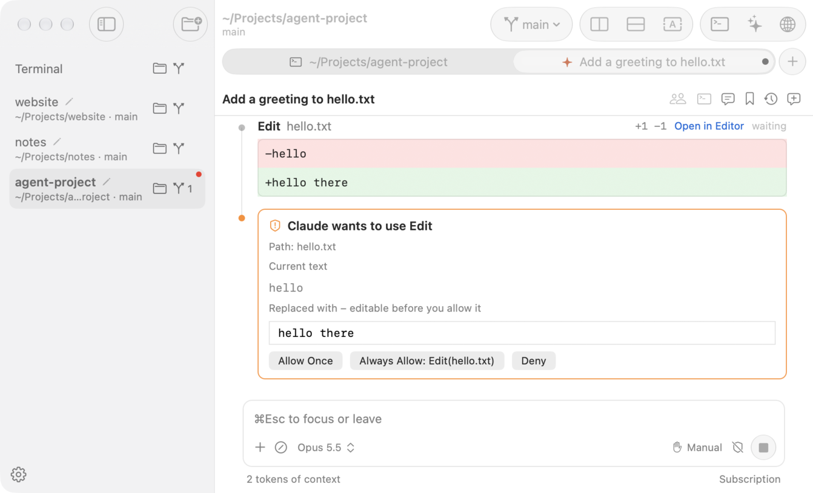

<p>&nbsp;&nbsp;&nbsp;</p>

# Tapa

**The fast, native terminal for macOS that grew room for your agents, files and pages.**

Tapa is a terminal first: its own VT core and a Metal renderer, native macOS tabs and splits, a quick terminal that slides in with one shortcut, shell integration with command blocks, and an optional input field with suggestions in the style of Warp. Around it, Tapa grew into the little sister of [Dango](https://github.com/sventmueller/dango): a sidebar of workspaces, one per project folder, each with its terminals, agent tabs for Claude, Codex, OpenCode, Antigravity and other ACP agents, browser tabs, an editor with a file list and a Git panel, and a Markdown preview by [Splat](https://github.com/sventmueller/splat) with formulas and diagrams. Nothing a project folder configures runs until you trust its workspace. Tapa is written in Rust on genuine AppKit controls, speaks 35 languages, needs no account and has no telemetry.

[](https://github.com/sventmueller/tapa/releases/latest/download/Tapa.dmg)

**[Download Tapa.dmg](https://github.com/sventmueller/tapa/releases/latest/download/Tapa.dmg)**: signed and notarized by Apple, for macOS 14 or later on Apple Silicon and Intel.

**Found a bug?** [Open an issue](https://github.com/sventmueller/tapa/issues/new/choose) and say which shell, which agent or which program it happened with. If Tapa is useful to you, a [star on GitHub](https://github.com/sventmueller/tapa) helps others find it.

[](https://www.rust-lang.org) [](https://www.apple.com/macos/)  [](https://github.com/madsmtm/objc2) [](https://developer.apple.com/metal/) [](https://agentclientprotocol.com)    [](#license)

[Bahasa Indonesia](assets/readme/id/README.md) · [Bahasa Melayu](assets/readme/ms/README.md) · [Català](assets/readme/ca/README.md) · [Čeština](assets/readme/cs/README.md) · [Dansk](assets/readme/da/README.md) · [Deutsch](assets/readme/de/README.md) · **English** · [Español](assets/readme/es/README.md) · [Français](assets/readme/fr/README.md) · [Hrvatski](assets/readme/hr/README.md) · [Italiano](assets/readme/it/README.md) · [Magyar](assets/readme/hu/README.md) · [Nederlands](assets/readme/nl/README.md) · [Norsk](assets/readme/no/README.md) · [Polski](assets/readme/pl/README.md) · [Português (Brasil)](assets/readme/pt_BR/README.md) · [Português (Portugal)](assets/readme/pt_PT/README.md) · [Română](assets/readme/ro/README.md) · [Slovenčina](assets/readme/sk/README.md) · [Slovenščina](assets/readme/sl/README.md) · [Suomi](assets/readme/fi/README.md) · [Svenska](assets/readme/sv/README.md) · [Tiếng Việt](assets/readme/vi/README.md) · [Türkçe](assets/readme/tr/README.md) · [Ελληνικά](assets/readme/el/README.md) · [Русский](assets/readme/ru/README.md) · [Українська](assets/readme/uk/README.md) · [עברית](assets/readme/he/README.md)‎ · [العربية](assets/readme/ar/README.md)‎ · [हिन्दी](assets/readme/hi/README.md) · [ไทย](assets/readme/th/README.md) · [한국어](assets/readme/ko/README.md) · [日本語](assets/readme/ja/README.md) · [简体中文](assets/readme/zh-Hans/README.md) · [繁體中文](assets/readme/zh-Hant/README.md)

## Contents

- [Features at a glance](#features-at-a-glance)
- [Requirements](#requirements)
- [Installation](#installation)
- [Getting started](#getting-started)
- [Workspaces](#workspaces)
- [The terminal](#the-terminal)
  - [Tabs and splits](#tabs-and-splits)
  - [Shell integration and command blocks](#shell-integration-and-command-blocks)
  - [The input field and suggestions](#the-input-field-and-suggestions)
  - [Search, selection and copying](#search-selection-and-copying)
  - [The quick terminal](#the-quick-terminal)
- [Agents](#agents)
- [Editor, files and Git](#editor-files-and-git)
- [Previews](#previews)
- [Browser](#browser)
- [Dictation](#dictation)
- [Settings](#settings)
- [Appearance and accessibility](#appearance-and-accessibility)
- [Languages](#languages)
- [Keyboard shortcuts](#keyboard-shortcuts)
- [Trust](#trust)
- [Privacy and security](#privacy-and-security)
- [Known limitations](#known-limitations)
- [For developers](#for-developers)
  - [Third-party components](#third-party-components)
- [License](#license)

## Features at a glance

- **A fast terminal of its own.** Tapa parses with its own VT core and draws with Metal on a thread per display, at the rate of the display, and only what changed. It passes 262 esctest checks where Alacritty's core passes 121, and every change to it is measured against a pinned Ghostty.
- **Native to the bone.** Real macOS tabs, window restoration, menus, the Services menu, notifications, Secure Keyboard Entry, dictation and input methods. No Electron, and WebKit only where a page or a preview needs it.
- **Workspaces.** The sidebar holds one workspace per project folder, each with its own tabs, branch and panels. The "Terminal" workspace on top starts fresh every time; all others stay until you remove them.
- **Agents in a native chat view.** Claude, Codex, OpenCode, Antigravity, Gemini CLI and other agents of the Agent Client Protocol run in tabs of their own, with answers, tool calls, diffs and permission requests in one timeline. Tapa installs and updates them on request.
- **Shell integration and command blocks** for zsh, bash and fish, also over `ssh`: jump from prompt to prompt, select, copy, save and fold a command's output, see failed commands and how long each one took.
- **An input field like Warp's, if you want it.** Edit the command line as text, with suggestions from your history, from specs for more than 700 command-line tools and from the state of the project, all on your Mac.
- **Files, Git and a browser beside the shell.** An editor with syntax colours, a file list, a Git panel with staging, commits, branches and worktrees, a Markdown preview with formulas and diagrams, and browser tabs.
- **Careful with your folders.** A workspace you have not trusted starts nothing its folder configures: no git hooks, no project MCP servers, no project settings for agents, no JavaScript in its file pages.
- **Private.** No account, no telemetry. Tapa goes on the network only when you ask it to, and the restored history on disk is encrypted with a key in your keychain.
- **In your language.** The interface comes in 35 languages: Arabic, Catalan, Chinese (Simplified), Chinese (Traditional), Croatian, Czech, Danish, Dutch, English, Finnish, French, German, Greek, Hebrew, Hindi, Hungarian, Indonesian, Italian, Japanese, Korean, Malay, Norwegian, Polish, Portuguese (Brazil), Portuguese (Portugal), Romanian, Russian, Slovak, Slovenian, Spanish, Swedish, Thai, Turkish, Ukrainian and Vietnamese.

## Requirements

- macOS 14 Sonoma or later, on Apple Silicon or Intel. Tapa is developed and tested on macOS 27.
- zsh, bash or fish for the shell integration; other shells run without it.
- For agent tabs, the agent you want to use, either already installed or installed by Tapa when you ask (see [Agents](#agents)).

## Installation

**From the disk image.** Each release is a disk image, `Tapa-<version>.dmg`, with one universal app for Apple Silicon and Intel, signed with a Developer ID and notarized by Apple. Open it and drag Tapa onto the Applications folder.

**With Homebrew.** The cask in a tap of its own installs the same disk image:

```sh
brew install --cask sventmueller/tap/tapa
```

**Updates.** Tapa from the disk image or Homebrew keeps itself up to date with [Sparkle](https://sparkle-project.org). On the second launch it asks whether it may look for updates on its own; until you agree, it makes no request. **Tapa › Check for Updates…** looks right away. Tapa installs an update only if it carries the developer's signature. A build of your own has no updater.

**From source.** See [For developers](#for-developers).

**As the default terminal.** Tapa can open shell scripts (`.command`, `.tool`), folders dropped on its icon and `ssh://` links. Choose it in the Finder with **File › Get Info › Open with**.

## Getting started

1. **The window** has the sidebar of workspaces on the left, the tabs of the selected workspace on top and the toolbar above them. ⌃⌘S shows and hides the sidebar.
2. **A new workspace** comes from the folder button at the top of the sidebar, or **Shell › New Workspace…** (⇧⌘N): pick one of the recent folders or **Choose Folder…**.
3. **New tabs** start in the workspace's folder: ⌘T for a terminal, the buttons on the right of the toolbar for a terminal, an agent or a browser tab, or the **+** at the end of the tab bar.
4. **Settings** open with ⌘, or the gear at the bottom of the sidebar.
5. **The command palette** (⇧⌘P) finds every command by name, and **Find Tab…** (⌘P) every tab of every workspace.

The toolbar holds, from the left, the branch pull-down of the workspace's repository, the buttons to split the terminal right and down and to show the input field, and the buttons for new terminal, agent and browser tabs. The buttons for splits and the input field are grey while no terminal tab is in front.

## Workspaces

A workspace is a folder with its tabs. Its row in the sidebar shows the name, the folder and the Git branch, and on the right the buttons for the file list and the Git panel. A click on one of them shows that panel in place of the list of workspaces; **Workspaces** at the top leads back.

- **The "Terminal" workspace** is always on top. It starts fresh at every launch, in the folder the settings name, with one empty terminal. Nothing of it is stored, and it cannot be renamed or removed.
- **Every other workspace stays** until you remove it, even without tabs. Tapa keeps its name, tabs, the content of its terminals (as far as the restore settings say), its agent sessions and the window's position. Programs still running end when Tapa quits.
- **Renaming.** Click the pencil after the name, click the name of the selected workspace, or choose **Shell › Rename Workspace**. The name is saved right away.
- **Status.** A green dot on the row means an agent of the workspace is working, also with subagents or in the background; a red dot means one is waiting for you. Terminals mark nothing there.
- **Switching.** ⌃⌘[ and ⌃⌘] move between workspaces. The window keeps its place, and the selected workspace's tabs take the place of the others.
- **Worktrees.** **New Worktree…** in the toolbar's branch pull-down creates a Git worktree on a new branch and opens it as a workspace of its own.

When the last tab of a workspace closes, the workspace stays in the list. With all tabs closed, only the window goes; the Dock icon or ⌘N brings it back with its workspaces.

## The terminal

Tapa runs on its own core, `term-vt`. It speaks xterm and VT520 with the Kitty keyboard protocol, OSC 8 hyperlinks, OSC 52 clipboard access with separate permission for reading, synchronized output, coloured and curly underlines, truecolor, colour queries, light and dark mode reports to programs, bracketed paste, focus events and mouse reporting. Text reflows when the window changes size, history included. Ligatures, font features, Nerd Font symbols without patched fonts, and pixel-exact box drawing, Powerline and Braille glyphs come built in.

### Tabs and splits

- **Tabs** are macOS's own: drag them to reorder or out into a window of their own, **Show All Tabs** (⇧⌘\\), ⌘1 to ⌘8, ⌘9 for the last tab, and ⇧⌘[ / ⇧⌘] to switch. Each tab shows the icon of its kind in front of its title.
- **Splits.** **Split Right** (⌘D or ⌃⌘T) and **Split Down** (⇧⌘D or ⌃⌥⌘T), nested as deep as you like. Drag a divider, move it with ⌃⌘ and the arrow keys, **Maximize Pane** (⌃⇧⌘↩), **Equalize Panes** (⌃⌘=), and move between panes with ⌘[ and ⌘].
- **Working folder.** New tabs, windows and splits start in the folder of the terminal in front; the settings decide this for each of the three.
- **Closing.** Tapa asks before it closes a tab, a window or the app while a program runs in it.
- **Restore.** After a restart, workspaces, tabs, panes, folders and the last lines of each terminal come back. Secrets such as tokens and passwords are masked before anything is stored.

### Shell integration and command blocks

Tapa sets up its shell integration for zsh, bash and fish by itself, without touching your configuration files, and takes it along when you `ssh` to another host. With it, every command and its output form a block:

- **Prompts.** ⌘↑ and ⌘↓ jump to the previous and next prompt. A click into the command line moves the cursor there.
- **Blocks.** **Select Block** (⇧⌘A), **Copy Output** (⌥⌘C), **Save Output…** (⌥⌘S) and **Collapse/Expand Block** (⇧⌘↩). Over the block under the pointer, buttons show its status, its duration and the same actions.
- **Failed commands** are marked, and the command that is still running stays visible at the top while its output scrolls.
- **Bookmarks.** **Add/Remove Bookmark** (⇧⌘M) marks a line; ⇧⌘↑ and ⇧⌘↓ jump between bookmarks.
- **Notifications** appear when a program asks for one (OSC 9 and OSC 777) and the terminal is not in front, and a progress bar (OSC 9;4) shows in the tab and on the Dock icon.

### The input field and suggestions

The input field turns the command line into a text field at the bottom of the pane, as in Warp, with chips for the folder and the Git branch above it. **Show/Hide Input Field** (⌘I) or the button in the toolbar switches it for one terminal; **Settings › Input** turns it on for new terminals. It needs the shell integration and steps aside for full-screen programs such as vim, htop or claude.

- **Return** sends the whole field to the shell, multi-line text as one paste; the shell runs and remembers it as usual. If the shell asks for more, the field hands the keys back to it until the next prompt.
- **Suggestions** show in grey right after what you type, from the second character on, from your history first and then from the specs. **Tab** takes a suggestion that is the one line meant, from your history, the next command or the only candidate; **→** or **⌃F** take any, **⌃E** too at the end of the line, and **⌃→** the next word.
- **↑, ↓ and ⌃R** search your history, with the folder, branch and exit code each command ran with.
- **Tab** completes with specs for more than 700 command-line tools, paths, and live values such as git branches, docker containers, kubectl resources, ssh hosts, `package.json` scripts and make, just and cargo targets. With one candidate it fills it in; with several it opens a menu above the field with what each one does, which typing filters, also by scattered letters such as `cmt` for `commit`. **⌃Space** opens the menu while a suggestion shows. ↑ and ↓ or Tab and ⇧Tab move, Return or a click takes one, Escape closes it.
- **Colours** set the parts of a command apart: the command, its subcommands, options, variables and operators such as `|` and `&&`. A command your shell cannot run, with no alias, function, builtin or program of that name, gets a dashed red underline. **Settings › Input** switches both.
- **Vim keys** in the field are a switch in the same settings.
- **The next command before you type**: what usually follows in this project (after `git add` comes `git commit`), what the project's state asks for (a lock file newer than `node_modules`), and a fix after "command not found", from typos or from your local Homebrew index.

Without the input field, suggestions show as grey text behind the cursor with the same keys, and Tab or ⌃Space open the same menu above the word; the candidate you pick is typed into the shell. Where Tapa finds nothing, Tab goes to the shell's own completion. Shells with their own autosuggestions, such as fish, zsh-autosuggestions or ble.sh, keep theirs, and their Tab. Suggestions never use the network, and they start programs only from your own `PATH`, never from the project folder.

**Pasting.** Multi-line pastes can be shown before they run (**Show multi-line pastes first**). Files dropped onto a terminal arrive as quoted paths; ⌥←/→, ⌘←/→ and ⌘⌫ move and delete by word and line as in any Mac text field.

### Search, selection and copying

- **Find** (⌘F) searches the history with regular expressions, case and whole words, and counts the matches; the scroll bar marks them with the prompts and errors.
- **Smart selection.** A double click selects a URL, a path, a hash or an IP address as a whole, and ⌥-drag selects a rectangle. Links are found even without OSC 8; ⌘-click opens them, and a path in Dango if it is installed.
- **Select with the Keyboard** (⇧⌘C) moves a selection with Vim's keys.
- **Copy with Formatting** (⇧⌥⌘C) keeps colours and styles; copy on select is a setting. **Clear** (⌘K) clears the terminal.

### The quick terminal

**Show/Hide Quick Terminal** (⌃⌥⌘Space) slides a terminal in from an edge of the screen, above other apps and over full-screen spaces, without switching apps. The edge, its size and whether it hides when you click elsewhere are settings. Its sessions keep running while it is hidden.

## Agents

An agent tab runs a coding agent in the workspace's folder, in the native agent view from Dango.

| Agent | How it runs | What it needs |
|---|---|---|
| Claude | the `claude` command, spoken to over its stream-json protocol | `claude` installed and signed in; Tapa installs it with Claude's own installer when you ask |
| Codex | `codex app-server`, or `codex-acp` for an older Codex | `codex` signed in; Tapa installs the pinned adapter when you ask |
| OpenCode | `opencode serve`, or `opencode acp` for an older OpenCode | your own `opencode` on the `PATH`, or the pinned download |
| Antigravity | `agy acp` | your own `agy` on the `PATH`, or the pinned download |
| Gemini CLI | `gemini --acp`, offered once you switch it on in **Settings › Agents** | your own `gemini`, or the pinned download |
| Other ACP agents | from the ACP registry, loaded only when you ask | what the registry entry names; entries without a checksum install only after you confirm |

Tapa uses each agent's own sign-in and stores no agent credentials. An agent found on your login shell's `PATH` comes first; otherwise Tapa runs the version it installed into its own data folder, never a program from the workspace.

- **The timeline** shows answers, tool calls with their output and diffs, questions and permission requests. **Allow Once**, **Always Allow** and **Deny** answer a request, and an edit can be changed before you allow it.
- **Status.** The tab and the workspace's row show a green dot while the agent works and a red one while it waits for you, and a notification tells you when it waits while you look elsewhere.
- **The message field** at the bottom takes your prompt, files dropped on it and dictation. ⌘Esc moves the keyboard focus into it and back. The model and the permission mode can be chosen there for the session.
- **Settings › Agents** sets for new sessions the permission mode (Claude, Codex), the model (Claude, Codex, OpenCode) and the thinking effort (Claude, Codex), and which agents new tabs offer. It shows where each agent's program lies, with **Install…**, **Update to …** and **Back to …** for the version before, and **Load Registry** for the ACP registry. The rules Claude saved with "Always Allow" can be seen and removed there.
- **Checked downloads.** Archives are checked against their SHA-256, npm packages against the integrity in their lock file, and packages without a fixed version are refused. A missing agent offers its installation in its own tab as well.

## Editor, files and Git

- **The file list** of a workspace shows its folder as a tree, updated as files change, with files Git ignores dimmed if you want them. A click opens a file as a preview tab, which the next click replaces until you edit it; a double click keeps it.
- **The editor** opens files in tabs of the workspace, with syntax colours, several carets, folding, the indentation of `.editorconfig`, optional Vim keys and marks for what changed since the last commit. It notices when a file changed on disk or holds conflict markers. Markdown files get a format bar and **Open in Splat**. **Save** (⌘S), **Save As…** and **Save All** work as usual, and Tapa asks before it closes unsaved text.
- **After a crash**, unsaved text comes back: Tapa keeps encrypted copies of it while you type.
- **The Git panel** shows staged and unstaged changes, stages and unstages files and single hunks, commits (⌘↩), amends, commits and pushes, fetches, and handles branches, stashes, cherry-picks and conflicts, with the commit history below. A click on a file shows its diff.
- **The branch pull-down** in the toolbar switches and creates branches and makes worktrees.

The editor starts no formatter and no language server. For a full IDE with language servers and a debugger, use [Dango](https://github.com/sventmueller/dango).

## Previews

- **Markdown** shows beside its editor through Splat's renderer: GitHub Flavored Markdown with formulas, diagrams and pictures, scrolling paragraph by paragraph with the text.
- **Pictures** open in a tab of their own, PDFs through PDFKit, and sound, films, fonts and office documents through Quick Look.
- **Isolated decoding.** Every picture from an untrusted source (project files, Markdown, agent attachments and pastes) is decoded in Splat's service `Decoder.xpc`, in an App Sandbox of its own without files or network, never in the app.

## Browser

**New Browser Tab** (⇧⌘B) opens a WebKit tab in the workspace. The address field takes an address or words for the search engine of your choice (DuckDuckGo, Google, Bing or Startpage); ⌘L, ⌘R, ⌘[ and ⌘] work as in Safari. Pages from `localhost` run as usual, for the development server of your project. HTML files of a workspace may read only their own folder, and in a workspace you have not trusted they run no JavaScript.

## Dictation

Dictate into an agent's message field or the editor with the microphone button or **Edit › Start Dictation** (⌃⌥D). The speech recognition is [Lowspeak](https://github.com/sventmueller/lowspeak)'s, which need not be installed. **Settings › Dictation** chooses online transcription with OpenAI or Groq, or local Whisper and Parakeet models that keep the recording on your Mac, the language, the post-processing, the microphone and your own vocabulary. The keys for OpenAI and Groq are kept in your keychain. Dictation is part of the release build only.

## Settings

**Tapa › Settings…** (⌘,) has the panes General, Font, Colors, Cursor, Terminal, Input, Editor, Agents, Dictation, Profiles and Shortcuts. They write one TOML file, `config.toml` in Tapa's folder under `~/Library/Application Support`, which you can also edit by hand; Tapa reloads it while it runs, and **Reload Settings** (⇧⌘,) does so right away.

- **Four font sizes** under General: Interface (sidebar, panels, file list, Git panel and tab titles), Editor (text, line numbers and Markdown preview), Terminal and Agents. ⌘+, ⌘− and ⌘0 change the size of the terminal in front.
- **Appearance:** Light, Dark or Same as System.
- **Colours.** A theme for light and one for dark mode, in Ghostty's theme format, with a minimum contrast that keeps text readable on a poor theme. Your own themes go into the themes folder.
- **Profiles** bundle font, colours, shell, environment and folder.
- **Shortcuts** can all be changed, and conflicts are shown.

## Appearance and accessibility

- **Dark mode** follows the system or your choice; the accent colour, Reduce Motion and Increase Contrast are respected.
- **VoiceOver** reads the terminal's lines and prompts and announces new output; the sidebar, tabs, toolbar buttons and the cards of the agent timeline are named.
- **Keyboard.** Every command has a menu item and a shortcut, and Full Keyboard Access reaches every control.
- **Sizes.** The four font sizes of the settings scale the interface, editor, terminal and agents independently.
- **Right to left.** The interface is mirrored in Arabic and Hebrew, while the terminal grid stays left to right.

Details and known gaps are in [ACCESSIBILITY.md](ACCESSIBILITY.md).

## Languages

The interface is translated into 35 languages: Arabic, Catalan, Chinese (Simplified), Chinese (Traditional), Croatian, Czech, Danish, Dutch, English, Finnish, French, German, Greek, Hebrew, Hindi, Hungarian, Indonesian, Italian, Japanese, Korean, Malay, Norwegian, Polish, Portuguese (Brazil), Portuguese (Portugal), Romanian, Russian, Slovak, Slovenian, Spanish, Swedish, Thai, Turkish, Ukrainian and Vietnamese.

Tapa follows the language order in **System Settings › General › Language & Region**; you can also pick a language for Tapa alone there under **Applications**. Without a translation for your language, it uses English.

## Keyboard shortcuts

| Action | Shortcut |
|---|---|
| New window, workspace, tab | ⌘N, ⇧⌘N, ⌘T |
| New browser tab | ⇧⌘B |
| New file, open file | ⌥⌘N, ⌘O |
| Close pane or tab, close tab, close window | ⌘W, ⌥⌘W, ⇧⌘W |
| Split right, split down | ⌘D or ⌃⌘T, ⇧⌘D or ⌃⌥⌘T |
| Maximize pane, equalize panes, close pane | ⌃⇧⌘↩, ⌃⌘=, ⌃⇧⌘W |
| Move a divider | ⌃⌘←, ⌃⌘→, ⌃⌘↑, ⌃⌘↓ |
| Next, previous pane | ⌘], ⌘[ |
| Next, previous tab; tab 1 to 8, last tab | ⇧⌘], ⇧⌘[; ⌘1 to ⌘8, ⌘9 |
| Next, previous workspace | ⌃⌘], ⌃⌘[ |
| Find tab, command palette | ⌘P, ⇧⌘P |
| Show or hide the sidebar, the input field | ⌃⌘S, ⌘I |
| Quick terminal | ⌃⌥⌘Space |
| Find, find next, find previous | ⌘F, ⌘G, ⇧⌘G |
| Previous, next prompt | ⌘↑, ⌘↓ |
| Select block, copy output, save output, fold block | ⇧⌘A, ⌥⌘C, ⌥⌘S, ⇧⌘↩ |
| Add or remove a bookmark; previous, next bookmark | ⇧⌘M; ⇧⌘↑, ⇧⌘↓ |
| Select with the keyboard | ⇧⌘C |
| Copy with formatting | ⇧⌥⌘C |
| Clear | ⌘K |
| Top, bottom, page up, page down | ⌘Home, ⌘End, ⌘PageUp, ⌘PageDown |
| Bigger, smaller, original size (terminal) | ⌘+, ⌘−, ⌘0 |
| Message field of an agent tab | ⌘Esc |
| Start dictation | ⌃⌥D |
| Settings, reload settings | ⌘,, ⇧⌘, |

Every shortcut can be changed in **Settings › Shortcuts** or in the `[keys]` section of the settings file.

## Trust

A project folder can make programs run as soon as something starts in it: git hooks and repository settings such as `core.fsmonitor`, agent hooks, project MCP servers and project settings of agents. So a new workspace is not trusted.

- **Not trusted:** agents start without the project's hooks, MCP servers and configuration (Claude with `--setting-sources=user --strict-mcp-config`, Codex with the folder marked as untrusted, OpenCode without the project's configuration). Git runs neutralised: no hooks, filters, diff drivers, fsmonitor, `sshCommand` or pager, and only global credential helpers. HTML files open without JavaScript. The Git panel and the agent tab say so and offer to trust the workspace.
- **Trusted:** **Shell › Trust Workspace** loads all of that as the folder intends. **Revoke Trust** takes it back. Trust is kept per workspace.

Whatever its trust, Tapa never runs a program from a project folder by itself: suggestions start programs only from your `PATH` outside the project, and the sidebar reads the Git state from the `.git` files. A workspace in your home folder, such as "Terminal", is no project: programs under `~` such as `~/.local/bin/claude` count as your own there.

## Privacy and security

- **No telemetry, no account.** Tapa reports nothing about how you use it and works fully offline. It goes on the network only when you ask: to install or update an agent, to load the ACP registry, to check for updates once you agreed, and for the pages you open in a browser tab. The agents themselves talk to their providers as they always do.
- **History on disk** for restoring sessions is encrypted with a key in your keychain, can be switched off, and has secrets such as API keys, tokens and passwords masked before it is written. The copies of unsaved editor text are encrypted with the same key.
- **Secure Keyboard Entry** turns on by itself at password prompts, and can be switched on for good in the app menu.
- **Escape sequences** that could leak or inject, such as title reports, clipboard reads and paste tricks, are blocked or asked for first. The parser is fuzzed in CI.
- **Isolated decoding** of pictures from untrusted sources, see [Previews](#previews).
- **Code signing** with the Hardened Runtime. macOS attributes the access of the programs in a terminal to Tapa, so it carries a usage description for every protected service.

Security problems are reported privately, see [SECURITY.md](SECURITY.md).

## Known limitations

- **No inline images** in the terminal yet: Kitty graphics, Sixel and iTerm2 images are planned after 1.0.
- **No tmux control mode**, and sessions do not survive quitting Tapa.
- **Right-to-left text** in the terminal grid stays left to right.
- **⌘+ and ⌘−** change only the terminal in front.
- **The editor** has no language servers, formatters or debugger, by design; Dango has them.
- **Dictation** is only in the release build, not in a debug build.
- **VoiceOver** has not yet been checked end to end by a person.

## For developers

You need macOS 14 or later with the Xcode Command Line Tools, Rust as `rust-toolchain.toml` names it (rustup with both Mac targets for the universal build), checkouts of [splat](https://github.com/sventmueller/splat) and [lowspeak](https://github.com/sventmueller/lowspeak) next to this one (`../splat`, `../lowspeak`), and cmake for builds with dictation.

| Command | What it does |
|---|---|
| `make help` | lists the targets |
| `cargo xtask run` | builds the debug app and opens it |
| `make build` | builds the release app with dictation into `target/release`, signed ad hoc for this Mac |
| `make lint` | formatting, clippy with warnings as errors, the shape of the files and the interface texts |
| `make check` | `lint`, then all tests; needs no window and no network |
| `make selftest STEPS="split_right,type:ls\n,shot:x"` | drives the app and leaves window pictures in `target/selftest/` |
| `make esctest`, `make vttest` | runs esctest and vttest against both cores in the app |
| `make perf` | the benchmark against a pinned Ghostty; meaningful only on an idle Mac |
| `make fuzz` | the fuzz targets with cargo-fuzz |
| `make release` | a dry run of the release: the universal app with dictation, its disk image, update feed and cask in `target/release-dry-run`; sends nothing anywhere |
| `make release-notarized` | the current version signed with the Developer ID, notarized by Apple and stapled, into `dist/`; the version unchanged |
| `make deploy` | notarizes the next version, commits it in `Cargo.toml`, uploads a draft release, pushes `main` and the tag, then publishes the release; see [docs/development.md](docs/development.md#deploy) |

How to contribute is in [CONTRIBUTING.md](CONTRIBUTING.md). Every interface text is German as the key, with a translation into all 35 languages; `cargo xtask strings` fails on a missing one.

### Third-party components

| Component | Used for | License |
|---|---|---|
| [objc2](https://github.com/madsmtm/objc2) and its framework crates | AppKit, Metal, WebKit and the other Apple frameworks | MIT, Zlib or Apache-2.0 |
| Splat's crates | Markdown, the preview, Git reading, the picture decoder and the translations | MIT or Apache-2.0 |
| [Lowspeak](https://github.com/sventmueller/lowspeak) with [whisper.cpp](https://github.com/ggml-org/whisper.cpp) | dictation | MIT |
| [Fig autocomplete specs](https://github.com/withfig/autocomplete) | the command descriptions of the suggestions | MIT |
| [rusqlite](https://github.com/rusqlite/rusqlite) with SQLite | the command history | MIT, public domain |
| [Simple Icons](https://simpleicons.org) | logos of languages and programs | CC0, some logos under their own terms |
| [Sparkle](https://sparkle-project.org) 2.10.1 | updates of the release build | MIT |

## License

Tapa is licensed under either of

- Apache License, Version 2.0 ([LICENSE-APACHE](LICENSE-APACHE))
- MIT License ([LICENSE-MIT](LICENSE-MIT))

at your option. Logos in `assets/simple-icons` carry their own licenses, see the README there.

Unless you explicitly state otherwise, any contribution intentionally submitted for inclusion in Tapa by you, as defined in the Apache-2.0 license, shall be dual licensed as above, without any additional terms or conditions.
