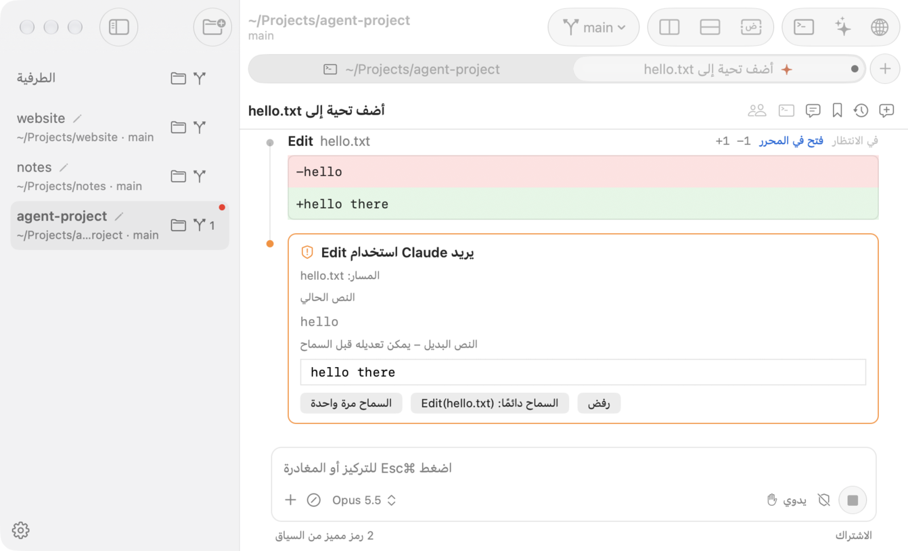

<p>&nbsp;&nbsp;&nbsp;</p>

# Tapa

**الطرفية السريعة والأصلية لنظام macOS التي اتسعت لوكلائك وملفاتك وصفحاتك.**

Tapa طرفية أولًا: نواة VT خاصة بها ومُصيِّر Metal، وعلامات تبويب وتقسيمات macOS أصلية، وطرفية سريعة تنزلق إلى الشاشة باختصار واحد، وتكامل مع الصدفة بكتل الأوامر، وحقل إدخال اختياري باقتراحات على طريقة Warp. ومن حول ذلك نما Tapa ليصبح الأخ الأصغر لـ [Dango](https://github.com/sventmueller/dango): شريط جانبي لمساحات العمل، مساحة لكل مجلد مشروع، لكلٍّ منها طرفياتها، وعلامات تبويب للوكلاء Claude وCodex وOpenCode وAntigravity وغيرهم من وكلاء ACP، وعلامات تبويب للمتصفح، ومحرر بقائمة ملفات ولوحة Git، ومعاينة Markdown من [Splat](https://github.com/sventmueller/splat) بالصيغ والمخططات. لا يعمل أي شيء يضبطه مجلد مشروع حتى تثق بمساحة العمل الخاصة به. كُتب Tapa بلغة Rust على عناصر تحكم AppKit الأصلية، ويدعم 35 لغة، ولا يحتاج إلى حساب، وليس فيه أي قياس عن بُعد.

[](https://github.com/sventmueller/tapa/releases/latest/download/Tapa.dmg)

**[تنزيل Tapa.dmg](https://github.com/sventmueller/tapa/releases/latest/download/Tapa.dmg)**: موقّع ومعتمد من Apple، لنظام macOS 14 أو أحدث على Apple Silicon وIntel.

**هل وجدت خطأ؟** [افتح بلاغًا](https://github.com/sventmueller/tapa/issues/new/choose) واذكر الصدفة أو الوكيل أو البرنامج الذي حدث معه. وإذا كان Tapa مفيدًا لك، فإن [نجمة على GitHub](https://github.com/sventmueller/tapa) تساعد الآخرين على العثور عليه.

[](https://www.rust-lang.org) [](https://www.apple.com/macos/)  [](https://github.com/madsmtm/objc2) [](https://developer.apple.com/metal/) [](https://agentclientprotocol.com)    [](#الترخيص)

[Bahasa Indonesia](../id/README.md) · [Bahasa Melayu](../ms/README.md) · [Català](../ca/README.md) · [Čeština](../cs/README.md) · [Dansk](../da/README.md) · [Deutsch](../de/README.md) · [English](../../../README.md) · [Español](../es/README.md) · [Français](../fr/README.md) · [Hrvatski](../hr/README.md) · [Italiano](../it/README.md) · [Magyar](../hu/README.md) · [Nederlands](../nl/README.md) · [Norsk](../no/README.md) · [Polski](../pl/README.md) · [Português (Brasil)](../pt_BR/README.md) · [Português (Portugal)](../pt_PT/README.md) · [Română](../ro/README.md) · [Slovenčina](../sk/README.md) · [Slovenščina](../sl/README.md) · [Suomi](../fi/README.md) · [Svenska](../sv/README.md) · [Tiếng Việt](../vi/README.md) · [Türkçe](../tr/README.md) · [Ελληνικά](../el/README.md) · [Русский](../ru/README.md) · [Українська](../uk/README.md) · [עברית](../he/README.md)‎ · **العربية**‎ · [हिन्दी](../hi/README.md) · [ไทย](../th/README.md) · [한국어](../ko/README.md) · [日本語](../ja/README.md) · [简体中文](../zh-Hans/README.md) · [繁體中文](../zh-Hant/README.md)

## المحتويات

- [نظرة سريعة على الميزات](#نظرة-سريعة-على-الميزات)
- [المتطلبات](#المتطلبات)
- [التثبيت](#التثبيت)
- [البدء](#البدء)
- [مساحات العمل](#مساحات-العمل)
- [الطرفية](#الطرفية)
  - [علامات التبويب والتقسيمات](#علامات-التبويب-والتقسيمات)
  - [تكامل الصدفة وكتل الأوامر](#تكامل-الصدفة-وكتل-الأوامر)
  - [حقل الإدخال والاقتراحات](#حقل-الإدخال-والاقتراحات)
  - [البحث والتحديد والنسخ](#البحث-والتحديد-والنسخ)
  - [الطرفية السريعة](#الطرفية-السريعة)
- [الوكلاء](#الوكلاء)
- [المحرر والملفات وGit](#المحرر-والملفات-وgit)
- [المعاينات](#المعاينات)
- [المتصفح](#المتصفح)
- [الإملاء](#الإملاء)
- [الإعدادات](#الإعدادات)
- [المظهر وإمكانية الوصول](#المظهر-وإمكانية-الوصول)
- [اللغات](#اللغات)
- [اختصارات لوحة المفاتيح](#اختصارات-لوحة-المفاتيح)
- [الثقة](#الثقة)
- [الخصوصية والأمان](#الخصوصية-والأمان)
- [القيود المعروفة](#القيود-المعروفة)
- [للمطورين](#للمطورين)
  - [المكونات الخارجية](#المكونات-الخارجية)
- [الترخيص](#الترخيص)

## نظرة سريعة على الميزات

- **طرفية سريعة خاصة بها.** يحلّل Tapa بنواة VT خاصة به ويرسم عبر Metal في خيط لكل شاشة، بمعدل تحديث الشاشة، ولا يرسم إلا ما تغيّر. يجتاز 262 فحصًا من esctest بينما تجتاز نواة Alacritty ‏121 فحصًا، وكل تغيير فيه يُقاس مقابل إصدار مثبَّت من Ghostty.
- **أصلي حتى النخاع.** علامات تبويب macOS حقيقية واستعادة النوافذ والقوائم وقائمة الخدمات والإشعارات وإدخال آمن للوحة المفاتيح والإملاء وطرق الإدخال. لا Electron، ولا WebKit إلا حيث تحتاج إليه صفحة أو معاينة.
- **مساحات العمل.** يضم الشريط الجانبي مساحة عمل لكل مجلد مشروع، لكلٍّ منها علامات تبويبها وفرعها ولوحاتها. تبدأ مساحة العمل "الطرفية" في الأعلى من جديد في كل مرة؛ وتبقى كل المساحات الأخرى حتى تزيلها.
- **وكلاء في عرض دردشة أصلي.** يعمل Claude وCodex وOpenCode وAntigravity وGemini CLI وغيرهم من وكلاء Agent Client Protocol في علامات تبويب خاصة بهم، مع الإجابات واستدعاءات الأدوات والفروقات وطلبات الأذونات في خط زمني واحد. يثبّتهم Tapa ويحدّثهم عند الطلب.
- **تكامل الصدفة وكتل الأوامر** لـ zsh وbash وfish، وعبر `ssh` أيضًا: انتقل من موجّه إلى موجّه، وحدّد مخرجات أمر وانسخها واحفظها واطوِها، واطّلع على الأوامر الفاشلة والمدة التي استغرقها كل أمر.
- **حقل إدخال مثل حقل Warp، إن أردت.** حرّر سطر الأوامر كنص، مع اقتراحات من سجلّك ومن مواصفات أكثر من 700 أداة لسطر الأوامر ومن حالة المشروع، وكل ذلك على جهاز Mac لديك.
- **الملفات وGit ومتصفح بجوار الصدفة.** محرر بألوان بناء الجملة، وقائمة ملفات، ولوحة Git للتجهيز والإيداع والفروع وأشجار العمل (Worktree)، ومعاينة Markdown بالصيغ والمخططات، وعلامات تبويب للمتصفح.
- **حريص على مجلداتك.** مساحة العمل التي لم تثق بها لا تبدأ أي شيء يضبطه مجلدها: لا خطافات git، ولا خوادم MCP للمشروع، ولا إعدادات مشروع للوكلاء، ولا JavaScript في صفحات ملفاتها.
- **خاص.** لا حساب، ولا قياس عن بُعد. لا يتصل Tapa بالشبكة إلا حين تطلب منه ذلك، والسجل المستعاد على القرص مشفَّر بمفتاح في سلسلة المفاتيح لديك.
- **بلغتك.** تتوفر الواجهة بـ 35 لغة: العربية والكتالانية والصينية (المبسطة) والصينية (التقليدية) والكرواتية والتشيكية والدنماركية والهولندية والإنجليزية والفنلندية والفرنسية والألمانية واليونانية والعبرية والهندية والمجرية والإندونيسية والإيطالية واليابانية والكورية والملايوية والنرويجية والبولندية والبرتغالية (البرازيل) والبرتغالية (البرتغال) والرومانية والروسية والسلوفاكية والسلوفينية والإسبانية والسويدية والتايلاندية والتركية والأوكرانية والفيتنامية.

## المتطلبات

- macOS 14 Sonoma أو أحدث، على Apple Silicon أو Intel. يُطوَّر Tapa ويُختبر على macOS 27.
- zsh أو bash أو fish لتكامل الصدفة؛ وتعمل الصدفات الأخرى من دونه.
- لعلامات تبويب الوكلاء: الوكيل الذي تريد استخدامه، إما مثبتًا مسبقًا وإما يثبّته Tapa عندما تطلب (راجع [الوكلاء](#الوكلاء)).

## التثبيت

**من صورة القرص.** كل إصدار هو صورة قرص، `Tapa-<version>.dmg`، فيها تطبيق شامل واحد لـ Apple Silicon وIntel، موقّع بشهادة Developer ID ومعتمد من Apple. افتحها واسحب Tapa إلى مجلد التطبيقات.

**عبر Homebrew.** تثبّت حزمة cask الموجودة في tap خاص بها صورة القرص نفسها:

```sh
brew install --cask sventmueller/tap/tapa
```

**التحديثات.** يحدّث Tapa نفسه بنفسه عبر [Sparkle](https://sparkle-project.org) إذا ثبّتّه من صورة القرص أو Homebrew. عند التشغيل الثاني يسأل إن كان يجوز له البحث عن تحديثات بنفسه؛ وإلى أن توافق، لا يرسل أي طلب. يبحث **Tapa › التحقق من وجود تحديثات…** فورًا. لا يثبّت Tapa تحديثًا إلا إذا كان يحمل توقيع المطوّر. أما النسخة التي تبنيها بنفسك فلا تحتوي على أداة تحديث.

**من الشيفرة المصدرية.** راجع [للمطورين](#للمطورين).

**كطرفية افتراضية.** يستطيع Tapa فتح سكربتات الصدفة (`.command` و`.tool`) والمجلدات المُفلتة على أيقونته وروابط `ssh://`. اختره في Finder عبر **ملف › إحضار المعلومات › فتح بواسطة**.

## البدء

1. **النافذة** فيها شريط مساحات العمل الجانبي على اليمين، وعلامات تبويب مساحة العمل المحددة في الأعلى، وشريط الأدوات فوقها. يُظهر ⌃⌘S الشريط الجانبي ويخفيه.
2. **مساحة عمل جديدة** تأتي من زر المجلد أعلى الشريط الجانبي، أو من **Shell › مساحة عمل جديدة…** (⇧⌘N): اختر أحد المجلدات الأخيرة أو **اختيار مجلد…**.
3. **علامات التبويب الجديدة** تبدأ في مجلد مساحة العمل: ⌘T لطرفية، أو الأزرار على يسار شريط الأدوات لطرفية أو وكيل أو علامة تبويب متصفح، أو **+** في نهاية شريط علامات التبويب.
4. **الإعدادات** تُفتح بـ ⌘, أو بالترس في أسفل الشريط الجانبي.
5. **لوحة الأوامر** (⇧⌘P) تجد كل أمر باسمه، و**البحث عن علامة تبويب…** (⌘P) تجد كل علامة تبويب في كل مساحة عمل.

يضم شريط الأدوات، من اليمين، القائمة المنسدلة لفروع مستودع مساحة العمل، وأزرار تقسيم الطرفية إلى اليمين وإلى الأسفل وإظهار حقل الإدخال، وأزرار علامات التبويب الجديدة للطرفية والوكيل والمتصفح. تظهر أزرار التقسيم وحقل الإدخال باللون الرمادي ما دامت لا توجد علامة تبويب طرفية في المقدمة.

## مساحات العمل

مساحة العمل مجلد مع علامات تبويبه. يعرض صفّها في الشريط الجانبي الاسم والمجلد وفرع Git، وعلى اليسار زرَّي قائمة الملفات ولوحة Git. النقر على أحدهما يُظهر تلك اللوحة مكان قائمة مساحات العمل؛ ويعيدك **مساحات العمل** في الأعلى.

- **مساحة العمل "الطرفية"** دائمًا في الأعلى. تبدأ من جديد عند كل تشغيل، في المجلد الذي تحدده الإعدادات، مع طرفية فارغة واحدة. لا يُحفظ منها شيء، ولا يمكن إعادة تسميتها أو إزالتها.
- **كل مساحة عمل أخرى تبقى** حتى تزيلها، حتى من دون علامات تبويب. يحتفظ Tapa باسمها وعلامات تبويبها ومحتوى طرفياتها (بالقدر الذي تسمح به إعدادات الاستعادة) وجلسات وكلائها وموضع النافذة. أما البرامج التي ما زالت تعمل فتنتهي عند إنهاء Tapa.
- **إعادة التسمية.** انقر القلم بعد الاسم، أو انقر اسم مساحة العمل المحددة، أو اختر **Shell › إعادة تسمية مساحة العمل**. يُحفظ الاسم فورًا.
- **الحالة.** تعني النقطة الخضراء على الصف أن وكيلًا في مساحة العمل يعمل، حتى مع وكلاء فرعيين أو في الخلفية؛ وتعني النقطة الحمراء أن أحدهم ينتظرك. أما الطرفيات فلا تضع أي علامة هناك.
- **التبديل.** ينتقل ⌃⌘[ و⌃⌘] بين مساحات العمل. تبقى النافذة في مكانها، وتحل علامات تبويب مساحة العمل المحددة محل غيرها.
- **أشجار العمل.** ينشئ **Worktree جديد…** في القائمة المنسدلة للفروع في شريط الأدوات شجرة عمل Git على فرع جديد ويفتحها كمساحة عمل مستقلة.

عندما تُغلق آخر علامة تبويب في مساحة عمل، تبقى مساحة العمل في القائمة. وعند إغلاق كل علامات التبويب، لا تذهب إلا النافذة؛ وتعيدها أيقونة Dock أو ⌘N مع مساحات عملها.

## الطرفية

يعمل Tapa بنواته الخاصة، `term-vt`. تتحدث xterm وVT520 مع بروتوكول لوحة مفاتيح Kitty، وروابط OSC 8 التشعبية، والوصول إلى الحافظة عبر OSC 52 بإذن منفصل للقراءة، والمخرجات المتزامنة، والتسطير الملوّن والمتموّج، وtruecolor، واستعلامات الألوان، وإبلاغ البرامج بالوضع الفاتح والداكن، واللصق المحاط (bracketed paste)، وأحداث التركيز، والإبلاغ عن الفأرة. يُعاد توزيع النص عند تغيّر حجم النافذة، بما في ذلك السجل. وتأتي مدمجةً الحروف المركّبة وميزات الخطوط ورموز Nerd Font دون خطوط معدَّلة، ورسم المربعات وPowerline ورموز Braille بدقة البكسل.

### علامات التبويب والتقسيمات

- **علامات التبويب** هي علامات macOS نفسها: اسحبها لإعادة ترتيبها أو إلى خارجها في نافذة مستقلة، و**إظهار كل علامات التبويب** (⇧⌘\\)، و⌘1 إلى ⌘8، و⌘9 لآخر علامة تبويب، و⇧⌘[ / ⇧⌘] للتبديل. تعرض كل علامة تبويب أيقونة نوعها قبل عنوانها.
- **التقسيمات.** **تقسيم إلى اليمين** (⌘D أو ⌃⌘T) و**تقسيم إلى الأسفل** (⇧⌘D أو ⌃⌥⌘T)، متداخلة بالعمق الذي تريده. اسحب فاصلًا، أو حرّكه بـ ⌃⌘ ومفاتيح الأسهم، و**تكبير الجزء** (⌃⇧⌘↩)، و**مساواة الأجزاء** (⌃⌘=)، وتنقّل بين الأجزاء بـ ⌘[ و⌘].
- **مجلد العمل.** تبدأ علامات التبويب والنوافذ والتقسيمات الجديدة في مجلد الطرفية التي في المقدمة؛ وتحدد الإعدادات ذلك لكل واحد من الثلاثة.
- **الإغلاق.** يسأل Tapa قبل أن يغلق علامة تبويب أو نافذة أو التطبيق ما دام برنامج يعمل فيه.
- **الاستعادة.** بعد إعادة التشغيل، تعود مساحات العمل وعلامات التبويب والأجزاء والمجلدات وآخر أسطر كل طرفية. وتُخفى الأسرار مثل الرموز المميزة (tokens) وكلمات المرور قبل حفظ أي شيء.

### تكامل الصدفة وكتل الأوامر

يُعدّ Tapa تكامله مع الصدفة لـ zsh وbash وfish بنفسه، دون أن يلمس ملفات إعداداتك، ويأخذه معه عندما تتصل بمضيف آخر عبر `ssh`. وبه يشكّل كل أمر ومخرجاته كتلة:

- **الموجّهات.** ينتقل ⌘↑ و⌘↓ إلى الموجّه السابق والتالي. والنقر داخل سطر الأوامر ينقل المؤشر إلى هناك.
- **الكتل.** **تحديد الكتلة** (⇧⌘A) و**نسخ المخرجات** (⌥⌘C) و**حفظ المخرجات…** (⌥⌘S) و**طي/توسيع الكتلة** (⇧⌘↩). فوق الكتلة التي تحت المؤشر تُظهر أزرارٌ حالتها ومدتها والإجراءات نفسها.
- **الأوامر الفاشلة** تُعلَّم، ويبقى الأمر الذي ما زال يعمل ظاهرًا في الأعلى بينما تتمرر مخرجاته.
- **الإشارات المرجعية.** يضع **إضافة/إزالة إشارة مرجعية** (⇧⌘M) علامة على سطر؛ وينتقل ⇧⌘↑ و⇧⌘↓ بين الإشارات المرجعية.
- **الإشعارات** تظهر عندما يطلبها برنامج (OSC 9 وOSC 777) ولا تكون الطرفية في المقدمة، ويظهر شريط تقدّم (OSC 9;4) في علامة التبويب وعلى أيقونة Dock.

### حقل الإدخال والاقتراحات

يحوّل حقل الإدخال سطر الأوامر إلى حقل نصي في أسفل الجزء، كما في Warp، وفوقه شارات للمجلد ولفرع Git. يبدّله **إظهار/إخفاء حقل الإدخال** (⌘I) أو الزر في شريط الأدوات لطرفية واحدة؛ ويفعّله **الإعدادات › الإدخال** للطرفيات الجديدة. يحتاج إلى تكامل الصدفة، ويتنحّى جانبًا لبرامج ملء الشاشة مثل vim أو htop أو claude.

- **Return** يرسل الحقل كله إلى الصدفة، والنص متعدد الأسطر كلصقة واحدة؛ فتشغّله الصدفة وتتذكره كالمعتاد. وإذا طلبت الصدفة المزيد، يعيد الحقل المفاتيح إليها حتى الموجّه التالي.
- **↑ و↓ و⌃R** تبحث في سجلّك، مع المجلد والفرع ورمز الخروج الذي عمل به كل أمر.
- **Tab** يُكمل بمواصفات أكثر من 700 أداة لسطر الأوامر، وبالمسارات، وبالقيم الحية مثل فروع git وحاويات docker وموارد kubectl ومضيفي ssh وسكربتات `package.json` وأهداف make وjust وcargo.
- **مفاتيح Vim** في الحقل خيار يُفعَّل في الإعدادات نفسها.
- **الأمر التالي قبل أن تكتبه**: ما يأتي عادةً بعده في هذا المشروع (بعد `git add` يأتي `git commit`)، وما تتطلبه حالة المشروع (ملف قفل أحدث من `node_modules`)، وتصحيح بعد "command not found"، من الأخطاء المطبعية أو من فهرس Homebrew المحلي لديك.

من دون حقل الإدخال، تظهر الاقتراحات كنص رمادي خلف المؤشر، ويقبلها →. أما الصدفات التي لها اقتراحاتها التلقائية الخاصة، مثل fish أو zsh-autosuggestions، فتحتفظ باقتراحاتها. لا تستخدم الاقتراحات الشبكة أبدًا، ولا تشغّل البرامج إلا من `PATH` الخاص بك، وليس من مجلد المشروع أبدًا.

**اللصق.** يمكن عرض اللصق متعدد الأسطر قبل تشغيله (**عرض اللصق متعدد الأسطر أولًا**). تصل الملفات المُفلتة على طرفية كمسارات مقتبسة؛ ويحرّك ⌥←/→ و⌘←/→ و⌘⌫ ويحذف بالكلمة والسطر كما في أي حقل نصي على Mac.

### البحث والتحديد والنسخ

- **بحث…** (⌘F) يبحث في السجل بالتعابير النمطية وبمطابقة حالة الأحرف والكلمات الكاملة، ويعدّ النتائج؛ ويعلّمها شريط التمرير مع الموجّهات والأخطاء.
- **التحديد الذكي.** النقر المزدوج يحدد عنوان URL أو مسارًا أو قيمة hash أو عنوان IP بأكمله، والسحب مع ⌥ يحدد مستطيلًا. تُكتشف الروابط حتى من دون OSC 8؛ والنقر مع ⌘ يفتحها، ويفتح المسار في Dango إن كان مثبتًا.
- **التحديد بلوحة المفاتيح** (⇧⌘C) يحرّك التحديد بمفاتيح Vim.
- **نسخ مع التنسيق** (⇧⌥⌘C) يحتفظ بالألوان والأنماط؛ والنسخ عند التحديد خيار في الإعدادات. **مسح** (⌘K) يمسح الطرفية.

### الطرفية السريعة

**إظهار/إخفاء الطرفية السريعة** (⌃⌥⌘Space) يُنزلق طرفية من حافة الشاشة، فوق التطبيقات الأخرى وفوق مساحات ملء الشاشة، دون تبديل التطبيق. الحافة وحجمها وما إذا كانت تختفي عند النقر في مكان آخر كلها إعدادات. وتستمر جلساتها في العمل وهي مخفية.

## الوكلاء

تشغّل علامة تبويب الوكيل وكيلًا برمجيًا في مجلد مساحة العمل، في عرض الوكيل الأصلي المأخوذ من Dango.

| الوكيل | كيف يعمل | ما يحتاج إليه |
|---|---|---|
| Claude | الأمر `claude`، يُخاطَب عبر بروتوكول stream-json الخاص به | `claude` مثبتًا ومسجَّل الدخول؛ يثبّته Tapa بأداة التثبيت الخاصة بـ Claude عندما تطلب |
| Codex | `codex app-server`، أو `codex-acp` لإصدار أقدم من Codex | `codex` مسجَّل الدخول؛ يثبّت Tapa المحوّل المثبَّت الإصدار عندما تطلب |
| OpenCode | `opencode serve`، أو `opencode acp` لإصدار أقدم من OpenCode | `opencode` الخاص بك على `PATH`، أو التنزيل المثبَّت الإصدار |
| Antigravity | `agy acp` | `agy` الخاص بك على `PATH`، أو التنزيل المثبَّت الإصدار |
| Gemini CLI | `gemini --acp`، يُعرض بعد أن تفعّله في **الإعدادات › الوكلاء** | `gemini` الخاص بك، أو التنزيل المثبَّت الإصدار |
| وكلاء ACP آخرون | من فهرس ACP، يُحمَّل فقط عندما تطلب | ما يذكره إدخال الفهرس؛ الإدخالات التي بلا مجموع اختباري لا تُثبَّت إلا بعد تأكيدك |

يستخدم Tapa تسجيل الدخول الخاص بكل وكيل، ولا يخزّن أي بيانات اعتماد للوكلاء. الوكيل الموجود على `PATH` في صدفة تسجيل الدخول لديك يأتي أولًا؛ وإلا يشغّل Tapa الإصدار الذي ثبّته في مجلد بياناته الخاص، وليس أبدًا برنامجًا من مساحة العمل.

- **الخط الزمني** يعرض الإجابات، واستدعاءات الأدوات مع مخرجاتها وفروقاتها، والأسئلة، وطلبات الأذونات. يجيب **السماح مرة واحدة** و**السماح دائمًا** و**رفض** عن الطلب، ويمكن تغيير التعديل قبل أن تسمح به.
- **الحالة.** تُظهر علامة التبويب وصف مساحة العمل نقطة خضراء ما دام الوكيل يعمل ونقطة حمراء ما دام ينتظرك، ويخبرك إشعار حين ينتظر بينما تنظر إلى مكان آخر.
- **حقل الرسالة** في الأسفل يستقبل مطالبتك والملفات المُفلتة عليه والإملاء. ينقل ⌘Esc تركيز لوحة المفاتيح إليه ثم يعيده. ويمكن اختيار النموذج ووضع الأذونات هناك للجلسة.
- **الإعدادات › الوكلاء** تحدد للجلسات الجديدة وضع الأذونات (Claude وCodex) والنموذج (Claude وCodex وOpenCode) ومقدار التفكير (Claude وCodex)، وأي الوكلاء تعرضهم علامات التبويب الجديدة. وتُظهر موضع برنامج كل وكيل، مع **تثبيت…** و**تحديث إلى …** و**رجوع إلى …** للإصدار السابق، و**تحميل الفهرس** لفهرس ACP. ويمكن هناك رؤية القواعد التي حفظها Claude بخيار "السماح دائمًا" وإزالتها.
- **تنزيلات مفحوصة.** تُفحص الأرشيفات مقابل SHA-256 الخاص بها، وحزم npm مقابل قيمة السلامة في ملف القفل الخاص بها، وتُرفض الحزم التي ليس لها إصدار ثابت. والوكيل المفقود يعرض تثبيته في علامة تبويبه أيضًا.

## المحرر والملفات وGit

- **قائمة الملفات** في مساحة العمل تعرض مجلدها كشجرة تتحدّث مع تغيّر الملفات، مع تعتيم الملفات التي يتجاهلها Git إن أردت. النقر يفتح الملف كعلامة تبويب معاينة يحل محلها النقر التالي إلى أن تعدّله؛ أما النقر المزدوج فيُبقيه.
- **المحرر** يفتح الملفات في علامات تبويب مساحة العمل، بألوان بناء الجملة وعدة مؤشرات والطي ومسافة البادئة من `.editorconfig` ومفاتيح Vim الاختيارية وعلامات لما تغيّر منذ آخر Commit. وينتبه عندما يتغيّر ملف على القرص أو يحتوي على علامات تعارض. تحصل ملفات Markdown على شريط تنسيق وعلى **فتح في Splat**. يعمل **حفظ** (⌘S) و**حفظ باسم…** و**حفظ الكل** كالمعتاد، ويسأل Tapa قبل أن يغلق نصًا غير محفوظ.
- **بعد الانهيار** يعود النص غير المحفوظ: يحتفظ Tapa بنسخ مشفّرة منه أثناء الكتابة.
- **لوحة Git** تعرض التغييرات المجهَّزة وغير المجهَّزة، وتجهّز الملفات والأجزاء المفردة (hunks) وتلغي تجهيزها، وتودِع (⌘↩)، وتعدّل الإيداع (amend)، وتودِع وتدفع (push)، وتجلب (fetch)، وتتعامل مع الفروع والمخبّآت (stash) والانتقاء (cherry-pick) والتعارضات، مع سجل الإيداعات في الأسفل. النقر على ملف يعرض فروقاته.
- **القائمة المنسدلة للفروع** في شريط الأدوات تبدّل الفروع وتنشئها وتصنع أشجار العمل.

لا يشغّل المحرر أي أداة تنسيق ولا أي خادم لغة. للحصول على بيئة تطوير متكاملة بخوادم لغة ومصحّح أخطاء، استخدم [Dango](https://github.com/sventmueller/dango).

## المعاينات

- **Markdown** يُعرض بجوار محرره عبر مُصيِّر Splat: GitHub Flavored Markdown بالصيغ والمخططات والصور، يتمرر فقرةً فقرة مع النص.
- **الصور** تُفتح في علامة تبويب خاصة بها، وملفات PDF عبر PDFKit، والصوت والأفلام والخطوط والمستندات المكتبية عبر Quick Look.
- **فكّ ترميز معزول.** كل صورة من مصدر غير موثوق (ملفات المشروع وMarkdown ومرفقات الوكلاء واللصق) يُفكّ ترميزها في خدمة Splat المسماة `Decoder.xpc`، داخل App Sandbox خاص بها بلا ملفات ولا شبكة، ولا يحدث ذلك في التطبيق أبدًا.

## المتصفح

يفتح **علامة تبويب متصفح جديدة** (⇧⌘B) علامة تبويب WebKit في مساحة العمل. يقبل حقل العنوان عنوانًا أو كلمات لمحرك البحث الذي تختاره (DuckDuckGo أو Google أو Bing أو Startpage)؛ ويعمل ⌘L و⌘R و⌘[ و⌘] كما في Safari. تعمل الصفحات من `localhost` كالمعتاد، لخادم التطوير في مشروعك. لا يمكن لملفات HTML في مساحة العمل أن تقرأ إلا مجلدها، وفي مساحة عمل لم تثق بها لا تشغّل أي JavaScript.

## الإملاء

أملِ في حقل رسالة وكيل أو في المحرر بزر الميكروفون أو عبر **تحرير › بدء الإملاء** (⌃⌥D). التعرّف على الكلام من [Lowspeak](https://github.com/sventmueller/lowspeak)، ولا حاجة إلى تثبيته. تختار **الإعدادات › الإملاء** التفريغ عبر الإنترنت مع OpenAI أو Groq، أو نماذج Whisper وParakeet المحلية التي تُبقي التسجيل على جهاز Mac لديك، واللغة، والمعالجة اللاحقة، والميكروفون، ومفرداتك الخاصة. تُحفظ مفاتيح OpenAI وGroq في سلسلة المفاتيح لديك. الإملاء جزء من نسخة الإصدار فقط.

## الإعدادات

يضم **Tapa › الإعدادات…** (⌘,) الأجزاء عام والخط والألوان والمؤشر والطرفية والإدخال والمحرر والوكلاء والإملاء والملفات الشخصية واختصارات لوحة المفاتيح. وتكتب كلها ملف TOML واحدًا، هو `config.toml` في مجلد Tapa تحت `~/Library/Application Support`، ويمكنك تحريره يدويًا أيضًا؛ يعيد Tapa تحميله أثناء تشغيله، ويفعل **إعادة تحميل الإعدادات** (⇧⌘,) ذلك فورًا.

- **أربعة أحجام للخط** ضمن عام: الواجهة (الشريط الجانبي واللوحات وقائمة الملفات ولوحة Git وعناوين علامات التبويب)، والمحرر (النص وأرقام الأسطر ومعاينة Markdown)، والطرفية، والوكلاء. يغيّر ⌘+ و⌘− و⌘0 حجم الطرفية التي في المقدمة.
- **المظهر:** فاتح أو داكن أو مثل النظام.
- **الألوان.** سمة للوضع الفاتح وأخرى للوضع الداكن، بتنسيق سمات Ghostty، مع حد أدنى للتباين يُبقي النص مقروءًا مع سمة رديئة. وتوضع سماتك الخاصة في مجلد السمات.
- **الملفات الشخصية** تجمع الخط والألوان والصدفة والبيئة والمجلد.
- **الاختصارات** كلها قابلة للتغيير، وتُعرض التعارضات.

## المظهر وإمكانية الوصول

- **الوضع الداكن** يتبع النظام أو اختيارك؛ ويُراعى لون التمييز وتقليل الحركة وزيادة التباين.
- **VoiceOver** يقرأ أسطر الطرفية وموجّهاتها ويعلن عن المخرجات الجديدة؛ وللشريط الجانبي وعلامات التبويب وأزرار شريط الأدوات وبطاقات الخط الزمني للوكيل أسماء.
- **لوحة المفاتيح.** لكل أمر عنصر في القائمة واختصار، ويصل الوصول الكامل للوحة المفاتيح إلى كل عنصر تحكم.
- **الأحجام.** تغيّر أحجام الخط الأربعة في الإعدادات مقياس الواجهة والمحرر والطرفية والوكلاء كلٍّ على حدة.
- **من اليمين إلى اليسار.** تنعكس الواجهة في العربية والعبرية، بينما تبقى شبكة الطرفية من اليسار إلى اليمين.

التفاصيل والثغرات المعروفة في [ACCESSIBILITY.md](../../../ACCESSIBILITY.md).

## اللغات

الواجهة مترجمة إلى 35 لغة: العربية والكتالانية والصينية (المبسطة) والصينية (التقليدية) والكرواتية والتشيكية والدنماركية والهولندية والإنجليزية والفنلندية والفرنسية والألمانية واليونانية والعبرية والهندية والمجرية والإندونيسية والإيطالية واليابانية والكورية والملايوية والنرويجية والبولندية والبرتغالية (البرازيل) والبرتغالية (البرتغال) والرومانية والروسية والسلوفاكية والسلوفينية والإسبانية والسويدية والتايلاندية والتركية والأوكرانية والفيتنامية.

يتبع Tapa ترتيب اللغات في **إعدادات النظام › عام › اللغة والمنطقة**؛ ويمكنك أيضًا اختيار لغة لـ Tapa وحده هناك ضمن **التطبيقات**. وإذا لم تتوفر ترجمة للغتك، يستخدم الإنجليزية.

## اختصارات لوحة المفاتيح

| الإجراء | الاختصار |
|---|---|
| نافذة جديدة، مساحة عمل جديدة، علامة تبويب جديدة | ⌘N، ⇧⌘N، ⌘T |
| علامة تبويب متصفح جديدة | ⇧⌘B |
| ملف جديد، فتح ملف | ⌥⌘N، ⌘O |
| إغلاق الجزء أو علامة التبويب، إغلاق علامة التبويب، إغلاق النافذة | ⌘W، ⌥⌘W، ⇧⌘W |
| تقسيم إلى اليمين، تقسيم إلى الأسفل | ⌘D أو ⌃⌘T، ⇧⌘D أو ⌃⌥⌘T |
| تكبير الجزء، مساواة الأجزاء، إغلاق الجزء | ⌃⇧⌘↩، ⌃⌘=، ⌃⇧⌘W |
| تحريك فاصل | ⌃⌘←، ⌃⌘→، ⌃⌘↑، ⌃⌘↓ |
| الجزء التالي، السابق | ⌘]، ⌘[ |
| علامة التبويب التالية، السابقة؛ علامة التبويب 1 إلى 8، آخر علامة تبويب | ⇧⌘]، ⇧⌘[؛ ⌘1 إلى ⌘8، ⌘9 |
| مساحة العمل التالية، السابقة | ⌃⌘]، ⌃⌘[ |
| البحث عن علامة تبويب، لوحة الأوامر | ⌘P، ⇧⌘P |
| إظهار أو إخفاء الشريط الجانبي، حقل الإدخال | ⌃⌘S، ⌘I |
| الطرفية السريعة | ⌃⌥⌘Space |
| بحث، البحث عن التالي، البحث عن السابق | ⌘F، ⌘G، ⇧⌘G |
| الموجّه السابق، التالي | ⌘↑، ⌘↓ |
| تحديد الكتلة، نسخ المخرجات، حفظ المخرجات، طي الكتلة | ⇧⌘A، ⌥⌘C، ⌥⌘S، ⇧⌘↩ |
| إضافة إشارة مرجعية أو إزالتها؛ الإشارة المرجعية السابقة، التالية | ⇧⌘M؛ ⇧⌘↑، ⇧⌘↓ |
| التحديد بلوحة المفاتيح | ⇧⌘C |
| نسخ مع التنسيق | ⇧⌥⌘C |
| مسح | ⌘K |
| الأعلى، الأسفل، صفحة لأعلى، صفحة لأسفل | ⌘Home، ⌘End، ⌘PageUp، ⌘PageDown |
| تكبير، تصغير، الحجم الأصلي (الطرفية) | ⌘+، ⌘−، ⌘0 |
| حقل الرسالة في علامة تبويب وكيل | ⌘Esc |
| بدء الإملاء | ⌃⌥D |
| الإعدادات، إعادة تحميل الإعدادات | ⌘,، ⇧⌘, |

يمكن تغيير كل اختصار في **الإعدادات › اختصارات لوحة المفاتيح** أو في القسم `[keys]` من ملف الإعدادات.

## الثقة

يستطيع مجلد المشروع أن يجعل برامج تعمل بمجرد أن يبدأ فيه شيء ما: خطافات git وإعدادات المستودع مثل `core.fsmonitor`، وخطافات الوكلاء، وخوادم MCP للمشروع، وإعدادات المشروع للوكلاء. لذلك لا تكون مساحة العمل الجديدة موثوقة.

- **غير موثوقة:** يبدأ الوكلاء دون خطافات المشروع وخوادم MCP وإعداداته (Claude مع `--setting-sources=user --strict-mcp-config`، وCodex مع تعليم المجلد بأنه غير موثوق، وOpenCode دون إعدادات المشروع). ويعمل Git مُحيَّدًا: لا خطافات ولا مرشحات ولا برامج تشغيل للفروقات ولا fsmonitor ولا `sshCommand` ولا برنامج ترقيم صفحات، ولا مساعدات بيانات اعتماد إلا العامة منها. تُفتح ملفات HTML دون JavaScript. وتذكر لوحة Git وعلامة تبويب الوكيل ذلك وتعرضان الوثوق بمساحة العمل.
- **موثوقة:** يحمّل **Shell › الوثوق بمساحة العمل** كل ذلك كما يقصده المجلد. ويسترد **إلغاء الثقة** ذلك. وتُحفظ الثقة لكل مساحة عمل على حدة.

أيًّا كانت الثقة، لا يشغّل Tapa أبدًا برنامجًا من مجلد مشروع من تلقاء نفسه: لا تشغّل الاقتراحات البرامج إلا من `PATH` الخاص بك خارج المشروع، ويقرأ الشريط الجانبي حالة Git من ملفات `.git`. ومساحة العمل الموجودة في مجلد المنزل، مثل "الطرفية"، ليست مشروعًا: فالبرامج تحت `~` مثل `~/.local/bin/claude` تُعدّ برامجك الخاصة هناك.

## الخصوصية والأمان

- **بلا قياس عن بُعد، وبلا حساب.** لا يُبلغ Tapa عن أي شيء يخص طريقة استخدامك له، ويعمل دون اتصال بالكامل. ولا يتصل بالشبكة إلا عندما تطلب: لتثبيت وكيل أو تحديثه، ولتحميل فهرس ACP، وللتحقق من وجود تحديثات بعد موافقتك، وللصفحات التي تفتحها في علامة تبويب متصفح. أما الوكلاء أنفسهم فيتواصلون مع مزوّديهم كما يفعلون دائمًا.
- **السجل على القرص** المستخدم لاستعادة الجلسات مشفَّر بمفتاح في سلسلة المفاتيح لديك، ويمكن إيقافه، وتُخفى فيه الأسرار مثل مفاتيح API والرموز المميزة وكلمات المرور قبل كتابته. ونسخ نص المحرر غير المحفوظ مشفّرة بالمفتاح نفسه.
- **إدخال آمن للوحة المفاتيح** يُفعَّل تلقائيًا عند مطالبات كلمات المرور، ويمكن تفعيله بشكل دائم من قائمة التطبيق.
- **تسلسلات الهروب** التي قد تسرّب البيانات أو تحقنها، مثل الإبلاغ عن العنوان وقراءة الحافظة وحيل اللصق، تُحظر أو تُطلب الموافقة عليها أولًا. ويُختبر المحلل بالتشويش (fuzzing) في CI.
- **فكّ ترميز معزول** للصور القادمة من مصادر غير موثوقة، راجع [المعاينات](#المعاينات).
- **توقيع الشيفرة** مع Hardened Runtime. ينسب macOS وصول البرامج في الطرفية إلى Tapa، لذلك يحمل وصفًا للاستخدام لكل خدمة محمية.

يُبلَّغ عن المشكلات الأمنية بشكل خاص، راجع [SECURITY.md](../../../SECURITY.md).

## القيود المعروفة

- **لا صور مضمّنة** في الطرفية بعد: رسومات Kitty وSixel وصور iTerm2 مخطط لها بعد الإصدار 1.0.
- **لا وضع تحكم tmux**، ولا تبقى الجلسات بعد إنهاء Tapa.
- **النص من اليمين إلى اليسار** في شبكة الطرفية يبقى من اليسار إلى اليمين.
- **⌘+ و⌘−** لا تغيّران إلا الطرفية التي في المقدمة.
- **المحرر** بلا خوادم لغة ولا أدوات تنسيق ولا مصحّح أخطاء، عن قصد؛ فهي موجودة في Dango.
- **الإملاء** موجود في نسخة الإصدار فقط، لا في نسخة التصحيح.
- **VoiceOver** لم يفحصه شخص بعد من البداية إلى النهاية.

## للمطورين

تحتاج إلى macOS 14 أو أحدث مع Xcode Command Line Tools، وRust كما يحدده `rust-toolchain.toml` (‏rustup مع هدفَي Mac كليهما للبناء الشامل)، ونسختين من [splat](https://github.com/sventmueller/splat) و[lowspeak](https://github.com/sventmueller/lowspeak) بجوار هذا المستودع (`../splat` و`../lowspeak`)، وcmake للبناء مع الإملاء.

| الأمر | ما يفعله |
|---|---|
| `make help` | يسرد الأهداف |
| `cargo xtask run` | يبني تطبيق التصحيح ويفتحه |
| `make build` | يبني تطبيق الإصدار مع الإملاء في `target/release`، موقّعًا توقيعًا مخصصًا (ad hoc) لهذا الجهاز |
| `make lint` | التنسيق، وclippy مع اعتبار التحذيرات أخطاء، وشكل الملفات، ونصوص الواجهة |
| `make check` | `lint` ثم كل الاختبارات؛ لا يحتاج إلى نافذة ولا إلى شبكة |
| `make selftest STEPS="split_right,type:ls\n,shot:x"` | يقود التطبيق ويترك صور النوافذ في `target/selftest/` |
| `make esctest`، `make vttest` | يشغّل esctest وvttest على النواتين في التطبيق |
| `make perf` | قياس الأداء مقابل إصدار مثبَّت من Ghostty؛ ذو معنى فقط على جهاز Mac خامل |
| `make fuzz` | أهداف التشويش مع cargo-fuzz |
| `make release` | تشغيل تجريبي للإصدار: التطبيق الشامل مع الإملاء، وصورة القرص الخاصة به، وملف تغذية التحديثات وحزمة cask في `target/release-dry-run`؛ لا يرسل شيئًا إلى أي مكان |
| `make release-notarized` | الإصدار الحالي موقّعًا بشهادة Developer ID ومعتمدًا من Apple ومدبَّسًا، في `dist/`؛ دون تغيير `Cargo.toml` |
| `make deploy` | يرسل الإصدار التالي إلى Apple لاعتماده، ويودِع `Cargo.toml`، ويرفع مسودة إصدار، ويدفع (push) `main` والوسم، ثم ينشر الإصدار؛ راجع [docs/development.md](../../../docs/development.md#deploy) |

طريقة المساهمة موجودة في [CONTRIBUTING.md](../../../CONTRIBUTING.md). مفتاح كل نص في الواجهة هو النص الألماني، مع ترجمة إلى اللغات الـ 35 كلها؛ ويفشل `cargo xtask strings` عند غياب أي ترجمة.

### المكونات الخارجية

| المكوّن | الاستخدام | الترخيص |
|---|---|---|
| [objc2](https://github.com/madsmtm/objc2) وحزم crates لأطر العمل الخاصة به | AppKit وMetal وWebKit وأطر عمل Apple الأخرى | MIT أو Zlib أو Apache-2.0 |
| حزم crates الخاصة بـ Splat | Markdown والمعاينة وقراءة Git ومفكّك ترميز الصور والترجمات | MIT أو Apache-2.0 |
| [Lowspeak](https://github.com/sventmueller/lowspeak) مع [whisper.cpp](https://github.com/ggml-org/whisper.cpp) | الإملاء | MIT |
| [Fig autocomplete specs](https://github.com/withfig/autocomplete) | أوصاف الأوامر في الاقتراحات | MIT |
| [rusqlite](https://github.com/rusqlite/rusqlite) مع SQLite | سجل الأوامر | MIT، ملكية عامة |
| [Simple Icons](https://simpleicons.org) | شعارات اللغات والبرامج | CC0، وبعض الشعارات بشروطها الخاصة |
| [Sparkle](https://sparkle-project.org) 2.10.1 | تحديثات نسخة الإصدار | MIT |

## الترخيص

Tapa مرخَّص بأحد الترخيصين التاليين

- Apache License، الإصدار 2.0 ([LICENSE-APACHE](../../../LICENSE-APACHE))
- MIT License ([LICENSE-MIT](../../../LICENSE-MIT))

حسب اختيارك. تحمل الشعارات في `assets/simple-icons` تراخيصها الخاصة، راجع ملف README هناك.

ما لم تذكر خلاف ذلك صراحةً، فإن أي مساهمة تقدّمها عمدًا لإدراجها في Tapa، كما هي معرّفة في ترخيص Apache-2.0، تُرخَّص بترخيص مزدوج كما سبق، دون أي شروط أو أحكام إضافية.
