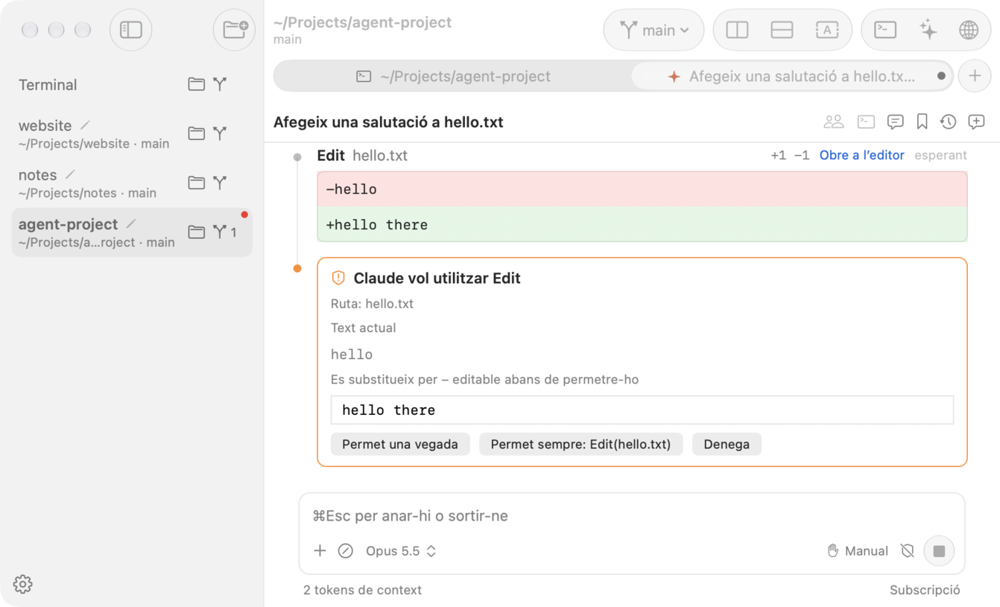

<p>&nbsp;&nbsp;&nbsp;</p>

# Tapa

**El terminal ràpid i natiu per a macOS que ha fet lloc als teus agents, fitxers i pàgines.**

El Tapa és, abans de res, un terminal: el seu propi nucli VT i un renderitzador Metal, pestanyes i divisions natives de macOS, un terminal ràpid que apareix amb una sola drecera, integració amb el shell amb blocs d’ordres i, si vols, un camp d’entrada amb suggeriments a l’estil del Warp. Al seu voltant, el Tapa s’ha convertit en la germana petita del [Dango](https://github.com/sventmueller/dango): una barra lateral d’espais de treball, un per carpeta de projecte, cadascun amb els seus terminals, pestanyes d’agent per a Claude, Codex, OpenCode, Antigravity i altres agents ACP, pestanyes de navegador, un editor amb una llista de fitxers i un panell de Git, i una previsualització de Markdown del [Splat](https://github.com/sventmueller/splat) amb fórmules i diagrames. Res del que configura una carpeta de projecte s’executa fins que confies en el seu espai de treball. El Tapa està escrit en Rust sobre controls AppKit autèntics, parla 35 idiomes, no necessita cap compte i no té telemetria.

[](https://github.com/sventmueller/tapa/releases/latest/download/Tapa.dmg)

**[Descarrega Tapa.dmg](https://github.com/sventmueller/tapa/releases/latest/download/Tapa.dmg)**: signat i notaritzat per Apple, per a macOS 14 o posterior, amb Apple Silicon i Intel.

**Has trobat un error?** [Obre una incidència](https://github.com/sventmueller/tapa/issues/new/choose) i indica amb quin shell, quin agent o quin programa ha passat. Si el Tapa et resulta útil, una [estrella a GitHub](https://github.com/sventmueller/tapa) ajuda altres persones a trobar-lo.

[](https://www.rust-lang.org) [](https://www.apple.com/macos/)  [](https://github.com/madsmtm/objc2) [](https://developer.apple.com/metal/) [](https://agentclientprotocol.com)    [](#llicència)

[Bahasa Indonesia](../id/README.md) · [Bahasa Melayu](../ms/README.md) · **Català** · [Čeština](../cs/README.md) · [Dansk](../da/README.md) · [Deutsch](../de/README.md) · [English](../../../README.md) · [Español](../es/README.md) · [Français](../fr/README.md) · [Hrvatski](../hr/README.md) · [Italiano](../it/README.md) · [Magyar](../hu/README.md) · [Nederlands](../nl/README.md) · [Norsk](../no/README.md) · [Polski](../pl/README.md) · [Português (Brasil)](../pt_BR/README.md) · [Português (Portugal)](../pt_PT/README.md) · [Română](../ro/README.md) · [Slovenčina](../sk/README.md) · [Slovenščina](../sl/README.md) · [Suomi](../fi/README.md) · [Svenska](../sv/README.md) · [Tiếng Việt](../vi/README.md) · [Türkçe](../tr/README.md) · [Ελληνικά](../el/README.md) · [Русский](../ru/README.md) · [Українська](../uk/README.md) · [עברית](../he/README.md)‎ · [العربية](../ar/README.md)‎ · [हिन्दी](../hi/README.md) · [ไทย](../th/README.md) · [한국어](../ko/README.md) · [日本語](../ja/README.md) · [简体中文](../zh-Hans/README.md) · [繁體中文](../zh-Hant/README.md)

## Continguts

- [Resum de les funcions](#resum-de-les-funcions)
- [Requisits](#requisits)
- [Instal·lació](#installació)
- [Primers passos](#primers-passos)
- [Espais de treball](#espais-de-treball)
- [El terminal](#el-terminal)
  - [Pestanyes i divisions](#pestanyes-i-divisions)
  - [Integració amb el shell i blocs d’ordres](#integració-amb-el-shell-i-blocs-dordres)
  - [El camp d’entrada i els suggeriments](#el-camp-dentrada-i-els-suggeriments)
  - [Cerca, selecció i còpia](#cerca-selecció-i-còpia)
  - [El terminal ràpid](#el-terminal-ràpid)
- [Agents](#agents)
- [Editor, fitxers i Git](#editor-fitxers-i-git)
- [Previsualitzacions](#previsualitzacions)
- [Navegador](#navegador)
- [Dictat](#dictat)
- [Configuració](#configuració)
- [Aparença i accessibilitat](#aparença-i-accessibilitat)
- [Idiomes](#idiomes)
- [Dreceres de teclat](#dreceres-de-teclat)
- [Confiança](#confiança)
- [Privadesa i seguretat](#privadesa-i-seguretat)
- [Limitacions conegudes](#limitacions-conegudes)
- [Per a desenvolupadors](#per-a-desenvolupadors)
  - [Components de tercers](#components-de-tercers)
- [Llicència](#llicència)

## Resum de les funcions

- **Un terminal ràpid i propi.** El Tapa analitza amb el seu propi nucli VT i dibuixa amb Metal en un fil per pantalla, a la freqüència de la pantalla, i només allò que ha canviat. Supera 262 proves d’esctest on el nucli de l’Alacritty en supera 121, i cada canvi es mesura amb una versió fixada del Ghostty.
- **Natiu fins al moll de l’os.** Pestanyes reals de macOS, restauració de finestres, menús, el menú Serveis, notificacions, entrada de teclat segura, dictat i mètodes d’entrada. Sense Electron, i WebKit només on una pàgina o una previsualització el necessiten.
- **Espais de treball.** La barra lateral conté un espai de treball per carpeta de projecte, cadascun amb les seves pestanyes, la seva branca i els seus panells. L’espai de treball «Terminal», a dalt de tot, comença de zero cada vegada; tots els altres es queden fins que els elimines.
- **Agents en una vista de xat nativa.** Claude, Codex, OpenCode, Antigravity, Gemini CLI i altres agents de l’Agent Client Protocol s’executen en pestanyes pròpies, amb respostes, crides a eines, diffs i sol·licituds de permís en una sola cronologia. El Tapa els instal·la i els actualitza quan l’hi demanes.
- **Integració amb el shell i blocs d’ordres** per a zsh, bash i fish, també a través de `ssh`: salta d’un indicador a un altre, selecciona, copia, desa i plega la sortida d’una ordre, i veu quines ordres han fallat i quant ha trigat cadascuna.
- **Un camp d’entrada com el del Warp, si el vols.** Edita la línia d’ordres com a text, amb suggeriments del teu historial, d’especificacions per a més de 700 eines de línia d’ordres i de l’estat del projecte, tot al teu Mac.
- **Fitxers, Git i un navegador al costat del shell.** Un editor amb colors de sintaxi, una llista de fitxers, un panell de Git amb preparació de canvis, commits, branques i worktrees, una previsualització de Markdown amb fórmules i diagrames, i pestanyes de navegador.
- **Curós amb les teves carpetes.** Un espai de treball en què no confies no inicia res del que configura la seva carpeta: ni hooks de Git, ni servidors MCP del projecte, ni configuració del projecte per als agents, ni JavaScript a les seves pàgines de fitxer.
- **Privat.** Sense compte i sense telemetria. El Tapa només es connecta a la xarxa quan l’hi demanes, i l’historial restaurat al disc es xifra amb una clau del teu clauer.
- **En el teu idioma.** La interfície està disponible en 35 idiomes: àrab, català, xinès (simplificat), xinès (tradicional), croat, txec, danès, neerlandès, anglès, finès, francès, alemany, grec, hebreu, hindi, hongarès, indonesi, italià, japonès, coreà, malai, noruec, polonès, portuguès (Brasil), portuguès (Portugal), romanès, rus, eslovac, eslovè, castellà, suec, tailandès, turc, ucraïnès i vietnamita.

## Requisits

- macOS 14 Sonoma o posterior, amb Apple Silicon o Intel. El Tapa es desenvolupa i es prova amb macOS 27.
- zsh, bash o fish per a la integració amb el shell; els altres shells funcionen sense.
- Per a les pestanyes d’agent, l’agent que vulguis fer servir, ja instal·lat o instal·lat pel Tapa quan l’hi demanis (mira [Agents](#agents)).

## Instal·lació

**Des de la imatge de disc.** Cada versió és una imatge de disc, `Tapa-<version>.dmg`, amb una app universal per a Apple Silicon i Intel, signada amb un Developer ID i notaritzada per Apple. Obre-la i arrossega el Tapa a la carpeta Aplicacions.

**Amb Homebrew.** El cask, en un tap propi, instal·la la mateixa imatge de disc:

```sh
brew install --cask sventmueller/tap/tapa
```

**Actualitzacions.** El Tapa de la imatge de disc o de Homebrew s’actualitza sol amb [Sparkle](https://sparkle-project.org). A la segona obertura pregunta si pot buscar actualitzacions pel seu compte; fins que no hi estàs d’acord, no fa cap sol·licitud. **Tapa › Buscar actualitzacions…** les busca a l’instant. El Tapa només instal·la una actualització si porta la signatura del desenvolupador. Una compilació pròpia no té actualitzador.

**Des del codi font.** Mira [Per a desenvolupadors](#per-a-desenvolupadors).

**Com a terminal per defecte.** El Tapa pot obrir scripts de shell (`.command`, `.tool`), carpetes deixades anar sobre la seva icona i enllaços `ssh://`. Tria’l al Finder amb **Arxiu › Obtén informació › Obre amb**.

## Primers passos

1. **La finestra** té a l’esquerra la barra lateral d’espais de treball, a dalt les pestanyes de l’espai de treball seleccionat i, a sobre, la barra d’eines. ⌃⌘S mostra i oculta la barra lateral.
2. **Un espai de treball nou** es crea amb el botó de carpeta de la part superior de la barra lateral o amb **Shell › Espai de treball nou…** (⇧⌘N): tria una de les carpetes recents o **Triar una carpeta…**.
3. **Les pestanyes noves** comencen a la carpeta de l’espai de treball: ⌘T per a un terminal, els botons de la dreta de la barra d’eines per a un terminal, un agent o una pestanya de navegador, o el **+** al final de la barra de pestanyes.
4. **La configuració** s’obre amb ⌘, o amb la roda dentada de la part inferior de la barra lateral.
5. **La paleta d’ordres** (⇧⌘P) troba qualsevol ordre pel nom, i **Cercar pestanya…** (⌘P) qualsevol pestanya de qualsevol espai de treball.

La barra d’eines conté, d’esquerra a dreta, el menú desplegable de branques del repositori de l’espai de treball, els botons per dividir el terminal a la dreta i a sota i per mostrar el camp d’entrada, i els botons per a pestanyes noves de terminal, d’agent i de navegador. Els botons de les divisions i del camp d’entrada són grisos mentre no hi hagi cap pestanya de terminal al davant.

## Espais de treball

Un espai de treball és una carpeta amb les seves pestanyes. La seva fila a la barra lateral mostra el nom, la carpeta i la branca de Git i, a la dreta, els botons de la llista de fitxers i del panell de Git. Un clic en un d’ells mostra aquell panell en lloc de la llista d’espais de treball; **Espais de treball**, a dalt, hi torna.

- **L’espai de treball «Terminal»** és sempre a dalt. Comença de zero a cada obertura, a la carpeta que indica la configuració, amb un terminal buit. No se’n desa res, i no se’n pot canviar el nom ni eliminar.
- **Tots els altres espais de treball es queden** fins que els elimines, fins i tot sense pestanyes. El Tapa en conserva el nom, les pestanyes, el contingut dels terminals (fins on ho indiqui la configuració de restauració), les sessions d’agent i la posició de la finestra. Els programes que encara s’executen acaben quan surts del Tapa.
- **Canviar el nom.** Fes clic al llapis que hi ha després del nom, fes clic al nom de l’espai de treball seleccionat o tria **Shell › Canviar el nom de l’espai de treball**. El nom es desa a l’instant.
- **Estat.** Un punt verd a la fila vol dir que un agent de l’espai de treball està treballant, també amb subagents o en segon pla; un punt vermell vol dir que un t’està esperant. Els terminals no hi marquen res.
- **Canviar d’espai.** ⌃⌘[ i ⌃⌘] passen d’un espai de treball a un altre. La finestra es queda al seu lloc, i les pestanyes de l’espai de treball seleccionat ocupen el lloc de les altres.
- **Worktrees.** **Nou worktree…**, al menú desplegable de branques de la barra d’eines, crea un worktree de Git en una branca nova i l’obre com a espai de treball propi.

Quan es tanca l’última pestanya d’un espai de treball, l’espai de treball es queda a la llista. Amb totes les pestanyes tancades, només desapareix la finestra; la icona del Dock o ⌘N la tornen amb els seus espais de treball.

## El terminal

El Tapa funciona amb el seu propi nucli, `term-vt`. Parla xterm i VT520 amb el protocol de teclat del Kitty, hiperenllaços OSC 8, accés al porta-retalls OSC 52 amb un permís a part per a la lectura, sortida sincronitzada, subratllats de color i ondulats, color real (truecolor), consultes de color, avisos del mode clar i fosc als programes, enganxament entre claudàtors (bracketed paste), esdeveniments de focus i notificació del ratolí. El text es reorganitza quan la finestra canvia de mida, historial inclòs. Les lligadures, les funcions tipogràfiques, els símbols de Nerd Font sense tipus de lletra pedaçats i el dibuix exacte al píxel dels caràcters de requadre, els glifs de Powerline i el braille vénen integrats.

### Pestanyes i divisions

- **Les pestanyes** són les pròpies de macOS: arrossega-les per reordenar-les o per treure-les a una finestra pròpia, **Mostra totes les pestanyes** (⇧⌘\\), ⌘1 a ⌘8, ⌘9 per a l’última pestanya, i ⇧⌘[ / ⇧⌘] per canviar. Cada pestanya mostra la icona del seu tipus davant del títol.
- **Divisions.** **Dividir a la dreta** (⌘D o ⌃⌘T) i **Dividir a sota** (⇧⌘D o ⌃⌥⌘T), imbricades tan endins com vulguis. Arrossega un separador, mou-lo amb ⌃⌘ i les fletxes, **Maximitzar el panell** (⌃⇧⌘↩), **Igualar els panells** (⌃⌘=), i passa d’un panell a un altre amb ⌘[ i ⌘].
- **Carpeta de treball.** Les pestanyes, finestres i divisions noves comencen a la carpeta del terminal que és al davant; la configuració ho decideix per a cadascuna de les tres.
- **Tancar.** El Tapa pregunta abans de tancar una pestanya, una finestra o l’app mentre s’hi executa un programa.
- **Restauració.** Després d’un reinici tornen els espais de treball, les pestanyes, els panells, les carpetes i les últimes línies de cada terminal. Els secrets com ara tokens i contrasenyes s’emmascaren abans de desar res.

### Integració amb el shell i blocs d’ordres

El Tapa configura tot sol la seva integració amb el shell per a zsh, bash i fish, sense tocar els teus fitxers de configuració, i se l’emporta quan et connectes a un altre amfitrió amb `ssh`. Amb ella, cada ordre i la seva sortida formen un bloc:

- **Indicadors.** ⌘↑ i ⌘↓ salten a l’indicador anterior i al següent. Un clic a la línia d’ordres hi mou el cursor.
- **Blocs.** **Seleccionar el bloc** (⇧⌘A), **Copiar la sortida** (⌥⌘C), **Desa la sortida…** (⌥⌘S) i **Plegar/desplegar el bloc** (⇧⌘↩). Sobre el bloc que hi ha sota el punter, uns botons en mostren l’estat, la durada i les mateixes accions.
- **Les ordres fallides** es marquen, i l’ordre que encara s’executa es queda visible a dalt mentre la seva sortida es desplaça.
- **Marcadors.** **Afegir/treure el marcador** (⇧⌘M) marca una línia; ⇧⌘↑ i ⇧⌘↓ salten d’un marcador a un altre.
- **Les notificacions** apareixen quan un programa en demana una (OSC 9 i OSC 777) i el terminal no és al davant, i una barra de progrés (OSC 9;4) es mostra a la pestanya i a la icona del Dock.

### El camp d’entrada i els suggeriments

El camp d’entrada converteix la línia d’ordres en un camp de text a la part inferior del panell, com al Warp, amb etiquetes per a la carpeta i la branca de Git a sobre. **Mostrar/ocultar el camp d’entrada** (⌘I) o el botó de la barra d’eines l’activa per a un terminal; **Configuració › Entrada** l’activa per als terminals nous. Necessita la integració amb el shell i s’aparta davant dels programes a pantalla completa com ara vim, htop o claude.

- **Retorn** envia tot el camp al shell, el text de diverses línies com un sol enganxament; el shell l’executa i el recorda com sempre. Si el shell en demana més, el camp li torna les tecles fins al següent indicador.
- **↑, ↓ i ⌃R** cerquen al teu historial, amb la carpeta, la branca i el codi de sortida amb què es va executar cada ordre.
- **Tab** completa amb especificacions per a més de 700 eines de línia d’ordres, camins i valors en directe com ara branques de Git, contenidors de Docker, recursos de kubectl, amfitrions d’ssh, scripts de `package.json` i objectius de make, just i cargo.
- **Les tecles del Vim** al camp s’activen amb un interruptor a la mateixa configuració.
- **La següent ordre abans que l’escriguis**: el que sol venir després en aquest projecte (després de `git add` ve `git commit`), el que demana l’estat del projecte (un fitxer de bloqueig més recent que `node_modules`) i una correcció després de «command not found», a partir de faltes de tecleig o del teu índex local de Homebrew.

Sense el camp d’entrada, els suggeriments es mostren com a text gris darrere del cursor, i → els accepta. Els shells amb suggeriments automàtics propis, com ara fish o zsh-autosuggestions, conserven els seus. Els suggeriments no fan servir mai la xarxa, i només inicien programes del teu propi `PATH`, mai de la carpeta del projecte.

**Enganxar.** Els enganxaments de diverses línies es poden mostrar abans que s’executin (**Mostrar primer els enganxaments de diverses línies**). Els fitxers deixats anar sobre un terminal arriben com a camins entre cometes; ⌥←/→, ⌘←/→ i ⌘⌫ mouen i esborren per paraules i línies com en qualsevol camp de text del Mac.

### Cerca, selecció i còpia

- **Buscar** (⌘F) cerca a l’historial amb expressions regulars, distinció de majúscules i paraules senceres, i compta les coincidències; la barra de desplaçament les marca juntament amb els indicadors i els errors.
- **Selecció intel·ligent.** Un doble clic selecciona sencera una URL, un camí, un hash o una adreça IP, i arrossegar amb ⌥ selecciona un rectangle. Els enllaços es detecten fins i tot sense OSC 8; ⌘-clic els obre, i obre un camí al Dango si està instal·lat.
- **Seleccionar amb el teclat** (⇧⌘C) mou una selecció amb les tecles del Vim.
- **Copia amb format** (⇧⌥⌘C) conserva els colors i els estils; copiar en seleccionar és una opció de la configuració. **Esborrar** (⌘K) neteja el terminal.

### El terminal ràpid

**Mostrar/ocultar el terminal ràpid** (⌃⌥⌘Space) fa lliscar un terminal des d’una vora de la pantalla, per sobre d’altres apps i dels espais a pantalla completa, sense canviar d’app. La vora, la mida i si s’oculta quan fas clic en un altre lloc són opcions de la configuració. Les seves sessions continuen executant-se mentre està ocult.

## Agents

Una pestanya d’agent executa un agent de programació a la carpeta de l’espai de treball, a la vista d’agent nativa del Dango.

| Agent | Com s’executa | Què necessita |
|---|---|---|
| Claude | l’ordre `claude`, controlada mitjançant el seu protocol stream-json | `claude` instal·lat i amb la sessió iniciada; el Tapa l’instal·la amb l’instal·lador de Claude quan l’hi demanes |
| Codex | `codex app-server`, o `codex-acp` per a un Codex més antic | `codex` amb la sessió iniciada; el Tapa instal·la l’adaptador de versió fixada quan l’hi demanes |
| OpenCode | `opencode serve`, o `opencode acp` per a un OpenCode més antic | el teu propi `opencode` al `PATH`, o la baixada de versió fixada |
| Antigravity | `agy acp` | el teu propi `agy` al `PATH`, o la baixada de versió fixada |
| Gemini CLI | `gemini --acp`, que s’ofereix quan l’actives a **Configuració › Agents** | el teu propi `gemini`, o la baixada de versió fixada |
| Altres agents ACP | del registre ACP, carregat només quan ho demanes | el que indiqui l’entrada del registre; les entrades sense suma de verificació només s’instal·len després que ho confirmis |

El Tapa fa servir l’inici de sessió propi de cada agent i no desa cap credencial d’agent. Un agent que es trobi al `PATH` del teu shell d’inici de sessió té prioritat; si no, el Tapa executa la versió que va instal·lar a la seva pròpia carpeta de dades, mai un programa de l’espai de treball.

- **La cronologia** mostra respostes, crides a eines amb la seva sortida i els seus diffs, preguntes i sol·licituds de permís. **Permet una vegada**, **Permet sempre** i **Denega** responen una sol·licitud, i una edició es pot canviar abans de permetre-la.
- **Estat.** La pestanya i la fila de l’espai de treball mostren un punt verd mentre l’agent treballa i un de vermell mentre t’espera, i una notificació t’avisa quan espera mentre mires una altra cosa.
- **El camp de missatge** de la part inferior recull el teu prompt, els fitxers que hi deixis anar i el dictat. ⌘Esc hi porta el focus del teclat i el torna. Hi pots triar el model i el mode de permisos per a la sessió.
- **Configuració › Agents** fixa per a les sessions noves el mode de permisos (Claude, Codex), el model (Claude, Codex, OpenCode) i l’esforç de raonament (Claude, Codex), i quins agents ofereixen les pestanyes noves. Mostra on és el programa de cada agent, amb **Instal·la…**, **Actualitza a …** i **Torna a …** per a la versió anterior, i **Carrega el registre** per al registre ACP. Hi pots veure i eliminar les regles que Claude ha desat amb «Permet sempre».
- **Baixades comprovades.** Els arxius es comproven amb el seu SHA-256, els paquets d’npm amb la integritat del seu fitxer de bloqueig, i es rebutgen els paquets sense versió fixa. Un agent que falta també n’ofereix la instal·lació a la seva pròpia pestanya.

## Editor, fitxers i Git

- **La llista de fitxers** d’un espai de treball mostra la seva carpeta com un arbre, actualitzat a mesura que canvien els fitxers, amb els fitxers que Git ignora atenuats si vols. Un clic obre un fitxer en una pestanya de previsualització, que el clic següent substitueix mentre no l’editis; un doble clic el conserva.
- **L’editor** obre els fitxers en pestanyes de l’espai de treball, amb colors de sintaxi, diversos cursors, plegat, el sagnat de `.editorconfig`, tecles del Vim opcionals i marques del que ha canviat des de l’últim commit. Se n’adona quan un fitxer ha canviat al disc o conté marcadors de conflicte. Els fitxers Markdown tenen una barra de format i **Obre a Splat**. **Desa** (⌘S), **Desa com a…** i **Desa‑ho tot** funcionen com sempre, i el Tapa pregunta abans de tancar text sense desar.
- **Després d’una fallada**, el text sense desar torna: el Tapa en guarda còpies xifrades mentre escrius.
- **El panell de Git** mostra els canvis preparats i sense preparar, prepara i retira fitxers i fragments solts, fa commits (⌘↩), els esmena (amend), fa commit i push, fa fetch, i gestiona branques, stashes, cherry-picks i conflictes, amb l’historial de commits a sota. Un clic en un fitxer en mostra el diff.
- **El menú desplegable de branques** de la barra d’eines canvia de branca, crea branques i crea worktrees.

L’editor no inicia cap formatador ni cap servidor de llenguatge. Per a un IDE complet amb servidors de llenguatge i depurador, fes servir el [Dango](https://github.com/sventmueller/dango).

## Previsualitzacions

- **El Markdown** es mostra al costat del seu editor mitjançant el renderitzador del Splat: GitHub Flavored Markdown amb fórmules, diagrames i imatges, que es desplaça paràgraf a paràgraf amb el text.
- **Les imatges** s’obren en una pestanya pròpia, els PDF mitjançant PDFKit, i el so, els vídeos, els tipus de lletra i els documents d’oficina mitjançant la Vista ràpida.
- **Descodificació aïllada.** Tota imatge d’una font no fiable (fitxers del projecte, Markdown, adjunts i enganxaments d’agents) es descodifica al servei `Decoder.xpc` del Splat, en un App Sandbox propi sense fitxers ni xarxa, mai dins de l’app.

## Navegador

**Nova pestanya de navegador** (⇧⌘B) obre una pestanya de WebKit a l’espai de treball. El camp d’adreça accepta una adreça o paraules per al cercador que triïs (DuckDuckGo, Google, Bing o Startpage); ⌘L, ⌘R, ⌘[ i ⌘] funcionen com al Safari. Les pàgines de `localhost` s’executen amb normalitat, per al servidor de desenvolupament del teu projecte. Els fitxers HTML d’un espai de treball només poden llegir la seva pròpia carpeta i, en un espai de treball en què no confies, no executen JavaScript.

## Dictat

Dicta al camp de missatge d’un agent o a l’editor amb el botó del micròfon o amb **Edició › Inicia el dictat** (⌃⌥D). El reconeixement de veu és el del [Lowspeak](https://github.com/sventmueller/lowspeak), que no cal instal·lar. **Configuració › Dictat** tria la transcripció en línia amb OpenAI o Groq, o models locals Whisper i Parakeet que mantenen l’enregistrament al teu Mac, l’idioma, el postprocessament, el micròfon i el teu propi vocabulari. Les claus d’OpenAI i Groq es desen al teu clauer. El dictat només forma part de la versió de distribució.

## Configuració

**Tapa › Configuració…** (⌘,) té els panells General, Tipus de lletra, Colors, Cursor, Terminal, Entrada, Editor, Agents, Dictat, Perfils i Dreceres de teclat. Escriuen un únic fitxer TOML, `config.toml`, a la carpeta del Tapa dins de `~/Library/Application Support`, que també pots editar a mà; el Tapa el torna a carregar mentre s’executa, i **Tornar a carregar la configuració** (⇧⌘,) ho fa a l’instant.

- **Quatre mides de lletra** a General: Interfície (barra lateral, panells, llista de fitxers, panell de Git i títols de les pestanyes), Editor (text, números de línia i previsualització de Markdown), Terminal i Agents. ⌘+, ⌘− i ⌘0 canvien la mida del terminal que és al davant.
- **Aparença:** Clar, Fosc o Com el sistema.
- **Colors.** Un tema per al mode clar i un altre per al fosc, en el format de temes del Ghostty, amb un contrast mínim que manté el text llegible fins i tot amb un tema deficient. Els teus propis temes van a la carpeta de temes.
- **Els perfils** agrupen tipus de lletra, colors, shell, entorn i carpeta.
- **Les dreceres de teclat** es poden canviar totes, i es mostren els conflictes.

## Aparença i accessibilitat

- **El mode fosc** segueix el sistema o la teva elecció; es respecten el color d’èmfasi, Reduir el moviment i Augmentar el contrast.
- **VoiceOver** llegeix les línies i els indicadors del terminal i anuncia la sortida nova; la barra lateral, les pestanyes, els botons de la barra d’eines i les targetes de la cronologia d’agents tenen nom.
- **Teclat.** Cada ordre té un element de menú i una drecera, i l’accés total amb el teclat arriba a tots els controls.
- **Mides.** Les quatre mides de lletra de la configuració escalen per separat la interfície, l’editor, el terminal i els agents.
- **De dreta a esquerra.** La interfície s’emmiralla en àrab i hebreu, mentre que la graella del terminal continua d’esquerra a dreta.

Els detalls i les mancances conegudes són a [ACCESSIBILITY.md](../../../ACCESSIBILITY.md).

## Idiomes

La interfície està traduïda a 35 idiomes: àrab, català, xinès (simplificat), xinès (tradicional), croat, txec, danès, neerlandès, anglès, finès, francès, alemany, grec, hebreu, hindi, hongarès, indonesi, italià, japonès, coreà, malai, noruec, polonès, portuguès (Brasil), portuguès (Portugal), romanès, rus, eslovac, eslovè, castellà, suec, tailandès, turc, ucraïnès i vietnamita.

El Tapa segueix l’ordre d’idiomes de **Configuració del Sistema › General › Idioma i regió**; allà també pots triar un idioma només per al Tapa, a **Apps**. Si no hi ha traducció per al teu idioma, fa servir l’anglès.

## Dreceres de teclat

| Acció | Drecera |
|---|---|
| Finestra, espai de treball, pestanya nova | ⌘N, ⇧⌘N, ⌘T |
| Pestanya de navegador nova | ⇧⌘B |
| Fitxer nou, obrir un fitxer | ⌥⌘N, ⌘O |
| Tancar el panell o la pestanya, tancar la pestanya, tancar la finestra | ⌘W, ⌥⌘W, ⇧⌘W |
| Dividir a la dreta, dividir a sota | ⌘D o ⌃⌘T, ⇧⌘D o ⌃⌥⌘T |
| Maximitzar el panell, igualar els panells, tancar el panell | ⌃⇧⌘↩, ⌃⌘=, ⌃⇧⌘W |
| Moure un separador | ⌃⌘←, ⌃⌘→, ⌃⌘↑, ⌃⌘↓ |
| Panell següent, anterior | ⌘], ⌘[ |
| Pestanya següent, anterior; pestanyes 1 a 8, última pestanya | ⇧⌘], ⇧⌘[; ⌘1 a ⌘8, ⌘9 |
| Espai de treball següent, anterior | ⌃⌘], ⌃⌘[ |
| Cercar pestanya, paleta d’ordres | ⌘P, ⇧⌘P |
| Mostrar o ocultar la barra lateral, el camp d’entrada | ⌃⌘S, ⌘I |
| Terminal ràpid | ⌃⌥⌘Space |
| Buscar, buscar el següent, buscar l’anterior | ⌘F, ⌘G, ⇧⌘G |
| Indicador anterior, següent | ⌘↑, ⌘↓ |
| Seleccionar el bloc, copiar la sortida, desar la sortida, plegar el bloc | ⇧⌘A, ⌥⌘C, ⌥⌘S, ⇧⌘↩ |
| Afegir o treure un marcador; marcador anterior, següent | ⇧⌘M; ⇧⌘↑, ⇧⌘↓ |
| Seleccionar amb el teclat | ⇧⌘C |
| Copiar amb format | ⇧⌥⌘C |
| Esborrar | ⌘K |
| Inici, final, pàgina amunt, pàgina avall | ⌘Home, ⌘End, ⌘PageUp, ⌘PageDown |
| Més gran, més petit, mida original (terminal) | ⌘+, ⌘−, ⌘0 |
| Camp de missatge d’una pestanya d’agent | ⌘Esc |
| Iniciar el dictat | ⌃⌥D |
| Configuració, tornar a carregar la configuració | ⌘,, ⇧⌘, |

Totes les dreceres es poden canviar a **Configuració › Dreceres de teclat** o a la secció `[keys]` del fitxer de configuració.

## Confiança

Una carpeta de projecte pot fer que s’executin programes tan bon punt s’hi inicia alguna cosa: hooks de Git i opcions del repositori com ara `core.fsmonitor`, hooks d’agents, servidors MCP del projecte i configuració del projecte per als agents. Per això un espai de treball nou no es considera de confiança.

- **Sense confiança:** els agents s’inicien sense els hooks, els servidors MCP ni la configuració del projecte (Claude amb `--setting-sources=user --strict-mcp-config`, Codex amb la carpeta marcada com a no fiable, OpenCode sense la configuració del projecte). Git s’executa neutralitzat: sense hooks, filtres, controladors de diff, fsmonitor, `sshCommand` ni paginador, i només amb els ajudants de credencials globals. Els fitxers HTML s’obren sense JavaScript. El panell de Git i la pestanya d’agent ho indiquen i ofereixen confiar en l’espai de treball.
- **De confiança:** **Shell › Confiar en l’espai de treball** ho carrega tot tal com ho preveu la carpeta. **Retira la confiança** ho desfà. La confiança es desa per espai de treball.

Sigui quina sigui la seva confiança, el Tapa no executa mai pel seu compte un programa d’una carpeta de projecte: els suggeriments només inicien programes del teu `PATH` fora del projecte, i la barra lateral llegeix l’estat de Git dels fitxers `.git`. Un espai de treball a la teva carpeta d’inici, com ara «Terminal», no és cap projecte: allà, els programes que hi ha sota `~`, com ara `~/.local/bin/claude`, compten com a teus.

## Privadesa i seguretat

- **Sense telemetria, sense compte.** El Tapa no informa de res sobre com el fas servir i funciona completament sense connexió. Només es connecta a la xarxa quan l’hi demanes: per instal·lar o actualitzar un agent, per carregar el registre ACP, per buscar actualitzacions un cop hi has estat d’acord, i per a les pàgines que obres en una pestanya de navegador. Els agents mateixos parlen amb els seus proveïdors com sempre.
- **L’historial al disc** per restaurar sessions es xifra amb una clau del teu clauer, es pot desactivar, i els secrets com ara claus d’API, tokens i contrasenyes s’hi emmascaren abans d’escriure’l. Les còpies del text sense desar de l’editor es xifren amb la mateixa clau.
- **L’entrada de teclat segura** s’activa sola a les sol·licituds de contrasenya, i es pot activar de manera permanent al menú de l’app.
- **Les seqüències d’escapament** que podrien filtrar o injectar dades, com ara els informes de títol, les lectures del porta-retalls i els trucs d’enganxament, es bloquegen o es pregunten abans. L’analitzador se sotmet a fuzzing a la CI.
- **Descodificació aïllada** de les imatges de fonts no fiables, mira [Previsualitzacions](#previsualitzacions).
- **Signatura de codi** amb el Hardened Runtime. El macOS atribueix al Tapa els accessos dels programes que s’executen en un terminal, de manera que el Tapa inclou una descripció d’ús per a cada servei protegit.

Els problemes de seguretat es comuniquen en privat; mira [SECURITY.md](../../../SECURITY.md).

## Limitacions conegudes

- **Encara no hi ha imatges en línia** al terminal: els gràfics del Kitty, Sixel i les imatges de l’iTerm2 estan previstos després de la versió 1.0.
- **No hi ha mode de control de tmux**, i les sessions no sobreviuen quan surts del Tapa.
- **El text de dreta a esquerra** continua d’esquerra a dreta a la graella del terminal.
- **⌘+ i ⌘−** només canvien el terminal que és al davant.
- **L’editor** no té servidors de llenguatge, formatadors ni depurador, per disseny; el Dango sí que en té.
- **El dictat** només és a la versió de distribució, no en una compilació de depuració.
- **VoiceOver** encara no l’ha comprovat una persona de cap a cap.

## Per a desenvolupadors

Necessites macOS 14 o posterior amb les Command Line Tools de Xcode, Rust tal com l’indica `rust-toolchain.toml` (rustup amb els dos destins de Mac per a la compilació universal), còpies de [splat](https://github.com/sventmueller/splat) i [lowspeak](https://github.com/sventmueller/lowspeak) al costat d’aquesta (`../splat`, `../lowspeak`), i cmake per a les compilacions amb dictat.

| Ordre | Què fa |
|---|---|
| `make help` | llista els objectius |
| `cargo xtask run` | compila l’app de depuració i l’obre |
| `make build` | compila l’app de distribució amb dictat a `target/release`, signada ad hoc per a aquest Mac |
| `make lint` | format, clippy amb els avisos com a errors, la forma dels fitxers i els textos de la interfície |
| `make check` | `lint` i després totes les proves; no necessita finestra ni xarxa |
| `make selftest STEPS="split_right,type:ls\n,shot:x"` | controla l’app i deixa imatges de finestra a `target/selftest/` |
| `make esctest`, `make vttest` | executa esctest i vttest amb els dos nuclis a l’app |
| `make perf` | la prova de rendiment amb una versió fixada del Ghostty; només té sentit en un Mac en repòs |
| `make fuzz` | els objectius de fuzzing amb cargo-fuzz |
| `make release` | un assaig de la publicació: l’app universal amb dictat, la seva imatge de disc, el seu canal d’actualitzacions i el seu cask a `target/release-dry-run`; no envia res enlloc |
| `make release-notarized` | la versió actual signada amb el Developer ID, notaritzada per Apple i grapada, a `dist/`; `Cargo.toml` no canvia |
| `make deploy` | notaritza la versió següent, fa commit de `Cargo.toml`, puja un esborrany de la publicació, fa push de `main` i de l’etiqueta i després publica la versió; consulta [docs/development.md](../../../docs/development.md#deploy) |

Com contribuir-hi és a [CONTRIBUTING.md](../../../CONTRIBUTING.md). Cada text de la interfície té l’alemany com a clau, amb una traducció als 35 idiomes; `cargo xtask strings` falla si en falta alguna.

### Components de tercers

| Component | Ús | Llicència |
|---|---|---|
| [objc2](https://github.com/madsmtm/objc2) i els seus crates de frameworks | AppKit, Metal, WebKit i els altres frameworks d’Apple | MIT, Zlib o Apache-2.0 |
| Els crates del Splat | Markdown, la previsualització, la lectura de Git, el descodificador d’imatges i les traduccions | MIT o Apache-2.0 |
| [Lowspeak](https://github.com/sventmueller/lowspeak) amb [whisper.cpp](https://github.com/ggml-org/whisper.cpp) | el dictat | MIT |
| [Especificacions d’autocompleció de Fig](https://github.com/withfig/autocomplete) | les descripcions d’ordres dels suggeriments | MIT |
| [rusqlite](https://github.com/rusqlite/rusqlite) amb SQLite | l’historial d’ordres | MIT, domini públic |
| [Simple Icons](https://simpleicons.org) | logotips de llenguatges i programes | CC0, alguns logotips amb condicions pròpies |
| [Sparkle](https://sparkle-project.org) 2.10.1 | les actualitzacions de la versió de distribució | MIT |

## Llicència

El Tapa té llicència sota qualsevol de les dues següents:

- Llicència Apache, versió 2.0 ([LICENSE-APACHE](../../../LICENSE-APACHE))
- Llicència MIT ([LICENSE-MIT](../../../LICENSE-MIT))

a la teva elecció. Els logotips d’`assets/simple-icons` tenen les seves pròpies llicències; mira el README d’aquella carpeta.

Tret que indiquis explícitament el contrari, qualsevol contribució enviada intencionadament per tu per ser inclosa al Tapa, tal com es defineix a la llicència Apache-2.0, tindrà la doble llicència anterior, sense cap condició addicional.
