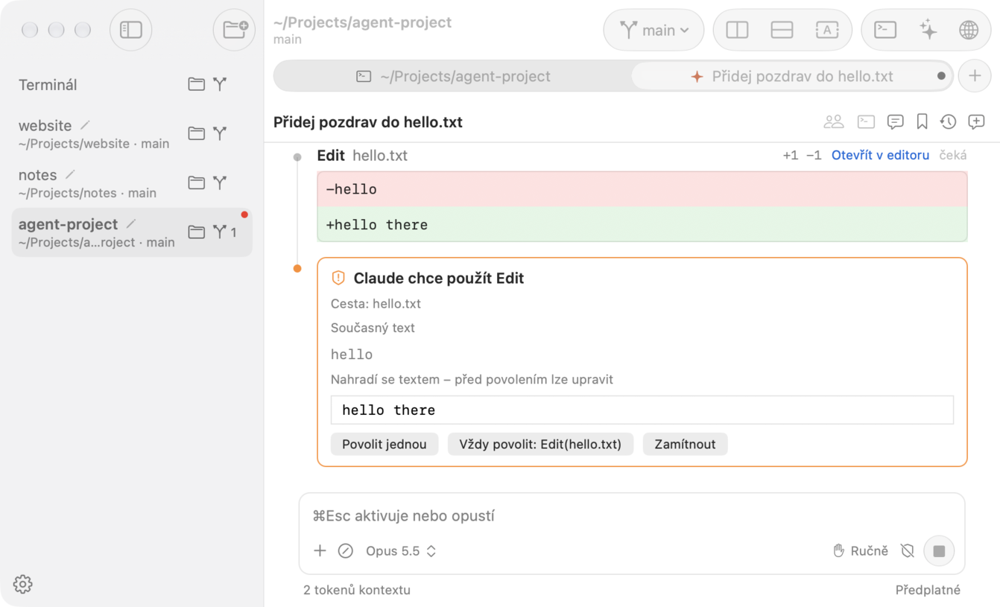

<p>&nbsp;&nbsp;&nbsp;</p>

# Tapa

**Rychlý, nativní terminál pro macOS, ve kterém se našlo místo pro vaše agenty, soubory a stránky.**

Tapa je především terminál: vlastní jádro VT a renderer Metal, nativní panely a rozdělení macOS, rychlý terminál, který se vysune jedinou zkratkou, integrace se shellem s bloky příkazů a volitelné vstupní pole s návrhy ve stylu Warpu. Kolem toho Tapa vyrostla v mladší sestru [Danga](https://github.com/sventmueller/dango): boční panel s pracovními prostory, jedním pro každou složku projektu, každý s vlastními terminály, panely agentů pro Claude, Codex, OpenCode, Antigravity a další agenty ACP, panely prohlížeče, editor se seznamem souborů a panelem Git a náhled Markdownu ze [Splatu](https://github.com/sventmueller/splat) se vzorci a diagramy. Nic, co nastavuje složka projektu, se nespustí, dokud jejímu pracovnímu prostoru nedůvěřujete. Tapa je napsaná v Rustu na skutečných ovládacích prvcích AppKit, mluví 35 jazyky, nepotřebuje účet a nemá telemetrii.

[](https://github.com/sventmueller/tapa/releases/latest/download/Tapa.dmg)

**[Stáhnout Tapa.dmg](https://github.com/sventmueller/tapa/releases/latest/download/Tapa.dmg)**: podepsaný a notarizovaný Applem, pro macOS 14 nebo novější na Apple Silicon i Intelu.

**Našli jste chybu?** [Založte issue](https://github.com/sventmueller/tapa/issues/new/choose) a uveďte, s jakým shellem, jakým agentem nebo jakým programem k ní došlo. Pokud je pro vás Tapa užitečná, [hvězdička na GitHubu](https://github.com/sventmueller/tapa) pomůže ostatním ji najít.

[](https://www.rust-lang.org) [](https://www.apple.com/macos/)  [](https://github.com/madsmtm/objc2) [](https://developer.apple.com/metal/) [](https://agentclientprotocol.com)    [](#licence)

[Bahasa Indonesia](../id/README.md) · [Bahasa Melayu](../ms/README.md) · [Català](../ca/README.md) · **Čeština** · [Dansk](../da/README.md) · [Deutsch](../de/README.md) · [English](../../../README.md) · [Español](../es/README.md) · [Français](../fr/README.md) · [Hrvatski](../hr/README.md) · [Italiano](../it/README.md) · [Magyar](../hu/README.md) · [Nederlands](../nl/README.md) · [Norsk](../no/README.md) · [Polski](../pl/README.md) · [Português (Brasil)](../pt_BR/README.md) · [Português (Portugal)](../pt_PT/README.md) · [Română](../ro/README.md) · [Slovenčina](../sk/README.md) · [Slovenščina](../sl/README.md) · [Suomi](../fi/README.md) · [Svenska](../sv/README.md) · [Tiếng Việt](../vi/README.md) · [Türkçe](../tr/README.md) · [Ελληνικά](../el/README.md) · [Русский](../ru/README.md) · [Українська](../uk/README.md) · [עברית](../he/README.md)‎ · [العربية](../ar/README.md)‎ · [हिन्दी](../hi/README.md) · [ไทย](../th/README.md) · [한국어](../ko/README.md) · [日本語](../ja/README.md) · [简体中文](../zh-Hans/README.md) · [繁體中文](../zh-Hant/README.md)

## Obsah

- [Přehled funkcí](#přehled-funkcí)
- [Požadavky](#požadavky)
- [Instalace](#instalace)
- [Začínáme](#začínáme)
- [Pracovní prostory](#pracovní-prostory)
- [Terminál](#terminál)
  - [Panely a rozdělení](#panely-a-rozdělení)
  - [Integrace se shellem a bloky příkazů](#integrace-se-shellem-a-bloky-příkazů)
  - [Vstupní pole a návrhy](#vstupní-pole-a-návrhy)
  - [Hledání, výběr a kopírování](#hledání-výběr-a-kopírování)
  - [Rychlý terminál](#rychlý-terminál)
- [Agenti](#agenti)
- [Editor, soubory a Git](#editor-soubory-a-git)
- [Náhledy](#náhledy)
- [Prohlížeč](#prohlížeč)
- [Diktování](#diktování)
- [Nastavení](#nastavení)
- [Vzhled a zpřístupnění](#vzhled-a-zpřístupnění)
- [Jazyky](#jazyky)
- [Klávesové zkratky](#klávesové-zkratky)
- [Důvěra](#důvěra)
- [Soukromí a zabezpečení](#soukromí-a-zabezpečení)
- [Známá omezení](#známá-omezení)
- [Pro vývojáře](#pro-vývojáře)
  - [Komponenty třetích stran](#komponenty-třetích-stran)
- [Licence](#licence)

## Přehled funkcí

- **Rychlý terminál s vlastním jádrem.** Tapa zpracovává výstup vlastním jádrem VT a vykresluje přes Metal ve vlastním vlákně pro každý displej, s obnovovací frekvencí displeje a jen to, co se změnilo. Projde 262 kontrolami esctest, kde jádro Alacritty projde 121, a každá jeho změna se měří proti pevně dané verzi Ghostty.
- **Nativní do posledního detailu.** Skutečné panely macOS, obnovení oken, nabídky, nabídka Služby, oznámení, zabezpečený vstup z klávesnice, diktování a metody zadávání. Žádný Electron a WebKit jen tam, kde ho potřebuje stránka nebo náhled.
- **Pracovní prostory.** Boční panel obsahuje jeden pracovní prostor pro každou složku projektu, každý s vlastními panely, větví a přehledy. Pracovní prostor „Terminál“ nahoře začíná pokaždé znovu; všechny ostatní zůstanou, dokud je neodstraníte.
- **Agenti v nativním zobrazení chatu.** Claude, Codex, OpenCode, Antigravity, Gemini CLI a další agenti protokolu Agent Client Protocol běží ve vlastních panelech, s odpověďmi, voláními nástrojů, rozdíly a žádostmi o oprávnění v jedné časové ose. Tapa je na požádání nainstaluje a aktualizuje.
- **Integrace se shellem a bloky příkazů** pro zsh, bash a fish, také přes `ssh`: skákejte z výzvy na výzvu, vybírejte, kopírujte, ukládejte a sbalujte výstup příkazu, sledujte neúspěšné příkazy a jak dlouho každý trval.
- **Vstupní pole jako ve Warpu, pokud chcete.** Upravujte příkazový řádek jako text, s návrhy z vaší historie, ze specifikací pro více než 700 nástrojů příkazového řádku a ze stavu projektu, vše přímo ve vašem Macu.
- **Soubory, Git a prohlížeč vedle shellu.** Editor s barvami syntaxe, seznam souborů, panel Git s přípravou změn, commity, větvemi a worktree, náhled Markdownu se vzorci a diagramy a panely prohlížeče.
- **Opatrná s vašimi složkami.** Pracovní prostor, kterému jste nedůvěřovali, nespustí nic, co nastavuje jeho složka: žádné git hooky, žádné projektové servery MCP, žádná projektová nastavení agentů, žádný JavaScript v jeho souborových stránkách.
- **Soukromá.** Žádný účet, žádná telemetrie. Tapa jde na síť, jen když ji o to požádáte, a obnovovaná historie na disku je šifrovaná klíčem ve vaší klíčence.
- **Ve vašem jazyce.** Rozhraní je ve 35 jazycích: arabština, katalánština, čínština (zjednodušená), čínština (tradiční), chorvatština, čeština, dánština, nizozemština, angličtina, finština, francouzština, němčina, řečtina, hebrejština, hindština, maďarština, indonéština, italština, japonština, korejština, malajština, norština, polština, portugalština (Brazílie), portugalština (Portugalsko), rumunština, ruština, slovenština, slovinština, španělština, švédština, thajština, turečtina, ukrajinština a vietnamština.

## Požadavky

- macOS 14 Sonoma nebo novější, na Apple Silicon nebo Intelu. Tapa se vyvíjí a testuje na macOS 27.
- zsh, bash nebo fish pro integraci se shellem; ostatní shelly fungují bez ní.
- Pro panely agentů agent, kterého chcete používat, buď už nainstalovaný, nebo nainstalovaný Tapou, když o to požádáte (viz [Agenti](#agenti)).

## Instalace

**Z obrazu disku.** Každé vydání je obraz disku, `Tapa-<version>.dmg`, s jedinou univerzální aplikací pro Apple Silicon i Intel, podepsanou certifikátem Developer ID a notarizovanou Applem. Otevřete ho a přetáhněte Tapu do složky Aplikace.

**Přes Homebrew.** Cask ve vlastním tapu instaluje stejný obraz disku:

```sh
brew install --cask sventmueller/tap/tapa
```

**Aktualizace.** Tapa z obrazu disku nebo z Homebrew se aktualizuje sama pomocí [Sparkle](https://sparkle-project.org). Při druhém spuštění se zeptá, zda smí sama vyhledávat aktualizace; dokud nesouhlasíte, nepošle žádný požadavek. **Tapa › Vyhledat aktualizace…** vyhledá hned. Tapa nainstaluje aktualizaci, jen pokud nese podpis vývojáře. Vlastní sestavení aktualizace nemá.

**Ze zdrojového kódu.** Viz [Pro vývojáře](#pro-vývojáře).

**Jako výchozí terminál.** Tapa umí otevírat skripty shellu (`.command`, `.tool`), složky přetažené na její ikonu a odkazy `ssh://`. Vyberte ji ve Finderu přes **Soubor › Informace › Otevřít v aplikaci**.

## Začínáme

1. **Okno** má vlevo boční panel s pracovními prostory, nahoře panely vybraného pracovního prostoru a nad nimi panel nástrojů. ⌃⌘S boční panel zobrazí a skryje.
2. **Nový pracovní prostor** vytvoříte tlačítkem složky v horní části bočního panelu nebo přes **Shell › Nový pracovní prostor…** (⇧⌘N): vyberte jednu z nedávných složek nebo **Vybrat složku…**.
3. **Nové panely** začínají ve složce pracovního prostoru: ⌘T pro terminál, tlačítka vpravo na panelu nástrojů pro panel terminálu, agenta nebo prohlížeče, nebo **+** na konci řady panelů.
4. **Nastavení** otevřete pomocí ⌘, nebo ozubeným kolem dole v bočním panelu.
5. **Paleta příkazů** (⇧⌘P) najde každý příkaz podle názvu a **Najít panel…** (⌘P) každý panel každého pracovního prostoru.

Panel nástrojů obsahuje zleva rozbalovací nabídku větví repozitáře pracovního prostoru, tlačítka pro rozdělení terminálu doprava a dolů a pro zobrazení vstupního pole a tlačítka pro nové panely terminálu, agenta a prohlížeče. Tlačítka pro rozdělení a vstupní pole jsou šedá, dokud vepředu není panel terminálu.

## Pracovní prostory

Pracovní prostor je složka s jejími panely. Jeho řádek v bočním panelu ukazuje název, složku a větev Git a vpravo tlačítka pro seznam souborů a panel Git. Kliknutí na jedno z nich zobrazí daný přehled místo seznamu pracovních prostorů; **Pracovní prostory** nahoře vede zpět.

- **Pracovní prostor „Terminál“** je vždy nahoře. Při každém spuštění začíná znovu, ve složce určené v nastavení, s jedním prázdným terminálem. Nic z něj se neukládá a nelze ho přejmenovat ani odstranit.
- **Každý jiný pracovní prostor zůstává**, dokud ho neodstraníte, i bez panelů. Tapa si pamatuje jeho název, panely, obsah jeho terminálů (v rozsahu, jaký určuje nastavení obnovení), jeho relace agentů a polohu okna. Programy, které ještě běží, skončí, když se Tapa ukončí.
- **Přejmenování.** Klikněte na tužku za názvem, klikněte na název vybraného pracovního prostoru nebo zvolte **Shell › Přejmenovat pracovní prostor**. Název se uloží hned.
- **Stav.** Zelená tečka na řádku znamená, že agent pracovního prostoru pracuje, i se subagenty nebo na pozadí; červená tečka znamená, že na vás některý čeká. Terminály tam nic neoznačují.
- **Přepínání.** ⌃⌘[ a ⌃⌘] přecházejí mezi pracovními prostory. Okno zůstane na svém místě a panely vybraného pracovního prostoru nahradí ostatní.
- **Worktree.** **Nový worktree…** v rozbalovací nabídce větví na panelu nástrojů vytvoří worktree Git na nové větvi a otevře ho jako samostatný pracovní prostor.

Když se zavře poslední panel pracovního prostoru, pracovní prostor v seznamu zůstane. Když jsou zavřené všechny panely, zmizí jen okno; ikona v Docku nebo ⌘N ho vrátí i s jeho pracovními prostory.

## Terminál

Tapa běží na vlastním jádře `term-vt`. Ovládá xterm a VT520 s klávesnicovým protokolem Kitty, hypertextovými odkazy OSC 8, přístupem ke schránce OSC 52 se samostatným oprávněním pro čtení, synchronizovaným výstupem, barevným a vlnitým podtržením, truecolor, dotazy na barvy, hlášením světlého a tmavého režimu programům, bracketed paste, událostmi fokusu a hlášením myši. Když okno změní velikost, text se znovu zalomí, včetně historie. Ligatury, funkce písem, symboly Nerd Font bez upravených písem a na pixel přesné znaky rámečků, Powerline a Braillova písma jsou vestavěné.

### Panely a rozdělení

- **Panely** jsou vlastní panely macOS: přetažením je přeuspořádáte nebo vytáhnete do vlastního okna, **Zobrazit všechny panely** (⇧⌘\\), ⌘1 až ⌘8, ⌘9 pro poslední panel a ⇧⌘[ / ⇧⌘] pro přepínání. Každý panel ukazuje před svým názvem ikonu svého druhu.
- **Rozdělení.** **Rozdělit doprava** (⌘D nebo ⌃⌘T) a **Rozdělit dolů** (⇧⌘D nebo ⌃⌥⌘T), vnořená libovolně hluboko. Táhněte dělicí čáru, posouvejte ji pomocí ⌃⌘ a šipek, **Maximalizovat podokno** (⌃⇧⌘↩), **Vyrovnat podokna** (⌃⌘=) a mezi podokny přecházejte pomocí ⌘[ a ⌘].
- **Pracovní složka.** Nové panely, okna a rozdělení začínají ve složce terminálu vepředu; nastavení o tom rozhoduje pro každý z těch tří zvlášť.
- **Zavírání.** Tapa se zeptá, než zavře panel, okno nebo aplikaci, ve kterých běží program.
- **Obnovení.** Po restartu se vrátí pracovní prostory, panely, podokna, složky a poslední řádky každého terminálu. Tajné údaje jako tokeny a hesla se před uložením zamaskují.

### Integrace se shellem a bloky příkazů

Tapa si sama nastaví integraci se shellem pro zsh, bash a fish, aniž by sahala na vaše konfigurační soubory, a vezme ji s sebou, když se přes `ssh` připojíte k jinému hostiteli. Díky ní tvoří každý příkaz se svým výstupem blok:

- **Výzvy.** ⌘↑ a ⌘↓ skočí na předchozí a další výzvu. Kliknutí do příkazového řádku tam přesune kurzor.
- **Bloky.** **Vybrat blok** (⇧⌘A), **Kopírovat výstup** (⌥⌘C), **Uložit výstup…** (⌥⌘S) a **Sbalit/rozbalit blok** (⇧⌘↩). Nad blokem pod ukazatelem zobrazují tlačítka jeho stav, dobu trvání a tytéž akce.
- **Neúspěšné příkazy** jsou označené a příkaz, který ještě běží, zůstává viditelný nahoře, zatímco se jeho výstup posouvá.
- **Záložky.** **Přidat/odebrat záložku** (⇧⌘M) označí řádek; ⇧⌘↑ a ⇧⌘↓ skáčou mezi záložkami.
- **Oznámení** se objeví, když o ně program požádá (OSC 9 a OSC 777) a terminál není vepředu, a ukazatel průběhu (OSC 9;4) se zobrazí na panelu a na ikoně v Docku.

### Vstupní pole a návrhy

Vstupní pole promění příkazový řádek v textové pole v dolní části podokna, jako ve Warpu, se štítky složky a větve Git nad ním. **Zobrazit/skrýt vstupní pole** (⌘I) nebo tlačítko na panelu nástrojů ho přepne pro jeden terminál; **Nastavení › Vstup** ho zapne pro nové terminály. Potřebuje integraci se shellem a ustoupí programům na celou obrazovku, jako je vim, htop nebo claude.

- **Return** pošle celé pole do shellu, víceřádkový text jako jedno vložení; shell ho spustí a zapamatuje si ho jako obvykle. Pokud shell žádá víc, pole mu až do další výzvy předá klávesy.
- **↑, ↓ a ⌃R** prohledávají historii, se složkou, větví a návratovým kódem, se kterými každý příkaz běžel.
- **Tab** doplňuje podle specifikací pro více než 700 nástrojů příkazového řádku, cest a aktuálních hodnot, jako jsou větve gitu, kontejnery dockeru, prostředky kubectl, hostitelé ssh, skripty `package.json` a cíle make, just a cargo.
- **Klávesy Vimu** v poli zapnete přepínačem ve stejném nastavení.
- **Další příkaz dřív, než začnete psát**: co v tomto projektu obvykle následuje (po `git add` přichází `git commit`), co vyžaduje stav projektu (zámkový soubor novější než `node_modules`) a oprava po „command not found“, podle překlepů nebo podle vašeho místního indexu Homebrew.

Bez vstupního pole se návrhy zobrazují jako šedý text za kurzorem a → je přijme. Shelly s vlastními automatickými návrhy, jako fish nebo zsh-autosuggestions, si ponechají ty své. Návrhy nikdy nepoužívají síť a spouštějí programy jen z vaší vlastní `PATH`, nikdy ze složky projektu.

**Vkládání.** Víceřádková vložení lze před spuštěním zobrazit (**Víceřádkové vložení nejprve zobrazit**). Soubory přetažené na terminál přijdou jako cesty v uvozovkách; ⌥←/→, ⌘←/→ a ⌘⌫ přesouvají a mažou po slovech a řádcích jako v každém textovém poli na Macu.

### Hledání, výběr a kopírování

- **Najít** (⌘F) prohledává historii s regulárními výrazy, rozlišováním velikosti písmen a celými slovy a počítá shody; posuvník je označuje spolu s výzvami a chybami.
- **Chytrý výběr.** Dvojité kliknutí vybere celou adresu URL, cestu, hash nebo IP adresu a tažení s ⌥ vybere obdélník. Odkazy se najdou i bez OSC 8; ⌘-kliknutí je otevře, a cestu v Dangu, pokud je nainstalované.
- **Výběr klávesnicí** (⇧⌘C) posouvá výběr klávesami Vimu.
- **Kopírovat s formátováním** (⇧⌥⌘C) zachová barvy a styly; kopírování při výběru je volba v nastavení. **Vymazat** (⌘K) vymaže terminál.

### Rychlý terminál

**Zobrazit/skrýt rychlý terminál** (⌃⌥⌘Space) vysune terminál z okraje obrazovky, nad ostatními aplikacemi a přes celoobrazovkové plochy, aniž byste přepínali aplikace. Okraj, velikost a to, zda se skryje, když kliknete jinam, jsou volby v nastavení. Jeho relace běží dál, i když je skrytý.

## Agenti

Panel agenta spouští programovacího agenta ve složce pracovního prostoru, v nativním zobrazení agenta z Danga.

| Agent | Jak běží | Co potřebuje |
|---|---|---|
| Claude | příkaz `claude`, se kterým Tapa komunikuje přes jeho protokol stream-json | nainstalovaný a přihlášený `claude`; Tapa ho na požádání nainstaluje vlastním instalátorem Claude |
| Codex | `codex app-server`, nebo `codex-acp` pro starší Codex | přihlášený `codex`; Tapa na požádání nainstaluje pevně danou verzi adaptéru |
| OpenCode | `opencode serve`, nebo `opencode acp` pro starší OpenCode | vlastní `opencode` v `PATH`, nebo stažení pevně dané verze |
| Antigravity | `agy acp` | vlastní `agy` v `PATH`, nebo stažení pevně dané verze |
| Gemini CLI | `gemini --acp`, nabízený, jakmile ho zapnete v **Nastavení › Agenti** | vlastní `gemini`, nebo stažení pevně dané verze |
| Další agenti ACP | z registru ACP, načteného jen na vaše požádání | to, co uvádí záznam v registru; záznamy bez kontrolního součtu se nainstalují až po vašem potvrzení |

Tapa používá vlastní přihlášení každého agenta a neukládá žádné přihlašovací údaje agentů. Agent nalezený v `PATH` vašeho přihlašovacího shellu má přednost; jinak Tapa spustí verzi, kterou nainstalovala do své vlastní datové složky, nikdy program z pracovního prostoru.

- **Časová osa** ukazuje odpovědi, volání nástrojů s jejich výstupem a rozdíly, otázky a žádosti o oprávnění. **Povolit jednou**, **Vždy povolit** a **Zamítnout** na žádost odpoví a úpravu lze změnit, než ji povolíte.
- **Stav.** Panel a řádek pracovního prostoru ukazují zelenou tečku, když agent pracuje, a červenou, když na vás čeká, a oznámení vám dá vědět, že čeká, zatímco se díváte jinam.
- **Pole zprávy** dole přijímá váš prompt, soubory na něj přetažené a diktování. ⌘Esc do něj přesune fokus klávesnice a zase zpět. Model a režim oprávnění se tam dají zvolit pro relaci.
- **Nastavení › Agenti** určuje pro nové relace režim oprávnění (Claude, Codex), model (Claude, Codex, OpenCode) a úsilí přemýšlení (Claude, Codex) a také to, které agenty nabízejí nové panely. Ukazuje, kde leží program každého agenta, s tlačítky **Instalovat…**, **Aktualizovat na …** a **Vrátit na …** pro předchozí verzi a **Načíst registr** pro registr ACP. Pravidla, která Claude uložil přes „Vždy povolit“, tam lze zobrazit a odstranit.
- **Ověřená stahování.** Archivy se ověřují podle jejich SHA-256, balíčky npm podle integrity v jejich zámkovém souboru a balíčky bez pevné verze se odmítnou. Chybějící agent nabídne svou instalaci i ve svém vlastním panelu.

## Editor, soubory a Git

- **Seznam souborů** pracovního prostoru zobrazuje jeho složku jako strom, aktualizovaný při změnách souborů, a pokud chcete, se ztlumenými soubory, které Git ignoruje. Kliknutí otevře soubor jako náhledový panel, který další kliknutí nahradí, dokud soubor neupravíte; dvojité kliknutí ho ponechá.
- **Editor** otevírá soubory v panelech pracovního prostoru, s barvami syntaxe, více kurzory, sbalováním, odsazením z `.editorconfig`, volitelnými klávesami Vimu a značkami toho, co se změnilo od posledního commitu. Všimne si, když se soubor na disku změnil nebo obsahuje značky konfliktů. Soubory Markdown dostanou lištu formátování a **Otevřít v aplikaci Splat**. **Uložit** (⌘S), **Uložit jako…** a **Uložit vše** fungují jako obvykle a Tapa se zeptá, než zavře neuložený text.
- **Po pádu** se neuložený text vrátí: Tapa si během psaní uchovává jeho šifrované kopie.
- **Panel Git** ukazuje připravené a nepřipravené změny, připravuje a vrací soubory i jednotlivé bloky změn, vytváří commity (⌘↩), opravuje je, vytváří commit s odesláním, stahuje změny a zvládá větve, stashe, cherry-picky a konflikty, s historií commitů pod tím. Kliknutí na soubor zobrazí jeho rozdíly.
- **Rozbalovací nabídka větví** na panelu nástrojů přepíná a vytváří větve a vytváří worktree.

Editor nespouští žádný formátovač ani jazykový server. Pro plnohodnotné IDE s jazykovými servery a debuggerem použijte [Dango](https://github.com/sventmueller/dango).

## Náhledy

- **Markdown** se zobrazuje vedle svého editoru přes renderer Splatu: GitHub Flavored Markdown se vzorci, diagramy a obrázky, posouvaný spolu s textem odstavec po odstavci.
- **Obrázky** se otevírají ve vlastním panelu, PDF přes PDFKit a zvuk, filmy, písma a kancelářské dokumenty přes Rychlý náhled.
- **Izolované dekódování.** Každý obrázek z nedůvěryhodného zdroje (soubory projektu, Markdown, přílohy a vložení agentů) se dekóduje ve službě Splatu `Decoder.xpc`, ve vlastním App Sandboxu bez souborů a sítě, nikdy v samotné aplikaci.

## Prohlížeč

**Nový panel prohlížeče** (⇧⌘B) otevře v pracovním prostoru panel WebKit. Pole adresy přijímá adresu nebo slova pro vámi zvolený vyhledávač (DuckDuckGo, Google, Bing nebo Startpage); ⌘L, ⌘R, ⌘[ a ⌘] fungují jako v Safari. Stránky z `localhost` běží jako obvykle, pro vývojový server vašeho projektu. Soubory HTML pracovního prostoru smějí číst jen vlastní složku a v pracovním prostoru, kterému jste nedůvěřovali, nespouštějí žádný JavaScript.

## Diktování

Diktujte do pole zprávy agenta nebo do editoru tlačítkem mikrofonu nebo přes **Úpravy › Spustit diktování** (⌃⌥D). Rozpoznávání řeči pochází z [Lowspeaku](https://github.com/sventmueller/lowspeak), který není třeba instalovat. **Nastavení › Diktování** volí online přepis přes OpenAI nebo Groq, nebo místní modely Whisper a Parakeet, které nahrávku ponechají ve vašem Macu, a dále jazyk, následné zpracování, mikrofon a váš vlastní slovník. Klíče pro OpenAI a Groq se uchovávají ve vaší klíčence. Diktování je součástí jen sestavení pro vydání.

## Nastavení

**Tapa › Nastavení…** (⌘,) má oddíly Obecné, Písmo, Barvy, Kurzor, Terminál, Vstup, Editor, Agenti, Diktování, Profily a Klávesové zkratky. Zapisují jeden soubor TOML, `config.toml` ve složce Tapy v `~/Library/Application Support`, který můžete upravovat i ručně; Tapa ho znovu načítá za běhu a **Znovu načíst nastavení** (⇧⌘,) to udělá hned.

- **Čtyři velikosti písma** v oddílu Obecné: Rozhraní (boční panel, přehledy, seznam souborů, panel Git a názvy panelů), Editor (text, čísla řádků a náhled Markdownu), Terminál a Agenti. ⌘+, ⌘− a ⌘0 mění velikost terminálu vepředu.
- **Vzhled:** Světlý, Tmavý nebo Podle systému.
- **Barvy.** Jedno téma pro světlý a jedno pro tmavý režim, ve formátu témat Ghostty, s minimálním kontrastem, který udrží text čitelný i u nevydařeného tématu. Vlastní témata patří do složky témat.
- **Profily** spojují písmo, barvy, shell, prostředí a složku.
- **Klávesové zkratky** se dají změnit všechny a konflikty se zobrazí.

## Vzhled a zpřístupnění

- **Tmavý režim** se řídí systémem nebo vaší volbou; barva zvýraznění, Omezit pohyb a Zvýšit kontrast se respektují.
- **VoiceOver** čte řádky a výzvy terminálu a oznamuje nový výstup; boční panel, panely, tlačítka panelu nástrojů a karty časové osy agenta mají názvy.
- **Klávesnice.** Každý příkaz má položku v nabídce a zkratku a Plný přístup z klávesnice dosáhne na každý ovládací prvek.
- **Velikosti.** Čtyři velikosti písma z nastavení nezávisle škálují rozhraní, editor, terminál a agenty.
- **Zprava doleva.** V arabštině a hebrejštině je rozhraní zrcadlené, zatímco mřížka terminálu zůstává zleva doprava.

Podrobnosti a známé mezery najdete v [ACCESSIBILITY.md](../../../ACCESSIBILITY.md).

## Jazyky

Rozhraní je přeloženo do 35 jazyků: arabština, katalánština, čínština (zjednodušená), čínština (tradiční), chorvatština, čeština, dánština, nizozemština, angličtina, finština, francouzština, němčina, řečtina, hebrejština, hindština, maďarština, indonéština, italština, japonština, korejština, malajština, norština, polština, portugalština (Brazílie), portugalština (Portugalsko), rumunština, ruština, slovenština, slovinština, španělština, švédština, thajština, turečtina, ukrajinština a vietnamština.

Tapa se řídí pořadím jazyků v **Nastavení systému › Obecné › Jazyk a oblast**; tam také můžete vybrat jazyk jen pro Tapu v části **Aplikace**. Pokud pro váš jazyk překlad není, použije angličtinu.

## Klávesové zkratky

| Akce | Zkratka |
|---|---|
| Nové okno, pracovní prostor, panel | ⌘N, ⇧⌘N, ⌘T |
| Nový panel prohlížeče | ⇧⌘B |
| Nový soubor, otevřít soubor | ⌥⌘N, ⌘O |
| Zavřít podokno nebo panel, zavřít panel, zavřít okno | ⌘W, ⌥⌘W, ⇧⌘W |
| Rozdělit doprava, rozdělit dolů | ⌘D nebo ⌃⌘T, ⇧⌘D nebo ⌃⌥⌘T |
| Maximalizovat podokno, vyrovnat podokna, zavřít podokno | ⌃⇧⌘↩, ⌃⌘=, ⌃⇧⌘W |
| Posunout dělicí čáru | ⌃⌘←, ⌃⌘→, ⌃⌘↑, ⌃⌘↓ |
| Další, předchozí podokno | ⌘], ⌘[ |
| Další, předchozí panel; panel 1 až 8, poslední panel | ⇧⌘], ⇧⌘[; ⌘1 až ⌘8, ⌘9 |
| Další, předchozí pracovní prostor | ⌃⌘], ⌃⌘[ |
| Najít panel, paleta příkazů | ⌘P, ⇧⌘P |
| Zobrazit nebo skrýt boční panel, vstupní pole | ⌃⌘S, ⌘I |
| Rychlý terminál | ⌃⌥⌘Space |
| Najít, najít další, najít předchozí | ⌘F, ⌘G, ⇧⌘G |
| Předchozí, další výzva | ⌘↑, ⌘↓ |
| Vybrat blok, kopírovat výstup, uložit výstup, sbalit blok | ⇧⌘A, ⌥⌘C, ⌥⌘S, ⇧⌘↩ |
| Přidat nebo odebrat záložku; předchozí, další záložka | ⇧⌘M; ⇧⌘↑, ⇧⌘↓ |
| Výběr klávesnicí | ⇧⌘C |
| Kopírovat s formátováním | ⇧⌥⌘C |
| Vymazat | ⌘K |
| Začátek, konec, stránka nahoru, stránka dolů | ⌘Home, ⌘End, ⌘PageUp, ⌘PageDown |
| Větší, menší, původní velikost (terminál) | ⌘+, ⌘−, ⌘0 |
| Pole zprávy panelu agenta | ⌘Esc |
| Spustit diktování | ⌃⌥D |
| Nastavení, znovu načíst nastavení | ⌘,, ⇧⌘, |

Každou zkratku můžete změnit v **Nastavení › Klávesové zkratky** nebo v oddílu `[keys]` souboru nastavení.

## Důvěra

Složka projektu může způsobit, že se programy spustí, jakmile se v ní něco spustí: git hooky a nastavení repozitáře jako `core.fsmonitor`, hooky agentů, projektové servery MCP a projektová nastavení agentů. Proto nový pracovní prostor není důvěryhodný.

- **Nedůvěryhodný:** agenti se spouštějí bez hooků, serverů MCP a konfigurace projektu (Claude s `--setting-sources=user --strict-mcp-config`, Codex se složkou označenou jako nedůvěryhodná, OpenCode bez konfigurace projektu). Git běží v neutralizovaném režimu: bez hooků, filtrů, ovladačů diff, fsmonitor, `sshCommand` a pageru a jen s globálními pomocníky pro přihlašovací údaje. Soubory HTML se otevírají bez JavaScriptu. Panel Git a panel agenta na to upozorní a nabídnou, že pracovnímu prostoru budete důvěřovat.
- **Důvěryhodný:** **Shell › Důvěřovat pracovnímu prostoru** načte všechno tak, jak to složka zamýšlí. **Odebrat důvěru** to vezme zpět. Důvěra se uchovává pro každý pracovní prostor zvlášť.

Bez ohledu na důvěru Tapa nikdy sama nespustí program ze složky projektu: návrhy spouštějí programy jen z vaší `PATH` mimo projekt a boční panel čte stav Git ze souborů `.git`. Pracovní prostor ve vaší domovské složce, jako je „Terminál“, není projekt: programy pod `~`, jako `~/.local/bin/claude`, tam platí za vaše vlastní.

## Soukromí a zabezpečení

- **Žádná telemetrie, žádný účet.** Tapa nehlásí nic o tom, jak ji používáte, a funguje zcela offline. Na síť jde, jen když o to požádáte: aby nainstalovala nebo aktualizovala agenta, načetla registr ACP, vyhledala aktualizace, jakmile s tím souhlasíte, a pro stránky, které otevřete v panelu prohlížeče. Samotní agenti komunikují se svými poskytovateli jako vždy.
- **Historie na disku** pro obnovení relací je šifrovaná klíčem ve vaší klíčence, dá se vypnout a tajné údaje jako klíče API, tokeny a hesla se v ní před zápisem zamaskují. Kopie neuloženého textu editoru jsou šifrované stejným klíčem.
- **Zabezpečit vstup z klávesnice** se jako volba zapne sama u výzev k zadání hesla a v nabídce aplikace ji lze zapnout natrvalo.
- **Řídicí sekvence**, které by mohly něco vyzradit nebo podstrčit, jako hlášení titulku, čtení schránky a triky s vkládáním, se blokují nebo se na ně Tapa nejdřív zeptá. Parser se v CI testuje fuzzingem.
- **Izolované dekódování** obrázků z nedůvěryhodných zdrojů, viz [Náhledy](#náhledy).
- **Podepisování kódu** s Hardened Runtime. macOS přisuzuje přístup programů v terminálu Tapě, proto obsahuje popis použití pro každou chráněnou službu.

Bezpečnostní problémy se hlásí soukromě, viz [SECURITY.md](../../../SECURITY.md).

## Známá omezení

- **Zatím žádné vložené obrázky** v terminálu: grafika Kitty, Sixel a obrázky iTerm2 jsou plánované po verzi 1.0.
- **Žádný řídicí režim tmux** a relace nepřežijí ukončení Tapy.
- **Text zprava doleva** v mřížce terminálu zůstává zleva doprava.
- **⌘+ a ⌘−** mění jen terminál vepředu.
- **Editor** záměrně nemá jazykové servery, formátovače ani debugger; Dango je má.
- **Diktování** je jen v sestavení pro vydání, ne v ladicím sestavení.
- **VoiceOver** zatím nikdo neprověřil od začátku do konce.

## Pro vývojáře

Potřebujete macOS 14 nebo novější s Xcode Command Line Tools, Rust podle `rust-toolchain.toml` (rustup s oběma cíli pro Mac kvůli univerzálnímu sestavení), klony [splat](https://github.com/sventmueller/splat) a [lowspeak](https://github.com/sventmueller/lowspeak) vedle tohoto repozitáře (`../splat`, `../lowspeak`) a cmake pro sestavení s diktováním.

| Příkaz | Co dělá |
|---|---|
| `make help` | vypíše cíle |
| `cargo xtask run` | sestaví ladicí aplikaci a otevře ji |
| `make build` | sestaví aplikaci pro vydání s diktováním do `target/release`, podepsanou ad hoc pro tento Mac |
| `make lint` | formátování, clippy s varováními jako chybami, tvar souborů a texty rozhraní |
| `make check` | `lint`, pak všechny testy; nepotřebuje okno ani síť |
| `make selftest STEPS="split_right,type:ls\n,shot:x"` | ovládá aplikaci a zanechá obrázky oken v `target/selftest/` |
| `make esctest`, `make vttest` | spustí esctest a vttest proti oběma jádrům v aplikaci |
| `make perf` | benchmark proti pevně dané verzi Ghostty; smysluplný jen na nečinném Macu |
| `make fuzz` | fuzzovací cíle s cargo-fuzz |
| `make release` | zkušební běh vydání: univerzální aplikace s diktováním, její obraz disku, kanál aktualizací a cask v `target/release-dry-run`; nikam nic neposílá |
| `make release-notarized` | aktuální verze podepsaná certifikátem Developer ID, notarizovaná Applem a s připojeným lístkem notarizace, do `dist/`; `Cargo.toml` se nemění |
| `make deploy` | notarizuje další verzi, commitne `Cargo.toml`, nahraje koncept vydání, pushne `main` a tag a pak vydání zveřejní; viz [docs/development.md](../../../docs/development.md#deploy) |

Postup pro přispívání je v [CONTRIBUTING.md](../../../CONTRIBUTING.md). Klíčem každého textu rozhraní je jeho německé znění, s překladem do všech 35 jazyků; `cargo xtask strings` selže, pokud některý chybí.

### Komponenty třetích stran

| Komponenta | Použití | Licence |
|---|---|---|
| [objc2](https://github.com/madsmtm/objc2) a jeho crates pro frameworky | AppKit, Metal, WebKit a další frameworky Applu | MIT, Zlib nebo Apache-2.0 |
| Crates Splatu | Markdown, náhled, čtení Gitu, dekodér obrázků a překlady | MIT nebo Apache-2.0 |
| [Lowspeak](https://github.com/sventmueller/lowspeak) s [whisper.cpp](https://github.com/ggml-org/whisper.cpp) | diktování | MIT |
| [Fig autocomplete specs](https://github.com/withfig/autocomplete) | popisy příkazů v návrzích | MIT |
| [rusqlite](https://github.com/rusqlite/rusqlite) se SQLite | historie příkazů | MIT, volné dílo |
| [Simple Icons](https://simpleicons.org) | loga jazyků a programů | CC0, některá loga podle vlastních podmínek |
| [Sparkle](https://sparkle-project.org) 2.10.1 | aktualizace sestavení pro vydání | MIT |

## Licence

Tapa je licencována podle jedné z těchto licencí:

- Licence Apache, verze 2.0 ([LICENSE-APACHE](../../../LICENSE-APACHE))
- Licence MIT ([LICENSE-MIT](../../../LICENSE-MIT))

dle vaší volby. Loga v `assets/simple-icons` mají vlastní licence, viz tamní README.

Pokud výslovně neuvedete jinak, každý příspěvek, který jste záměrně předložili k zahrnutí do Tapy, jak je definováno v licenci Apache-2.0, bude licencován duálně jako výše, bez dalších podmínek.
