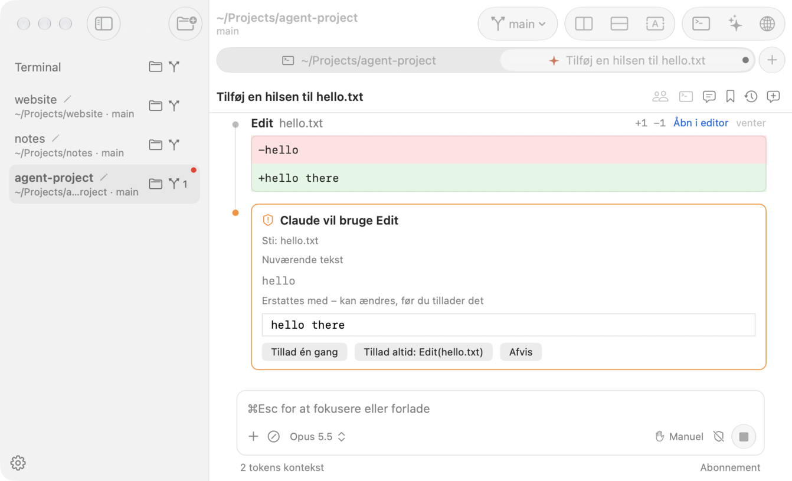

<p>&nbsp;&nbsp;&nbsp;</p>

# Tapa

**Den hurtige, native terminal til macOS, der har fået plads til dine agenter, filer og sider.**

Tapa er først og fremmest en terminal: en egen VT-kerne og en Metal-renderer, native macOS-faner og -opdelinger, en hurtig terminal, der glider ind med én genvej, shell-integration med kommandoblokke og et valgfrit inputfelt med forslag i Warps stil. Omkring det er Tapa vokset til lillesøster til [Dango](https://github.com/sventmueller/dango): en indholdsoversigt med arbejdsområder, ét pr. projektmappe, hvert med sine terminaler, agentfaner til Claude, Codex, OpenCode, Antigravity og andre ACP-agenter, browserfaner, en editor med en filliste og et Git-panel samt et Markdown-eksempel fra [Splat](https://github.com/sventmueller/splat) med formler og diagrammer. Intet, som en projektmappe konfigurerer, kører, før du har tillid til dens arbejdsområde. Tapa er skrevet i Rust med ægte AppKit-kontroller, findes på 35 sprog, kræver ingen konto og har ingen telemetri.

[](https://github.com/sventmueller/tapa/releases/latest/download/Tapa.dmg)

**[Hent Tapa.dmg](https://github.com/sventmueller/tapa/releases/latest/download/Tapa.dmg)**: signeret og notariseret af Apple, til macOS 14 eller nyere på Apple Silicon og Intel.

**Har du fundet en fejl?** [Opret et issue](https://github.com/sventmueller/tapa/issues/new/choose), og skriv, hvilken shell, hvilken agent eller hvilket program det skete med. Hvis du har glæde af Tapa, hjælper en [stjerne på GitHub](https://github.com/sventmueller/tapa) andre med at finde det.

[](https://www.rust-lang.org) [](https://www.apple.com/macos/)  [](https://github.com/madsmtm/objc2) [](https://developer.apple.com/metal/) [](https://agentclientprotocol.com)    [](#licens)

[Bahasa Indonesia](../id/README.md) · [Bahasa Melayu](../ms/README.md) · [Català](../ca/README.md) · [Čeština](../cs/README.md) · **Dansk** · [Deutsch](../de/README.md) · [English](../../../README.md) · [Español](../es/README.md) · [Français](../fr/README.md) · [Hrvatski](../hr/README.md) · [Italiano](../it/README.md) · [Magyar](../hu/README.md) · [Nederlands](../nl/README.md) · [Norsk](../no/README.md) · [Polski](../pl/README.md) · [Português (Brasil)](../pt_BR/README.md) · [Português (Portugal)](../pt_PT/README.md) · [Română](../ro/README.md) · [Slovenčina](../sk/README.md) · [Slovenščina](../sl/README.md) · [Suomi](../fi/README.md) · [Svenska](../sv/README.md) · [Tiếng Việt](../vi/README.md) · [Türkçe](../tr/README.md) · [Ελληνικά](../el/README.md) · [Русский](../ru/README.md) · [Українська](../uk/README.md) · [עברית](../he/README.md)‎ · [العربية](../ar/README.md)‎ · [हिन्दी](../hi/README.md) · [ไทย](../th/README.md) · [한국어](../ko/README.md) · [日本語](../ja/README.md) · [简体中文](../zh-Hans/README.md) · [繁體中文](../zh-Hant/README.md)

## Indhold

- [Overblik](#overblik)
- [Krav](#krav)
- [Installation](#installation)
- [Kom i gang](#kom-i-gang)
- [Arbejdsområder](#arbejdsområder)
- [Terminalen](#terminalen)
  - [Faner og opdelinger](#faner-og-opdelinger)
  - [Shell-integration og kommandoblokke](#shell-integration-og-kommandoblokke)
  - [Inputfeltet og forslag](#inputfeltet-og-forslag)
  - [Søgning, markering og kopiering](#søgning-markering-og-kopiering)
  - [Den hurtige terminal](#den-hurtige-terminal)
- [Agenter](#agenter)
- [Editor, filer og Git](#editor-filer-og-git)
- [Eksempelvisninger](#eksempelvisninger)
- [Browser](#browser)
- [Diktering](#diktering)
- [Indstillinger](#indstillinger)
- [Udseende og tilgængelighed](#udseende-og-tilgængelighed)
- [Sprog](#sprog)
- [Tastaturgenveje](#tastaturgenveje)
- [Tillid](#tillid)
- [Fortrolighed og sikkerhed](#fortrolighed-og-sikkerhed)
- [Kendte begrænsninger](#kendte-begrænsninger)
- [Til udviklere](#til-udviklere)
  - [Tredjepartskomponenter](#tredjepartskomponenter)
- [Licens](#licens)

## Overblik

- **En hurtig terminal med egen kerne.** Tapa fortolker med sin egen VT-kerne og tegner med Metal på en tråd pr. skærm, i skærmens takt og kun det, der er ændret. Den består 262 esctest-kontroller, hvor Alacrittys kerne består 121, og hver ændring af den måles mod en fastlåst Ghostty.
- **Native helt ind til benet.** Ægte macOS-faner, gendannelse af vinduer, menuer, menuen Tjenester, notifikationer, sikker indtastning via tastatur, diktering og indtastningsmetoder. Ingen Electron, og WebKit kun dér, hvor en side eller et eksempel har brug for det.
- **Arbejdsområder.** Indholdsoversigten rummer ét arbejdsområde pr. projektmappe, hvert med sine egne faner, sin egen branch og sine egne paneler. Arbejdsområdet "Terminal" øverst starter forfra hver gang; alle andre bliver, til du fjerner dem.
- **Agenter i en native chatvisning.** Claude, Codex, OpenCode, Antigravity, Gemini CLI og andre agenter fra Agent Client Protocol kører i deres egne faner, med svar, værktøjskald, diffs og anmodninger om tilladelse i én tidslinje. Tapa installerer og opdaterer dem, når du beder om det.
- **Shell-integration og kommandoblokke** til zsh, bash og fish, også over `ssh`: spring fra prompt til prompt, marker, kopier, gem og fold en kommandos output, og se mislykkede kommandoer og hvor lang tid hver enkelt tog.
- **Et inputfelt som Warps, hvis du vil have det.** Rediger kommandolinjen som tekst, med forslag fra din historik, fra beskrivelser af mere end 700 kommandolinjeværktøjer og fra projektets tilstand, alt sammen på din Mac.
- **Filer, Git og en browser ved siden af shellen.** En editor med syntaksfarver, en filliste, et Git-panel med klargøring, commits, branches og worktrees, et Markdown-eksempel med formler og diagrammer samt browserfaner.
- **Forsigtig med dine mapper.** Et arbejdsområde, du ikke har tillid til, starter intet, som dets mappe konfigurerer: ingen Git-hooks, ingen MCP-servere fra projektet, ingen projektindstillinger til agenter, intet JavaScript i dets filsider.
- **Privat.** Ingen konto, ingen telemetri. Tapa går kun på nettet, når du beder om det, og den gendannede historik på disken er krypteret med en nøgle i din nøglering.
- **På dit sprog.** Brugerfladen findes på 35 sprog: arabisk, catalansk, kinesisk (forenklet), kinesisk (traditionelt), kroatisk, tjekkisk, dansk, hollandsk, engelsk, finsk, fransk, tysk, græsk, hebraisk, hindi, ungarsk, indonesisk, italiensk, japansk, koreansk, malajisk, norsk, polsk, portugisisk (Brasilien), portugisisk (Portugal), rumænsk, russisk, slovakisk, slovensk, spansk, svensk, thai, tyrkisk, ukrainsk og vietnamesisk.

## Krav

- macOS 14 Sonoma eller nyere, på Apple Silicon eller Intel. Tapa udvikles og testes på macOS 27.
- zsh, bash eller fish til shell-integrationen; andre shells kører uden den.
- Til agentfaner den agent, du vil bruge, enten allerede installeret eller installeret af Tapa, når du beder om det (se [Agenter](#agenter)).

## Installation

**Fra diskbilledet.** Hver udgivelse er et diskbillede, `Tapa-<version>.dmg`, med én universel app til Apple Silicon og Intel, signeret med et Developer ID og notariseret af Apple. Åbn det, og træk Tapa til mappen Programmer.

**Med Homebrew.** Cask'en i et eget tap installerer det samme diskbillede:

```sh
brew install --cask sventmueller/tap/tapa
```

**Opdateringer.** Tapa fra diskbilledet eller fra Homebrew holder sig selv opdateret via [Sparkle](https://sparkle-project.org). Ved anden opstart spørger programmet, om det må søge efter opdateringer af sig selv; indtil du siger ja, sender det ingen forespørgsel. **Tapa › Søg efter opdateringer…** søger med det samme. Tapa installerer kun en opdatering, hvis den bærer udviklerens signatur. Et build, du selv har lavet, har ingen opdateringsfunktion.

**Fra kildekode.** Se [Til udviklere](#til-udviklere).

**Som standardterminal.** Tapa kan åbne shellscripts (`.command`, `.tool`), mapper, der trækkes til dets symbol, og `ssh://`-links. Vælg det i Finder med **Arkiv › Vis info › Åbn i**.

## Kom i gang

1. **Vinduet** har indholdsoversigten med arbejdsområder til venstre, fanerne for det valgte arbejdsområde øverst og værktøjslinjen over dem. ⌃⌘S viser og skjuler indholdsoversigten.
2. **Et nyt arbejdsområde** får du med mappeknappen øverst i indholdsoversigten eller med **Shell › Nyt arbejdsområde…** (⇧⌘N): vælg en af de seneste mapper eller **Vælg mappe…**.
3. **Nye faner** starter i arbejdsområdets mappe: ⌘T for en terminal, knapperne til højre i værktøjslinjen for en terminal-, agent- eller browserfane, eller **+** for enden af fanelinjen.
4. **Indstillingerne** åbner med ⌘, eller tandhjulet nederst i indholdsoversigten.
5. **Kommandopaletten** (⇧⌘P) finder enhver kommando ud fra navnet, og **Find fane…** (⌘P) enhver fane i ethvert arbejdsområde.

Værktøjslinjen indeholder fra venstre branchmenuen for arbejdsområdets repository, knapperne til at dele terminalen til højre og nedad og til at vise inputfeltet, og knapperne til nye terminal-, agent- og browserfaner. Knapperne til opdelinger og inputfeltet er grå, så længe ingen terminalfane er forrest.

## Arbejdsområder

Et arbejdsområde er en mappe med dens faner. Dets række i indholdsoversigten viser navnet, mappen og Git-branchen og til højre knapperne til fillisten og Git-panelet. Et klik på en af dem viser det panel i stedet for listen over arbejdsområder; **Arbejdsområder** øverst fører tilbage.

- **Arbejdsområdet "Terminal"** ligger altid øverst. Det starter forfra ved hver opstart, i den mappe, indstillingerne angiver, med én tom terminal. Intet af det gemmes, og det kan hverken omdøbes eller fjernes.
- **Alle andre arbejdsområder bliver**, til du fjerner dem, også uden faner. Tapa husker navnet, fanerne, indholdet af terminalerne (så vidt gendannelsesindstillingerne siger), agentsessionerne og vinduets placering. Programmer, der stadig kører, afsluttes, når Tapa slutter.
- **Omdøbning.** Klik på blyanten efter navnet, klik på navnet på det valgte arbejdsområde, eller vælg **Shell › Omdøb arbejdsområde**. Navnet gemmes med det samme.
- **Status.** En grøn prik på rækken betyder, at en agent i arbejdsområdet arbejder, også med underagenter eller i baggrunden; en rød prik betyder, at en venter på dig. Terminaler markerer intet dér.
- **Skift.** ⌃⌘[ og ⌃⌘] skifter mellem arbejdsområder. Vinduet bliver på sin plads, og det valgte arbejdsområdes faner træder i stedet for de andres.
- **Worktrees.** **Nyt worktree…** i værktøjslinjens branchmenu opretter et Git-worktree på en ny branch og åbner det som et selvstændigt arbejdsområde.

Når den sidste fane i et arbejdsområde lukkes, bliver arbejdsområdet i listen. Når alle faner er lukket, forsvinder kun vinduet; Dock-symbolet eller ⌘N bringer det tilbage med dets arbejdsområder.

## Terminalen

Tapa kører på sin egen kerne, `term-vt`. Den taler xterm og VT520 med Kitty-tastaturprotokollen, OSC 8-hyperlinks, adgang til udklipsholderen via OSC 52 med separat tilladelse til læsning, synkroniseret output, farvede og bølgede understregninger, truecolor, farveforespørgsler, meddelelser om lys og mørk tilstand til programmer, bracketed paste, fokushændelser og musrapportering. Teksten ombrydes igen, når vinduet ændrer størrelse, historikken medregnet. Ligaturer, skriftfunktioner, Nerd Font-symboler uden patchede skrifter samt pixelnøjagtige rammelinjer, Powerline- og punktskrifttegn er indbygget.

### Faner og opdelinger

- **Faner** er macOS' egne: træk dem for at ændre rækkefølgen eller ud i et selvstændigt vindue, **Vis alle faner** (⇧⌘\\), ⌘1 til ⌘8, ⌘9 for den sidste fane og ⇧⌘[ / ⇧⌘] for at skifte. Hver fane viser symbolet for sin type foran sin titel.
- **Opdelinger.** **Del til højre** (⌘D eller ⌃⌘T) og **Del nedad** (⇧⌘D eller ⌃⌥⌘T), indlejret så dybt, du vil. Træk i en skillelinje, flyt den med ⌃⌘ og piletasterne, **Maksimer rude** (⌃⇧⌘↩), **Udlign ruder** (⌃⌘=), og skift mellem ruder med ⌘[ og ⌘].
- **Arbejdsmappe.** Nye faner, vinduer og opdelinger starter i mappen for den forreste terminal; indstillingerne afgør det for hver af de tre.
- **Lukning.** Tapa spørger, før det lukker en fane, et vindue eller appen, mens et program kører i den.
- **Gendannelse.** Efter en genstart kommer arbejdsområder, faner, ruder, mapper og de sidste linjer i hver terminal tilbage. Hemmeligheder som tokens og adgangskoder maskeres, før noget gemmes.

### Shell-integration og kommandoblokke

Tapa sætter selv sin shell-integration op til zsh, bash og fish uden at røre dine konfigurationsfiler og tager den med, når du bruger `ssh` til en anden vært. Med den danner hver kommando og dens output en blok:

- **Prompter.** ⌘↑ og ⌘↓ springer til forrige og næste prompt. Et klik i kommandolinjen flytter markøren dertil.
- **Blokke.** **Marker blok** (⇧⌘A), **Kopier output** (⌥⌘C), **Gem output…** (⌥⌘S) og **Fold blok sammen/ud** (⇧⌘↩). Over blokken under markøren viser knapper dens status, dens varighed og de samme handlinger.
- **Mislykkede kommandoer** markeres, og den kommando, der stadig kører, bliver synlig øverst, mens dens output ruller.
- **Bogmærker.** **Sæt/fjern bogmærke** (⇧⌘M) markerer en linje; ⇧⌘↑ og ⇧⌘↓ springer mellem bogmærker.
- **Notifikationer** vises, når et program beder om en (OSC 9 og OSC 777), og terminalen ikke er forrest, og en statuslinje (OSC 9;4) vises i fanen og på Dock-symbolet.

### Inputfeltet og forslag

Inputfeltet gør kommandolinjen til et tekstfelt nederst i ruden, som i Warp, med chips for mappen og Git-branchen ovenover. **Vis/skjul inputfelt** (⌘I) eller knappen i værktøjslinjen slår det til og fra for én terminal; **Indstillinger › Input** slår det til for nye terminaler. Det kræver shell-integrationen og træder til side for fuldskærmsprogrammer som vim, htop eller claude.

- **Retur** sender hele feltet til shellen, tekst over flere linjer som én indsættelse; shellen kører og husker den som sædvanligt. Hvis shellen beder om mere, giver feltet tasterne tilbage til den indtil næste prompt.
- **↑, ↓ og ⌃R** søger i din historik, med den mappe, den branch og den afslutningskode, hver kommando kørte med.
- **Tab** fuldfører med beskrivelser af mere end 700 kommandolinjeværktøjer, stier og aktuelle værdier som Git-branches, Docker-containere, kubectl-ressourcer, SSH-værter, `package.json`-scripts og mål for make, just og cargo.
- **Vim-taster** i feltet er en kontakt i de samme indstillinger.
- **Den næste kommando, før du skriver**: hvad der plejer at følge i dette projekt (efter `git add` kommer `git commit`), hvad projektets tilstand kræver (en låsefil, der er nyere end `node_modules`), og en rettelse efter "command not found", ud fra tastefejl eller dit lokale Homebrew-indeks.

Uden inputfeltet vises forslag som grå tekst bag markøren, og → tager dem. Shells med deres egne autoforslag, som fish eller zsh-autosuggestions, beholder deres. Forslag bruger aldrig netværket, og de starter kun programmer fra din egen `PATH`, aldrig fra projektmappen.

**Indsættelse.** Indsættelser over flere linjer kan vises, før de kører (**Vis indsættelse af flere linjer først**). Filer, der trækkes til en terminal, ankommer som stier i anførselstegn; ⌥←/→, ⌘←/→ og ⌘⌫ flytter og sletter ord for ord og linje for linje som i ethvert tekstfelt på Mac.

### Søgning, markering og kopiering

- **Find…** (⌘F) søger i historikken med regulære udtryk, store og små bogstaver og hele ord og tæller resultaterne; rullepanelet markerer dem sammen med prompterne og fejlene.
- **Smart markering.** Et dobbeltklik markerer en URL, en sti, en hash eller en IP-adresse som helhed, og træk med ⌥ markerer et rektangel. Links findes også uden OSC 8; ⌘-klik åbner dem, og en sti i Dango, hvis det er installeret.
- **Vælg med tastaturet** (⇧⌘C) flytter en markering med Vims taster.
- **Kopiér med formatering** (⇧⌥⌘C) bevarer farver og typografi; kopiering ved markering er en indstilling. **Ryd** (⌘K) rydder terminalen.

### Den hurtige terminal

**Vis/skjul hurtig terminal** (⌃⌥⌘Space) lader en terminal glide ind fra en kant af skærmen, over andre apps og over fuldskærmsområder, uden at skifte app. Kanten, størrelsen og om den skjules, når du klikker et andet sted, er indstillinger. Dens sessioner kører videre, mens den er skjult.

## Agenter

En agentfane kører en kodeagent i arbejdsområdets mappe, i den native agentvisning fra Dango.

| Agent | Sådan kører den | Hvad den kræver |
|---|---|---|
| Claude | kommandoen `claude`, som der tales med over dens stream-json-protokol | `claude` installeret og logget ind; Tapa installerer den med Claudes eget installationsprogram, når du beder om det |
| Codex | `codex app-server` eller `codex-acp` til en ældre Codex | `codex` logget ind; Tapa installerer den fastlåste adapter, når du beder om det |
| OpenCode | `opencode serve` eller `opencode acp` til en ældre OpenCode | din egen `opencode` i `PATH` eller den fastlåste download |
| Antigravity | `agy acp` | din egen `agy` i `PATH` eller den fastlåste download |
| Gemini CLI | `gemini --acp`, tilbudt, når du slår den til under **Indstillinger › Agenter** | din egen `gemini` eller den fastlåste download |
| Andre ACP-agenter | fra ACP-registret, kun indlæst, når du beder om det | det, registerposten angiver; poster uden kontrolsum installeres først, når du har bekræftet |

Tapa bruger hver agents eget login og gemmer ingen loginoplysninger til agenter. En agent, der findes i din login-shells `PATH`, kommer først; ellers kører Tapa den version, det har installeret i sin egen datamappe, aldrig et program fra arbejdsområdet.

- **Tidslinjen** viser svar, værktøjskald med deres output og diffs, spørgsmål og anmodninger om tilladelse. **Tillad én gang**, **Tillad altid** og **Afvis** besvarer en anmodning, og en redigering kan ændres, før du tillader den.
- **Status.** Fanen og arbejdsområdets række viser en grøn prik, mens agenten arbejder, og en rød, mens den venter på dig, og en notifikation giver dig besked, når den venter, mens du kigger et andet sted.
- **Beskedfeltet** nederst tager imod din prompt, filer, der trækkes til det, og diktering. ⌘Esc flytter tastaturfokus ind i det og tilbage. Modellen og tilladelsestilstanden kan vælges dér for sessionen.
- **Indstillinger › Agenter** fastsætter for nye sessioner tilladelsestilstanden (Claude, Codex), modellen (Claude, Codex, OpenCode) og tænkeindsatsen (Claude, Codex), og hvilke agenter nye faner tilbyder. Dér kan du se, hvor hver agents program ligger, med **Installer…**, **Opdater til …** og **Tilbage til …** for den forrige version, og **Indlæs register** for ACP-registret. De regler, Claude har gemt med "Tillad altid", kan ses og fjernes dér.
- **Kontrollerede downloads.** Arkiver kontrolleres mod deres SHA-256, npm-pakker mod integriteten i deres låsefil, og pakker uden fast version afvises. En manglende agent tilbyder også sin installation i sin egen fane.

## Editor, filer og Git

- **Fillisten** for et arbejdsområde viser dets mappe som et træ, opdateret, når filer ændres, med filer, som Git ignorerer, nedtonet, hvis du ønsker det. Et klik åbner en fil som en eksempelfane, som det næste klik erstatter, indtil du redigerer den; et dobbeltklik beholder den.
- **Editoren** åbner filer i arbejdsområdets faner, med syntaksfarver, flere indsættelsesmærker, foldning, indrykningen fra `.editorconfig`, valgfrie Vim-taster og markeringer af det, der er ændret siden seneste commit. Den opdager, når en fil er ændret på disken eller indeholder konfliktmarkører. Markdown-filer får en formatlinje og **Åbn i Splat**. **Gem** (⌘S), **Gem som…** og **Gem alle** virker som sædvanligt, og Tapa spørger, før det lukker tekst, der ikke er gemt.
- **Efter et nedbrud** kommer tekst, der ikke var gemt, tilbage: Tapa holder krypterede kopier af den, mens du skriver.
- **Git-panelet** viser klargjorte og ikke-klargjorte ændringer, klargør filer og enkelte hunks og fjerner dem igen, committer (⌘↩), retter den seneste commit, committer og pusher, henter og håndterer branches, stashes, cherry-picks og konflikter, med commithistorikken nedenunder. Et klik på en fil viser dens diff.
- **Branchmenuen** i værktøjslinjen skifter og opretter branches og laver worktrees.

Editoren starter ingen formatering og ingen sprogserver. Til en fuld IDE med sprogservere og en debugger kan du bruge [Dango](https://github.com/sventmueller/dango).

## Eksempelvisninger

- **Markdown** vises ved siden af sin editor via Splats renderer: GitHub Flavored Markdown med formler, diagrammer og billeder, der ruller afsnit for afsnit med teksten.
- **Billeder** åbner i en selvstændig fane, PDF'er via PDFKit, og lyd, film, skrifter og kontordokumenter via Kvikbillede.
- **Isoleret afkodning.** Ethvert billede fra en upålidelig kilde (projektfiler, Markdown, vedhæftninger fra agenter og indsættelser) afkodes i Splats tjeneste `Decoder.xpc`, i en selvstændig App Sandbox uden filer eller netværk, aldrig i appen.

## Browser

**Ny browserfane** (⇧⌘B) åbner en WebKit-fane i arbejdsområdet. Adressefeltet tager imod en adresse eller søgeord til den søgemaskine, du vælger (DuckDuckGo, Google, Bing eller Startpage); ⌘L, ⌘R, ⌘[ og ⌘] virker som i Safari. Sider fra `localhost` kører som sædvanligt, til dit projekts udviklingsserver. HTML-filer i et arbejdsområde må kun læse deres egen mappe, og i et arbejdsområde, du ikke har tillid til, kører de intet JavaScript.

## Diktering

Diktér i en agents beskedfelt eller i editoren med mikrofonknappen eller **Rediger › Start diktering** (⌃⌥D). Talegenkendelsen kommer fra [Lowspeak](https://github.com/sventmueller/lowspeak), som ikke behøver at være installeret. **Indstillinger › Diktering** vælger onlinetransskription med OpenAI eller Groq eller lokale Whisper- og Parakeet-modeller, der holder optagelsen på din Mac, sproget, efterbehandlingen, mikrofonen og dit eget ordforråd. Nøglerne til OpenAI og Groq opbevares i din nøglering. Diktering findes kun i release-buildet.

## Indstillinger

**Tapa › Indstillinger…** (⌘,) har felterne Generelt, Skrift, Farver, Markør, Terminal, Input, Editor, Agenter, Diktering, Profiler og Tastaturgenveje. De skriver én TOML-fil, `config.toml` i Tapas mappe under `~/Library/Application Support`, som du også kan redigere i hånden; Tapa genindlæser den, mens det kører, og **Genindlæs indstillinger** (⇧⌘,) gør det med det samme.

- **Fire skriftstørrelser** under Generelt: Brugerflade (indholdsoversigt, paneler, filliste, Git-panel og fanetitler), Editor (tekst, linjenumre og Markdown-eksempel), Terminal og Agenter. ⌘+, ⌘− og ⌘0 ændrer størrelsen på den forreste terminal.
- **Udseende:** Lyst, Mørkt eller Som systemet.
- **Farver.** Ét tema til lys og ét til mørk tilstand, i Ghosttys temaformat, med en minimumskontrast, der holder teksten læselig med et dårligt tema. Dine egne temaer lægges i temamappen.
- **Profiler** samler skrift, farver, shell, miljø og mappe.
- **Tastaturgenveje** kan alle ændres, og konflikter vises.

## Udseende og tilgængelighed

- **Mørk tilstand** følger systemet eller dit valg; accentfarven, Reducer bevægelse og Forøg kontrast respekteres.
- **VoiceOver** læser terminalens linjer og prompter op og annoncerer nyt output; indholdsoversigten, fanerne, værktøjslinjens knapper og kortene i agenttidslinjen har navne.
- **Tastatur.** Hver kommando har et menupunkt og en genvej, og Fuld tastaturadgang når hver kontrol.
- **Størrelser.** De fire skriftstørrelser i indstillingerne skalerer brugerfladen, editoren, terminalen og agenterne uafhængigt af hinanden.
- **Fra højre mod venstre.** Brugerfladen spejles på arabisk og hebraisk, mens terminalens gitter forbliver fra venstre mod højre.

Detaljer og kendte mangler findes i [ACCESSIBILITY.md](../../../ACCESSIBILITY.md).

## Sprog

Brugerfladen er oversat til 35 sprog: arabisk, catalansk, kinesisk (forenklet), kinesisk (traditionelt), kroatisk, tjekkisk, dansk, hollandsk, engelsk, finsk, fransk, tysk, græsk, hebraisk, hindi, ungarsk, indonesisk, italiensk, japansk, koreansk, malajisk, norsk, polsk, portugisisk (Brasilien), portugisisk (Portugal), rumænsk, russisk, slovakisk, slovensk, spansk, svensk, thai, tyrkisk, ukrainsk og vietnamesisk.

Tapa følger sprogrækkefølgen i **Systemindstillinger › Generelt › Sprog & område**; dér kan du også vælge et sprog til Tapa alene under **Apps**. Findes der ingen oversættelse til dit sprog, bruger det engelsk.

## Tastaturgenveje

| Handling | Genvej |
|---|---|
| Nyt vindue, nyt arbejdsområde, ny fane | ⌘N, ⇧⌘N, ⌘T |
| Ny browserfane | ⇧⌘B |
| Ny fil, åbn fil | ⌥⌘N, ⌘O |
| Luk rude eller fane, luk fane, luk vindue | ⌘W, ⌥⌘W, ⇧⌘W |
| Del til højre, del nedad | ⌘D eller ⌃⌘T, ⇧⌘D eller ⌃⌥⌘T |
| Maksimer rude, udlign ruder, luk rude | ⌃⇧⌘↩, ⌃⌘=, ⌃⇧⌘W |
| Flyt en skillelinje | ⌃⌘←, ⌃⌘→, ⌃⌘↑, ⌃⌘↓ |
| Næste, forrige rude | ⌘], ⌘[ |
| Næste, forrige fane; fane 1 til 8, sidste fane | ⇧⌘], ⇧⌘[; ⌘1 til ⌘8, ⌘9 |
| Næste, forrige arbejdsområde | ⌃⌘], ⌃⌘[ |
| Find fane, kommandopalet | ⌘P, ⇧⌘P |
| Vis eller skjul indholdsoversigten, inputfeltet | ⌃⌘S, ⌘I |
| Hurtig terminal | ⌃⌥⌘Space |
| Find, find næste, find forrige | ⌘F, ⌘G, ⇧⌘G |
| Forrige, næste prompt | ⌘↑, ⌘↓ |
| Marker blok, kopier output, gem output, fold blok | ⇧⌘A, ⌥⌘C, ⌥⌘S, ⇧⌘↩ |
| Sæt eller fjern et bogmærke; forrige, næste bogmærke | ⇧⌘M; ⇧⌘↑, ⇧⌘↓ |
| Vælg med tastaturet | ⇧⌘C |
| Kopiér med formatering | ⇧⌥⌘C |
| Ryd | ⌘K |
| Top, bund, side op, side ned | ⌘Home, ⌘End, ⌘PageUp, ⌘PageDown |
| Større, mindre, original størrelse (terminal) | ⌘+, ⌘−, ⌘0 |
| Beskedfeltet i en agentfane | ⌘Esc |
| Start diktering | ⌃⌥D |
| Indstillinger, genindlæs indstillinger | ⌘,, ⇧⌘, |

Hver genvej kan ændres under **Indstillinger › Tastaturgenveje** eller i afsnittet `[keys]` i indstillingsfilen.

## Tillid

En projektmappe kan få programmer til at køre, så snart noget starter i den: Git-hooks og repositoryindstillinger som `core.fsmonitor`, agenthooks, MCP-servere fra projektet og projektindstillinger til agenter. Derfor har et nyt arbejdsområde ikke tillid.

- **Uden tillid:** agenter starter uden projektets hooks, MCP-servere og konfiguration (Claude med `--setting-sources=user --strict-mcp-config`, Codex med mappen markeret som upålidelig, OpenCode uden projektets konfiguration). Git kører neutraliseret: ingen hooks, filtre, diff-drivere, fsmonitor, `sshCommand` eller pager, og kun globale credential helpers. HTML-filer åbner uden JavaScript. Git-panelet og agentfanen siger det og tilbyder at give arbejdsområdet tillid.
- **Med tillid:** **Shell › Stol på arbejdsområdet** indlæser alt det, som mappen har tænkt det. **Fjern tillid** tager det tilbage. Tillid gemmes pr. arbejdsområde.

Uanset tilliden kører Tapa aldrig af sig selv et program fra en projektmappe: forslag starter kun programmer fra din `PATH` uden for projektet, og indholdsoversigten læser Git-tilstanden fra filerne i `.git`. Et arbejdsområde i din hjemmemappe, som "Terminal", er intet projekt: programmer under `~` som `~/.local/bin/claude` regnes dér som dine egne.

## Fortrolighed og sikkerhed

- **Ingen telemetri, ingen konto.** Tapa rapporterer intet om, hvordan du bruger det, og fungerer helt offline. Det går kun på nettet, når du beder om det: for at installere eller opdatere en agent, for at indlæse ACP-registret, for at søge efter opdateringer, når du har sagt ja, og for de sider, du åbner i en browserfane. Agenterne selv taler med deres udbydere, som de altid gør.
- **Historikken på disken** til gendannelse af sessioner er krypteret med en nøgle i din nøglering, kan slås fra, og hemmeligheder som API-nøgler, tokens og adgangskoder maskeres, før den skrives. Kopierne af tekst i editoren, der ikke er gemt, er krypteret med den samme nøgle.
- **Sikker indtastning via tastatur** slår sig selv til ved adgangskodeprompter og kan slås permanent til i appmenuen.
- **Escape-sekvenser**, der kunne lække eller indsprøjte noget, som titelrapporter, læsning af udklipsholderen og indsættelsestricks, blokeres eller kræver først din godkendelse. Parseren fuzzes i CI.
- **Isoleret afkodning** af billeder fra upålidelige kilder, se [Eksempelvisninger](#eksempelvisninger).
- **Kodesignering** med Hardened Runtime. macOS tilskriver Tapa adgangen for programmerne i en terminal, så appen har en brugsbeskrivelse for hver beskyttet tjeneste.

Sikkerhedsproblemer rapporteres fortroligt, se [SECURITY.md](../../../SECURITY.md).

## Kendte begrænsninger

- **Endnu ingen indlejrede billeder** i terminalen: Kitty-grafik, Sixel og iTerm2-billeder er planlagt efter 1.0.
- **Ingen tmux-kontroltilstand**, og sessioner overlever ikke, at Tapa afsluttes.
- **Tekst fra højre mod venstre** forbliver fra venstre mod højre i terminalens gitter.
- **⌘+ og ⌘−** ændrer kun den forreste terminal.
- **Editoren** har bevidst ingen sprogservere, formateringsværktøjer eller debugger; Dango har dem.
- **Diktering** findes kun i release-buildet, ikke i et debug-build.
- **VoiceOver** er endnu ikke kontrolleret fra ende til anden af et menneske.

## Til udviklere

Du skal bruge macOS 14 eller nyere med Xcode Command Line Tools, Rust, som `rust-toolchain.toml` angiver det (rustup med begge Mac-targets til det universelle build), checkouts af [splat](https://github.com/sventmueller/splat) og [lowspeak](https://github.com/sventmueller/lowspeak) ved siden af dette (`../splat`, `../lowspeak`) og cmake til builds med diktering.

| Kommando | Hvad den gør |
|---|---|
| `make help` | viser targets |
| `cargo xtask run` | bygger debug-appen og åbner den |
| `make build` | bygger release-appen med diktering i `target/release`, ad hoc-signeret til denne Mac |
| `make lint` | formatering, clippy med advarsler som fejl, filernes form og brugerfladens tekster |
| `make check` | `lint`, derefter alle tests; kræver intet vindue og intet netværk |
| `make selftest STEPS="split_right,type:ls\n,shot:x"` | styrer appen og efterlader billeder af vinduer i `target/selftest/` |
| `make esctest`, `make vttest` | kører esctest og vttest mod begge kerner i appen |
| `make perf` | benchmarken mod en fastlåst Ghostty; kun meningsfuld på en Mac, der ellers ikke laver noget |
| `make fuzz` | fuzz-targets med cargo-fuzz |
| `make release` | en prøvekørsel af udgivelsen: den universelle app med diktering, dens diskbillede, opdateringsfeed og cask i `target/release-dry-run`; sender intet nogen steder hen |
| `make release-notarized` | den aktuelle version, signeret med Developer ID, notariseret af Apple og med vedhæftet billet, i `dist/`; `Cargo.toml` uændret |
| `make deploy` | notariserer den næste version, committer `Cargo.toml`, uploader en kladde til udgivelsen, pusher `main` og tagget og udgiver derefter udgivelsen; se [docs/development.md](../../../docs/development.md#deploy) |

Hvordan du kan bidrage, står i [CONTRIBUTING.md](../../../CONTRIBUTING.md). Hver tekst i brugerfladen har tysk som nøgle med en oversættelse til alle 35 sprog; `cargo xtask strings` fejler, hvis en mangler.

### Tredjepartskomponenter

| Komponent | Bruges til | Licens |
|---|---|---|
| [objc2](https://github.com/madsmtm/objc2) og dens framework-crates | AppKit, Metal, WebKit og de andre Apple-frameworks | MIT, Zlib eller Apache-2.0 |
| Splats crates | Markdown, eksemplet, læsning af Git, billeddekoderen og oversættelserne | MIT eller Apache-2.0 |
| [Lowspeak](https://github.com/sventmueller/lowspeak) med [whisper.cpp](https://github.com/ggml-org/whisper.cpp) | diktering | MIT |
| [Fig autocomplete specs](https://github.com/withfig/autocomplete) | forslagenes kommandobeskrivelser | MIT |
| [rusqlite](https://github.com/rusqlite/rusqlite) med SQLite | kommandohistorikken | MIT, public domain |
| [Simple Icons](https://simpleicons.org) | logoer for sprog og programmer | CC0, nogle logoer under deres egne vilkår |
| [Sparkle](https://sparkle-project.org) 2.10.1 | opdateringer af release-buildet | MIT |

## Licens

Tapa er licenseret under en af følgende

- Apache-licensen, version 2.0 ([LICENSE-APACHE](../../../LICENSE-APACHE))
- MIT-licensen ([LICENSE-MIT](../../../LICENSE-MIT))

efter eget valg. Logoer i `assets/simple-icons` har deres egne licenser, se README-filen dér.

Medmindre du udtrykkeligt angiver andet, skal ethvert bidrag, som du bevidst indsender til optagelse i Tapa, som defineret i Apache-2.0-licensen, have dobbeltlicens som ovenfor, uden yderligere vilkår eller betingelser.
