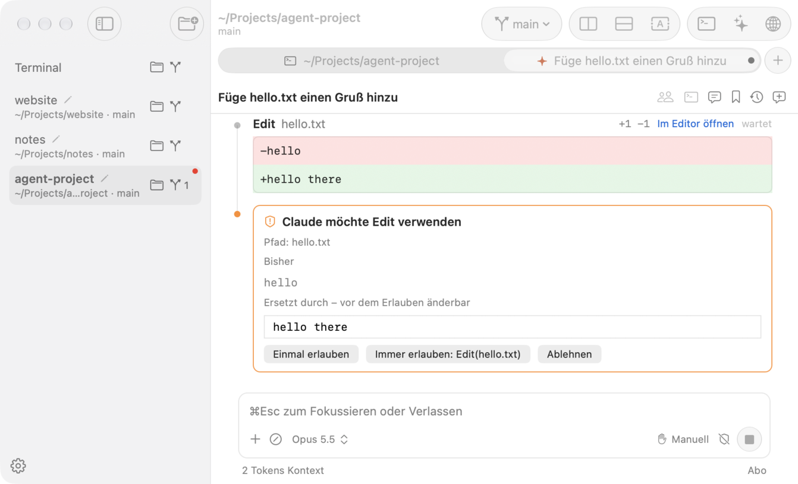

<p>&nbsp;&nbsp;&nbsp;</p>

# Tapa

**Das schnelle, native Terminal für macOS, in dem Platz für deine Agenten, Dateien und Seiten gewachsen ist.**

Tapa ist zuerst ein Terminal: ein eigener VT-Kern und ein Metal-Renderer, native macOS-Tabs und -Teilungen, ein schnelles Terminal, das mit einem Kurzbefehl hereingleitet, Shell-Integration mit Befehlsblöcken und ein optionales Eingabefeld mit Vorschlägen im Stil von Warp. Darum herum ist Tapa zur kleinen Schwester von [Dango](https://github.com/sventmueller/dango) gewachsen: eine Seitenleiste mit Arbeitsbereichen, einer je Projektordner, jeder mit seinen Terminals, Agenten-Tabs für Claude, Codex, OpenCode, Antigravity und andere ACP-Agenten, Browser-Tabs, einem Editor mit Dateiliste und Git-Panel und einer Markdown-Vorschau von [Splat](https://github.com/sventmueller/splat) mit Formeln und Diagrammen. Nichts, was ein Projektordner festlegt, läuft, bevor du seinem Arbeitsbereich vertraust. Tapa ist in Rust auf echten AppKit-Steuerelementen geschrieben, spricht 35 Sprachen, braucht kein Konto und hat keine Telemetrie.

[](https://github.com/sventmueller/tapa/releases/latest/download/Tapa.dmg)

**[Tapa.dmg laden](https://github.com/sventmueller/tapa/releases/latest/download/Tapa.dmg)**: signiert und von Apple notarisiert, für macOS 14 oder neuer auf Apple Silicon und Intel.

**Fehler gefunden?** [Eröffne ein Issue](https://github.com/sventmueller/tapa/issues/new/choose) und schreib dazu, mit welcher Shell, welchem Agenten oder welchem Programm es passiert ist. Wenn dir Tapa nützt, hilft ein [Stern auf GitHub](https://github.com/sventmueller/tapa) anderen, es zu finden.

[](https://www.rust-lang.org) [](https://www.apple.com/macos/)  [](https://github.com/madsmtm/objc2) [](https://developer.apple.com/metal/) [](https://agentclientprotocol.com)    [](#lizenz)

[Bahasa Indonesia](../id/README.md) · [Bahasa Melayu](../ms/README.md) · [Català](../ca/README.md) · [Čeština](../cs/README.md) · [Dansk](../da/README.md) · **Deutsch** · [English](../../../README.md) · [Español](../es/README.md) · [Français](../fr/README.md) · [Hrvatski](../hr/README.md) · [Italiano](../it/README.md) · [Magyar](../hu/README.md) · [Nederlands](../nl/README.md) · [Norsk](../no/README.md) · [Polski](../pl/README.md) · [Português (Brasil)](../pt_BR/README.md) · [Português (Portugal)](../pt_PT/README.md) · [Română](../ro/README.md) · [Slovenčina](../sk/README.md) · [Slovenščina](../sl/README.md) · [Suomi](../fi/README.md) · [Svenska](../sv/README.md) · [Tiếng Việt](../vi/README.md) · [Türkçe](../tr/README.md) · [Ελληνικά](../el/README.md) · [Русский](../ru/README.md) · [Українська](../uk/README.md) · [עברית](../he/README.md)‎ · [العربية](../ar/README.md)‎ · [हिन्दी](../hi/README.md) · [ไทย](../th/README.md) · [한국어](../ko/README.md) · [日本語](../ja/README.md) · [简体中文](../zh-Hans/README.md) · [繁體中文](../zh-Hant/README.md)

## Inhalt

- [Funktionen im Überblick](#funktionen-im-überblick)
- [Voraussetzungen](#voraussetzungen)
- [Installation](#installation)
- [Erste Schritte](#erste-schritte)
- [Arbeitsbereiche](#arbeitsbereiche)
- [Das Terminal](#das-terminal)
  - [Tabs und Teilungen](#tabs-und-teilungen)
  - [Shell-Integration und Befehlsblöcke](#shell-integration-und-befehlsblöcke)
  - [Das Eingabefeld und Vorschläge](#das-eingabefeld-und-vorschläge)
  - [Suchen, Auswählen und Kopieren](#suchen-auswählen-und-kopieren)
  - [Das schnelle Terminal](#das-schnelle-terminal)
- [Agenten](#agenten)
- [Editor, Dateien und Git](#editor-dateien-und-git)
- [Vorschauen](#vorschauen)
- [Browser](#browser)
- [Diktat](#diktat)
- [Einstellungen](#einstellungen)
- [Darstellung und Bedienungshilfen](#darstellung-und-bedienungshilfen)
- [Sprachen](#sprachen)
- [Kurzbefehle](#kurzbefehle)
- [Vertrauen](#vertrauen)
- [Datenschutz und Sicherheit](#datenschutz-und-sicherheit)
- [Bekannte Einschränkungen](#bekannte-einschränkungen)
- [Für Entwickler](#für-entwickler)
  - [Komponenten von Drittanbietern](#komponenten-von-drittanbietern)
- [Lizenz](#lizenz)

## Funktionen im Überblick

- **Ein schnelles Terminal mit eigenem Kern.** Tapa parst mit seinem eigenen VT-Kern und zeichnet mit Metal auf einem Thread je Bildschirm, im Takt des Bildschirms und nur, was sich geändert hat. Es besteht 262 esctest-Prüfungen, wo der Kern von Alacritty 121 besteht, und jede Änderung daran wird an einem festgelegten Ghostty gemessen.
- **Durch und durch nativ.** Echte macOS-Tabs, Fensterwiederherstellung, Menüs, das Menü „Dienste“, Mitteilungen, Sichere Tastatureingabe, Diktat und Eingabemethoden. Kein Electron, und WebKit nur dort, wo eine Seite oder eine Vorschau es braucht.
- **Arbeitsbereiche.** Die Seitenleiste hält einen Arbeitsbereich je Projektordner, jeder mit eigenen Tabs, eigenem Branch und eigenen Panels. Der Arbeitsbereich „Terminal“ ganz oben beginnt jedes Mal neu; alle anderen bleiben, bis du sie entfernst.
- **Agenten in einer nativen Chat-Ansicht.** Claude, Codex, OpenCode, Antigravity, Gemini CLI und andere Agenten des Agent Client Protocol laufen in eigenen Tabs, mit Antworten, Werkzeugaufrufen, Diffs und Berechtigungsanfragen in einer Zeitleiste. Tapa installiert und aktualisiert sie, wenn du es möchtest.
- **Shell-Integration und Befehlsblöcke** für zsh, bash und fish, auch über `ssh`: Spring von Prompt zu Prompt, wähle die Ausgabe eines Befehls aus, kopiere, sichere und klappe sie ein, und sieh, welche Befehle fehlgeschlagen sind und wie lange jeder gedauert hat.
- **Ein Eingabefeld wie bei Warp, wenn du willst.** Bearbeite die Befehlszeile als Text, mit Vorschlägen aus deinem Verlauf, aus Beschreibungen von mehr als 700 Befehlszeilenwerkzeugen und aus dem Zustand des Projekts, alles auf deinem Mac.
- **Dateien, Git und ein Browser neben der Shell.** Ein Editor mit Syntaxfarben, eine Dateiliste, ein Git-Panel mit Vormerken, Commits, Branches und Worktrees, eine Markdown-Vorschau mit Formeln und Diagrammen und Browser-Tabs.
- **Vorsichtig mit deinen Ordnern.** Ein Arbeitsbereich, dem du nicht vertraust, startet nichts, was sein Ordner festlegt: keine Git-Hooks, keine MCP-Server des Projekts, keine Projekteinstellungen für Agenten, kein JavaScript in seinen Dateiseiten.
- **Privat.** Kein Konto, keine Telemetrie. Tapa geht nur ins Netz, wenn du es darum bittest, und der wiederhergestellte Verlauf auf der Festplatte ist mit einem Schlüssel aus deinem Schlüsselbund verschlüsselt.
- **In deiner Sprache.** Die Oberfläche gibt es in 35 Sprachen: Arabisch, Katalanisch, Chinesisch (vereinfacht), Chinesisch (traditionell), Kroatisch, Tschechisch, Dänisch, Niederländisch, Englisch, Finnisch, Französisch, Deutsch, Griechisch, Hebräisch, Hindi, Ungarisch, Indonesisch, Italienisch, Japanisch, Koreanisch, Malaiisch, Norwegisch, Polnisch, Portugiesisch (Brasilien), Portugiesisch (Portugal), Rumänisch, Russisch, Slowakisch, Slowenisch, Spanisch, Schwedisch, Thai, Türkisch, Ukrainisch und Vietnamesisch.

## Voraussetzungen

- macOS 14 Sonoma oder neuer, auf Apple Silicon oder Intel. Tapa wird auf macOS 27 entwickelt und getestet.
- zsh, bash oder fish für die Shell-Integration; andere Shells laufen ohne sie.
- Für Agenten-Tabs der Agent, den du nutzen willst, entweder schon installiert oder von Tapa installiert, wenn du darum bittest (siehe [Agenten](#agenten)).

## Installation

**Vom Disk-Image.** Jede Version ist ein Disk-Image, `Tapa-<version>.dmg`, mit einer universellen App für Apple Silicon und Intel, mit einer Developer ID signiert und von Apple notarisiert. Öffne es und ziehe Tapa auf den Ordner „Programme“.

**Mit Homebrew.** Das Cask in einem eigenen Tap installiert dasselbe Disk-Image:

```sh
brew install --cask sventmueller/tap/tapa
```

**Updates.** Tapa vom Disk-Image oder von Homebrew hält sich mit [Sparkle](https://sparkle-project.org) selbst aktuell. Beim zweiten Start fragt es, ob es selbstständig nach Updates suchen darf; bis du zustimmst, stellt es keine Anfrage. **Tapa › Nach Updates suchen …** sucht sofort. Tapa installiert ein Update nur, wenn es die Signatur des Entwicklers trägt. Ein selbst gebautes Tapa hat keinen Updater.

**Aus dem Quellcode.** Siehe [Für Entwickler](#für-entwickler).

**Als Standard-Terminal.** Tapa kann Shell-Skripte (`.command`, `.tool`), auf sein Symbol gezogene Ordner und `ssh://`-Links öffnen. Wähle es im Finder unter **Ablage › Informationen › Öffnen mit**.

## Erste Schritte

1. **Das Fenster** hat links die Seitenleiste mit den Arbeitsbereichen, oben die Tabs des ausgewählten Arbeitsbereichs und darüber die Symbolleiste. ⌃⌘S blendet die Seitenleiste ein und aus.
2. **Einen neuen Arbeitsbereich** bekommst du über die Ordnertaste oben in der Seitenleiste oder **Shell › Neuer Arbeitsbereich …** (⇧⌘N): Wähle einen der zuletzt benutzten Ordner oder **Ordner wählen …**.
3. **Neue Tabs** beginnen im Ordner des Arbeitsbereichs: ⌘T für ein Terminal, die Tasten rechts in der Symbolleiste für ein Terminal, einen Agenten oder einen Browser-Tab, oder das **+** am Ende der Tableiste.
4. **Die Einstellungen** öffnest du mit ⌘, oder dem Zahnrad unten in der Seitenleiste.
5. **Die Befehlspalette** (⇧⌘P) findet jeden Befehl über seinen Namen, und **Tab suchen …** (⌘P) jeden Tab jedes Arbeitsbereichs.

Die Symbolleiste enthält von links das Branch-Menü des Repositorys des Arbeitsbereichs, die Tasten, um das Terminal nach rechts und nach unten zu teilen und das Eingabefeld einzublenden, und die Tasten für neue Terminal-, Agenten- und Browser-Tabs. Die Tasten für Teilungen und das Eingabefeld sind grau, solange kein Terminal-Tab vorne liegt.

## Arbeitsbereiche

Ein Arbeitsbereich ist ein Ordner mit seinen Tabs. Seine Zeile in der Seitenleiste zeigt den Namen, den Ordner und den Git-Branch und rechts die Tasten für die Dateiliste und das Git-Panel. Ein Klick auf eine davon zeigt dieses Panel anstelle der Liste der Arbeitsbereiche; **Arbeitsbereiche** oben führt zurück.

- **Der Arbeitsbereich „Terminal“** steht immer ganz oben. Er beginnt bei jedem Start neu, in dem Ordner, den die Einstellungen nennen, mit einem leeren Terminal. Nichts davon wird gespeichert, und er lässt sich weder umbenennen noch entfernen.
- **Jeder andere Arbeitsbereich bleibt**, bis du ihn entfernst, auch ohne Tabs. Tapa behält seinen Namen, seine Tabs, den Inhalt seiner Terminals (so weit die Einstellungen zur Wiederherstellung es vorsehen), seine Agentensitzungen und die Position des Fensters. Programme, die noch laufen, enden, wenn Tapa beendet wird.
- **Umbenennen.** Klick auf den Stift hinter dem Namen, klick auf den Namen des ausgewählten Arbeitsbereichs oder wähle **Shell › Arbeitsbereich umbenennen**. Der Name wird sofort gesichert.
- **Status.** Ein grüner Punkt an der Zeile bedeutet, dass ein Agent des Arbeitsbereichs arbeitet, auch mit Subagenten oder im Hintergrund; ein roter Punkt bedeutet, dass einer auf dich wartet. Terminals markieren dort nichts.
- **Wechseln.** ⌃⌘[ und ⌃⌘] wechseln zwischen Arbeitsbereichen. Das Fenster bleibt, wo es ist, und die Tabs des ausgewählten Arbeitsbereichs treten an die Stelle der anderen.
- **Worktrees.** **Neuer Worktree …** im Branch-Menü der Symbolleiste legt einen Git-Worktree auf einem neuen Branch an und öffnet ihn als eigenen Arbeitsbereich.

Wenn der letzte Tab eines Arbeitsbereichs geschlossen wird, bleibt der Arbeitsbereich in der Liste. Sind alle Tabs geschlossen, verschwindet nur das Fenster; das Dock-Symbol oder ⌘N holt es mit seinen Arbeitsbereichen zurück.

## Das Terminal

Tapa läuft auf seinem eigenen Kern, `term-vt`. Er spricht xterm und VT520 mit dem Kitty-Tastaturprotokoll, Hyperlinks über OSC 8, Zugriff auf die Zwischenablage über OSC 52 mit eigener Erlaubnis zum Lesen, synchronisierte Ausgabe, farbige und gewellte Unterstreichungen, Truecolor, Farbabfragen, Meldungen über hellen und dunklen Modus an Programme, Bracketed Paste, Fokusereignisse und Mausmeldungen. Text wird neu umbrochen, wenn sich die Fenstergröße ändert, samt Verlauf. Ligaturen, Schriftmerkmale, Nerd-Font-Symbole ohne gepatchte Schriften sowie pixelgenaue Rahmenlinien, Powerline- und Braille-Zeichen sind eingebaut.

### Tabs und Teilungen

- **Tabs** sind die von macOS: Zieh sie, um sie umzuordnen oder in ein eigenes Fenster zu holen, **Alle Tabs einblenden** (⇧⌘\\), ⌘1 bis ⌘8, ⌘9 für den letzten Tab und ⇧⌘[ / ⇧⌘] zum Wechseln. Jeder Tab zeigt das Symbol seiner Art vor seinem Titel.
- **Teilungen.** **Rechts teilen** (⌘D oder ⌃⌘T) und **Unten teilen** (⇧⌘D oder ⌃⌥⌘T), beliebig tief verschachtelt. Zieh eine Trennlinie, verschieb sie mit ⌃⌘ und den Pfeiltasten, **Bereich maximieren** (⌃⇧⌘↩), **Bereiche angleichen** (⌃⌘=), und wechsle mit ⌘[ und ⌘] zwischen Bereichen.
- **Arbeitsordner.** Neue Tabs, Fenster und Teilungen beginnen im Ordner des vorderen Terminals; die Einstellungen legen das für jede der drei fest.
- **Schließen.** Tapa fragt, bevor es einen Tab, ein Fenster oder die App schließt, solange darin ein Programm läuft.
- **Wiederherstellen.** Nach einem Neustart kommen Arbeitsbereiche, Tabs, Bereiche, Ordner und die letzten Zeilen jedes Terminals zurück. Geheimnisse wie Tokens und Passwörter werden maskiert, bevor etwas gespeichert wird.

### Shell-Integration und Befehlsblöcke

Tapa richtet seine Shell-Integration für zsh, bash und fish selbst ein, ohne deine Konfigurationsdateien anzufassen, und nimmt sie mit, wenn du per `ssh` auf einen anderen Rechner gehst. Damit bilden jeder Befehl und seine Ausgabe einen Block:

- **Prompts.** ⌘↑ und ⌘↓ springen zum vorigen und nächsten Prompt. Ein Klick in die Befehlszeile setzt den Cursor dorthin.
- **Blöcke.** **Block auswählen** (⇧⌘A), **Ausgabe kopieren** (⌥⌘C), **Ausgabe sichern …** (⌥⌘S) und **Block ein-/ausklappen** (⇧⌘↩). Über dem Block unter dem Zeiger zeigen Tasten seinen Status, seine Dauer und dieselben Aktionen.
- **Fehlgeschlagene Befehle** werden markiert, und der Befehl, der noch läuft, bleibt oben sichtbar, während seine Ausgabe scrollt.
- **Lesezeichen.** **Lesezeichen setzen/entfernen** (⇧⌘M) markiert eine Zeile; ⇧⌘↑ und ⇧⌘↓ springen zwischen Lesezeichen.
- **Mitteilungen** erscheinen, wenn ein Programm darum bittet (OSC 9 und OSC 777) und das Terminal nicht vorne liegt, und ein Fortschrittsbalken (OSC 9;4) erscheint im Tab und auf dem Dock-Symbol.

### Das Eingabefeld und Vorschläge

Das Eingabefeld macht die Befehlszeile zu einem Textfeld unten im Bereich, wie bei Warp, darüber Chips für den Ordner und den Git-Branch. **Eingabefeld ein-/ausblenden** (⌘I) oder die Taste in der Symbolleiste schaltet es für ein Terminal um; **Einstellungen › Eingabe** schaltet es für neue Terminals ein. Es braucht die Shell-Integration und tritt für Vollbildprogramme wie vim, htop oder claude zur Seite.

- **Return** schickt das ganze Feld an die Shell, mehrzeiligen Text als ein Einsetzen; die Shell führt es wie gewohnt aus und merkt es sich. Fragt die Shell nach mehr, gibt das Feld ihr die Tasten bis zum nächsten Prompt zurück.
- **↑, ↓ und ⌃R** durchsuchen deinen Verlauf, mit dem Ordner, dem Branch und dem Exit-Code, mit denen jeder Befehl lief.
- **Tab** ergänzt mit Beschreibungen von mehr als 700 Befehlszeilenwerkzeugen, Pfaden und aktuellen Werten wie Git-Branches, Docker-Containern, kubectl-Ressourcen, SSH-Hosts, `package.json`-Skripten und Zielen von make, just und cargo.
- **Vim-Tasten** im Feld sind ein Schalter in denselben Einstellungen.
- **Der nächste Befehl, bevor du tippst**: was in diesem Projekt üblicherweise folgt (nach `git add` kommt `git commit`), was der Zustand des Projekts verlangt (eine Lock-Datei, die neuer ist als `node_modules`), und eine Korrektur nach „command not found“, aus Tippfehlern oder aus deinem lokalen Homebrew-Index.

Ohne das Eingabefeld erscheinen Vorschläge als grauer Text hinter dem Cursor, und → übernimmt sie. Shells mit eigenen Autovorschlägen, etwa fish oder zsh-autosuggestions, behalten ihre. Vorschläge nutzen nie das Netz, und sie starten Programme nur aus deinem eigenen `PATH`, nie aus dem Projektordner.

**Einsetzen.** Mehrzeiliges Einsetzen lässt sich zeigen, bevor es läuft (**Mehrzeiliges Einsetzen vorher zeigen**). Auf ein Terminal gezogene Dateien kommen als Pfade in Anführungszeichen an; ⌥←/→, ⌘←/→ und ⌘⌫ bewegen und löschen wort- und zeilenweise wie in jedem Textfeld auf dem Mac.

### Suchen, Auswählen und Kopieren

- **Suchen …** (⌘F) durchsucht den Verlauf mit regulären Ausdrücken, Groß- und Kleinschreibung und ganzen Wörtern und zählt die Treffer; die Rollbalken markieren sie zusammen mit den Prompts und Fehlern.
- **Intelligente Auswahl.** Ein Doppelklick wählt eine URL, einen Pfad, einen Hash oder eine IP-Adresse als Ganzes aus, und Ziehen mit ⌥ wählt ein Rechteck aus. Links werden auch ohne OSC 8 erkannt; ⌘-Klick öffnet sie, und einen Pfad in Dango, wenn es installiert ist.
- **Auswahl mit der Tastatur** (⇧⌘C) bewegt eine Auswahl mit den Tasten von Vim.
- **Mit Formatierung kopieren** (⇧⌥⌘C) behält Farben und Stile; Kopieren beim Auswählen ist eine Einstellung. **Leeren** (⌘K) leert das Terminal.

### Das schnelle Terminal

**Schnelles Terminal ein-/ausblenden** (⌃⌥⌘Space) lässt ein Terminal von einem Bildschirmrand hereingleiten, über anderen Apps und über Vollbild-Spaces, ohne die App zu wechseln. Der Rand, seine Größe und ob es sich ausblendet, wenn du woanders hinklickst, sind Einstellungen. Seine Sitzungen laufen weiter, solange es ausgeblendet ist.

## Agenten

Ein Agenten-Tab führt einen Coding-Agenten im Ordner des Arbeitsbereichs aus, in der nativen Agentenansicht aus Dango.

| Agent | Wie er läuft | Was er braucht |
|---|---|---|
| Claude | der Befehl `claude`, angesprochen über sein stream-json-Protokoll | `claude` installiert und angemeldet; Tapa installiert es mit Claudes eigenem Installer, wenn du darum bittest |
| Codex | `codex app-server` oder `codex-acp` für ein älteres Codex | `codex` angemeldet; Tapa installiert den festgelegten Adapter, wenn du darum bittest |
| OpenCode | `opencode serve` oder `opencode acp` für ein älteres OpenCode | dein eigenes `opencode` im `PATH` oder der festgelegte Download |
| Antigravity | `agy acp` | dein eigenes `agy` im `PATH` oder der festgelegte Download |
| Gemini CLI | `gemini --acp`, angeboten, sobald du es unter **Einstellungen › Agenten** einschaltest | dein eigenes `gemini` oder der festgelegte Download |
| Andere ACP-Agenten | aus dem ACP-Register, nur geladen, wenn du darum bittest | was der Registereintrag nennt; Einträge ohne Prüfsumme werden erst installiert, nachdem du bestätigt hast |

Tapa nutzt die Anmeldung jedes Agenten selbst und speichert keine Zugangsdaten von Agenten. Ein Agent, der im `PATH` deiner Login-Shell liegt, hat Vorrang; sonst führt Tapa die Version aus, die es in seinen eigenen Datenordner installiert hat, nie ein Programm aus dem Arbeitsbereich.

- **Die Zeitleiste** zeigt Antworten, Werkzeugaufrufe mit ihrer Ausgabe und ihren Diffs, Fragen und Berechtigungsanfragen. **Einmal erlauben**, **Immer erlauben** und **Ablehnen** beantworten eine Anfrage, und eine Änderung lässt sich anpassen, bevor du sie erlaubst.
- **Status.** Der Tab und die Zeile des Arbeitsbereichs zeigen einen grünen Punkt, während der Agent arbeitet, und einen roten, während er auf dich wartet, und eine Mitteilung sagt dir Bescheid, wenn er wartet, während du woanders hinschaust.
- **Das Nachrichtenfeld** unten nimmt deinen Prompt, darauf gezogene Dateien und Diktat an. ⌘Esc bringt den Tastaturfokus hinein und wieder zurück. Das Modell und der Berechtigungsmodus lassen sich dort für die Sitzung wählen.
- **Einstellungen › Agenten** legt für neue Sitzungen den Berechtigungsmodus (Claude, Codex), das Modell (Claude, Codex, OpenCode) und den Denkaufwand (Claude, Codex) fest, und welche Agenten neue Tabs anbieten. Dort steht, wo das Programm jedes Agenten liegt, mit **Installieren …**, **Auf … aktualisieren** und **Zurück zu …** für die vorige Version, und **Register laden** für das ACP-Register. Die Regeln, die Claude mit „Immer erlauben“ gespeichert hat, lassen sich dort ansehen und entfernen.
- **Geprüfte Downloads.** Archive werden gegen ihre SHA-256-Prüfsumme geprüft, npm-Pakete gegen die Integrität in ihrer Lock-Datei, und Pakete ohne feste Version werden abgelehnt. Ein fehlender Agent bietet seine Installation auch in seinem eigenen Tab an.

## Editor, Dateien und Git

- **Die Dateiliste** eines Arbeitsbereichs zeigt seinen Ordner als Baum, aktualisiert, sobald sich Dateien ändern, mit Dateien, die Git ignoriert, abgeblendet, wenn du willst. Ein Klick öffnet eine Datei als Vorschau-Tab, den der nächste Klick ersetzt, bis du sie bearbeitest; ein Doppelklick behält sie.
- **Der Editor** öffnet Dateien in Tabs des Arbeitsbereichs, mit Syntaxfarben, mehreren Einfügemarken, Einklappen, der Einrückung aus `.editorconfig`, optionalen Vim-Tasten und Markierungen für das, was sich seit dem letzten Commit geändert hat. Er merkt, wenn sich eine Datei auf der Festplatte geändert hat oder Konfliktmarkierungen enthält. Markdown-Dateien bekommen eine Formatleiste und **In Splat öffnen**. **Sichern** (⌘S), **Sichern unter …** und **Alles sichern** funktionieren wie gewohnt, und Tapa fragt, bevor es ungesicherten Text schließt.
- **Nach einem Absturz** kommt ungesicherter Text zurück: Tapa hält verschlüsselte Kopien davon, während du tippst.
- **Das Git-Panel** zeigt vorgemerkte und nicht vorgemerkte Änderungen, merkt Dateien und einzelne Abschnitte vor und nimmt sie wieder heraus, committet (⌘↩), ergänzt den letzten Commit, committet und pusht, holt Änderungen und kümmert sich um Branches, Stashes, Cherry-Picks und Konflikte, darunter die Commit-Historie. Ein Klick auf eine Datei zeigt ihren Diff.
- **Das Branch-Menü** in der Symbolleiste wechselt und erstellt Branches und legt Worktrees an.

Der Editor startet keinen Formatierer und keinen Language Server. Für eine vollständige IDE mit Language Servern und Debugger nimm [Dango](https://github.com/sventmueller/dango).

## Vorschauen

- **Markdown** erscheint neben seinem Editor über den Renderer von Splat: GitHub Flavored Markdown mit Formeln, Diagrammen und Bildern, das Absatz für Absatz mit dem Text scrollt.
- **Bilder** öffnen sich in einem eigenen Tab, PDFs über PDFKit, und Ton, Filme, Schriften und Office-Dokumente über Quick Look.
- **Isoliertes Dekodieren.** Jedes Bild aus einer nicht vertrauenswürdigen Quelle (Projektdateien, Markdown, Anhänge von Agenten und Eingesetztes) wird in Splats Dienst `Decoder.xpc` dekodiert, in einer eigenen App-Sandbox ohne Dateien und Netz, nie in der App.

## Browser

**Neuer Browser-Tab** (⇧⌘B) öffnet einen WebKit-Tab im Arbeitsbereich. Das Adressfeld nimmt eine Adresse oder Suchbegriffe für die Suchmaschine deiner Wahl (DuckDuckGo, Google, Bing oder Startpage); ⌘L, ⌘R, ⌘[ und ⌘] funktionieren wie in Safari. Seiten von `localhost` laufen wie gewohnt, für den Entwicklungsserver deines Projekts. HTML-Dateien eines Arbeitsbereichs dürfen nur ihren eigenen Ordner lesen, und in einem Arbeitsbereich, dem du nicht vertraust, führen sie kein JavaScript aus.

## Diktat

Diktiere in das Nachrichtenfeld eines Agenten oder in den Editor, mit der Mikrofontaste oder **Bearbeiten › Diktat starten** (⌃⌥D). Die Spracherkennung stammt von [Lowspeak](https://github.com/sventmueller/lowspeak), das dafür nicht installiert sein muss. **Einstellungen › Diktat** wählt die Online-Transkription mit OpenAI oder Groq oder lokale Whisper- und Parakeet-Modelle, die die Aufnahme auf deinem Mac lassen, die Sprache, die Nachbearbeitung, das Mikrofon und deinen eigenen Wortschatz. Die Schlüssel für OpenAI und Groq liegen in deinem Schlüsselbund. Das Diktat gibt es nur im Release-Build.

## Einstellungen

**Tapa › Einstellungen …** (⌘,) hat die Bereiche Allgemein, Schrift, Farben, Cursor, Terminal, Eingabe, Editor, Agenten, Diktat, Profile und Tastenkürzel. Sie schreiben eine TOML-Datei, `config.toml` in Tapas Ordner unter `~/Library/Application Support`, die du auch von Hand bearbeiten kannst; Tapa lädt sie neu, während es läuft, und **Einstellungen neu laden** (⇧⌘,) tut das sofort.

- **Vier Schriftgrößen** unter Allgemein: Oberfläche (Seitenleiste, Panels, Dateiliste, Git-Panel und Tab-Titel), Editor (Text, Zeilennummern und Markdown-Vorschau), Terminal und Agenten. ⌘+, ⌘− und ⌘0 ändern die Größe des vorderen Terminals.
- **Erscheinungsbild:** Hell, Dunkel oder Wie das System.
- **Farben.** Ein Theme für den hellen und eines für den dunklen Modus, im Theme-Format von Ghostty, mit einem Mindestkontrast, der Text auch bei einem schwachen Theme lesbar hält. Eigene Themes kommen in den Theme-Ordner.
- **Profile** bündeln Schrift, Farben, Shell, Umgebung und Ordner.
- **Tastenkürzel** lassen sich alle ändern, und Konflikte werden angezeigt.

## Darstellung und Bedienungshilfen

- **Dark Mode** folgt dem System oder deiner Wahl; die Akzentfarbe, „Bewegung reduzieren“ und „Kontrast erhöhen“ werden berücksichtigt.
- **VoiceOver** liest die Zeilen und Prompts des Terminals vor und kündigt neue Ausgabe an; die Seitenleiste, Tabs, Tasten der Symbolleiste und die Karten der Agenten-Zeitleiste haben Namen.
- **Tastatur.** Jeder Befehl hat einen Menüeintrag und einen Kurzbefehl, und die Tastaturbedienung erreicht jedes Steuerelement.
- **Größen.** Die vier Schriftgrößen der Einstellungen skalieren Oberfläche, Editor, Terminal und Agenten unabhängig voneinander.
- **Von rechts nach links.** Auf Arabisch und Hebräisch ist die Oberfläche gespiegelt, während das Raster des Terminals von links nach rechts bleibt.

Einzelheiten und bekannte Lücken stehen in [ACCESSIBILITY.md](../../../ACCESSIBILITY.md).

## Sprachen

Die Oberfläche ist in 35 Sprachen übersetzt: Arabisch, Katalanisch, Chinesisch (vereinfacht), Chinesisch (traditionell), Kroatisch, Tschechisch, Dänisch, Niederländisch, Englisch, Finnisch, Französisch, Deutsch, Griechisch, Hebräisch, Hindi, Ungarisch, Indonesisch, Italienisch, Japanisch, Koreanisch, Malaiisch, Norwegisch, Polnisch, Portugiesisch (Brasilien), Portugiesisch (Portugal), Rumänisch, Russisch, Slowakisch, Slowenisch, Spanisch, Schwedisch, Thai, Türkisch, Ukrainisch und Vietnamesisch.

Tapa folgt der Sprachreihenfolge unter **Systemeinstellungen › Allgemein › Sprache & Region**; dort kannst du unter **Apps** auch eine Sprache nur für Tapa wählen. Gibt es keine Übersetzung für deine Sprache, nimmt es Englisch.

## Kurzbefehle

| Aktion | Kurzbefehl |
|---|---|
| Neues Fenster, neuer Arbeitsbereich, neuer Tab | ⌘N, ⇧⌘N, ⌘T |
| Neuer Browser-Tab | ⇧⌘B |
| Neue Datei, Datei öffnen | ⌥⌘N, ⌘O |
| Bereich oder Tab schließen, Tab schließen, Fenster schließen | ⌘W, ⌥⌘W, ⇧⌘W |
| Rechts teilen, unten teilen | ⌘D oder ⌃⌘T, ⇧⌘D oder ⌃⌥⌘T |
| Bereich maximieren, Bereiche angleichen, Bereich schließen | ⌃⇧⌘↩, ⌃⌘=, ⌃⇧⌘W |
| Trennlinie verschieben | ⌃⌘←, ⌃⌘→, ⌃⌘↑, ⌃⌘↓ |
| Nächster, voriger Bereich | ⌘], ⌘[ |
| Nächster, voriger Tab; Tab 1 bis 8, letzter Tab | ⇧⌘], ⇧⌘[; ⌘1 bis ⌘8, ⌘9 |
| Nächster, voriger Arbeitsbereich | ⌃⌘], ⌃⌘[ |
| Tab suchen, Befehlspalette | ⌘P, ⇧⌘P |
| Seitenleiste, Eingabefeld ein- oder ausblenden | ⌃⌘S, ⌘I |
| Schnelles Terminal | ⌃⌥⌘Space |
| Suchen, weitersuchen, rückwärts suchen | ⌘F, ⌘G, ⇧⌘G |
| Voriger, nächster Prompt | ⌘↑, ⌘↓ |
| Block auswählen, Ausgabe kopieren, Ausgabe sichern, Block einklappen | ⇧⌘A, ⌥⌘C, ⌥⌘S, ⇧⌘↩ |
| Lesezeichen setzen oder entfernen; voriges, nächstes Lesezeichen | ⇧⌘M; ⇧⌘↑, ⇧⌘↓ |
| Auswahl mit der Tastatur | ⇧⌘C |
| Mit Formatierung kopieren | ⇧⌥⌘C |
| Leeren | ⌘K |
| Anfang, Ende, Seite nach oben, Seite nach unten | ⌘Home, ⌘End, ⌘PageUp, ⌘PageDown |
| Größer, kleiner, Originalgröße (Terminal) | ⌘+, ⌘−, ⌘0 |
| Nachrichtenfeld eines Agenten-Tabs | ⌘Esc |
| Diktat starten | ⌃⌥D |
| Einstellungen, Einstellungen neu laden | ⌘,, ⇧⌘, |

Jeder Kurzbefehl lässt sich unter **Einstellungen › Tastenkürzel** oder im Abschnitt `[keys]` der Einstellungsdatei ändern.

## Vertrauen

Ein Projektordner kann Programme laufen lassen, sobald etwas in ihm startet: Git-Hooks und Repository-Einstellungen wie `core.fsmonitor`, Hooks von Agenten, MCP-Server des Projekts und Projekteinstellungen von Agenten. Deshalb ist ein neuer Arbeitsbereich nicht vertraut.

- **Nicht vertraut:** Agenten starten ohne die Hooks, MCP-Server und Konfiguration des Projekts (Claude mit `--setting-sources=user --strict-mcp-config`, Codex mit dem Ordner als nicht vertrauenswürdig markiert, OpenCode ohne die Konfiguration des Projekts). Git läuft entschärft: keine Hooks, Filter, Diff-Treiber, fsmonitor, `sshCommand` oder Pager, und nur globale Credential-Helper. HTML-Dateien öffnen sich ohne JavaScript. Das Git-Panel und der Agenten-Tab sagen das und bieten an, dem Arbeitsbereich zu vertrauen.
- **Vertraut:** **Shell › Arbeitsbereich vertrauen** lädt all das so, wie der Ordner es vorsieht. **Vertrauen entziehen** nimmt es zurück. Das Vertrauen gilt je Arbeitsbereich.

Wie auch immer es um das Vertrauen steht, Tapa führt nie von sich aus ein Programm aus einem Projektordner aus: Vorschläge starten Programme nur aus deinem `PATH` außerhalb des Projekts, und die Seitenleiste liest den Git-Zustand aus den Dateien in `.git`. Ein Arbeitsbereich in deinem Benutzerordner, wie „Terminal“, ist kein Projekt: Programme unter `~` wie `~/.local/bin/claude` zählen dort als deine eigenen.

## Datenschutz und Sicherheit

- **Keine Telemetrie, kein Konto.** Tapa meldet nichts darüber, wie du es benutzt, und funktioniert vollständig offline. Es geht nur ins Netz, wenn du darum bittest: um einen Agenten zu installieren oder zu aktualisieren, um das ACP-Register zu laden, um nach Updates zu suchen, sobald du zugestimmt hast, und für die Seiten, die du in einem Browser-Tab öffnest. Die Agenten selbst sprechen wie immer mit ihren Anbietern.
- **Der Verlauf auf der Festplatte** zum Wiederherstellen von Sitzungen ist mit einem Schlüssel aus deinem Schlüsselbund verschlüsselt, lässt sich abschalten, und Geheimnisse wie API-Schlüssel, Tokens und Passwörter werden maskiert, bevor er geschrieben wird. Die Kopien von ungesichertem Text im Editor sind mit demselben Schlüssel verschlüsselt.
- **Sichere Tastatureingabe** schaltet sich bei Passwortabfragen von selbst ein und lässt sich im App-Menü dauerhaft einschalten.
- **Escape-Sequenzen**, die etwas preisgeben oder einschleusen könnten, etwa Titelmeldungen, Lesezugriffe auf die Zwischenablage und Tricks beim Einsetzen, werden blockiert oder erst nach Rückfrage ausgeführt. Der Parser wird in der CI gefuzzt.
- **Isoliertes Dekodieren** von Bildern aus nicht vertrauenswürdigen Quellen, siehe [Vorschauen](#vorschauen).
- **Codesignatur** mit der Hardened Runtime. macOS rechnet die Zugriffe der Programme in einem Terminal Tapa zu, deshalb trägt es eine Nutzungsbeschreibung für jeden geschützten Dienst.

Sicherheitsprobleme meldest du vertraulich, siehe [SECURITY.md](../../../SECURITY.md).

## Bekannte Einschränkungen

- **Noch keine eingebetteten Bilder** im Terminal: Kitty-Grafiken, Sixel und iTerm2-Bilder sind für nach 1.0 geplant.
- **Kein tmux-Steuermodus**, und Sitzungen überleben das Beenden von Tapa nicht.
- **Text von rechts nach links** bleibt im Raster des Terminals von links nach rechts.
- **⌘+ und ⌘−** ändern nur das vordere Terminal.
- **Der Editor** hat bewusst keine Language Server, Formatierer oder Debugger; Dango hat sie.
- **Das Diktat** gibt es nur im Release-Build, nicht in einem Debug-Build.
- **VoiceOver** wurde noch nicht von einem Menschen von Anfang bis Ende geprüft.

## Für Entwickler

Du brauchst macOS 14 oder neuer mit den Xcode Command Line Tools, Rust so, wie `rust-toolchain.toml` es nennt (rustup mit beiden Mac-Targets für den universellen Build), Checkouts von [splat](https://github.com/sventmueller/splat) und [lowspeak](https://github.com/sventmueller/lowspeak) neben diesem (`../splat`, `../lowspeak`) und cmake für Builds mit Diktat.

| Befehl | Was er tut |
|---|---|
| `make help` | listet die Targets auf |
| `cargo xtask run` | baut die Debug-App und öffnet sie |
| `make build` | baut die Release-App mit Diktat nach `target/release`, ad hoc für diesen Mac signiert |
| `make lint` | Formatierung, clippy mit Warnungen als Fehlern, die Form der Dateien und die Texte der Oberfläche |
| `make check` | `lint`, dann alle Tests; braucht kein Fenster und kein Netz |
| `make selftest STEPS="split_right,type:ls\n,shot:x"` | steuert die App und legt Bilder der Fenster in `target/selftest/` ab |
| `make esctest`, `make vttest` | führt esctest und vttest gegen beide Kerne in der App aus |
| `make perf` | der Benchmark gegen ein festgelegtes Ghostty; nur auf einem ruhenden Mac aussagekräftig |
| `make fuzz` | die Fuzz-Targets mit cargo-fuzz |
| `make release` | ein Probelauf des Releases: die universelle App mit Diktat, ihr Disk-Image, Update-Feed und Cask in `target/release-dry-run`; sendet nichts nach außen |
| `make release-notarized` | die aktuelle Version, mit der Developer ID signiert, von Apple notarisiert und mit angeheftetem Ticket, nach `dist/`; `Cargo.toml` bleibt unverändert |
| `make deploy` | notarisiert die nächste Version, committet `Cargo.toml`, lädt ein Release als Entwurf hoch, pusht `main` und das Tag und veröffentlicht dann das Release; siehe [docs/development.md](../../../docs/development.md#deploy) |

Wie du beitragen kannst, steht in [CONTRIBUTING.md](../../../CONTRIBUTING.md). Jeder Text der Oberfläche hat Deutsch als Schlüssel, mit einer Übersetzung in alle 35 Sprachen; `cargo xtask strings` schlägt fehl, wenn eine fehlt.

### Komponenten von Drittanbietern

| Komponente | Verwendet für | Lizenz |
|---|---|---|
| [objc2](https://github.com/madsmtm/objc2) und seine Framework-Crates | AppKit, Metal, WebKit und die anderen Frameworks von Apple | MIT, Zlib oder Apache-2.0 |
| Splats Crates | Markdown, die Vorschau, das Lesen von Git, der Bilddecoder und die Übersetzungen | MIT oder Apache-2.0 |
| [Lowspeak](https://github.com/sventmueller/lowspeak) mit [whisper.cpp](https://github.com/ggml-org/whisper.cpp) | Diktat | MIT |
| [Fig autocomplete specs](https://github.com/withfig/autocomplete) | die Befehlsbeschreibungen der Vorschläge | MIT |
| [rusqlite](https://github.com/rusqlite/rusqlite) mit SQLite | der Befehlsverlauf | MIT, Public Domain |
| [Simple Icons](https://simpleicons.org) | Logos von Sprachen und Programmen | CC0, manche Logos unter eigenen Bedingungen |
| [Sparkle](https://sparkle-project.org) 2.10.1 | Updates des Release-Builds | MIT |

## Lizenz

Tapa ist unter einer der folgenden Lizenzen lizenziert

- Apache-Lizenz, Version 2.0 ([LICENSE-APACHE](../../../LICENSE-APACHE))
- MIT-Lizenz ([LICENSE-MIT](../../../LICENSE-MIT))

nach deiner Wahl. Logos in `assets/simple-icons` tragen ihre eigenen Lizenzen, siehe die README dort.

Sofern du nicht ausdrücklich etwas anderes erklärst, wird jeder Beitrag, den du absichtlich zur Aufnahme in Tapa einreichst, wie in der Apache-2.0-Lizenz definiert, unter den obigen Lizenzen doppelt lizenziert, ohne zusätzliche Bedingungen.
