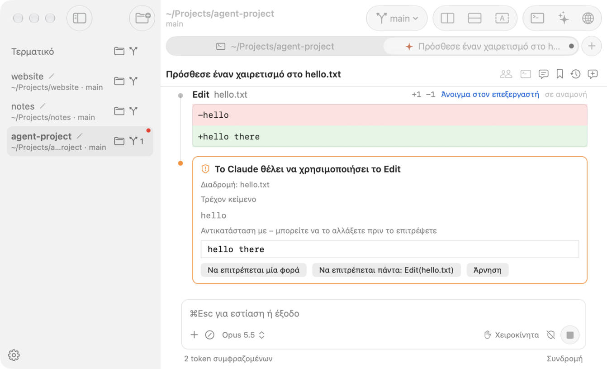

<p>&nbsp;&nbsp;&nbsp;</p>

# Tapa

**Το γρήγορο, εγγενές τερματικό για macOS που απέκτησε χώρο για τους πράκτορες, τα αρχεία και τις σελίδες σας.**

Το Tapa είναι πρώτα απ’ όλα τερματικό: δικός του πυρήνας VT και μηχανή απόδοσης σε Metal, εγγενείς καρτέλες και διαιρέσεις του macOS, ένα γρήγορο τερματικό που γλιστρά στην οθόνη με μία συντόμευση, ενσωμάτωση κελύφους με μπλοκ εντολών και ένα προαιρετικό πεδίο εισαγωγής με προτάσεις στο ύφος του Warp. Γύρω από αυτό, το Tapa εξελίχθηκε στη μικρή αδελφή του [Dango](https://github.com/sventmueller/dango): μια πλαϊνή στήλη με χώρους εργασίας, έναν για κάθε φάκελο έργου, ο καθένας με τα τερματικά του, καρτέλες πρακτόρων για Claude, Codex, OpenCode, Antigravity και άλλους πράκτορες ACP, καρτέλες προγράμματος περιήγησης, έναν επεξεργαστή με λίστα αρχείων και πλαίσιο Git, και μια προεπισκόπηση Markdown από το [Splat](https://github.com/sventmueller/splat) με τύπους και διαγράμματα. Τίποτα από όσα ρυθμίζει ένας φάκελος έργου δεν εκτελείται μέχρι να εμπιστευτείτε τον χώρο εργασίας του. Το Tapa είναι γραμμένο σε Rust με γνήσια στοιχεία ελέγχου AppKit, μιλά 35 γλώσσες, δεν χρειάζεται λογαριασμό και δεν έχει τηλεμετρία.

[](https://github.com/sventmueller/tapa/releases/latest/download/Tapa.dmg)

**[Λήψη του Tapa.dmg](https://github.com/sventmueller/tapa/releases/latest/download/Tapa.dmg)**: υπογεγραμμένο και πιστοποιημένο (notarized) από την Apple, για macOS 14 ή νεότερο σε Apple Silicon και Intel.

**Βρήκατε κάποιο σφάλμα;** [Ανοίξτε ένα issue](https://github.com/sventmueller/tapa/issues/new/choose) και πείτε με ποιο κέλυφος, ποιον πράκτορα ή ποιο πρόγραμμα συνέβη. Αν το Tapa σας είναι χρήσιμο, ένα [αστέρι στο GitHub](https://github.com/sventmueller/tapa) βοηθά και άλλους να το βρουν.

[](https://www.rust-lang.org) [](https://www.apple.com/macos/)  [](https://github.com/madsmtm/objc2) [](https://developer.apple.com/metal/) [](https://agentclientprotocol.com)    [](#άδεια-χρήσης)

[Bahasa Indonesia](../id/README.md) · [Bahasa Melayu](../ms/README.md) · [Català](../ca/README.md) · [Čeština](../cs/README.md) · [Dansk](../da/README.md) · [Deutsch](../de/README.md) · [English](../../../README.md) · [Español](../es/README.md) · [Français](../fr/README.md) · [Hrvatski](../hr/README.md) · [Italiano](../it/README.md) · [Magyar](../hu/README.md) · [Nederlands](../nl/README.md) · [Norsk](../no/README.md) · [Polski](../pl/README.md) · [Português (Brasil)](../pt_BR/README.md) · [Português (Portugal)](../pt_PT/README.md) · [Română](../ro/README.md) · [Slovenčina](../sk/README.md) · [Slovenščina](../sl/README.md) · [Suomi](../fi/README.md) · [Svenska](../sv/README.md) · [Tiếng Việt](../vi/README.md) · [Türkçe](../tr/README.md) · **Ελληνικά** · [Русский](../ru/README.md) · [Українська](../uk/README.md) · [עברית](../he/README.md)‎ · [العربية](../ar/README.md)‎ · [हिन्दी](../hi/README.md) · [ไทย](../th/README.md) · [한국어](../ko/README.md) · [日本語](../ja/README.md) · [简体中文](../zh-Hans/README.md) · [繁體中文](../zh-Hant/README.md)

## Περιεχόμενα

- [Τα βασικά με μια ματιά](#τα-βασικά-με-μια-ματιά)
- [Απαιτήσεις](#απαιτήσεις)
- [Εγκατάσταση](#εγκατάσταση)
- [Πρώτα βήματα](#πρώτα-βήματα)
- [Χώροι εργασίας](#χώροι-εργασίας)
- [Το τερματικό](#το-τερματικό)
  - [Καρτέλες και διαιρέσεις](#καρτέλες-και-διαιρέσεις)
  - [Ενσωμάτωση κελύφους και μπλοκ εντολών](#ενσωμάτωση-κελύφους-και-μπλοκ-εντολών)
  - [Το πεδίο εισαγωγής και οι προτάσεις](#το-πεδίο-εισαγωγής-και-οι-προτάσεις)
  - [Αναζήτηση, επιλογή και αντιγραφή](#αναζήτηση-επιλογή-και-αντιγραφή)
  - [Το γρήγορο τερματικό](#το-γρήγορο-τερματικό)
- [Πράκτορες](#πράκτορες)
- [Επεξεργαστής, αρχεία και Git](#επεξεργαστής-αρχεία-και-git)
- [Προεπισκοπήσεις](#προεπισκοπήσεις)
- [Πρόγραμμα περιήγησης](#πρόγραμμα-περιήγησης)
- [Υπαγόρευση](#υπαγόρευση)
- [Ρυθμίσεις](#ρυθμίσεις)
- [Εμφάνιση και προσβασιμότητα](#εμφάνιση-και-προσβασιμότητα)
- [Γλώσσες](#γλώσσες)
- [Συντομεύσεις πληκτρολογίου](#συντομεύσεις-πληκτρολογίου)
- [Εμπιστοσύνη](#εμπιστοσύνη)
- [Απόρρητο και ασφάλεια](#απόρρητο-και-ασφάλεια)
- [Γνωστοί περιορισμοί](#γνωστοί-περιορισμοί)
- [Για προγραμματιστές](#για-προγραμματιστές)
  - [Στοιχεία τρίτων](#στοιχεία-τρίτων)
- [Άδεια χρήσης](#άδεια-χρήσης)

## Τα βασικά με μια ματιά

- **Ένα δικό του, γρήγορο τερματικό.** Το Tapa αναλύει με τον δικό του πυρήνα VT και σχεδιάζει με Metal σε ένα νήμα ανά οθόνη, με τον ρυθμό της οθόνης και μόνο ό,τι άλλαξε. Περνά 262 ελέγχους του esctest, ενώ ο πυρήνας του Alacritty περνά 121, και κάθε αλλαγή του μετριέται απέναντι σε μια καθορισμένη έκδοση του Ghostty.
- **Εγγενές ως το κόκαλο.** Πραγματικές καρτέλες του macOS, επαναφορά παραθύρων, μενού, το μενού Υπηρεσίες, γνωστοποιήσεις, ασφαλής πληκτρολόγηση, υπαγόρευση και μέθοδοι εισαγωγής. Καθόλου Electron, και WebKit μόνο όπου το χρειάζεται μια σελίδα ή μια προεπισκόπηση.
- **Χώροι εργασίας.** Η πλαϊνή στήλη περιέχει έναν χώρο εργασίας για κάθε φάκελο έργου, ο καθένας με τις δικές του καρτέλες, τον κλάδο και τα πλαίσιά του. Ο χώρος εργασίας «Τερματικό» στην κορυφή ξεκινά από την αρχή κάθε φορά· όλοι οι άλλοι μένουν μέχρι να τους αφαιρέσετε.
- **Πράκτορες σε εγγενή προβολή συνομιλίας.** Οι Claude, Codex, OpenCode, Antigravity, Gemini CLI και άλλοι πράκτορες του Agent Client Protocol εκτελούνται σε δικές τους καρτέλες, με απαντήσεις, κλήσεις εργαλείων, diff και αιτήματα αδειών σε ένα χρονολόγιο. Το Tapa τους εγκαθιστά και τους ενημερώνει όταν το ζητήσετε.
- **Ενσωμάτωση κελύφους και μπλοκ εντολών** για zsh, bash και fish, και μέσω `ssh`: μεταβείτε από προτροπή σε προτροπή, επιλέξτε, αντιγράψτε, αποθηκεύστε και συμπτύξτε την έξοδο μιας εντολής, δείτε ποιες εντολές απέτυχαν και πόσο κράτησε η καθεμία.
- **Ένα πεδίο εισαγωγής σαν του Warp, αν το θέλετε.** Επεξεργαστείτε τη γραμμή εντολών ως κείμενο, με προτάσεις από το ιστορικό σας, από προδιαγραφές για περισσότερα από 700 εργαλεία γραμμής εντολών και από την κατάσταση του έργου, όλα στο Mac σας.
- **Αρχεία, Git και πρόγραμμα περιήγησης δίπλα στο κέλυφος.** Ένας επεξεργαστής με χρωματισμό σύνταξης, μια λίστα αρχείων, ένα πλαίσιο Git με προετοιμασία (staging), commit, κλάδους και worktree, μια προεπισκόπηση Markdown με τύπους και διαγράμματα, και καρτέλες προγράμματος περιήγησης.
- **Προσεκτικό με τους φακέλους σας.** Ένας χώρος εργασίας που δεν έχετε εμπιστευτεί δεν ξεκινά τίποτα από όσα ρυθμίζει ο φάκελός του: κανένα git hook, κανέναν διακομιστή MCP του έργου, καμία ρύθμιση έργου για πράκτορες, καθόλου JavaScript στις σελίδες αρχείων του.
- **Ιδιωτικό.** Χωρίς λογαριασμό, χωρίς τηλεμετρία. Το Tapa συνδέεται στο δίκτυο μόνο όταν του το ζητήσετε, και το αποθηκευμένο ιστορικό επαναφοράς στον δίσκο είναι κρυπτογραφημένο με ένα κλειδί στην κλειδοθήκη σας.
- **Στη γλώσσα σας.** Η διεπαφή διατίθεται σε 35 γλώσσες: Αραβικά, Καταλανικά, Κινεζικά (απλοποιημένα), Κινεζικά (παραδοσιακά), Κροατικά, Τσεχικά, Δανικά, Ολλανδικά, Αγγλικά, Φινλανδικά, Γαλλικά, Γερμανικά, Ελληνικά, Εβραϊκά, Χίντι, Ουγγρικά, Ινδονησιακά, Ιταλικά, Ιαπωνικά, Κορεατικά, Μαλαισιανά, Νορβηγικά, Πολωνικά, Πορτογαλικά (Βραζιλία), Πορτογαλικά (Πορτογαλία), Ρουμανικά, Ρωσικά, Σλοβακικά, Σλοβενικά, Ισπανικά, Σουηδικά, Ταϊλανδικά, Τουρκικά, Ουκρανικά και Βιετναμέζικα.

## Απαιτήσεις

- macOS 14 Sonoma ή νεότερο, σε Apple Silicon ή Intel. Το Tapa αναπτύσσεται και δοκιμάζεται στο macOS 27.
- zsh, bash ή fish για την ενσωμάτωση κελύφους· άλλα κελύφη λειτουργούν χωρίς αυτήν.
- Για τις καρτέλες πρακτόρων, τον πράκτορα που θέλετε να χρησιμοποιήσετε, είτε ήδη εγκατεστημένο είτε εγκατεστημένο από το Tapa όταν το ζητήσετε (δείτε [Πράκτορες](#πράκτορες)).

## Εγκατάσταση

**Από την εικόνα δίσκου.** Κάθε έκδοση είναι μια εικόνα δίσκου, `Tapa-<version>.dmg`, με μία universal εφαρμογή για Apple Silicon και Intel, υπογεγραμμένη με Developer ID και πιστοποιημένη (notarized) από την Apple. Ανοίξτε την και σύρετε το Tapa στον φάκελο Εφαρμογές.

**Με το Homebrew.** Το cask, σε δικό του tap, εγκαθιστά την ίδια εικόνα δίσκου:

```sh
brew install --cask sventmueller/tap/tapa
```

**Ενημερώσεις.** Το Tapa από την εικόνα δίσκου ή από το Homebrew ενημερώνεται μόνο του με το [Sparkle](https://sparkle-project.org). Στη δεύτερη εκκίνηση ρωτά αν μπορεί να ελέγχει μόνο του για ενημερώσεις· μέχρι να συμφωνήσετε, δεν κάνει κανένα αίτημα. Η εντολή **Tapa › Έλεγχος για ενημερώσεις…** ελέγχει αμέσως. Το Tapa εγκαθιστά μια ενημέρωση μόνο αν φέρει την υπογραφή του προγραμματιστή. Μια δική σας έκδοση δεν έχει μηχανισμό ενημέρωσης.

**Από τον πηγαίο κώδικα.** Δείτε [Για προγραμματιστές](#για-προγραμματιστές).

**Ως προεπιλεγμένο τερματικό.** Το Tapa μπορεί να ανοίγει σενάρια κελύφους (`.command`, `.tool`), φακέλους που αφήνονται στο εικονίδιό του και συνδέσμους `ssh://`. Επιλέξτε το στο Finder με **Αρχείο › Λήψη πληροφοριών › Άνοιγμα με**.

## Πρώτα βήματα

1. **Το παράθυρο** έχει αριστερά την πλαϊνή στήλη με τους χώρους εργασίας, επάνω τις καρτέλες του επιλεγμένου χώρου εργασίας και πάνω από αυτές τη γραμμή εργαλείων. Το ⌃⌘S εμφανίζει και αποκρύπτει την πλαϊνή στήλη.
2. **Ένας νέος χώρος εργασίας** δημιουργείται από το κουμπί φακέλου στην κορυφή της πλαϊνής στήλης ή με **Κέλυφος › Νέος χώρος εργασίας…** (⇧⌘N): διαλέξτε έναν από τους πρόσφατους φακέλους ή **Επιλογή φακέλου…**.
3. **Οι νέες καρτέλες** ξεκινούν στον φάκελο του χώρου εργασίας: ⌘T για τερματικό, τα κουμπιά στα δεξιά της γραμμής εργαλείων για τερματικό, πράκτορα ή καρτέλα προγράμματος περιήγησης, ή το **+** στο τέλος της γραμμής καρτελών.
4. **Οι ρυθμίσεις** ανοίγουν με ⌘, ή με το γρανάζι στο κάτω μέρος της πλαϊνής στήλης.
5. **Η παλέτα εντολών** (⇧⌘P) βρίσκει κάθε εντολή με το όνομά της, και η **Εύρεση καρτέλας…** (⌘P) κάθε καρτέλα κάθε χώρου εργασίας.

Η γραμμή εργαλείων περιέχει, από αριστερά, το αναδυόμενο μενού κλάδων του αποθετηρίου του χώρου εργασίας, τα κουμπιά για διαίρεση του τερματικού δεξιά και κάτω και για εμφάνιση του πεδίου εισαγωγής, και τα κουμπιά για νέες καρτέλες τερματικού, πράκτορα και προγράμματος περιήγησης. Τα κουμπιά για διαιρέσεις και για το πεδίο εισαγωγής είναι γκρι όσο δεν υπάρχει καρτέλα τερματικού μπροστά.

## Χώροι εργασίας

Ένας χώρος εργασίας είναι ένας φάκελος με τις καρτέλες του. Η γραμμή του στην πλαϊνή στήλη δείχνει το όνομα, τον φάκελο και τον κλάδο Git, και δεξιά τα κουμπιά για τη λίστα αρχείων και το πλαίσιο Git. Ένα κλικ σε ένα από αυτά εμφανίζει εκείνο το πλαίσιο στη θέση της λίστας χώρων εργασίας· το **Χώροι εργασίας** στην κορυφή σας οδηγεί πίσω.

- **Ο χώρος εργασίας «Τερματικό»** είναι πάντα στην κορυφή. Ξεκινά από την αρχή σε κάθε εκκίνηση, στον φάκελο που ορίζουν οι ρυθμίσεις, με ένα κενό τερματικό. Τίποτα από αυτόν δεν αποθηκεύεται, και δεν μπορεί να μετονομαστεί ή να αφαιρεθεί.
- **Κάθε άλλος χώρος εργασίας μένει** μέχρι να τον αφαιρέσετε, ακόμη και χωρίς καρτέλες. Το Tapa κρατά το όνομά του, τις καρτέλες, το περιεχόμενο των τερματικών του (στον βαθμό που επιτρέπουν οι ρυθμίσεις επαναφοράς), τις συνεδρίες των πρακτόρων του και τη θέση του παραθύρου. Τα προγράμματα που εκτελούνται ακόμη τερματίζονται όταν κλείνει το Tapa.
- **Μετονομασία.** Κάντε κλικ στο μολύβι μετά το όνομα, κάντε κλικ στο όνομα του επιλεγμένου χώρου εργασίας ή επιλέξτε **Κέλυφος › Μετονομασία χώρου εργασίας**. Το όνομα αποθηκεύεται αμέσως.
- **Κατάσταση.** Μια πράσινη κουκκίδα στη γραμμή σημαίνει ότι ένας πράκτορας του χώρου εργασίας δουλεύει, και με υποπράκτορες ή στο παρασκήνιο· μια κόκκινη κουκκίδα σημαίνει ότι κάποιος περιμένει εσάς. Τα τερματικά δεν σημειώνουν τίποτα εκεί.
- **Εναλλαγή.** Τα ⌃⌘[ και ⌃⌘] μετακινούνται μεταξύ των χώρων εργασίας. Το παράθυρο μένει στη θέση του, και οι καρτέλες του επιλεγμένου χώρου εργασίας παίρνουν τη θέση των άλλων.
- **Worktree.** Το **Νέο worktree…** στο αναδυόμενο μενού κλάδων της γραμμής εργαλείων δημιουργεί ένα worktree του Git σε νέο κλάδο και το ανοίγει ως ξεχωριστό χώρο εργασίας.

Όταν κλείνει η τελευταία καρτέλα ενός χώρου εργασίας, ο χώρος εργασίας μένει στη λίστα. Με όλες τις καρτέλες κλειστές, φεύγει μόνο το παράθυρο· το εικονίδιο στο Dock ή το ⌘N το επαναφέρει μαζί με τους χώρους εργασίας του.

## Το τερματικό

Το Tapa τρέχει στον δικό του πυρήνα, `term-vt`. Μιλά xterm και VT520 με το πρωτόκολλο πληκτρολογίου του Kitty, υπερσυνδέσμους OSC 8, πρόσβαση στο πρόχειρο μέσω OSC 52 με ξεχωριστή άδεια για ανάγνωση, συγχρονισμένη έξοδο, έγχρωμες και κυματιστές υπογραμμίσεις, truecolor, ερωτήματα χρωμάτων, αναφορές φωτεινής και σκοτεινής λειτουργίας προς τα προγράμματα, bracketed paste, συμβάντα εστίασης και αναφορά ποντικιού. Το κείμενο αναδιπλώνεται ξανά όταν αλλάζει το μέγεθος του παραθύρου, μαζί με το ιστορικό. Συμπλέγματα χαρακτήρων (ligatures), δυνατότητες γραμματοσειρών, σύμβολα Nerd Font χωρίς τροποποιημένες γραμματοσειρές και χαρακτήρες γραφικών πλαισίων, Powerline και Braille με ακρίβεια εικονοστοιχείου είναι ενσωματωμένα.

### Καρτέλες και διαιρέσεις

- **Οι καρτέλες** είναι του ίδιου του macOS: σύρετέ τες για να αλλάξετε τη σειρά τους ή έξω σε δικό τους παράθυρο, **Εμφάνιση όλων των καρτελών** (⇧⌘\\), ⌘1 έως ⌘8, ⌘9 για την τελευταία καρτέλα και ⇧⌘[ / ⇧⌘] για εναλλαγή. Κάθε καρτέλα δείχνει το εικονίδιο του είδους της μπροστά από τον τίτλο της.
- **Διαιρέσεις.** **Διαίρεση δεξιά** (⌘D ή ⌃⌘T) και **Διαίρεση κάτω** (⇧⌘D ή ⌃⌥⌘T), ένθετες όσο βαθιά θέλετε. Σύρετε ένα διαχωριστικό, μετακινήστε το με ⌃⌘ και τα πλήκτρα βέλους, **Μεγιστοποίηση τμήματος** (⌃⇧⌘↩), **Εξίσωση τμημάτων** (⌃⌘=), και μετακινηθείτε μεταξύ τμημάτων με ⌘[ και ⌘].
- **Φάκελος εργασίας.** Νέες καρτέλες, παράθυρα και διαιρέσεις ξεκινούν στον φάκελο του τερματικού που βρίσκεται μπροστά· οι ρυθμίσεις το αποφασίζουν για καθένα από τα τρία.
- **Κλείσιμο.** Το Tapa ρωτά πριν κλείσει μια καρτέλα, ένα παράθυρο ή την εφαρμογή όσο εκτελείται κάποιο πρόγραμμα σε αυτά.
- **Επαναφορά.** Μετά από επανεκκίνηση επιστρέφουν οι χώροι εργασίας, οι καρτέλες, τα τμήματα, οι φάκελοι και οι τελευταίες γραμμές κάθε τερματικού. Μυστικά όπως διακριτικά και συνθηματικά καλύπτονται πριν αποθηκευτεί οτιδήποτε.

### Ενσωμάτωση κελύφους και μπλοκ εντολών

Το Tapa ρυθμίζει μόνο του την ενσωμάτωση κελύφους για zsh, bash και fish, χωρίς να αγγίζει τα αρχεία διαμόρφωσής σας, και την παίρνει μαζί του όταν συνδέεστε με `ssh` σε άλλο υπολογιστή. Με αυτήν, κάθε εντολή και η έξοδός της σχηματίζουν ένα μπλοκ:

- **Προτροπές.** Τα ⌘↑ και ⌘↓ μεταβαίνουν στην προηγούμενη και την επόμενη προτροπή. Ένα κλικ μέσα στη γραμμή εντολών μετακινεί τον δρομέα εκεί.
- **Μπλοκ.** **Επιλογή μπλοκ** (⇧⌘A), **Αντιγραφή εξόδου** (⌥⌘C), **Αποθήκευση εξόδου…** (⌥⌘S) και **Σύμπτυξη/ανάπτυξη μπλοκ** (⇧⌘↩). Πάνω από το μπλοκ κάτω από τον δείκτη, κουμπιά δείχνουν την κατάστασή του, τη διάρκειά του και τις ίδιες ενέργειες.
- **Οι εντολές που απέτυχαν** επισημαίνονται, και η εντολή που εκτελείται ακόμη μένει ορατή στην κορυφή όσο κυλά η έξοδός της.
- **Σελιδοδείκτες.** Η **Προσθήκη/αφαίρεση σελιδοδείκτη** (⇧⌘M) σημαδεύει μια γραμμή· τα ⇧⌘↑ και ⇧⌘↓ μεταβαίνουν μεταξύ σελιδοδεικτών.
- **Γνωστοποιήσεις** εμφανίζονται όταν τις ζητά ένα πρόγραμμα (OSC 9 και OSC 777) και το τερματικό δεν είναι μπροστά, και μια γραμμή προόδου (OSC 9;4) εμφανίζεται στην καρτέλα και στο εικονίδιο του Dock.

### Το πεδίο εισαγωγής και οι προτάσεις

Το πεδίο εισαγωγής μετατρέπει τη γραμμή εντολών σε πεδίο κειμένου στο κάτω μέρος του τμήματος, όπως στο Warp, με ετικέτες για τον φάκελο και τον κλάδο Git από πάνω του. Η **Εμφάνιση/απόκρυψη πεδίου εισαγωγής** (⌘I) ή το κουμπί στη γραμμή εργαλείων το ενεργοποιεί για ένα τερματικό· οι **Ρυθμίσεις › Εισαγωγή** το ενεργοποιούν για νέα τερματικά. Χρειάζεται την ενσωμάτωση κελύφους και παραμερίζει για προγράμματα πλήρους οθόνης όπως το vim, το htop ή το claude.

- **Το Return** στέλνει όλο το πεδίο στο κέλυφος, το κείμενο πολλών γραμμών ως μία επικόλληση· το κέλυφος το εκτελεί και το θυμάται όπως συνήθως. Αν το κέλυφος ζητήσει περισσότερα, το πεδίο του επιστρέφει τα πλήκτρα μέχρι την επόμενη προτροπή.
- **Τα ↑, ↓ και ⌃R** αναζητούν στο ιστορικό σας, με τον φάκελο, τον κλάδο και τον κωδικό εξόδου με τους οποίους εκτελέστηκε κάθε εντολή.
- **Το Tab** συμπληρώνει με προδιαγραφές για περισσότερα από 700 εργαλεία γραμμής εντολών, διαδρομές και τρέχουσες τιμές όπως κλάδους git, κοντέινερ docker, πόρους kubectl, υπολογιστές ssh, σενάρια του `package.json` και στόχους make, just και cargo.
- **Τα πλήκτρα Vim** στο πεδίο είναι ένας διακόπτης στις ίδιες ρυθμίσεις.
- **Η επόμενη εντολή πριν πληκτρολογήσετε**: ό,τι συνήθως ακολουθεί σε αυτό το έργο (μετά το `git add` έρχεται το `git commit`), ό,τι ζητά η κατάσταση του έργου (ένα αρχείο κλειδώματος νεότερο από το `node_modules`), και μια διόρθωση μετά το «command not found», από τυπογραφικά λάθη ή από το τοπικό σας ευρετήριο Homebrew.

Χωρίς το πεδίο εισαγωγής, οι προτάσεις εμφανίζονται ως γκρι κείμενο πίσω από τον δρομέα, και το → τις αποδέχεται. Κελύφη με δικές τους αυτόματες προτάσεις, όπως το fish ή το zsh-autosuggestions, κρατούν τις δικές τους. Οι προτάσεις δεν χρησιμοποιούν ποτέ το δίκτυο, και ξεκινούν προγράμματα μόνο από το δικό σας `PATH`, ποτέ από τον φάκελο του έργου.

**Επικόλληση.** Οι επικολλήσεις πολλών γραμμών μπορούν να εμφανίζονται πριν εκτελεστούν (**Εμφάνιση πρώτα των επικολλήσεων πολλών γραμμών**). Τα αρχεία που αφήνονται σε ένα τερματικό φτάνουν ως διαδρομές σε εισαγωγικά· τα ⌥←/→, ⌘←/→ και ⌘⌫ μετακινούν και διαγράφουν ανά λέξη και γραμμή όπως σε κάθε πεδίο κειμένου του Mac.

### Αναζήτηση, επιλογή και αντιγραφή

- **Η Εύρεση…** (⌘F) αναζητά στο ιστορικό με κανονικές εκφράσεις, διάκριση πεζών-κεφαλαίων και ολόκληρες λέξεις, και μετρά τα αποτελέσματα· η γραμμή κύλισης τα σημειώνει μαζί με τις προτροπές και τα σφάλματα.
- **Έξυπνη επιλογή.** Ένα διπλό κλικ επιλέγει ένα URL, μια διαδρομή, ένα hash ή μια διεύθυνση IP ολόκληρα, και η μεταφορά με ⌥ επιλέγει ένα ορθογώνιο. Οι σύνδεσμοι εντοπίζονται ακόμη και χωρίς OSC 8· το ⌘-κλικ τους ανοίγει, και μια διαδρομή στο Dango αν είναι εγκατεστημένο.
- **Η Επιλογή με το πληκτρολόγιο** (⇧⌘C) μετακινεί μια επιλογή με τα πλήκτρα του Vim.
- **Η Αντιγραφή με μορφοποίηση** (⇧⌥⌘C) διατηρεί χρώματα και στυλ· η αντιγραφή κατά την επιλογή είναι ρύθμιση. Η **Εκκαθάριση** (⌘K) καθαρίζει το τερματικό.

### Το γρήγορο τερματικό

Η **Εμφάνιση/απόκρυψη γρήγορου τερματικού** (⌃⌥⌘Διάστημα) φέρνει ένα τερματικό να γλιστρήσει από μια άκρη της οθόνης, πάνω από άλλες εφαρμογές και πάνω από χώρους πλήρους οθόνης, χωρίς εναλλαγή εφαρμογής. Η άκρη, το μέγεθός του και το αν κρύβεται όταν κάνετε κλικ αλλού είναι ρυθμίσεις. Οι συνεδρίες του συνεχίζουν να εκτελούνται όσο είναι κρυμμένο.

## Πράκτορες

Μια καρτέλα πράκτορα εκτελεί έναν πράκτορα προγραμματισμού στον φάκελο του χώρου εργασίας, στην εγγενή προβολή πρακτόρων του Dango.

| Πράκτορας | Πώς εκτελείται | Τι χρειάζεται |
|---|---|---|
| Claude | η εντολή `claude`, με επικοινωνία μέσω του πρωτοκόλλου της stream-json | εγκατεστημένο `claude` με σύνδεση· το Tapa το εγκαθιστά με τον δικό εγκαταστάτη του Claude όταν το ζητήσετε |
| Codex | `codex app-server`, ή `codex-acp` για παλαιότερο Codex | `codex` με σύνδεση· το Tapa εγκαθιστά τον καθορισμένο προσαρμογέα όταν το ζητήσετε |
| OpenCode | `opencode serve`, ή `opencode acp` για παλαιότερο OpenCode | το δικό σας `opencode` στο `PATH`, ή η καθορισμένη λήψη |
| Antigravity | `agy acp` | το δικό σας `agy` στο `PATH`, ή η καθορισμένη λήψη |
| Gemini CLI | `gemini --acp`, προσφέρεται μόλις το ενεργοποιήσετε στις **Ρυθμίσεις › Πράκτορες** | το δικό σας `gemini`, ή η καθορισμένη λήψη |
| Άλλοι πράκτορες ACP | από το μητρώο ACP, που φορτώνεται μόνο όταν το ζητήσετε | ό,τι ορίζει η καταχώριση του μητρώου· καταχωρίσεις χωρίς άθροισμα ελέγχου εγκαθίστανται μόνο αφού επιβεβαιώσετε |

Το Tapa χρησιμοποιεί τη δική σύνδεση κάθε πράκτορα και δεν αποθηκεύει διαπιστευτήρια πρακτόρων. Ένας πράκτορας που βρίσκεται στο `PATH` του κελύφους σύνδεσής σας έχει προτεραιότητα· διαφορετικά το Tapa εκτελεί την έκδοση που εγκατέστησε στον δικό του φάκελο δεδομένων, ποτέ ένα πρόγραμμα από τον χώρο εργασίας.

- **Το χρονολόγιο** δείχνει απαντήσεις, κλήσεις εργαλείων με την έξοδο και τα diff τους, ερωτήσεις και αιτήματα αδειών. Τα **Να επιτρέπεται μία φορά**, **Να επιτρέπεται πάντα** και **Άρνηση** απαντούν σε ένα αίτημα, και μια επεξεργασία μπορεί να αλλάξει πριν την επιτρέψετε.
- **Κατάσταση.** Η καρτέλα και η γραμμή του χώρου εργασίας δείχνουν μια πράσινη κουκκίδα όσο ο πράκτορας δουλεύει και μια κόκκινη όσο περιμένει εσάς, και μια γνωστοποίηση σας ενημερώνει όταν περιμένει ενώ κοιτάτε αλλού.
- **Το πεδίο μηνύματος** στο κάτω μέρος δέχεται την προτροπή σας, αρχεία που αφήνονται πάνω του και υπαγόρευση. Το ⌘Esc μεταφέρει την εστίαση του πληκτρολογίου μέσα σε αυτό και πίσω. Εκεί μπορούν να επιλεγούν για τη συνεδρία το μοντέλο και η λειτουργία αδειών.
- **Οι Ρυθμίσεις › Πράκτορες** ορίζουν για νέες συνεδρίες τη λειτουργία αδειών (Claude, Codex), το μοντέλο (Claude, Codex, OpenCode) και την ένταση σκέψης (Claude, Codex), καθώς και ποιους πράκτορες προσφέρουν οι νέες καρτέλες. Δείχνουν πού βρίσκεται το πρόγραμμα κάθε πράκτορα, με **Εγκατάσταση…**, **Ενημέρωση στην έκδοση …** και **Επιστροφή στην έκδοση …** για την προηγούμενη έκδοση, και **Φόρτωση μητρώου** για το μητρώο ACP. Εκεί μπορείτε επίσης να δείτε και να αφαιρέσετε τους κανόνες που αποθήκευσε ο Claude με το «Να επιτρέπεται πάντα».
- **Ελεγμένες λήψεις.** Τα αρχεία ελέγχονται με βάση το SHA-256 τους, τα πακέτα npm με βάση το integrity στο αρχείο κλειδώματός τους, και πακέτα χωρίς σταθερή έκδοση απορρίπτονται. Ένας πράκτορας που λείπει προσφέρει επίσης την εγκατάστασή του στη δική του καρτέλα.

## Επεξεργαστής, αρχεία και Git

- **Η λίστα αρχείων** ενός χώρου εργασίας δείχνει τον φάκελό του ως δέντρο, που ενημερώνεται όταν αλλάζουν τα αρχεία, με τα αρχεία που αγνοεί το Git αχνά αν το θέλετε. Ένα κλικ ανοίγει ένα αρχείο ως καρτέλα προεπισκόπησης, την οποία αντικαθιστά το επόμενο κλικ μέχρι να την επεξεργαστείτε· ένα διπλό κλικ την κρατά.
- **Ο επεξεργαστής** ανοίγει αρχεία σε καρτέλες του χώρου εργασίας, με χρωματισμό σύνταξης, πολλαπλούς δρομείς, σύμπτυξη, την εσοχή του `.editorconfig`, προαιρετικά πλήκτρα Vim και σημάδια για ό,τι άλλαξε από το τελευταίο commit. Αντιλαμβάνεται όταν ένα αρχείο άλλαξε στον δίσκο ή περιέχει σημάδια σύγκρουσης. Τα αρχεία Markdown έχουν γραμμή μορφοποίησης και **Άνοιγμα στο Splat**. Τα **Αποθήκευση** (⌘S), **Αποθήκευση ως…** και **Αποθήκευση όλων** λειτουργούν όπως συνήθως, και το Tapa ρωτά πριν κλείσει μη αποθηκευμένο κείμενο.
- **Μετά από κατάρρευση**, το μη αποθηκευμένο κείμενο επιστρέφει: το Tapa κρατά κρυπτογραφημένα αντίγραφά του όσο πληκτρολογείτε.
- **Το πλαίσιο Git** δείχνει τις προετοιμασμένες και μη προετοιμασμένες αλλαγές, προετοιμάζει και αναιρεί την προετοιμασία αρχείων και μεμονωμένων τμημάτων (hunks), κάνει commit (⌘↩), amend, commit με push, fetch, και χειρίζεται κλάδους, stash, cherry-pick και συγκρούσεις, με το ιστορικό commit από κάτω. Ένα κλικ σε ένα αρχείο δείχνει το diff του.
- **Το αναδυόμενο μενού κλάδων** στη γραμμή εργαλείων αλλάζει και δημιουργεί κλάδους και φτιάχνει worktree.

Ο επεξεργαστής δεν ξεκινά κανέναν μορφοποιητή και κανέναν διακομιστή γλώσσας. Για ένα πλήρες IDE με διακομιστές γλώσσας και αποσφαλματωτή, χρησιμοποιήστε το [Dango](https://github.com/sventmueller/dango).

## Προεπισκοπήσεις

- **Το Markdown** εμφανίζεται δίπλα στον επεξεργαστή του μέσω της μηχανής απόδοσης του Splat: GitHub Flavored Markdown με τύπους, διαγράμματα και εικόνες, που κυλά παράγραφο προς παράγραφο μαζί με το κείμενο.
- **Οι εικόνες** ανοίγουν σε δική τους καρτέλα, τα PDF μέσω του PDFKit, και ο ήχος, οι ταινίες, οι γραμματοσειρές και τα έγγραφα γραφείου μέσω της Γρήγορης ματιάς.
- **Απομονωμένη αποκωδικοποίηση.** Κάθε εικόνα από μη έμπιστη πηγή (αρχεία έργου, Markdown, συνημμένα πρακτόρων και επικολλήσεις) αποκωδικοποιείται στην υπηρεσία `Decoder.xpc` του Splat, σε δικό της App Sandbox χωρίς αρχεία και δίκτυο, ποτέ μέσα στην εφαρμογή.

## Πρόγραμμα περιήγησης

Η **Νέα καρτέλα προγράμματος περιήγησης** (⇧⌘B) ανοίγει μια καρτέλα WebKit στον χώρο εργασίας. Το πεδίο διεύθυνσης δέχεται μια διεύθυνση ή λέξεις για τη μηχανή αναζήτησης της επιλογής σας (DuckDuckGo, Google, Bing ή Startpage)· τα ⌘L, ⌘R, ⌘[ και ⌘] λειτουργούν όπως στο Safari. Οι σελίδες από το `localhost` εκτελούνται κανονικά, για τον διακομιστή ανάπτυξης του έργου σας. Τα αρχεία HTML ενός χώρου εργασίας μπορούν να διαβάζουν μόνο τον δικό τους φάκελο, και σε χώρο εργασίας που δεν έχετε εμπιστευτεί δεν εκτελούν JavaScript.

## Υπαγόρευση

Υπαγορεύστε στο πεδίο μηνύματος ενός πράκτορα ή στον επεξεργαστή με το κουμπί του μικροφώνου ή με **Επεξεργασία › Έναρξη υπαγόρευσης** (⌃⌥D). Η αναγνώριση ομιλίας είναι του [Lowspeak](https://github.com/sventmueller/lowspeak), το οποίο δεν χρειάζεται να είναι εγκατεστημένο. Οι **Ρυθμίσεις › Υπαγόρευση** επιλέγουν διαδικτυακή μεταγραφή με OpenAI ή Groq, ή τοπικά μοντέλα Whisper και Parakeet που κρατούν την ηχογράφηση στο Mac σας, τη γλώσσα, τη μεταεπεξεργασία, το μικρόφωνο και το δικό σας λεξιλόγιο. Τα κλειδιά για OpenAI και Groq φυλάσσονται στην κλειδοθήκη σας. Η υπαγόρευση υπάρχει μόνο στην έκδοση διανομής.

## Ρυθμίσεις

Οι **Tapa › Ρυθμίσεις…** (⌘,) έχουν τις ενότητες Γενικά, Γραμματοσειρά, Χρώματα, Δρομέας, Τερματικό, Εισαγωγή, Επεξεργαστής, Πράκτορες, Υπαγόρευση, Προφίλ και Συντομεύσεις. Γράφουν ένα αρχείο TOML, το `config.toml` στον φάκελο του Tapa κάτω από το `~/Library/Application Support`, το οποίο μπορείτε επίσης να επεξεργαστείτε με το χέρι· το Tapa το φορτώνει ξανά όσο εκτελείται, και η **Επαναφόρτωση ρυθμίσεων** (⇧⌘,) το κάνει αμέσως.

- **Τέσσερα μεγέθη γραμματοσειράς** στα Γενικά: Περιβάλλον (πλαϊνή στήλη, πλαίσια, λίστα αρχείων, πλαίσιο Git και τίτλοι καρτελών), Επεξεργαστής (κείμενο, αριθμοί γραμμών και προεπισκόπηση Markdown), Τερματικό και Πράκτορες. Τα ⌘+, ⌘− και ⌘0 αλλάζουν το μέγεθος του τερματικού που βρίσκεται μπροστά.
- **Εμφάνιση:** Ανοιχτόχρωμη, Σκουρόχρωμη ή Όπως το σύστημα.
- **Χρώματα.** Ένα θέμα για τη φωτεινή και ένα για τη σκοτεινή λειτουργία, στη μορφή θεμάτων του Ghostty, με ελάχιστη αντίθεση που κρατά το κείμενο ευανάγνωστο σε ένα κακό θέμα. Τα δικά σας θέματα μπαίνουν στον φάκελο θεμάτων.
- **Τα προφίλ** συνδυάζουν γραμματοσειρά, χρώματα, κέλυφος, περιβάλλον και φάκελο.
- **Οι συντομεύσεις** μπορούν να αλλάξουν όλες, και οι συγκρούσεις εμφανίζονται.

## Εμφάνιση και προσβασιμότητα

- **Η σκοτεινή λειτουργία** ακολουθεί το σύστημα ή την επιλογή σας· το χρώμα έμφασης, η Μείωση κίνησης και η Αύξηση αντίθεσης γίνονται σεβαστά.
- **Το VoiceOver** διαβάζει τις γραμμές και τις προτροπές του τερματικού και ανακοινώνει νέα έξοδο· η πλαϊνή στήλη, οι καρτέλες, τα κουμπιά της γραμμής εργαλείων και οι κάρτες του χρονολογίου πρακτόρων έχουν ονόματα.
- **Πληκτρολόγιο.** Κάθε εντολή έχει στοιχείο μενού και συντόμευση, και η Πλήρης πρόσβαση πληκτρολογίου φτάνει σε κάθε στοιχείο ελέγχου.
- **Μεγέθη.** Τα τέσσερα μεγέθη γραμματοσειράς των ρυθμίσεων κλιμακώνουν το περιβάλλον, τον επεξεργαστή, το τερματικό και τους πράκτορες ανεξάρτητα.
- **Από δεξιά προς αριστερά.** Η διεπαφή αντικατοπτρίζεται στα αραβικά και στα εβραϊκά, ενώ το πλέγμα του τερματικού μένει από αριστερά προς δεξιά.

Λεπτομέρειες και γνωστά κενά υπάρχουν στο [ACCESSIBILITY.md](../../../ACCESSIBILITY.md).

## Γλώσσες

Η διεπαφή είναι μεταφρασμένη σε 35 γλώσσες: Αραβικά, Καταλανικά, Κινεζικά (απλοποιημένα), Κινεζικά (παραδοσιακά), Κροατικά, Τσεχικά, Δανικά, Ολλανδικά, Αγγλικά, Φινλανδικά, Γαλλικά, Γερμανικά, Ελληνικά, Εβραϊκά, Χίντι, Ουγγρικά, Ινδονησιακά, Ιταλικά, Ιαπωνικά, Κορεατικά, Μαλαισιανά, Νορβηγικά, Πολωνικά, Πορτογαλικά (Βραζιλία), Πορτογαλικά (Πορτογαλία), Ρουμανικά, Ρωσικά, Σλοβακικά, Σλοβενικά, Ισπανικά, Σουηδικά, Ταϊλανδικά, Τουρκικά, Ουκρανικά και Βιετναμέζικα.

Το Tapa ακολουθεί τη σειρά γλωσσών στις **Ρυθμίσεις συστήματος › Γενικά › Γλώσσα και περιοχή**· εκεί, στο **Εφαρμογές**, μπορείτε επίσης να διαλέξετε γλώσσα μόνο για το Tapa. Αν δεν υπάρχει μετάφραση για τη γλώσσα σας, χρησιμοποιεί τα αγγλικά.

## Συντομεύσεις πληκτρολογίου

| Ενέργεια | Συντόμευση |
|---|---|
| Νέο παράθυρο, χώρος εργασίας, καρτέλα | ⌘N, ⇧⌘N, ⌘T |
| Νέα καρτέλα προγράμματος περιήγησης | ⇧⌘B |
| Νέο αρχείο, άνοιγμα αρχείου | ⌥⌘N, ⌘O |
| Κλείσιμο τμήματος ή καρτέλας, κλείσιμο καρτέλας, κλείσιμο παραθύρου | ⌘W, ⌥⌘W, ⇧⌘W |
| Διαίρεση δεξιά, διαίρεση κάτω | ⌘D ή ⌃⌘T, ⇧⌘D ή ⌃⌥⌘T |
| Μεγιστοποίηση τμήματος, εξίσωση τμημάτων, κλείσιμο τμήματος | ⌃⇧⌘↩, ⌃⌘=, ⌃⇧⌘W |
| Μετακίνηση διαχωριστικού | ⌃⌘←, ⌃⌘→, ⌃⌘↑, ⌃⌘↓ |
| Επόμενο, προηγούμενο τμήμα | ⌘], ⌘[ |
| Επόμενη, προηγούμενη καρτέλα· καρτέλα 1 έως 8, τελευταία καρτέλα | ⇧⌘], ⇧⌘[; ⌘1 έως ⌘8, ⌘9 |
| Επόμενος, προηγούμενος χώρος εργασίας | ⌃⌘], ⌃⌘[ |
| Εύρεση καρτέλας, παλέτα εντολών | ⌘P, ⇧⌘P |
| Εμφάνιση ή απόκρυψη της πλαϊνής στήλης, του πεδίου εισαγωγής | ⌃⌘S, ⌘I |
| Γρήγορο τερματικό | ⌃⌥⌘Διάστημα |
| Εύρεση, εύρεση επόμενου, εύρεση προηγούμενου | ⌘F, ⌘G, ⇧⌘G |
| Προηγούμενη, επόμενη προτροπή | ⌘↑, ⌘↓ |
| Επιλογή μπλοκ, αντιγραφή εξόδου, αποθήκευση εξόδου, σύμπτυξη μπλοκ | ⇧⌘A, ⌥⌘C, ⌥⌘S, ⇧⌘↩ |
| Προσθήκη ή αφαίρεση σελιδοδείκτη· προηγούμενος, επόμενος σελιδοδείκτης | ⇧⌘M; ⇧⌘↑, ⇧⌘↓ |
| Επιλογή με το πληκτρολόγιο | ⇧⌘C |
| Αντιγραφή με μορφοποίηση | ⇧⌥⌘C |
| Εκκαθάριση | ⌘K |
| Αρχή, τέλος, σελίδα πάνω, σελίδα κάτω | ⌘Home, ⌘End, ⌘PageUp, ⌘PageDown |
| Μεγαλύτερο, μικρότερο, αρχικό μέγεθος (τερματικό) | ⌘+, ⌘−, ⌘0 |
| Πεδίο μηνύματος καρτέλας πράκτορα | ⌘Esc |
| Έναρξη υπαγόρευσης | ⌃⌥D |
| Ρυθμίσεις, επαναφόρτωση ρυθμίσεων | ⌘,, ⇧⌘, |

Κάθε συντόμευση μπορεί να αλλάξει στις **Ρυθμίσεις › Συντομεύσεις** ή στην ενότητα `[keys]` του αρχείου ρυθμίσεων.

## Εμπιστοσύνη

Ένας φάκελος έργου μπορεί να κάνει προγράμματα να εκτελεστούν μόλις ξεκινήσει κάτι μέσα του: git hooks και ρυθμίσεις αποθετηρίου όπως το `core.fsmonitor`, hooks πρακτόρων, διακομιστές MCP του έργου και ρυθμίσεις έργου για πράκτορες. Γι’ αυτό ένας νέος χώρος εργασίας δεν θεωρείται έμπιστος.

- **Μη έμπιστος:** οι πράκτορες ξεκινούν χωρίς τα hooks, τους διακομιστές MCP και τη διαμόρφωση του έργου (ο Claude με `--setting-sources=user --strict-mcp-config`, ο Codex με τον φάκελο σημειωμένο ως μη έμπιστο, το OpenCode χωρίς τη διαμόρφωση του έργου). Το Git εκτελείται εξουδετερωμένο: χωρίς hooks, φίλτρα, οδηγούς diff, fsmonitor, `sshCommand` ή σελιδοποιητή, και μόνο με καθολικούς βοηθούς διαπιστευτηρίων. Τα αρχεία HTML ανοίγουν χωρίς JavaScript. Το πλαίσιο Git και η καρτέλα πράκτορα το αναφέρουν και προσφέρουν να εμπιστευτείτε τον χώρο εργασίας.
- **Έμπιστος:** η **Κέλυφος › Εμπιστοσύνη στον χώρο εργασίας** φορτώνει όλα αυτά όπως τα προβλέπει ο φάκελος. Η **Ανάκληση εμπιστοσύνης** τα αναιρεί. Η εμπιστοσύνη διατηρείται ανά χώρο εργασίας.

Όποια κι αν είναι η εμπιστοσύνη του, το Tapa δεν εκτελεί ποτέ από μόνο του πρόγραμμα από φάκελο έργου: οι προτάσεις ξεκινούν προγράμματα μόνο από το `PATH` σας εκτός του έργου, και η πλαϊνή στήλη διαβάζει την κατάσταση του Git από τα αρχεία `.git`. Ένας χώρος εργασίας στον αρχικό σας φάκελο, όπως το «Τερματικό», δεν είναι έργο: προγράμματα κάτω από το `~`, όπως το `~/.local/bin/claude`, θεωρούνται εκεί δικά σας.

## Απόρρητο και ασφάλεια

- **Χωρίς τηλεμετρία, χωρίς λογαριασμό.** Το Tapa δεν αναφέρει τίποτα για το πώς το χρησιμοποιείτε και λειτουργεί πλήρως εκτός σύνδεσης. Συνδέεται στο δίκτυο μόνο όταν το ζητήσετε: για να εγκαταστήσει ή να ενημερώσει έναν πράκτορα, για να φορτώσει το μητρώο ACP, για να ελέγξει για ενημερώσεις αφού συμφωνήσετε, και για τις σελίδες που ανοίγετε σε μια καρτέλα προγράμματος περιήγησης. Οι ίδιοι οι πράκτορες επικοινωνούν με τους παρόχους τους όπως πάντα.
- **Το ιστορικό στον δίσκο** για την επαναφορά συνεδριών είναι κρυπτογραφημένο με ένα κλειδί στην κλειδοθήκη σας, μπορεί να απενεργοποιηθεί, και τα μυστικά του, όπως κλειδιά API, διακριτικά και συνθηματικά, καλύπτονται πριν γραφτεί. Τα αντίγραφα μη αποθηκευμένου κειμένου του επεξεργαστή κρυπτογραφούνται με το ίδιο κλειδί.
- **Η ασφαλής πληκτρολόγηση** ενεργοποιείται μόνη της σε προτροπές συνθηματικού, και μπορεί να ενεργοποιηθεί μόνιμα από το μενού της εφαρμογής.
- **Οι ακολουθίες διαφυγής** που θα μπορούσαν να διαρρεύσουν ή να εισαγάγουν δεδομένα, όπως αναφορές τίτλου, αναγνώσεις του προχείρου και τεχνάσματα επικόλλησης, αποκλείονται ή ζητούν πρώτα επιβεβαίωση. Ο αναλυτής ελέγχεται με fuzzing στο CI.
- **Απομονωμένη αποκωδικοποίηση** εικόνων από μη έμπιστες πηγές, δείτε [Προεπισκοπήσεις](#προεπισκοπήσεις).
- **Υπογραφή κώδικα** με το Hardened Runtime. Το macOS αποδίδει την πρόσβαση των προγραμμάτων ενός τερματικού στο Tapa, γι’ αυτό φέρει περιγραφή χρήσης για κάθε προστατευμένη υπηρεσία.

Τα προβλήματα ασφάλειας αναφέρονται ιδιωτικά, δείτε [SECURITY.md](../../../SECURITY.md).

## Γνωστοί περιορισμοί

- **Δεν υπάρχουν ακόμη ενσωματωμένες εικόνες** στο τερματικό: γραφικά Kitty, Sixel και εικόνες iTerm2 έχουν προγραμματιστεί μετά την 1.0.
- **Δεν υπάρχει λειτουργία ελέγχου tmux**, και οι συνεδρίες δεν επιβιώνουν από το κλείσιμο του Tapa.
- **Το κείμενο από δεξιά προς αριστερά** στο πλέγμα του τερματικού μένει από αριστερά προς δεξιά.
- **Τα ⌘+ και ⌘−** αλλάζουν μόνο το τερματικό που βρίσκεται μπροστά.
- **Ο επεξεργαστής** δεν έχει διακομιστές γλώσσας, μορφοποιητές ή αποσφαλματωτή, εκ σχεδιασμού· το Dango τα έχει.
- **Η υπαγόρευση** υπάρχει μόνο στην έκδοση διανομής, όχι σε έκδοση αποσφαλμάτωσης.
- **Το VoiceOver** δεν έχει ακόμη ελεγχθεί από άνθρωπο από άκρη σε άκρη.

## Για προγραμματιστές

Χρειάζεστε macOS 14 ή νεότερο με τα Xcode Command Line Tools, Rust όπως το ορίζει το `rust-toolchain.toml` (rustup με τους δύο στόχους Mac για τη universal έκδοση), αντίγραφα εργασίας των [splat](https://github.com/sventmueller/splat) και [lowspeak](https://github.com/sventmueller/lowspeak) δίπλα σε αυτό (`../splat`, `../lowspeak`), και cmake για εκδόσεις με υπαγόρευση.

| Εντολή | Τι κάνει |
|---|---|
| `make help` | παραθέτει τους στόχους |
| `cargo xtask run` | δημιουργεί την εφαρμογή αποσφαλμάτωσης και την ανοίγει |
| `make build` | δημιουργεί την εφαρμογή διανομής με υπαγόρευση στο `target/release`, με ad hoc υπογραφή για αυτό το Mac |
| `make lint` | μορφοποίηση, clippy με προειδοποιήσεις ως σφάλματα, τη μορφή των αρχείων και τα κείμενα της διεπαφής |
| `make check` | `lint`, μετά όλα τα τεστ· δεν χρειάζεται παράθυρο ούτε δίκτυο |
| `make selftest STEPS="split_right,type:ls\n,shot:x"` | χειρίζεται την εφαρμογή και αφήνει εικόνες παραθύρων στο `target/selftest/` |
| `make esctest`, `make vttest` | εκτελεί τα esctest και vttest απέναντι και στους δύο πυρήνες μέσα στην εφαρμογή |
| `make perf` | η μέτρηση επιδόσεων απέναντι σε μια καθορισμένη έκδοση του Ghostty· έχει νόημα μόνο σε αδρανές Mac |
| `make fuzz` | οι στόχοι fuzzing με cargo-fuzz |
| `make release` | μια δοκιμαστική εκτέλεση της έκδοσης: η universal εφαρμογή με υπαγόρευση, η εικόνα δίσκου της, η ροή ενημερώσεων και το cask στο `target/release-dry-run`· δεν στέλνει τίποτα πουθενά |
| `make release-notarized` | η τρέχουσα έκδοση υπογεγραμμένη με το Developer ID, πιστοποιημένη από την Apple και με συρραμμένο εισιτήριο (stapled), στο `dist/`· το `Cargo.toml` μένει αμετάβλητο |
| `make deploy` | πιστοποιεί την επόμενη έκδοση, κάνει commit το `Cargo.toml`, ανεβάζει ένα πρόχειρο release, κάνει push το `main` και την ετικέτα και μετά δημοσιεύει την έκδοση· δείτε [docs/development.md](../../../docs/development.md#deploy) |

Ο τρόπος συνεισφοράς βρίσκεται στο [CONTRIBUTING.md](../../../CONTRIBUTING.md). Κάθε κείμενο της διεπαφής έχει ως κλειδί το γερμανικό, με μετάφραση σε όλες τις 35 γλώσσες· το `cargo xtask strings` αποτυγχάνει όταν λείπει κάποια.

### Στοιχεία τρίτων

| Στοιχείο | Χρήση | Άδεια |
|---|---|---|
| [objc2](https://github.com/madsmtm/objc2) και τα crates πλαισίων του | AppKit, Metal, WebKit και τα άλλα πλαίσια της Apple | MIT, Zlib ή Apache-2.0 |
| Τα crates του Splat | Markdown, η προεπισκόπηση, ανάγνωση Git, ο αποκωδικοποιητής εικόνων και οι μεταφράσεις | MIT ή Apache-2.0 |
| [Lowspeak](https://github.com/sventmueller/lowspeak) με [whisper.cpp](https://github.com/ggml-org/whisper.cpp) | υπαγόρευση | MIT |
| [Προδιαγραφές αυτόματης συμπλήρωσης του Fig](https://github.com/withfig/autocomplete) | οι περιγραφές εντολών των προτάσεων | MIT |
| [rusqlite](https://github.com/rusqlite/rusqlite) με SQLite | το ιστορικό εντολών | MIT, κοινό κτήμα |
| [Simple Icons](https://simpleicons.org) | λογότυπα γλωσσών και προγραμμάτων | CC0, ορισμένα λογότυπα με δικούς τους όρους |
| [Sparkle](https://sparkle-project.org) 2.10.1 | ενημερώσεις της έκδοσης διανομής | MIT |

## Άδεια χρήσης

Το Tapa διατίθεται με άδεια είτε

- Άδεια Apache, έκδοση 2.0 ([LICENSE-APACHE](../../../LICENSE-APACHE))
- Άδεια MIT ([LICENSE-MIT](../../../LICENSE-MIT))

κατ’ επιλογήν σας. Τα λογότυπα στο `assets/simple-icons` έχουν τις δικές τους άδειες, δείτε το README εκεί.

Εκτός αν δηλώσετε ρητά διαφορετικά, κάθε συνεισφορά που υποβάλλετε σκόπιμα για ενσωμάτωση στο Tapa, όπως ορίζεται στην άδεια Apache-2.0, θα διατίθεται με διπλή άδεια όπως παραπάνω, χωρίς πρόσθετους όρους ή προϋποθέσεις.
