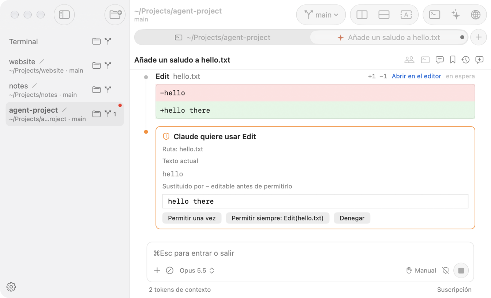

<p>&nbsp;&nbsp;&nbsp;</p>

# Tapa

**El terminal rápido y nativo para macOS que ha hecho sitio a tus agentes, tus archivos y tus páginas.**

Tapa es ante todo un terminal: su propio núcleo VT y un renderizador Metal, pestañas y divisiones nativas de macOS, un terminal rápido que aparece con un solo atajo, integración con el shell con bloques de comandos y, si lo quieres, un campo de entrada con sugerencias al estilo de Warp. A su alrededor, Tapa se ha convertido en la hermana pequeña de [Dango](https://github.com/sventmueller/dango): una barra lateral de espacios de trabajo, uno por carpeta de proyecto, cada uno con sus terminales, pestañas de agente para Claude, Codex, OpenCode, Antigravity y otros agentes ACP, pestañas de navegador, un editor con una lista de archivos y un panel de Git, y una previsualización de Markdown de [Splat](https://github.com/sventmueller/splat) con fórmulas y diagramas. Nada de lo que configura una carpeta de proyecto se ejecuta hasta que confías en su espacio de trabajo. Tapa está escrito en Rust sobre controles AppKit auténticos, habla 35 idiomas, no necesita cuenta y no tiene telemetría.

[](https://github.com/sventmueller/tapa/releases/latest/download/Tapa.dmg)

**[Descargar Tapa.dmg](https://github.com/sventmueller/tapa/releases/latest/download/Tapa.dmg)**: firmado y notarizado por Apple, para macOS 14 o posterior en Apple Silicon e Intel.

**¿Has encontrado un error?** [Abre una incidencia](https://github.com/sventmueller/tapa/issues/new/choose) e indica con qué shell, qué agente o qué programa ocurrió. Si Tapa te resulta útil, una [estrella en GitHub](https://github.com/sventmueller/tapa) ayuda a que otros lo encuentren.

[](https://www.rust-lang.org) [](https://www.apple.com/macos/)  [](https://github.com/madsmtm/objc2) [](https://developer.apple.com/metal/) [](https://agentclientprotocol.com)    [](#licencia)

[Bahasa Indonesia](../id/README.md) · [Bahasa Melayu](../ms/README.md) · [Català](../ca/README.md) · [Čeština](../cs/README.md) · [Dansk](../da/README.md) · [Deutsch](../de/README.md) · [English](../../../README.md) · **Español** · [Français](../fr/README.md) · [Hrvatski](../hr/README.md) · [Italiano](../it/README.md) · [Magyar](../hu/README.md) · [Nederlands](../nl/README.md) · [Norsk](../no/README.md) · [Polski](../pl/README.md) · [Português (Brasil)](../pt_BR/README.md) · [Português (Portugal)](../pt_PT/README.md) · [Română](../ro/README.md) · [Slovenčina](../sk/README.md) · [Slovenščina](../sl/README.md) · [Suomi](../fi/README.md) · [Svenska](../sv/README.md) · [Tiếng Việt](../vi/README.md) · [Türkçe](../tr/README.md) · [Ελληνικά](../el/README.md) · [Русский](../ru/README.md) · [Українська](../uk/README.md) · [עברית](../he/README.md)‎ · [العربية](../ar/README.md)‎ · [हिन्दी](../hi/README.md) · [ไทย](../th/README.md) · [한국어](../ko/README.md) · [日本語](../ja/README.md) · [简体中文](../zh-Hans/README.md) · [繁體中文](../zh-Hant/README.md)

## Contenido

- [Resumen de funciones](#resumen-de-funciones)
- [Requisitos](#requisitos)
- [Instalación](#instalación)
- [Primeros pasos](#primeros-pasos)
- [Espacios de trabajo](#espacios-de-trabajo)
- [El terminal](#el-terminal)
  - [Pestañas y divisiones](#pestañas-y-divisiones)
  - [Integración con el shell y bloques de comandos](#integración-con-el-shell-y-bloques-de-comandos)
  - [El campo de entrada y las sugerencias](#el-campo-de-entrada-y-las-sugerencias)
  - [Búsqueda, selección y copia](#búsqueda-selección-y-copia)
  - [El terminal rápido](#el-terminal-rápido)
- [Agentes](#agentes)
- [Editor, archivos y Git](#editor-archivos-y-git)
- [Previsualizaciones](#previsualizaciones)
- [Navegador](#navegador)
- [Dictado](#dictado)
- [Ajustes](#ajustes)
- [Apariencia y accesibilidad](#apariencia-y-accesibilidad)
- [Idiomas](#idiomas)
- [Atajos de teclado](#atajos-de-teclado)
- [Confianza](#confianza)
- [Privacidad y seguridad](#privacidad-y-seguridad)
- [Limitaciones conocidas](#limitaciones-conocidas)
- [Para desarrolladores](#para-desarrolladores)
  - [Componentes de terceros](#componentes-de-terceros)
- [Licencia](#licencia)

## Resumen de funciones

- **Un terminal rápido y propio.** Tapa analiza con su propio núcleo VT y dibuja con Metal en un hilo por pantalla, a la frecuencia de la pantalla y solo lo que ha cambiado. Supera 262 pruebas de esctest donde el núcleo de Alacritty supera 121, y cada cambio se mide frente a una versión fijada de Ghostty.
- **Nativo hasta la médula.** Pestañas reales de macOS, restauración de ventanas, menús, el menú Servicios, notificaciones, entrada de teclado segura, dictado y métodos de entrada. Sin Electron, y WebKit solo donde una página o una previsualización lo necesitan.
- **Espacios de trabajo.** La barra lateral contiene un espacio de trabajo por carpeta de proyecto, cada uno con sus propias pestañas, su rama y sus paneles. El espacio de trabajo «Terminal», arriba del todo, empieza de cero cada vez; todos los demás se quedan hasta que los eliminas.
- **Agentes en una vista de chat nativa.** Claude, Codex, OpenCode, Antigravity, Gemini CLI y otros agentes del Agent Client Protocol se ejecutan en pestañas propias, con respuestas, llamadas a herramientas, diffs y solicitudes de permiso en una sola cronología. Tapa los instala y los actualiza cuando se lo pides.
- **Integración con el shell y bloques de comandos** para zsh, bash y fish, también a través de `ssh`: salta de un prompt a otro, selecciona, copia, guarda y contrae la salida de un comando, y ve qué comandos han fallado y cuánto ha tardado cada uno.
- **Un campo de entrada como el de Warp, si lo quieres.** Edita la línea de comandos como texto, con sugerencias de tu historial, de especificaciones para más de 700 herramientas de línea de comandos y del estado del proyecto, todo en tu Mac.
- **Archivos, Git y un navegador junto al shell.** Un editor con colores de sintaxis, una lista de archivos, un panel de Git con preparación de cambios, commits, ramas y worktrees, una previsualización de Markdown con fórmulas y diagramas, y pestañas de navegador.
- **Cuidadoso con tus carpetas.** Un espacio de trabajo en el que no confías no inicia nada de lo que configura su carpeta: ni hooks de Git, ni servidores MCP del proyecto, ni ajustes del proyecto para los agentes, ni JavaScript en sus páginas de archivo.
- **Privado.** Sin cuenta y sin telemetría. Tapa solo se conecta a la red cuando se lo pides, y el historial restaurado en el disco se cifra con una clave de tu llavero.
- **En tu idioma.** La interfaz está disponible en 35 idiomas: alemán, árabe, catalán, checo, chino (simplificado), chino (tradicional), coreano, croata, danés, eslovaco, esloveno, español, finés, francés, griego, hebreo, hindi, húngaro, indonesio, inglés, italiano, japonés, malayo, neerlandés, noruego, polaco, portugués (Brasil), portugués (Portugal), rumano, ruso, sueco, tailandés, turco, ucraniano y vietnamita.

## Requisitos

- macOS 14 Sonoma o posterior, en Apple Silicon o Intel. Tapa se desarrolla y se prueba en macOS 27.
- zsh, bash o fish para la integración con el shell; los demás shells funcionan sin ella.
- Para las pestañas de agente, el agente que quieras usar, ya instalado o instalado por Tapa cuando se lo pidas (consulta [Agentes](#agentes)).

## Instalación

**Desde la imagen de disco.** Cada versión es una imagen de disco, `Tapa-<version>.dmg`, con una app universal para Apple Silicon e Intel, firmada con un Developer ID y notarizada por Apple. Ábrela y arrastra Tapa a la carpeta Aplicaciones.

**Con Homebrew.** El cask, en un tap propio, instala la misma imagen de disco:

```sh
brew install --cask sventmueller/tap/tapa
```

**Actualizaciones.** Tapa, instalado desde la imagen de disco o con Homebrew, se mantiene al día por sí solo con [Sparkle](https://sparkle-project.org). En el segundo arranque pregunta si puede buscar actualizaciones por su cuenta; hasta que aceptas, no hace ninguna solicitud. **Tapa › Buscar actualizaciones…** busca al instante. Tapa solo instala una actualización si lleva la firma del desarrollador. Una compilación propia no tiene actualizador.

**Desde el código fuente.** Consulta [Para desarrolladores](#para-desarrolladores).

**Como terminal predeterminado.** Tapa puede abrir scripts de shell (`.command`, `.tool`), carpetas soltadas sobre su icono y enlaces `ssh://`. Elígelo en el Finder con **Archivo › Obtener información › Abrir con**.

## Primeros pasos

1. **La ventana** tiene a la izquierda la barra lateral de espacios de trabajo, arriba las pestañas del espacio de trabajo seleccionado y, encima de ellas, la barra de herramientas. ⌃⌘S muestra y oculta la barra lateral.
2. **Un espacio de trabajo nuevo** se crea con el botón de carpeta de la parte superior de la barra lateral o con **Shell › Nuevo espacio de trabajo…** (⇧⌘N): elige una de las carpetas recientes o **Elegir carpeta…**.
3. **Las pestañas nuevas** empiezan en la carpeta del espacio de trabajo: ⌘T para un terminal, los botones de la derecha de la barra de herramientas para un terminal, un agente o una pestaña de navegador, o el **+** al final de la barra de pestañas.
4. **Los ajustes** se abren con ⌘, o con la rueda dentada de la parte inferior de la barra lateral.
5. **La paleta de comandos** (⇧⌘P) encuentra cualquier comando por su nombre, y **Buscar pestaña…** (⌘P) cualquier pestaña de cualquier espacio de trabajo.

La barra de herramientas contiene, de izquierda a derecha, el menú desplegable de ramas del repositorio del espacio de trabajo, los botones para dividir el terminal a la derecha y hacia abajo y para mostrar el campo de entrada, y los botones para pestañas nuevas de terminal, agente y navegador. Los botones de las divisiones y del campo de entrada están en gris mientras no haya una pestaña de terminal delante.

## Espacios de trabajo

Un espacio de trabajo es una carpeta con sus pestañas. Su fila en la barra lateral muestra el nombre, la carpeta y la rama de Git y, a la derecha, los botones de la lista de archivos y del panel de Git. Un clic en uno de ellos muestra ese panel en lugar de la lista de espacios de trabajo; **Espacios de trabajo**, arriba, lleva de vuelta.

- **El espacio de trabajo «Terminal»** está siempre arriba. Empieza de cero en cada arranque, en la carpeta que indican los ajustes, con un terminal vacío. No se guarda nada de él, y no se puede renombrar ni eliminar.
- **Todos los demás espacios de trabajo se quedan** hasta que los eliminas, incluso sin pestañas. Tapa conserva su nombre, sus pestañas, el contenido de sus terminales (en la medida en que lo indiquen los ajustes de restauración), sus sesiones de agente y la posición de la ventana. Los programas que siguen en ejecución terminan cuando Tapa se cierra.
- **Renombrar.** Haz clic en el lápiz que hay tras el nombre, haz clic en el nombre del espacio de trabajo seleccionado o elige **Shell › Renombrar espacio de trabajo**. El nombre se guarda al instante.
- **Estado.** Un punto verde en la fila significa que un agente del espacio de trabajo está trabajando, también con subagentes o en segundo plano; un punto rojo significa que uno te está esperando. Los terminales no marcan nada ahí.
- **Cambiar.** ⌃⌘[ y ⌃⌘] pasan de un espacio de trabajo a otro. La ventana se queda en su sitio, y las pestañas del espacio de trabajo seleccionado ocupan el lugar de las otras.
- **Worktrees.** **Nuevo worktree…**, en el menú desplegable de ramas de la barra de herramientas, crea un worktree de Git en una rama nueva y lo abre como un espacio de trabajo propio.

Cuando se cierra la última pestaña de un espacio de trabajo, el espacio de trabajo sigue en la lista. Con todas las pestañas cerradas, solo desaparece la ventana; el icono del Dock o ⌘N la traen de vuelta con sus espacios de trabajo.

## El terminal

Tapa funciona con su núcleo propio, `term-vt`. Habla xterm y VT520 con el protocolo de teclado de Kitty, hipervínculos OSC 8, acceso al portapapeles OSC 52 con un permiso aparte para la lectura, salida sincronizada, subrayados de color y ondulados, color verdadero (truecolor), consultas de color, avisos del modo claro y oscuro a los programas, pegado entre corchetes (bracketed paste), eventos de foco y notificación del ratón. El texto se reajusta cuando la ventana cambia de tamaño, historial incluido. Las ligaduras, las funciones tipográficas, los símbolos de Nerd Font sin tipos de letra parcheados y el dibujo exacto al píxel de los caracteres de recuadro, los glifos de Powerline y el braille vienen integrados.

### Pestañas y divisiones

- **Las pestañas** son las propias de macOS: arrástralas para reordenarlas o para sacarlas a una ventana propia, **Mostrar todas las pestañas** (⇧⌘\\), ⌘1 a ⌘8, ⌘9 para la última pestaña, y ⇧⌘[ / ⇧⌘] para cambiar. Cada pestaña muestra el icono de su tipo delante de su título.
- **Divisiones.** **Dividir a la derecha** (⌘D o ⌃⌘T) y **Dividir hacia abajo** (⇧⌘D o ⌃⌥⌘T), anidadas tan hondo como quieras. Arrastra un divisor, muévelo con ⌃⌘ y las flechas, **Maximizar panel** (⌃⇧⌘↩), **Igualar paneles** (⌃⌘=), y pasa de un panel a otro con ⌘[ y ⌘].
- **Carpeta de trabajo.** Las pestañas, ventanas y divisiones nuevas empiezan en la carpeta del terminal que está delante; los ajustes lo deciden para cada una de las tres.
- **Cerrar.** Tapa pregunta antes de cerrar una pestaña, una ventana o la app mientras se ejecuta un programa en ella.
- **Restauración.** Tras un reinicio vuelven los espacios de trabajo, las pestañas, los paneles, las carpetas y las últimas líneas de cada terminal. Los secretos como tokens y contraseñas se enmascaran antes de guardar nada.

### Integración con el shell y bloques de comandos

Tapa configura por sí solo su integración con el shell para zsh, bash y fish, sin tocar tus archivos de configuración, y la lleva consigo cuando te conectas a otro host con `ssh`. Con ella, cada comando y su salida forman un bloque:

- **Prompts.** ⌘↑ y ⌘↓ saltan al prompt anterior y al siguiente. Un clic en la línea de comandos mueve el cursor hasta allí.
- **Bloques.** **Seleccionar bloque** (⇧⌘A), **Copiar salida** (⌥⌘C), **Guardar salida…** (⌥⌘S) y **Contraer/expandir bloque** (⇧⌘↩). Sobre el bloque que está bajo el puntero, unos botones muestran su estado, su duración y las mismas acciones.
- **Los comandos fallidos** se marcan, y el comando que sigue en ejecución permanece visible arriba mientras su salida se desplaza.
- **Marcadores.** **Añadir/quitar marcador** (⇧⌘M) marca una línea; ⇧⌘↑ y ⇧⌘↓ saltan de un marcador a otro.
- **Las notificaciones** aparecen cuando un programa pide una (OSC 9 y OSC 777) y el terminal no está delante, y una barra de progreso (OSC 9;4) se muestra en la pestaña y en el icono del Dock.

### El campo de entrada y las sugerencias

El campo de entrada convierte la línea de comandos en un campo de texto en la parte inferior del panel, como en Warp, con fichas para la carpeta y la rama de Git encima. **Mostrar/ocultar campo de entrada** (⌘I) o el botón de la barra de herramientas lo activa para un terminal; **Ajustes › Entrada** lo activa para los terminales nuevos. Necesita la integración con el shell y se aparta ante los programas a pantalla completa como vim, htop o claude.

- **Retorno** envía todo el campo al shell, el texto de varias líneas como un solo pegado; el shell lo ejecuta y lo recuerda como siempre. Si el shell pide más, el campo le devuelve las teclas hasta el siguiente prompt.
- **↑, ↓ y ⌃R** buscan en tu historial, con la carpeta, la rama y el código de salida con que se ejecutó cada comando.
- **Tab** completa con especificaciones para más de 700 herramientas de línea de comandos, rutas y valores en vivo como ramas de Git, contenedores de Docker, recursos de kubectl, hosts de ssh, scripts de `package.json` y objetivos de make, just y cargo.
- **Las teclas de Vim** en el campo se activan con un interruptor en los mismos ajustes.
- **El siguiente comando antes de que lo escribas**: lo que suele venir después en este proyecto (tras `git add` viene `git commit`), lo que pide el estado del proyecto (un archivo de bloqueo más reciente que `node_modules`) y una corrección tras «command not found», a partir de erratas o de tu índice local de Homebrew.

Sin el campo de entrada, las sugerencias se muestran como texto gris detrás del cursor, y → las acepta. Los shells con sus propias autosugerencias, como fish o zsh-autosuggestions, conservan las suyas. Las sugerencias nunca usan la red, y solo inician programas de tu propio `PATH`, nunca de la carpeta del proyecto.

**Pegar.** Los pegados de varias líneas se pueden mostrar antes de que se ejecuten (**Mostrar antes los pegados de varias líneas**). Los archivos soltados sobre un terminal llegan como rutas entre comillas; ⌥←/→, ⌘←/→ y ⌘⌫ mueven y borran por palabras y líneas como en cualquier campo de texto del Mac.

### Búsqueda, selección y copia

- **Buscar** (⌘F) busca en el historial con expresiones regulares, distinción de mayúsculas y palabras completas, y cuenta las coincidencias; la barra de desplazamiento las marca junto con los prompts y los errores.
- **Selección inteligente.** Un doble clic selecciona entera una URL, una ruta, un hash o una dirección IP, y arrastrar con ⌥ selecciona un rectángulo. Los enlaces se detectan incluso sin OSC 8; ⌘-clic los abre, y abre una ruta en Dango si está instalado.
- **Seleccionar con el teclado** (⇧⌘C) mueve una selección con las teclas de Vim.
- **Copiar con formato** (⇧⌥⌘C) conserva colores y estilos; copiar al seleccionar es un ajuste. **Borrar** (⌘K) limpia el terminal.

### El terminal rápido

**Mostrar/ocultar terminal rápido** (⌃⌥⌘Space) desliza un terminal desde un borde de la pantalla, por encima de otras apps y de los espacios a pantalla completa, sin cambiar de app. El borde, su tamaño y si se oculta al hacer clic en otro sitio son ajustes. Sus sesiones siguen en ejecución mientras está oculto.

## Agentes

Una pestaña de agente ejecuta un agente de programación en la carpeta del espacio de trabajo, en la vista de agente nativa de Dango.

| Agente | Cómo se ejecuta | Qué necesita |
|---|---|---|
| Claude | el comando `claude`, controlado mediante su protocolo stream-json | `claude` instalado y con sesión iniciada; Tapa lo instala con el instalador de Claude cuando se lo pides |
| Codex | `codex app-server`, o `codex-acp` para un Codex más antiguo | `codex` con sesión iniciada; Tapa instala el adaptador de versión fijada cuando se lo pides |
| OpenCode | `opencode serve`, o `opencode acp` para un OpenCode más antiguo | tu propio `opencode` en el `PATH`, o la descarga de versión fijada |
| Antigravity | `agy acp` | tu propio `agy` en el `PATH`, o la descarga de versión fijada |
| Gemini CLI | `gemini --acp`, ofrecido en cuanto lo activas en **Ajustes › Agentes** | tu propio `gemini`, o la descarga de versión fijada |
| Otros agentes ACP | desde el registro ACP, cargado solo cuando lo pides | lo que indique la entrada del registro; las entradas sin suma de comprobación solo se instalan después de que lo confirmes |

Tapa usa el inicio de sesión propio de cada agente y no guarda credenciales de agentes. Un agente que se encuentre en el `PATH` de tu shell de inicio de sesión tiene prioridad; si no, Tapa ejecuta la versión que instaló en su propia carpeta de datos, nunca un programa del espacio de trabajo.

- **La cronología** muestra respuestas, llamadas a herramientas con su salida y sus diffs, preguntas y solicitudes de permiso. **Permitir una vez**, **Permitir siempre** y **Denegar** responden a una solicitud, y una edición se puede cambiar antes de permitirla.
- **Estado.** La pestaña y la fila del espacio de trabajo muestran un punto verde mientras el agente trabaja y uno rojo mientras te espera, y una notificación te avisa cuando espera mientras miras otra cosa.
- **El campo de mensaje** de la parte inferior recoge tu prompt, los archivos que sueltes en él y el dictado. ⌘Esc lleva el foco del teclado hasta él y lo devuelve. Ahí se pueden elegir el modelo y el modo de permisos para la sesión.
- **Ajustes › Agentes** fija para las sesiones nuevas el modo de permisos (Claude, Codex), el modelo (Claude, Codex, OpenCode) y el esfuerzo de razonamiento (Claude, Codex), y qué agentes ofrecen las pestañas nuevas. Muestra dónde está el programa de cada agente, con **Instalar…**, **Actualizar a …** y **Volver a …** para la versión anterior, y **Cargar registro** para el registro ACP. Ahí se pueden ver y eliminar las reglas que Claude guardó con «Permitir siempre».
- **Descargas comprobadas.** Los archivos comprimidos se comprueban con su SHA-256, los paquetes de npm con la integridad de su archivo de bloqueo, y se rechazan los paquetes sin versión fija. Un agente que falta ofrece también su instalación en su propia pestaña.

## Editor, archivos y Git

- **La lista de archivos** de un espacio de trabajo muestra su carpeta como un árbol, actualizado a medida que cambian los archivos, con los archivos que Git ignora atenuados si lo quieres. Un clic abre un archivo en una pestaña de previsualización, que el siguiente clic sustituye mientras no lo edites; un doble clic lo conserva.
- **El editor** abre los archivos en pestañas del espacio de trabajo, con colores de sintaxis, varios cursores, plegado, la sangría de `.editorconfig`, teclas de Vim opcionales y marcas de lo que ha cambiado desde el último commit. Se da cuenta cuando un archivo ha cambiado en el disco o contiene marcadores de conflicto. Los archivos Markdown reciben una barra de formato y **Abrir en Splat**. **Guardar** (⌘S), **Guardar como…** y **Guardar todo** funcionan como siempre, y Tapa pregunta antes de cerrar texto sin guardar.
- **Tras un fallo**, el texto sin guardar vuelve: Tapa guarda copias cifradas de él mientras escribes.
- **El panel de Git** muestra los cambios preparados y sin preparar, prepara y retira archivos y fragmentos sueltos, hace commits (⌘↩), los corrige (amend), hace commit y push, hace fetch, y gestiona ramas, stashes, cherry-picks y conflictos, con el historial de commits debajo. Un clic en un archivo muestra su diff.
- **El menú desplegable de ramas** de la barra de herramientas cambia de rama, crea ramas y crea worktrees.

El editor no inicia ningún formateador ni ningún servidor de lenguaje. Para un IDE completo con servidores de lenguaje y depurador, usa [Dango](https://github.com/sventmueller/dango).

## Previsualizaciones

- **El Markdown** se muestra junto a su editor mediante el renderizador de Splat: GitHub Flavored Markdown con fórmulas, diagramas e imágenes, que se desplaza párrafo a párrafo con el texto.
- **Las imágenes** se abren en una pestaña propia, los PDF mediante PDFKit, y el sonido, los vídeos, los tipos de letra y los documentos de oficina mediante Vista Rápida.
- **Decodificación aislada.** Toda imagen de una fuente no fiable (archivos del proyecto, Markdown, adjuntos y pegados de agentes) se decodifica en el servicio `Decoder.xpc` de Splat, en un App Sandbox propio sin archivos ni red, nunca en la app.

## Navegador

**Nueva pestaña de navegador** (⇧⌘B) abre una pestaña de WebKit en el espacio de trabajo. El campo de dirección acepta una dirección o palabras para el buscador que elijas (DuckDuckGo, Google, Bing o Startpage); ⌘L, ⌘R, ⌘[ y ⌘] funcionan como en Safari. Las páginas de `localhost` se ejecutan con normalidad, para el servidor de desarrollo de tu proyecto. Los archivos HTML de un espacio de trabajo solo pueden leer su propia carpeta y, en un espacio de trabajo en el que no confías, no ejecutan JavaScript.

## Dictado

Dicta en el campo de mensaje de un agente o en el editor con el botón del micrófono o con **Edición › Iniciar dictado** (⌃⌥D). El reconocimiento de voz es el de [Lowspeak](https://github.com/sventmueller/lowspeak), que no hace falta instalar. **Ajustes › Dictado** elige la transcripción en línea con OpenAI o Groq, o modelos locales Whisper y Parakeet que mantienen la grabación en tu Mac, el idioma, el posprocesado, el micrófono y tu propio vocabulario. Las claves de OpenAI y Groq se guardan en tu llavero. El dictado solo forma parte de la versión de distribución.

## Ajustes

**Tapa › Ajustes…** (⌘,) tiene los paneles General, Tipo de letra, Colores, Cursor, Terminal, Entrada, Editor, Agentes, Dictado, Perfiles y Atajos de teclado. Escriben un único archivo TOML, `config.toml`, en la carpeta de Tapa dentro de `~/Library/Application Support`, que también puedes editar a mano; Tapa lo vuelve a cargar mientras se ejecuta, y **Volver a cargar ajustes** (⇧⌘,) lo hace al instante.

- **Cuatro tamaños de letra** en General: Interfaz (barra lateral, paneles, lista de archivos, panel de Git y títulos de las pestañas), Editor (texto, números de línea y previsualización de Markdown), Terminal y Agentes. ⌘+, ⌘− y ⌘0 cambian el tamaño del terminal que está delante.
- **Apariencia:** Claro, Oscuro o Como el sistema.
- **Colores.** Un tema para el modo claro y otro para el oscuro, en el formato de temas de Ghostty, con un contraste mínimo que mantiene el texto legible incluso con un tema deficiente. Tus propios temas van en la carpeta de temas.
- **Los perfiles** agrupan tipo de letra, colores, shell, entorno y carpeta.
- **Los atajos de teclado** se pueden cambiar todos, y se muestran los conflictos.

## Apariencia y accesibilidad

- **El modo oscuro** sigue al sistema o a tu elección; se respetan el color de realce, Reducir movimiento y Aumentar contraste.
- **VoiceOver** lee las líneas y los prompts del terminal y anuncia la salida nueva; la barra lateral, las pestañas, los botones de la barra de herramientas y las tarjetas de la cronología de agentes tienen nombre.
- **Teclado.** Cada comando tiene un elemento de menú y un atajo, y el acceso total con teclado llega a todos los controles.
- **Tamaños.** Los cuatro tamaños de letra de los ajustes escalan por separado la interfaz, el editor, el terminal y los agentes.
- **De derecha a izquierda.** La interfaz se refleja en árabe y hebreo, mientras que la cuadrícula del terminal sigue de izquierda a derecha.

Los detalles y las carencias conocidas están en [ACCESSIBILITY.md](../../../ACCESSIBILITY.md).

## Idiomas

La interfaz está traducida a 35 idiomas: alemán, árabe, catalán, checo, chino (simplificado), chino (tradicional), coreano, croata, danés, eslovaco, esloveno, español, finés, francés, griego, hebreo, hindi, húngaro, indonesio, inglés, italiano, japonés, malayo, neerlandés, noruego, polaco, portugués (Brasil), portugués (Portugal), rumano, ruso, sueco, tailandés, turco, ucraniano y vietnamita.

Tapa sigue el orden de idiomas de **Ajustes del Sistema › General › Idioma y región**; allí también puedes elegir un idioma solo para Tapa en **Aplicaciones**. Si no hay traducción para tu idioma, usa el inglés.

## Atajos de teclado

| Acción | Atajo |
|---|---|
| Nueva ventana, espacio de trabajo, pestaña | ⌘N, ⇧⌘N, ⌘T |
| Nueva pestaña de navegador | ⇧⌘B |
| Nuevo archivo, abrir archivo | ⌥⌘N, ⌘O |
| Cerrar panel o pestaña, cerrar pestaña, cerrar ventana | ⌘W, ⌥⌘W, ⇧⌘W |
| Dividir a la derecha, dividir hacia abajo | ⌘D o ⌃⌘T, ⇧⌘D o ⌃⌥⌘T |
| Maximizar panel, igualar paneles, cerrar panel | ⌃⇧⌘↩, ⌃⌘=, ⌃⇧⌘W |
| Mover un divisor | ⌃⌘←, ⌃⌘→, ⌃⌘↑, ⌃⌘↓ |
| Panel siguiente, anterior | ⌘], ⌘[ |
| Pestaña siguiente, anterior; pestañas 1 a 8, última pestaña | ⇧⌘], ⇧⌘[; ⌘1 a ⌘8, ⌘9 |
| Espacio de trabajo siguiente, anterior | ⌃⌘], ⌃⌘[ |
| Buscar pestaña, paleta de comandos | ⌘P, ⇧⌘P |
| Mostrar u ocultar la barra lateral, el campo de entrada | ⌃⌘S, ⌘I |
| Terminal rápido | ⌃⌥⌘Space |
| Buscar, buscar siguiente, buscar anterior | ⌘F, ⌘G, ⇧⌘G |
| Prompt anterior, siguiente | ⌘↑, ⌘↓ |
| Seleccionar bloque, copiar salida, guardar salida, contraer bloque | ⇧⌘A, ⌥⌘C, ⌥⌘S, ⇧⌘↩ |
| Añadir o quitar un marcador; marcador anterior, siguiente | ⇧⌘M; ⇧⌘↑, ⇧⌘↓ |
| Seleccionar con el teclado | ⇧⌘C |
| Copiar con formato | ⇧⌥⌘C |
| Borrar | ⌘K |
| Principio, final, página arriba, página abajo | ⌘Home, ⌘End, ⌘PageUp, ⌘PageDown |
| Más grande, más pequeño, tamaño original (terminal) | ⌘+, ⌘−, ⌘0 |
| Campo de mensaje de una pestaña de agente | ⌘Esc |
| Iniciar dictado | ⌃⌥D |
| Ajustes, volver a cargar ajustes | ⌘,, ⇧⌘, |

Todos los atajos se pueden cambiar en **Ajustes › Atajos de teclado** o en la sección `[keys]` del archivo de ajustes.

## Confianza

Una carpeta de proyecto puede hacer que se ejecuten programas en cuanto algo se inicia en ella: hooks de Git y ajustes del repositorio como `core.fsmonitor`, hooks de agentes, servidores MCP del proyecto y ajustes del proyecto para los agentes. Por eso un espacio de trabajo nuevo no se considera de confianza.

- **Sin confianza:** los agentes se inician sin los hooks, los servidores MCP ni la configuración del proyecto (Claude con `--setting-sources=user --strict-mcp-config`, Codex con la carpeta marcada como no fiable, OpenCode sin la configuración del proyecto). Git se ejecuta neutralizado: sin hooks, filtros, controladores de diff, fsmonitor, `sshCommand` ni paginador, y solo con los asistentes de credenciales globales. Los archivos HTML se abren sin JavaScript. El panel de Git y la pestaña de agente lo indican y ofrecen confiar en el espacio de trabajo.
- **De confianza:** **Shell › Confiar en el espacio de trabajo** carga todo eso tal como la carpeta lo prevé. **Retirar confianza** lo deshace. La confianza se guarda por espacio de trabajo.

Sea cual sea su confianza, Tapa nunca ejecuta por sí solo un programa de una carpeta de proyecto: las sugerencias solo inician programas de tu `PATH` fuera del proyecto, y la barra lateral lee el estado de Git de los archivos `.git`. Un espacio de trabajo en tu carpeta de inicio, como «Terminal», no es un proyecto: allí, los programas que están bajo `~`, como `~/.local/bin/claude`, cuentan como tuyos.

## Privacidad y seguridad

- **Sin telemetría, sin cuenta.** Tapa no informa de nada sobre cómo lo usas y funciona completamente sin conexión. Solo se conecta a la red cuando se lo pides: para instalar o actualizar un agente, para cargar el registro ACP, para buscar actualizaciones una vez que lo has aceptado, y para las páginas que abres en una pestaña de navegador. Los propios agentes hablan con sus proveedores como siempre.
- **El historial en el disco** para restaurar sesiones se cifra con una clave de tu llavero, se puede desactivar, y los secretos como claves de API, tokens y contraseñas se enmascaran antes de escribirlo. Las copias del texto sin guardar del editor se cifran con la misma clave.
- **La entrada de teclado segura** se activa sola en las solicitudes de contraseña, y se puede activar de forma permanente en el menú de la app.
- **Las secuencias de escape** que podrían filtrar o inyectar datos, como los informes de título, las lecturas del portapapeles y los trucos de pegado, se bloquean o se preguntan antes. El analizador se somete a fuzzing en la CI.
- **Decodificación aislada** de las imágenes de fuentes no fiables, consulta [Previsualizaciones](#previsualizaciones).
- **Firma de código** con el Hardened Runtime. macOS atribuye a Tapa los accesos de los programas que se ejecutan en un terminal, así que Tapa incluye una descripción de uso para cada servicio protegido.

Los problemas de seguridad se comunican en privado; consulta [SECURITY.md](../../../SECURITY.md).

## Limitaciones conocidas

- **Todavía no hay imágenes en línea** en el terminal: los gráficos de Kitty, Sixel y las imágenes de iTerm2 están previstos después de la versión 1.0.
- **No hay modo de control de tmux**, y las sesiones no sobreviven al cierre de Tapa.
- **El texto de derecha a izquierda** sigue de izquierda a derecha en la cuadrícula del terminal.
- **⌘+ y ⌘−** solo cambian el terminal que está delante.
- **El editor** no tiene servidores de lenguaje, formateadores ni depurador, por diseño; Dango sí los tiene.
- **El dictado** solo está en la versión de distribución, no en una compilación de depuración.
- **VoiceOver** todavía no lo ha comprobado una persona de principio a fin.

## Para desarrolladores

Necesitas macOS 14 o posterior con las Command Line Tools de Xcode, Rust tal como lo indica `rust-toolchain.toml` (rustup con los dos destinos de Mac para la compilación universal), copias de [splat](https://github.com/sventmueller/splat) y [lowspeak](https://github.com/sventmueller/lowspeak) junto a esta (`../splat`, `../lowspeak`), y cmake para las compilaciones con dictado.

| Comando | Qué hace |
|---|---|
| `make help` | enumera los objetivos |
| `cargo xtask run` | compila la app de depuración y la abre |
| `make build` | compila la app de distribución con dictado en `target/release`, firmada ad hoc para este Mac |
| `make lint` | formato, clippy con los avisos como errores, la forma de los archivos y los textos de la interfaz |
| `make check` | `lint` y después todas las pruebas; no necesita ventana ni red |
| `make selftest STEPS="split_right,type:ls\n,shot:x"` | maneja la app y deja imágenes de ventana en `target/selftest/` |
| `make esctest`, `make vttest` | ejecuta esctest y vttest contra los dos núcleos en la app |
| `make perf` | la prueba de rendimiento frente a una versión fijada de Ghostty; solo es significativa en un Mac en reposo |
| `make fuzz` | los objetivos de fuzzing con cargo-fuzz |
| `make release` | un ensayo de la publicación: la app universal con dictado, su imagen de disco, su canal de actualizaciones y su cask en `target/release-dry-run`; no envía nada a ninguna parte |
| `make release-notarized` | la versión actual firmada con el Developer ID, notarizada por Apple y grapada, en `dist/`; `Cargo.toml` no cambia |
| `make deploy` | notariza la siguiente versión, hace commit de `Cargo.toml`, sube un borrador de la publicación, hace push de `main` y de la etiqueta y luego publica la versión; consulta [docs/development.md](../../../docs/development.md#deploy) |

Cómo contribuir está en [CONTRIBUTING.md](../../../CONTRIBUTING.md). Cada texto de la interfaz tiene el alemán como clave, con una traducción a los 35 idiomas; `cargo xtask strings` falla si falta alguna.

### Componentes de terceros

| Componente | Para qué se usa | Licencia |
|---|---|---|
| [objc2](https://github.com/madsmtm/objc2) y sus crates de frameworks | AppKit, Metal, WebKit y los demás frameworks de Apple | MIT, Zlib o Apache-2.0 |
| Los crates de Splat | Markdown, la previsualización, la lectura de Git, el decodificador de imágenes y las traducciones | MIT o Apache-2.0 |
| [Lowspeak](https://github.com/sventmueller/lowspeak) con [whisper.cpp](https://github.com/ggml-org/whisper.cpp) | el dictado | MIT |
| [Especificaciones de autocompletado de Fig](https://github.com/withfig/autocomplete) | las descripciones de comandos de las sugerencias | MIT |
| [rusqlite](https://github.com/rusqlite/rusqlite) con SQLite | el historial de comandos | MIT, dominio público |
| [Simple Icons](https://simpleicons.org) | logotipos de lenguajes y programas | CC0, algunos logotipos con sus propias condiciones |
| [Sparkle](https://sparkle-project.org) 2.10.1 | las actualizaciones de la versión de distribución | MIT |

## Licencia

Tapa se distribuye bajo cualquiera de las dos licencias siguientes:

- Licencia Apache, versión 2.0 ([LICENSE-APACHE](../../../LICENSE-APACHE))
- Licencia MIT ([LICENSE-MIT](../../../LICENSE-MIT))

a tu elección. Los logotipos de `assets/simple-icons` tienen sus propias licencias; consulta el README de esa carpeta.

Salvo que declares expresamente lo contrario, toda contribución enviada intencionadamente para su inclusión en Tapa por tu parte, tal como se define en la licencia Apache-2.0, tendrá doble licencia como arriba, sin términos ni condiciones adicionales.
