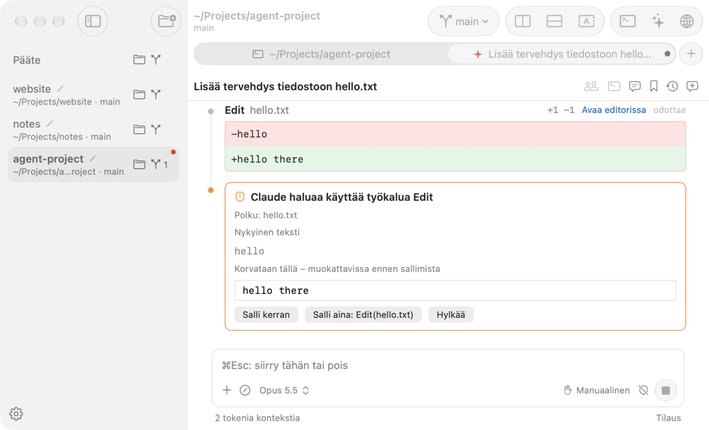

<p>&nbsp;&nbsp;&nbsp;</p>

# Tapa

**Nopea, natiivi pääte macOS:lle, johon mahtuvat myös agenttisi, tiedostosi ja sivusi.**

Tapa on ennen kaikkea pääte: oma VT-ydin ja Metal-renderöijä, natiivit macOS-välilehdet ja -jaot, pikapääte, joka liukuu esiin yhdellä näppäinoikotiellä, komentotulkki-integraatio komentolohkoineen ja valinnainen syötekenttä Warpin tyylisine ehdotuksineen. Sen ympärille Tapa on kasvanut [Dangon](https://github.com/sventmueller/dango) pikkusiskoksi: sivupalkki täynnä työtiloja, yksi kutakin projektikansiota kohden, jokaisessa omat päätteensä, agenttivälilehdet Claudelle, Codexille, OpenCodelle, Antigravitylle ja muille ACP-agenteille, selainvälilehdet, editori tiedostoluetteloineen ja Git-paneeleineen sekä [Splatin](https://github.com/sventmueller/splat) Markdown-esikatselu kaavoineen ja kaavioineen. Mitään, minkä projektikansio määrittää, ei suoriteta ennen kuin luotat sen työtilaan. Tapa on kirjoitettu Rustilla aidoilla AppKit-säätimillä, puhuu 35 kieltä, ei tarvitse tiliä eikä sisällä telemetriaa.

[](https://github.com/sventmueller/tapa/releases/latest/download/Tapa.dmg)

**[Lataa Tapa.dmg](https://github.com/sventmueller/tapa/releases/latest/download/Tapa.dmg)**: allekirjoitettu ja Applen notarisoima, macOS 14:lle tai uudemmalle Apple Silicon- ja Intel-Maceissa.

**Löysitkö virheen?** [Avaa issue](https://github.com/sventmueller/tapa/issues/new/choose) ja kerro, millä komentotulkilla, millä agentilla tai millä ohjelmalla se tapahtui. Jos Tapa on sinulle hyödyllinen, [tähti GitHubissa](https://github.com/sventmueller/tapa) auttaa muita löytämään sen.

[](https://www.rust-lang.org) [](https://www.apple.com/macos/)  [](https://github.com/madsmtm/objc2) [](https://developer.apple.com/metal/) [](https://agentclientprotocol.com)    [](#lisenssi)

[Bahasa Indonesia](../id/README.md) · [Bahasa Melayu](../ms/README.md) · [Català](../ca/README.md) · [Čeština](../cs/README.md) · [Dansk](../da/README.md) · [Deutsch](../de/README.md) · [English](../../../README.md) · [Español](../es/README.md) · [Français](../fr/README.md) · [Hrvatski](../hr/README.md) · [Italiano](../it/README.md) · [Magyar](../hu/README.md) · [Nederlands](../nl/README.md) · [Norsk](../no/README.md) · [Polski](../pl/README.md) · [Português (Brasil)](../pt_BR/README.md) · [Português (Portugal)](../pt_PT/README.md) · [Română](../ro/README.md) · [Slovenčina](../sk/README.md) · [Slovenščina](../sl/README.md) · **Suomi** · [Svenska](../sv/README.md) · [Tiếng Việt](../vi/README.md) · [Türkçe](../tr/README.md) · [Ελληνικά](../el/README.md) · [Русский](../ru/README.md) · [Українська](../uk/README.md) · [עברית](../he/README.md)‎ · [العربية](../ar/README.md)‎ · [हिन्दी](../hi/README.md) · [ไทย](../th/README.md) · [한국어](../ko/README.md) · [日本語](../ja/README.md) · [简体中文](../zh-Hans/README.md) · [繁體中文](../zh-Hant/README.md)

## Sisältö

- [Pähkinänkuoressa](#pähkinänkuoressa)
- [Vaatimukset](#vaatimukset)
- [Asennus](#asennus)
- [Aloittaminen](#aloittaminen)
- [Työtilat](#työtilat)
- [Pääte](#pääte)
  - [Välilehdet ja jaot](#välilehdet-ja-jaot)
  - [Komentotulkki-integraatio ja komentolohkot](#komentotulkki-integraatio-ja-komentolohkot)
  - [Syötekenttä ja ehdotukset](#syötekenttä-ja-ehdotukset)
  - [Haku, valinta ja kopiointi](#haku-valinta-ja-kopiointi)
  - [Pikapääte](#pikapääte)
- [Agentit](#agentit)
- [Editori, tiedostot ja Git](#editori-tiedostot-ja-git)
- [Esikatselut](#esikatselut)
- [Selain](#selain)
- [Sanelu](#sanelu)
- [Asetukset](#asetukset)
- [Ulkoasu ja saavutettavuus](#ulkoasu-ja-saavutettavuus)
- [Kielet](#kielet)
- [Pikanäppäimet](#pikanäppäimet)
- [Luottamus](#luottamus)
- [Tietosuoja ja turvallisuus](#tietosuoja-ja-turvallisuus)
- [Tunnetut rajoitukset](#tunnetut-rajoitukset)
- [Kehittäjille](#kehittäjille)
  - [Kolmannen osapuolen komponentit](#kolmannen-osapuolen-komponentit)
- [Lisenssi](#lisenssi)

## Pähkinänkuoressa

- **Oma, nopea pääte.** Tapa jäsentää omalla VT-ytimellään ja piirtää Metalilla omassa säikeessään jokaiselle näytölle, näytön tahdissa ja vain sen, mikä muuttui. Se läpäisee 262 esctest-tarkistusta, kun Alacrittyn ydin läpäisee 121, ja jokaista sen muutosta mitataan kiinnitettyä Ghostty-versiota vasten.
- **Natiivi läpikotaisin.** Aidot macOS-välilehdet, ikkunoiden palautus, valikot, Palvelut-valikko, ilmoitukset, suojattu näppäimistösyöte, sanelu ja syöttötavat. Ei Electronia, ja WebKitiä vain siellä, missä sivu tai esikatselu sitä tarvitsee.
- **Työtilat.** Sivupalkissa on yksi työtila kutakin projektikansiota kohden, jokaisella omat välilehtensä, haaransa ja paneelinsa. Ylimpänä oleva Pääte-työtila alkaa joka kerta puhtaalta pöydältä; kaikki muut säilyvät, kunnes poistat ne.
- **Agentit natiivissa keskustelunäkymässä.** Claude, Codex, OpenCode, Antigravity, Gemini CLI ja muut Agent Client Protocolin agentit toimivat omissa välilehdissään, ja vastaukset, työkalukutsut, diffit ja lupapyynnöt näkyvät yhdellä aikajanalla. Tapa asentaa ja päivittää ne pyynnöstä.
- **Komentotulkki-integraatio ja komentolohkot** zsh:lle, bashille ja fishille, myös `ssh`:n yli: hyppää kehotteesta kehotteeseen, valitse, kopioi, tallenna ja supista komennon tuloste, näe epäonnistuneet komennot ja kunkin kesto.
- **Warpin kaltainen syötekenttä, jos haluat.** Muokkaa komentoriviä tekstinä ehdotusten kera, jotka tulevat historiastasi, yli 700 komentorivityökalun kuvauksista ja projektin tilasta, kaikki omalla Macillasi.
- **Tiedostot, Git ja selain komentotulkin vieressä.** Editori syntaksiväreineen, tiedostoluettelo, Git-paneeli lavastuksineen (staging), committeineen, haaroineen ja worktreineen, Markdown-esikatselu kaavoineen ja kaavioineen sekä selainvälilehdet.
- **Varovainen kansioidesi kanssa.** Työtila, johon et ole luottanut, ei käynnistä mitään, minkä sen kansio määrittää: ei git-hookeja, ei projektin MCP-palvelimia, ei agenttien projektiasetuksia eikä JavaScriptiä sen tiedostosivuilla.
- **Yksityinen.** Ei tiliä, ei telemetriaa. Tapa menee verkkoon vain, kun pyydät, ja levylle tallennettu palautushistoria on salattu avainnipussasi olevalla avaimella.
- **Omalla kielelläsi.** Käyttöliittymä on saatavilla 35 kielellä: arabia, englanti, espanja, heprea, hindi, hollanti, indonesia, italia, japani, katalaani, kiina (yksinkertaistettu), kiina (perinteinen), korea, kreikka, kroatia, malaiji, norja, portugali (Brasilia), portugali (Portugali), puola, ranska, romania, ruotsi, saksa, slovakki, sloveeni, suomi, tanska, thai, turkki, tšekki, ukraina, unkari, venäjä ja vietnam.

## Vaatimukset

- macOS 14 Sonoma tai uudempi, Apple Siliconilla tai Intelillä. Tapaa kehitetään ja testataan macOS 27:llä.
- zsh, bash tai fish komentotulkki-integraatiota varten; muut komentotulkit toimivat ilman sitä.
- Agenttivälilehtiä varten agentti, jota haluat käyttää, joko valmiiksi asennettuna tai Tapan pyynnöstäsi asentamana (katso [Agentit](#agentit)).

## Asennus

**Levykuvasta.** Jokainen julkaisu on levykuva, `Tapa-<version>.dmg`, jossa on yksi universal-appi Apple Siliconille ja Intelille, allekirjoitettu Developer ID:llä ja Applen notarisoima. Avaa se ja vedä Tapa Ohjelmat-kansioon.

**Homebrew'lla.** Oman tapin cask asentaa saman levykuvan:

```sh
brew install --cask sventmueller/tap/tapa
```

**Päivitykset.** Levykuvasta tai Homebrew'lla asennettu Tapa pitää itsensä ajan tasalla [Sparklen](https://sparkle-project.org) avulla. Toisella käynnistyskerralla se kysyy, saako se etsiä päivityksiä itsenäisesti; ennen kuin suostut, se ei tee yhtään pyyntöä. **Tapa › Tarkista päivitykset…** tarkistaa heti. Tapa asentaa päivityksen vain, jos siinä on kehittäjän allekirjoitus. Itse käännetyssä versiossa ei ole päivitystoimintoa.

**Lähdekoodista.** Katso [Kehittäjille](#kehittäjille).

**Oletuspäätteeksi.** Tapa osaa avata komentotulkkiskriptit (`.command`, `.tool`), sen kuvakkeen päälle pudotetut kansiot ja `ssh://`-linkit. Valitse se Finderissa kohdasta **Tiedosto › Näytä tiedot › Avaa apilla**.

## Aloittaminen

1. **Ikkunassa** on vasemmalla työtilojen sivupalkki, ylhäällä valitun työtilan välilehdet ja niiden yläpuolella työkalupalkki. ⌃⌘S näyttää ja kätkee sivupalkin.
2. **Uusi työtila** syntyy sivupalkin yläreunan kansiopainikkeesta tai valinnalla **Komentotulkki › Uusi työtila…** (⇧⌘N): valitse jokin viimeaikaisista kansioista tai **Valitse kansio…**.
3. **Uudet välilehdet** alkavat työtilan kansiosta: ⌘T päätteelle, työkalupalkin oikean reunan painikkeet päätteelle, agentille tai selainvälilehdelle, tai välilehtipalkin lopussa oleva **+**.
4. **Asetukset** avautuvat ⌘,-näppäimillä tai sivupalkin alareunan rataskuvakkeesta.
5. **Komentopaletti** (⇧⌘P) löytää jokaisen komennon nimen perusteella, ja **Etsi välilehti…** (⌘P) jokaisen työtilan jokaisen välilehden.

Työkalupalkissa ovat vasemmalta lukien työtilan repositorion haaravalikko, painikkeet päätteen jakamiseen oikealle ja alas sekä syötekentän näyttämiseen, ja painikkeet uusille pääte-, agentti- ja selainvälilehdille. Jakojen ja syötekentän painikkeet ovat harmaina, kun edessä ei ole päätevälilehteä.

## Työtilat

Työtila on kansio välilehtineen. Sen rivi sivupalkissa näyttää nimen, kansion ja Git-haaran, ja oikealla painikkeet tiedostoluettelolle ja Git-paneelille. Kummankin napsautus näyttää kyseisen paneelin työtilaluettelon paikalla; yläreunan **Työtilat** vie takaisin.

- **Pääte-työtila** on aina ylimpänä. Se alkaa joka käynnistyksessä puhtaalta pöydältä, asetusten nimeämässä kansiossa, yhdellä tyhjällä päätteellä. Siitä ei tallenneta mitään, eikä sitä voi nimetä uudelleen tai poistaa.
- **Jokainen muu työtila säilyy**, kunnes poistat sen, myös ilman välilehtiä. Tapa säilyttää sen nimen, välilehdet, sen päätteiden sisällön (sikäli kuin palautusasetukset sallivat), sen agenttien istunnot ja ikkunan sijainnin. Yhä käynnissä olevat ohjelmat päättyvät, kun Tapa lopetetaan.
- **Uudelleennimeäminen.** Napsauta nimen perässä olevaa kynää, napsauta valitun työtilan nimeä tai valitse **Komentotulkki › Nimeä työtila uudelleen**. Nimi tallennetaan heti.
- **Tila.** Vihreä piste rivillä tarkoittaa, että työtilan agentti työskentelee, myös aliagenttien kanssa tai taustalla; punainen piste tarkoittaa, että jokin niistä odottaa sinua. Päätteet eivät merkitse sinne mitään.
- **Vaihtaminen.** ⌃⌘[ ja ⌃⌘] siirtyvät työtilasta toiseen. Ikkuna pysyy paikallaan, ja valitun työtilan välilehdet tulevat muiden tilalle.
- **Worktreet.** Työkalupalkin haaravalikon **Uusi worktree…** luo Git-worktreen uuteen haaraan ja avaa sen omana työtilanaan.

Kun työtilan viimeinen välilehti suljetaan, työtila jää luetteloon. Kun kaikki välilehdet on suljettu, vain ikkuna katoaa; Dockin kuvake tai ⌘N tuo sen takaisin työtiloineen.

## Pääte

Tapa toimii omalla ytimellään, `term-vt`. Se puhuu xtermiä ja VT520:tä Kittyn näppäimistöprotokollalla, ja tukee OSC 8 -hyperlinkkejä, leikepöydän käyttöä OSC 52:n kautta erillisellä lukuluvalla, synkronoitua tulostetta, värillisiä ja kiemuraisia alleviivauksia, truecoloria, värikyselyitä, vaalean ja tumman tilan ilmoituksia ohjelmille, bracketed pastea, kohdistustapahtumia ja hiiriraportointia. Teksti rivittyy uudelleen ikkunan koon muuttuessa, historia mukaan lukien. Ligatuurit, fonttiominaisuudet, Nerd Font -symbolit ilman paikattuja fontteja sekä pikselintarkat laatikkopiirros-, Powerline- ja pistekirjoitusmerkit ovat sisäänrakennettuja.

### Välilehdet ja jaot

- **Välilehdet** ovat macOS:n omia: vedä niitä järjestääksesi ne uudelleen tai ulos omaan ikkunaansa, **Näytä kaikki välilehdet** (⇧⌘\\), ⌘1–⌘8, ⌘9 viimeiselle välilehdelle ja ⇧⌘[ / ⇧⌘] vaihtamiseen. Jokainen välilehti näyttää tyyppinsä kuvakkeen otsikkonsa edessä.
- **Jaot.** **Jaa oikealle** (⌘D tai ⌃⌘T) ja **Jaa alas** (⇧⌘D tai ⌃⌥⌘T), sisäkkäin niin syvälle kuin haluat. Vedä jakajaa, siirrä sitä ⌃⌘:llä ja nuolinäppäimillä, **Suurenna paneeli** (⌃⇧⌘↩), **Tasaa paneelit** (⌃⌘=), ja siirry paneelien välillä ⌘[:llä ja ⌘]:llä.
- **Työkansio.** Uudet välilehdet, ikkunat ja jaot alkavat edessä olevan päätteen kansiosta; asetukset päättävät tämän kullekin kolmesta erikseen.
- **Sulkeminen.** Tapa kysyy ennen kuin sulkee välilehden, ikkunan tai apin, jossa ohjelma on käynnissä.
- **Palautus.** Uudelleenkäynnistyksen jälkeen työtilat, välilehdet, paneelit, kansiot ja kunkin päätteen viimeiset rivit palaavat. Salaisuudet, kuten tunnukset ja salasanat, peitetään ennen kuin mitään tallennetaan.

### Komentotulkki-integraatio ja komentolohkot

Tapa ottaa komentotulkki-integraation käyttöön zsh:lle, bashille ja fishille itse, koskematta asetustiedostoihisi, ja vie sen mukanaan, kun otat `ssh`-yhteyden toiseen koneeseen. Sen ansiosta jokainen komento tulosteineen muodostaa lohkon:

- **Kehotteet.** ⌘↑ ja ⌘↓ hyppäävät edelliseen ja seuraavaan kehotteeseen. Napsautus komentoriville siirtää kohdistimen sinne.
- **Lohkot.** **Valitse lohko** (⇧⌘A), **Kopioi tuloste** (⌥⌘C), **Tallenna tuloste…** (⌥⌘S) ja **Supista/laajenna lohko** (⇧⌘↩). Osoittimen alla olevan lohkon päällä painikkeet näyttävät sen tilan, keston ja samat toiminnot.
- **Epäonnistuneet komennot** merkitään, ja yhä käynnissä oleva komento pysyy näkyvissä ylhäällä, kun sen tuloste vierii.
- **Kirjanmerkit.** **Lisää/poista kirjanmerkki** (⇧⌘M) merkitsee rivin; ⇧⌘↑ ja ⇧⌘↓ hyppäävät kirjanmerkkien välillä.
- **Ilmoitukset** näkyvät, kun ohjelma pyytää sellaista (OSC 9 ja OSC 777) eikä pääte ole edessä, ja edistymispalkki (OSC 9;4) näkyy välilehdessä ja Dockin kuvakkeessa.

### Syötekenttä ja ehdotukset

Syötekenttä muuttaa komentorivin tekstikentäksi paneelin alareunaan, kuten Warpissa, ja sen yläpuolella on lappuset kansiolle ja Git-haaralle. **Näytä/kätke syötekenttä** (⌘I) tai työkalupalkin painike vaihtaa sen yhdelle päätteelle; **Asetukset › Syöte** ottaa sen käyttöön uusille päätteille. Se tarvitsee komentotulkki-integraation ja väistyy koko näytön ohjelmien, kuten vimin, htopin tai clauden, tieltä.

- **Return** lähettää koko kentän komentotulkille, monirivisen tekstin yhtenä sijoituksena; komentotulkki suorittaa ja muistaa sen tavalliseen tapaan. Jos komentotulkki pyytää lisää, kenttä antaa näppäimet sille seuraavaan kehotteeseen asti.
- **↑, ↓ ja ⌃R** hakevat historiastasi, kunkin komennon kansion, haaran ja paluukoodin kera.
- **Tab** täydentää yli 700 komentorivityökalun kuvausten, polkujen ja reaaliaikaisten arvojen perusteella, kuten git-haarat, docker-kontit, kubectl-resurssit, ssh-palvelimet, `package.json`-skriptit sekä make-, just- ja cargo-kohteet.
- **Vim-näppäimet** kentässä ovat kytkin samoissa asetuksissa.
- **Seuraava komento ennen kuin kirjoitat**: mitä tässä projektissa yleensä seuraa (`git add`:n jälkeen tulee `git commit`), mitä projektin tila vaatii (lukitustiedosto on uudempi kuin `node_modules`), ja korjaus ”command not found” -virheen jälkeen, kirjoitusvirheistä tai paikallisesta Homebrew-indeksistäsi.

Ilman syötekenttää ehdotukset näkyvät harmaana tekstinä kohdistimen takana, ja → hyväksyy ne. Komentotulkit, joilla on omat automaattiset ehdotuksensa, kuten fish tai zsh-autosuggestions, pitävät omansa. Ehdotukset eivät koskaan käytä verkkoa, ja ne käynnistävät ohjelmia vain omasta `PATH`istasi, ei koskaan projektikansiosta.

**Sijoittaminen.** Moniriviset sijoitukset voi näyttää ennen suoritusta (**Näytä monirivinen sijoitus ensin**). Päätteeseen pudotetut tiedostot saapuvat lainausmerkeissä olevina polkuina; ⌥←/→, ⌘←/→ ja ⌘⌫ siirtävät ja poistavat sanoittain ja riveittäin kuten missä tahansa Macin tekstikentässä.

### Haku, valinta ja kopiointi

- **Etsi…** (⌘F) hakee historiasta säännöllisillä lausekkeilla, kirjainkoon ja kokonaisten sanojen mukaan ja laskee osumat; vierityspalkki merkitsee ne kehotteiden ja virheiden kera.
- **Älykäs valinta.** Kaksoisnapsautus valitsee URL-osoitteen, polun, tiivisteen tai IP-osoitteen kokonaan, ja ⌥-veto valitsee suorakulmion. Linkit löytyvät myös ilman OSC 8:aa; ⌘-napsautus avaa ne, ja polun Dangossa, jos se on asennettu.
- **Valitse näppäimistöllä** (⇧⌘C) siirtää valintaa Vimin näppäimillä.
- **Kopioi muotoiluineen** (⇧⌥⌘C) säilyttää värit ja tyylit; kopiointi valittaessa on asetus. **Tyhjennä** (⌘K) tyhjentää päätteen.

### Pikapääte

**Näytä/kätke pikapääte** (⌃⌥⌘Välilyönti) liu’uttaa päätteen esiin näytön reunasta, muiden appien ja koko näytön tilojen päälle, vaihtamatta appia. Reuna, koko ja se, katoaako pääte, kun napsautat muualle, ovat asetuksia. Sen istunnot jatkuvat, kun se on kätkettynä.

## Agentit

Agenttivälilehti suorittaa koodausagenttia työtilan kansiossa, Dangosta peräisin olevassa natiivissa agenttinäkymässä.

| Agentti | Miten se toimii | Mitä se tarvitsee |
|---|---|---|
| Claude | `claude`-komento, jonka kanssa puhutaan sen stream-json-protokollalla | asennettu ja sisäänkirjautunut `claude`; Tapa asentaa sen Clauden omalla asentimella pyynnöstäsi |
| Codex | `codex app-server`, tai `codex-acp` vanhemmalle Codexille | sisäänkirjautunut `codex`; Tapa asentaa kiinnitetyn sovittimen pyynnöstäsi |
| OpenCode | `opencode serve`, tai `opencode acp` vanhemmalle OpenCodelle | oma `opencode` `PATH`issa, tai kiinnitetty lataus |
| Antigravity | `agy acp` | oma `agy` `PATH`issa, tai kiinnitetty lataus |
| Gemini CLI | `gemini --acp`, tarjolla heti kun otat sen käyttöön kohdassa **Asetukset › Agentit** | oma `gemini`, tai kiinnitetty lataus |
| Muut ACP-agentit | ACP-rekisteristä, joka ladataan vain pyynnöstäsi | mitä rekisterimerkintä nimeää; merkinnät ilman tarkistussummaa asentuvat vasta vahvistuksesi jälkeen |

Tapa käyttää kunkin agentin omaa kirjautumista eikä tallenna agenttien tunnistetietoja. Kirjautumiskomentotulkkisi `PATH`ista löytyvä agentti on etusijalla; muuten Tapa suorittaa version, jonka se asensi omaan datakansioonsa, ei koskaan ohjelmaa työtilasta.

- **Aikajana** näyttää vastaukset, työkalukutsut tulosteineen ja diffeineen, kysymykset ja lupapyynnöt. **Salli kerran**, **Salli aina** ja **Hylkää** vastaavat pyyntöön, ja muokkausta voi muuttaa ennen kuin sallit sen.
- **Tila.** Välilehti ja työtilan rivi näyttävät vihreän pisteen agentin työskennellessä ja punaisen sen odottaessa sinua, ja ilmoitus kertoo, kun se odottaa sillä aikaa kun katsot muualle.
- **Viestikenttä** alareunassa ottaa vastaan kehotteesi, sen päälle pudotetut tiedostot ja sanelun. ⌘Esc siirtää näppäimistön kohdistuksen siihen ja takaisin. Siellä voi valita istunnolle mallin ja lupatilan.
- **Asetukset › Agentit** määrittää uusille istunnoille lupatilan (Claude, Codex), mallin (Claude, Codex, OpenCode) ja ajattelun tason (Claude, Codex) sekä sen, mitä agentteja uudet välilehdet tarjoavat. Se näyttää, missä kunkin agentin ohjelma sijaitsee, ja tarjoaa **Asenna…**, **Päivitä versioon …** ja edelliselle versiolle **Palaa versioon …** sekä ACP-rekisterille **Lataa rekisteri**. Siellä voi myös nähdä ja poistaa säännöt, jotka Claude tallensi ”Salli aina” -valinnalla.
- **Tarkistetut lataukset.** Arkistot tarkistetaan SHA-256-summaansa vasten, npm-paketit lukitustiedostonsa integrity-arvoa vasten, ja paketit ilman kiinteää versiota hylätään. Puuttuva agentti tarjoaa asennustaan myös omassa välilehdessään.

## Editori, tiedostot ja Git

- **Työtilan tiedostoluettelo** näyttää sen kansion puuna, joka päivittyy tiedostojen muuttuessa, ja Gitin ohittamat tiedostot himmennettyinä, jos haluat. Napsautus avaa tiedoston esikatseluvälilehteen, jonka seuraava napsautus korvaa, kunnes muokkaat sitä; kaksoisnapsautus pitää sen.
- **Editori** avaa tiedostoja työtilan välilehtiin, syntaksivärein, useilla kohdistimilla, laskostuksella, `.editorconfig`in sisennyksellä, valinnaisilla Vim-näppäimillä ja merkinnöillä siitä, mikä on muuttunut viimeisen commitin jälkeen. Se huomaa, kun tiedosto on muuttunut levyllä tai sisältää ristiriitamerkintöjä. Markdown-tiedostot saavat muotoilupalkin ja **Avaa Splatissa** -toiminnon. **Tallenna** (⌘S), **Tallenna nimellä…** ja **Tallenna kaikki** toimivat tavalliseen tapaan, ja Tapa kysyy ennen kuin sulkee tallentamatonta tekstiä.
- **Kaatumisen jälkeen** tallentamaton teksti palaa: Tapa pitää siitä salattuja kopioita kirjoittaessasi.
- **Git-paneeli** näyttää lavastetut ja lavastamattomat muutokset, lavastaa ja poistaa lavastuksesta tiedostoja ja yksittäisiä hunkeja, tekee commitin (⌘↩), amendin, commitin ja pushin, fetchin, ja hoitaa haarat, stashit, cherry-pickit ja ristiriidat, commit-historia alapuolellaan. Tiedoston napsautus näyttää sen diffin.
- **Haaravalikko** työkalupalkissa vaihtaa ja luo haaroja sekä tekee worktreet.

Editori ei käynnistä muotoilijaa eikä kielipalvelinta. Täysimittaiseen IDE:hen kielipalvelimineen ja debuggereineen käytä [Dangoa](https://github.com/sventmueller/dango).

## Esikatselut

- **Markdown** näkyy editorinsa vieressä Splatin renderöijän kautta: GitHub Flavored Markdown kaavoineen, kaavioineen ja kuvineen, vierien kappale kappaleelta tekstin mukana.
- **Kuvat** avautuvat omaan välilehteensä, PDF:t PDFKitin kautta, ja äänet, elokuvat, fontit ja toimistoasiakirjat Pikakatselun kautta.
- **Eristetty dekoodaus.** Jokainen epäluotettavasta lähteestä tuleva kuva (projektitiedostot, Markdown, agenttien liitteet ja sijoitukset) dekoodataan Splatin `Decoder.xpc`-palvelussa, omassa App Sandboxissaan ilman tiedostoja tai verkkoa, ei koskaan itse apissa.

## Selain

**Uusi selainvälilehti** (⇧⌘B) avaa WebKit-välilehden työtilaan. Osoitekenttä ottaa vastaan osoitteen tai hakusanoja valitsemallesi hakukoneelle (DuckDuckGo, Google, Bing tai Startpage); ⌘L, ⌘R, ⌘[ ja ⌘] toimivat kuten Safarissa. `localhost`in sivut toimivat tavalliseen tapaan, projektisi kehityspalvelinta varten. Työtilan HTML-tiedostot saavat lukea vain omaa kansiotaan, ja työtilassa, johon et ole luottanut, ne eivät suorita JavaScriptiä.

## Sanelu

Sanele agentin viestikenttään tai editoriin mikrofonipainikkeella tai valinnalla **Muokkaa › Aloita sanelu** (⌃⌥D). Puheentunnistus on [Lowspeakin](https://github.com/sventmueller/lowspeak), jota ei tarvitse asentaa. **Asetukset › Sanelu** valitsee verkkolitteroinnin OpenAI:lla tai Groqilla tai paikalliset Whisper- ja Parakeet-mallit, jotka pitävät äänitteen Macillasi, sekä kielen, jälkikäsittelyn, mikrofonin ja oman sanastosi. OpenAI:n ja Groqin avaimet säilytetään avainnipussasi. Sanelu on mukana vain julkaisuversiossa.

## Asetukset

**Tapa › Asetukset…** (⌘,) sisältää osiot Yleiset, Fontti, Värit, Kohdistin, Pääte, Syöte, Editori, Agentit, Sanelu, Profiilit ja Näppäinoikotiet. Ne kirjoittavat yhden TOML-tiedoston, `config.toml`, Tapan kansioon kohteen `~/Library/Application Support` alle, ja voit muokata sitä myös käsin; Tapa lataa sen uudelleen käynnissä ollessaan, ja **Lataa asetukset uudelleen** (⇧⌘,) tekee sen heti.

- **Neljä fonttikokoa** osiossa Yleiset: Käyttöliittymä (sivupalkki, paneelit, tiedostoluettelo, Git-paneeli ja välilehtien otsikot), Editori (teksti, rivinumerot ja Markdown-esikatselu), Pääte ja Agentit. ⌘+, ⌘− ja ⌘0 muuttavat edessä olevan päätteen kokoa.
- **Ulkoasu:** Vaalea, Tumma tai Kuten järjestelmä.
- **Värit.** Teema vaalealle ja toinen tummalle tilalle, Ghosttyn teemamuodossa, vähimmäiskontrastilla, joka pitää tekstin luettavana huonossakin teemassa. Omat teemasi menevät teemakansioon.
- **Profiilit** yhdistävät fontin, värit, komentotulkin, ympäristön ja kansion.
- **Näppäinoikotiet** voi kaikki muuttaa, ja ristiriidat näytetään.

## Ulkoasu ja saavutettavuus

- **Tumma tila** seuraa järjestelmää tai valintaasi; korostusväriä, Vähennä liikettä- ja Lisää kontrastia -asetuksia kunnioitetaan.
- **VoiceOver** lukee päätteen rivit ja kehotteet ja ilmoittaa uudesta tulosteesta; sivupalkilla, välilehdillä, työkalupalkin painikkeilla ja agentin aikajanan korteilla on nimet.
- **Näppäimistö.** Jokaisella komennolla on valikkokohde ja näppäinoikotie, ja täysi näppäimistön käyttö yltää jokaiseen säätimeen.
- **Koot.** Asetusten neljä fonttikokoa skaalaavat käyttöliittymää, editoria, päätettä ja agentteja toisistaan riippumatta.
- **Oikealta vasemmalle.** Käyttöliittymä peilataan arabiaksi ja hepreaksi, kun taas päätteen ruudukko pysyy vasemmalta oikealle.

Yksityiskohdat ja tunnetut puutteet ovat tiedostossa [ACCESSIBILITY.md](../../../ACCESSIBILITY.md).

## Kielet

Käyttöliittymä on käännetty 35 kielelle: arabia, englanti, espanja, heprea, hindi, hollanti, indonesia, italia, japani, katalaani, kiina (yksinkertaistettu), kiina (perinteinen), korea, kreikka, kroatia, malaiji, norja, portugali (Brasilia), portugali (Portugali), puola, ranska, romania, ruotsi, saksa, slovakki, sloveeni, suomi, tanska, thai, turkki, tšekki, ukraina, unkari, venäjä ja vietnam.

Tapa seuraa kielijärjestystä kohdassa **Järjestelmäasetukset › Yleiset › Kieli ja alue**; voit myös valita siellä kielen pelkästään Tapalle kohdassa **Apit**. Jos omalle kielellesi ei ole käännöstä, se käyttää englantia.

## Pikanäppäimet

| Toiminto | Näppäinoikotie |
|---|---|
| Uusi ikkuna, työtila, välilehti | ⌘N, ⇧⌘N, ⌘T |
| Uusi selainvälilehti | ⇧⌘B |
| Uusi tiedosto, avaa tiedosto | ⌥⌘N, ⌘O |
| Sulje paneeli tai välilehti, sulje välilehti, sulje ikkuna | ⌘W, ⌥⌘W, ⇧⌘W |
| Jaa oikealle, jaa alas | ⌘D tai ⌃⌘T, ⇧⌘D tai ⌃⌥⌘T |
| Suurenna paneeli, tasaa paneelit, sulje paneeli | ⌃⇧⌘↩, ⌃⌘=, ⌃⇧⌘W |
| Siirrä jakajaa | ⌃⌘←, ⌃⌘→, ⌃⌘↑, ⌃⌘↓ |
| Seuraava, edellinen paneeli | ⌘], ⌘[ |
| Seuraava, edellinen välilehti; välilehdet 1–8, viimeinen välilehti | ⇧⌘], ⇧⌘[; ⌘1–⌘8, ⌘9 |
| Seuraava, edellinen työtila | ⌃⌘], ⌃⌘[ |
| Etsi välilehti, komentopaletti | ⌘P, ⇧⌘P |
| Näytä tai kätke sivupalkki, syötekenttä | ⌃⌘S, ⌘I |
| Pikapääte | ⌃⌥⌘Välilyönti |
| Etsi, etsi seuraava, etsi edellinen | ⌘F, ⌘G, ⇧⌘G |
| Edellinen, seuraava kehote | ⌘↑, ⌘↓ |
| Valitse lohko, kopioi tuloste, tallenna tuloste, supista lohko | ⇧⌘A, ⌥⌘C, ⌥⌘S, ⇧⌘↩ |
| Lisää tai poista kirjanmerkki; edellinen, seuraava kirjanmerkki | ⇧⌘M; ⇧⌘↑, ⇧⌘↓ |
| Valitse näppäimistöllä | ⇧⌘C |
| Kopioi muotoiluineen | ⇧⌥⌘C |
| Tyhjennä | ⌘K |
| Alkuun, loppuun, sivu ylös, sivu alas | ⌘Home, ⌘End, ⌘PageUp, ⌘PageDown |
| Suurempi, pienempi, alkuperäinen koko (pääte) | ⌘+, ⌘−, ⌘0 |
| Agenttivälilehden viestikenttä | ⌘Esc |
| Aloita sanelu | ⌃⌥D |
| Asetukset, lataa asetukset uudelleen | ⌘,, ⇧⌘, |

Jokaisen näppäinoikotien voi muuttaa kohdassa **Asetukset › Näppäinoikotiet** tai asetustiedoston osiossa `[keys]`.

## Luottamus

Projektikansio voi saada ohjelmia käyntiin heti, kun jotain käynnistyy siinä: git-hookit ja repositorion asetukset kuten `core.fsmonitor`, agenttien hookit, projektin MCP-palvelimet ja agenttien projektiasetukset. Siksi uuteen työtilaan ei luoteta.

- **Ei luotettu:** agentit käynnistyvät ilman projektin hookeja, MCP-palvelimia ja asetuksia (Claude valitsimilla `--setting-sources=user --strict-mcp-config`, Codex kansio epäluotetuksi merkittynä, OpenCode ilman projektin asetuksia). Git toimii neutraloituna: ilman hookeja, suodattimia, diff-ajureita, fsmonitoria, `sshCommand`ia tai sivuttajaa, ja vain globaaleilla tunnistetietoapureilla. HTML-tiedostot avautuvat ilman JavaScriptiä. Git-paneeli ja agenttivälilehti kertovat tästä ja tarjoavat mahdollisuuden luottaa työtilaan.
- **Luotettu:** **Komentotulkki › Luota työtilaan** lataa kaiken tämän kansion tarkoittamalla tavalla. **Peru luottamus** peruu sen. Luottamus säilytetään työtilakohtaisesti.

Luottamuksesta riippumatta Tapa ei koskaan suorita itsestään ohjelmaa projektikansiosta: ehdotukset käynnistävät ohjelmia vain projektin ulkopuolisesta `PATH`istasi, ja sivupalkki lukee Gitin tilan `.git`-tiedostoista. Kotikansiossasi oleva työtila, kuten Pääte, ei ole projekti: `~`:n alla olevat ohjelmat, kuten `~/.local/bin/claude`, lasketaan siellä omiksesi.

## Tietosuoja ja turvallisuus

- **Ei telemetriaa, ei tiliä.** Tapa ei raportoi mitään siitä, miten käytät sitä, ja toimii täysin ilman verkkoyhteyttä. Se menee verkkoon vain, kun pyydät: asentaakseen tai päivittääkseen agentin, ladatakseen ACP-rekisterin, tarkistaakseen päivitykset suostumuksesi jälkeen ja selainvälilehdessä avaamiasi sivuja varten. Agentit itse viestivät palveluntarjoajiensa kanssa kuten aina.
- **Levyllä oleva historia** istuntojen palauttamista varten on salattu avainnipussasi olevalla avaimella, sen voi poistaa käytöstä, ja siitä peitetään salaisuudet, kuten API-avaimet, tunnukset ja salasanat, ennen kirjoittamista. Tallentamattoman editoritekstin kopiot salataan samalla avaimella.
- **Suojattu näppäimistösyöte** kytkeytyy itsestään päälle salasanakehotteissa, ja sen voi kytkeä pysyvästi päälle apin valikosta.
- **Ohjaussekvenssit**, jotka voisivat vuotaa tai syöttää tietoa, kuten otsikkoraportit, leikepöydän luvut ja sijoitustemput, estetään tai niistä kysytään ensin. Jäsennintä fuzz-testataan CI:ssä.
- **Eristetty dekoodaus** epäluotettavista lähteistä tuleville kuville, katso [Esikatselut](#esikatselut).
- **Koodin allekirjoitus** Hardened Runtimella. macOS laskee päätteessä toimivien ohjelmien käyttöoikeudet Tapan nimiin, joten siinä on käyttötarkoituksen kuvaus jokaiselle suojatulle palvelulle.

Tietoturvaongelmat ilmoitetaan yksityisesti, katso [SECURITY.md](../../../SECURITY.md).

## Tunnetut rajoitukset

- **Ei vielä upotettuja kuvia** päätteessä: Kitty-grafiikka, Sixel ja iTerm2-kuvat on suunniteltu 1.0:n jälkeen.
- **Ei tmuxin ohjaustilaa**, eivätkä istunnot selviä Tapan lopettamisesta.
- **Oikealta vasemmalle kirjoitettu teksti** päätteen ruudukossa pysyy vasemmalta oikealle.
- **⌘+ ja ⌘−** muuttavat vain edessä olevaa päätettä.
- **Editorissa** ei ole kielipalvelimia, muotoilijoita tai debuggeria, tarkoituksella; Dangossa ne ovat.
- **Sanelu** on vain julkaisuversiossa, ei debug-versiossa.
- **VoiceOveria** ei ole vielä tarkistettu ihmisen toimesta alusta loppuun.

## Kehittäjille

Tarvitset macOS 14:n tai uudemman Xcode Command Line Toolsin kanssa, Rustin sellaisena kuin `rust-toolchain.toml` sen nimeää (rustup molemmilla Mac-kohteilla universal-käännöstä varten), [splatin](https://github.com/sventmueller/splat) ja [lowspeakin](https://github.com/sventmueller/lowspeak) työkopiot tämän viereen (`../splat`, `../lowspeak`) ja cmaken sanelun sisältäviä käännöksiä varten.

| Komento | Mitä se tekee |
|---|---|
| `make help` | luettelee kohteet |
| `cargo xtask run` | kääntää debug-apin ja avaa sen |
| `make build` | kääntää julkaisuapin sanelun kanssa kansioon `target/release`, ad hoc -allekirjoitettuna tälle Macille |
| `make lint` | muotoilu, clippy varoitukset virheinä, tiedostojen rakenne ja käyttöliittymän tekstit |
| `make check` | `lint`, sitten kaikki testit; ei tarvitse ikkunaa eikä verkkoa |
| `make selftest STEPS="split_right,type:ls\n,shot:x"` | ohjaa appia ja jättää ikkunakuvat kansioon `target/selftest/` |
| `make esctest`, `make vttest` | ajaa esctestin ja vttestin molempia ytimiä vasten apissa |
| `make perf` | suorituskykytesti kiinnitettyä Ghostty-versiota vasten; mielekäs vain joutilaalla Macilla |
| `make fuzz` | fuzz-kohteet cargo-fuzzilla |
| `make release` | julkaisun kuivaharjoitus: universal-appi saneluineen, sen levykuva, päivityssyöte ja cask kansiossa `target/release-dry-run`; ei lähetä mitään minnekään |
| `make release-notarized` | nykyinen versio Developer ID:llä allekirjoitettuna, Applen notarisoimana ja staplattuna kansioon `dist/`; `Cargo.toml` ei muutu |
| `make deploy` | notarisoi seuraavan version, committaa `Cargo.toml`in, lataa julkaisuluonnoksen, pushaa `main`-haaran ja tagin ja julkaisee sitten julkaisun; katso [docs/development.md](../../../docs/development.md#deploy) |

Ohjeet osallistumiseen ovat tiedostossa [CONTRIBUTING.md](../../../CONTRIBUTING.md). Jokaisen käyttöliittymätekstin avaimena on saksankielinen teksti, ja sille on käännös kaikille 35 kielelle; `cargo xtask strings` epäonnistuu, jos jokin puuttuu.

### Kolmannen osapuolen komponentit

| Komponentti | Käyttötarkoitus | Lisenssi |
|---|---|---|
| [objc2](https://github.com/madsmtm/objc2) ja sen kehyscratet | AppKit, Metal, WebKit ja muut Applen kehykset | MIT, Zlib tai Apache-2.0 |
| Splatin cratet | Markdown, esikatselu, Gitin lukeminen, kuvadekooderi ja käännökset | MIT tai Apache-2.0 |
| [Lowspeak](https://github.com/sventmueller/lowspeak) ja [whisper.cpp](https://github.com/ggml-org/whisper.cpp) | sanelu | MIT |
| [Figin automaattisen täydennyksen kuvaukset](https://github.com/withfig/autocomplete) | ehdotusten komentokuvaukset | MIT |
| [rusqlite](https://github.com/rusqlite/rusqlite) ja SQLite | komentohistoria | MIT, vapaa (public domain) |
| [Simple Icons](https://simpleicons.org) | kielten ja ohjelmien logot | CC0, osa logoista omilla ehdoillaan |
| [Sparkle](https://sparkle-project.org) 2.10.1 | julkaisuversion päivitykset | MIT |

## Lisenssi

Tapan lisenssi on jompikumpi seuraavista

- Apache-lisenssi, versio 2.0 ([LICENSE-APACHE](../../../LICENSE-APACHE))
- MIT-lisenssi ([LICENSE-MIT](../../../LICENSE-MIT))

valintasi mukaan. Kansion `assets/simple-icons` logoilla on omat lisenssinsä, katso siellä oleva README.

Ellet nimenomaisesti toisin ilmoita, jokainen Tapaan sisällytettäväksi tarkoituksella toimittamasi lahjoitus, sellaisena kuin se on määritelty Apache-2.0-lisenssissä, lisensoidaan kaksoislisenssillä kuten yllä ilman lisäehtoja.
