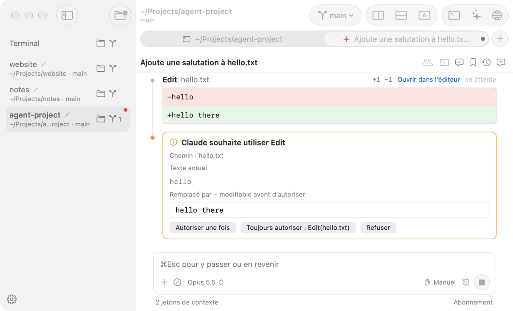

<p>&nbsp;&nbsp;&nbsp;</p>

# Tapa

**Le terminal rapide et natif pour macOS, qui a fait de la place pour vos agents, vos fichiers et vos pages.**

Tapa est d’abord un terminal : son propre cœur VT et un moteur de rendu Metal, des onglets et des divisions natifs de macOS, un terminal rapide qui apparaît d’un seul raccourci, une intégration au shell avec des blocs de commandes et, si vous le souhaitez, un champ de saisie avec des suggestions dans le style de Warp. Autour de lui, Tapa est devenu la petite sœur de [Dango](https://github.com/sventmueller/dango) : une barre latérale d’espaces de travail, un par dossier de projet, chacun avec ses terminaux, des onglets d’agent pour Claude, Codex, OpenCode, Antigravity et d’autres agents ACP, des onglets de navigateur, un éditeur avec une liste de fichiers et un panneau Git, et un aperçu Markdown signé [Splat](https://github.com/sventmueller/splat) avec formules et diagrammes. Rien de ce que configure un dossier de projet ne s’exécute tant que vous n’avez pas fait confiance à son espace de travail. Tapa est écrit en Rust avec de véritables contrôles AppKit, parle 35 langues, ne demande aucun compte et n’a aucune télémétrie.

[](https://github.com/sventmueller/tapa/releases/latest/download/Tapa.dmg)

**[Télécharger Tapa.dmg](https://github.com/sventmueller/tapa/releases/latest/download/Tapa.dmg)** : signé et notarisé par Apple, pour macOS 14 ou ultérieur sur Apple Silicon et Intel.

**Vous avez trouvé un bogue ?** [Ouvrez une issue](https://github.com/sventmueller/tapa/issues/new/choose) et indiquez avec quel shell, quel agent ou quel programme il s’est produit. Si Tapa vous est utile, une [étoile sur GitHub](https://github.com/sventmueller/tapa) aide d’autres personnes à le trouver.

[](https://www.rust-lang.org) [](https://www.apple.com/macos/)  [](https://github.com/madsmtm/objc2) [](https://developer.apple.com/metal/) [](https://agentclientprotocol.com)    [](#licence)

[Bahasa Indonesia](../id/README.md) · [Bahasa Melayu](../ms/README.md) · [Català](../ca/README.md) · [Čeština](../cs/README.md) · [Dansk](../da/README.md) · [Deutsch](../de/README.md) · [English](../../../README.md) · [Español](../es/README.md) · **Français** · [Hrvatski](../hr/README.md) · [Italiano](../it/README.md) · [Magyar](../hu/README.md) · [Nederlands](../nl/README.md) · [Norsk](../no/README.md) · [Polski](../pl/README.md) · [Português (Brasil)](../pt_BR/README.md) · [Português (Portugal)](../pt_PT/README.md) · [Română](../ro/README.md) · [Slovenčina](../sk/README.md) · [Slovenščina](../sl/README.md) · [Suomi](../fi/README.md) · [Svenska](../sv/README.md) · [Tiếng Việt](../vi/README.md) · [Türkçe](../tr/README.md) · [Ελληνικά](../el/README.md) · [Русский](../ru/README.md) · [Українська](../uk/README.md) · [עברית](../he/README.md)‎ · [العربية](../ar/README.md)‎ · [हिन्दी](../hi/README.md) · [ไทย](../th/README.md) · [한국어](../ko/README.md) · [日本語](../ja/README.md) · [简体中文](../zh-Hans/README.md) · [繁體中文](../zh-Hant/README.md)

## Sommaire

- [Aperçu des fonctionnalités](#aperçu-des-fonctionnalités)
- [Configuration requise](#configuration-requise)
- [Installation](#installation)
- [Premiers pas](#premiers-pas)
- [Espaces de travail](#espaces-de-travail)
- [Le terminal](#le-terminal)
  - [Onglets et divisions](#onglets-et-divisions)
  - [Intégration au shell et blocs de commandes](#intégration-au-shell-et-blocs-de-commandes)
  - [Le champ de saisie et les suggestions](#le-champ-de-saisie-et-les-suggestions)
  - [Recherche, sélection et copie](#recherche-sélection-et-copie)
  - [Le terminal rapide](#le-terminal-rapide)
- [Agents](#agents)
- [Éditeur, fichiers et Git](#éditeur-fichiers-et-git)
- [Aperçus](#aperçus)
- [Navigateur](#navigateur)
- [Dictée](#dictée)
- [Réglages](#réglages)
- [Apparence et accessibilité](#apparence-et-accessibilité)
- [Langues](#langues)
- [Raccourcis clavier](#raccourcis-clavier)
- [Confiance](#confiance)
- [Confidentialité et sécurité](#confidentialité-et-sécurité)
- [Limites connues](#limites-connues)
- [Pour les développeurs](#pour-les-développeurs)
  - [Composants tiers](#composants-tiers)
- [Licence](#licence)

## Aperçu des fonctionnalités

- **Un terminal rapide bien à lui.** Tapa analyse avec son propre cœur VT et dessine avec Metal, sur un fil d’exécution par écran, à la fréquence de l’écran, et seulement ce qui a changé. Il réussit 262 tests esctest là où le cœur d’Alacritty en réussit 121, et chaque modification est mesurée par rapport à une version figée de Ghostty.
- **Natif jusqu’au bout.** De vrais onglets macOS, la restauration des fenêtres, les menus, le menu Services, les notifications, la saisie clavier sécurisée, la dictée et les méthodes de saisie. Pas d’Electron, et WebKit seulement là où une page ou un aperçu en a besoin.
- **Espaces de travail.** La barre latérale contient un espace de travail par dossier de projet, chacun avec ses propres onglets, sa branche et ses panneaux. L’espace de travail « Terminal », tout en haut, repart de zéro à chaque fois ; tous les autres restent jusqu’à ce que vous les supprimiez.
- **Des agents dans une vue de discussion native.** Claude, Codex, OpenCode, Antigravity, Gemini CLI et d’autres agents de l’Agent Client Protocol s’exécutent dans leurs propres onglets, avec les réponses, les appels d’outils, les diffs et les demandes d’autorisation dans une seule chronologie. Tapa les installe et les met à jour sur demande.
- **Intégration au shell et blocs de commandes** pour zsh, bash et fish, y compris via `ssh` : sautez d’une invite à l’autre, sélectionnez, copiez, enregistrez et réduisez la sortie d’une commande, voyez les commandes qui ont échoué et la durée de chacune.
- **Un champ de saisie comme celui de Warp, si vous le voulez.** Modifiez la ligne de commande comme du texte, avec des suggestions tirées de votre historique, des spécifications de plus de 700 outils en ligne de commande et de l’état du projet, le tout sur votre Mac.
- **Fichiers, Git et un navigateur à côté du shell.** Un éditeur avec coloration syntaxique, une liste de fichiers, un panneau Git avec indexation, commits, branches et worktrees, un aperçu Markdown avec formules et diagrammes, et des onglets de navigateur.
- **Prudent avec vos dossiers.** Un espace de travail auquel vous n’avez pas fait confiance ne lance rien de ce que son dossier configure : pas de hooks Git, pas de serveurs MCP du projet, pas de réglages de projet pour les agents, pas de JavaScript dans ses pages de fichiers.
- **Privé.** Aucun compte, aucune télémétrie. Tapa n’accède au réseau que lorsque vous le lui demandez, et l’historique restauré sur le disque est chiffré avec une clé de votre trousseau.
- **Dans votre langue.** L’interface existe en 35 langues : allemand, anglais, arabe, catalan, chinois (simplifié), chinois (traditionnel), coréen, croate, danois, espagnol, finnois, français, grec, hébreu, hindi, hongrois, indonésien, italien, japonais, malais, néerlandais, norvégien, polonais, portugais (Brésil), portugais (Portugal), roumain, russe, slovaque, slovène, suédois, tchèque, thaï, turc, ukrainien et vietnamien.

## Configuration requise

- macOS 14 Sonoma ou ultérieur, sur Apple Silicon ou Intel. Tapa est développé et testé sous macOS 27.
- zsh, bash ou fish pour l’intégration au shell ; les autres shells fonctionnent sans elle.
- Pour les onglets d’agent, l’agent que vous voulez utiliser, déjà installé ou installé par Tapa à votre demande (voir [Agents](#agents)).

## Installation

**Depuis l’image disque.** Chaque version est une image disque, `Tapa-<version>.dmg`, contenant une app universelle pour Apple Silicon et Intel, signée avec un Developer ID et notarisée par Apple. Ouvrez-la et faites glisser Tapa sur le dossier Applications.

**Avec Homebrew.** Le cask, dans un tap à part, installe la même image disque :

```sh
brew install --cask sventmueller/tap/tapa
```

**Mises à jour.** Tapa, installé depuis l’image disque ou avec Homebrew, se met à jour tout seul grâce à [Sparkle](https://sparkle-project.org). Au deuxième lancement, il demande s’il peut rechercher des mises à jour de lui-même ; tant que vous n’avez pas accepté, il n’envoie aucune requête. **Tapa › Rechercher des mises à jour…** lance la recherche tout de suite. Tapa n’installe une mise à jour que si elle porte la signature du développeur. Une version compilée par vos soins n’a pas de mise à jour automatique.

**Depuis les sources.** Consultez [Pour les développeurs](#pour-les-développeurs).

**Comme terminal par défaut.** Tapa peut ouvrir des scripts shell (`.command`, `.tool`), des dossiers déposés sur son icône et des liens `ssh://`. Choisissez-le dans le Finder avec **Fichier › Lire les informations › Ouvrir avec**.

## Premiers pas

1. **La fenêtre** présente à gauche la barre latérale des espaces de travail, en haut les onglets de l’espace de travail sélectionné et, au-dessus, la barre d’outils. ⌃⌘S affiche et masque la barre latérale.
2. **Un nouvel espace de travail** s’obtient avec le bouton de dossier en haut de la barre latérale ou avec **Shell › Nouvel espace de travail…** (⇧⌘N) : choisissez l’un des dossiers récents ou **Choisir un dossier…**.
3. **Les nouveaux onglets** démarrent dans le dossier de l’espace de travail : ⌘T pour un terminal, les boutons à droite de la barre d’outils pour un terminal, un agent ou un onglet de navigateur, ou le **+** au bout de la barre d’onglets.
4. **Les réglages** s’ouvrent avec ⌘, ou avec la roue dentée en bas de la barre latérale.
5. **La palette de commandes** (⇧⌘P) trouve chaque commande par son nom, et **Rechercher un onglet…** (⌘P) chaque onglet de chaque espace de travail.

La barre d’outils contient, de gauche à droite, le menu local des branches du dépôt de l’espace de travail, les boutons pour diviser le terminal à droite et vers le bas et pour afficher le champ de saisie, puis les boutons pour un nouvel onglet de terminal, d’agent ou de navigateur. Les boutons des divisions et du champ de saisie restent gris tant qu’aucun onglet de terminal n’est au premier plan.

## Espaces de travail

Un espace de travail est un dossier avec ses onglets. Sa ligne dans la barre latérale affiche le nom, le dossier et la branche Git et, à droite, les boutons de la liste de fichiers et du panneau Git. Un clic sur l’un d’eux affiche ce panneau à la place de la liste des espaces de travail ; **Espaces de travail** en haut permet de revenir.

- **L’espace de travail « Terminal »** est toujours en haut. Il repart de zéro à chaque lancement, dans le dossier indiqué par les réglages, avec un terminal vide. Rien n’en est conservé, et il ne peut être ni renommé ni supprimé.
- **Tous les autres espaces de travail restent** jusqu’à ce que vous les supprimiez, même sans onglets. Tapa conserve leur nom, leurs onglets, le contenu de leurs terminaux (dans la mesure prévue par les réglages de restauration), leurs sessions d’agent et la position de la fenêtre. Les programmes encore en cours s’arrêtent lorsque Tapa quitte.
- **Renommer.** Cliquez sur le crayon après le nom, cliquez sur le nom de l’espace de travail sélectionné ou choisissez **Shell › Renommer l’espace de travail**. Le nom est enregistré immédiatement.
- **État.** Un point vert sur la ligne signifie qu’un agent de l’espace de travail est au travail, y compris avec des sous-agents ou en arrière-plan ; un point rouge signifie que l’un d’eux vous attend. Les terminaux n’y signalent rien.
- **Changer d’espace de travail.** ⌃⌘[ et ⌃⌘] passent d’un espace de travail à l’autre. La fenêtre reste en place, et les onglets de l’espace de travail sélectionné remplacent les autres.
- **Worktrees.** **Nouveau worktree…** dans le menu local des branches de la barre d’outils crée un worktree Git sur une nouvelle branche et l’ouvre comme un espace de travail à part entière.

Lorsque le dernier onglet d’un espace de travail se ferme, l’espace de travail reste dans la liste. Quand tous les onglets sont fermés, seule la fenêtre disparaît ; l’icône du Dock ou ⌘N la fait revenir avec ses espaces de travail.

## Le terminal

Tapa fonctionne avec son propre cœur, `term-vt`. Il parle xterm et VT520 avec le protocole clavier de Kitty, les hyperliens OSC 8, l’accès au presse-papiers OSC 52 avec une autorisation distincte pour la lecture, la sortie synchronisée, les soulignements colorés et ondulés, les couleurs vraies (truecolor), les requêtes de couleur, le signalement du mode clair ou sombre aux programmes, le collage entre crochets (bracketed paste), les événements de focus et le signalement de la souris. Le texte se réorganise quand la fenêtre change de taille, historique compris. Les ligatures, les fonctionnalités de police, les symboles Nerd Font sans polices modifiées et un dessin au pixel près des caractères de tracé de cadres, des glyphes Powerline et du braille sont intégrés.

### Onglets et divisions

- **Les onglets** sont ceux de macOS : faites-les glisser pour les réordonner ou pour les sortir dans une fenêtre à part, **Afficher tous les onglets** (⇧⌘\\), ⌘1 à ⌘8, ⌘9 pour le dernier onglet, et ⇧⌘[ / ⇧⌘] pour passer de l’un à l’autre. Chaque onglet affiche l’icône de son type devant son titre.
- **Divisions.** **Diviser à droite** (⌘D ou ⌃⌘T) et **Diviser vers le bas** (⇧⌘D ou ⌃⌥⌘T), imbriquées aussi profondément que vous le voulez. Faites glisser un séparateur, déplacez-le avec ⌃⌘ et les touches fléchées, **Agrandir la sous-fenêtre** (⌃⇧⌘↩), **Égaliser les sous-fenêtres** (⌃⌘=), et passez d’une sous-fenêtre à l’autre avec ⌘[ et ⌘].
- **Dossier de travail.** Les nouveaux onglets, fenêtres et divisions démarrent dans le dossier du terminal au premier plan ; les réglages en décident pour chacun des trois.
- **Fermeture.** Tapa demande confirmation avant de fermer un onglet, une fenêtre ou l’app tant qu’un programme y tourne.
- **Restauration.** Après un redémarrage, les espaces de travail, les onglets, les sous-fenêtres, les dossiers et les dernières lignes de chaque terminal reviennent. Les secrets tels que les jetons et les mots de passe sont masqués avant tout enregistrement.

### Intégration au shell et blocs de commandes

Tapa met en place son intégration au shell pour zsh, bash et fish de lui-même, sans toucher à vos fichiers de configuration, et l’emporte avec lui lorsque vous vous connectez à un autre hôte avec `ssh`. Grâce à elle, chaque commande et sa sortie forment un bloc :

- **Invites.** ⌘↑ et ⌘↓ sautent à l’invite précédente et à la suivante. Un clic dans la ligne de commande y déplace le curseur.
- **Blocs.** **Sélectionner le bloc** (⇧⌘A), **Copier la sortie** (⌥⌘C), **Enregistrer la sortie…** (⌥⌘S) et **Réduire/développer le bloc** (⇧⌘↩). Au-dessus du bloc situé sous le pointeur, des boutons affichent son état, sa durée et les mêmes actions.
- **Les commandes qui ont échoué** sont signalées, et la commande encore en cours reste visible en haut pendant que sa sortie défile.
- **Signets.** **Ajouter/supprimer un signet** (⇧⌘M) marque une ligne ; ⇧⌘↑ et ⇧⌘↓ sautent d’un signet à l’autre.
- **Les notifications** apparaissent lorsqu’un programme en demande une (OSC 9 et OSC 777) et que le terminal n’est pas au premier plan, et une barre de progression (OSC 9;4) s’affiche dans l’onglet et sur l’icône du Dock.

### Le champ de saisie et les suggestions

Le champ de saisie transforme la ligne de commande en un champ de texte en bas de la sous-fenêtre, comme dans Warp, avec au-dessus des pastilles pour le dossier et la branche Git. **Afficher/masquer le champ de saisie** (⌘I) ou le bouton de la barre d’outils l’active pour un terminal ; **Réglages › Saisie** l’active pour les nouveaux terminaux. Il nécessite l’intégration au shell et s’efface devant les programmes plein écran tels que vim, htop ou claude.

- **Retour** envoie tout le champ au shell, le texte de plusieurs lignes en un seul collage ; le shell l’exécute et le mémorise comme d’habitude. Si le shell demande davantage, le champ lui rend les touches jusqu’à l’invite suivante.
- **↑, ↓ et ⌃R** cherchent dans votre historique, avec le dossier, la branche et le code de sortie de chaque commande.
- **Tab** complète à l’aide des spécifications de plus de 700 outils en ligne de commande, des chemins et de valeurs en direct comme les branches Git, les conteneurs Docker, les ressources kubectl, les hôtes ssh, les scripts de `package.json` et les cibles de make, just et cargo.
- **Les touches Vim** dans le champ s’activent par un interrupteur dans les mêmes réglages.
- **La commande suivante avant même de la taper** : ce qui suit habituellement dans ce projet (après `git add` vient `git commit`), ce que demande l’état du projet (un fichier de verrouillage plus récent que `node_modules`) et une correction après « command not found », d’après les fautes de frappe ou votre index Homebrew local.

Sans le champ de saisie, les suggestions s’affichent en texte gris derrière le curseur, et → les accepte. Les shells qui ont leurs propres suggestions automatiques, comme fish ou zsh-autosuggestions, conservent les leurs. Les suggestions n’utilisent jamais le réseau, et elles ne lancent des programmes que depuis votre propre `PATH`, jamais depuis le dossier du projet.

**Coller.** Les collages de plusieurs lignes peuvent être affichés avant de s’exécuter (**Afficher d’abord les collages de plusieurs lignes**). Les fichiers déposés sur un terminal arrivent sous forme de chemins entre guillemets ; ⌥←/→, ⌘←/→ et ⌘⌫ déplacent et suppriment par mot et par ligne, comme dans tout champ de texte du Mac.

### Recherche, sélection et copie

- **Rechercher** (⌘F) cherche dans l’historique avec des expressions régulières, en respectant la casse et les mots entiers, et compte les occurrences ; la barre de défilement les signale avec les invites et les erreurs.
- **Sélection intelligente.** Un double-clic sélectionne en entier une URL, un chemin, un hachage ou une adresse IP, et un glissement avec ⌥ sélectionne un rectangle. Les liens sont détectés même sans OSC 8 ; un clic avec ⌘ les ouvre, et un chemin s’ouvre dans Dango s’il est installé.
- **Sélectionner au clavier** (⇧⌘C) déplace une sélection avec les touches de Vim.
- **Copier avec la mise en forme** (⇧⌥⌘C) conserve les couleurs et les styles ; la copie à la sélection est un réglage. **Effacer** (⌘K) efface le terminal.

### Le terminal rapide

**Afficher/masquer le terminal rapide** (⌃⌥⌘Space) fait glisser un terminal depuis un bord de l’écran, au-dessus des autres apps et des espaces en plein écran, sans changer d’app. Le bord, sa taille et le fait qu’il se masque quand vous cliquez ailleurs sont des réglages. Ses sessions continuent de tourner pendant qu’il est masqué.

## Agents

Un onglet d’agent exécute un agent de programmation dans le dossier de l’espace de travail, dans la vue d’agent native reprise de Dango.

| Agent | Fonctionnement | Prérequis |
|---|---|---|
| Claude | la commande `claude`, pilotée via son protocole stream-json | `claude` installé et connecté ; Tapa l’installe avec l’installateur de Claude à votre demande |
| Codex | `codex app-server`, ou `codex-acp` pour un Codex plus ancien | `codex` connecté ; Tapa installe l’adaptateur à version figée à votre demande |
| OpenCode | `opencode serve`, ou `opencode acp` pour un OpenCode plus ancien | votre propre `opencode` dans le `PATH`, ou le téléchargement à version figée |
| Antigravity | `agy acp` | votre propre `agy` dans le `PATH`, ou le téléchargement à version figée |
| Gemini CLI | `gemini --acp`, proposé dès que vous l’activez dans **Réglages › Agents** | votre propre `gemini`, ou le téléchargement à version figée |
| Autres agents ACP | depuis le registre ACP, chargé uniquement à votre demande | ce qu’indique l’entrée du registre ; les entrées sans somme de contrôle ne s’installent qu’après votre confirmation |

Tapa utilise la connexion propre à chaque agent et ne stocke aucun identifiant d’agent. Un agent trouvé dans le `PATH` de votre shell de connexion passe en premier ; sinon, Tapa exécute la version qu’il a installée dans son propre dossier de données, jamais un programme de l’espace de travail.

- **La chronologie** affiche les réponses, les appels d’outils avec leur sortie et leurs diffs, les questions et les demandes d’autorisation. **Autoriser une fois**, **Toujours autoriser** et **Refuser** répondent à une demande, et une modification peut être changée avant que vous ne l’autorisiez.
- **État.** L’onglet et la ligne de l’espace de travail affichent un point vert pendant que l’agent travaille et un point rouge pendant qu’il vous attend, et une notification vous prévient lorsqu’il attend pendant que vous regardez ailleurs.
- **Le champ de message** en bas accueille votre prompt, les fichiers que vous y déposez et la dictée. ⌘Esc y place le focus du clavier et l’en retire. Le modèle et le mode d’autorisation peuvent y être choisis pour la session.
- **Réglages › Agents** définit pour les nouvelles sessions le mode d’autorisation (Claude, Codex), le modèle (Claude, Codex, OpenCode) et l’effort de réflexion (Claude, Codex), ainsi que les agents proposés par les nouveaux onglets. Il indique où se trouve le programme de chaque agent, avec **Installer…**, **Mettre à jour vers …** et **Revenir à la version …** pour la version précédente, et **Charger le registre** pour le registre ACP. Les règles que Claude a enregistrées avec « Toujours autoriser » peuvent y être consultées et supprimées.
- **Téléchargements vérifiés.** Les archives sont vérifiées par rapport à leur SHA-256, les paquets npm par rapport à l’intégrité inscrite dans leur fichier de verrouillage, et les paquets sans version fixe sont refusés. Un agent manquant propose aussi son installation dans son propre onglet.

## Éditeur, fichiers et Git

- **La liste de fichiers** d’un espace de travail affiche son dossier sous forme d’arborescence, mise à jour à mesure que les fichiers changent, avec les fichiers ignorés par Git estompés si vous le souhaitez. Un clic ouvre un fichier dans un onglet d’aperçu, que le clic suivant remplace tant que vous ne l’avez pas modifié ; un double-clic le conserve.
- **L’éditeur** ouvre les fichiers dans des onglets de l’espace de travail, avec coloration syntaxique, plusieurs points d’insertion, le repli, l’indentation de `.editorconfig`, des touches Vim en option et des marques pour ce qui a changé depuis le dernier commit. Il remarque lorsqu’un fichier a changé sur le disque ou contient des marqueurs de conflit. Les fichiers Markdown reçoivent une barre de mise en forme et **Ouvrir dans Splat**. **Enregistrer** (⌘S), **Enregistrer sous…** et **Tout enregistrer** fonctionnent comme d’habitude, et Tapa demande confirmation avant de fermer du texte non enregistré.
- **Après un plantage**, le texte non enregistré revient : Tapa en conserve des copies chiffrées pendant que vous tapez.
- **Le panneau Git** affiche les modifications indexées et non indexées, indexe et désindexe des fichiers et des blocs de modifications isolés, crée des commits (⌘↩), les amende, fait un commit puis un push, récupère (fetch), et gère les branches, les remises (stash), les cherry-picks et les conflits, avec l’historique des commits en dessous. Un clic sur un fichier affiche son diff.
- **Le menu local des branches** de la barre d’outils change de branche, en crée et crée des worktrees.

L’éditeur ne lance aucun outil de formatage ni aucun serveur de langage. Pour un IDE complet avec serveurs de langage et débogueur, utilisez [Dango](https://github.com/sventmueller/dango).

## Aperçus

- **Le Markdown** s’affiche à côté de son éditeur grâce au moteur de rendu de Splat : GitHub Flavored Markdown avec formules, diagrammes et images, qui défile paragraphe par paragraphe avec le texte.
- **Les images** s’ouvrent dans leur propre onglet, les PDF via PDFKit, et les sons, les films, les polices et les documents bureautiques via Coup d’œil.
- **Décodage isolé.** Chaque image provenant d’une source non fiable (fichiers de projet, Markdown, pièces jointes et collages d’agents) est décodée dans le service `Decoder.xpc` de Splat, dans son propre App Sandbox sans fichiers ni réseau, jamais dans l’app.

## Navigateur

**Nouvel onglet de navigateur** (⇧⌘B) ouvre un onglet WebKit dans l’espace de travail. Le champ d’adresse accepte une adresse ou des mots pour le moteur de recherche de votre choix (DuckDuckGo, Google, Bing ou Startpage) ; ⌘L, ⌘R, ⌘[ et ⌘] fonctionnent comme dans Safari. Les pages de `localhost` s’exécutent normalement, pour le serveur de développement de votre projet. Les fichiers HTML d’un espace de travail ne peuvent lire que leur propre dossier et, dans un espace de travail auquel vous n’avez pas fait confiance, n’exécutent aucun JavaScript.

## Dictée

Dictez dans le champ de message d’un agent ou dans l’éditeur avec le bouton du micro ou **Édition › Démarrer la dictée** (⌃⌥D). La reconnaissance vocale est celle de [Lowspeak](https://github.com/sventmueller/lowspeak), qui n’a pas besoin d’être installé. **Réglages › Dictée** permet de choisir la transcription en ligne avec OpenAI ou Groq, ou des modèles locaux Whisper et Parakeet qui gardent l’enregistrement sur votre Mac, ainsi que la langue, le post-traitement, le micro et votre propre vocabulaire. Les clés pour OpenAI et Groq sont conservées dans votre trousseau. La dictée n’existe que dans la version de distribution.

## Réglages

**Tapa › Réglages…** (⌘,) comporte les sous-fenêtres Général, Police, Couleurs, Curseur, Terminal, Saisie, Éditeur, Agents, Dictée, Profils et Raccourcis clavier. Elles écrivent un unique fichier TOML, `config.toml`, dans le dossier de Tapa sous `~/Library/Application Support`, que vous pouvez aussi modifier à la main ; Tapa le recharge pendant qu’il tourne, et **Recharger les réglages** (⇧⌘,) le fait immédiatement.

- **Quatre tailles de police** sous Général : Interface (barre latérale, panneaux, liste de fichiers, panneau Git et titres des onglets), Éditeur (texte, numéros de ligne et aperçu Markdown), Terminal et Agents. ⌘+, ⌘− et ⌘0 changent la taille du terminal au premier plan.
- **Apparence :** Clair, Sombre ou Comme le système.
- **Couleurs.** Un thème pour le mode clair et un pour le mode sombre, au format de thème de Ghostty, avec un contraste minimal qui garde le texte lisible même avec un thème médiocre. Vos propres thèmes vont dans le dossier des thèmes.
- **Les profils** regroupent police, couleurs, shell, environnement et dossier.
- **Les raccourcis clavier** peuvent tous être modifiés, et les conflits sont signalés.

## Apparence et accessibilité

- **Le mode sombre** suit le système ou votre choix ; la couleur d’accentuation, Réduire les animations et Augmenter le contraste sont respectés.
- **VoiceOver** lit les lignes et les invites du terminal et annonce les nouvelles sorties ; la barre latérale, les onglets, les boutons de la barre d’outils et les cartes de la chronologie des agents ont un nom.
- **Clavier.** Chaque commande a un élément de menu et un raccourci, et l’accès complet au clavier atteint chaque contrôle.
- **Tailles.** Les quatre tailles de police des réglages mettent à l’échelle l’interface, l’éditeur, le terminal et les agents indépendamment les uns des autres.
- **De droite à gauche.** L’interface est inversée en arabe et en hébreu, tandis que la grille du terminal reste de gauche à droite.

Les détails et les lacunes connues se trouvent dans [ACCESSIBILITY.md](../../../ACCESSIBILITY.md).

## Langues

L’interface est traduite en 35 langues : allemand, anglais, arabe, catalan, chinois (simplifié), chinois (traditionnel), coréen, croate, danois, espagnol, finnois, français, grec, hébreu, hindi, hongrois, indonésien, italien, japonais, malais, néerlandais, norvégien, polonais, portugais (Brésil), portugais (Portugal), roumain, russe, slovaque, slovène, suédois, tchèque, thaï, turc, ukrainien et vietnamien.

Tapa suit l’ordre des langues défini dans **Réglages Système › Général › Langue et région** ; vous pouvez aussi y choisir une langue pour Tapa seul sous **Applications**. Sans traduction pour votre langue, il utilise l’anglais.

## Raccourcis clavier

| Action | Raccourci |
|---|---|
| Nouvelle fenêtre, nouvel espace de travail, nouvel onglet | ⌘N, ⇧⌘N, ⌘T |
| Nouvel onglet de navigateur | ⇧⌘B |
| Nouveau fichier, ouvrir un fichier | ⌥⌘N, ⌘O |
| Fermer la sous-fenêtre ou l’onglet, fermer l’onglet, fermer la fenêtre | ⌘W, ⌥⌘W, ⇧⌘W |
| Diviser à droite, diviser vers le bas | ⌘D ou ⌃⌘T, ⇧⌘D ou ⌃⌥⌘T |
| Agrandir la sous-fenêtre, égaliser les sous-fenêtres, fermer la sous-fenêtre | ⌃⇧⌘↩, ⌃⌘=, ⌃⇧⌘W |
| Déplacer un séparateur | ⌃⌘←, ⌃⌘→, ⌃⌘↑, ⌃⌘↓ |
| Sous-fenêtre suivante, précédente | ⌘], ⌘[ |
| Onglet suivant, précédent ; onglets 1 à 8, dernier onglet | ⇧⌘], ⇧⌘[ ; ⌘1 à ⌘8, ⌘9 |
| Espace de travail suivant, précédent | ⌃⌘], ⌃⌘[ |
| Rechercher un onglet, palette de commandes | ⌘P, ⇧⌘P |
| Afficher ou masquer la barre latérale, le champ de saisie | ⌃⌘S, ⌘I |
| Terminal rapide | ⌃⌥⌘Space |
| Rechercher, rechercher le suivant, rechercher le précédent | ⌘F, ⌘G, ⇧⌘G |
| Invite précédente, suivante | ⌘↑, ⌘↓ |
| Sélectionner le bloc, copier la sortie, enregistrer la sortie, réduire le bloc | ⇧⌘A, ⌥⌘C, ⌥⌘S, ⇧⌘↩ |
| Ajouter ou supprimer un signet ; signet précédent, suivant | ⇧⌘M ; ⇧⌘↑, ⇧⌘↓ |
| Sélectionner au clavier | ⇧⌘C |
| Copier avec la mise en forme | ⇧⌥⌘C |
| Effacer | ⌘K |
| Début, fin, page précédente, page suivante | ⌘Home, ⌘End, ⌘PageUp, ⌘PageDown |
| Agrandir, réduire, taille originale (terminal) | ⌘+, ⌘−, ⌘0 |
| Champ de message d’un onglet d’agent | ⌘Esc |
| Démarrer la dictée | ⌃⌥D |
| Réglages, recharger les réglages | ⌘,, ⇧⌘, |

Chaque raccourci peut être modifié dans **Réglages › Raccourcis clavier** ou dans la section `[keys]` du fichier de réglages.

## Confiance

Un dossier de projet peut faire exécuter des programmes dès que quelque chose y démarre : hooks Git et réglages de dépôt comme `core.fsmonitor`, hooks d’agents, serveurs MCP du projet et réglages de projet des agents. C’est pourquoi un nouvel espace de travail n’est pas considéré comme fiable.

- **Non fiable :** les agents démarrent sans les hooks, les serveurs MCP ni la configuration du projet (Claude avec `--setting-sources=user --strict-mcp-config`, Codex avec le dossier marqué comme non fiable, OpenCode sans la configuration du projet). Git s’exécute neutralisé : pas de hooks, de filtres, de pilotes de diff, de fsmonitor, de `sshCommand` ni de pager, et seulement les assistants d’identification globaux. Les fichiers HTML s’ouvrent sans JavaScript. Le panneau Git et l’onglet d’agent le signalent et proposent de faire confiance à l’espace de travail.
- **Fiable :** **Shell › Faire confiance à l’espace de travail** charge tout cela comme le dossier le prévoit. **Retirer la confiance** revient en arrière. La confiance est conservée pour chaque espace de travail.

Quel que soit son niveau de confiance, Tapa n’exécute jamais de lui-même un programme provenant d’un dossier de projet : les suggestions ne lancent des programmes que depuis votre `PATH` hors du projet, et la barre latérale lit l’état Git dans les fichiers `.git`. Un espace de travail situé dans votre dossier de départ, comme « Terminal », n’est pas un projet : les programmes sous `~`, comme `~/.local/bin/claude`, y comptent comme les vôtres.

## Confidentialité et sécurité

- **Aucune télémétrie, aucun compte.** Tapa ne transmet rien sur la façon dont vous l’utilisez et fonctionne entièrement hors ligne. Il n’accède au réseau qu’à votre demande : pour installer ou mettre à jour un agent, pour charger le registre ACP, pour rechercher des mises à jour une fois que vous l’avez accepté, et pour les pages que vous ouvrez dans un onglet de navigateur. Les agents eux-mêmes communiquent avec leurs fournisseurs comme ils le font toujours.
- **L’historique sur le disque** servant à restaurer les sessions est chiffré avec une clé de votre trousseau, peut être désactivé, et les secrets tels que les clés d’API, les jetons et les mots de passe y sont masqués avant l’écriture. Les copies du texte non enregistré de l’éditeur sont chiffrées avec la même clé.
- **La saisie clavier sécurisée** s’active d’elle-même aux invites de mot de passe, et peut être activée en permanence dans le menu de l’app.
- **Les séquences d’échappement** susceptibles de divulguer ou d’injecter des données, comme les rapports de titre, les lectures du presse-papiers et les astuces de collage, sont bloquées ou soumises d’abord à confirmation. L’analyseur est soumis à du fuzzing dans la CI.
- **Décodage isolé** des images provenant de sources non fiables, voir [Aperçus](#aperçus).
- **Signature du code** avec le Hardened Runtime. macOS attribue à Tapa les accès des programmes lancés dans un terminal ; Tapa comporte donc une description d’utilisation pour chaque service protégé.

Les problèmes de sécurité se signalent en privé, voir [SECURITY.md](../../../SECURITY.md).

## Limites connues

- **Pas encore d’images intégrées** dans le terminal : les graphismes Kitty, Sixel et les images iTerm2 sont prévus après la version 1.0.
- **Pas de mode de contrôle tmux**, et les sessions ne survivent pas à la fermeture de Tapa.
- **Le texte de droite à gauche** reste de gauche à droite dans la grille du terminal.
- **⌘+ et ⌘−** ne changent que le terminal au premier plan.
- **L’éditeur** n’a ni serveurs de langage, ni outils de formatage, ni débogueur, par conception ; Dango les a.
- **La dictée** n’existe que dans la version de distribution, pas dans une version de débogage.
- **VoiceOver** n’a pas encore été vérifié de bout en bout par une personne.

## Pour les développeurs

Il vous faut macOS 14 ou ultérieur avec les Command Line Tools de Xcode, Rust tel que l’indique `rust-toolchain.toml` (rustup avec les deux cibles Mac pour la compilation universelle), des copies de [splat](https://github.com/sventmueller/splat) et de [lowspeak](https://github.com/sventmueller/lowspeak) à côté de celle-ci (`../splat`, `../lowspeak`), et cmake pour les compilations avec dictée.

| Commande | Ce qu’elle fait |
|---|---|
| `make help` | liste les cibles |
| `cargo xtask run` | compile l’app de débogage et l’ouvre |
| `make build` | compile l’app de distribution avec dictée dans `target/release`, signée ad hoc pour ce Mac |
| `make lint` | mise en forme, clippy avec les avertissements traités comme des erreurs, la forme des fichiers et les textes de l’interface |
| `make check` | `lint`, puis tous les tests ; ne nécessite ni fenêtre ni réseau |
| `make selftest STEPS="split_right,type:ls\n,shot:x"` | pilote l’app et laisse des images de fenêtre dans `target/selftest/` |
| `make esctest`, `make vttest` | exécute esctest et vttest sur les deux cœurs dans l’app |
| `make perf` | le banc d’essai par rapport à une version figée de Ghostty ; significatif seulement sur un Mac au repos |
| `make fuzz` | les cibles de fuzzing avec cargo-fuzz |
| `make release` | un essai à blanc de la publication : l’app universelle avec la dictée, son image disque, son flux de mises à jour et son cask dans `target/release-dry-run` ; n’envoie rien nulle part |
| `make release-notarized` | la version actuelle signée avec le Developer ID, notarisée par Apple et agrafée, dans `dist/` ; `Cargo.toml` reste inchangé |
| `make deploy` | notarise la version suivante, commite `Cargo.toml`, téléverse un brouillon de publication, pousse `main` et le tag, puis publie la version ; voir [docs/development.md](../../../docs/development.md#deploy) |

La façon de contribuer se trouve dans [CONTRIBUTING.md](../../../CONTRIBUTING.md). Chaque texte de l’interface a l’allemand pour clé, avec une traduction dans les 35 langues ; `cargo xtask strings` échoue s’il en manque une.

### Composants tiers

| Composant | Utilisé pour | Licence |
|---|---|---|
| [objc2](https://github.com/madsmtm/objc2) et ses crates de frameworks | AppKit, Metal, WebKit et les autres frameworks d’Apple | MIT, Zlib ou Apache-2.0 |
| Les crates de Splat | Markdown, l’aperçu, la lecture de Git, le décodeur d’images et les traductions | MIT ou Apache-2.0 |
| [Lowspeak](https://github.com/sventmueller/lowspeak) avec [whisper.cpp](https://github.com/ggml-org/whisper.cpp) | la dictée | MIT |
| [Spécifications d’autocomplétion de Fig](https://github.com/withfig/autocomplete) | les descriptions de commandes des suggestions | MIT |
| [rusqlite](https://github.com/rusqlite/rusqlite) avec SQLite | l’historique des commandes | MIT, domaine public |
| [Simple Icons](https://simpleicons.org) | les logos de langages et de programmes | CC0, certains logos selon leurs propres conditions |
| [Sparkle](https://sparkle-project.org) 2.10.1 | les mises à jour de la version de distribution | MIT |

## Licence

Tapa est placé sous l’une ou l’autre des licences suivantes

- Licence Apache, version 2.0 ([LICENSE-APACHE](../../../LICENSE-APACHE))
- Licence MIT ([LICENSE-MIT](../../../LICENSE-MIT))

à votre choix. Les logos de `assets/simple-icons` ont leurs propres licences, voir le README qui s’y trouve.

Sauf indication contraire de votre part, toute contribution soumise intentionnellement pour inclusion dans Tapa par vous, telle que définie dans la licence Apache-2.0, est placée sous la double licence ci-dessus, sans conditions supplémentaires.
