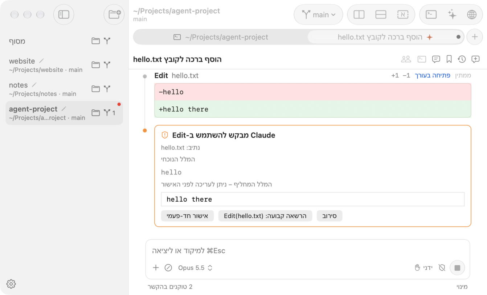

<p>&nbsp;&nbsp;&nbsp;</p>

# Tapa

**המסוף המהיר והמקורי ל-macOS, שפינה מקום גם לסוכנים, לקבצים ולדפים שלכם.**

Tapa הוא קודם כול מסוף: ליבת VT משלו ומנוע רינדור Metal, כרטיסיות ופיצולים מקוריים של macOS, מסוף מהיר שמחליק פנימה בקיצור אחד, שילוב מעטפת עם בלוקים של פקודות, ושדה קלט אופציונלי עם הצעות בסגנון Warp. סביב כל זה Tapa צמח לאחיו הקטן של [Dango](https://github.com/sventmueller/dango): סרגל צד של סביבות עבודה, אחת לכל תיקיית פרויקט, ולכל אחת המסופים שלה, כרטיסיות סוכנים ל-Claude, ל-Codex, ל-OpenCode, ל-Antigravity ולסוכני ACP אחרים, כרטיסיות דפדפן, עורך עם רשימת קבצים וחלונית Git, ותצוגה מקדימה של Markdown מבית [Splat](https://github.com/sventmueller/splat) עם נוסחאות ותרשימים. שום דבר שתיקיית פרויקט מגדירה לא רץ עד שאתם נותנים אמון בסביבת העבודה שלה. Tapa כתוב ב-Rust על רכיבי AppKit אמיתיים, זמין ב-35 שפות, לא דורש חשבון ואין בו טלמטריה.

[](https://github.com/sventmueller/tapa/releases/latest/download/Tapa.dmg)

**[הורדת Tapa.dmg](https://github.com/sventmueller/tapa/releases/latest/download/Tapa.dmg)**: חתום ומאושר (notarized) על ידי Apple, ל-macOS 14 ואילך, ב-Apple Silicon וב-Intel.

**מצאתם באג?** אפשר [לפתוח issue](https://github.com/sventmueller/tapa/issues/new/choose) ולציין באיזו מעטפת, באיזה סוכן או באיזו תוכנית זה קרה. אם Tapa מועיל לכם, [כוכב ב-GitHub](https://github.com/sventmueller/tapa) עוזר לאחרים למצוא אותו.

[](https://www.rust-lang.org) [](https://www.apple.com/macos/)  [](https://github.com/madsmtm/objc2) [](https://developer.apple.com/metal/) [](https://agentclientprotocol.com)    [](#רישיון)

[Bahasa Indonesia](../id/README.md) · [Bahasa Melayu](../ms/README.md) · [Català](../ca/README.md) · [Čeština](../cs/README.md) · [Dansk](../da/README.md) · [Deutsch](../de/README.md) · [English](../../../README.md) · [Español](../es/README.md) · [Français](../fr/README.md) · [Hrvatski](../hr/README.md) · [Italiano](../it/README.md) · [Magyar](../hu/README.md) · [Nederlands](../nl/README.md) · [Norsk](../no/README.md) · [Polski](../pl/README.md) · [Português (Brasil)](../pt_BR/README.md) · [Português (Portugal)](../pt_PT/README.md) · [Română](../ro/README.md) · [Slovenčina](../sk/README.md) · [Slovenščina](../sl/README.md) · [Suomi](../fi/README.md) · [Svenska](../sv/README.md) · [Tiếng Việt](../vi/README.md) · [Türkçe](../tr/README.md) · [Ελληνικά](../el/README.md) · [Русский](../ru/README.md) · [Українська](../uk/README.md) · **עברית**‎ · [العربية](../ar/README.md)‎ · [हिन्दी](../hi/README.md) · [ไทย](../th/README.md) · [한국어](../ko/README.md) · [日本語](../ja/README.md) · [简体中文](../zh-Hans/README.md) · [繁體中文](../zh-Hant/README.md)

## תוכן העניינים

- [התכונות במבט אחד](#התכונות-במבט-אחד)
- [דרישות](#דרישות)
- [התקנה](#התקנה)
- [תחילת העבודה](#תחילת-העבודה)
- [סביבות עבודה](#סביבות-עבודה)
- [המסוף](#המסוף)
  - [כרטיסיות ופיצולים](#כרטיסיות-ופיצולים)
  - [שילוב המעטפת ובלוקים של פקודות](#שילוב-המעטפת-ובלוקים-של-פקודות)
  - [שדה הקלט וההצעות](#שדה-הקלט-וההצעות)
  - [חיפוש, בחירה והעתקה](#חיפוש-בחירה-והעתקה)
  - [המסוף המהיר](#המסוף-המהיר)
- [סוכנים](#סוכנים)
- [עורך, קבצים ו-Git](#עורך-קבצים-ו-git)
- [תצוגות מקדימות](#תצוגות-מקדימות)
- [דפדפן](#דפדפן)
- [הכתבה](#הכתבה)
- [הגדרות](#הגדרות)
- [מראה ונגישות](#מראה-ונגישות)
- [שפות](#שפות)
- [קיצורי מקלדת](#קיצורי-מקלדת)
- [אמון](#אמון)
- [פרטיות ואבטחה](#פרטיות-ואבטחה)
- [מגבלות ידועות](#מגבלות-ידועות)
- [למפתחים](#למפתחים)
  - [רכיבי צד שלישי](#רכיבי-צד-שלישי)
- [רישיון](#רישיון)

## התכונות במבט אחד

- **מסוף מהיר משלו.** Tapa מפענח עם ליבת VT משלו ומצייר עם Metal בתהליכון לכל מסך, בקצב הרענון של המסך, ורק את מה שהשתנה. הוא עובר 262 בדיקות esctest, לעומת 121 שעוברת הליבה של Alacritty, וכל שינוי בו נמדד מול גירסה מקובעת של Ghostty.
- **מקורי עד העצם.** כרטיסיות macOS אמיתיות, שחזור חלונות, תפריטים, תפריט השירותים, עדכונים, כניסת מקלדת מאובטחת, הכתבה ושיטות קלט. בלי Electron, ו-WebKit רק במקום שבו דף או תצוגה מקדימה צריכים אותו.
- **סביבות עבודה.** סרגל הצד מכיל סביבת עבודה אחת לכל תיקיית פרויקט, ולכל אחת הכרטיסיות, הענף והחלוניות שלה. סביבת העבודה "מסוף" שלמעלה מתחילה מחדש בכל פעם; כל האחרות נשארות עד שאתם מסירים אותן.
- **סוכנים בתצוגת צ׳אט מקורית.** Claude, Codex, OpenCode, Antigravity, Gemini CLI וסוכנים אחרים של Agent Client Protocol רצים בכרטיסיות משלהם, עם תשובות, קריאות לכלים, diff-ים ובקשות הרשאה בציר זמן אחד. Tapa מתקין ומעדכן אותם לפי בקשה.
- **שילוב מעטפת ובלוקים של פקודות** ל-zsh, ל-bash ול-fish, גם דרך `ssh`: קפיצה מהנחיה להנחיה, בחירה, העתקה, שמירה וקיפול של הפלט של פקודה, וצפייה בפקודות שנכשלו ובמשך הזמן של כל אחת.
- **שדה קלט כמו של Warp, אם תרצו.** עריכת שורת הפקודה כטקסט, עם הצעות מההיסטוריה שלכם, מהגדרות של יותר מ-700 כלי שורת פקודה וממצב הפרויקט, הכול ב-Mac שלכם.
- **קבצים, Git ודפדפן לצד המעטפת.** עורך עם צבעי תחביר, רשימת קבצים, חלונית Git עם הכנה ל-Commit (staging), Commit-ים, ענפים ו-worktree-ים, תצוגה מקדימה של Markdown עם נוסחאות ותרשימים, וכרטיסיות דפדפן.
- **זהיר עם התיקיות שלכם.** סביבת עבודה שלא נתתם בה אמון לא מפעילה שום דבר שהתיקיה שלה מגדירה: בלי git hooks, בלי שרתי MCP של הפרויקט, בלי הגדרות פרויקט לסוכנים, בלי JavaScript בדפי הקבצים שלה.
- **פרטי.** בלי חשבון, בלי טלמטריה. Tapa יוצא לרשת רק כשאתם מבקשים, וההיסטוריה המשוחזרת בדיסק מוצפנת במפתח שנמצא במחזיק המפתחות שלכם.
- **בשפה שלכם.** הממשק זמין ב-35 שפות: ערבית, קטלאנית, סינית (מפושטת), סינית (מסורתית), קרואטית, צ׳כית, דנית, הולנדית, אנגלית, פינית, צרפתית, גרמנית, יוונית, עברית, הינדי, הונגרית, אינדונזית, איטלקית, יפנית, קוריאנית, מלאית, נורווגית, פולנית, פורטוגזית (ברזיל), פורטוגזית (פורטוגל), רומנית, רוסית, סלובקית, סלובנית, ספרדית, שוודית, תאילנדית, טורקית, אוקראינית ווייטנאמית.

## דרישות

- macOS 14 Sonoma ואילך, ב-Apple Silicon או ב-Intel. Tapa מפותח ונבדק ב-macOS 27.
- zsh, bash או fish לשילוב המעטפת; מעטפות אחרות רצות בלעדיו.
- לכרטיסיות סוכנים: הסוכן שבו אתם רוצים להשתמש, מותקן מראש או מותקן על ידי Tapa כשאתם מבקשים (ראו [סוכנים](#סוכנים)).

## התקנה

**מתמונת הדיסק.** כל גירסה היא תמונת דיסק, `Tapa-<version>.dmg`, עם יישום אוניברסלי אחד ל-Apple Silicon ול-Intel, חתום עם Developer ID ומאושר (notarized) על ידי Apple. יש לפתוח אותה ולגרור את Tapa אל תיקיית היישומים (Applications).

**עם Homebrew.** ה-cask, שנמצא ב-tap נפרד, מתקין את אותה תמונת דיסק:

```sh
brew install --cask sventmueller/tap/tapa
```

**עדכונים.** Tapa שהותקן מתמונת הדיסק או דרך Homebrew מתעדכן בעצמו באמצעות [Sparkle](https://sparkle-project.org). בהפעלה השנייה הוא שואל אם מותר לו לחפש עדכונים בעצמו; עד שתסכימו, הוא לא שולח שום בקשה. **Tapa › בדוק אם יש עדכונים…** מחפש מיד. Tapa מתקין עדכון רק אם הוא נושא את חתימת המפתח. גירסה שבניתם בעצמכם אינה כוללת מנגנון עדכון.

**מקוד המקור.** ראו [למפתחים](#למפתחים).

**כמסוף ברירת המחדל.** Tapa יכול לפתוח סקריפטים של מעטפת (`.command`, `.tool`), תיקיות שנגררו אל האייקון שלו וקישורי `ssh://`. אפשר לבחור בו ב-Finder דרך **קובץ › הצגת פרטים › פתיחה באמצעות**.

## תחילת העבודה

1. **בחלון** נמצאים סרגל הצד של סביבות העבודה מימין, הכרטיסיות של סביבת העבודה הנבחרת למעלה וסרגל הכלים מעליהן. ⌃⌘S מציג ומסתיר את סרגל הצד.
2. **סביבת עבודה חדשה** נפתחת מכפתור התיקיה בראש סרגל הצד, או דרך **מעטפת › סביבת עבודה חדשה…** (⇧⌘N): יש לבחור אחת מהתיקיות האחרונות או **בחר תיקייה…**.
3. **כרטיסיות חדשות** מתחילות בתיקיה של סביבת העבודה: ⌘T למסוף, הכפתורים בצד שמאל של סרגל הכלים למסוף, לסוכן או לכרטיסיית דפדפן, או ה-**+** בסוף שורת הכרטיסיות.
4. **ההגדרות** נפתחות עם ⌘, או עם גלגל השיניים בתחתית סרגל הצד.
5. **לוח הפקודות** (⇧⌘P) מוצא כל פקודה לפי שמה, ו-**חיפוש כרטיסיה…** (⌘P) מוצא כל כרטיסיה בכל סביבת עבודה.

בסרגל הכלים נמצאים, מימין, התפריט הנפתח של הענפים במאגר של סביבת העבודה, הכפתורים לפיצול המסוף ימינה ולמטה ולהצגת שדה הקלט, והכפתורים לכרטיסיות חדשות של מסוף, סוכן ודפדפן. הכפתורים של הפיצולים ושל שדה הקלט אפורים כל עוד אין כרטיסיית מסוף בחזית.

## סביבות עבודה

סביבת עבודה היא תיקיה עם הכרטיסיות שלה. השורה שלה בסרגל הצד מציגה את השם, את התיקיה ואת ענף ה-Git, ומשמאל את הכפתורים של רשימת הקבצים ושל חלונית Git. לחיצה על אחד מהם מציגה את החלונית הזו במקום רשימת סביבות העבודה; **סביבות עבודה** למעלה מחזיר אחורה.

- **סביבת העבודה "מסוף"** תמיד למעלה. היא מתחילה מחדש בכל הפעלה, בתיקיה שההגדרות מציינות, עם מסוף ריק אחד. שום דבר ממנה לא נשמר, ואי אפשר לשנות את שמה או להסיר אותה.
- **כל סביבת עבודה אחרת נשארת** עד שאתם מסירים אותה, גם בלי כרטיסיות. Tapa שומר את השם שלה, את הכרטיסיות, את התוכן של המסופים (במידה שהגדרות השחזור מאפשרות), את סשנים של הסוכנים ואת מיקום החלון. תוכניות שעדיין רצות מסתיימות כשיוצאים מ-Tapa.
- **שינוי שם.** אפשר ללחוץ על העיפרון שאחרי השם, ללחוץ על השם של סביבת העבודה הנבחרת, או לבחור **מעטפת › שנה שם לסביבת עבודה**. השם נשמר מיד.
- **מצב.** נקודה ירוקה בשורה פירושה שסוכן של סביבת העבודה עובד, גם עם תת-סוכנים או ברקע; נקודה אדומה פירושה שאחד מהם מחכה לכם. מסופים לא מסמנים שם דבר.
- **מעבר.** ⌃⌘[ ו-⌃⌘] עוברים בין סביבות עבודה. החלון נשאר במקומו, והכרטיסיות של סביבת העבודה הנבחרת תופסות את מקומן של האחרות.
- **Worktree-ים.** **‏Worktree חדש…** בתפריט הנפתח של הענפים בסרגל הכלים יוצר worktree של Git על ענף חדש ופותח אותו כסביבת עבודה נפרדת.

כשהכרטיסיה האחרונה של סביבת עבודה נסגרת, סביבת העבודה נשארת ברשימה. כשכל הכרטיסיות סגורות, רק החלון נעלם; האייקון ב-Dock או ⌘N מחזירים אותו עם סביבות העבודה שלו.

## המסוף

Tapa פועל על הליבה שלו עצמו, `term-vt`. היא דוברת xterm ו-VT520 עם פרוטוקול המקלדת של Kitty, היפר-קישורים של OSC 8, גישה ללוח הגזירים דרך OSC 52 עם הרשאה נפרדת לקריאה, פלט מסונכרן, קווים תחתונים צבעוניים ומסולסלים, truecolor, שאילתות צבע, דיווח על מצב בהיר וכהה לתוכניות, הדבקה תחומה (bracketed paste), אירועי מיקוד ודיווח עכבר. הטקסט נפרס מחדש כשגודל החלון משתנה, כולל ההיסטוריה. ליגטורות, תכונות גופן, סמלי Nerd Font בלי גופנים מתוקנים, וציור מסגרות, Powerline וגליפים של Braille בדיוק של פיקסל מובנים.

### כרטיסיות ופיצולים

- **הכרטיסיות** הן של macOS עצמה: אפשר לגרור אותן כדי לשנות את הסדר או החוצה לחלון משלהן, **הצגת כל הכרטיסיות** (⇧⌘\\), ⌘1 עד ⌘8, ⌘9 לכרטיסיה האחרונה, ו-⇧⌘[ / ⇧⌘] למעבר. כל כרטיסיה מציגה את האייקון של הסוג שלה לפני הכותרת.
- **פיצולים.** **פצל ימינה** (⌘D או ⌃⌘T) ו-**פצל למטה** (⇧⌘D או ⌃⌥⌘T), מקוננים לכל עומק. אפשר לגרור מחיצה, להזיז אותה עם ⌃⌘ ומקשי החצים, **הגדל חלונית** (⌃⇧⌘↩), **השווה חלוניות** (⌃⌘=), ולעבור בין חלוניות עם ⌘[ ו-⌘].
- **תיקיית עבודה.** כרטיסיות, חלונות ופיצולים חדשים מתחילים בתיקיה של המסוף שבחזית; ההגדרות קובעות זאת לכל אחד מהשלושה.
- **סגירה.** Tapa שואל לפני שהוא סוגר כרטיסיה, חלון או את היישום כל עוד תוכנית רצה בהם.
- **שחזור.** אחרי הפעלה מחדש חוזרים סביבות העבודה, הכרטיסיות, החלוניות, התיקיות והשורות האחרונות של כל מסוף. סודות כמו אסימונים (tokens) וסיסמאות מוסתרים לפני שמשהו נשמר.

### שילוב המעטפת ובלוקים של פקודות

Tapa מגדיר בעצמו את שילוב המעטפת ל-zsh, ל-bash ול-fish, בלי לגעת בקובצי התצורה שלכם, ולוקח אותו איתו כשאתם מתחברים ב-`ssh` למחשב אחר. איתו, כל פקודה והפלט שלה יוצרים בלוק:

- **הנחיות.** ⌘↑ ו-⌘↓ קופצים להנחיה הקודמת ולבאה. לחיצה בתוך שורת הפקודה מזיזה את הסמן לשם.
- **בלוקים.** **בחר בלוק** (⇧⌘A), **העתק פלט** (⌥⌘C), **שמירת פלט…** (⌥⌘S) ו-**כווץ/הרחב בלוק** (⇧⌘↩). מעל הבלוק שמתחת לסמן העכבר, כפתורים מציגים את המצב שלו, את משך הזמן שלו ואת אותן פעולות.
- **פקודות שנכשלו** מסומנות, והפקודה שעדיין רצה נשארת גלויה למעלה בזמן שהפלט שלה נגלל.
- **סימניות.** **הוסף/הסר סימנייה** (⇧⌘M) מסמן שורה; ⇧⌘↑ ו-⇧⌘↓ קופצים בין סימניות.
- **עדכונים** מופיעים כשתוכנית מבקשת זאת (OSC 9 ו-OSC 777) והמסוף לא בחזית, וסרגל התקדמות (OSC 9;4) מוצג בכרטיסיה ובאייקון ב-Dock.

### שדה הקלט וההצעות

שדה הקלט הופך את שורת הפקודה לשדה טקסט בתחתית החלונית, כמו ב-Warp, ומעליו תגיות של התיקיה ושל ענף ה-Git. **הצג/הסתר שדה קלט** (⌘I) או הכפתור בסרגל הכלים מפעילים ומכבים אותו למסוף אחד; **הגדרות › קלט** מפעיל אותו למסופים חדשים. הוא דורש את שילוב המעטפת ומפנה את מקומו לתוכניות במסך מלא כמו vim, htop או claude.

- **Return** שולח את השדה כולו למעטפת, וטקסט מרובה שורות כהדבקה אחת; המעטפת מריצה וזוכרת אותו כרגיל. אם המעטפת מבקשת עוד, השדה מחזיר לה את המקשים עד ההנחיה הבאה.
- **↑, ↓ ו-⌃R** מחפשים בהיסטוריה שלכם, עם התיקיה, הענף וקוד היציאה שבהם רצה כל פקודה.
- **Tab** משלים עם הגדרות של יותר מ-700 כלי שורת פקודה, נתיבים וערכים חיים כמו ענפי git, קונטיינרים של docker, משאבי kubectl, מחשבי ssh, סקריפטים של `package.json` ויעדים של make, של just ושל cargo.
- **מקשי Vim** בשדה הם מתג באותן הגדרות.
- **הפקודה הבאה עוד לפני שהקלדתם**: מה שבדרך כלל בא אחר כך בפרויקט הזה (אחרי `git add` בא `git commit`), מה שמצב הפרויקט דורש (קובץ נעילה חדש יותר מ-`node_modules`), ותיקון אחרי "command not found", משגיאות הקלדה או מהאינדקס המקומי של Homebrew.

בלי שדה הקלט, ההצעות מופיעות כטקסט אפור מאחורי הסמן, ו-→ מקבל אותן. מעטפות עם הצעות אוטומטיות משלהן, כמו fish או zsh-autosuggestions, שומרות על שלהן. ההצעות אף פעם לא משתמשות ברשת, והן מפעילות תוכניות רק מה-`PATH` שלכם, אף פעם לא מתיקיית הפרויקט.

**הדבקה.** אפשר להציג הדבקות מרובות שורות לפני שהן רצות (**הצגה מראש של הדבקה מרובת שורות**). קבצים שנגררים אל מסוף מגיעים כנתיבים במירכאות; ⌥←/→, ⌘←/→ ו-⌘⌫ מזיזים ומוחקים לפי מילה ושורה כמו בכל שדה טקסט ב-Mac.

### חיפוש, בחירה והעתקה

- **חפש…** (⌘F) מחפש בהיסטוריה עם ביטויים רגולריים, התאמת אותיות רישיות ומילים שלמות, וסופר את ההתאמות; פס הגלילה מסמן אותן יחד עם ההנחיות והשגיאות.
- **בחירה חכמה.** לחיצה כפולה בוחרת URL, נתיב, hash או כתובת IP בשלמותם, וגרירה עם ⌥ בוחרת מלבן. קישורים מזוהים גם בלי OSC 8; ⌘-לחיצה פותחת אותם, ונתיב נפתח ב-Dango אם הוא מותקן.
- **בחירה באמצעות המקלדת** (⇧⌘C) מזיזה בחירה עם המקשים של Vim.
- **העתקה עם עיצוב** (⇧⌥⌘C) שומרת על צבעים וסגנונות; העתקה בעת בחירה היא הגדרה. **נקה** (⌘K) מנקה את המסוף.

### המסוף המהיר

**הצג/הסתר מסוף מהיר** (⌃⌥⌘Space) מחליק מסוף פנימה מקצה של המסך, מעל יישומים אחרים ומעל מרחבים במסך מלא, בלי להחליף יישום. הקצה, הגודל ואם הוא מוסתר כשלוחצים במקום אחר הם הגדרות. הסשנים שלו ממשיכים לרוץ כשהוא מוסתר.

## סוכנים

כרטיסיית סוכן מריצה סוכן תכנות בתיקיה של סביבת העבודה, בתצוגת הסוכן המקורית מ-Dango.

| סוכן | איך הוא רץ | מה הוא צריך |
|---|---|---|
| Claude | הפקודה `claude`, שמדברים איתה בפרוטוקול stream-json שלה | `claude` מותקן ומחובר; Tapa מתקין אותו עם המתקין של Claude עצמו כשאתם מבקשים |
| Codex | `codex app-server`, או `codex-acp` ל-Codex ישן יותר | `codex` מחובר; Tapa מתקין את המתאם בגירסה המקובעת כשאתם מבקשים |
| OpenCode | `opencode serve`, או `opencode acp` ל-OpenCode ישן יותר | `opencode` משלכם ב-`PATH`, או ההורדה בגירסה המקובעת |
| Antigravity | `agy acp` | `agy` משלכם ב-`PATH`, או ההורדה בגירסה המקובעת |
| Gemini CLI | `gemini --acp`, מוצע אחרי שמפעילים אותו ב-**הגדרות › סוכנים** | `gemini` משלכם, או ההורדה בגירסה המקובעת |
| סוכני ACP אחרים | מהמרשם של ACP, נטען רק כשאתם מבקשים | מה שהרשומה במרשם מציינת; רשומות בלי סכום ביקורת מותקנות רק אחרי שאתם מאשרים |

Tapa משתמש בהתחברות של כל סוכן ולא שומר פרטי גישה של סוכנים. סוכן שנמצא ב-`PATH` של מעטפת ההתחברות שלכם קודם לכול; אחרת Tapa מריץ את הגירסה שהתקין בתיקיית הנתונים שלו, ואף פעם לא תוכנית מסביבת העבודה.

- **ציר הזמן** מציג תשובות, קריאות לכלים עם הפלט וה-diff-ים שלהן, שאלות ובקשות הרשאה. **אישור חד-פעמי**, **הרשאה קבועה** ו-**סירוב** עונים לבקשה, ואפשר לשנות עריכה לפני שמאשרים אותה.
- **מצב.** הכרטיסיה והשורה של סביבת העבודה מציגות נקודה ירוקה כשהסוכן עובד ואדומה כשהוא מחכה לכם, ועדכון מודיע לכם כשהוא מחכה בזמן שאתם מסתכלים במקום אחר.
- **שדה ההודעה** בתחתית מקבל את ההנחיה שלכם, קבצים שנגררו אליו והכתבה. ⌘Esc מעביר את מיקוד המקלדת אליו וחזרה. אפשר לבחור שם את המודל ואת מצב ההרשאות לסשן.
- **הגדרות › סוכנים** קובע לסשנים חדשים את מצב ההרשאות (Claude, Codex), את המודל (Claude, Codex, OpenCode) ואת מאמץ החשיבה (Claude, Codex), ואילו סוכנים מוצעים בכרטיסיות חדשות. שם מוצג היכן נמצאת התוכנית של כל סוכן, עם **התקנה…**, **עדכון לגירסה …** ו-**חזרה לגירסה …** לגירסה הקודמת, ו-**טעינת המרשם** למרשם של ACP. אפשר לראות שם ולהסיר את הכללים ש-Claude שמר עם "הרשאה קבועה".
- **הורדות שנבדקו.** ארכיונים נבדקים מול ה-SHA-256 שלהם, חבילות npm מול ערך השלמות בקובץ הנעילה שלהן, וחבילות בלי גירסה קבועה נדחות. סוכן חסר מציע את ההתקנה שלו גם בכרטיסיה שלו.

## עורך, קבצים ו-Git

- **רשימת הקבצים** של סביבת עבודה מציגה את התיקיה שלה כעץ, מתעדכנת כשקבצים משתנים, ומעמעמת קבצים ש-Git מתעלם מהם אם תרצו. לחיצה פותחת קובץ ככרטיסיית תצוגה מקדימה, שהלחיצה הבאה מחליפה עד שעורכים אותה; לחיצה כפולה משאירה אותה.
- **העורך** פותח קבצים בכרטיסיות של סביבת העבודה, עם צבעי תחביר, כמה סמנים, קיפול, ההזחה של `.editorconfig`, מקשי Vim אופציונליים וסימונים למה שהשתנה מאז ה-Commit האחרון. הוא מבחין כשקובץ השתנה בדיסק או מכיל סימני התנגשות. קובצי Markdown מקבלים סרגל עיצוב ו-**פתיחה ב-Splat**. **שמירה** (⌘S), **שמירה בשם…** ו-**שמירת הכול** פועלים כרגיל, ו-Tapa שואל לפני שהוא סוגר טקסט שלא נשמר.
- **אחרי קריסה** טקסט שלא נשמר חוזר: Tapa שומר עותקים מוצפנים שלו בזמן שאתם מקלידים.
- **חלונית Git** מציגה שינויים שהוכנו ושלא הוכנו ל-Commit, מכינה ומבטלת הכנה של קבצים ושל קטעים בודדים (hunks), מבצעת Commit (⌘↩), amend, ‏Commit ו-push, fetch, ומטפלת בענפים, ב-stash-ים, ב-cherry-pick ובהתנגשויות, עם היסטוריית ה-Commit-ים למטה. לחיצה על קובץ מציגה את ה-diff שלו.
- **התפריט הנפתח של הענפים** בסרגל הכלים מחליף ענפים, יוצר ענפים ויוצר worktree-ים.

העורך לא מפעיל שום כלי עיצוב קוד ושום שרת שפה. ל-IDE מלא עם שרתי שפה ומנפה שגיאות, השתמשו ב-[Dango](https://github.com/sventmueller/dango).

## תצוגות מקדימות

- **Markdown** מוצג לצד העורך שלו דרך מנוע הרינדור של Splat: GitHub Flavored Markdown עם נוסחאות, תרשימים ותמונות, שנגלל פסקה אחר פסקה יחד עם הטקסט.
- **תמונות** נפתחות בכרטיסיה משלהן, קובצי PDF דרך PDFKit, וצלילים, סרטים, גופנים ומסמכי Office דרך Quick Look.
- **פענוח מבודד.** כל תמונה ממקור לא מהימן (קובצי פרויקט, Markdown, קבצים מצורפים של סוכנים והדבקות) מפוענחת בשירות `Decoder.xpc` של Splat, בתוך App Sandbox משלו בלי קבצים ובלי רשת, ואף פעם לא ביישום עצמו.

## דפדפן

**כרטיסיית דפדפן חדשה** (⇧⌘B) פותחת כרטיסיית WebKit בסביבת העבודה. שדה הכתובת מקבל כתובת או מילים למנוע החיפוש שבחרתם (DuckDuckGo, Google, Bing או Startpage); ⌘L, ⌘R, ⌘[ ו-⌘] פועלים כמו ב-Safari. דפים מ-`localhost` רצים כרגיל, בשביל שרת הפיתוח של הפרויקט שלכם. קובצי HTML של סביבת עבודה יכולים לקרוא רק את התיקיה שלהם, ובסביבת עבודה שלא נתתם בה אמון הם לא מריצים JavaScript.

## הכתבה

אפשר להכתיב לשדה ההודעה של סוכן או לעורך עם כפתור המיקרופון או דרך **עריכה › התחלת הכתבה** (⌃⌥D). זיהוי הדיבור הוא של [Lowspeak](https://github.com/sventmueller/lowspeak), שאין צורך להתקין אותו. **הגדרות › הכתבה** בוחר תמלול מקוון עם OpenAI או Groq, או מודלים מקומיים של Whisper ו-Parakeet ששומרים את ההקלטה ב-Mac שלכם, את השפה, את העיבוד שלאחר מכן, את המיקרופון ואת אוצר המילים שלכם. המפתחות של OpenAI ושל Groq נשמרים במחזיק המפתחות שלכם. ההכתבה כלולה רק בגירסת ה-release.

## הגדרות

ב-**Tapa › הגדרות…** (⌘,) יש את החלוניות כללי, גופן, צבעים, סמן, מסוף, קלט, עורך, סוכנים, הכתבה, פרופילים וקיצורי מקלדת. הן כותבות קובץ TOML אחד, `config.toml` בתיקייה של Tapa תחת `~/Library/Application Support`, שאפשר גם לערוך ידנית; Tapa טוען אותו מחדש בזמן שהוא רץ, ו-**טען הגדרות מחדש** (⇧⌘,) עושה זאת מיד.

- **ארבעה גדלי גופן** תחת כללי: ממשק (סרגל הצד, חלוניות, רשימת הקבצים, חלונית Git וכותרות הכרטיסיות), עורך (טקסט, מספרי שורות ותצוגה מקדימה של Markdown), מסוף וסוכנים. ⌘+, ⌘− ו-⌘0 משנים את הגודל של המסוף שבחזית.
- **מראה:** בהיר, כהה או כמו המערכת.
- **צבעים.** ערכת נושא אחת למצב בהיר ואחת למצב כהה, בפורמט ערכות הנושא של Ghostty, עם ניגודיות מינימלית ששומרת על טקסט קריא גם בערכת נושא גרועה. ערכות נושא משלכם נכנסות לתיקיית ערכות הנושא.
- **פרופילים** מאגדים גופן, צבעים, מעטפת, סביבה ותיקיה.
- **קיצורים** אפשר לשנות את כולם, והתנגשויות מוצגות.

## מראה ונגישות

- **מצב כהה** עוקב אחרי המערכת או אחרי הבחירה שלכם; צבע ההדגשה, הפחתת תנועה והגברת ניגודיות מכובדים.
- **VoiceOver** מקריא את השורות ואת ההנחיות של המסוף ומכריז על פלט חדש; לסרגל הצד, לכרטיסיות, לכפתורי סרגל הכלים ולכרטיסים של ציר הזמן של הסוכן יש שמות.
- **מקלדת.** לכל פקודה יש פריט תפריט וקיצור, וגישה מלאה למקלדת מגיעה לכל פקד.
- **גדלים.** ארבעת גדלי הגופן שבהגדרות משנים את קנה המידה של הממשק, העורך, המסוף והסוכנים בנפרד.
- **מימין לשמאל.** הממשק משתקף בערבית ובעברית, ואילו רשת המסוף נשארת משמאל לימין.

פרטים ופערים ידועים נמצאים ב-[ACCESSIBILITY.md](../../../ACCESSIBILITY.md).

## שפות

הממשק מתורגם ל-35 שפות: ערבית, קטלאנית, סינית (מפושטת), סינית (מסורתית), קרואטית, צ׳כית, דנית, הולנדית, אנגלית, פינית, צרפתית, גרמנית, יוונית, עברית, הינדי, הונגרית, אינדונזית, איטלקית, יפנית, קוריאנית, מלאית, נורווגית, פולנית, פורטוגזית (ברזיל), פורטוגזית (פורטוגל), רומנית, רוסית, סלובקית, סלובנית, ספרדית, שוודית, תאילנדית, טורקית, אוקראינית ווייטנאמית.

Tapa עוקב אחרי סדר השפות ב-**הגדרות המערכת › כללי › שפה ואזור**; שם אפשר גם לבחור שפה ל-Tapa בלבד תחת **יישומים**. אם אין תרגום לשפה שלכם, הוא משתמש באנגלית.

## קיצורי מקלדת

| פעולה | קיצור |
|---|---|
| חלון, סביבת עבודה, כרטיסיה חדשים | ⌘N, ⇧⌘N, ⌘T |
| כרטיסיית דפדפן חדשה | ⇧⌘B |
| קובץ חדש, פתיחת קובץ | ⌥⌘N, ⌘O |
| סגירת חלונית או כרטיסיה, סגירת כרטיסיה, סגירת חלון | ⌘W, ⌥⌘W, ⇧⌘W |
| פיצול ימינה, פיצול למטה | ⌘D או ⌃⌘T, ⇧⌘D או ⌃⌥⌘T |
| הגדלת חלונית, השוואת חלוניות, סגירת חלונית | ⌃⇧⌘↩, ⌃⌘=, ⌃⇧⌘W |
| הזזת מחיצה | ⌃⌘←, ⌃⌘→, ⌃⌘↑, ⌃⌘↓ |
| החלונית הבאה, הקודמת | ⌘], ⌘[ |
| הכרטיסיה הבאה, הקודמת; כרטיסיה 1 עד 8, הכרטיסיה האחרונה | ⇧⌘], ⇧⌘[; ⌘1 עד ⌘8, ⌘9 |
| סביבת העבודה הבאה, הקודמת | ⌃⌘], ⌃⌘[ |
| חיפוש כרטיסיה, לוח הפקודות | ⌘P, ⇧⌘P |
| הצגה או הסתרה של סרגל הצד, של שדה הקלט | ⌃⌘S, ⌘I |
| מסוף מהיר | ⌃⌥⌘Space |
| חיפוש, חיפוש הבא, חיפוש קודם | ⌘F, ⌘G, ⇧⌘G |
| ההנחיה הקודמת, הבאה | ⌘↑, ⌘↓ |
| בחירת בלוק, העתקת פלט, שמירת פלט, קיפול בלוק | ⇧⌘A, ⌥⌘C, ⌥⌘S, ⇧⌘↩ |
| הוספה או הסרה של סימנייה; הסימנייה הקודמת, הבאה | ⇧⌘M; ⇧⌘↑, ⇧⌘↓ |
| בחירה באמצעות המקלדת | ⇧⌘C |
| העתקה עם עיצוב | ⇧⌥⌘C |
| ניקוי | ⌘K |
| ראש, סוף, עמוד למעלה, עמוד למטה | ⌘Home, ⌘End, ⌘PageUp, ⌘PageDown |
| הגדלה, הקטנה, גודל מקורי (מסוף) | ⌘+, ⌘−, ⌘0 |
| שדה ההודעה של כרטיסיית סוכן | ⌘Esc |
| התחלת הכתבה | ⌃⌥D |
| הגדרות, טעינה מחדש של ההגדרות | ⌘,, ⇧⌘, |

אפשר לשנות כל קיצור ב-**הגדרות › קיצורי מקלדת** או במקטע `[keys]` של קובץ ההגדרות.

## אמון

תיקיית פרויקט יכולה לגרום לתוכניות לרוץ ברגע שמשהו מתחיל בה: git hooks והגדרות מאגר כמו `core.fsmonitor`, ‏hooks של סוכנים, שרתי MCP של הפרויקט והגדרות פרויקט של סוכנים. לכן סביבת עבודה חדשה אינה מהימנה.

- **לא מהימנה:** סוכנים מתחילים בלי ה-hooks, שרתי ה-MCP והתצורה של הפרויקט (Claude עם `--setting-sources=user --strict-mcp-config`, ‏Codex כשהתיקיה מסומנת כלא מהימנה, OpenCode בלי התצורה של הפרויקט). Git רץ מנוטרל: בלי hooks, מסננים, מנהלי diff, ‏fsmonitor, ‏`sshCommand` או pager, ורק עם מסייעי פרטי גישה גלובליים. קובצי HTML נפתחים בלי JavaScript. חלונית Git וכרטיסיית הסוכן אומרות זאת ומציעות לתת אמון בסביבת העבודה.
- **מהימנה:** **מעטפת › מתן אמון בסביבת העבודה** טוען את כל אלה כפי שהתיקיה מתכוונת. **ביטול האמון** מחזיר את המצב לקדמותו. האמון נשמר לכל סביבת עבודה בנפרד.

בלי קשר למצב האמון, Tapa אף פעם לא מריץ מעצמו תוכנית מתיקיית פרויקט: ההצעות מפעילות תוכניות רק מה-`PATH` שלכם מחוץ לפרויקט, וסרגל הצד קורא את מצב ה-Git מקובצי `.git`. סביבת עבודה בתיקיית הבית שלכם, כמו "מסוף", אינה פרויקט: תוכניות תחת `~` כמו `~/.local/bin/claude` נחשבות שם לתוכניות שלכם.

## פרטיות ואבטחה

- **ללא טלמטריה, ללא חשבון.** Tapa לא מדווח דבר על האופן שבו אתם משתמשים בו ועובד באופן מלא בלי חיבור לרשת. הוא יוצא לרשת רק כשאתם מבקשים: כדי להתקין או לעדכן סוכן, לטעון את המרשם של ACP, לחפש עדכונים אחרי שהסכמתם, ובשביל הדפים שאתם פותחים בכרטיסיית דפדפן. הסוכנים עצמם מדברים עם הספקים שלהם כמו תמיד.
- **ההיסטוריה בדיסק** לשחזור סשנים מוצפנת במפתח שנמצא במחזיק המפתחות שלכם, אפשר לכבות אותה, וסודות כמו מפתחות API, אסימונים וסיסמאות מוסתרים בה לפני הכתיבה. העותקים של טקסט שלא נשמר בעורך מוצפנים באותו מפתח.
- **כניסת מקלדת מאובטחת** מופעלת מעצמה בבקשות סיסמה, ואפשר להפעיל אותה לצמיתות בתפריט היישום.
- **רצפי בריחה** שעלולים להדליף או להזריק, כמו דיווחי כותרת, קריאות מלוח הגזירים ותרגילי הדבקה, נחסמים או דורשים אישור מראש. המפענח עובר fuzzing ב-CI.
- **פענוח מבודד** של תמונות ממקורות לא מהימנים, ראו [תצוגות מקדימות](#תצוגות-מקדימות).
- **חתימת קוד** עם Hardened Runtime. macOS מייחס ל-Tapa את הגישה של התוכניות שבמסוף, ולכן הוא נושא תיאור שימוש לכל שירות מוגן.

על בעיות אבטחה מדווחים באופן פרטי, ראו [SECURITY.md](../../../SECURITY.md).

## מגבלות ידועות

- **עדיין אין תמונות בתוך המסוף**: גרפיקה של Kitty, ‏Sixel ותמונות של iTerm2 מתוכננות לאחרי 1.0.
- **אין מצב בקרה של tmux**, וסשנים לא שורדים יציאה מ-Tapa.
- **טקסט מימין לשמאל** ברשת המסוף נשאר משמאל לימין.
- **⌘+ ו-⌘−** משנים רק את המסוף שבחזית.
- **לעורך** אין שרתי שפה, כלי עיצוב קוד או מנפה שגיאות, במכוון; ב-Dango יש אותם.
- **הכתבה** קיימת רק בגירסת ה-release, לא בגירסת debug.
- **VoiceOver** עדיין לא נבדק מקצה לקצה על ידי אדם.

## למפתחים

נדרשים macOS 14 ואילך עם Xcode Command Line Tools, ‏Rust כפי ש-`rust-toolchain.toml` מציין (rustup עם שני יעדי ה-Mac לבנייה האוניברסלית), עותקים של [splat](https://github.com/sventmueller/splat) ושל [lowspeak](https://github.com/sventmueller/lowspeak) לצד המאגר הזה (`../splat`, `../lowspeak`), ו-cmake לבנייה עם הכתבה.

| פקודה | מה היא עושה |
|---|---|
| `make help` | מציגה את היעדים |
| `cargo xtask run` | בונה את יישום ה-debug ופותחת אותו |
| `make build` | בונה את יישום ה-release עם הכתבה לתוך `target/release`, חתום ad hoc ל-Mac הזה |
| `make lint` | עיצוב קוד, clippy עם אזהרות כשגיאות, מבנה הקבצים וטקסטי הממשק |
| `make check` | `lint`, ואחר כך כל הבדיקות; לא דורשת חלון ולא רשת |
| `make selftest STEPS="split_right,type:ls\n,shot:x"` | מפעילה את היישום ומשאירה תמונות של החלון ב-`target/selftest/` |
| `make esctest`, `make vttest` | מריצה את esctest ואת vttest מול שתי הליבות ביישום |
| `make perf` | מדד הביצועים מול Ghostty בגירסה מקובעת; משמעותי רק ב-Mac במצב סרק |
| `make fuzz` | יעדי ה-fuzzing עם cargo-fuzz |
| `make release` | הרצת ניסיון של השחרור: היישום האוניברסלי עם הכתבה, תמונת הדיסק שלו, פיד העדכונים וה-cask ב-`target/release-dry-run`; לא שולחת דבר לשום מקום |
| `make release-notarized` | הגירסה הנוכחית, חתומה עם Developer ID, מאושרת (notarized) על ידי Apple ומוצמדת (stapled), אל `dist/`; הקובץ `Cargo.toml` לא משתנה |
| `make deploy` | מאשרת (notarize) את הגירסה הבאה, מבצעת commit ל-`Cargo.toml`, מעלה טיוטת שחרור, דוחפת את `main` ואת התג ואז מפרסמת את השחרור; ראו [docs/development.md](../../../docs/development.md#deploy) |

אופן התרומה נמצא ב-[CONTRIBUTING.md](../../../CONTRIBUTING.md). המפתח של כל טקסט בממשק הוא הנוסח הגרמני, עם תרגום לכל 35 השפות; `cargo xtask strings` נכשלת כשתרגום חסר.

### רכיבי צד שלישי

| רכיב | שימוש | רישיון |
|---|---|---|
| [objc2](https://github.com/madsmtm/objc2) וה-crates של המסגרות שלו | AppKit, ‏Metal, ‏WebKit ושאר המסגרות של Apple | MIT, ‏Zlib או Apache-2.0 |
| ה-crates של Splat | Markdown, התצוגה המקדימה, קריאת Git, מפענח התמונות והתרגומים | MIT או Apache-2.0 |
| [Lowspeak](https://github.com/sventmueller/lowspeak) עם [whisper.cpp](https://github.com/ggml-org/whisper.cpp) | הכתבה | MIT |
| [Fig autocomplete specs](https://github.com/withfig/autocomplete) | תיאורי הפקודות בהצעות | MIT |
| [rusqlite](https://github.com/rusqlite/rusqlite) עם SQLite | היסטוריית הפקודות | MIT, נחלת הכלל |
| [Simple Icons](https://simpleicons.org) | לוגואים של שפות ותוכניות | CC0, חלק מהלוגואים בתנאים משלהם |
| [Sparkle](https://sparkle-project.org) 2.10.1 | עדכונים של גירסת ה-release | MIT |

## רישיון

Tapa מורשה לפי אחד משני אלה

- רישיון Apache, גירסה 2.0 ([LICENSE-APACHE](../../../LICENSE-APACHE))
- רישיון MIT ([LICENSE-MIT](../../../LICENSE-MIT))

לבחירתכם. ללוגואים ב-`assets/simple-icons` יש רישיונות משלהם, ראו את ה-README שם.

אלא אם צוין אחרת במפורש, כל תרומה שהוגשה במכוון לשילוב ב-Tapa על ידכם, כהגדרתה ברישיון Apache-2.0, תורשה ברישיון כפול כאמור לעיל, ללא תנאים נוספים.
