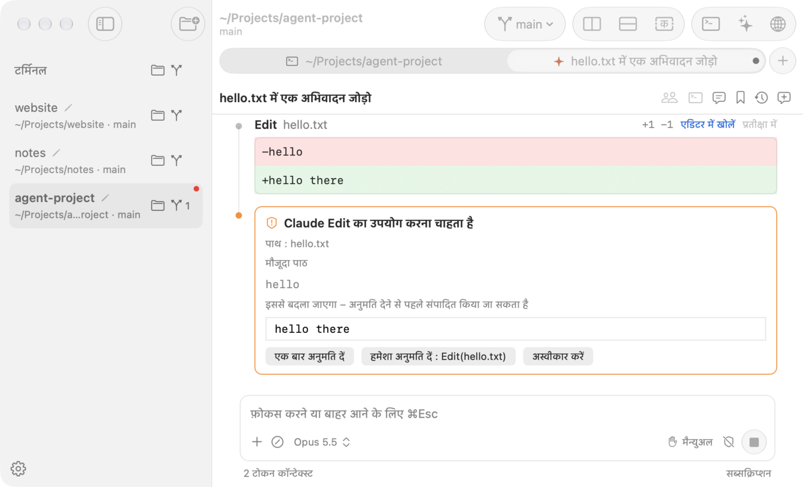

<p>&nbsp;&nbsp;&nbsp;</p>

# Tapa

**macOS के लिए तेज़, नेटिव टर्मिनल, जिसमें आपके एजेंट, फ़ाइलों और पेजों के लिए भी जगह है।**

Tapa सबसे पहले एक टर्मिनल है: अपना VT कोर और Metal रेंडरर, macOS के नेटिव टैब और विभाजन, एक शॉर्टकट से स्लाइड होकर आने वाला क्विक टर्मिनल, कमांड ब्लॉक के साथ शेल इंटीग्रेशन, और Warp की शैली में सुझावों वाला एक वैकल्पिक इनपुट फ़ील्ड। इसके इर्द-गिर्द Tapa बढ़कर [Dango](https://github.com/sventmueller/dango) की छोटी बहन बन गया: वर्कस्पेस का एक साइडबार, हर प्रोजेक्ट फ़ोल्डर के लिए एक, और हर वर्कस्पेस में उसके टर्मिनल, Claude, Codex, OpenCode, Antigravity और दूसरे ACP एजेंट के लिए एजेंट टैब, ब्राउज़र टैब, फ़ाइल सूची और Git पैनल वाला एडिटर, और [Splat](https://github.com/sventmueller/splat) का Markdown प्रीव्यू, सूत्रों और डायग्राम के साथ। कोई प्रोजेक्ट फ़ोल्डर जो कुछ भी कॉन्फ़िगर करता है, वह तब तक नहीं चलता जब तक आप उसके वर्कस्पेस पर भरोसा नहीं करते। Tapa Rust में, असली AppKit कंट्रोल पर लिखा गया है, 35 भाषाएँ बोलता है, उसे किसी खाते की ज़रूरत नहीं है और उसमें कोई टेलीमेट्री नहीं है।

[](https://github.com/sventmueller/tapa/releases/latest/download/Tapa.dmg)

**[Tapa.dmg डाउनलोड करें](https://github.com/sventmueller/tapa/releases/latest/download/Tapa.dmg)**: साइन की गई और Apple द्वारा नोटराइज़ की गई डिस्क इमेज, Apple Silicon और Intel पर macOS 14 या उसके बाद के लिए।

**कोई बग मिला?** [एक issue खोलिए](https://github.com/sventmueller/tapa/issues/new/choose) और बताइए कि यह किस शेल, किस एजेंट या किस प्रोग्राम के साथ हुआ। अगर Tapa आपके काम का है, तो [GitHub पर एक स्टार](https://github.com/sventmueller/tapa) दूसरों को इसे ढूँढने में मदद करता है।

[](https://www.rust-lang.org) [](https://www.apple.com/macos/)  [](https://github.com/madsmtm/objc2) [](https://developer.apple.com/metal/) [](https://agentclientprotocol.com)    [](#लाइसेंस)

[Bahasa Indonesia](../id/README.md) · [Bahasa Melayu](../ms/README.md) · [Català](../ca/README.md) · [Čeština](../cs/README.md) · [Dansk](../da/README.md) · [Deutsch](../de/README.md) · [English](../../../README.md) · [Español](../es/README.md) · [Français](../fr/README.md) · [Hrvatski](../hr/README.md) · [Italiano](../it/README.md) · [Magyar](../hu/README.md) · [Nederlands](../nl/README.md) · [Norsk](../no/README.md) · [Polski](../pl/README.md) · [Português (Brasil)](../pt_BR/README.md) · [Português (Portugal)](../pt_PT/README.md) · [Română](../ro/README.md) · [Slovenčina](../sk/README.md) · [Slovenščina](../sl/README.md) · [Suomi](../fi/README.md) · [Svenska](../sv/README.md) · [Tiếng Việt](../vi/README.md) · [Türkçe](../tr/README.md) · [Ελληνικά](../el/README.md) · [Русский](../ru/README.md) · [Українська](../uk/README.md) · [עברית](../he/README.md)‎ · [العربية](../ar/README.md)‎ · **हिन्दी** · [ไทย](../th/README.md) · [한국어](../ko/README.md) · [日本語](../ja/README.md) · [简体中文](../zh-Hans/README.md) · [繁體中文](../zh-Hant/README.md)

## विषय-सूची

- [एक नज़र में खूबियाँ](#एक-नज़र-में-खूबियाँ)
- [आवश्यकताएँ](#आवश्यकताएँ)
- [इंस्टॉलेशन](#इंस्टॉलेशन)
- [शुरुआत करना](#शुरुआत-करना)
- [वर्कस्पेस](#वर्कस्पेस)
- [टर्मिनल](#टर्मिनल)
  - [टैब और विभाजन](#टैब-और-विभाजन)
  - [शेल इंटीग्रेशन और कमांड ब्लॉक](#शेल-इंटीग्रेशन-और-कमांड-ब्लॉक)
  - [इनपुट फ़ील्ड और सुझाव](#इनपुट-फ़ील्ड-और-सुझाव)
  - [खोज, चयन और कॉपी करना](#खोज-चयन-और-कॉपी-करना)
  - [क्विक टर्मिनल](#क्विक-टर्मिनल)
- [एजेंट](#एजेंट)
- [एडिटर, फ़ाइलें और Git](#एडिटर-फ़ाइलें-और-git)
- [प्रीव्यू](#प्रीव्यू)
- [ब्राउज़र](#ब्राउज़र)
- [डिक्टेशन](#डिक्टेशन)
- [सेटिंग्ज़](#सेटिंग्ज़)
- [रूप और एक्सेसिबिलिटी](#रूप-और-एक्सेसिबिलिटी)
- [भाषाएँ](#भाषाएँ)
- [कीबोर्ड शॉर्टकट](#कीबोर्ड-शॉर्टकट)
- [भरोसा](#भरोसा)
- [गोपनीयता और सुरक्षा](#गोपनीयता-और-सुरक्षा)
- [ज्ञात सीमाएँ](#ज्ञात-सीमाएँ)
- [डेवलपर्स के लिए](#डेवलपर्स-के-लिए)
  - [तृतीय-पक्ष घटक](#तृतीय-पक्ष-घटक)
- [लाइसेंस](#लाइसेंस)

## एक नज़र में खूबियाँ

- **अपना ख़ुद का तेज़ टर्मिनल।** Tapa अपने VT कोर से पार्स करता है और Metal से हर डिस्प्ले के लिए एक अलग थ्रेड पर, डिस्प्ले की दर पर, और सिर्फ़ वही ड्रॉ करता है जो बदला है। यह esctest की 262 जाँचें पास करता है, जबकि Alacritty का कोर 121 पास करता है, और इसमें हर बदलाव को एक पिन किए गए Ghostty संस्करण के मुक़ाबले मापा जाता है।
- **पूरी तरह नेटिव।** असली macOS टैब, विंडो पुनर्स्थापन, मेनू, सेवाएँ मेनू, सूचनाएँ, सुरक्षित कीबोर्ड एंट्री, डिक्टेशन और इनपुट मेथड। कोई Electron नहीं, और WebKit सिर्फ़ वहीं जहाँ किसी पेज या प्रीव्यू को उसकी ज़रूरत हो।
- **वर्कस्पेस।** साइडबार में हर प्रोजेक्ट फ़ोल्डर के लिए एक वर्कस्पेस होता है, हर एक के अपने टैब, ब्रांच और पैनल के साथ। सबसे ऊपर का "टर्मिनल" वर्कस्पेस हर बार नए सिरे से शुरू होता है; बाकी सभी तब तक रहते हैं जब तक आप उन्हें हटा नहीं देते।
- **नेटिव चैट व्यू में एजेंट।** Claude, Codex, OpenCode, Antigravity, Gemini CLI और Agent Client Protocol के दूसरे एजेंट अपने-अपने टैब में चलते हैं, जवाबों, टूल कॉल, diff और अनुमति अनुरोधों के साथ एक ही टाइमलाइन में। Tapa कहने पर उन्हें इंस्टॉल और अपडेट करता है।
- **शेल इंटीग्रेशन और कमांड ब्लॉक** zsh, bash और fish के लिए, `ssh` पर भी: एक प्रॉम्प्ट से दूसरे पर जाइए, किसी कमांड का आउटपुट चुनिए, कॉपी कीजिए, सहेजिए और समेटिए, विफल कमांड देखिए और यह भी कि हर कमांड में कितना समय लगा।
- **अगर आप चाहें, तो Warp जैसा इनपुट फ़ील्ड।** कमांड लाइन को टेक्स्ट की तरह संपादित कीजिए, आपकी हिस्ट्री से, 700 से ज़्यादा कमांड-लाइन टूल की स्पेक से और प्रोजेक्ट की स्थिति से आए सुझावों के साथ, सब आपके Mac पर।
- **शेल के बगल में फ़ाइलें, Git और ब्राउज़र।** सिंटैक्स के रंगों वाला एडिटर, एक फ़ाइल सूची, स्टेजिंग, कमिट, ब्रांच और वर्कट्री वाला Git पैनल, सूत्रों और डायग्राम वाला Markdown प्रीव्यू, और ब्राउज़र टैब।
- **आपके फ़ोल्डरों के साथ सावधान।** जिस वर्कस्पेस पर आपने भरोसा नहीं किया है, वह उसके फ़ोल्डर की कॉन्फ़िगर की हुई कोई चीज़ शुरू नहीं करता: न git हुक, न प्रोजेक्ट के MCP सर्वर, न एजेंट के लिए प्रोजेक्ट सेटिंग्ज़, न उसके फ़ाइल पेजों में JavaScript।
- **निजी।** कोई खाता नहीं, कोई टेलीमेट्री नहीं। Tapa नेटवर्क पर तभी जाता है जब आप कहें, और डिस्क पर पुनर्स्थापित हिस्ट्री आपके कीचेन की एक कुंजी से एन्क्रिप्ट रहती है।
- **आपकी भाषा में।** इंटरफ़ेस 35 भाषाओं में मिलता है: अरबी, कैटलन, चीनी (सरलीकृत), चीनी (पारंपरिक), क्रोएशियाई, चेक, डेनिश, डच, अंग्रेज़ी, फ़िनिश, फ़्रेंच, जर्मन, ग्रीक, हिब्रू, हिन्दी, हंगेरियन, इंडोनेशियाई, इतालवी, जापानी, कोरियाई, मलय, नॉर्वेजियन, पोलिश, पुर्तगाली (ब्राज़ील), पुर्तगाली (पुर्तगाल), रोमानियाई, रूसी, स्लोवाक, स्लोवेनियाई, स्पैनिश, स्वीडिश, थाई, तुर्की, यूक्रेनी और वियतनामी।

## आवश्यकताएँ

- Apple Silicon या Intel पर macOS 14 Sonoma या उसके बाद। Tapa का विकास और परीक्षण macOS 27 पर होता है।
- शेल इंटीग्रेशन के लिए zsh, bash या fish; दूसरे शेल उसके बिना चलते हैं।
- एजेंट टैब के लिए वह एजेंट जिसे आप इस्तेमाल करना चाहते हैं, या तो पहले से इंस्टॉल किया हुआ या आपके कहने पर Tapa द्वारा इंस्टॉल किया हुआ ([एजेंट](#एजेंट) देखिए)।

## इंस्टॉलेशन

**डिस्क इमेज से।** हर रिलीज़ एक डिस्क इमेज है, `Tapa-<version>.dmg`, जिसमें Apple Silicon और Intel के लिए एक यूनिवर्सल ऐप है, Developer ID से साइन किया हुआ और Apple द्वारा नोटराइज़ किया हुआ। इसे खोलिए और Tapa को ऐप्लिकेशन फ़ोल्डर पर ड्रैग कीजिए।

**Homebrew से।** अपने अलग tap में रखा cask वही डिस्क इमेज इंस्टॉल करता है:

```sh
brew install --cask sventmueller/tap/tapa
```

**अपडेट।** डिस्क इमेज या Homebrew से इंस्टॉल किया गया Tapa [Sparkle](https://sparkle-project.org) के ज़रिए खुद को अप टू डेट रखता है। दूसरी बार खुलने पर वह पूछता है कि क्या वह अपने आप अपडेट ढूँढ सकता है; जब तक आप हाँ नहीं कहते, वह कोई अनुरोध नहीं भेजता। **Tapa › अपडेट के लिए जाँचें…** तुरंत जाँचता है। Tapa कोई अपडेट तभी इंस्टॉल करता है, जब उस पर डेवलपर के हस्ताक्षर हों। आपके अपने बनाए बिल्ड में अपडेटर नहीं होता।

**सोर्स से।** [डेवलपर्स के लिए](#डेवलपर्स-के-लिए) देखिए।

**डिफ़ॉल्ट टर्मिनल के रूप में।** Tapa शेल स्क्रिप्ट (`.command`, `.tool`), उसके आइकन पर छोड़े गए फ़ोल्डर और `ssh://` लिंक खोल सकता है। Finder में **फ़ाइल › जानकारी प्राप्त करें › इसमें खोलें** से उसे चुनिए।

## शुरुआत करना

1. **विंडो** में बाईं ओर वर्कस्पेस का साइडबार, ऊपर चुने गए वर्कस्पेस के टैब और उनके ऊपर टूलबार होता है। ⌃⌘S साइडबार दिखाता और छिपाता है।
2. **नया वर्कस्पेस** साइडबार के ऊपर के फ़ोल्डर बटन से, या **शेल › नया वर्कस्पेस…** (⇧⌘N) से बनता है: हाल के फ़ोल्डरों में से कोई एक चुनिए या **फ़ोल्डर चुनें…**।
3. **नए टैब** वर्कस्पेस के फ़ोल्डर में शुरू होते हैं: टर्मिनल के लिए ⌘T, टर्मिनल, एजेंट या ब्राउज़र टैब के लिए टूलबार के दाईं ओर के बटन, या टैब बार के आख़िर में **+**।
4. **सेटिंग्ज़** ⌘, से या साइडबार के नीचे गियर से खुलती हैं।
5. **कमांड पैलेट** (⇧⌘P) हर कमांड को नाम से ढूँढता है, और **टैब ढूँढें…** (⌘P) हर वर्कस्पेस का हर टैब।

टूलबार में बाईं ओर से, वर्कस्पेस की रिपॉज़िटरी का ब्रांच पुल-डाउन, टर्मिनल को दाईं ओर और नीचे विभाजित करने और इनपुट फ़ील्ड दिखाने के बटन, और नए टर्मिनल, एजेंट और ब्राउज़र टैब के बटन होते हैं। जब तक सामने कोई टर्मिनल टैब न हो, विभाजन और इनपुट फ़ील्ड के बटन धूसर रहते हैं।

## वर्कस्पेस

वर्कस्पेस अपने टैब के साथ एक फ़ोल्डर है। साइडबार में उसकी पंक्ति नाम, फ़ोल्डर और Git ब्रांच दिखाती है, और दाईं ओर फ़ाइल सूची और Git पैनल के बटन। इनमें से किसी पर क्लिक करने से वर्कस्पेस की सूची की जगह वह पैनल दिखता है; ऊपर **वर्कस्पेस** वापस ले जाता है।

- **"टर्मिनल" वर्कस्पेस** हमेशा सबसे ऊपर होता है। यह हर लॉन्च पर नए सिरे से, सेटिंग्ज़ में बताए गए फ़ोल्डर में, एक खाली टर्मिनल के साथ शुरू होता है। इसका कुछ भी सहेजा नहीं जाता, और इसका नाम न बदला जा सकता है, न इसे हटाया जा सकता है।
- **हर दूसरा वर्कस्पेस बना रहता है** जब तक आप उसे हटा नहीं देते, टैब के बिना भी। Tapa उसका नाम, टैब, उसके टर्मिनलों की सामग्री (जितना पुनर्स्थापन सेटिंग्ज़ कहती हैं), उसके एजेंट सत्र और विंडो की स्थिति रखता है। अभी भी चल रहे प्रोग्राम Tapa बंद होने पर ख़त्म हो जाते हैं।
- **नाम बदलना।** नाम के बाद पेंसिल पर क्लिक कीजिए, चुने गए वर्कस्पेस के नाम पर क्लिक कीजिए, या **शेल › वर्कस्पेस का नाम बदलें** चुनिए। नाम तुरंत सहेजा जाता है।
- **स्थिति।** पंक्ति पर हरा बिंदु मतलब वर्कस्पेस का कोई एजेंट काम कर रहा है, सबएजेंट के साथ या बैकग्राउंड में भी; लाल बिंदु मतलब कोई आपका इंतज़ार कर रहा है। टर्मिनल वहाँ कुछ भी चिह्नित नहीं करते।
- **बदलना।** ⌃⌘[ और ⌃⌘] वर्कस्पेस के बीच जाते हैं। विंडो अपनी जगह रहती है, और चुने गए वर्कस्पेस के टैब दूसरों की जगह ले लेते हैं।
- **वर्कट्री।** टूलबार के ब्रांच पुल-डाउन में **नया वर्कट्री…** एक नई ब्रांच पर Git वर्कट्री बनाता है और उसे एक अलग वर्कस्पेस के रूप में खोलता है।

जब किसी वर्कस्पेस का आख़िरी टैब बंद होता है, तो वर्कस्पेस सूची में बना रहता है। सभी टैब बंद होने पर सिर्फ़ विंडो जाती है; Dock आइकन या ⌘N उसे उसके वर्कस्पेस के साथ वापस ले आता है।

## टर्मिनल

Tapa अपने ही कोर, `term-vt`, पर चलता है। यह Kitty कीबोर्ड प्रोटोकॉल के साथ xterm और VT520 बोलता है, OSC 8 हाइपरलिंक, पढ़ने के लिए अलग अनुमति के साथ OSC 52 क्लिपबोर्ड ऐक्सेस, सिंक्रनाइज़्ड आउटपुट, रंगीन और घुमावदार अंडरलाइन, truecolor, रंग क्वेरी, प्रोग्रामों को लाइट और डार्क मोड की सूचना, bracketed paste, फ़ोकस इवेंट और माउस रिपोर्टिंग। विंडो का आकार बदलने पर टेक्स्ट फिर से व्यवस्थित होता है, हिस्ट्री समेत। लिगेचर, फ़ॉन्ट फ़ीचर, पैच किए फ़ॉन्ट के बिना Nerd Font चिह्न, और पिक्सेल-सटीक बॉक्स ड्रॉइंग, Powerline और Braille ग्लिफ़ अंतर्निहित हैं।

### टैब और विभाजन

- **टैब** macOS के अपने हैं: क्रम बदलने के लिए या अपनी अलग विंडो में ले जाने के लिए उन्हें खींचिए, **सभी टैब दिखाएँ** (⇧⌘\\), ⌘1 से ⌘8, आख़िरी टैब के लिए ⌘9, और बदलने के लिए ⇧⌘[ / ⇧⌘]। हर टैब अपने शीर्षक से पहले अपने प्रकार का आइकन दिखाता है।
- **विभाजन।** **दाईं ओर विभाजित करें** (⌘D या ⌃⌘T) और **नीचे विभाजित करें** (⇧⌘D या ⌃⌥⌘T), जितना गहरा चाहें उतना नेस्ट करके। डिवाइडर को खींचिए, उसे ⌃⌘ और तीर कुंजियों से खिसकाइए, **पेन अधिकतम करें** (⌃⇧⌘↩), **पेन बराबर करें** (⌃⌘=), और ⌘[ और ⌘] से पेन के बीच जाइए।
- **कार्य फ़ोल्डर।** नए टैब, विंडो और विभाजन सामने वाले टर्मिनल के फ़ोल्डर में शुरू होते हैं; तीनों में से हर एक के लिए यह सेटिंग्ज़ तय करती हैं।
- **बंद करना।** जब किसी टैब, विंडो या ऐप में कोई प्रोग्राम चल रहा हो, तो उसे बंद करने से पहले Tapa पूछता है।
- **पुनर्स्थापन।** रीस्टार्ट के बाद वर्कस्पेस, टैब, पेन, फ़ोल्डर और हर टर्मिनल की आख़िरी पंक्तियाँ वापस आती हैं। कुछ भी सहेजे जाने से पहले टोकन और पासवर्ड जैसे सीक्रेट छिपा दिए जाते हैं।

### शेल इंटीग्रेशन और कमांड ब्लॉक

Tapa zsh, bash और fish के लिए अपना शेल इंटीग्रेशन खुद सेट करता है, आपकी कॉन्फ़िगरेशन फ़ाइलों को छुए बिना, और जब आप `ssh` से किसी दूसरे होस्ट पर जाते हैं तो उसे साथ ले जाता है। इसके साथ हर कमांड और उसका आउटपुट एक ब्लॉक बनाते हैं:

- **प्रॉम्प्ट।** ⌘↑ और ⌘↓ पिछले और अगले प्रॉम्प्ट पर जाते हैं। कमांड लाइन में क्लिक करने से कर्सर वहाँ पहुँच जाता है।
- **ब्लॉक।** **ब्लॉक चुनें** (⇧⌘A), **आउटपुट कॉपी करें** (⌥⌘C), **आउटपुट सहेजें…** (⌥⌘S) और **ब्लॉक संक्षिप्त/विस्तृत करें** (⇧⌘↩)। पॉइंटर के नीचे वाले ब्लॉक के ऊपर बटन उसकी स्थिति, उसकी अवधि और यही कार्रवाइयाँ दिखाते हैं।
- **विफल कमांड** चिह्नित होते हैं, और जो कमांड अभी चल रहा है वह ऊपर दिखता रहता है जबकि उसका आउटपुट स्क्रॉल होता है।
- **बुकमार्क।** **बुकमार्क जोड़ें/हटाएँ** (⇧⌘M) एक पंक्ति को चिह्नित करता है; ⇧⌘↑ और ⇧⌘↓ बुकमार्क के बीच जाते हैं।
- **सूचनाएँ** तब दिखती हैं जब कोई प्रोग्राम माँगे (OSC 9 और OSC 777) और टर्मिनल सामने न हो, और एक प्रगति बार (OSC 9;4) टैब में और Dock आइकन पर दिखता है।

### इनपुट फ़ील्ड और सुझाव

इनपुट फ़ील्ड कमांड लाइन को पेन के नीचे एक टेक्स्ट फ़ील्ड में बदल देता है, Warp की तरह, उसके ऊपर फ़ोल्डर और Git ब्रांच के चिप के साथ। **इनपुट फ़ील्ड दिखाएँ/छिपाएँ** (⌘I) या टूलबार का बटन इसे एक टर्मिनल के लिए चालू-बंद करता है; **सेटिंग्ज़ › इनपुट** इसे नए टर्मिनलों के लिए चालू करता है। इसे शेल इंटीग्रेशन चाहिए, और यह vim, htop या claude जैसे फ़ुल-स्क्रीन प्रोग्रामों के लिए रास्ता छोड़ देता है।

- **Return** पूरा फ़ील्ड शेल को भेजता है, कई पंक्तियों वाला टेक्स्ट एक पेस्ट के रूप में; शेल उसे हमेशा की तरह चलाता और याद रखता है। अगर शेल और माँगता है, तो फ़ील्ड अगले प्रॉम्प्ट तक कुंजियाँ उसे लौटा देता है।
- **↑, ↓ और ⌃R** आपकी हिस्ट्री में खोजते हैं, उस फ़ोल्डर, ब्रांच और एग्ज़िट कोड के साथ जिनके साथ हर कमांड चला था।
- **Tab** 700 से ज़्यादा कमांड-लाइन टूल की स्पेक, पाथ, और git ब्रांच, docker कंटेनर, kubectl संसाधन, ssh होस्ट, `package.json` स्क्रिप्ट और make, just और cargo टार्गेट जैसे लाइव मानों से पूरा करता है।
- **Vim कुंजियाँ** फ़ील्ड में उन्हीं सेटिंग्ज़ में एक स्विच हैं।
- **आपके टाइप करने से पहले अगला कमांड**: इस प्रोजेक्ट में आमतौर पर आगे क्या आता है (`git add` के बाद `git commit`), प्रोजेक्ट की स्थिति क्या माँगती है (`node_modules` से नई लॉक फ़ाइल), और "command not found" के बाद एक सुधार, टाइपो से या आपके स्थानीय Homebrew इंडेक्स से।

इनपुट फ़ील्ड के बिना सुझाव कर्सर के पीछे धूसर टेक्स्ट के रूप में दिखते हैं, और → उन्हें ले लेता है। जिन शेल के अपने ऑटोसजेशन होते हैं, जैसे fish या zsh-autosuggestions, वे अपने ही रखते हैं। सुझाव कभी नेटवर्क का इस्तेमाल नहीं करते, और प्रोग्राम सिर्फ़ आपके अपने `PATH` से शुरू करते हैं, कभी प्रोजेक्ट फ़ोल्डर से नहीं।

**पेस्ट करना।** कई पंक्तियों वाले पेस्ट चलने से पहले दिखाए जा सकते हैं (**कई पंक्तियों वाला पेस्ट पहले दिखाएँ**)। टर्मिनल पर छोड़ी गई फ़ाइलें उद्धृत पाथ के रूप में पहुँचती हैं; ⌥←/→, ⌘←/→ और ⌘⌫ किसी भी Mac टेक्स्ट फ़ील्ड की तरह शब्द और पंक्ति के हिसाब से खिसकाते और मिटाते हैं।

### खोज, चयन और कॉपी करना

- **ढूँढें…** (⌘F) हिस्ट्री में रेगुलर एक्सप्रेशन, केस और पूरे शब्दों के साथ खोजता है और मिलानों को गिनता है; स्क्रॉल बार उन्हें प्रॉम्प्ट और त्रुटियों के साथ चिह्नित करता है।
- **स्मार्ट चयन।** डबल क्लिक किसी URL, पाथ, हैश या IP पते को पूरा चुनता है, और ⌥ के साथ खींचने से एक आयत चुना जाता है। लिंक OSC 8 के बिना भी मिल जाते हैं; ⌘-क्लिक उन्हें खोलता है, और किसी पाथ को Dango में, अगर वह इंस्टॉल हो।
- **कीबोर्ड से चुनें** (⇧⌘C) Vim की कुंजियों से चयन को खिसकाता है।
- **फ़ॉर्मैटिंग के साथ कॉपी करें** (⇧⌥⌘C) रंग और स्टाइल बनाए रखता है; चुनते ही कॉपी करना एक सेटिंग है। **साफ़ करें** (⌘K) टर्मिनल साफ़ करता है।

### क्विक टर्मिनल

**क्विक टर्मिनल दिखाएँ/छिपाएँ** (⌃⌥⌘Space) स्क्रीन के एक किनारे से एक टर्मिनल स्लाइड करके लाता है, दूसरे ऐप के ऊपर और फ़ुल-स्क्रीन स्पेस के ऊपर, ऐप बदले बिना। किनारा, उसका आकार और कहीं और क्लिक करने पर वह छिपे या नहीं, ये सेटिंग्ज़ हैं। छिपे रहने पर भी उसके सत्र चलते रहते हैं।

## एजेंट

एजेंट टैब वर्कस्पेस के फ़ोल्डर में, Dango से आए नेटिव एजेंट व्यू में, एक कोडिंग एजेंट चलाता है।

| एजेंट | कैसे चलता है | क्या चाहिए |
|---|---|---|
| Claude | `claude` कमांड, जिससे उसके stream-json प्रोटोकॉल पर बात होती है | `claude` इंस्टॉल और साइन इन किया हुआ; आपके कहने पर Tapa इसे Claude के अपने इंस्टॉलर से इंस्टॉल करता है |
| Codex | `codex app-server`, या पुराने Codex के लिए `codex-acp` | `codex` साइन इन किया हुआ; आपके कहने पर Tapa पिन किया हुआ एडैप्टर इंस्टॉल करता है |
| OpenCode | `opencode serve`, या पुराने OpenCode के लिए `opencode acp` | `PATH` पर आपका अपना `opencode`, या पिन किया हुआ डाउनलोड |
| Antigravity | `agy acp` | `PATH` पर आपका अपना `agy`, या पिन किया हुआ डाउनलोड |
| Gemini CLI | `gemini --acp`, जो **सेटिंग्ज़ › एजेंट** में चालू करने पर दिया जाता है | आपका अपना `gemini`, या पिन किया हुआ डाउनलोड |
| दूसरे ACP एजेंट | ACP रजिस्ट्री से, सिर्फ़ आपके कहने पर लोड किए जाते हैं | रजिस्ट्री की प्रविष्टि जो बताए; बिना चेकसम वाली प्रविष्टियाँ आपकी पुष्टि के बाद ही इंस्टॉल होती हैं |

Tapa हर एजेंट का अपना साइन-इन इस्तेमाल करता है और एजेंट का कोई क्रेडेंशियल नहीं रखता। आपके लॉगिन शेल के `PATH` पर मिला एजेंट पहले आता है; नहीं तो Tapa वह संस्करण चलाता है जो उसने अपने डेटा फ़ोल्डर में इंस्टॉल किया था, वर्कस्पेस का कोई प्रोग्राम कभी नहीं।

- **टाइमलाइन** जवाब, आउटपुट और diff के साथ टूल कॉल, सवाल और अनुमति अनुरोध दिखाती है। **एक बार अनुमति दें**, **हमेशा अनुमति दें** और **अस्वीकार करें** किसी अनुरोध का जवाब देते हैं, और किसी संपादन को अनुमति देने से पहले बदला जा सकता है।
- **स्थिति।** टैब और वर्कस्पेस की पंक्ति, एजेंट के काम करते समय हरा और आपका इंतज़ार करते समय लाल बिंदु दिखाती हैं, और जब आप कहीं और देख रहे हों तब इंतज़ार करने पर एक सूचना आपको बताती है।
- **संदेश फ़ील्ड** नीचे आपका प्रॉम्प्ट, उस पर छोड़ी गई फ़ाइलें और डिक्टेशन लेता है। ⌘Esc कीबोर्ड फ़ोकस को उसमें और वापस ले जाता है। मॉडल और अनुमति मोड वहाँ सत्र के लिए चुने जा सकते हैं।
- **सेटिंग्ज़ › एजेंट** नए सत्रों के लिए अनुमति मोड (Claude, Codex), मॉडल (Claude, Codex, OpenCode) और सोचने का प्रयास (Claude, Codex) तय करता है, और यह भी कि नए टैब कौन-से एजेंट दें। यह दिखाता है कि हर एजेंट का प्रोग्राम कहाँ है, **इंस्टॉल करें…**, **… पर अपडेट करें** और पिछले संस्करण के लिए **… पर वापस जाएँ** के साथ, और ACP रजिस्ट्री के लिए **रजिस्ट्री लोड करें**। Claude ने "हमेशा अनुमति दें" से जो नियम सहेजे, वे वहाँ देखे और हटाए जा सकते हैं।
- **जाँचे गए डाउनलोड।** आर्काइव उनके SHA-256 से, npm पैकेज उनकी लॉक फ़ाइल की इंटीग्रिटी से जाँचे जाते हैं, और बिना तय संस्करण वाले पैकेज अस्वीकार किए जाते हैं। कोई ग़ायब एजेंट अपने टैब में भी अपना इंस्टॉलेशन पेश करता है।

## एडिटर, फ़ाइलें और Git

- **फ़ाइल सूची** किसी वर्कस्पेस के फ़ोल्डर को एक ट्री के रूप में दिखाती है, फ़ाइलें बदलने पर अपडेट होती है, और चाहें तो Git जिन फ़ाइलों को अनदेखा करता है उन्हें धुंधला दिखाती है। एक क्लिक फ़ाइल को प्रीव्यू टैब के रूप में खोलता है, जिसे अगला क्लिक बदल देता है जब तक आप उसे संपादित न करें; डबल क्लिक उसे बनाए रखता है।
- **एडिटर** फ़ाइलों को वर्कस्पेस के टैब में खोलता है, सिंटैक्स के रंगों, कई कैरेट, फ़ोल्डिंग, `.editorconfig` के इंडेंटेशन, वैकल्पिक Vim कुंजियों और पिछले कमिट के बाद बदले हिस्सों के निशानों के साथ। यह पहचान लेता है कि कोई फ़ाइल डिस्क पर बदल गई है या उसमें कॉन्फ़्लिक्ट मार्कर हैं। Markdown फ़ाइलों को एक फ़ॉर्मैट बार और **Splat में खोलें** मिलता है। **सहेजें** (⌘S), **ऐसे सहेजें…** और **सभी सहेजें** हमेशा की तरह काम करते हैं, और बिना सहेजा टेक्स्ट बंद करने से पहले Tapa पूछता है।
- **क्रैश के बाद** बिना सहेजा टेक्स्ट वापस आ जाता है: आपके टाइप करते समय Tapa उसकी एन्क्रिप्टेड प्रतियाँ रखता है।
- **Git पैनल** स्टेज किए और बिना स्टेज किए बदलाव दिखाता है, फ़ाइलों और अलग-अलग हंक को स्टेज और अनस्टेज करता है, कमिट (⌘↩), amend, कमिट और पुश, फ़ेच करता है, और ब्रांच, stash, cherry-pick और कॉन्फ़्लिक्ट संभालता है, नीचे कमिट हिस्ट्री के साथ। किसी फ़ाइल पर क्लिक करने से उसका diff दिखता है।
- **ब्रांच पुल-डाउन** टूलबार में ब्रांच बदलता और बनाता है और वर्कट्री बनाता है।

एडिटर न कोई फ़ॉर्मैटर शुरू करता है, न कोई लैंग्वेज सर्वर। लैंग्वेज सर्वर और डीबगर वाले पूरे IDE के लिए [Dango](https://github.com/sventmueller/dango) इस्तेमाल कीजिए।

## प्रीव्यू

- **Markdown** अपने एडिटर के बगल में Splat के रेंडरर से दिखता है: सूत्रों, डायग्राम और चित्रों वाला GitHub Flavored Markdown, जो टेक्स्ट के साथ अनुच्छेद-दर-अनुच्छेद स्क्रॉल होता है।
- **चित्र** अपने अलग टैब में खुलते हैं, PDF, PDFKit से, और ध्वनि, फ़िल्में, फ़ॉन्ट और ऑफ़िस दस्तावेज़ Quick Look से।
- **अलग-थलग डिकोडिंग।** किसी अविश्वसनीय स्रोत का हर चित्र (प्रोजेक्ट फ़ाइलें, Markdown, एजेंट अटैचमेंट और पेस्ट) Splat की सर्विस `Decoder.xpc` में डिकोड होता है, बिना फ़ाइलों और नेटवर्क वाले अपने App Sandbox में, ऐप में कभी नहीं।

## ब्राउज़र

**नया ब्राउज़र टैब** (⇧⌘B) वर्कस्पेस में एक WebKit टैब खोलता है। पता फ़ील्ड कोई पता या आपकी पसंद के सर्च इंजन (DuckDuckGo, Google, Bing या Startpage) के लिए शब्द लेता है; ⌘L, ⌘R, ⌘[ और ⌘] Safari की तरह काम करते हैं। आपके प्रोजेक्ट के डेवलपमेंट सर्वर के लिए `localhost` के पेज हमेशा की तरह चलते हैं। किसी वर्कस्पेस की HTML फ़ाइलें सिर्फ़ अपना फ़ोल्डर पढ़ सकती हैं, और जिस वर्कस्पेस पर आपने भरोसा नहीं किया, उसमें वे कोई JavaScript नहीं चलातीं।

## डिक्टेशन

माइक्रोफ़ोन बटन से या **संपादित करें › डिक्टेशन शुरू करें** (⌃⌥D) से किसी एजेंट के संदेश फ़ील्ड में या एडिटर में बोलकर लिखवाइए। वाक् पहचान [Lowspeak](https://github.com/sventmueller/lowspeak) की है, जिसे इंस्टॉल करने की ज़रूरत नहीं है। **सेटिंग्ज़ › डिक्टेशन** में OpenAI या Groq के साथ ऑनलाइन ट्रांसक्रिप्शन, या रिकॉर्डिंग को आपके Mac पर ही रखने वाले स्थानीय Whisper और Parakeet मॉडल, भाषा, पोस्ट-प्रोसेसिंग, माइक्रोफ़ोन और आपकी अपनी शब्दावली चुनी जाती है। OpenAI और Groq की कुंजियाँ आपके कीचेन में रखी जाती हैं। डिक्टेशन सिर्फ़ रिलीज़ बिल्ड का हिस्सा है।

## सेटिंग्ज़

**Tapa › सेटिंग्ज़…** (⌘,) में ये पैन हैं: सामान्य, फ़ॉन्ट, रंग, कर्सर, टर्मिनल, इनपुट, एडिटर, एजेंट, डिक्टेशन, प्रोफ़ाइलें और कीबोर्ड शॉर्टकट। ये एक TOML फ़ाइल लिखते हैं, `~/Library/Application Support` के अंतर्गत Tapa के फ़ोल्डर में `config.toml`, जिसे आप हाथ से भी संपादित कर सकते हैं; Tapa चलते समय उसे फिर से लोड करता है, और **सेटिंग्ज़ फिर से लोड करें** (⇧⌘,) यह तुरंत करता है।

- **चार फ़ॉन्ट आकार** सामान्य के अंतर्गत: इंटरफ़ेस (साइडबार, पैनल, फ़ाइल सूची, Git पैनल और टैब शीर्षक), एडिटर (टेक्स्ट, पंक्ति संख्याएँ और Markdown प्रीव्यू), टर्मिनल और एजेंट। ⌘+, ⌘− और ⌘0 सामने वाले टर्मिनल का आकार बदलते हैं।
- **रूप:** हल्का, गहरा या सिस्टम के अनुसार।
- **रंग।** लाइट मोड के लिए एक थीम और डार्क मोड के लिए एक, Ghostty के थीम फ़ॉर्मैट में, एक न्यूनतम कंट्रास्ट के साथ जो ख़राब थीम पर भी टेक्स्ट को पढ़ने योग्य रखता है। आपकी अपनी थीम थीम फ़ोल्डर में जाती हैं।
- **प्रोफ़ाइलें** फ़ॉन्ट, रंग, शेल, एनवायरनमेंट और फ़ोल्डर को एक साथ रखती हैं।
- **शॉर्टकट** सभी बदले जा सकते हैं, और टकराव दिखाए जाते हैं।

## रूप और एक्सेसिबिलिटी

- **डार्क मोड** सिस्टम या आपकी पसंद का अनुसरण करता है; एक्सेंट रंग, मोशन कम करें और कंट्रास्ट बढ़ाएँ का ध्यान रखा जाता है।
- **VoiceOver** टर्मिनल की पंक्तियाँ और प्रॉम्प्ट पढ़ता है और नए आउटपुट की घोषणा करता है; साइडबार, टैब, टूलबार बटन और एजेंट टाइमलाइन के कार्ड नामित हैं।
- **कीबोर्ड।** हर कमांड का एक मेनू आइटम और एक शॉर्टकट है, और पूर्ण कीबोर्ड ऐक्सेस हर कंट्रोल तक पहुँचता है।
- **आकार।** सेटिंग्ज़ के चार फ़ॉन्ट आकार इंटरफ़ेस, एडिटर, टर्मिनल और एजेंट को अलग-अलग छोटा-बड़ा करते हैं।
- **दाएँ से बाएँ।** अरबी और हिब्रू में इंटरफ़ेस उलट जाता है, जबकि टर्मिनल ग्रिड बाएँ से दाएँ ही रहता है।

विवरण और ज्ञात कमियाँ [ACCESSIBILITY.md](../../../ACCESSIBILITY.md) में हैं।

## भाषाएँ

इंटरफ़ेस का 35 भाषाओं में अनुवाद हुआ है: अरबी, कैटलन, चीनी (सरलीकृत), चीनी (पारंपरिक), क्रोएशियाई, चेक, डेनिश, डच, अंग्रेज़ी, फ़िनिश, फ़्रेंच, जर्मन, ग्रीक, हिब्रू, हिन्दी, हंगेरियन, इंडोनेशियाई, इतालवी, जापानी, कोरियाई, मलय, नॉर्वेजियन, पोलिश, पुर्तगाली (ब्राज़ील), पुर्तगाली (पुर्तगाल), रोमानियाई, रूसी, स्लोवाक, स्लोवेनियाई, स्पैनिश, स्वीडिश, थाई, तुर्की, यूक्रेनी और वियतनामी।

Tapa **सिस्टम सेटिंग › सामान्य › भाषा और क्षेत्र** में तय भाषाओं के क्रम का पालन करता है; वहीं **ऐप्लिकेशन** के अंतर्गत आप केवल Tapa के लिए अलग भाषा भी चुन सकते हैं। आपकी भाषा का अनुवाद न होने पर वह अंग्रेज़ी इस्तेमाल करता है।

## कीबोर्ड शॉर्टकट

| क्रिया | शॉर्टकट |
|---|---|
| नई विंडो, वर्कस्पेस, टैब | ⌘N, ⇧⌘N, ⌘T |
| नया ब्राउज़र टैब | ⇧⌘B |
| नई फ़ाइल, फ़ाइल खोलें | ⌥⌘N, ⌘O |
| पेन या टैब बंद करें, टैब बंद करें, विंडो बंद करें | ⌘W, ⌥⌘W, ⇧⌘W |
| दाईं ओर विभाजित करें, नीचे विभाजित करें | ⌘D या ⌃⌘T, ⇧⌘D या ⌃⌥⌘T |
| पेन अधिकतम करें, पेन बराबर करें, पेन बंद करें | ⌃⇧⌘↩, ⌃⌘=, ⌃⇧⌘W |
| डिवाइडर खिसकाएँ | ⌃⌘←, ⌃⌘→, ⌃⌘↑, ⌃⌘↓ |
| अगला, पिछला पेन | ⌘], ⌘[ |
| अगला, पिछला टैब; टैब 1 से 8, आख़िरी टैब | ⇧⌘], ⇧⌘[; ⌘1 से ⌘8, ⌘9 |
| अगला, पिछला वर्कस्पेस | ⌃⌘], ⌃⌘[ |
| टैब ढूँढें, कमांड पैलेट | ⌘P, ⇧⌘P |
| साइडबार, इनपुट फ़ील्ड दिखाएँ या छिपाएँ | ⌃⌘S, ⌘I |
| क्विक टर्मिनल | ⌃⌥⌘Space |
| ढूँढें, अगला ढूँढें, पिछला ढूँढें | ⌘F, ⌘G, ⇧⌘G |
| पिछला, अगला प्रॉम्प्ट | ⌘↑, ⌘↓ |
| ब्लॉक चुनें, आउटपुट कॉपी करें, आउटपुट सहेजें, ब्लॉक समेटें | ⇧⌘A, ⌥⌘C, ⌥⌘S, ⇧⌘↩ |
| बुकमार्क जोड़ें या हटाएँ; पिछला, अगला बुकमार्क | ⇧⌘M; ⇧⌘↑, ⇧⌘↓ |
| कीबोर्ड से चुनें | ⇧⌘C |
| फ़ॉर्मैटिंग के साथ कॉपी करें | ⇧⌥⌘C |
| साफ़ करें | ⌘K |
| सबसे ऊपर, सबसे नीचे, पेज ऊपर, पेज नीचे | ⌘Home, ⌘End, ⌘PageUp, ⌘PageDown |
| बड़ा, छोटा, मूल आकार (टर्मिनल) | ⌘+, ⌘−, ⌘0 |
| एजेंट टैब का संदेश फ़ील्ड | ⌘Esc |
| डिक्टेशन शुरू करें | ⌃⌥D |
| सेटिंग्ज़, सेटिंग्ज़ फिर से लोड करें | ⌘,, ⇧⌘, |

हर शॉर्टकट **सेटिंग्ज़ › कीबोर्ड शॉर्टकट** में या सेटिंग्ज़ फ़ाइल के `[keys]` सेक्शन में बदला जा सकता है।

## भरोसा

कोई प्रोजेक्ट फ़ोल्डर उसमें कुछ भी शुरू होते ही प्रोग्राम चलवा सकता है: git हुक और `core.fsmonitor` जैसी रिपॉज़िटरी सेटिंग्ज़, एजेंट हुक, प्रोजेक्ट के MCP सर्वर और एजेंट की प्रोजेक्ट सेटिंग्ज़। इसलिए नए वर्कस्पेस पर भरोसा नहीं किया जाता।

- **भरोसा नहीं:** एजेंट प्रोजेक्ट के हुक, MCP सर्वर और कॉन्फ़िगरेशन के बिना शुरू होते हैं (Claude `--setting-sources=user --strict-mcp-config` के साथ, Codex फ़ोल्डर को अविश्वसनीय चिह्नित करके, OpenCode प्रोजेक्ट के कॉन्फ़िगरेशन के बिना)। Git निष्प्रभावी रूप में चलता है: न हुक, न फ़िल्टर, न diff ड्राइवर, न fsmonitor, न `sshCommand`, न पेजर, और सिर्फ़ ग्लोबल क्रेडेंशियल हेल्पर। HTML फ़ाइलें JavaScript के बिना खुलती हैं। Git पैनल और एजेंट टैब यह बताते हैं और वर्कस्पेस पर भरोसा करने का विकल्प देते हैं।
- **भरोसा:** **शेल › वर्कस्पेस पर भरोसा करें** यह सब वैसे लोड करता है जैसा फ़ोल्डर चाहता है। **भरोसा वापस लें** इसे वापस ले लेता है। भरोसा हर वर्कस्पेस के लिए अलग रखा जाता है।

भरोसा हो या न हो, Tapa कभी अपने आप किसी प्रोजेक्ट फ़ोल्डर का प्रोग्राम नहीं चलाता: सुझाव प्रोग्राम सिर्फ़ प्रोजेक्ट के बाहर आपके `PATH` से शुरू करते हैं, और साइडबार Git की स्थिति `.git` फ़ाइलों से पढ़ता है। आपके होम फ़ोल्डर में कोई वर्कस्पेस, जैसे "टर्मिनल", प्रोजेक्ट नहीं है: वहाँ `~` के अंतर्गत के प्रोग्राम, जैसे `~/.local/bin/claude`, आपके अपने माने जाते हैं।

## गोपनीयता और सुरक्षा

- **कोई टेलीमेट्री नहीं, कोई खाता नहीं।** Tapa इस बारे में कुछ नहीं बताता कि आप उसे कैसे इस्तेमाल करते हैं, और पूरी तरह ऑफ़लाइन काम करता है। वह नेटवर्क पर सिर्फ़ तब जाता है जब आप कहें: किसी एजेंट को इंस्टॉल या अपडेट करने, ACP रजिस्ट्री लोड करने, आपकी सहमति के बाद अपडेट जाँचने, और ब्राउज़र टैब में आपके खोले पेजों के लिए। एजेंट ख़ुद अपने प्रदाताओं से हमेशा की तरह बात करते हैं।
- **डिस्क पर हिस्ट्री**, जो सत्र पुनर्स्थापित करने के लिए है, आपके कीचेन की एक कुंजी से एन्क्रिप्ट रहती है, बंद की जा सकती है, और लिखे जाने से पहले उसमें API कुंजियाँ, टोकन और पासवर्ड जैसे सीक्रेट छिपा दिए जाते हैं। बिना सहेजे एडिटर टेक्स्ट की प्रतियाँ उसी कुंजी से एन्क्रिप्ट होती हैं।
- **सुरक्षित कीबोर्ड एंट्री** पासवर्ड प्रॉम्प्ट पर अपने आप चालू हो जाती है, और ऐप मेनू में स्थायी रूप से चालू की जा सकती है।
- **एस्केप सीक्वेंस** जो डेटा लीक या इंजेक्ट कर सकते हैं, जैसे शीर्षक रिपोर्ट, क्लिपबोर्ड पढ़ना और पेस्ट की चालें, रोके जाते हैं या पहले पूछे जाते हैं। पार्सर का CI में फ़ज़ परीक्षण होता है।
- **अलग-थलग डिकोडिंग** अविश्वसनीय स्रोतों के चित्रों की, [प्रीव्यू](#प्रीव्यू) देखिए।
- **कोड साइनिंग** Hardened Runtime के साथ। macOS टर्मिनल के प्रोग्रामों के ऐक्सेस को Tapa के नाम दर्ज करता है, इसलिए उसमें हर संरक्षित सेवा के लिए उपयोग का विवरण होता है।

सुरक्षा समस्याएँ निजी रूप से रिपोर्ट की जाती हैं, [SECURITY.md](../../../SECURITY.md) देखिए।

## ज्ञात सीमाएँ

- **टर्मिनल में अभी इनलाइन चित्र नहीं**: Kitty ग्राफ़िक्स, Sixel और iTerm2 चित्र 1.0 के बाद की योजना में हैं।
- **tmux कंट्रोल मोड नहीं**, और Tapa बंद करने के बाद सत्र नहीं बचते।
- **दाएँ से बाएँ टेक्स्ट** टर्मिनल ग्रिड में बाएँ से दाएँ ही रहता है।
- **⌘+ और ⌘−** सिर्फ़ सामने वाले टर्मिनल को बदलते हैं।
- **एडिटर** में जानबूझकर कोई लैंग्वेज सर्वर, फ़ॉर्मैटर या डीबगर नहीं है; वे Dango में हैं।
- **डिक्टेशन** सिर्फ़ रिलीज़ बिल्ड में है, डीबग बिल्ड में नहीं।
- **VoiceOver** की अभी तक किसी व्यक्ति ने शुरू से अंत तक जाँच नहीं की है।

## डेवलपर्स के लिए

आपको Xcode Command Line Tools के साथ macOS 14 या उसके बाद, `rust-toolchain.toml` में बताया गया Rust (यूनिवर्सल बिल्ड के लिए दोनों Mac टार्गेट के साथ rustup), इस रिपॉज़िटरी के बगल में [splat](https://github.com/sventmueller/splat) और [lowspeak](https://github.com/sventmueller/lowspeak) की कॉपियाँ (`../splat`, `../lowspeak`), और डिक्टेशन वाले बिल्ड के लिए cmake चाहिए।

| कमांड | क्या करता है |
|---|---|
| `make help` | टार्गेट की सूची दिखाता है |
| `cargo xtask run` | डीबग ऐप बिल्ड करता है और खोलता है |
| `make build` | डिक्टेशन वाला रिलीज़ ऐप `target/release` में बिल्ड करता है, इस Mac के लिए ad hoc साइन करके |
| `make lint` | फ़ॉर्मैटिंग, चेतावनियों को त्रुटि मानने वाला clippy, फ़ाइलों का आकार और इंटरफ़ेस टेक्स्ट |
| `make check` | `lint`, फिर सभी परीक्षण; न विंडो चाहिए, न नेटवर्क |
| `make selftest STEPS="split_right,type:ls\n,shot:x"` | ऐप को चलाता है और विंडो के चित्र `target/selftest/` में छोड़ता है |
| `make esctest`, `make vttest` | ऐप में दोनों कोर पर esctest और vttest चलाता है |
| `make perf` | पिन किए गए Ghostty के मुक़ाबले बेंचमार्क; सिर्फ़ खाली बैठे Mac पर सार्थक |
| `make fuzz` | cargo-fuzz के साथ फ़ज़ टार्गेट |
| `make release` | रिलीज़ का एक ड्राई रन: डिक्टेशन वाला यूनिवर्सल ऐप, उसकी डिस्क इमेज, अपडेट फ़ीड और cask `target/release-dry-run` में; कहीं कुछ नहीं भेजता |
| `make release-notarized` | मौजूदा संस्करण, Developer ID से साइन, Apple द्वारा नोटराइज़ और स्टेपल किया हुआ, `dist/` में; `Cargo.toml` नहीं बदलता |
| `make deploy` | अगला संस्करण नोटराइज़ करता है, `Cargo.toml` कमिट करता है, एक ड्राफ़्ट रिलीज़ अपलोड करता है, `main` और टैग पुश करता है, फिर रिलीज़ प्रकाशित करता है; देखिए [docs/development.md](../../../docs/development.md#deploy) |

योगदान कैसे करें, यह [CONTRIBUTING.md](../../../CONTRIBUTING.md) में है। इंटरफ़ेस के हर टेक्स्ट की कुंजी जर्मन टेक्स्ट है, सभी 35 भाषाओं में अनुवाद के साथ; कोई अनुवाद ग़ायब होने पर `cargo xtask strings` विफल हो जाता है।

### तृतीय-पक्ष घटक

| घटक | किसलिए | लाइसेंस |
|---|---|---|
| [objc2](https://github.com/madsmtm/objc2) और उसके फ़्रेमवर्क crate | AppKit, Metal, WebKit और दूसरे Apple फ़्रेमवर्क | MIT, Zlib या Apache-2.0 |
| Splat के crate | Markdown, प्रीव्यू, Git पढ़ना, चित्र डिकोडर और अनुवाद | MIT या Apache-2.0 |
| [whisper.cpp](https://github.com/ggml-org/whisper.cpp) के साथ [Lowspeak](https://github.com/sventmueller/lowspeak) | डिक्टेशन | MIT |
| [Fig autocomplete specs](https://github.com/withfig/autocomplete) | सुझावों के कमांड विवरण | MIT |
| SQLite के साथ [rusqlite](https://github.com/rusqlite/rusqlite) | कमांड हिस्ट्री | MIT, सार्वजनिक डोमेन |
| [Simple Icons](https://simpleicons.org) | भाषाओं और प्रोग्रामों के लोगो | CC0, कुछ लोगो अपनी शर्तों के अंतर्गत |
| [Sparkle](https://sparkle-project.org) 2.10.1 | रिलीज़ बिल्ड के अपडेट | MIT |

## लाइसेंस

Tapa निम्न में से किसी एक के अंतर्गत लाइसेंस प्राप्त है

- Apache लाइसेंस, संस्करण 2.0 ([LICENSE-APACHE](../../../LICENSE-APACHE))
- MIT लाइसेंस ([LICENSE-MIT](../../../LICENSE-MIT))

आपकी पसंद के अनुसार। `assets/simple-icons` के लोगो अपने लाइसेंस रखते हैं, वहाँ की README देखिए।

जब तक आप स्पष्ट रूप से कुछ और न कहें, Apache-2.0 लाइसेंस में परिभाषित के अनुसार Tapa में शामिल किए जाने के लिए आपके द्वारा जानबूझकर प्रस्तुत किया गया कोई भी योगदान ऊपर बताए अनुसार दोहरे लाइसेंस के अंतर्गत होगा, बिना किसी अतिरिक्त नियम या शर्त के।
