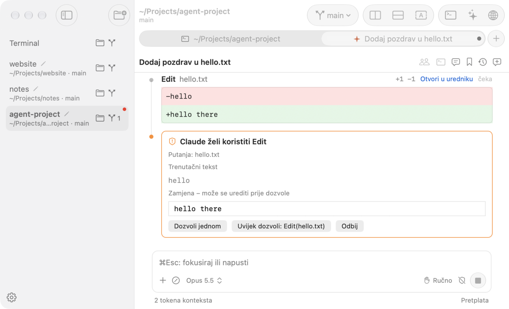

<p>&nbsp;&nbsp;&nbsp;</p>

# Tapa

**Brz, izvorni terminal za macOS u kojem je izraslo mjesta za vaše agente, datoteke i stranice.**

Tapa je prije svega terminal: vlastita VT jezgra i Metal renderer, izvorne kartice i podjele macOS-a, brzi terminal koji jednim prečacem klizne na zaslon, integracija s ljuskom s blokovima naredbi i neobavezno polje za unos s prijedlozima u stilu Warpa. Oko toga Tapa je izrasla u mlađu sestru aplikacije [Dango](https://github.com/sventmueller/dango): bočna traka s radnim prostorima, po jednim za svaku mapu projekta, svaki sa svojim terminalima, kartice agenata za Claude, Codex, OpenCode, Antigravity i druge ACP agente, kartice preglednika, uređivač s popisom datoteka i panelom Git te Markdown pregled iz [Splata](https://github.com/sventmueller/splat) s formulama i dijagramima. Ništa što konfigurira mapa projekta ne pokreće se dok ne vjerujete njezinom radnom prostoru. Tapa je napisana u Rustu na pravim AppKit kontrolama, govori 35 jezika, ne treba račun i nema telemetriju.

[](https://github.com/sventmueller/tapa/releases/latest/download/Tapa.dmg)

**[Preuzmite Tapa.dmg](https://github.com/sventmueller/tapa/releases/latest/download/Tapa.dmg)**: potpisan i ovjeren (notariziran) od Applea, za macOS 14 ili noviji na Apple Siliconu i Intelu.

**Pronašli ste grešku?** [Otvorite issue](https://github.com/sventmueller/tapa/issues/new/choose) i navedite s kojom ljuskom, kojim agentom ili kojim programom se dogodila. Ako vam je Tapa korisna, [zvjezdica na GitHubu](https://github.com/sventmueller/tapa) pomaže drugima da je pronađu.

[](https://www.rust-lang.org) [](https://www.apple.com/macos/)  [](https://github.com/madsmtm/objc2) [](https://developer.apple.com/metal/) [](https://agentclientprotocol.com)    [](#licenca)

[Bahasa Indonesia](../id/README.md) · [Bahasa Melayu](../ms/README.md) · [Català](../ca/README.md) · [Čeština](../cs/README.md) · [Dansk](../da/README.md) · [Deutsch](../de/README.md) · [English](../../../README.md) · [Español](../es/README.md) · [Français](../fr/README.md) · **Hrvatski** · [Italiano](../it/README.md) · [Magyar](../hu/README.md) · [Nederlands](../nl/README.md) · [Norsk](../no/README.md) · [Polski](../pl/README.md) · [Português (Brasil)](../pt_BR/README.md) · [Português (Portugal)](../pt_PT/README.md) · [Română](../ro/README.md) · [Slovenčina](../sk/README.md) · [Slovenščina](../sl/README.md) · [Suomi](../fi/README.md) · [Svenska](../sv/README.md) · [Tiếng Việt](../vi/README.md) · [Türkçe](../tr/README.md) · [Ελληνικά](../el/README.md) · [Русский](../ru/README.md) · [Українська](../uk/README.md) · [עברית](../he/README.md)‎ · [العربية](../ar/README.md)‎ · [हिन्दी](../hi/README.md) · [ไทย](../th/README.md) · [한국어](../ko/README.md) · [日本語](../ja/README.md) · [简体中文](../zh-Hans/README.md) · [繁體中文](../zh-Hant/README.md)

## Sadržaj

- [Značajke ukratko](#značajke-ukratko)
- [Zahtjevi](#zahtjevi)
- [Instalacija](#instalacija)
- [Početak rada](#početak-rada)
- [Radni prostori](#radni-prostori)
- [Terminal](#terminal)
  - [Kartice i podjele](#kartice-i-podjele)
  - [Integracija s ljuskom i blokovi naredbi](#integracija-s-ljuskom-i-blokovi-naredbi)
  - [Polje za unos i prijedlozi](#polje-za-unos-i-prijedlozi)
  - [Pretraživanje, odabir i kopiranje](#pretraživanje-odabir-i-kopiranje)
  - [Brzi terminal](#brzi-terminal)
- [Agenti](#agenti)
- [Uređivač, datoteke i Git](#uređivač-datoteke-i-git)
- [Pregledi](#pregledi)
- [Preglednik](#preglednik)
- [Diktat](#diktat)
- [Postavke](#postavke)
- [Izgled i pristupačnost](#izgled-i-pristupačnost)
- [Jezici](#jezici)
- [Tipkovnički prečaci](#tipkovnički-prečaci)
- [Povjerenje](#povjerenje)
- [Privatnost i sigurnost](#privatnost-i-sigurnost)
- [Poznata ograničenja](#poznata-ograničenja)
- [Za programere](#za-programere)
  - [Komponente trećih strana](#komponente-trećih-strana)
- [Licenca](#licenca)

## Značajke ukratko

- **Brz terminal s vlastitom jezgrom.** Tapa raščlanjuje vlastitom VT jezgrom i iscrtava Metalom u zasebnoj niti za svaki zaslon, brzinom osvježavanja zaslona i samo ono što se promijenilo. Prolazi 262 esctest provjere, dok jezgra Alacrittyja prolazi 121, a svaka njezina promjena mjeri se prema fiksnoj verziji Ghosttyja.
- **Izvorna do srži.** Prave macOS kartice, vraćanje prozora, izbornici, izbornik Usluge, obavijesti, zaštićeni unos putem tipkovnice, diktat i metode unosa. Bez Electrona, a WebKit samo ondje gdje ga treba stranica ili pregled.
- **Radni prostori.** Bočna traka sadrži jedan radni prostor za svaku mapu projekta, svaki sa svojim karticama, granom i panelima. Radni prostor „Terminal” na vrhu svaki put počinje iznova; svi ostali ostaju dok ih ne uklonite.
- **Agenti u izvornom prikazu razgovora.** Claude, Codex, OpenCode, Antigravity, Gemini CLI i drugi agenti protokola Agent Client Protocol rade u vlastitim karticama, s odgovorima, pozivima alata, razlikama i zahtjevima za dopuštenje na jednoj vremenskoj crti. Tapa ih na zahtjev instalira i ažurira.
- **Integracija s ljuskom i blokovi naredbi** za zsh, bash i fish, i preko `ssh`: skačite od odzivnika do odzivnika, odabirite, kopirajte, spremajte i sažimajte izlaz naredbe, pogledajte neuspjele naredbe i koliko je koja trajala.
- **Polje za unos kao u Warpu, ako želite.** Uređujte naredbeni redak kao tekst, s prijedlozima iz vaše povijesti, iz specifikacija za više od 700 alata naredbenog retka i iz stanja projekta, sve na vašem Macu.
- **Datoteke, Git i preglednik uz ljusku.** Uređivač s bojanjem sintakse, popis datoteka, panel Git s pripremom promjena, commitovima, granama i worktreejima, Markdown pregled s formulama i dijagramima te kartice preglednika.
- **Oprezna s vašim mapama.** Radni prostor kojem niste dali povjerenje ne pokreće ništa što konfigurira njegova mapa: nema git hookova, nema projektnih MCP poslužitelja, nema projektnih postavki za agente, nema JavaScripta na njegovim stranicama datoteka.
- **Privatna.** Bez računa, bez telemetrije. Tapa izlazi na mrežu samo kad je to zatražite, a vraćena povijest na disku šifrirana je ključem u vašem privjesku ključeva.
- **Na vašem jeziku.** Sučelje je dostupno na 35 jezika: arapskom, katalonskom, kineskom (pojednostavljenom), kineskom (tradicionalnom), hrvatskom, češkom, danskom, nizozemskom, engleskom, finskom, francuskom, njemačkom, grčkom, hebrejskom, hindskom, mađarskom, indonezijskom, talijanskom, japanskom, korejskom, malajskom, norveškom, poljskom, portugalskom (Brazil), portugalskom (Portugal), rumunjskom, ruskom, slovačkom, slovenskom, španjolskom, švedskom, tajlandskom, turskom, ukrajinskom i vijetnamskom.

## Zahtjevi

- macOS 14 Sonoma ili noviji, na Apple Siliconu ili Intelu. Tapa se razvija i testira na macOSu 27.
- zsh, bash ili fish za integraciju s ljuskom; ostale ljuske rade bez nje.
- Za kartice agenata agent kojeg želite koristiti, bilo već instaliran, bilo instaliran putem Tape kad to zatražite (pogledajte [Agenti](#agenti)).

## Instalacija

**Sa slike diska.** Svako izdanje je slika diska, `Tapa-<version>.dmg`, s jednom univerzalnom aplikacijom za Apple Silicon i Intel, potpisanom certifikatom Developer ID i ovjerenom (notariziranom) od Applea. Otvorite je i povucite Tapu u mapu Aplikacije.

**S Homebrewom.** Cask u vlastitom tapu instalira istu sliku diska:

```sh
brew install --cask sventmueller/tap/tapa
```

**Ažuriranja.** Tapa sa slike diska ili s Homebrewa sama se održava ažurnom putem [Sparkla](https://sparkle-project.org). Pri drugom pokretanju pita smije li sama tražiti ažuriranja; dok ne pristanete, ne šalje nijedan zahtjev. **Tapa › Potraži ažuriranja…** traži odmah. Tapa instalira ažuriranje samo ako nosi potpis razvojnog programera. Vlastita izgradnja nema ažuriranje.

**Iz izvornog koda.** Pogledajte [Za programere](#za-programere).

**Kao zadani terminal.** Tapa može otvarati skripte ljuske (`.command`, `.tool`), mape ispuštene na njezinu ikonu i poveznice `ssh://`. Odaberite je u Finderu putem **Datoteka › Učitaj informacije › Otvori koristeći**.

## Početak rada

1. **Prozor** ima lijevo bočnu traku s radnim prostorima, na vrhu kartice odabranog radnog prostora, a iznad njih alatnu traku. ⌃⌘S prikazuje i skriva bočnu traku.
2. **Novi radni prostor** stvara gumb s mapom na vrhu bočne trake ili **Ljuska › Novi radni prostor…** (⇧⌘N): odaberite jednu od nedavnih mapa ili **Odaberi mapu…**.
3. **Nove kartice** počinju u mapi radnog prostora: ⌘T za terminal, gumbi na desnoj strani alatne trake za karticu terminala, agenta ili preglednika ili **+** na kraju trake kartica.
4. **Postavke** otvarate s ⌘, ili zupčanikom na dnu bočne trake.
5. **Paleta naredbi** (⇧⌘P) pronalazi svaku naredbu po nazivu, a **Pronađi karticu…** (⌘P) svaku karticu svakog radnog prostora.

Alatna traka sadrži, slijeva, padajući izbornik grana repozitorija radnog prostora, gumbe za podjelu terminala desno i dolje te za prikaz polja za unos i gumbe za nove kartice terminala, agenta i preglednika. Gumbi za podjele i polje za unos sivi su dok sprijeda nije kartica terminala.

## Radni prostori

Radni prostor je mapa s njezinim karticama. Njegov redak u bočnoj traci prikazuje naziv, mapu i Git granu, a desno gumbe za popis datoteka i panel Git. Klik na jedan od njih prikazuje taj panel umjesto popisa radnih prostora; **Radni prostori** na vrhu vodi natrag.

- **Radni prostor „Terminal”** uvijek je na vrhu. Pri svakom pokretanju počinje iznova, u mapi koju određuju postavke, s jednim praznim terminalom. Ništa od njega se ne sprema i ne može se preimenovati ni ukloniti.
- **Svaki drugi radni prostor ostaje** dok ga ne uklonite, čak i bez kartica. Tapa čuva njegov naziv, kartice, sadržaj njegovih terminala (koliko to dopuštaju postavke vraćanja), njegove sesije agenata i položaj prozora. Programi koji još rade završavaju kad se Tapa zatvori.
- **Preimenovanje.** Kliknite olovku iza naziva, kliknite naziv odabranog radnog prostora ili odaberite **Ljuska › Preimenuj radni prostor**. Naziv se sprema odmah.
- **Stanje.** Zelena točka u retku znači da agent radnog prostora radi, i sa subagentima ili u pozadini; crvena točka znači da vas neki čeka. Terminali ondje ništa ne označavaju.
- **Prebacivanje.** ⌃⌘[ i ⌃⌘] prelaze između radnih prostora. Prozor ostaje na svom mjestu, a kartice odabranog radnog prostora zauzimaju mjesto ostalih.
- **Worktreeji.** **Novi worktree…** u padajućem izborniku grana na alatnoj traci stvara Git worktree na novoj grani i otvara ga kao zaseban radni prostor.

Kad se zatvori posljednja kartica radnog prostora, radni prostor ostaje na popisu. Kad su sve kartice zatvorene, nestaje samo prozor; ikona u Docku ili ⌘N vraća ga zajedno s njegovim radnim prostorima.

## Terminal

Tapa radi na vlastitoj jezgri, `term-vt`. Govori xterm i VT520 s Kittyjevim protokolom tipkovnice, OSC 8 hiperpoveznicama, OSC 52 pristupom međuspremniku sa zasebnim dopuštenjem za čitanje, sinkroniziranim izlazom, obojenim i valovitim podcrtavanjem, truecolorom, upitima o bojama, javljanjem svijetlog i tamnog načina programima, bracketed pasteom, događajima fokusa i javljanjem miša. Kad prozor promijeni veličinu, tekst se ponovno prelama, uključujući povijest. Ligature, značajke fontova, Nerd Font simboli bez zakrpanih fontova te do piksela točni znakovi okvira, Powerline i Brailleovog pisma ugrađeni su.

### Kartice i podjele

- **Kartice** su vlastite kartice macOS-a: povucite ih da biste promijenili redoslijed ili van u vlastiti prozor, **Prikaži sve kartice** (⇧⌘\\), ⌘1 do ⌘8, ⌘9 za posljednju karticu te ⇧⌘[ / ⇧⌘] za prebacivanje. Svaka kartica ispred naslova prikazuje ikonu svoje vrste.
- **Podjele.** **Podijeli desno** (⌘D ili ⌃⌘T) i **Podijeli dolje** (⇧⌘D ili ⌃⌥⌘T), ugniježđene proizvoljno duboko. Povucite razdjelnik, pomičite ga s ⌃⌘ i tipkama sa strelicama, **Maksimiziraj okno** (⌃⇧⌘↩), **Izjednači okna** (⌃⌘=), a između okana prelazite s ⌘[ i ⌘].
- **Radna mapa.** Nove kartice, prozori i podjele počinju u mapi terminala sprijeda; postavke to određuju za svako od to troje zasebno.
- **Zatvaranje.** Tapa pita prije nego što zatvori karticu, prozor ili aplikaciju u kojoj radi program.
- **Vraćanje.** Nakon ponovnog pokretanja vraćaju se radni prostori, kartice, okna, mape i posljednji retci svakog terminala. Tajne poput tokena i lozinki maskiraju se prije nego što se išta spremi.

### Integracija s ljuskom i blokovi naredbi

Tapa sama postavlja integraciju s ljuskom za zsh, bash i fish, ne dirajući vaše konfiguracijske datoteke, i nosi je sa sobom kad se preko `ssh` spojite na drugo računalo. Uz nju svaka naredba i njezin izlaz čine blok:

- **Odzivnici.** ⌘↑ i ⌘↓ skaču na prethodni i sljedeći odzivnik. Klik u naredbeni redak premješta kursor onamo.
- **Blokovi.** **Odaberi blok** (⇧⌘A), **Kopiraj izlaz** (⌥⌘C), **Spremi izlaz…** (⌥⌘S) i **Sažmi/proširi blok** (⇧⌘↩). Iznad bloka pod pokazivačem gumbi prikazuju njegovo stanje, trajanje i iste radnje.
- **Neuspjele naredbe** su označene, a naredba koja još radi ostaje vidljiva na vrhu dok se njezin izlaz pomiče.
- **Oznake.** **Dodaj/ukloni oznaku** (⇧⌘M) označava redak; ⇧⌘↑ i ⇧⌘↓ skaču između oznaka.
- **Obavijesti** se pojavljuju kad ih program zatraži (OSC 9 i OSC 777), a terminal nije sprijeda, a traka napretka (OSC 9;4) prikazuje se na kartici i na ikoni u Docku.

### Polje za unos i prijedlozi

Polje za unos pretvara naredbeni redak u tekstno polje na dnu okna, kao u Warpu, s oznakama mape i Git grane iznad njega. **Prikaži/sakrij polje za unos** (⌘I) ili gumb na alatnoj traci uključuje ga i isključuje za jedan terminal; **Postavke › Unos** uključuje ga za nove terminale. Treba integraciju s ljuskom i povlači se pred programima preko cijelog zaslona, kao što su vim, htop ili claude.

- **Return** šalje cijelo polje ljusci, višeredni tekst kao jedno lijepljenje; ljuska ga izvršava i pamti kao i obično. Ako ljuska traži još, polje joj predaje tipke do sljedećeg odzivnika.
- **↑, ↓ i ⌃R** pretražuju vašu povijest, s mapom, granom i izlaznim kodom s kojima je svaka naredba izvršena.
- **Tab** dovršava prema specifikacijama za više od 700 alata naredbenog retka, putanjama i trenutačnim vrijednostima kao što su git grane, docker kontejneri, kubectl resursi, ssh računala, skripte iz `package.json` te make, just i cargo ciljevi.
- **Vim tipke** u polju uključuju se prekidačem u istim postavkama.
- **Sljedeća naredba prije nego što počnete tipkati**: ono što u ovom projektu obično slijedi (nakon `git add` dolazi `git commit`), ono što traži stanje projekta (datoteka zaključavanja novija od `node_modules`) i ispravak nakon „command not found”, iz tipfelera ili iz vašeg lokalnog Homebrew indeksa.

Bez polja za unos prijedlozi se prikazuju kao sivi tekst iza kursora, a → ih prihvaća. Ljuske s vlastitim automatskim prijedlozima, kao što su fish ili zsh-autosuggestions, zadržavaju svoje. Prijedlozi nikad ne koriste mrežu i pokreću programe samo iz vašeg vlastitog `PATH`-a, nikad iz mape projekta.

**Lijepljenje.** Višeredna lijepljenja mogu se prikazati prije izvršavanja (**Najprije prikaži lijepljenje više redaka**). Datoteke ispuštene na terminal stižu kao putanje u navodnicima; ⌥←/→, ⌘←/→ i ⌘⌫ pomiču i brišu po riječi i retku kao u svakom tekstnom polju na Macu.

### Pretraživanje, odabir i kopiranje

- **Traži** (⌘F) pretražuje povijest s regularnim izrazima, razlikovanjem velikih i malih slova i cijelim riječima te broji pogotke; traka za pomicanje označava ih zajedno s odzivnicima i greškama.
- **Pametni odabir.** Dvoklik odabire cijeli URL, putanju, hash ili IP adresu, a povlačenje s ⌥ odabire pravokutnik. Poveznice se pronalaze i bez OSC 8; ⌘-klik ih otvara, a putanju u aplikaciji Dango ako je instalirana.
- **Odabir tipkovnicom** (⇧⌘C) pomiče odabir Vim tipkama.
- **Kopiraj s formatiranjem** (⇧⌥⌘C) zadržava boje i stilove; kopiranje pri odabiru je postavka. **Očisti** (⌘K) čisti terminal.

### Brzi terminal

**Prikaži/sakrij brzi terminal** (⌃⌥⌘Space) uvlači terminal s ruba zaslona, iznad drugih aplikacija i preko prostora preko cijelog zaslona, bez prebacivanja aplikacija. Rub, veličina i skriva li se kad kliknete drugdje su postavke. Njegove sesije nastavljaju raditi dok je skriven.

## Agenti

Kartica agenta pokreće agenta za programiranje u mapi radnog prostora, u izvornom prikazu agenta iz aplikacije Dango.

| Agent | Kako radi | Što treba |
|---|---|---|
| Claude | naredba `claude`, s kojom Tapa razgovara preko njezinog protokola stream-json | instaliran i prijavljen `claude`; Tapa ga na zahtjev instalira Claudeovim vlastitim instalacijskim programom |
| Codex | `codex app-server` ili `codex-acp` za stariji Codex | prijavljen `codex`; Tapa na zahtjev instalira fiksnu verziju adaptera |
| OpenCode | `opencode serve` ili `opencode acp` za stariji OpenCode | vaš vlastiti `opencode` u `PATH`-u ili preuzimanje fiksne verzije |
| Antigravity | `agy acp` | vaš vlastiti `agy` u `PATH`-u ili preuzimanje fiksne verzije |
| Gemini CLI | `gemini --acp`, ponuđen čim ga uključite u **Postavke › Agenti** | vaš vlastiti `gemini` ili preuzimanje fiksne verzije |
| Drugi ACP agenti | iz ACP registra, učitanog samo na vaš zahtjev | ono što navodi unos u registru; unosi bez kontrolnog zbroja instaliraju se tek nakon vaše potvrde |

Tapa koristi vlastitu prijavu svakog agenta i ne pohranjuje vjerodajnice agenata. Agent pronađen u `PATH`-u vaše ljuske za prijavu ima prednost; inače Tapa pokreće verziju koju je instalirala u vlastitu mapu podataka, nikad program iz radnog prostora.

- **Vremenska crta** prikazuje odgovore, pozive alata s njihovim izlazom i razlikama, pitanja i zahtjeve za dopuštenje. **Dozvoli jednom**, **Uvijek dozvoli** i **Odbij** odgovaraju na zahtjev, a izmjena se može promijeniti prije nego što je dozvolite.
- **Stanje.** Kartica i redak radnog prostora prikazuju zelenu točku dok agent radi i crvenu dok vas čeka, a obavijest vam javlja da čeka dok gledate drugamo.
- **Polje za poruku** na dnu prima vaš prompt, datoteke ispuštene na njega i diktat. ⌘Esc premješta fokus tipkovnice u njega i natrag. Model i način dopuštenja ondje se mogu odabrati za sesiju.
- **Postavke › Agenti** za nove sesije određuje način dopuštenja (Claude, Codex), model (Claude, Codex, OpenCode) i razinu razmišljanja (Claude, Codex) te koje agente nude nove kartice. Prikazuje gdje se nalazi program svakog agenta, s gumbima **Instaliraj…**, **Ažuriraj na …** i **Natrag na …** za prethodnu verziju te **Učitaj registar** za ACP registar. Pravila koja je Claude spremio putem „Uvijek dozvoli” ondje se mogu pregledati i ukloniti.
- **Provjerena preuzimanja.** Arhive se provjeravaju prema njihovom SHA-256, npm paketi prema integritetu u njihovoj datoteci zaključavanja, a paketi bez fiksne verzije odbijaju se. Agent koji nedostaje nudi svoju instalaciju i u vlastitoj kartici.

## Uređivač, datoteke i Git

- **Popis datoteka** radnog prostora prikazuje njegovu mapu kao stablo, ažurirano dok se datoteke mijenjaju, i ako želite, s prigušenim datotekama koje Git zanemaruje. Klik otvara datoteku kao karticu pregleda koju sljedeći klik zamjenjuje dok je ne uredite; dvoklik je zadržava.
- **Uređivač** otvara datoteke u karticama radnog prostora, s bojanjem sintakse, više kursora, sažimanjem, uvlakama iz `.editorconfig`, neobaveznim Vim tipkama i oznakama za ono što se promijenilo od zadnjeg commita. Primjećuje kad se datoteka promijenila na disku ili sadrži oznake sukoba. Markdown datoteke dobivaju traku za formatiranje i **Otvori u aplikaciji Splat**. **Spremi** (⌘S), **Spremi kao…** i **Spremi sve** rade kao i obično, a Tapa pita prije nego što zatvori nespremljeni tekst.
- **Nakon rušenja** nespremljeni tekst se vraća: Tapa dok tipkate čuva njegove šifrirane kopije.
- **Panel Git** prikazuje pripremljene i nepripremljene promjene, priprema i vraća datoteke i pojedinačne dijelove, stvara commitove (⌘↩), ispravlja ih, stvara commit i odmah ga gura, dohvaća promjene te upravlja granama, stashevima, cherry-pickovima i sukobima, s poviješću commitova ispod. Klik na datoteku prikazuje njezine razlike.
- **Padajući izbornik grana** na alatnoj traci prebacuje i stvara grane te stvara worktreeje.

Uređivač ne pokreće formater ni jezični poslužitelj. Za potpuni IDE s jezičnim poslužiteljima i programom za uklanjanje pogrešaka koristite [Dango](https://github.com/sventmueller/dango).

## Pregledi

- **Markdown** se prikazuje uz svoj uređivač putem Splatovog renderera: GitHub Flavored Markdown s formulama, dijagramima i slikama, koji se pomiče s tekstom odlomak po odlomak.
- **Slike** se otvaraju u vlastitoj kartici, PDF-ovi putem PDFKita, a zvuk, filmovi, fontovi i uredski dokumenti putem Brzog pregleda.
- **Izolirano dekodiranje.** Svaka slika iz nepouzdanog izvora (datoteke projekta, Markdown, privici i lijepljenja agenata) dekodira se u Splatovoj usluzi `Decoder.xpc`, u vlastitom App Sandboxu bez datoteka i mreže, nikad u samoj aplikaciji.

## Preglednik

**Nova kartica preglednika** (⇧⌘B) otvara WebKit karticu u radnom prostoru. Polje za adresu prima adresu ili riječi za tražilicu po vašem izboru (DuckDuckGo, Google, Bing ili Startpage); ⌘L, ⌘R, ⌘[ i ⌘] rade kao u Safariju. Stranice s `localhost` rade kao i obično, za razvojni poslužitelj vašeg projekta. HTML datoteke radnog prostora smiju čitati samo vlastitu mapu, a u radnom prostoru kojem niste dali povjerenje ne izvršavaju JavaScript.

## Diktat

Diktirajte u polje za poruku agenta ili u uređivač gumbom mikrofona ili putem **Uredi › Započni diktat** (⌃⌥D). Prepoznavanje govora dolazi iz [Lowspeaka](https://github.com/sventmueller/lowspeak), koji ne treba instalirati. **Postavke › Diktat** odabire mrežnu transkripciju putem OpenAI-ja ili Groqa ili lokalne modele Whisper i Parakeet koji snimku zadržavaju na vašem Macu, te jezik, naknadnu obradu, mikrofon i vaš vlastiti rječnik. Ključevi za OpenAI i Groq čuvaju se u vašem privjesku ključeva. Diktat je dio samo izgradnje za izdanje.

## Postavke

**Tapa › Postavke…** (⌘,) ima odjeljke Općenito, Font, Boje, Kursor, Terminal, Unos, Uređivač, Agenti, Diktat, Profili i Prečaci tipkovnice. Oni zapisuju jednu TOML datoteku, `config.toml` u Tapinoj mapi pod `~/Library/Application Support`, koju možete uređivati i ručno; Tapa je ponovno učitava dok radi, a **Ponovno učitaj postavke** (⇧⌘,) to čini odmah.

- **Četiri veličine fonta** pod Općenito: Sučelje (bočna traka, paneli, popis datoteka, panel Git i naslovi kartica), Uređivač (tekst, brojevi redaka i Markdown pregled), Terminal i Agenti. ⌘+, ⌘− i ⌘0 mijenjaju veličinu terminala sprijeda.
- **Izgled:** Svijetli, Tamni ili Kao sustav.
- **Boje.** Jedna tema za svijetli i jedna za tamni način, u Ghosttyjevom formatu tema, s minimalnim kontrastom koji tekst održava čitljivim i uz lošu temu. Vlastite teme idu u mapu tema.
- **Profili** objedinjuju font, boje, ljusku, okruženje i mapu.
- **Prečaci tipkovnice** svi se mogu promijeniti, a sukobi se prikazuju.

## Izgled i pristupačnost

- **Tamni način rada** prati sustav ili vaš izbor; boja isticanja, Smanji kretanje i Povećaj kontrast poštuju se.
- **VoiceOver** čita retke i odzivnike terminala i najavljuje novi izlaz; bočna traka, kartice, gumbi alatne trake i stavke vremenske crte agenta imaju nazive.
- **Tipkovnica.** Svaka naredba ima stavku izbornika i prečac, a Potpuni pristup tipkovnicom dopire do svake kontrole.
- **Veličine.** Četiri veličine fonta iz postavki neovisno skaliraju sučelje, uređivač, terminal i agente.
- **Zdesna nalijevo.** Sučelje je zrcaljeno na arapskom i hebrejskom, dok mreža terminala ostaje slijeva nadesno.

Pojedinosti i poznati nedostaci nalaze se u [ACCESSIBILITY.md](../../../ACCESSIBILITY.md).

## Jezici

Sučelje je prevedeno na 35 jezika: arapski, katalonski, kineski (pojednostavljeni), kineski (tradicionalni), hrvatski, češki, danski, nizozemski, engleski, finski, francuski, njemački, grčki, hebrejski, hindski, mađarski, indonezijski, talijanski, japanski, korejski, malajski, norveški, poljski, portugalski (Brazil), portugalski (Portugal), rumunjski, ruski, slovački, slovenski, španjolski, švedski, tajlandski, turski, ukrajinski i vijetnamski.

Tapa slijedi redoslijed jezika u **Postavke sustava › Općenito › Jezik i regija**; ondje pod **Aplikacije** možete odabrati i jezik samo za Tapu. Ako nema prijevoda za vaš jezik, koristi engleski.

## Tipkovnički prečaci

| Radnja | Prečac |
|---|---|
| Novi prozor, radni prostor, kartica | ⌘N, ⇧⌘N, ⌘T |
| Nova kartica preglednika | ⇧⌘B |
| Nova datoteka, otvori datoteku | ⌥⌘N, ⌘O |
| Zatvori okno ili karticu, zatvori karticu, zatvori prozor | ⌘W, ⌥⌘W, ⇧⌘W |
| Podijeli desno, podijeli dolje | ⌘D ili ⌃⌘T, ⇧⌘D ili ⌃⌥⌘T |
| Maksimiziraj okno, izjednači okna, zatvori okno | ⌃⇧⌘↩, ⌃⌘=, ⌃⇧⌘W |
| Pomakni razdjelnik | ⌃⌘←, ⌃⌘→, ⌃⌘↑, ⌃⌘↓ |
| Sljedeće, prethodno okno | ⌘], ⌘[ |
| Sljedeća, prethodna kartica; kartica 1 do 8, posljednja kartica | ⇧⌘], ⇧⌘[; ⌘1 do ⌘8, ⌘9 |
| Sljedeći, prethodni radni prostor | ⌃⌘], ⌃⌘[ |
| Pronađi karticu, paleta naredbi | ⌘P, ⇧⌘P |
| Prikaži ili sakrij bočnu traku, polje za unos | ⌃⌘S, ⌘I |
| Brzi terminal | ⌃⌥⌘Space |
| Traži, traži sljedeće, traži prethodno | ⌘F, ⌘G, ⇧⌘G |
| Prethodni, sljedeći odzivnik | ⌘↑, ⌘↓ |
| Odaberi blok, kopiraj izlaz, spremi izlaz, sažmi blok | ⇧⌘A, ⌥⌘C, ⌥⌘S, ⇧⌘↩ |
| Dodaj ili ukloni oznaku; prethodna, sljedeća oznaka | ⇧⌘M; ⇧⌘↑, ⇧⌘↓ |
| Odabir tipkovnicom | ⇧⌘C |
| Kopiraj s formatiranjem | ⇧⌥⌘C |
| Očisti | ⌘K |
| Vrh, dno, stranica gore, stranica dolje | ⌘Home, ⌘End, ⌘PageUp, ⌘PageDown |
| Veće, manje, izvorna veličina (terminal) | ⌘+, ⌘−, ⌘0 |
| Polje za poruku kartice agenta | ⌘Esc |
| Započni diktat | ⌃⌥D |
| Postavke, ponovno učitaj postavke | ⌘,, ⇧⌘, |

Svaki prečac može se promijeniti u **Postavke › Prečaci tipkovnice** ili u odjeljku `[keys]` datoteke postavki.

## Povjerenje

Mapa projekta može pokrenuti programe čim se u njoj nešto pokrene: git hookovi i postavke repozitorija kao što je `core.fsmonitor`, hookovi agenata, projektni MCP poslužitelji i projektne postavke agenata. Zato novi radni prostor nije pouzdan.

- **Nepouzdan:** agenti se pokreću bez hookova, MCP poslužitelja i konfiguracije projekta (Claude s `--setting-sources=user --strict-mcp-config`, Codex s mapom označenom kao nepouzdana, OpenCode bez konfiguracije projekta). Git radi neutralizirano: bez hookova, filtara, diff upravljačkih programa, fsmonitora, `sshCommand` i pagera te samo s globalnim pomoćnicima za vjerodajnice. HTML datoteke otvaraju se bez JavaScripta. Panel Git i kartica agenta to navode i nude da radnom prostoru date povjerenje.
- **Pouzdan:** **Ljuska › Vjeruj radnom prostoru** učitava sve to kako mapa namjerava. **Povuci povjerenje** to poništava. Povjerenje se čuva za svaki radni prostor zasebno.

Bez obzira na povjerenje, Tapa nikad sama ne pokreće program iz mape projekta: prijedlozi pokreću programe samo iz vašeg `PATH`-a izvan projekta, a bočna traka čita Git stanje iz datoteka `.git`. Radni prostor u vašoj početnoj mapi, kao što je „Terminal”, nije projekt: programi ispod `~`, kao što je `~/.local/bin/claude`, ondje se smatraju vašima.

## Privatnost i sigurnost

- **Bez telemetrije, bez računa.** Tapa ne javlja ništa o tome kako je koristite i radi potpuno izvanmrežno. Na mrežu izlazi samo kad to zatražite: da instalira ili ažurira agenta, učita ACP registar, potraži ažuriranja nakon što ste pristali i za stranice koje otvorite u kartici preglednika. Sami agenti komuniciraju sa svojim pružateljima kao i uvijek.
- **Povijest na disku** za vraćanje sesija šifrirana je ključem u vašem privjesku ključeva, može se isključiti, a tajne poput API ključeva, tokena i lozinki u njoj se maskiraju prije zapisivanja. Kopije nespremljenog teksta uređivača šifrirane su istim ključem.
- **Zaštiti unos putem tipkovnice** uključuje se sam kod upita za lozinku, a u izborniku aplikacije može se uključiti trajno.
- **Escape sekvence** koje bi mogle nešto otkriti ili ubaciti, poput izvješća o naslovu, čitanja međuspremnika i trikova s lijepljenjem, blokiraju se ili Tapa najprije pita. Parser se u CI-ju testira fuzzingom.
- **Izolirano dekodiranje** slika iz nepouzdanih izvora, pogledajte [Pregledi](#pregledi).
- **Potpisivanje koda** s Hardened Runtimeom. macOS pristup programa u terminalu pripisuje Tapi, pa ona ima opis upotrebe za svaku zaštićenu uslugu.

Sigurnosni problemi prijavljuju se privatno, pogledajte [SECURITY.md](../../../SECURITY.md).

## Poznata ograničenja

- **Još nema slika u retku** u terminalu: Kitty grafika, Sixel i iTerm2 slike planirani su nakon verzije 1.0.
- **Nema tmux kontrolnog načina**, a sesije ne preživljavaju zatvaranje Tape.
- **Tekst zdesna nalijevo** u mreži terminala ostaje slijeva nadesno.
- **⌘+ i ⌘−** mijenjaju samo terminal sprijeda.
- **Uređivač** namjerno nema jezične poslužitelje, formatere ni program za uklanjanje pogrešaka; Dango ih ima.
- **Diktat** postoji samo u izgradnji za izdanje, ne u izgradnji za otklanjanje pogrešaka.
- **VoiceOver** još nije od početka do kraja provjerila osoba.

## Za programere

Trebate macOS 14 ili noviji s Xcode Command Line Tools, Rust kako ga navodi `rust-toolchain.toml` (rustup s oba Mac cilja za univerzalnu izgradnju), klonove [splat](https://github.com/sventmueller/splat) i [lowspeak](https://github.com/sventmueller/lowspeak) pokraj ovoga (`../splat`, `../lowspeak`) te cmake za izgradnje s diktatom.

| Naredba | Što radi |
|---|---|
| `make help` | ispisuje ciljeve |
| `cargo xtask run` | izgrađuje aplikaciju za otklanjanje pogrešaka i otvara je |
| `make build` | izgrađuje aplikaciju za izdanje s diktatom u `target/release`, potpisanu ad hoc za ovaj Mac |
| `make lint` | formatiranje, clippy s upozorenjima kao greškama, oblik datoteka i tekstovi sučelja |
| `make check` | `lint`, zatim svi testovi; ne treba prozor ni mrežu |
| `make selftest STEPS="split_right,type:ls\n,shot:x"` | upravlja aplikacijom i ostavlja slike prozora u `target/selftest/` |
| `make esctest`, `make vttest` | pokreće esctest i vttest prema obje jezgre u aplikaciji |
| `make perf` | mjerilo izvedbe prema fiksnoj verziji Ghosttyja; smisleno samo na neopterećenom Macu |
| `make fuzz` | ciljevi fuzzinga s cargo-fuzz |
| `make release` | probni prolaz izdanja: univerzalna aplikacija s diktatom, njezina slika diska, kanal ažuriranja i cask u `target/release-dry-run`; ništa nikamo ne šalje |
| `make release-notarized` | trenutna verzija potpisana certifikatom Developer ID, notarizirana od Applea i s pričvršćenom potvrdom notarizacije, u `dist/`; `Cargo.toml` ostaje nepromijenjen |
| `make deploy` | notarizira sljedeću verziju, commita `Cargo.toml`, prenosi skicu izdanja, gura `main` i oznaku pa objavljuje izdanje; vidi [docs/development.md](../../../docs/development.md#deploy) |

Način doprinošenja nalazi se u [CONTRIBUTING.md](../../../CONTRIBUTING.md). Ključ svakog teksta sučelja je njegov njemački tekst, s prijevodom na svih 35 jezika; `cargo xtask strings` javlja grešku ako neki nedostaje.

### Komponente trećih strana

| Komponenta | Namjena | Licenca |
|---|---|---|
| [objc2](https://github.com/madsmtm/objc2) i njegovi crateovi za okvire | AppKit, Metal, WebKit i ostali Appleovi okviri | MIT, Zlib ili Apache-2.0 |
| Splatovi crateovi | Markdown, pregled, čitanje Gita, dekoder slika i prijevodi | MIT ili Apache-2.0 |
| [Lowspeak](https://github.com/sventmueller/lowspeak) s [whisper.cpp](https://github.com/ggml-org/whisper.cpp) | diktat | MIT |
| [Fig autocomplete specs](https://github.com/withfig/autocomplete) | opisi naredbi u prijedlozima | MIT |
| [rusqlite](https://github.com/rusqlite/rusqlite) sa SQLiteom | povijest naredbi | MIT, javna domena |
| [Simple Icons](https://simpleicons.org) | logotipi jezika i programa | CC0, neki logotipi pod vlastitim uvjetima |
| [Sparkle](https://sparkle-project.org) 2.10.1 | ažuriranja izgradnje za izdanje | MIT |

## Licenca

Tapa je licencirana pod jednom od sljedećih licenci

- Licenca Apache, verzija 2.0 ([LICENSE-APACHE](../../../LICENSE-APACHE))
- Licenca MIT ([LICENSE-MIT](../../../LICENSE-MIT))

po vašem izboru. Logotipi u `assets/simple-icons` imaju vlastite licence, pogledajte ondašnji README.

Osim ako izričito ne navedete drukčije, svaki doprinos koji ste namjerno poslali za uključivanje u Tapu, kako je definiran u licenci Apache-2.0, dvostruko je licenciran kako je gore navedeno, bez dodatnih uvjeta.
