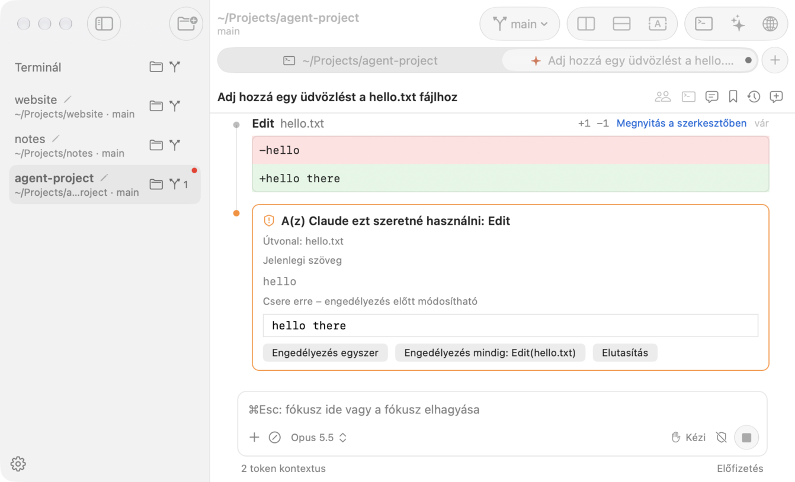

<p>&nbsp;&nbsp;&nbsp;</p>

# Tapa

**A gyors, natív macOS-es terminál, amelyben helyet kaptak az ügynökei, a fájljai és az oldalai.**

A Tapa elsősorban terminál: saját VT-mag és Metal-alapú megjelenítő, natív macOS-lapok és -felosztások, egy gyors terminál, amely egyetlen billentyűparanccsal becsúszik, shell-integráció parancsblokkokkal, és egy opcionális beviteli mező Warp-stílusú javaslatokkal. Ekörül a Tapa a [Dango](https://github.com/sventmueller/dango) kistestvérévé nőtte ki magát: oldalsáv munkaterületekkel, projektmappánként eggyel, mindegyikben a saját termináljaival, ügynöklapok a Claude, a Codex, az OpenCode, az Antigravity és más ACP-ügynökök számára, böngészőlapok, egy szerkesztő fájllistával és Git-panellel, valamint a [Splat](https://github.com/sventmueller/splat) Markdown-előnézete képletekkel és diagramokkal. Semmi, amit egy projektmappa beállít, nem fut el addig, amíg meg nem bízik a munkaterületében. A Tapa Rustban készült, valódi AppKit-vezérlőkre épül, 35 nyelven beszél, nem kell hozzá fiók, és nincs benne telemetria.

[](https://github.com/sventmueller/tapa/releases/latest/download/Tapa.dmg)

**[Tapa.dmg letöltése](https://github.com/sventmueller/tapa/releases/latest/download/Tapa.dmg)**: aláírva és az Apple által hitelesítve, macOS 14 vagy újabb rendszerhez, Apple Silicon és Intel gépekre.

**Hibát talált?** [Nyisson egy issue-t](https://github.com/sventmueller/tapa/issues/new/choose), és írja meg, melyik shell-lel, melyik ügynökkel vagy melyik programmal történt. Ha hasznosnak találja a Tapát, egy [csillag a GitHubon](https://github.com/sventmueller/tapa) segít másoknak megtalálni.

[](https://www.rust-lang.org) [](https://www.apple.com/macos/)  [](https://github.com/madsmtm/objc2) [](https://developer.apple.com/metal/) [](https://agentclientprotocol.com)    [](#licenc)

[Bahasa Indonesia](../id/README.md) · [Bahasa Melayu](../ms/README.md) · [Català](../ca/README.md) · [Čeština](../cs/README.md) · [Dansk](../da/README.md) · [Deutsch](../de/README.md) · [English](../../../README.md) · [Español](../es/README.md) · [Français](../fr/README.md) · [Hrvatski](../hr/README.md) · [Italiano](../it/README.md) · **Magyar** · [Nederlands](../nl/README.md) · [Norsk](../no/README.md) · [Polski](../pl/README.md) · [Português (Brasil)](../pt_BR/README.md) · [Português (Portugal)](../pt_PT/README.md) · [Română](../ro/README.md) · [Slovenčina](../sk/README.md) · [Slovenščina](../sl/README.md) · [Suomi](../fi/README.md) · [Svenska](../sv/README.md) · [Tiếng Việt](../vi/README.md) · [Türkçe](../tr/README.md) · [Ελληνικά](../el/README.md) · [Русский](../ru/README.md) · [Українська](../uk/README.md) · [עברית](../he/README.md)‎ · [العربية](../ar/README.md)‎ · [हिन्दी](../hi/README.md) · [ไทย](../th/README.md) · [한국어](../ko/README.md) · [日本語](../ja/README.md) · [简体中文](../zh-Hans/README.md) · [繁體中文](../zh-Hant/README.md)

## Tartalom

- [Az áttekintés](#az-áttekintés)
- [Rendszerkövetelmények](#rendszerkövetelmények)
- [Telepítés](#telepítés)
- [Első lépések](#első-lépések)
- [Munkaterületek](#munkaterületek)
- [A terminál](#a-terminál)
  - [Lapok és felosztások](#lapok-és-felosztások)
  - [Shell-integráció és parancsblokkok](#shell-integráció-és-parancsblokkok)
  - [A beviteli mező és a javaslatok](#a-beviteli-mező-és-a-javaslatok)
  - [Keresés, kijelölés és másolás](#keresés-kijelölés-és-másolás)
  - [A gyors terminál](#a-gyors-terminál)
- [Ügynökök](#ügynökök)
- [Szerkesztő, fájlok és Git](#szerkesztő-fájlok-és-git)
- [Előnézetek](#előnézetek)
- [Böngésző](#böngésző)
- [Diktálás](#diktálás)
- [Beállítások](#beállítások)
- [Megjelenés és kisegítő lehetőségek](#megjelenés-és-kisegítő-lehetőségek)
- [Nyelvek](#nyelvek)
- [Billentyűparancsok](#billentyűparancsok)
- [Bizalom](#bizalom)
- [Adatvédelem és biztonság](#adatvédelem-és-biztonság)
- [Ismert korlátozások](#ismert-korlátozások)
- [Fejlesztőknek](#fejlesztőknek)
  - [Harmadik féltől származó összetevők](#harmadik-féltől-származó-összetevők)
- [Licenc](#licenc)

## Az áttekintés

- **Saját, gyors terminál.** A Tapa saját VT-magjával elemez, és Metallal rajzol kijelzőnként egy szálon, a kijelző frissítési ütemében, és csak azt, ami megváltozott. 262 esctest-ellenőrzésen megy át, míg az Alacritty magja 121-en, és minden módosítását egy rögzített Ghostty-verzióhoz mérik.
- **Natív a csontjáig.** Valódi macOS-lapok, ablak-visszaállítás, menük, a Szolgáltatások menü, értesítések, biztonságos bevitel billentyűzetről, diktálás és beviteli módok. Nincs Electron, WebKit pedig csak ott, ahol egy oldalnak vagy előnézetnek szüksége van rá.
- **Munkaterületek.** Az oldalsávban projektmappánként egy munkaterület van, mindegyik saját lapokkal, ággal és panelekkel. A legfelső „Terminál” munkaterület minden alkalommal tisztán indul; az összes többi megmarad, amíg el nem távolítja.
- **Ügynökök natív csevegőnézetben.** A Claude, a Codex, az OpenCode, az Antigravity, a Gemini CLI és az Agent Client Protocol más ügynökei saját lapokon futnak, a válaszok, eszközhívások, diffek és engedélykérések pedig egyetlen idővonalon jelennek meg. Kérésre a Tapa telepíti és frissíti őket.
- **Shell-integráció és parancsblokkok** zsh, bash és fish alatt, `ssh` felett is: ugorjon promptról promptra, jelölje ki, másolja, mentse és csukja össze egy parancs kimenetét, lássa a sikertelen parancsokat és azt, hogy melyik mennyi ideig tartott.
- **Warpéhoz hasonló beviteli mező, ha szeretné.** Szerkessze a parancssort szövegként, javaslatokkal az előzményeiből, több mint 700 parancssori eszköz leírásából és a projekt állapotából, mindezt a saját Macjén.
- **Fájlok, Git és böngésző a shell mellett.** Szintaxiskiemelős szerkesztő, fájllista, Git-panel előkészítéssel (staging), commitokkal, ágakkal és worktree-kkel, Markdown-előnézet képletekkel és diagramokkal, valamint böngészőlapok.
- **Óvatos a mappáival.** Egy munkaterület, amelyben nem bízott meg, semmit sem indít el, amit a mappája beállít: sem git hookokat, sem a projekt MCP-szervereit, sem az ügynökök projektbeállításait, sem JavaScriptet a fájloldalaiban.
- **Privát.** Nincs fiók, nincs telemetria. A Tapa csak akkor fordul a hálózathoz, ha Ön kéri, a lemezen tárolt visszaállítási előzményeket pedig a kulcskarikájában lévő kulcs titkosítja.
- **Az Ön nyelvén.** A felület 35 nyelven érhető el: angol, arab, katalán, kínai (egyszerűsített), kínai (hagyományos), horvát, cseh, dán, holland, finn, francia, német, görög, héber, hindi, magyar, indonéz, olasz, japán, koreai, maláj, norvég, lengyel, portugál (Brazília), portugál (Portugália), román, orosz, szlovák, szlovén, spanyol, svéd, thai, török, ukrán és vietnami.

## Rendszerkövetelmények

- macOS 14 Sonoma vagy újabb, Apple Silicon vagy Intel processzorral. A Tapát macOS 27 alatt fejlesztik és tesztelik.
- zsh, bash vagy fish a shell-integrációhoz; más shellek nélküle futnak.
- Az ügynöklapokhoz a használni kívánt ügynök, amely vagy már telepítve van, vagy a Tapa telepíti, ha kéri (lásd: [Ügynökök](#ügynökök)).

## Telepítés

**A lemezképről.** Minden kiadás egy lemezkép, `Tapa-<version>.dmg`, egyetlen univerzális appal Apple Silicon és Intel gépekre, Developer ID-val aláírva és az Apple által hitelesítve. Nyissa meg, és húzza a Tapát az Alkalmazások mappára.

**Homebrew-val.** A saját tapben lévő cask ugyanezt a lemezképet telepíti:

```sh
brew install --cask sventmueller/tap/tapa
```

**Frissítések.** A lemezképről vagy Homebrew-val telepített Tapa a [Sparkle](https://sparkle-project.org) segítségével naprakészen tartja magát. A második indításkor megkérdezi, kereshet-e magától frissítéseket; amíg bele nem egyezik, egyetlen kérést sem küld. A **Tapa › Frissítések keresése…** azonnal keres. A Tapa csak akkor telepít egy frissítést, ha az a fejlesztő aláírását viseli. A saját buildnek nincs frissítője.

**Forráskódból.** Lásd: [Fejlesztőknek](#fejlesztőknek).

**Alapértelmezett terminálként.** A Tapa meg tudja nyitni a shellszkripteket (`.command`, `.tool`), az ikonjára húzott mappákat és az `ssh://` hivatkozásokat. Válassza ki a Finderben a **Fájl › Infó megjelenítése › Megnyitás ezzel** alatt.

## Első lépések

1. **Az ablakban** balra a munkaterületek oldalsávja, felül a kiválasztott munkaterület lapjai, fölöttük pedig az eszközsor látható. A ⌃⌘S megjeleníti és elrejti az oldalsávot.
2. **Új munkaterületet** az oldalsáv tetején lévő mappagombbal vagy a **Shell › Új munkaterület…** (⇧⌘N) paranccsal hozhat létre: válasszon egy legutóbbi mappát, vagy a **Mappa kiválasztása…** lehetőséget.
3. **Az új lapok** a munkaterület mappájában indulnak: ⌘T egy terminálhoz, az eszközsor jobb oldalán lévő gombok egy terminálhoz, ügynökhöz vagy böngészőlaphoz, illetve a **+** a lapsor végén.
4. **A beállítások** a ⌘, billentyűparanccsal vagy az oldalsáv alján lévő fogaskerékkel nyílnak meg.
5. **A parancspaletta** (⇧⌘P) név szerint megtalál minden parancsot, a **Lap keresése…** (⌘P) pedig minden munkaterület minden lapját.

Az eszközsoron balról jobbra a munkaterület tárolójának ágválasztó menüje, a terminál jobbra és lefelé felosztására és a beviteli mező megjelenítésére szolgáló gombok, valamint az új terminál-, ügynök- és böngészőlapok gombjai találhatók. A felosztás és a beviteli mező gombjai szürkék, amíg nincs elöl terminállap.

## Munkaterületek

A munkaterület egy mappa a lapjaival. Az oldalsávban lévő sora a nevet, a mappát és a Git-ágat mutatja, jobb oldalon pedig a fájllista és a Git-panel gombjait. Ha valamelyikre kattint, az a panel jelenik meg a munkaterületek listája helyett; a felül lévő **Munkaterületek** visszavezet.

- **A „Terminál” munkaterület** mindig legfelül van. Minden indításkor tisztán indul, a beállításokban megadott mappában, egyetlen üres terminállal. Semmi sem tárolódik belőle, és nem lehet átnevezni vagy eltávolítani.
- **Minden más munkaterület megmarad**, amíg el nem távolítja, lapok nélkül is. A Tapa megőrzi a nevét, a lapjait, a termináljai tartalmát (amennyire a visszaállítási beállítások engedik), az ügynökmunkameneteit és az ablak helyzetét. A még futó programok a Tapából való kilépéskor leállnak.
- **Átnevezés.** Kattintson a név utáni ceruzára, kattintson a kiválasztott munkaterület nevére, vagy válassza a **Shell › Munkaterület átnevezése** parancsot. A név azonnal mentődik.
- **Állapot.** A soron lévő zöld pont azt jelzi, hogy a munkaterület egyik ügynöke dolgozik, alügynökökkel vagy a háttérben is; a piros pont azt, hogy valamelyik Önre vár. A terminálok ott semmit sem jelölnek.
- **Váltás.** A ⌃⌘[ és a ⌃⌘] a munkaterületek között vált. Az ablak a helyén marad, és a kiválasztott munkaterület lapjai veszik át a többiek helyét.
- **Worktree-k.** Az eszközsor ágválasztó menüjében az **Új worktree…** Git-worktree-t hoz létre egy új ágon, és saját munkaterületként nyitja meg.

Amikor egy munkaterület utolsó lapja bezárul, a munkaterület a listában marad. Ha minden lap bezárult, csak az ablak tűnik el; a Dock-ikon vagy a ⌘N a munkaterületeivel együtt visszahozza.

## A terminál

A Tapa saját magon, a `term-vt`-n fut. Beszéli az xtermet és a VT520-at a Kitty billentyűzetprotokolljával, támogatja az OSC 8 hivatkozásokat, a vágólap OSC 52-n keresztüli elérését külön olvasási engedéllyel, a szinkronizált kimenetet, a színes és hullámos aláhúzást, a truecolort, a színlekérdezéseket, a világos és sötét mód jelentését a programok felé, a bracketed paste-et, a fókuszeseményeket és az egérjelentést. Az ablak átméretezésekor a szöveg újratördelődik, az előzményekkel együtt. A ligatúrák, a betűtípus-funkciók, a foltozott betűtípusok nélküli Nerd Font-szimbólumok és a pixelpontos keretrajzoló, Powerline- és Braille-karakterek beépítettek.

### Lapok és felosztások

- **A lapok** a macOS saját lapjai: húzással átrendezheti őket, vagy kihúzhatja egy saját ablakba, **Összes lap megjelenítése** (⇧⌘\\), ⌘1–⌘8, ⌘9 az utolsó laphoz, és ⇧⌘[ / ⇧⌘] a váltáshoz. Minden lap a címe előtt a típusa ikonját mutatja.
- **Felosztások.** **Felosztás jobbra** (⌘D vagy ⌃⌘T) és **Felosztás lefelé** (⇧⌘D vagy ⌃⌥⌘T), tetszőleges mélységig egymásba ágyazva. Húzzon egy elválasztót, mozgassa a ⌃⌘ és a nyílbillentyűk segítségével, **Panel maximalizálása** (⌃⇧⌘↩), **Panelek kiegyenlítése** (⌃⌘=), a panelek között pedig a ⌘[ és a ⌘] billentyűkkel lépkedhet.
- **Munkamappa.** Az új lapok, ablakok és felosztások az elöl lévő terminál mappájában indulnak; a beállítások mindhárom esetben külön döntenek erről.
- **Bezárás.** A Tapa rákérdez, mielőtt bezár egy lapot, egy ablakot vagy az appot, miközben program fut benne.
- **Visszaállítás.** Újraindítás után visszatérnek a munkaterületek, a lapok, a panelek, a mappák és minden terminál utolsó sorai. A titkokat, például tokeneket és jelszavakat, maszkolja, mielőtt bármit tárolna.

### Shell-integráció és parancsblokkok

A Tapa magától beállítja a shell-integrációt zsh, bash és fish alatt, a konfigurációs fájljai érintése nélkül, és magával viszi, amikor `ssh`-val másik gépre csatlakozik. Ezzel minden parancs a kimenetével együtt egy blokkot alkot:

- **Promptok.** A ⌘↑ és a ⌘↓ az előző és a következő promptra ugrik. A parancssorba kattintva oda kerül a kurzor.
- **Blokkok.** **Blokk kijelölése** (⇧⌘A), **Kimenet másolása** (⌥⌘C), **Kimenet mentése…** (⌥⌘S) és **Blokk összecsukása/kibontása** (⇧⌘↩). A mutató alatti blokk fölött gombok mutatják az állapotát, az időtartamát és ugyanezeket a műveleteket.
- **A sikertelen parancsok** jelölve vannak, a még futó parancs pedig felül látható marad, miközben a kimenete görög.
- **Könyvjelzők.** A **Könyvjelző be/ki** (⇧⌘M) megjelöl egy sort; a ⇧⌘↑ és a ⇧⌘↓ a könyvjelzők között ugrik.
- **Értesítések** jelennek meg, ha egy program kéri (OSC 9 és OSC 777), és a terminál nincs elöl, egy folyamatjelző (OSC 9;4) pedig a lapon és a Dock-ikonon látható.

### A beviteli mező és a javaslatok

A beviteli mező a parancssort a panel alján lévő szövegmezővé alakítja, mint a Warpban, fölötte a mappa és a Git-ág címkéivel. A **Beviteli mező megjelenítése/elrejtése** (⌘I) vagy az eszközsor gombja egy terminálra kapcsolja be vagy ki; a **Beállítások › Bevitel** az új terminálokra kapcsolja be. A shell-integrációra van szüksége, és félreáll a teljes képernyős programok, például a vim, a htop vagy a claude elől.

- **A Return** a teljes mezőt elküldi a shellnek, a többsoros szöveget egyetlen beillesztésként; a shell a szokásos módon futtatja és megjegyzi. Ha a shell további bevitelt kér, a mező a következő promptig visszaadja neki a billentyűket.
- **A ↑, a ↓ és a ⌃R** az előzményekben keres, azzal a mappával, ággal és kilépési kóddal, amellyel az egyes parancsok futottak.
- **A Tab** több mint 700 parancssori eszköz leírása, útvonalak és élő értékek alapján egészít ki, például git-ágak, docker-konténerek, kubectl-erőforrások, ssh-gépek, `package.json`-szkriptek, valamint make-, just- és cargo-célok alapján.
- **A Vim-billentyűk** a mezőben egy kapcsolóval érhetők el ugyanezekben a beállításokban.
- **A következő parancs, még mielőtt gépelne**: ami ebben a projektben általában következik (a `git add` után jön a `git commit`), amit a projekt állapota kíván (a `node_modules`-nál újabb zárolási fájl), és javítás a „command not found” után, elgépelésekből vagy a helyi Homebrew-indexből.

Beviteli mező nélkül a javaslatok szürke szövegként jelennek meg a kurzor mögött, és a → elfogadja őket. A saját automatikus javaslatokkal rendelkező shellek, például a fish vagy a zsh-autosuggestions, megtartják a sajátjukat. A javaslatok soha nem használják a hálózatot, és programokat csak a saját `PATH`-jából indítanak, soha a projektmappából.

**Beillesztés.** A többsoros beillesztések futtatás előtt megjeleníthetők (**Többsoros beillesztés előzetes megjelenítése**). A terminálra húzott fájlok idézőjeles útvonalként érkeznek; a ⌥←/→, a ⌘←/→ és a ⌘⌫ szavanként és soronként mozog és töröl, mint bármely Mac-es szövegmezőben.

### Keresés, kijelölés és másolás

- **A Keresés…** (⌘F) reguláris kifejezésekkel, kis- és nagybetűk szerint és egész szavakra keres az előzményekben, és megszámolja a találatokat; a görgetősáv a promptokkal és a hibákkal együtt jelöli őket.
- **Intelligens kijelölés.** A dupla kattintás egy URL-t, útvonalat, hasht vagy IP-címet egészében jelöl ki, az ⌥-húzás pedig téglalapot jelöl ki. A hivatkozásokat OSC 8 nélkül is felismeri; a ⌘-kattintás megnyitja őket, egy útvonalat pedig a Dangóban, ha telepítve van.
- **A Kijelölés billentyűzettel** (⇧⌘C) a Vim billentyűivel mozgatja a kijelölést.
- **A Másolás formázással** (⇧⌥⌘C) megtartja a színeket és a stílusokat; a kijelöléskori másolás beállítás. A **Kiürítés** (⌘K) kiüríti a terminált.

### A gyors terminál

A **Gyors terminál megjelenítése/elrejtése** (⌃⌥⌘Szóköz) a képernyő egyik széléről becsúsztat egy terminált, más appok és teljes képernyős terek fölé, appváltás nélkül. A szél, a méret, és hogy elrejtőzik-e, ha máshová kattint, a beállításokban adható meg. A munkamenetei elrejtett állapotban is tovább futnak.

## Ügynökök

Egy ügynöklap egy kódoló ügynököt futtat a munkaterület mappájában, a Dangóból átvett natív ügynöknézetben.

| Ügynök | Hogyan fut | Mi kell hozzá |
|---|---|---|
| Claude | a `claude` parancs, a stream-json protokollján keresztül | telepített és bejelentkezett `claude`; kérésre a Tapa a Claude saját telepítőjével telepíti |
| Codex | `codex app-server`, vagy régebbi Codexhez `codex-acp` | bejelentkezett `codex`; kérésre a Tapa telepíti a rögzített adaptert |
| OpenCode | `opencode serve`, vagy régebbi OpenCode-hoz `opencode acp` | saját `opencode` a `PATH`-ban, vagy a rögzített letöltés |
| Antigravity | `agy acp` | saját `agy` a `PATH`-ban, vagy a rögzített letöltés |
| Gemini CLI | `gemini --acp`, akkor kínálja fel, ha bekapcsolja a **Beállítások › Ügynökök** alatt | saját `gemini`, vagy a rögzített letöltés |
| Más ACP-ügynökök | az ACP-jegyzékből, amelyet csak kérésre tölt be | amit a jegyzékbejegyzés megad; ellenőrzőösszeg nélküli bejegyzések csak megerősítés után települnek |

A Tapa minden ügynök saját bejelentkezését használja, és nem tárol ügynök-hitelesítő adatokat. A bejelentkezési shell `PATH`-jában talált ügynök élvez elsőbbséget; ellenkező esetben a Tapa a saját adatmappájába telepített verziót futtatja, soha nem a munkaterületről származó programot.

- **Az idővonal** a válaszokat, az eszközhívásokat a kimenetükkel és diffjeikkel, a kérdéseket és az engedélykéréseket mutatja. Az **Engedélyezés egyszer**, az **Engedélyezés mindig** és az **Elutasítás** válaszol egy kérésre, egy szerkesztés pedig engedélyezés előtt módosítható.
- **Állapot.** A lap és a munkaterület sora zöld pontot mutat, amíg az ügynök dolgozik, és pirosat, amíg Önre vár, egy értesítés pedig szól, ha vár, miközben Ön máshol jár.
- **Az üzenetmező** alul fogadja a promptját, a ráhúzott fájlokat és a diktálást. A ⌘Esc a billentyűzetfókuszt beléviszi és vissza. Ott választható ki a munkamenethez a modell és az engedélyezési mód is.
- **A Beállítások › Ügynökök** az új munkamenetekhez beállítja az engedélyezési módot (Claude, Codex), a modellt (Claude, Codex, OpenCode) és a gondolkodási erőfeszítést (Claude, Codex), valamint azt, hogy az új lapok mely ügynököket kínálják. Megmutatja, hol található az egyes ügynökök programja, a **Telepítés…**, a **Frissítés erre: …** és az előző verzióhoz a **Vissza ide: …** gombokkal, az ACP-jegyzékhez pedig a **Jegyzék betöltése** gombbal. Ott meg is tekintheti és el is távolíthatja azokat a szabályokat, amelyeket a Claude az „Engedélyezés mindig” révén mentett.
- **Ellenőrzött letöltések.** Az archívumokat az SHA-256 értékükkel, az npm-csomagokat a zárolási fájljukban lévő integrity értékkel ellenőrzi, a rögzített verzió nélküli csomagokat pedig elutasítja. Egy hiányzó ügynök a saját lapján is felajánlja a telepítését.

## Szerkesztő, fájlok és Git

- **A munkaterület fájllistája** fa formájában mutatja a mappáját, a fájlok változásával frissülve, a Git által figyelmen kívül hagyott fájlokat pedig igény szerint halványítva. Egy kattintás előnézeti lapon nyit meg egy fájlt, amelyet a következő kattintás lecserél, amíg nem szerkeszti; a dupla kattintás megtartja.
- **A szerkesztő** a munkaterület lapjain nyitja meg a fájlokat, szintaxiskiemeléssel, több kurzorral, összecsukással, az `.editorconfig` behúzásával, opcionális Vim-billentyűkkel és jelölésekkel arról, mi változott az utolsó commit óta. Észreveszi, ha egy fájl megváltozott a lemezen, vagy ütközésjelölőket tartalmaz. A Markdown-fájlok formázósávot és **Megnyitás a Splatben** parancsot kapnak. A **Mentés** (⌘S), a **Mentés mint…** és az **Összes mentése** a megszokott módon működik, és a Tapa rákérdez, mielőtt mentetlen szöveget zár be.
- **Összeomlás után** a mentetlen szöveg visszatér: a Tapa gépelés közben titkosított másolatokat tart róla.
- **A Git-panel** az előkészített és az előkészítetlen módosításokat mutatja, fájlokat és egyes hunkokat készít elő és vesz vissza, commitol (⌘↩), módosítja az utolsó commitot (amend), commitol és pushol, fetchel, és kezeli az ágakat, a stasht, a cherry-pickeket és az ütközéseket, alatta a commitelőzményekkel. Egy fájlra kattintva megjelenik a diffje.
- **Az ágválasztó menü** az eszközsoron ágakat vált és hoz létre, és worktree-ket készít.

A szerkesztő nem indít formázót és nyelvi szervert. Nyelvi szerverekkel és hibakeresővel rendelkező teljes IDE-hez használja a [Dangót](https://github.com/sventmueller/dango).

## Előnézetek

- **A Markdown** a szerkesztője mellett jelenik meg a Splat megjelenítőjével: GitHub Flavored Markdown képletekkel, diagramokkal és képekkel, a szöveggel bekezdésről bekezdésre együtt görgetve.
- **A képek** saját lapon nyílnak meg, a PDF-ek a PDFKit-tel, a hangok, filmek, betűtípusok és irodai dokumentumok pedig a Gyorsnézettel.
- **Elszigetelt dekódolás.** Minden nem megbízható forrásból származó kép (projektfájlok, Markdown, ügynökmellékletek és beillesztések) a Splat `Decoder.xpc` szolgáltatásában dekódolódik, saját App Sandboxban, fájlok és hálózat nélkül, soha nem magában az appban.

## Böngésző

Az **Új böngészőlap** (⇧⌘B) WebKit-lapot nyit a munkaterületen. A címmező címet vagy keresőszavakat fogad az Ön által választott keresőmotor számára (DuckDuckGo, Google, Bing vagy Startpage); a ⌘L, a ⌘R, a ⌘[ és a ⌘] úgy működik, mint a Safariban. A `localhost` oldalai a szokásos módon futnak, a projekt fejlesztői szerveréhez. Egy munkaterület HTML-fájljai csak a saját mappájukat olvashatják, és olyan munkaterületen, amelyben nem bízott meg, nem futtatnak JavaScriptet.

## Diktálás

Diktáljon egy ügynök üzenetmezőjébe vagy a szerkesztőbe a mikrofongombbal vagy a **Szerkesztés › Diktálás indítása** (⌃⌥D) paranccsal. A beszédfelismerés a [Lowspeaké](https://github.com/sventmueller/lowspeak), amelyet nem kell telepíteni. A **Beállítások › Diktálás** alatt választhat online átírást az OpenAI-jal vagy a Groqkal, vagy helyi Whisper- és Parakeet-modelleket, amelyek a felvételt a Macjén tartják, valamint a nyelvet, az utófeldolgozást, a mikrofont és a saját szókincsét. Az OpenAI és a Groq kulcsait a kulcskarikája őrzi. A diktálás csak a kiadási buildben érhető el.

## Beállítások

A **Tapa › Beállítások…** (⌘,) paneljei: Általános, Betűtípus, Színek, Kurzor, Terminál, Bevitel, Szerkesztő, Ügynökök, Diktálás, Profilok és Billentyűparancsok. Ezek egyetlen TOML-fájlba írnak, a `config.toml` fájlba a Tapa mappájában a `~/Library/Application Support` alatt, amelyet kézzel is szerkeszthet; a Tapa futás közben újratölti, a **Beállítások újratöltése** (⇧⌘,) pedig azonnal megteszi.

- **Négy betűméret** az Általános alatt: Felület (oldalsáv, panelek, fájllista, Git-panel és lapcímek), Szerkesztő (szöveg, sorszámok és Markdown-előnézet), Terminál és Ügynökök. A ⌘+, a ⌘− és a ⌘0 az elöl lévő terminál méretét módosítja.
- **Megjelenés:** Világos, Sötét vagy Rendszer szerint.
- **Színek.** Egy téma a világos és egy a sötét módhoz, a Ghostty témaformátumában, minimális kontraszttal, amely gyenge témánál is olvashatóan tartja a szöveget. A saját témái a témák mappájába kerülnek.
- **A profilok** betűtípust, színeket, shellt, környezetet és mappát fognak össze.
- **A billentyűparancsok** mind módosíthatók, az ütközések pedig megjelennek.

## Megjelenés és kisegítő lehetőségek

- **A sötét mód** a rendszert vagy az Ön választását követi; a kiemelőszínt, a Mozgás csökkentése és a Kontraszt növelése beállítást figyelembe veszi.
- **A VoiceOver** felolvassa a terminál sorait és promptjait, és bejelenti az új kimenetet; az oldalsáv, a lapok, az eszközsor gombjai és az ügynök-idővonal kártyái névvel rendelkeznek.
- **Billentyűzet.** Minden parancsnak van menüeleme és billentyűparancsa, és a Teljes billentyűzetes hozzáférés minden vezérlőt elér.
- **Méretek.** A beállítások négy betűmérete egymástól függetlenül méretezi a felületet, a szerkesztőt, a terminált és az ügynököket.
- **Jobbról balra.** A felület arab és héber nyelven tükrözve jelenik meg, a terminál rácsa viszont balról jobbra marad.

A részletek és az ismert hiányosságok az [ACCESSIBILITY.md](../../../ACCESSIBILITY.md) fájlban találhatók.

## Nyelvek

A felület 35 nyelvre van lefordítva: angol, arab, katalán, kínai (egyszerűsített), kínai (hagyományos), horvát, cseh, dán, holland, finn, francia, német, görög, héber, hindi, magyar, indonéz, olasz, japán, koreai, maláj, norvég, lengyel, portugál (Brazília), portugál (Portugália), román, orosz, szlovák, szlovén, spanyol, svéd, thai, török, ukrán és vietnami.

A Tapa a **Rendszerbeállítások › Általános › Nyelv és régió** nyelvi sorrendjét követi; ugyanott az **Alkalmazások** alatt a Tapának külön nyelvet is választhat. Ha az Ön nyelvére nincs fordítás, angolt használ.

## Billentyűparancsok

| Művelet | Billentyűparancs |
|---|---|
| Új ablak, munkaterület, lap | ⌘N, ⇧⌘N, ⌘T |
| Új böngészőlap | ⇧⌘B |
| Új fájl, fájl megnyitása | ⌥⌘N, ⌘O |
| Panel vagy lap bezárása, lap bezárása, ablak bezárása | ⌘W, ⌥⌘W, ⇧⌘W |
| Felosztás jobbra, felosztás lefelé | ⌘D vagy ⌃⌘T, ⇧⌘D vagy ⌃⌥⌘T |
| Panel maximalizálása, panelek kiegyenlítése, panel bezárása | ⌃⇧⌘↩, ⌃⌘=, ⌃⇧⌘W |
| Elválasztó mozgatása | ⌃⌘←, ⌃⌘→, ⌃⌘↑, ⌃⌘↓ |
| Következő, előző panel | ⌘], ⌘[ |
| Következő, előző lap; 1–8. lap, utolsó lap | ⇧⌘], ⇧⌘[; ⌘1–⌘8, ⌘9 |
| Következő, előző munkaterület | ⌃⌘], ⌃⌘[ |
| Lap keresése, parancspaletta | ⌘P, ⇧⌘P |
| Az oldalsáv, a beviteli mező megjelenítése vagy elrejtése | ⌃⌘S, ⌘I |
| Gyors terminál | ⌃⌥⌘Szóköz |
| Keresés, következő találat, előző találat | ⌘F, ⌘G, ⇧⌘G |
| Előző, következő prompt | ⌘↑, ⌘↓ |
| Blokk kijelölése, kimenet másolása, kimenet mentése, blokk összecsukása | ⇧⌘A, ⌥⌘C, ⌥⌘S, ⇧⌘↩ |
| Könyvjelző hozzáadása vagy eltávolítása; előző, következő könyvjelző | ⇧⌘M; ⇧⌘↑, ⇧⌘↓ |
| Kijelölés billentyűzettel | ⇧⌘C |
| Másolás formázással | ⇧⌥⌘C |
| Kiürítés | ⌘K |
| Eleje, vége, lap fel, lap le | ⌘Home, ⌘End, ⌘PageUp, ⌘PageDown |
| Nagyobb, kisebb, eredeti méret (terminál) | ⌘+, ⌘−, ⌘0 |
| Ügynöklap üzenetmezője | ⌘Esc |
| Diktálás indítása | ⌃⌥D |
| Beállítások, beállítások újratöltése | ⌘,, ⇧⌘, |

Minden billentyűparancs módosítható a **Beállítások › Billentyűparancsok** alatt vagy a beállításfájl `[keys]` szakaszában.

## Bizalom

Egy projektmappa programokat indíthat el, amint valami elindul benne: git hookokat és olyan tárolóbeállításokat, mint a `core.fsmonitor`, ügynökhookokat, a projekt MCP-szervereit és az ügynökök projektbeállításait. Ezért egy új munkaterület nem megbízható.

- **Nem megbízható:** az ügynökök a projekt hookjai, MCP-szerverei és konfigurációja nélkül indulnak (a Claude `--setting-sources=user --strict-mcp-config` kapcsolókkal, a Codex nem megbízhatónak jelölt mappával, az OpenCode a projekt konfigurációja nélkül). A Git semlegesítve fut: hookok, szűrők, diff-illesztők, fsmonitor, `sshCommand` és lapozó nélkül, és csak globális hitelesítőadat-segédekkel. A HTML-fájlok JavaScript nélkül nyílnak meg. A Git-panel és az ügynöklap jelzi ezt, és felajánlja, hogy megbízhatónak jelölje a munkaterületet.
- **Megbízható:** a **Shell › Munkaterület megbízhatónak jelölése** mindezt úgy tölti be, ahogyan a mappa szándékolja. A **Bizalom visszavonása** visszavonja. A bizalom munkaterületenként tárolódik.

Bármilyen is a bizalom, a Tapa soha nem futtat magától programot egy projektmappából: a javaslatok csak a projekten kívüli `PATH`-ból indítanak programokat, az oldalsáv pedig a `.git` fájlokból olvassa a Git állapotát. A saját mappájában lévő munkaterület, például a „Terminál”, nem projekt: a `~` alatti programok, például a `~/.local/bin/claude`, ott a sajátjának számítanak.

## Adatvédelem és biztonság

- **Nincs telemetria, nincs fiók.** A Tapa semmit sem jelent arról, hogyan használja, és teljesen offline működik. Csak akkor fordul a hálózathoz, ha kéri: egy ügynök telepítéséhez vagy frissítéséhez, az ACP-jegyzék betöltéséhez, a frissítések kereséséhez, miután beleegyezett, és a böngészőlapon megnyitott oldalakhoz. Maguk az ügynökök a szokásos módon kommunikálnak a szolgáltatóikkal.
- **A lemezen tárolt előzményeket** a munkamenetek visszaállításához a kulcskarikájában lévő kulcs titkosítja, kikapcsolhatók, és a titkokat, például API-kulcsokat, tokeneket és jelszavakat, írás előtt maszkolja. A mentetlen szerkesztőszöveg másolatait ugyanaz a kulcs titkosítja.
- **A Biztonságos bevitel billentyűzetről** jelszókéréseknél magától bekapcsol, és az app menüjében végleg bekapcsolható.
- **Az escape-szekvenciákat**, amelyek adatot szivárogtathatnak ki vagy juttathatnak be, például a címlekérdezéseket, a vágólap olvasását és a beillesztési trükköket, letiltja, vagy előbb rákérdez. Az elemzőt a CI-ban fuzzolják.
- **Elszigetelt dekódolás** a nem megbízható forrásból származó képekhez, lásd: [Előnézetek](#előnézetek).
- **Kódaláírás** Hardened Runtime-mal. A macOS a terminálban futó programok hozzáféréseit a Tapának tulajdonítja, ezért minden védett szolgáltatáshoz használati leírást tartalmaz.

A biztonsági problémákat bizalmasan jelentse, lásd: [SECURITY.md](../../../SECURITY.md).

## Ismert korlátozások

- **Még nincsenek beágyazott képek** a terminálban: a Kitty-grafika, a Sixel és az iTerm2-képek az 1.0 utánra vannak tervezve.
- **Nincs tmux-vezérlőmód**, és a munkamenetek nem élik túl a Tapából való kilépést.
- **A jobbról balra írt szöveg** a terminál rácsában balról jobbra marad.
- **A ⌘+ és a ⌘−** csak az elöl lévő terminált módosítja.
- **A szerkesztőben** szándékosan nincsenek nyelvi szerverek, formázók és hibakereső; a Dangóban megvannak.
- **A diktálás** csak a kiadási buildben érhető el, a hibakeresési buildben nem.
- **A VoiceOvert** még nem ellenőrizte ember elejétől a végéig.

## Fejlesztőknek

Szükség van macOS 14-re vagy újabbra az Xcode Command Line Tools csomaggal, a `rust-toolchain.toml` által megadott Rustra (rustup mindkét Mac-céllal az univerzális buildhez), a [splat](https://github.com/sventmueller/splat) és a [lowspeak](https://github.com/sventmueller/lowspeak) e mellé kicsekkolt példányára (`../splat`, `../lowspeak`), valamint a diktálással készülő buildekhez cmake-re.

| Parancs | Mit csinál |
|---|---|
| `make help` | felsorolja a célokat |
| `cargo xtask run` | lefordítja a hibakeresési appot, és megnyitja |
| `make build` | lefordítja a kiadási appot diktálással a `target/release` mappába, erre a Macre ad hoc aláírva |
| `make lint` | formázás, clippy hibaként kezelt figyelmeztetésekkel, a fájlok szerkezete és a felület szövegei |
| `make check` | `lint`, majd az összes teszt; nem kell hozzá ablak és hálózat |
| `make selftest STEPS="split_right,type:ls\n,shot:x"` | vezérli az appot, és ablakképeket hagy a `target/selftest/` mappában |
| `make esctest`, `make vttest` | az esctestet és a vttestet futtatja mindkét magon az appban |
| `make perf` | a benchmark egy rögzített Ghostty-verzióval szemben; csak tétlen Macen van értelme |
| `make fuzz` | a fuzzcélok a cargo-fuzzal |
| `make release` | a kiadás próbafuttatása: az univerzális app diktálással, a lemezképe, a frissítési feedje és a caskja a `target/release-dry-run` mappában; semmit sem küld el sehová |
| `make release-notarized` | a jelenlegi verzió a Developer ID-val aláírva, az Apple által hitelesítve és stapled jeggyel ellátva a `dist/` mappába; a `Cargo.toml` változatlan marad |
| `make deploy` | hitelesíti a következő verziót, commitolja a `Cargo.toml` fájlt, feltölt egy kiadástervezetet, pusholja a `main` ágat és a címkét, majd közzéteszi a kiadást; lásd [docs/development.md](../../../docs/development.md#deploy) |

A közreműködés módja a [CONTRIBUTING.md](../../../CONTRIBUTING.md) fájlban található. Minden felületi szöveg kulcsa a német szöveg, mind a 35 nyelvre lefordítva; a `cargo xtask strings` hibával leáll, ha valamelyik fordítás hiányzik.

### Harmadik féltől származó összetevők

| Összetevő | Mire használjuk | Licenc |
|---|---|---|
| [objc2](https://github.com/madsmtm/objc2) és a keretrendszer-crate-jei | AppKit, Metal, WebKit és a többi Apple-keretrendszer | MIT, Zlib vagy Apache-2.0 |
| A Splat crate-jei | Markdown, az előnézet, a Git olvasása, a képdekóder és a fordítások | MIT vagy Apache-2.0 |
| [Lowspeak](https://github.com/sventmueller/lowspeak) a [whisper.cpp](https://github.com/ggml-org/whisper.cpp)-vel | diktálás | MIT |
| [Fig automatikus kiegészítési leírásai](https://github.com/withfig/autocomplete) | a javaslatok parancsleírásai | MIT |
| [rusqlite](https://github.com/rusqlite/rusqlite) SQLite-tal | a parancselőzmények | MIT, közkincs |
| [Simple Icons](https://simpleicons.org) | nyelvek és programok logói | CC0, egyes logók saját feltételekkel |
| [Sparkle](https://sparkle-project.org) 2.10.1 | a kiadási build frissítései | MIT |

## Licenc

A Tapa licence az alábbiak bármelyike

- Apache-licenc, 2.0-s verzió ([LICENSE-APACHE](../../../LICENSE-APACHE))
- MIT-licenc ([LICENSE-MIT](../../../LICENSE-MIT))

az Ön választása szerint. Az `assets/simple-icons` logóira saját licencük vonatkozik, lásd az ottani README-t.

Hacsak Ön kifejezetten másként nem nyilatkozik, a Tapába való felvételre szándékosan benyújtott minden hozzájárulás, az Apache-2.0 licenc meghatározása szerint, a fentiek szerint kettős licenc alatt áll, további feltételek nélkül.
