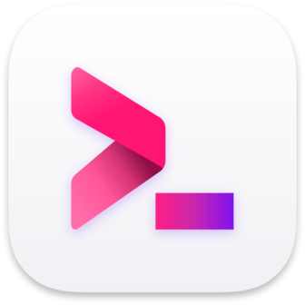
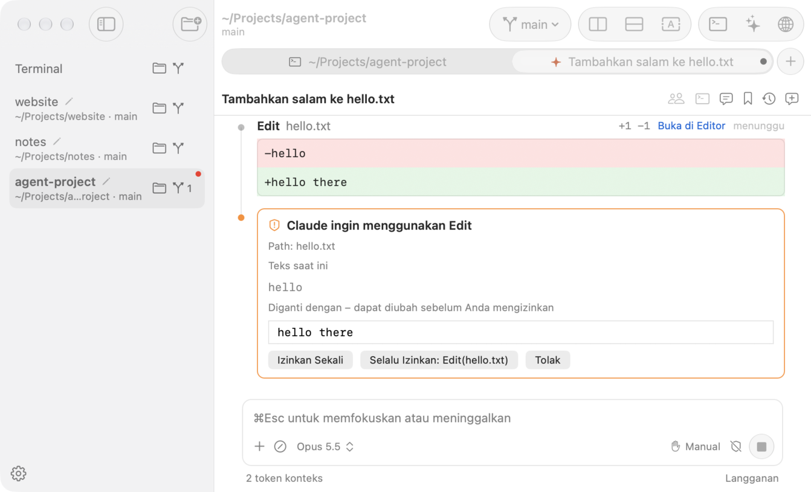

<p>&nbsp;&nbsp;&nbsp;</p>

# Tapa

**Terminal native yang cepat untuk macOS, yang kini juga punya tempat bagi agen, file, dan halaman Anda.**

Tapa pertama-tama adalah terminal: inti VT sendiri dan perender Metal, tab dan pisahan native macOS, terminal cepat yang meluncur masuk dengan satu pintasan, integrasi shell dengan blok perintah, dan bidang input opsional dengan saran bergaya Warp. Di sekelilingnya, Tapa tumbuh menjadi adik dari [Dango](https://github.com/sventmueller/dango): bilah samping berisi ruang kerja, satu per folder proyek, masing-masing dengan terminalnya, tab agen untuk Claude, Codex, OpenCode, Antigravity, dan agen ACP lainnya, tab browser, editor dengan daftar file dan panel Git, serta pratinjau Markdown dari [Splat](https://github.com/sventmueller/splat) dengan rumus dan diagram. Tidak ada yang dikonfigurasi oleh folder proyek yang berjalan sebelum Anda memercayai ruang kerjanya. Tapa ditulis dalam Rust dengan kontrol AppKit asli, tersedia dalam 35 bahasa, tidak memerlukan akun, dan tidak punya telemetri.

[](https://github.com/sventmueller/tapa/releases/latest/download/Tapa.dmg)

**[Unduh Tapa.dmg](https://github.com/sventmueller/tapa/releases/latest/download/Tapa.dmg)**: ditandatangani dan dinotarisasi oleh Apple, untuk macOS 14 atau yang lebih baru di Apple Silicon dan Intel.

**Menemukan bug?** [Buka issue](https://github.com/sventmueller/tapa/issues/new/choose) dan sebutkan dengan shell, agen, atau program apa hal itu terjadi. Jika Tapa berguna bagi Anda, [bintang di GitHub](https://github.com/sventmueller/tapa) membantu orang lain menemukannya.

[](https://www.rust-lang.org) [](https://www.apple.com/macos/)  [](https://github.com/madsmtm/objc2) [](https://developer.apple.com/metal/) [](https://agentclientprotocol.com)    [](#lisensi)

**Bahasa Indonesia** · [Bahasa Melayu](../ms/README.md) · [Català](../ca/README.md) · [Čeština](../cs/README.md) · [Dansk](../da/README.md) · [Deutsch](../de/README.md) · [English](../../../README.md) · [Español](../es/README.md) · [Français](../fr/README.md) · [Hrvatski](../hr/README.md) · [Italiano](../it/README.md) · [Magyar](../hu/README.md) · [Nederlands](../nl/README.md) · [Norsk](../no/README.md) · [Polski](../pl/README.md) · [Português (Brasil)](../pt_BR/README.md) · [Português (Portugal)](../pt_PT/README.md) · [Română](../ro/README.md) · [Slovenčina](../sk/README.md) · [Slovenščina](../sl/README.md) · [Suomi](../fi/README.md) · [Svenska](../sv/README.md) · [Tiếng Việt](../vi/README.md) · [Türkçe](../tr/README.md) · [Ελληνικά](../el/README.md) · [Русский](../ru/README.md) · [Українська](../uk/README.md) · [עברית](../he/README.md)‎ · [العربية](../ar/README.md)‎ · [हिन्दी](../hi/README.md) · [ไทย](../th/README.md) · [한국어](../ko/README.md) · [日本語](../ja/README.md) · [简体中文](../zh-Hans/README.md) · [繁體中文](../zh-Hant/README.md)

## Daftar isi

- [Sekilas fitur](#sekilas-fitur)
- [Persyaratan](#persyaratan)
- [Instalasi](#instalasi)
- [Memulai](#memulai)
- [Ruang kerja](#ruang-kerja)
- [Terminal](#terminal)
  - [Tab dan pisahan](#tab-dan-pisahan)
  - [Integrasi shell dan blok perintah](#integrasi-shell-dan-blok-perintah)
  - [Bidang input dan saran](#bidang-input-dan-saran)
  - [Pencarian, pemilihan, dan penyalinan](#pencarian-pemilihan-dan-penyalinan)
  - [Terminal cepat](#terminal-cepat)
- [Agen](#agen)
- [Editor, file, dan Git](#editor-file-dan-git)
- [Pratinjau](#pratinjau)
- [Browser](#browser)
- [Dikte](#dikte)
- [Pengaturan](#pengaturan)
- [Tampilan dan aksesibilitas](#tampilan-dan-aksesibilitas)
- [Bahasa](#bahasa)
- [Pintasan keyboard](#pintasan-keyboard)
- [Kepercayaan](#kepercayaan)
- [Privasi dan keamanan](#privasi-dan-keamanan)
- [Keterbatasan yang diketahui](#keterbatasan-yang-diketahui)
- [Untuk pengembang](#untuk-pengembang)
  - [Komponen pihak ketiga](#komponen-pihak-ketiga)
- [Lisensi](#lisensi)

## Sekilas fitur

- **Terminal cepat buatan sendiri.** Tapa mengurai dengan inti VT-nya sendiri dan menggambar dengan Metal di satu thread per layar, mengikuti laju refresh layar, dan hanya bagian yang berubah. Tapa lolos 262 pemeriksaan esctest, sedangkan inti Alacritty lolos 121, dan setiap perubahan padanya diukur terhadap Ghostty dengan versi yang dipatok.
- **Native sampai ke akarnya.** Tab macOS sungguhan, pemulihan jendela, menu, menu Layanan, notifikasi, Entri Papan Ketik Aman, dikte, dan metode input. Tanpa Electron, dan WebKit hanya di tempat halaman atau pratinjau memerlukannya.
- **Ruang kerja.** Bilah samping memuat satu ruang kerja per folder proyek, masing-masing dengan tab, branch, dan panelnya sendiri. Ruang kerja "Terminal" di paling atas selalu dimulai dari awal; semua yang lain tetap ada sampai Anda menghapusnya.
- **Agen dalam tampilan chat native.** Claude, Codex, OpenCode, Antigravity, Gemini CLI, dan agen Agent Client Protocol lainnya berjalan di tab masing-masing, dengan jawaban, panggilan alat, diff, dan permintaan izin dalam satu linimasa. Tapa memasang dan memperbaruinya atas permintaan Anda.
- **Integrasi shell dan blok perintah** untuk zsh, bash, dan fish, juga lewat `ssh`: lompat dari prompt ke prompt, pilih, salin, simpan, dan lipat output sebuah perintah, lihat perintah yang gagal dan berapa lama masing-masing berjalan.
- **Bidang input seperti milik Warp, jika Anda mau.** Edit baris perintah sebagai teks, dengan saran dari riwayat Anda, dari spesifikasi untuk lebih dari 700 alat baris perintah, dan dari keadaan proyek, semuanya di Mac Anda.
- **File, Git, dan browser di samping shell.** Editor dengan pewarnaan sintaks, daftar file, panel Git dengan staging, commit, branch, dan worktree, pratinjau Markdown dengan rumus dan diagram, serta tab browser.
- **Hati-hati dengan folder Anda.** Ruang kerja yang belum Anda percayai tidak menjalankan apa pun yang dikonfigurasi foldernya: tanpa git hook, tanpa server MCP proyek, tanpa pengaturan proyek untuk agen, tanpa JavaScript di halaman file-nya.
- **Privat.** Tanpa akun, tanpa telemetri. Tapa hanya mengakses jaringan saat Anda memintanya, dan riwayat yang dipulihkan di disk dienkripsi dengan kunci di rantai kunci Anda.
- **Dalam bahasa Anda.** Antarmukanya tersedia dalam 35 bahasa: Arab, Katalan, Tionghoa (Sederhana), Tionghoa (Tradisional), Kroasia, Ceko, Denmark, Belanda, Inggris, Finlandia, Prancis, Jerman, Yunani, Ibrani, Hindi, Hungaria, Indonesia, Italia, Jepang, Korea, Melayu, Norwegia, Polandia, Portugis (Brasil), Portugis (Portugal), Rumania, Rusia, Slovakia, Slovenia, Spanyol, Swedia, Thai, Turki, Ukraina, dan Vietnam.

## Persyaratan

- macOS 14 Sonoma atau yang lebih baru, di Apple Silicon atau Intel. Tapa dikembangkan dan diuji di macOS 27.
- zsh, bash, atau fish untuk integrasi shell; shell lain berjalan tanpanya.
- Untuk tab agen, agen yang ingin Anda gunakan, entah sudah terpasang atau dipasang oleh Tapa saat Anda memintanya (lihat [Agen](#agen)).

## Instalasi

**Dari image disk.** Setiap rilis adalah image disk, `Tapa-<version>.dmg`, berisi satu app universal untuk Apple Silicon dan Intel, ditandatangani dengan Developer ID dan dinotarisasi oleh Apple. Buka, lalu seret Tapa ke folder Aplikasi.

**Dengan Homebrew.** Cask di tap tersendiri memasang image disk yang sama:

```sh
brew install --cask sventmueller/tap/tapa
```

**Pembaruan.** Tapa dari image disk atau Homebrew memperbarui dirinya sendiri melalui [Sparkle](https://sparkle-project.org). Pada peluncuran kedua, Tapa bertanya apakah boleh mencari pembaruan sendiri; sebelum Anda setuju, Tapa tidak mengirim permintaan apa pun. **Tapa › Periksa Pembaruan…** langsung memeriksa. Tapa hanya memasang pembaruan yang membawa tanda tangan pengembang. Build buatan sendiri tidak punya pemutakhir.

**Dari sumber.** Lihat [Untuk pengembang](#untuk-pengembang).

**Sebagai terminal default.** Tapa dapat membuka skrip shell (`.command`, `.tool`), folder yang dijatuhkan ke ikonnya, dan tautan `ssh://`. Pilih Tapa di Finder lewat **File › Dapatkan Info › Buka dengan**.

## Memulai

1. **Jendela** menampilkan bilah samping ruang kerja di kiri, tab dari ruang kerja yang dipilih di atas, dan bar alat di atasnya. ⌃⌘S menampilkan dan menyembunyikan bilah samping.
2. **Ruang kerja baru** dibuat dari tombol folder di bagian atas bilah samping, atau **Shell › Ruang Kerja Baru…** (⇧⌘N): pilih salah satu folder terbaru atau **Pilih Folder…**.
3. **Tab baru** dimulai di folder ruang kerja: ⌘T untuk terminal, tombol di kanan bar alat untuk tab terminal, agen, atau browser, atau **+** di ujung bar tab.
4. **Pengaturan** terbuka dengan ⌘, atau ikon roda gigi di bagian bawah bilah samping.
5. **Palet perintah** (⇧⌘P) menemukan setiap perintah berdasarkan namanya, dan **Cari Tab…** (⌘P) setiap tab di setiap ruang kerja.

Dari kiri, bar alat berisi menu tarik-turun branch dari repositori ruang kerja, tombol untuk memisah terminal ke kanan dan ke bawah serta untuk menampilkan bidang input, lalu tombol untuk tab terminal, agen, dan browser baru. Tombol pisahan dan bidang input berwarna abu-abu selama tidak ada tab terminal di depan.

## Ruang kerja

Ruang kerja adalah sebuah folder beserta tab-tabnya. Barisnya di bilah samping menampilkan nama, folder, dan branch Git, serta di sebelah kanan tombol untuk daftar file dan panel Git. Klik salah satunya untuk menampilkan panel itu di tempat daftar ruang kerja; **Ruang Kerja** di bagian atas membawa Anda kembali.

- **Ruang kerja "Terminal"** selalu berada di paling atas. Ruang kerja ini dimulai dari awal setiap kali app diluncurkan, di folder yang disebut pengaturan, dengan satu terminal kosong. Tidak ada isinya yang disimpan, dan namanya tidak dapat diganti atau dihapus.
- **Setiap ruang kerja lain tetap ada** sampai Anda menghapusnya, bahkan tanpa tab. Tapa menyimpan namanya, tabnya, isi terminalnya (sejauh yang diizinkan pengaturan pemulihan), sesi agennya, dan posisi jendela. Program yang masih berjalan berakhir saat Tapa ditutup.
- **Mengganti nama.** Klik pensil setelah nama, klik nama ruang kerja yang dipilih, atau pilih **Shell › Ganti Nama Ruang Kerja**. Nama langsung disimpan.
- **Status.** Titik hijau pada baris berarti agen di ruang kerja itu sedang bekerja, juga dengan subagen atau di latar belakang; titik merah berarti ada yang menunggu Anda. Terminal tidak menandai apa pun di sana.
- **Berpindah.** ⌃⌘[ dan ⌃⌘] berpindah antar-ruang kerja. Jendela tetap di tempatnya, dan tab dari ruang kerja yang dipilih menggantikan tab yang lain.
- **Worktree.** **Worktree Baru…** di menu tarik-turun branch pada bar alat membuat worktree Git di branch baru dan membukanya sebagai ruang kerja tersendiri.

Saat tab terakhir sebuah ruang kerja ditutup, ruang kerja itu tetap ada di daftar. Jika semua tab ditutup, hanya jendelanya yang hilang; ikon Dock atau ⌘N memunculkannya kembali beserta ruang kerjanya.

## Terminal

Tapa berjalan di atas intinya sendiri, `term-vt`. Inti ini memahami xterm dan VT520 dengan protokol keyboard Kitty, hyperlink OSC 8, akses papan klip OSC 52 dengan izin terpisah untuk membaca, output tersinkron, garis bawah berwarna dan bergelombang, truecolor, kueri warna, laporan mode terang dan gelap ke program, tempel berpembatas (bracketed paste), event fokus, dan pelaporan mouse. Teks menyesuaikan diri saat ukuran jendela berubah, termasuk riwayatnya. Ligatur, fitur font, simbol Nerd Font tanpa font yang ditambal, serta karakter gambar kotak, Powerline, dan Braille yang presisi hingga piksel sudah tersedia bawaan.

### Tab dan pisahan

- **Tab** adalah tab macOS sendiri: seret untuk mengubah urutan atau keluar ke jendela tersendiri, **Tampilkan Semua Tab** (⇧⌘\\), ⌘1 sampai ⌘8, ⌘9 untuk tab terakhir, dan ⇧⌘[ / ⇧⌘] untuk berpindah. Setiap tab menampilkan ikon jenisnya di depan judulnya.
- **Pisahan.** **Pisah ke Kanan** (⌘D atau ⌃⌘T) dan **Pisah ke Bawah** (⇧⌘D atau ⌃⌥⌘T), bertingkat sedalam yang Anda mau. Seret pembatas, geser dengan ⌃⌘ dan tombol panah, **Maksimalkan Panel** (⌃⇧⌘↩), **Samakan Panel** (⌃⌘=), dan berpindah antar-panel dengan ⌘[ dan ⌘].
- **Folder kerja.** Tab, jendela, dan pisahan baru dimulai di folder terminal yang ada di depan; pengaturan menentukan hal ini untuk masing-masing dari ketiganya.
- **Menutup.** Tapa bertanya sebelum menutup tab, jendela, atau app selama ada program yang berjalan di dalamnya.
- **Pemulihan.** Setelah mulai ulang, ruang kerja, tab, panel, folder, dan baris-baris terakhir setiap terminal kembali. Rahasia seperti token dan kata sandi disamarkan sebelum apa pun disimpan.

### Integrasi shell dan blok perintah

Tapa menyiapkan integrasi shell untuk zsh, bash, dan fish dengan sendirinya, tanpa menyentuh file konfigurasi Anda, dan membawanya serta saat Anda `ssh` ke host lain. Dengan integrasi ini, setiap perintah dan outputnya membentuk sebuah blok:

- **Prompt.** ⌘↑ dan ⌘↓ melompat ke prompt sebelumnya dan berikutnya. Klik di baris perintah memindahkan kursor ke sana.
- **Blok.** **Pilih Blok** (⇧⌘A), **Salin Output** (⌥⌘C), **Simpan Output…** (⌥⌘S), dan **Ciutkan/Bentangkan Blok** (⇧⌘↩). Di atas blok yang berada di bawah penunjuk, tombol-tombol menampilkan status, durasi, dan tindakan yang sama.
- **Perintah yang gagal** ditandai, dan perintah yang masih berjalan tetap terlihat di bagian atas selama outputnya bergulir.
- **Markah.** **Tambah/Hapus Markah** (⇧⌘M) menandai sebuah baris; ⇧⌘↑ dan ⇧⌘↓ melompat antar-markah.
- **Notifikasi** muncul saat sebuah program memintanya (OSC 9 dan OSC 777) dan terminal tidak berada di depan, dan bilah kemajuan (OSC 9;4) tampil di tab dan di ikon Dock.

### Bidang input dan saran

Bidang input mengubah baris perintah menjadi bidang teks di bagian bawah panel, seperti di Warp, dengan label folder dan branch Git di atasnya. **Tampilkan/Sembunyikan Bidang Input** (⌘I) atau tombol di bar alat mengaktifkan dan menonaktifkannya untuk satu terminal; **Pengaturan › Input** menyalakannya untuk terminal baru. Bidang ini memerlukan integrasi shell dan menyingkir untuk program layar penuh seperti vim, htop, atau claude.

- **Return** mengirim seluruh isi bidang ke shell, teks multibaris sebagai satu tempelan; shell menjalankan dan mengingatnya seperti biasa. Jika shell meminta lebih, bidang menyerahkan tombol kembali kepadanya sampai prompt berikutnya.
- **↑, ↓, dan ⌃R** mencari di riwayat Anda, lengkap dengan folder, branch, dan kode keluar tempat setiap perintah dijalankan.
- **Tab** melengkapi dengan spesifikasi untuk lebih dari 700 alat baris perintah, path, dan nilai langsung seperti branch git, kontainer docker, resource kubectl, host ssh, skrip `package.json`, serta target make, just, dan cargo.
- **Tombol Vim** di bidang ini adalah sakelar di pengaturan yang sama.
- **Perintah berikutnya sebelum Anda mengetik**: apa yang biasanya menyusul di proyek ini (setelah `git add` datang `git commit`), apa yang diminta keadaan proyek (file lock yang lebih baru daripada `node_modules`), dan perbaikan setelah "command not found", dari salah ketik atau dari indeks Homebrew lokal Anda.

Tanpa bidang input, saran tampil sebagai teks abu-abu di belakang kursor, dan → menerimanya. Shell dengan saran otomatisnya sendiri, seperti fish atau zsh-autosuggestions, tetap memakai miliknya. Saran tidak pernah menggunakan jaringan, dan hanya menjalankan program dari `PATH` Anda sendiri, tidak pernah dari folder proyek.

**Menempel.** Tempelan multibaris dapat ditampilkan sebelum dijalankan (**Tampilkan dulu tempelan multibaris**). File yang dijatuhkan ke terminal tiba sebagai path berkutip; ⌥←/→, ⌘←/→, dan ⌘⌫ memindahkan dan menghapus per kata dan per baris seperti di bidang teks Mac mana pun.

### Pencarian, pemilihan, dan penyalinan

- **Cari** (⌘F) mencari di riwayat dengan ekspresi reguler, huruf besar-kecil, dan kata utuh, serta menghitung kecocokannya; bilah gulir menandainya bersama prompt dan error.
- **Pemilihan cerdas.** Klik ganda memilih URL, path, hash, atau alamat IP secara utuh, dan seret dengan ⌥ memilih sebuah persegi panjang. Tautan ditemukan bahkan tanpa OSC 8; ⌘-klik membukanya, dan membuka path di Dango jika terpasang.
- **Pilih dengan Papan Ketik** (⇧⌘C) menggerakkan pilihan dengan tombol Vim.
- **Salin dengan Format** (⇧⌥⌘C) mempertahankan warna dan gaya; salin saat memilih adalah sebuah pengaturan. **Bersihkan** (⌘K) mengosongkan terminal.

### Terminal cepat

**Tampilkan/Sembunyikan Terminal Cepat** (⌃⌥⌘Space) meluncurkan terminal masuk dari salah satu tepi layar, di atas app lain dan di atas space layar penuh, tanpa berpindah app. Tepi layar, ukurannya, dan apakah terminal ini bersembunyi saat Anda mengeklik di tempat lain adalah pengaturan. Sesinya tetap berjalan selama tersembunyi.

## Agen

Tab agen menjalankan agen pemrograman di folder ruang kerja, dalam tampilan agen native dari Dango.

| Agen | Cara berjalannya | Yang diperlukan |
|---|---|---|
| Claude | perintah `claude`, diajak bicara lewat protokol stream-json-nya | `claude` terpasang dan sudah masuk; Tapa memasangnya dengan penginstal Claude sendiri saat Anda memintanya |
| Codex | `codex app-server`, atau `codex-acp` untuk Codex versi lama | `codex` sudah masuk; Tapa memasang adaptor berversi patok saat Anda memintanya |
| OpenCode | `opencode serve`, atau `opencode acp` untuk OpenCode versi lama | `opencode` milik Anda sendiri di `PATH`, atau unduhan berversi patok |
| Antigravity | `agy acp` | `agy` milik Anda sendiri di `PATH`, atau unduhan berversi patok |
| Gemini CLI | `gemini --acp`, ditawarkan begitu Anda menyalakannya di **Pengaturan › Agen** | `gemini` milik Anda sendiri, atau unduhan berversi patok |
| Agen ACP lainnya | dari registri ACP, dimuat hanya saat Anda memintanya | apa yang disebut entri registri; entri tanpa checksum hanya terpasang setelah Anda mengonfirmasi |

Tapa memakai proses masuk masing-masing agen dan tidak menyimpan kredensial agen. Agen yang ditemukan di `PATH` shell login Anda didahulukan; jika tidak ada, Tapa menjalankan versi yang dipasangnya di folder datanya sendiri, tidak pernah program dari ruang kerja.

- **Linimasa** menampilkan jawaban, panggilan alat beserta output dan diff-nya, pertanyaan, dan permintaan izin. **Izinkan Sekali**, **Selalu Izinkan**, dan **Tolak** menjawab sebuah permintaan, dan suntingan dapat diubah sebelum Anda mengizinkannya.
- **Status.** Tab dan baris ruang kerja menampilkan titik hijau selama agen bekerja dan titik merah selama ia menunggu Anda, dan notifikasi memberi tahu Anda saat ia menunggu sementara Anda melihat ke tempat lain.
- **Bidang pesan** di bagian bawah menerima prompt Anda, file yang dijatuhkan ke sana, dan dikte. ⌘Esc memindahkan fokus keyboard ke sana dan kembali. Model dan mode izin dapat dipilih di sana untuk sesi tersebut.
- **Pengaturan › Agen** menentukan untuk sesi baru mode izin (Claude, Codex), model (Claude, Codex, OpenCode), dan tingkat penalaran (Claude, Codex), serta agen mana yang ditawarkan tab baru. Di sana terlihat lokasi program setiap agen, dengan **Instal…**, **Perbarui ke …**, dan **Kembali ke …** untuk versi sebelumnya, serta **Muat Registri** untuk registri ACP. Aturan yang disimpan Claude dengan "Selalu Izinkan" dapat dilihat dan dihapus di sana.
- **Unduhan yang diperiksa.** Arsip diperiksa terhadap SHA-256-nya, paket npm terhadap integritas di file lock-nya, dan paket tanpa versi tetap ditolak. Agen yang belum ada juga menawarkan pemasangannya di tabnya sendiri.

## Editor, file, dan Git

- **Daftar file** sebuah ruang kerja menampilkan foldernya sebagai pohon, diperbarui seiring file berubah, dengan file yang diabaikan Git diredupkan jika Anda mau. Klik membuka file sebagai tab pratinjau, yang digantikan oleh klik berikutnya sampai Anda mengeditnya; klik ganda mempertahankannya.
- **Editor** membuka file di tab ruang kerja, dengan pewarnaan sintaks, beberapa kursor, pelipatan, indentasi dari `.editorconfig`, tombol Vim opsional, dan tanda untuk apa yang berubah sejak commit terakhir. Editor menyadari saat file berubah di disk atau berisi penanda konflik. File Markdown mendapat bar format dan **Buka di Splat**. **Simpan** (⌘S), **Simpan Sebagai…**, dan **Simpan Semua** bekerja seperti biasa, dan Tapa bertanya sebelum menutup teks yang belum disimpan.
- **Setelah crash**, teks yang belum disimpan kembali: Tapa menyimpan salinan terenkripsinya selama Anda mengetik.
- **Panel Git** menampilkan perubahan yang sudah dan belum di-stage, melakukan stage dan unstage pada file dan hunk tunggal, membuat commit (⌘↩), mengubah commit terakhir (amend), membuat commit lalu push, melakukan fetch, dan menangani branch, stash, cherry-pick, dan konflik, dengan riwayat commit di bawahnya. Klik pada file menampilkan diff-nya.
- **Menu tarik-turun branch** di bar alat berpindah dan membuat branch serta membuat worktree.

Editor tidak menjalankan formatter maupun server bahasa. Untuk IDE lengkap dengan server bahasa dan debugger, gunakan [Dango](https://github.com/sventmueller/dango).

## Pratinjau

- **Markdown** tampil di samping editornya melalui perender Splat: GitHub Flavored Markdown dengan rumus, diagram, dan gambar, bergulir paragraf demi paragraf bersama teksnya.
- **Gambar** terbuka di tab tersendiri, PDF melalui PDFKit, serta audio, film, font, dan dokumen perkantoran melalui Quick Look.
- **Dekode terisolasi.** Setiap gambar dari sumber yang tidak tepercaya (file proyek, Markdown, lampiran dan tempelan agen) didekode di layanan `Decoder.xpc` milik Splat, dalam App Sandbox tersendiri tanpa file atau jaringan, tidak pernah di dalam app.

## Browser

**Tab Browser Baru** (⇧⌘B) membuka tab WebKit di ruang kerja. Bidang alamat menerima alamat atau kata kunci untuk mesin pencari pilihan Anda (DuckDuckGo, Google, Bing, atau Startpage); ⌘L, ⌘R, ⌘[, dan ⌘] bekerja seperti di Safari. Halaman dari `localhost` berjalan seperti biasa, untuk server pengembangan proyek Anda. File HTML sebuah ruang kerja hanya boleh membaca foldernya sendiri, dan di ruang kerja yang belum Anda percayai, file tersebut tidak menjalankan JavaScript.

## Dikte

Diktekan ke bidang pesan agen atau ke editor dengan tombol mikrofon atau **Edit › Mulai Dikte** (⌃⌥D). Pengenalan suaranya berasal dari [Lowspeak](https://github.com/sventmueller/lowspeak), yang tidak perlu dipasang. **Pengaturan › Dikte** memilih transkripsi online dengan OpenAI atau Groq, atau model lokal Whisper dan Parakeet yang menyimpan rekaman di Mac Anda, serta bahasa, pascapemrosesan, mikrofon, dan kosakata Anda sendiri. Kunci untuk OpenAI dan Groq disimpan di rantai kunci Anda. Dikte hanya ada di build rilis.

## Pengaturan

**Tapa › Pengaturan…** (⌘,) memiliki panel Umum, Font, Warna, Kursor, Terminal, Input, Editor, Agen, Dikte, Profil, dan Pintasan. Semuanya menulis ke satu file TOML, `config.toml` di folder Tapa di bawah `~/Library/Application Support`, yang juga dapat Anda edit secara manual; Tapa memuat ulang file ini selagi berjalan, dan **Muat Ulang Pengaturan** (⇧⌘,) langsung melakukannya.

- **Empat ukuran font** di bawah Umum: Antarmuka (bilah samping, panel, daftar file, panel Git, dan judul tab), Editor (teks, nomor baris, dan pratinjau Markdown), Terminal, dan Agen. ⌘+, ⌘−, dan ⌘0 mengubah ukuran terminal yang ada di depan.
- **Tampilan:** Terang, Gelap, atau Sama seperti Sistem.
- **Warna.** Satu tema untuk mode terang dan satu untuk mode gelap, dalam format tema Ghostty, dengan kontras minimum yang menjaga teks tetap terbaca pada tema yang kurang baik. Tema Anda sendiri masuk ke folder tema.
- **Profil** menggabungkan font, warna, shell, lingkungan, dan folder.
- **Pintasan** semuanya dapat diubah, dan konflik ditampilkan.

## Tampilan dan aksesibilitas

- **Mode gelap** mengikuti sistem atau pilihan Anda; warna aksen, Kurangi Gerakan, dan Tingkatkan Kontras dihormati.
- **VoiceOver** membacakan baris dan prompt terminal serta mengumumkan output baru; bilah samping, tab, tombol bar alat, dan kartu di linimasa agen memiliki nama.
- **Keyboard.** Setiap perintah memiliki item menu dan pintasan, dan Akses Papan Ketik Penuh menjangkau setiap kontrol.
- **Ukuran.** Empat ukuran font di pengaturan menskalakan antarmuka, editor, terminal, dan agen secara terpisah.
- **Kanan ke kiri.** Antarmuka dicerminkan dalam bahasa Arab dan Ibrani, sementara kisi terminal tetap dari kiri ke kanan.

Detail dan kekurangan yang diketahui ada di [ACCESSIBILITY.md](../../../ACCESSIBILITY.md).

## Bahasa

Antarmukanya diterjemahkan ke 35 bahasa: Arab, Katalan, Tionghoa (Sederhana), Tionghoa (Tradisional), Kroasia, Ceko, Denmark, Belanda, Inggris, Finlandia, Prancis, Jerman, Yunani, Ibrani, Hindi, Hungaria, Indonesia, Italia, Jepang, Korea, Melayu, Norwegia, Polandia, Portugis (Brasil), Portugis (Portugal), Rumania, Rusia, Slovakia, Slovenia, Spanyol, Swedia, Thai, Turki, Ukraina, dan Vietnam.

Tapa mengikuti urutan bahasa di **Pengaturan Sistem › Umum › Bahasa & Wilayah**; di sana Anda juga dapat memilih bahasa khusus untuk Tapa di bawah **Aplikasi**. Jika bahasa Anda belum diterjemahkan, Tapa memakai bahasa Inggris.

## Pintasan keyboard

| Tindakan | Pintasan |
|---|---|
| Jendela, ruang kerja, tab baru | ⌘N, ⇧⌘N, ⌘T |
| Tab browser baru | ⇧⌘B |
| File baru, buka file | ⌥⌘N, ⌘O |
| Tutup panel atau tab, tutup tab, tutup jendela | ⌘W, ⌥⌘W, ⇧⌘W |
| Pisah ke kanan, pisah ke bawah | ⌘D atau ⌃⌘T, ⇧⌘D atau ⌃⌥⌘T |
| Maksimalkan panel, samakan panel, tutup panel | ⌃⇧⌘↩, ⌃⌘=, ⌃⇧⌘W |
| Geser pembatas | ⌃⌘←, ⌃⌘→, ⌃⌘↑, ⌃⌘↓ |
| Panel berikutnya, sebelumnya | ⌘], ⌘[ |
| Tab berikutnya, sebelumnya; tab 1 sampai 8, tab terakhir | ⇧⌘], ⇧⌘[; ⌘1 sampai ⌘8, ⌘9 |
| Ruang kerja berikutnya, sebelumnya | ⌃⌘], ⌃⌘[ |
| Cari tab, palet perintah | ⌘P, ⇧⌘P |
| Tampilkan atau sembunyikan bilah samping, bidang input | ⌃⌘S, ⌘I |
| Terminal cepat | ⌃⌥⌘Space |
| Cari, cari berikutnya, cari sebelumnya | ⌘F, ⌘G, ⇧⌘G |
| Prompt sebelumnya, berikutnya | ⌘↑, ⌘↓ |
| Pilih blok, salin output, simpan output, lipat blok | ⇧⌘A, ⌥⌘C, ⌥⌘S, ⇧⌘↩ |
| Tambah atau hapus markah; markah sebelumnya, berikutnya | ⇧⌘M; ⇧⌘↑, ⇧⌘↓ |
| Pilih dengan papan ketik | ⇧⌘C |
| Salin dengan format | ⇧⌥⌘C |
| Bersihkan | ⌘K |
| Atas, bawah, halaman atas, halaman bawah | ⌘Home, ⌘End, ⌘PageUp, ⌘PageDown |
| Perbesar, perkecil, ukuran asli (terminal) | ⌘+, ⌘−, ⌘0 |
| Bidang pesan tab agen | ⌘Esc |
| Mulai dikte | ⌃⌥D |
| Pengaturan, muat ulang pengaturan | ⌘,, ⇧⌘, |

Setiap pintasan dapat diubah di **Pengaturan › Pintasan** atau di bagian `[keys]` pada file pengaturan.

## Kepercayaan

Sebuah folder proyek dapat membuat program berjalan begitu sesuatu dimulai di dalamnya: git hook dan pengaturan repositori seperti `core.fsmonitor`, hook agen, server MCP proyek, dan pengaturan proyek untuk agen. Karena itu, ruang kerja baru tidak dipercaya.

- **Tidak dipercaya:** agen dimulai tanpa hook, server MCP, dan konfigurasi proyek (Claude dengan `--setting-sources=user --strict-mcp-config`, Codex dengan folder yang ditandai tidak tepercaya, OpenCode tanpa konfigurasi proyek). Git berjalan dalam keadaan dinetralkan: tanpa hook, filter, driver diff, fsmonitor, `sshCommand`, atau pager, dan hanya dengan credential helper global. File HTML terbuka tanpa JavaScript. Panel Git dan tab agen memberitahukan hal ini dan menawarkan untuk memercayai ruang kerja.
- **Dipercaya:** **Shell › Percayai Ruang Kerja** memuat semua itu sebagaimana dimaksud foldernya. **Cabut Kepercayaan** membatalkannya. Kepercayaan disimpan per ruang kerja.

Apa pun tingkat kepercayaannya, Tapa tidak pernah menjalankan program dari folder proyek dengan sendirinya: saran hanya menjalankan program dari `PATH` Anda di luar proyek, dan bilah samping membaca status Git dari file `.git`. Ruang kerja di folder rumah Anda, seperti "Terminal", bukanlah proyek: program di bawah `~` seperti `~/.local/bin/claude` dianggap milik Anda sendiri di sana.

## Privasi dan keamanan

- **Tanpa telemetri, tanpa akun.** Tapa tidak melaporkan apa pun tentang cara Anda menggunakannya dan bekerja sepenuhnya offline. Tapa hanya mengakses jaringan saat Anda memintanya: untuk memasang atau memperbarui agen, untuk memuat registri ACP, untuk memeriksa pembaruan setelah Anda setuju, dan untuk halaman yang Anda buka di tab browser. Agen-agen itu sendiri berkomunikasi dengan penyedianya seperti biasa.
- **Riwayat di disk** untuk memulihkan sesi dienkripsi dengan kunci di rantai kunci Anda, dapat dimatikan, dan rahasia seperti kunci API, token, dan kata sandi di dalamnya disamarkan sebelum ditulis. Salinan teks editor yang belum disimpan dienkripsi dengan kunci yang sama.
- **Entri Papan Ketik Aman** menyala sendiri saat ada permintaan kata sandi, dan dapat dinyalakan secara permanen di menu app.
- **Escape sequence** yang dapat membocorkan atau menyisipkan data, seperti laporan judul, pembacaan papan klip, dan trik tempel, diblokir atau dimintakan izin terlebih dahulu. Parser-nya diuji dengan fuzzing di CI.
- **Dekode terisolasi** untuk gambar dari sumber yang tidak tepercaya, lihat [Pratinjau](#pratinjau).
- **Penandatanganan kode** dengan Hardened Runtime. macOS mengatribusikan akses program di dalam terminal kepada Tapa, sehingga Tapa menyertakan deskripsi penggunaan untuk setiap layanan yang dilindungi.

Masalah keamanan dilaporkan secara privat, lihat [SECURITY.md](../../../SECURITY.md).

## Keterbatasan yang diketahui

- **Belum ada gambar inline** di terminal: grafis Kitty, Sixel, dan gambar iTerm2 direncanakan setelah 1.0.
- **Tanpa mode kontrol tmux**, dan sesi tidak bertahan setelah Tapa ditutup.
- **Teks kanan ke kiri** di kisi terminal tetap dari kiri ke kanan.
- **⌘+ dan ⌘−** hanya mengubah terminal yang ada di depan.
- **Editor** tidak punya server bahasa, formatter, atau debugger, memang sengaja; Dango memilikinya.
- **Dikte** hanya ada di build rilis, tidak di build debug.
- **VoiceOver** belum diperiksa secara menyeluruh oleh manusia.

## Untuk pengembang

Anda memerlukan macOS 14 atau yang lebih baru dengan Xcode Command Line Tools, Rust sesuai yang disebut `rust-toolchain.toml` (rustup dengan kedua target Mac untuk build universal), checkout [splat](https://github.com/sventmueller/splat) dan [lowspeak](https://github.com/sventmueller/lowspeak) di sebelah repositori ini (`../splat`, `../lowspeak`), dan cmake untuk build dengan dikte.

| Perintah | Fungsinya |
|---|---|
| `make help` | menampilkan daftar target |
| `cargo xtask run` | membangun app debug dan membukanya |
| `make build` | membangun app rilis dengan dikte ke `target/release`, ditandatangani ad hoc untuk Mac ini |
| `make lint` | pemformatan, clippy dengan peringatan sebagai error, bentuk file, dan teks antarmuka |
| `make check` | `lint`, lalu semua tes; tidak memerlukan jendela maupun jaringan |
| `make selftest STEPS="split_right,type:ls\n,shot:x"` | mengendalikan app dan meninggalkan gambar jendela di `target/selftest/` |
| `make esctest`, `make vttest` | menjalankan esctest dan vttest terhadap kedua inti di dalam app |
| `make perf` | benchmark terhadap Ghostty berversi patok; hanya bermakna di Mac yang sedang menganggur |
| `make fuzz` | target fuzzing dengan cargo-fuzz |
| `make release` | uji coba rilis: app universal dengan dikte, image disk-nya, feed pembaruan, dan cask di `target/release-dry-run`; tidak mengirim apa pun ke mana pun |
| `make release-notarized` | versi saat ini yang ditandatangani dengan Developer ID, dinotarisasi oleh Apple, dan di-staple, ke `dist/`; `Cargo.toml` tidak berubah |
| `make deploy` | menotarisasi versi berikutnya, meng-commit `Cargo.toml`, mengunggah draf rilis, mem-push `main` dan tag-nya, lalu menerbitkan rilis; lihat [docs/development.md](../../../docs/development.md#deploy) |

Cara berkontribusi ada di [CONTRIBUTING.md](../../../CONTRIBUTING.md). Setiap teks antarmuka memakai bahasa Jerman sebagai kunci, dengan terjemahan ke semua 35 bahasa; `cargo xtask strings` gagal jika ada yang kurang.

### Komponen pihak ketiga

| Komponen | Digunakan untuk | Lisensi |
|---|---|---|
| [objc2](https://github.com/madsmtm/objc2) dan crate framework-nya | AppKit, Metal, WebKit, dan framework Apple lainnya | MIT, Zlib, atau Apache-2.0 |
| Crate milik Splat | Markdown, pratinjau, pembacaan Git, dekoder gambar, dan terjemahan | MIT atau Apache-2.0 |
| [Lowspeak](https://github.com/sventmueller/lowspeak) dengan [whisper.cpp](https://github.com/ggml-org/whisper.cpp) | dikte | MIT |
| [Spesifikasi pelengkapan otomatis Fig](https://github.com/withfig/autocomplete) | deskripsi perintah pada saran | MIT |
| [rusqlite](https://github.com/rusqlite/rusqlite) dengan SQLite | riwayat perintah | MIT, domain publik |
| [Simple Icons](https://simpleicons.org) | logo bahasa dan program | CC0, beberapa logo dengan ketentuannya sendiri |
| [Sparkle](https://sparkle-project.org) 2.10.1 | pembaruan build rilis | MIT |

## Lisensi

Tapa dilisensikan di bawah salah satu dari

- Lisensi Apache, Versi 2.0 ([LICENSE-APACHE](../../../LICENSE-APACHE))
- Lisensi MIT ([LICENSE-MIT](../../../LICENSE-MIT))

sesuai pilihan Anda. Logo di `assets/simple-icons` memiliki lisensinya sendiri, lihat README di sana.

Kecuali Anda menyatakan lain secara eksplisit, setiap kontribusi yang dengan sengaja diajukan untuk dimasukkan ke dalam Tapa oleh Anda, sebagaimana didefinisikan dalam lisensi Apache-2.0, dilisensikan ganda seperti di atas, tanpa syarat atau ketentuan tambahan apa pun.
