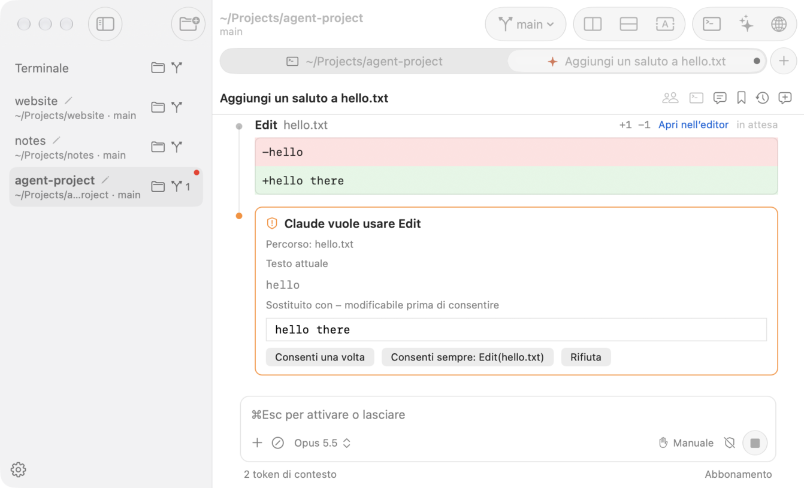

<p>&nbsp;&nbsp;&nbsp;</p>

# Tapa

**Il terminale veloce e nativo per macOS che ha fatto spazio ai tuoi agenti, ai tuoi file e alle tue pagine.**

Tapa è prima di tutto un terminale: un proprio core VT e un renderer Metal, pannelli e divisioni nativi di macOS, un terminale rapido che compare con una sola scorciatoia, l’integrazione con la shell con blocchi di comandi e, se vuoi, un campo di input con suggerimenti nello stile di Warp. Attorno a questo, Tapa è diventato la sorella minore di [Dango](https://github.com/sventmueller/dango): una barra laterale di spazi di lavoro, uno per cartella di progetto, ognuno con i suoi terminali, pannelli agente per Claude, Codex, OpenCode, Antigravity e altri agenti ACP, pannelli del browser, un editor con un elenco di file e un pannello Git, e un’anteprima Markdown di [Splat](https://github.com/sventmueller/splat) con formule e diagrammi. Nulla di ciò che una cartella di progetto configura viene eseguito finché non consideri attendibile il suo spazio di lavoro. Tapa è scritto in Rust su veri controlli AppKit, parla 35 lingue, non richiede alcun account e non ha telemetria.

[](https://github.com/sventmueller/tapa/releases/latest/download/Tapa.dmg)

**[Scarica Tapa.dmg](https://github.com/sventmueller/tapa/releases/latest/download/Tapa.dmg)**: firmato e notarizzato da Apple, per macOS 14 o successivo su Apple Silicon e Intel.

**Hai trovato un bug?** [Apri una issue](https://github.com/sventmueller/tapa/issues/new/choose) e indica con quale shell, quale agente o quale programma si è verificato. Se Tapa ti è utile, una [stella su GitHub](https://github.com/sventmueller/tapa) aiuta altri a trovarlo.

[](https://www.rust-lang.org) [](https://www.apple.com/macos/)  [](https://github.com/madsmtm/objc2) [](https://developer.apple.com/metal/) [](https://agentclientprotocol.com)    [](#licenza)

[Bahasa Indonesia](../id/README.md) · [Bahasa Melayu](../ms/README.md) · [Català](../ca/README.md) · [Čeština](../cs/README.md) · [Dansk](../da/README.md) · [Deutsch](../de/README.md) · [English](../../../README.md) · [Español](../es/README.md) · [Français](../fr/README.md) · [Hrvatski](../hr/README.md) · **Italiano** · [Magyar](../hu/README.md) · [Nederlands](../nl/README.md) · [Norsk](../no/README.md) · [Polski](../pl/README.md) · [Português (Brasil)](../pt_BR/README.md) · [Português (Portugal)](../pt_PT/README.md) · [Română](../ro/README.md) · [Slovenčina](../sk/README.md) · [Slovenščina](../sl/README.md) · [Suomi](../fi/README.md) · [Svenska](../sv/README.md) · [Tiếng Việt](../vi/README.md) · [Türkçe](../tr/README.md) · [Ελληνικά](../el/README.md) · [Русский](../ru/README.md) · [Українська](../uk/README.md) · [עברית](../he/README.md)‎ · [العربية](../ar/README.md)‎ · [हिन्दी](../hi/README.md) · [ไทย](../th/README.md) · [한국어](../ko/README.md) · [日本語](../ja/README.md) · [简体中文](../zh-Hans/README.md) · [繁體中文](../zh-Hant/README.md)

## Indice

- [Funzioni in breve](#funzioni-in-breve)
- [Requisiti](#requisiti)
- [Installazione](#installazione)
- [Per iniziare](#per-iniziare)
- [Spazi di lavoro](#spazi-di-lavoro)
- [Il terminale](#il-terminale)
  - [Pannelli e divisioni](#pannelli-e-divisioni)
  - [Integrazione con la shell e blocchi di comandi](#integrazione-con-la-shell-e-blocchi-di-comandi)
  - [Il campo di input e i suggerimenti](#il-campo-di-input-e-i-suggerimenti)
  - [Ricerca, selezione e copia](#ricerca-selezione-e-copia)
  - [Il terminale rapido](#il-terminale-rapido)
- [Agenti](#agenti)
- [Editor, file e Git](#editor-file-e-git)
- [Anteprime](#anteprime)
- [Browser](#browser)
- [Dettatura](#dettatura)
- [Impostazioni](#impostazioni)
- [Aspetto e accessibilità](#aspetto-e-accessibilità)
- [Lingue](#lingue)
- [Scorciatoie da tastiera](#scorciatoie-da-tastiera)
- [Fiducia](#fiducia)
- [Privacy e sicurezza](#privacy-e-sicurezza)
- [Limiti noti](#limiti-noti)
- [Per sviluppatori](#per-sviluppatori)
  - [Componenti di terze parti](#componenti-di-terze-parti)
- [Licenza](#licenza)

## Funzioni in breve

- **Un terminale veloce tutto suo.** Tapa analizza con il proprio core VT e disegna con Metal su un thread per schermo, alla frequenza dello schermo e solo ciò che è cambiato. Supera 262 test di esctest, dove il core di Alacritty ne supera 121, e ogni modifica viene misurata rispetto a una versione fissata di Ghostty.
- **Nativo fino in fondo.** Veri pannelli di macOS, ripristino delle finestre, menu, il menu Servizi, notifiche, input da tastiera sicuro, dettatura e metodi di input. Niente Electron, e WebKit solo dove serve a una pagina o a un’anteprima.
- **Spazi di lavoro.** La barra laterale contiene uno spazio di lavoro per cartella di progetto, ognuno con i propri pannelli, il proprio branch e le proprie viste. Lo spazio di lavoro «Terminale», in cima, riparte da zero ogni volta; tutti gli altri restano finché non li rimuovi.
- **Agenti in una vista chat nativa.** Claude, Codex, OpenCode, Antigravity, Gemini CLI e altri agenti dell’Agent Client Protocol vengono eseguiti in pannelli propri, con risposte, chiamate agli strumenti, diff e richieste di autorizzazione in un’unica cronologia. Tapa li installa e li aggiorna su richiesta.
- **Integrazione con la shell e blocchi di comandi** per zsh, bash e fish, anche via `ssh`: salta da un prompt all’altro, seleziona, copia, salva e comprimi l’output di un comando, vedi i comandi non riusciti e quanto è durato ciascuno.
- **Un campo di input come quello di Warp, se lo vuoi.** Modifica la riga di comando come testo, con suggerimenti dalla tua cronologia, dalle specifiche di oltre 700 strumenti da riga di comando e dallo stato del progetto, tutto sul tuo Mac.
- **File, Git e un browser accanto alla shell.** Un editor con colorazione della sintassi, un elenco di file, un pannello Git con staging, commit, branch e worktree, un’anteprima Markdown con formule e diagrammi, e pannelli del browser.
- **Attento alle tue cartelle.** Uno spazio di lavoro che non hai considerato attendibile non avvia nulla di ciò che la sua cartella configura: niente hook di Git, niente server MCP del progetto, niente impostazioni di progetto per gli agenti, niente JavaScript nelle sue pagine di file.
- **Privato.** Nessun account, nessuna telemetria. Tapa accede alla rete solo quando glielo chiedi, e la cronologia ripristinata sul disco è cifrata con una chiave nel tuo portachiavi.
- **Nella tua lingua.** L’interfaccia è disponibile in 35 lingue: arabo, catalano, cinese (semplificato), cinese (tradizionale), croato, ceco, danese, olandese, inglese, finlandese, francese, tedesco, greco, ebraico, hindi, ungherese, indonesiano, italiano, giapponese, coreano, malese, norvegese, polacco, portoghese (Brasile), portoghese (Portogallo), rumeno, russo, slovacco, sloveno, spagnolo, svedese, tailandese, turco, ucraino e vietnamita.

## Requisiti

- macOS 14 Sonoma o successivo, su Apple Silicon o Intel. Tapa è sviluppato e testato su macOS 27.
- zsh, bash o fish per l’integrazione con la shell; le altre shell funzionano senza.
- Per i pannelli agente, l’agente che vuoi usare, già installato oppure installato da Tapa su tua richiesta (vedi [Agenti](#agenti)).

## Installazione

**Dall’immagine disco.** Ogni release è un’immagine disco, `Tapa-<version>.dmg`, con un’unica app universale per Apple Silicon e Intel, firmata con un Developer ID e notarizzata da Apple. Aprila e trascina Tapa nella cartella Applicazioni.

**Con Homebrew.** Il cask, in un tap a parte, installa la stessa immagine disco:

```sh
brew install --cask sventmueller/tap/tapa
```

**Aggiornamenti.** Tapa, installato dall’immagine disco o con Homebrew, si mantiene aggiornato da solo con [Sparkle](https://sparkle-project.org). Al secondo avvio chiede se può cercare aggiornamenti per conto suo; finché non acconsenti, non fa alcuna richiesta. **Tapa › Controlla aggiornamenti…** li cerca subito. Tapa installa un aggiornamento solo se porta la firma dello sviluppatore. Una build compilata da te non ha l’aggiornamento automatico.

**Dal codice sorgente.** Vedi [Per sviluppatori](#per-sviluppatori).

**Come terminale predefinito.** Tapa può aprire script di shell (`.command`, `.tool`), cartelle trascinate sulla sua icona e link `ssh://`. Sceglilo nel Finder con **File › Ottieni informazioni › Apri con**.

## Per iniziare

1. **La finestra** ha a sinistra la barra laterale degli spazi di lavoro, in alto i pannelli dello spazio di lavoro selezionato e, sopra di essi, la barra degli strumenti. ⌃⌘S mostra e nasconde la barra laterale.
2. **Un nuovo spazio di lavoro** si crea con il pulsante della cartella in cima alla barra laterale o con **Shell › Nuovo spazio di lavoro…** (⇧⌘N): scegli una delle cartelle recenti oppure **Scegli cartella…**.
3. **I nuovi pannelli** si aprono nella cartella dello spazio di lavoro: ⌘T per un terminale, i pulsanti sulla destra della barra degli strumenti per un terminale, un agente o un pannello del browser, oppure il **+** alla fine della barra dei pannelli.
4. **Le impostazioni** si aprono con ⌘, o con l’ingranaggio in fondo alla barra laterale.
5. **La tavolozza dei comandi** (⇧⌘P) trova ogni comando per nome, e **Trova pannello…** (⌘P) ogni pannello di ogni spazio di lavoro.

La barra degli strumenti contiene, da sinistra, il menu a comparsa dei branch del repository dello spazio di lavoro, i pulsanti per dividere il terminale a destra e in basso e per mostrare il campo di input, e i pulsanti per nuovi pannelli di terminale, agente e browser. I pulsanti delle divisioni e del campo di input restano grigi finché in primo piano non c’è un pannello del terminale.

## Spazi di lavoro

Uno spazio di lavoro è una cartella con i suoi pannelli. La sua riga nella barra laterale mostra il nome, la cartella e il branch Git e, a destra, i pulsanti per l’elenco dei file e il pannello Git. Un clic su uno di essi mostra quella vista al posto dell’elenco degli spazi di lavoro; **Spazi di lavoro** in alto riporta indietro.

- **Lo spazio di lavoro «Terminale»** è sempre in cima. Riparte da zero a ogni avvio, nella cartella indicata dalle impostazioni, con un terminale vuoto. Di esso non viene salvato nulla, e non può essere rinominato né rimosso.
- **Tutti gli altri spazi di lavoro restano** finché non li rimuovi, anche senza pannelli. Tapa ne conserva il nome, i pannelli, il contenuto dei terminali (nella misura prevista dalle impostazioni di ripristino), le sessioni degli agenti e la posizione della finestra. I programmi ancora in esecuzione terminano quando esci da Tapa.
- **Rinominare.** Fai clic sulla matita dopo il nome, fai clic sul nome dello spazio di lavoro selezionato oppure scegli **Shell › Rinomina spazio di lavoro**. Il nome viene salvato subito.
- **Stato.** Un punto verde sulla riga indica che un agente dello spazio di lavoro sta lavorando, anche con subagenti o in background; un punto rosso indica che uno di essi ti sta aspettando. I terminali non vi segnalano nulla.
- **Passare da uno all’altro.** ⌃⌘[ e ⌃⌘] passano da uno spazio di lavoro all’altro. La finestra resta al suo posto, e i pannelli dello spazio di lavoro selezionato prendono il posto degli altri.
- **Worktree.** **Nuovo worktree…** nel menu a comparsa dei branch della barra degli strumenti crea un worktree Git su un nuovo branch e lo apre come spazio di lavoro a sé.

Quando si chiude l’ultimo pannello di uno spazio di lavoro, lo spazio di lavoro resta nell’elenco. Con tutti i pannelli chiusi, sparisce solo la finestra; l’icona nel Dock o ⌘N la riportano con i suoi spazi di lavoro.

## Il terminale

Tapa funziona con il proprio core, `term-vt`. Parla xterm e VT520 con il protocollo di tastiera di Kitty, i link ipertestuali OSC 8, l’accesso agli appunti OSC 52 con un’autorizzazione separata per la lettura, l’output sincronizzato, le sottolineature colorate e ondulate, il truecolor, le richieste di colore, la segnalazione della modalità chiara e scura ai programmi, l’incolla tra parentesi (bracketed paste), gli eventi di focus e la segnalazione del mouse. Il testo si riadatta quando la finestra cambia dimensione, cronologia compresa. Legature, funzioni tipografiche dei font, simboli Nerd Font senza font modificati e un disegno preciso al pixel dei caratteri per riquadri, dei glifi Powerline e del Braille sono integrati.

### Pannelli e divisioni

- **I pannelli** sono quelli di macOS: trascinali per riordinarli o per portarli in una finestra a sé, **Mostra tutti i pannelli** (⇧⌘\\), da ⌘1 a ⌘8, ⌘9 per l’ultimo pannello, e ⇧⌘[ / ⇧⌘] per passare dall’uno all’altro. Ogni pannello mostra l’icona del suo tipo davanti al titolo.
- **Divisioni.** **Dividi a destra** (⌘D o ⌃⌘T) e **Dividi in basso** (⇧⌘D o ⌃⌥⌘T), annidate a piacere. Trascina un divisore, spostalo con ⌃⌘ e i tasti freccia, **Ingrandisci riquadro** (⌃⇧⌘↩), **Uniforma riquadri** (⌃⌘=), e passa da un riquadro all’altro con ⌘[ e ⌘].
- **Cartella di lavoro.** Nuovi pannelli, finestre e divisioni si aprono nella cartella del terminale in primo piano; le impostazioni lo decidono per ciascuno dei tre.
- **Chiusura.** Tapa chiede conferma prima di chiudere un pannello, una finestra o l’app mentre vi è in esecuzione un programma.
- **Ripristino.** Dopo un riavvio tornano gli spazi di lavoro, i pannelli, i riquadri, le cartelle e le ultime righe di ogni terminale. I segreti come token e password vengono mascherati prima che venga salvato qualcosa.

### Integrazione con la shell e blocchi di comandi

Tapa configura da sé la propria integrazione con la shell per zsh, bash e fish, senza toccare i tuoi file di configurazione, e la porta con sé quando ti colleghi a un altro host con `ssh`. Grazie a essa, ogni comando e il suo output formano un blocco:

- **Prompt.** ⌘↑ e ⌘↓ saltano al prompt precedente e a quello successivo. Un clic nella riga di comando vi sposta il cursore.
- **Blocchi.** **Seleziona blocco** (⇧⌘A), **Copia output** (⌥⌘C), **Salva output…** (⌥⌘S) e **Comprimi/espandi blocco** (⇧⌘↩). Sopra il blocco sotto il puntatore, alcuni pulsanti ne mostrano lo stato, la durata e le stesse azioni.
- **I comandi non riusciti** vengono segnalati, e il comando ancora in esecuzione resta visibile in alto mentre il suo output scorre.
- **Segnalibri.** **Aggiungi/rimuovi segnalibro** (⇧⌘M) contrassegna una riga; ⇧⌘↑ e ⇧⌘↓ saltano da un segnalibro all’altro.
- **Le notifiche** compaiono quando un programma ne chiede una (OSC 9 e OSC 777) e il terminale non è in primo piano, e una barra di avanzamento (OSC 9;4) appare nel pannello e sull’icona nel Dock.

### Il campo di input e i suggerimenti

Il campo di input trasforma la riga di comando in un campo di testo in fondo al riquadro, come in Warp, con sopra delle etichette per la cartella e il branch Git. **Mostra/nascondi campo di input** (⌘I) o il pulsante nella barra degli strumenti lo attiva per un terminale; **Impostazioni › Input** lo attiva per i nuovi terminali. Richiede l’integrazione con la shell e si fa da parte davanti ai programmi a schermo intero come vim, htop o claude.

- **A capo** invia l’intero campo alla shell, il testo su più righe come un unico incolla; la shell lo esegue e lo memorizza come al solito. Se la shell chiede altro, il campo le restituisce i tasti fino al prompt successivo.
- **↑, ↓ e ⌃R** cercano nella tua cronologia, con la cartella, il branch e il codice di uscita con cui è stato eseguito ogni comando.
- **Tab** completa con le specifiche di oltre 700 strumenti da riga di comando, percorsi e valori in tempo reale come i branch Git, i container Docker, le risorse kubectl, gli host ssh, gli script di `package.json` e i target di make, just e cargo.
- **I tasti Vim** nel campo si attivano con un interruttore nelle stesse impostazioni.
- **Il comando successivo prima che tu lo digiti**: ciò che di solito segue in questo progetto (dopo `git add` viene `git commit`), ciò che lo stato del progetto richiede (un file di lock più recente di `node_modules`) e una correzione dopo «command not found», a partire dagli errori di battitura o dal tuo indice locale di Homebrew.

Senza il campo di input, i suggerimenti appaiono come testo grigio dietro il cursore, e → li accetta. Le shell con propri suggerimenti automatici, come fish o zsh-autosuggestions, mantengono i loro. I suggerimenti non usano mai la rete e avviano programmi solo dal tuo `PATH`, mai dalla cartella del progetto.

**Incollare.** Gli incolla su più righe possono essere mostrati prima di essere eseguiti (**Mostra prima gli incolla su più righe**). I file trascinati su un terminale arrivano come percorsi tra virgolette; ⌥←/→, ⌘←/→ e ⌘⌫ spostano e cancellano per parola e per riga come in qualsiasi campo di testo del Mac.

### Ricerca, selezione e copia

- **Trova** (⌘F) cerca nella cronologia con espressioni regolari, maiuscole/minuscole e parole intere, e conta le corrispondenze; la barra di scorrimento le segnala insieme ai prompt e agli errori.
- **Selezione intelligente.** Un doppio clic seleziona per intero un URL, un percorso, un hash o un indirizzo IP, e il trascinamento con ⌥ seleziona un rettangolo. I link vengono riconosciuti anche senza OSC 8; ⌘-clic li apre, e apre un percorso in Dango se è installato.
- **Seleziona con la tastiera** (⇧⌘C) sposta una selezione con i tasti di Vim.
- **Copia con formattazione** (⇧⌥⌘C) mantiene colori e stili; la copia alla selezione è un’impostazione. **Cancella** (⌘K) pulisce il terminale.

### Il terminale rapido

**Mostra/nascondi terminale rapido** (⌃⌥⌘Space) fa scorrere un terminale da un bordo dello schermo, sopra le altre app e sugli spazi a schermo intero, senza cambiare app. Il bordo, la dimensione e se si nasconde quando fai clic altrove sono impostazioni. Le sue sessioni continuano a essere eseguite mentre è nascosto.

## Agenti

Un pannello agente esegue un agente di programmazione nella cartella dello spazio di lavoro, nella vista agente nativa di Dango.

| Agente | Come viene eseguito | Cosa richiede |
|---|---|---|
| Claude | il comando `claude`, pilotato tramite il suo protocollo stream-json | `claude` installato e con accesso effettuato; Tapa lo installa con il programma di installazione di Claude su tua richiesta |
| Codex | `codex app-server`, oppure `codex-acp` per un Codex meno recente | `codex` con accesso effettuato; Tapa installa l’adattatore a versione fissata su tua richiesta |
| OpenCode | `opencode serve`, oppure `opencode acp` per un OpenCode meno recente | il tuo `opencode` nel `PATH`, oppure il download a versione fissata |
| Antigravity | `agy acp` | il tuo `agy` nel `PATH`, oppure il download a versione fissata |
| Gemini CLI | `gemini --acp`, proposto non appena lo attivi in **Impostazioni › Agenti** | il tuo `gemini`, oppure il download a versione fissata |
| Altri agenti ACP | dal registro ACP, caricato solo su tua richiesta | ciò che indica la voce del registro; le voci senza checksum si installano solo dopo la tua conferma |

Tapa usa l’accesso proprio di ogni agente e non memorizza credenziali degli agenti. Un agente trovato nel `PATH` della tua shell di login ha la precedenza; altrimenti Tapa esegue la versione che ha installato nella propria cartella dei dati, mai un programma dello spazio di lavoro.

- **La cronologia** mostra risposte, chiamate agli strumenti con il loro output e i loro diff, domande e richieste di autorizzazione. **Consenti una volta**, **Consenti sempre** e **Rifiuta** rispondono a una richiesta, e una modifica può essere cambiata prima che tu la consenta.
- **Stato.** Il pannello e la riga dello spazio di lavoro mostrano un punto verde mentre l’agente lavora e uno rosso mentre ti aspetta, e una notifica ti avvisa quando aspetta mentre guardi altrove.
- **Il campo del messaggio** in basso accoglie il tuo prompt, i file trascinati su di esso e la dettatura. ⌘Esc vi sposta lo stato attivo della tastiera e lo riporta indietro. Lì si possono scegliere il modello e la modalità di autorizzazione per la sessione.
- **Impostazioni › Agenti** imposta per le nuove sessioni la modalità di autorizzazione (Claude, Codex), il modello (Claude, Codex, OpenCode) e l’impegno di ragionamento (Claude, Codex), oltre a quali agenti offrono i nuovi pannelli. Mostra dove si trova il programma di ciascun agente, con **Installa…**, **Aggiorna a …** e **Torna a …** per la versione precedente, e **Carica registro** per il registro ACP. Lì si possono vedere e rimuovere le regole che Claude ha salvato con «Consenti sempre».
- **Download verificati.** Gli archivi vengono verificati rispetto al loro SHA-256, i pacchetti npm rispetto all’integrità indicata nel loro file di lock, e i pacchetti senza una versione fissa vengono rifiutati. Un agente mancante propone l’installazione anche nel proprio pannello.

## Editor, file e Git

- **L’elenco dei file** di uno spazio di lavoro mostra la sua cartella come un albero, aggiornato man mano che i file cambiano, con i file ignorati da Git attenuati se lo desideri. Un clic apre un file in un pannello di anteprima, che il clic successivo sostituisce finché non lo modifichi; un doppio clic lo mantiene.
- **L’editor** apre i file in pannelli dello spazio di lavoro, con colorazione della sintassi, più cursori, la compressione del codice, l’indentazione di `.editorconfig`, tasti Vim opzionali e segni per ciò che è cambiato dall’ultimo commit. Si accorge quando un file è cambiato sul disco o contiene marcatori di conflitto. I file Markdown ricevono una barra di formattazione e **Apri in Splat**. **Salva** (⌘S), **Salva col nome…** e **Salva tutto** funzionano come di consueto, e Tapa chiede conferma prima di chiudere testo non salvato.
- **Dopo un arresto anomalo**, il testo non salvato ritorna: Tapa ne conserva copie cifrate mentre scrivi.
- **Il pannello Git** mostra le modifiche in staging e fuori staging, aggiunge e toglie dallo staging file e singoli hunk, crea commit (⌘↩), li modifica (amend), esegue commit e push, fetch, e gestisce branch, stash, cherry-pick e conflitti, con la cronologia dei commit sotto. Un clic su un file ne mostra il diff.
- **Il menu a comparsa dei branch** nella barra degli strumenti cambia e crea branch e crea worktree.

L’editor non avvia alcun formattatore né alcun language server. Per un IDE completo con language server e debugger, usa [Dango](https://github.com/sventmueller/dango).

## Anteprime

- **Il Markdown** appare accanto al suo editor tramite il renderer di Splat: GitHub Flavored Markdown con formule, diagrammi e immagini, che scorre paragrafo per paragrafo insieme al testo.
- **Le immagini** si aprono in un pannello a sé, i PDF tramite PDFKit, e audio, filmati, font e documenti d’ufficio tramite Quick Look.
- **Decodifica isolata.** Ogni immagine proveniente da una fonte non attendibile (file del progetto, Markdown, allegati e incolla degli agenti) viene decodificata nel servizio `Decoder.xpc` di Splat, in un proprio App Sandbox senza file né rete, mai nell’app.

## Browser

**Nuovo pannello browser** (⇧⌘B) apre un pannello WebKit nello spazio di lavoro. Il campo dell’indirizzo accetta un indirizzo o parole per il motore di ricerca che preferisci (DuckDuckGo, Google, Bing o Startpage); ⌘L, ⌘R, ⌘[ e ⌘] funzionano come in Safari. Le pagine di `localhost` funzionano normalmente, per il server di sviluppo del tuo progetto. I file HTML di uno spazio di lavoro possono leggere solo la propria cartella e, in uno spazio di lavoro che non hai considerato attendibile, non eseguono JavaScript.

## Dettatura

Detta nel campo del messaggio di un agente o nell’editor con il pulsante del microfono o con **Composizione › Avvia dettatura** (⌃⌥D). Il riconoscimento vocale è quello di [Lowspeak](https://github.com/sventmueller/lowspeak), che non occorre installare. **Impostazioni › Dettatura** sceglie la trascrizione online con OpenAI o Groq, oppure modelli locali Whisper e Parakeet che mantengono la registrazione sul tuo Mac, la lingua, la post-elaborazione, il microfono e il tuo vocabolario personale. Le chiavi per OpenAI e Groq sono conservate nel tuo portachiavi. La dettatura fa parte solo della build di release.

## Impostazioni

**Tapa › Impostazioni…** (⌘,) ha le sezioni Generali, Font, Colori, Cursore, Terminale, Input, Editor, Agenti, Dettatura, Profili e Abbreviazioni da tastiera. Scrivono un unico file TOML, `config.toml`, nella cartella di Tapa in `~/Library/Application Support`, che puoi anche modificare a mano; Tapa lo ricarica mentre è in esecuzione, e **Ricarica impostazioni** (⇧⌘,) lo fa subito.

- **Quattro dimensioni del font** in Generali: Interfaccia (barra laterale, viste laterali, elenco dei file, pannello Git e titoli dei pannelli), Editor (testo, numeri di riga e anteprima Markdown), Terminale e Agenti. ⌘+, ⌘− e ⌘0 cambiano la dimensione del terminale in primo piano.
- **Aspetto:** Chiaro, Scuro o Come il sistema.
- **Colori.** Un tema per la modalità chiara e uno per quella scura, nel formato dei temi di Ghostty, con un contrasto minimo che mantiene il testo leggibile anche con un tema scadente. I tuoi temi vanno nella cartella dei temi.
- **I profili** raggruppano font, colori, shell, ambiente e cartella.
- **Le abbreviazioni da tastiera** si possono cambiare tutte, e i conflitti vengono segnalati.

## Aspetto e accessibilità

- **La modalità scura** segue il sistema o la tua scelta; il colore di evidenziazione, Riduci movimento e Aumenta contrasto vengono rispettati.
- **VoiceOver** legge le righe e i prompt del terminale e annuncia il nuovo output; la barra laterale, i pannelli, i pulsanti della barra degli strumenti e le schede della cronologia degli agenti hanno un nome.
- **Tastiera.** Ogni comando ha una voce di menu e una scorciatoia, e l’accesso completo da tastiera raggiunge ogni controllo.
- **Dimensioni.** Le quattro dimensioni del font nelle impostazioni ridimensionano in modo indipendente interfaccia, editor, terminale e agenti.
- **Da destra a sinistra.** L’interfaccia è speculare in arabo ed ebraico, mentre la griglia del terminale resta da sinistra a destra.

Dettagli e lacune note si trovano in [ACCESSIBILITY.md](../../../ACCESSIBILITY.md).

## Lingue

L’interfaccia è tradotta in 35 lingue: arabo, catalano, cinese (semplificato), cinese (tradizionale), croato, ceco, danese, olandese, inglese, finlandese, francese, tedesco, greco, ebraico, hindi, ungherese, indonesiano, italiano, giapponese, coreano, malese, norvegese, polacco, portoghese (Brasile), portoghese (Portogallo), rumeno, russo, slovacco, sloveno, spagnolo, svedese, tailandese, turco, ucraino e vietnamita.

Tapa segue l’ordine delle lingue in **Impostazioni di Sistema › Generali › Lingua e zona**; lì, sotto **Applicazioni**, puoi anche scegliere una lingua solo per Tapa. Se manca una traduzione nella tua lingua, usa l’inglese.

## Scorciatoie da tastiera

| Azione | Scorciatoia |
|---|---|
| Nuova finestra, nuovo spazio di lavoro, nuovo pannello | ⌘N, ⇧⌘N, ⌘T |
| Nuovo pannello browser | ⇧⌘B |
| Nuovo file, apri file | ⌥⌘N, ⌘O |
| Chiudi riquadro o pannello, chiudi pannello, chiudi finestra | ⌘W, ⌥⌘W, ⇧⌘W |
| Dividi a destra, dividi in basso | ⌘D o ⌃⌘T, ⇧⌘D o ⌃⌥⌘T |
| Ingrandisci riquadro, uniforma riquadri, chiudi riquadro | ⌃⇧⌘↩, ⌃⌘=, ⌃⇧⌘W |
| Sposta un divisore | ⌃⌘←, ⌃⌘→, ⌃⌘↑, ⌃⌘↓ |
| Riquadro successivo, precedente | ⌘], ⌘[ |
| Pannello successivo, precedente; pannelli da 1 a 8, ultimo pannello | ⇧⌘], ⇧⌘[; da ⌘1 a ⌘8, ⌘9 |
| Spazio di lavoro successivo, precedente | ⌃⌘], ⌃⌘[ |
| Trova pannello, tavolozza dei comandi | ⌘P, ⇧⌘P |
| Mostra o nascondi la barra laterale, il campo di input | ⌃⌘S, ⌘I |
| Terminale rapido | ⌃⌥⌘Space |
| Trova, trova successivo, trova precedente | ⌘F, ⌘G, ⇧⌘G |
| Prompt precedente, successivo | ⌘↑, ⌘↓ |
| Seleziona blocco, copia output, salva output, comprimi blocco | ⇧⌘A, ⌥⌘C, ⌥⌘S, ⇧⌘↩ |
| Aggiungi o rimuovi un segnalibro; segnalibro precedente, successivo | ⇧⌘M; ⇧⌘↑, ⇧⌘↓ |
| Seleziona con la tastiera | ⇧⌘C |
| Copia con formattazione | ⇧⌥⌘C |
| Cancella | ⌘K |
| Inizio, fine, pagina su, pagina giù | ⌘Home, ⌘End, ⌘PageUp, ⌘PageDown |
| Più grande, più piccolo, dimensioni originali (terminale) | ⌘+, ⌘−, ⌘0 |
| Campo del messaggio di un pannello agente | ⌘Esc |
| Avvia dettatura | ⌃⌥D |
| Impostazioni, ricarica impostazioni | ⌘,, ⇧⌘, |

Ogni scorciatoia si può cambiare in **Impostazioni › Abbreviazioni da tastiera** o nella sezione `[keys]` del file delle impostazioni.

## Fiducia

Una cartella di progetto può far eseguire programmi non appena qualcosa vi si avvia: hook di Git e impostazioni del repository come `core.fsmonitor`, hook degli agenti, server MCP del progetto e impostazioni di progetto degli agenti. Per questo un nuovo spazio di lavoro non è considerato attendibile.

- **Non attendibile:** gli agenti si avviano senza gli hook, i server MCP e la configurazione del progetto (Claude con `--setting-sources=user --strict-mcp-config`, Codex con la cartella contrassegnata come non attendibile, OpenCode senza la configurazione del progetto). Git viene eseguito in modo neutralizzato: niente hook, filtri, driver di diff, fsmonitor, `sshCommand` né pager, e solo gli helper delle credenziali globali. I file HTML si aprono senza JavaScript. Il pannello Git e il pannello agente lo segnalano e propongono di considerare attendibile lo spazio di lavoro.
- **Attendibile:** **Shell › Considera attendibile lo spazio di lavoro** carica tutto questo come previsto dalla cartella. **Revoca fiducia** lo annulla. La fiducia viene conservata per ogni spazio di lavoro.

Qualunque sia la sua fiducia, Tapa non esegue mai da sé un programma da una cartella di progetto: i suggerimenti avviano programmi solo dal tuo `PATH` al di fuori del progetto, e la barra laterale legge lo stato di Git dai file `.git`. Uno spazio di lavoro nella tua cartella Inizio, come «Terminale», non è un progetto: lì i programmi sotto `~`, come `~/.local/bin/claude`, contano come tuoi.

## Privacy e sicurezza

- **Nessuna telemetria, nessun account.** Tapa non riferisce nulla su come lo usi e funziona completamente offline. Accede alla rete solo quando glielo chiedi: per installare o aggiornare un agente, per caricare il registro ACP, per cercare aggiornamenti dopo che hai acconsentito, e per le pagine che apri in un pannello del browser. Gli agenti stessi comunicano con i loro fornitori come fanno sempre.
- **La cronologia sul disco** per ripristinare le sessioni è cifrata con una chiave nel tuo portachiavi, può essere disattivata, e i segreti come chiavi API, token e password vengono mascherati prima che venga scritta. Le copie del testo non salvato dell’editor sono cifrate con la stessa chiave.
- **L’input da tastiera sicuro** si attiva da solo alle richieste di password, e può essere attivato in modo permanente nel menu dell’app.
- **Le sequenze di escape** che potrebbero far trapelare o iniettare dati, come le segnalazioni del titolo, le letture degli appunti e i trucchi di incolla, vengono bloccate o richiedono prima una conferma. Il parser è sottoposto a fuzzing nella CI.
- **Decodifica isolata** delle immagini provenienti da fonti non attendibili, vedi [Anteprime](#anteprime).
- **Firma del codice** con l’Hardened Runtime. macOS attribuisce a Tapa gli accessi dei programmi eseguiti in un terminale, perciò Tapa include una descrizione d’uso per ogni servizio protetto.

I problemi di sicurezza si segnalano in privato, vedi [SECURITY.md](../../../SECURITY.md).

## Limiti noti

- **Ancora nessuna immagine inline** nel terminale: la grafica di Kitty, Sixel e le immagini di iTerm2 sono previste dopo la versione 1.0.
- **Nessuna modalità di controllo di tmux**, e le sessioni non sopravvivono all’uscita da Tapa.
- **Il testo da destra a sinistra** resta da sinistra a destra nella griglia del terminale.
- **⌘+ e ⌘−** cambiano solo il terminale in primo piano.
- **L’editor** non ha language server, formattatori né debugger, per scelta progettuale; Dango li ha.
- **La dettatura** è presente solo nella build di release, non in una build di debug.
- **VoiceOver** non è ancora stato verificato da cima a fondo da una persona.

## Per sviluppatori

Ti servono macOS 14 o successivo con i Command Line Tools di Xcode, Rust come indicato in `rust-toolchain.toml` (rustup con entrambi i target Mac per la build universale), copie di [splat](https://github.com/sventmueller/splat) e [lowspeak](https://github.com/sventmueller/lowspeak) accanto a questa (`../splat`, `../lowspeak`), e cmake per le build con dettatura.

| Comando | Cosa fa |
|---|---|
| `make help` | elenca i target |
| `cargo xtask run` | compila l’app di debug e la apre |
| `make build` | compila l’app di release con dettatura in `target/release`, firmata ad hoc per questo Mac |
| `make lint` | formattazione, clippy con gli avvisi trattati come errori, la forma dei file e i testi dell’interfaccia |
| `make check` | `lint`, poi tutti i test; non richiede finestre né rete |
| `make selftest STEPS="split_right,type:ls\n,shot:x"` | pilota l’app e lascia immagini delle finestre in `target/selftest/` |
| `make esctest`, `make vttest` | esegue esctest e vttest su entrambi i core nell’app |
| `make perf` | il benchmark rispetto a una versione fissata di Ghostty; significativo solo su un Mac inattivo |
| `make fuzz` | i target di fuzzing con cargo-fuzz |
| `make release` | una prova a secco della release: l’app universale con la dettatura, la sua immagine disco, il feed di aggiornamento e il cask in `target/release-dry-run`; non invia nulla da nessuna parte |
| `make release-notarized` | la versione attuale firmata con il Developer ID, notarizzata da Apple e con ticket allegato (staple), in `dist/`; `Cargo.toml` invariato |
| `make deploy` | notarizza la versione successiva, fa il commit di `Cargo.toml`, carica una bozza della release, fa il push di `main` e del tag, poi pubblica la release; vedi [docs/development.md](../../../docs/development.md#deploy) |

Come contribuire si trova in [CONTRIBUTING.md](../../../CONTRIBUTING.md). Ogni testo dell’interfaccia ha il tedesco come chiave, con una traduzione in tutte le 35 lingue; `cargo xtask strings` fallisce se ne manca una.

### Componenti di terze parti

| Componente | Usato per | Licenza |
|---|---|---|
| [objc2](https://github.com/madsmtm/objc2) e i suoi crate per i framework | AppKit, Metal, WebKit e gli altri framework di Apple | MIT, Zlib o Apache-2.0 |
| I crate di Splat | Markdown, l’anteprima, la lettura di Git, il decodificatore di immagini e le traduzioni | MIT o Apache-2.0 |
| [Lowspeak](https://github.com/sventmueller/lowspeak) con [whisper.cpp](https://github.com/ggml-org/whisper.cpp) | la dettatura | MIT |
| [Specifiche di completamento automatico di Fig](https://github.com/withfig/autocomplete) | le descrizioni dei comandi nei suggerimenti | MIT |
| [rusqlite](https://github.com/rusqlite/rusqlite) con SQLite | la cronologia dei comandi | MIT, pubblico dominio |
| [Simple Icons](https://simpleicons.org) | loghi di linguaggi e programmi | CC0, alcuni loghi con condizioni proprie |
| [Sparkle](https://sparkle-project.org) 2.10.1 | gli aggiornamenti della build di release | MIT |

## Licenza

Tapa è distribuito con una delle seguenti licenze

- Licenza Apache, versione 2.0 ([LICENSE-APACHE](../../../LICENSE-APACHE))
- Licenza MIT ([LICENSE-MIT](../../../LICENSE-MIT))

a tua scelta. I loghi in `assets/simple-icons` hanno le proprie licenze, vedi il README in quella cartella.

Salvo diversa indicazione esplicita, qualsiasi contributo inviato intenzionalmente da te per l’inclusione in Tapa, come definito nella licenza Apache-2.0, sarà distribuito con la doppia licenza di cui sopra, senza termini o condizioni aggiuntivi.
