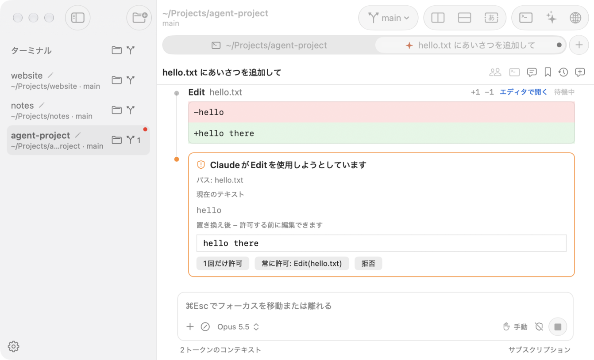

<p>&nbsp;&nbsp;&nbsp;</p>

# Tapa

**エージェント、ファイル、ページのための場所も備えた、macOS用の高速でネイティブなターミナル。**

Tapaは何よりもまずターミナルです。独自のVTコアとMetalレンダラ、macOS標準のタブと分割、ショートカット1つでスライドして現れるクイックターミナル、コマンドブロック付きのシェル統合、そしてWarp風の候補を表示するオプションの入力フィールドを備えています。その周りに、Tapaは[Dango](https://github.com/sventmueller/dango)の妹分へと育ちました。プロジェクトフォルダごとに1つのワークスペースが並ぶサイドバーがあり、それぞれにターミナル、Claude、Codex、OpenCode、Antigravityなど各種ACPエージェントのエージェントタブ、ブラウザタブ、ファイルリストとGitパネルを備えたエディタ、そして数式と図に対応した[Splat](https://github.com/sventmueller/splat)によるMarkdownプレビューがあります。プロジェクトフォルダが設定するものは、そのワークスペースを信頼するまで何も実行されません。TapaはRustでmacOS標準のAppKitコントロール上に作られ、35の言語に対応し、アカウントは不要で、テレメトリはありません。

[](https://github.com/sventmueller/tapa/releases/latest/download/Tapa.dmg)

**[Tapa.dmgをダウンロード](https://github.com/sventmueller/tapa/releases/latest/download/Tapa.dmg)**：署名され、Appleによって公証されたディスクイメージです。Apple SiliconとIntelのmacOS 14以降に対応します。

**バグを見つけましたか？** [Issueを作成](https://github.com/sventmueller/tapa/issues/new/choose)して、どのシェル、どのエージェント、どのプログラムで起きたかを書いてください。Tapaがお役に立ったら、[GitHubのスター](https://github.com/sventmueller/tapa)が、ほかの人がTapaを見つける助けになります。

[](https://www.rust-lang.org) [](https://www.apple.com/macos/)  [](https://github.com/madsmtm/objc2) [](https://developer.apple.com/metal/) [](https://agentclientprotocol.com)    [](#ライセンス)

[Bahasa Indonesia](../id/README.md) · [Bahasa Melayu](../ms/README.md) · [Català](../ca/README.md) · [Čeština](../cs/README.md) · [Dansk](../da/README.md) · [Deutsch](../de/README.md) · [English](../../../README.md) · [Español](../es/README.md) · [Français](../fr/README.md) · [Hrvatski](../hr/README.md) · [Italiano](../it/README.md) · [Magyar](../hu/README.md) · [Nederlands](../nl/README.md) · [Norsk](../no/README.md) · [Polski](../pl/README.md) · [Português (Brasil)](../pt_BR/README.md) · [Português (Portugal)](../pt_PT/README.md) · [Română](../ro/README.md) · [Slovenčina](../sk/README.md) · [Slovenščina](../sl/README.md) · [Suomi](../fi/README.md) · [Svenska](../sv/README.md) · [Tiếng Việt](../vi/README.md) · [Türkçe](../tr/README.md) · [Ελληνικά](../el/README.md) · [Русский](../ru/README.md) · [Українська](../uk/README.md) · [עברית](../he/README.md)‎ · [العربية](../ar/README.md)‎ · [हिन्दी](../hi/README.md) · [ไทย](../th/README.md) · [한국어](../ko/README.md) · **日本語** · [简体中文](../zh-Hans/README.md) · [繁體中文](../zh-Hant/README.md)

## 目次

- [主な機能](#主な機能)
- [動作環境](#動作環境)
- [インストール](#インストール)
- [はじめに](#はじめに)
- [ワークスペース](#ワークスペース)
- [ターミナル](#ターミナル)
  - [タブと分割](#タブと分割)
  - [シェル統合とコマンドブロック](#シェル統合とコマンドブロック)
  - [入力フィールドと候補](#入力フィールドと候補)
  - [検索、選択、コピー](#検索選択コピー)
  - [クイックターミナル](#クイックターミナル)
- [エージェント](#エージェント)
- [エディタ、ファイル、Git](#エディタファイルgit)
- [プレビュー](#プレビュー)
- [ブラウザ](#ブラウザ)
- [音声入力](#音声入力)
- [設定](#設定)
- [外観とアクセシビリティ](#外観とアクセシビリティ)
- [言語](#言語)
- [キーボードショートカット](#キーボードショートカット)
- [信頼](#信頼)
- [プライバシーとセキュリティ](#プライバシーとセキュリティ)
- [既知の制限](#既知の制限)
- [開発者向け](#開発者向け)
  - [サードパーティのコンポーネント](#サードパーティのコンポーネント)
- [ライセンス](#ライセンス)

## 主な機能

- **独自の高速ターミナル。** Tapaは独自のVTコアで解析し、ディスプレイごとのスレッドでMetalを使って、ディスプレイのリフレッシュレートで、変化した部分だけを描画します。esctestのチェックに262項目合格しており（Alacrittyのコアは121項目）、あらゆる変更は固定バージョンのGhosttyと比較して計測されます。
- **骨の髄までネイティブ。** 本物のmacOSタブ、ウインドウの復元、メニュー、サービスメニュー、通知、「キーボード入力のセキュリティを保護」、音声入力、入力メソッド。Electronは使わず、WebKitはページやプレビューが必要とする場所でだけ使います。
- **ワークスペース。** サイドバーにはプロジェクトフォルダごとに1つのワークスペースがあり、それぞれに専用のタブ、ブランチ、パネルがあります。一番上の「ターミナル」ワークスペースは毎回まっさらな状態で始まり、ほかのワークスペースはすべて、削除するまで残ります。
- **ネイティブなチャットビューで動くエージェント。** Claude、Codex、OpenCode、Antigravity、Gemini CLI、そしてAgent Client Protocolに対応するほかのエージェントが専用のタブで動作し、回答、ツール呼び出し、diff、許可のリクエストが1つのタイムラインに並びます。Tapaは依頼に応じてそれらをインストールし、アップデートします。
- **シェル統合とコマンドブロック。** zsh、bash、fishに対応し、`ssh`越しでも使えます。プロンプトからプロンプトへジャンプし、コマンドの出力を選択、コピー、保存、折りたたみでき、失敗したコマンドとそれぞれの所要時間がわかります。
- **お望みなら、Warpのような入力フィールド。** コマンドラインをテキストとして編集でき、履歴、700を超えるコマンドラインツールの仕様、プロジェクトの状態から候補が出ます。すべてお使いのMac上で処理されます。
- **シェルの隣にファイル、Git、ブラウザ。** シンタックスカラー付きのエディタ、ファイルリスト、ステージング、コミット、ブランチ、ワークツリーに対応したGitパネル、数式と図に対応したMarkdownプレビュー、そしてブラウザタブ。
- **フォルダを慎重に扱います。** 信頼していないワークスペースでは、そのフォルダが設定するものは何も起動しません。Gitフックも、プロジェクトのMCPサーバも、エージェント向けのプロジェクト設定も、ファイルページのJavaScriptも動きません。
- **プライベート。** アカウントもテレメトリもありません。Tapaがネットワークに接続するのは依頼したときだけで、ディスク上に残る復元用の履歴はキーチェーン内の鍵で暗号化されます。
- **あなたの言語で。** インターフェイスは35の言語で利用できます。アラビア語、カタロニア語、中国語（簡体字）、中国語（繁体字）、クロアチア語、チェコ語、デンマーク語、オランダ語、英語、フィンランド語、フランス語、ドイツ語、ギリシャ語、ヘブライ語、ヒンディー語、ハンガリー語、インドネシア語、イタリア語、日本語、韓国語、マレー語、ノルウェー語、ポーランド語、ポルトガル語（ブラジル）、ポルトガル語（ポルトガル）、ルーマニア語、ロシア語、スロバキア語、スロベニア語、スペイン語、スウェーデン語、タイ語、トルコ語、ウクライナ語、ベトナム語。

## 動作環境

- macOS 14 Sonoma以降、Apple SiliconまたはIntel。Tapaの開発とテストはmacOS 27で行っています。
- シェル統合にはzsh、bash、fishのいずれかが必要です。ほかのシェルはシェル統合なしで動作します。
- エージェントタブには、使いたいエージェントが必要です。すでにインストールされているものか、依頼に応じてTapaがインストールしたものです（[エージェント](#エージェント)を参照）。

## インストール

**ディスクイメージから。** 各リリースはディスクイメージ`Tapa-<version>.dmg`で、Apple SiliconとIntelの両方に対応したユニバーサルアプリが1つ入っており、Developer IDで署名され、Appleによって公証されています。開いて、Tapaをアプリケーションフォルダにドラッグしてください。

**Homebrewで。** 専用のtapにあるCaskが、同じディスクイメージをインストールします。

```sh
brew install --cask sventmueller/tap/tapa
```

**アップデート。** ディスクイメージまたはHomebrewで入れたTapaは、[Sparkle](https://sparkle-project.org)によって自動的に最新の状態に保たれます。2回目の起動時に、自動でアップデートを確認してよいかをたずねます。同意するまでは、リクエストを一切送りません。**Tapa › アップデートを確認…** はすぐに確認します。Tapaは、開発者の署名があるアップデートだけをインストールします。自分でビルドしたものにはアップデータはありません。

**ソースから。** [開発者向け](#開発者向け)を参照してください。

**デフォルトのターミナルとして。** Tapaはシェルスクリプト（`.command`、`.tool`）、アイコンにドロップされたフォルダ、`ssh://`リンクを開けます。Finderで**ファイル › 情報を見る › このアプリケーションで開く**からTapaを選んでください。

## はじめに

1. **ウインドウ**には、左にワークスペースのサイドバー、上に選択中のワークスペースのタブ、その上にツールバーがあります。⌃⌘Sでサイドバーの表示/非表示を切り替えます。
2. **新しいワークスペース**は、サイドバー上部のフォルダボタンか、**シェル › 新規ワークスペース…**（⇧⌘N）から作ります。最近使ったフォルダのいずれかか、**フォルダを選択…** を選びます。
3. **新しいタブ**は、ワークスペースのフォルダで始まります。ターミナルは⌘Tで、ターミナル、エージェント、ブラウザのタブはツールバー右側のボタンで、またはタブバーの末尾にある**+**で開きます。
4. **設定**は、⌘,かサイドバー下部の歯車で開きます。
5. **コマンドパレット**（⇧⌘P）は名前ですべてのコマンドを、**タブを検索…**（⌘P）はすべてのワークスペースのすべてのタブを見つけます。

ツールバーには左から順に、ワークスペースのリポジトリのブランチのプルダウン、ターミナルを右と下に分割するボタンと入力フィールドを表示するボタン、そして新しいターミナル、エージェント、ブラウザのタブを開くボタンが並びます。分割と入力フィールドのボタンは、ターミナルタブが前面にない間はグレイ表示になります。

## ワークスペース

ワークスペースとは、フォルダとそのタブのことです。サイドバーの行には名前、フォルダ、Gitブランチが表示され、右側にはファイルリストとGitパネルのボタンがあります。どちらかをクリックすると、ワークスペースのリストの代わりにそのパネルが表示されます。上部の**ワークスペース**で戻ります。

- **「ターミナル」ワークスペース**は常に一番上にあります。起動するたびに、設定で指定したフォルダで、空のターミナルを1つ持つまっさらな状態で始まります。何も保存されず、名前の変更も削除もできません。
- **ほかのワークスペースはすべて残ります。** タブがなくても、削除するまで残ります。Tapaはその名前、タブ、ターミナルの内容（復元の設定が許す範囲で）、エージェントのセッション、ウインドウの位置を保持します。実行中のプログラムは、Tapaを終了すると終了します。
- **名前の変更。** 名前の後ろにある鉛筆をクリックするか、選択中のワークスペースの名前をクリックするか、**シェル › ワークスペース名を変更**を選びます。名前はすぐに保存されます。
- **ステータス。** 行の緑の点は、そのワークスペースのエージェントが作業中であることを示します。サブエージェントやバックグラウンドでの作業も含みます。赤い点は、エージェントがあなたを待っていることを示します。ターミナルはここには何も表示しません。
- **切り替え。** ⌃⌘[と⌃⌘]でワークスペースを移動します。ウインドウはその場にとどまり、選択したワークスペースのタブがほかのタブと入れ替わります。
- **ワークツリー。** ツールバーのブランチのプルダウンにある**新規ワークツリー…** は、新しいブランチでGitワークツリーを作成し、独立したワークスペースとして開きます。

ワークスペースの最後のタブを閉じても、ワークスペースはリストに残ります。すべてのタブを閉じると、ウインドウだけが閉じます。Dockのアイコンか⌘Nで、ワークスペースごとウインドウが戻ります。

## ターミナル

Tapaは独自のコア`term-vt`で動作します。xtermとVT520に対応し、Kittyキーボードプロトコル、OSC 8ハイパーリンク、読み取りには別途許可が必要なOSC 52のクリップボードアクセス、同期出力、色付きの下線と波線の下線、トゥルーカラー、色の問い合わせ、プログラムへのライト/ダークモードの通知、ブラケットペースト、フォーカスイベント、マウスレポートをサポートします。ウインドウのサイズが変わると、履歴も含めてテキストが再配置されます。合字、フォント機能、パッチを当てたフォントなしで使えるNerd Fontの記号、ピクセル単位で正確な罫線、Powerline、点字のグリフを内蔵しています。

### タブと分割

- **タブ**はmacOS標準のものです。ドラッグして並べ替えたり、独立したウインドウに切り出したりできます。**すべてのタブを表示**（⇧⌘\\）、⌘1〜⌘8、最後のタブには⌘9、切り替えには⇧⌘[ / ⇧⌘]を使います。各タブのタイトルの前には、その種類のアイコンが表示されます。
- **分割。** **右に分割**（⌘Dまたは⌃⌘T）と**下に分割**（⇧⌘Dまたは⌃⌥⌘T）は、好きなだけ深く入れ子にできます。区切り線はドラッグするか、⌃⌘と矢印キーで動かします。**ペインを最大化**（⌃⇧⌘↩）、**ペインのサイズを揃える**（⌃⌘=）があり、⌘[と⌘]でペイン間を移動します。
- **作業フォルダ。** 新しいタブ、ウインドウ、分割は、前面にあるターミナルのフォルダで始まります。この3つそれぞれについて、設定で決められます。
- **閉じる。** プログラムが実行中のタブ、ウインドウ、アプリを閉じる前に、Tapaは確認します。
- **復元。** 再起動後、ワークスペース、タブ、ペイン、フォルダ、各ターミナルの最後の数行が戻ります。トークンやパスワードなどの秘密情報は、保存される前にマスクされます。

### シェル統合とコマンドブロック

Tapaはzsh、bash、fish用のシェル統合を自動で設定します。あなたの設定ファイルには手を触れず、`ssh`でほかのホストに接続するときにも持っていきます。これにより、各コマンドとその出力が1つのブロックになります。

- **プロンプト。** ⌘↑と⌘↓で前と次のプロンプトにジャンプします。コマンドラインをクリックすると、カーソルがそこに移動します。
- **ブロック。** **ブロックを選択**（⇧⌘A）、**出力をコピー**（⌥⌘C）、**出力を保存…**（⌥⌘S）、**ブロックを折りたたむ/展開**（⇧⌘↩）。ポインタの下にあるブロックの上には、そのステータス、所要時間、同じ操作のボタンが表示されます。
- **失敗したコマンド**には印が付きます。実行中のコマンドは、出力がスクロールする間も上部に表示されたままです。
- **ブックマーク。** **ブックマークを設定/解除**（⇧⌘M）で行に印を付け、⇧⌘↑と⇧⌘↓でブックマーク間をジャンプします。
- **通知**は、プログラムが求めたとき（OSC 9とOSC 777）にターミナルが前面になければ表示されます。進行状況バー（OSC 9;4）は、タブとDockのアイコンに表示されます。

### 入力フィールドと候補

入力フィールドは、Warpのように、コマンドラインをペイン下部のテキストフィールドに変えます。その上には、フォルダとGitブランチのチップが並びます。**入力フィールドの表示/非表示**（⌘I）またはツールバーのボタンで1つのターミナルについて切り替え、**設定 › 入力**で新しいターミナルに対してオンにします。シェル統合が必要で、vim、htop、claudeなどのフルスクリーンのプログラムでは脇に退きます。

- **Return**でフィールド全体をシェルに送ります。複数行のテキストは1回のペーストとして送られ、シェルはいつもどおり実行して履歴に残します。シェルが続きの入力を求めると、次のプロンプトまで、フィールドはキー入力をシェルに戻します。
- **↑、↓、⌃R**で履歴を検索します。各コマンドを実行したときのフォルダ、ブランチ、終了コードも表示されます。
- **Tab**で補完します。700を超えるコマンドラインツールの仕様、パス、そしてgitブランチ、dockerコンテナ、kubectlリソース、sshホスト、`package.json`のスクリプト、make、just、cargoのターゲットといったその場の値を使います。
- **Vimのキー**をフィールドで使うかどうかは、同じ設定のスイッチで切り替えます。
- **入力する前に次のコマンドを。** このプロジェクトで普段続くもの（`git add`の後には`git commit`）、プロジェクトの状態が求めるもの（`node_modules`より新しいロックファイル）、そして「command not found」の後の修正案（タイプミスやローカルのHomebrewのインデックスから）を提案します。

入力フィールドを使わない場合、候補はカーソルの後ろにグレイのテキストで表示され、→で確定します。fishやzsh-autosuggestionsなど独自の自動候補を持つシェルでは、そちらがそのまま使われます。候補がネットワークを使うことはなく、プログラムを起動するのは自分の`PATH`からだけで、プロジェクトフォルダからは決して起動しません。

**ペースト。** 複数行のペーストは、実行前に表示できます（**複数行のペーストを先に表示**）。ターミナルにドロップしたファイルは、引用符で囲まれたパスになります。⌥←/→、⌘←/→、⌘⌫で、Macのどのテキストフィールドとも同じように、単語単位や行単位で移動と削除ができます。

### 検索、選択、コピー

- **検索…**（⌘F）は、正規表現、大文字と小文字の区別、単語単位で履歴を検索し、一致した数を数えます。スクロールバーには、一致箇所がプロンプトやエラーとともに示されます。
- **スマート選択。** ダブルクリックでURL、パス、ハッシュ、IPアドレスをまとめて選択し、⌥ドラッグで矩形を選択します。リンクはOSC 8がなくても見つかり、⌘クリックで開きます。パスは、Dangoがインストールされていれば、Dangoで開きます。
- **キーボードで選択**（⇧⌘C）では、Vimのキーで選択範囲を動かします。
- **書式付きでコピー**（⇧⌥⌘C）は、色とスタイルを保ちます。選択時にコピーするかどうかは設定で選べます。**消去**（⌘K）はターミナルを消去します。

### クイックターミナル

**クイックターミナルの表示/非表示**（⌃⌥⌘Space）は、アプリを切り替えずに、画面の端からターミナルをスライドさせて表示します。ほかのアプリの手前に、フルスクリーンの操作スペースの上にも表示されます。どの端から出すか、その大きさ、ほかの場所をクリックしたときに隠すかどうかは設定で決められます。隠れている間も、セッションは動き続けます。

## エージェント

エージェントタブは、ワークスペースのフォルダでコーディングエージェントを実行します。表示には、Dangoから受け継いだネイティブなエージェントビューを使います。

| エージェント | 実行方法 | 必要なもの |
|---|---|---|
| Claude | `claude`コマンド。stream-jsonプロトコルで通信します | `claude`がインストールされ、サインイン済みであること。依頼すれば、TapaがClaude公式のインストーラでインストールします |
| Codex | `codex app-server`、古いCodexでは`codex-acp` | `codex`にサインイン済みであること。依頼すれば、Tapaが固定バージョンのアダプタをインストールします |
| OpenCode | `opencode serve`、古いOpenCodeでは`opencode acp` | `PATH`上にある自分の`opencode`、または固定バージョンのダウンロード |
| Antigravity | `agy acp` | `PATH`上にある自分の`agy`、または固定バージョンのダウンロード |
| Gemini CLI | `gemini --acp`。**設定 › エージェント**でオンにすると選べるようになります | 自分の`gemini`、または固定バージョンのダウンロード |
| ほかのACPエージェント | ACPレジストリから。依頼したときだけ読み込みます | レジストリのエントリが指定するもの。チェックサムのないエントリは、確認した後にだけインストールされます |

Tapaは各エージェント自身のサインインを使い、エージェントの認証情報は保存しません。ログインシェルの`PATH`にあるエージェントが優先されます。なければ、Tapaが自分のデータフォルダにインストールしたバージョンを実行します。ワークスペースにあるプログラムは決して実行しません。

- **タイムライン**には、回答、出力とdiffを伴うツール呼び出し、質問、許可のリクエストが表示されます。リクエストには**1回だけ許可**、**常に許可**、**拒否**で答えます。編集内容は、許可する前に変更できます。
- **ステータス。** エージェントが作業している間はタブとワークスペースの行に緑の点が、あなたを待っている間は赤い点が表示されます。ほかの場所を見ている間にエージェントが待ち状態になると、通知で知らせます。
- **メッセージフィールド**は下部にあり、プロンプト、ドロップしたファイル、音声入力を受け付けます。⌘Escでキーボードフォーカスがフィールドに移り、もう一度押すと元に戻ります。モデルと許可モードは、そこでセッションごとに選べます。
- **設定 › エージェント**では、新しいセッションの許可モード（Claude、Codex）、モデル（Claude、Codex、OpenCode）、思考の度合い（Claude、Codex）、そして新しいタブで選べるエージェントを設定します。各エージェントのプログラムがどこにあるかが表示され、**インストール…**、**…にアップデート**、以前のバージョンに戻す**…に戻る**、ACPレジストリ用の**レジストリを読み込む**があります。Claudeが「常に許可」で保存したルールも、そこで確認して削除できます。
- **検証されたダウンロード。** アーカイブはSHA-256で、npmパッケージはロックファイルのintegrityで検証され、バージョンが固定されていないパッケージは拒否されます。見つからないエージェントは、そのタブの中でもインストールを提案します。

## エディタ、ファイル、Git

- **ファイルリスト**は、ワークスペースのフォルダをツリーで表示し、ファイルが変わると更新されます。Gitが無視するファイルは、お望みなら薄く表示されます。クリックするとファイルがプレビュータブで開き、編集するまでは次のクリックでそのタブが置き換わります。ダブルクリックすると、タブが残ります。
- **エディタ**は、ワークスペースのタブでファイルを開きます。シンタックスカラー、複数のキャレット、折りたたみ、`.editorconfig`のインデント、オプションのVimキー、前回のコミット以降の変更の印に対応しています。ディスク上でファイルが変わったときや、コンフリクトマーカーが含まれているときには、それに気付きます。Markdownファイルには書式バーと**Splatで開く**が付きます。**保存**（⌘S）、**別名で保存…**、**すべてを保存**はいつもどおりに働き、未保存のテキストを閉じる前にはTapaが確認します。
- **クラッシュの後**も、未保存のテキストは戻ってきます。入力している間、Tapaがその暗号化されたコピーを保持しているからです。
- **Gitパネル**は、ステージ済みと未ステージの変更を表示します。ファイル単位や個々のハンク単位でのステージとステージ解除、コミット（⌘↩）、amend、コミットしてプッシュ、フェッチを行い、ブランチ、stash、cherry-pick、コンフリクトを扱います。下にはコミット履歴があります。ファイルをクリックすると、そのdiffが表示されます。
- **ブランチのプルダウン**はツールバーにあり、ブランチの切り替えと作成、ワークツリーの作成を行います。

エディタは、フォーマッタも言語サーバも起動しません。言語サーバとデバッガを備えた本格的なIDEが必要なら、[Dango](https://github.com/sventmueller/dango)を使ってください。

## プレビュー

- **Markdown**は、Splatのレンダラでエディタの隣に表示されます。数式、図、画像を含むGitHub Flavored Markdownで、テキストと段落単位で連動してスクロールします。
- **画像**は専用のタブで開きます。PDFはPDFKitで、音声、動画、フォント、オフィス書類はクイックルックで開きます。
- **隔離されたデコード。** 信頼できないソースからの画像（プロジェクトのファイル、Markdown、エージェントの添付ファイルとペースト）は、すべてSplatのサービス`Decoder.xpc`でデコードされます。このサービスは、ファイルにもネットワークにもアクセスできない専用のApp Sandboxの中で動きます。アプリの中でデコードすることは決してありません。

## ブラウザ

**新規ブラウザタブ**（⇧⌘B）は、ワークスペースにWebKitのタブを開きます。アドレスフィールドには、アドレスか、選んだ検索エンジン（DuckDuckGo、Google、Bing、Startpage）で検索する語句を入力します。⌘L、⌘R、⌘[、⌘]はSafariと同じように働きます。`localhost`のページは、プロジェクトの開発サーバのためにいつもどおり動作します。ワークスペースのHTMLファイルが読み込めるのは自分のフォルダだけで、信頼していないワークスペースではJavaScriptを実行しません。

## 音声入力

マイクボタンまたは**編集 › 音声入力を開始**（⌃⌥D）で、エージェントのメッセージフィールドやエディタに音声で入力できます。音声認識には[Lowspeak](https://github.com/sventmueller/lowspeak)を使いますが、Lowspeakをインストールする必要はありません。**設定 › 音声入力**では、OpenAIまたはGroqによるオンラインの文字起こしか、録音をMacの外に出さないローカルのWhisperおよびParakeetモデルかを選び、言語、後処理、マイク、独自の語彙も設定します。OpenAIとGroqのキーは、キーチェーンに保管されます。音声入力は、リリースビルドにだけ含まれます。

## 設定

**Tapa › 設定…**（⌘,）には、一般、フォント、カラー、カーソル、ターミナル、入力、エディタ、エージェント、音声入力、プロファイル、ショートカットの各パネルがあります。設定は1つのTOMLファイル、つまり`~/Library/Application Support`の下にあるTapaのフォルダの`config.toml`に書き込まれ、手で編集することもできます。Tapaは実行中にこのファイルを再読み込みし、**設定を再読み込み**（⇧⌘,）ではすぐに再読み込みします。

- **4つのフォントサイズ**が一般パネルにあります。インターフェイス（サイドバー、パネル、ファイルリスト、Gitパネル、タブのタイトル）、エディタ（テキスト、行番号、Markdownプレビュー）、ターミナル、エージェントです。⌘+、⌘−、⌘0で、前面にあるターミナルのサイズを変えます。
- **外観：** ライト、ダーク、システムと同じ。
- **カラー。** ライトモード用とダークモード用のテーマを1つずつ、Ghosttyのテーマ形式で選びます。最小コントラストにより、出来の悪いテーマでもテキストが読みやすく保たれます。自分のテーマは、テーマフォルダに入れます。
- **プロファイル**は、フォント、カラー、シェル、環境変数、フォルダをひとまとめにします。
- **ショートカット**はすべて変更でき、競合は表示されます。

## 外観とアクセシビリティ

- **ダークモード**は、システムかあなたの選択に従います。アクセントカラー、「視差効果を減らす」、「コントラストを上げる」の設定も尊重されます。
- **VoiceOver**は、ターミナルの行とプロンプトを読み上げ、新しい出力を通知します。サイドバー、タブ、ツールバーのボタン、エージェントのタイムラインのカードには名前が付いています。
- **キーボード。** すべてのコマンドにメニュー項目とショートカットがあり、フルキーボードアクセスですべてのコントロールを操作できます。
- **サイズ。** 設定の4つのフォントサイズで、インターフェイス、エディタ、ターミナル、エージェントの大きさをそれぞれ独立して変えられます。
- **右から左。** アラビア語とヘブライ語ではインターフェイスが左右反転しますが、ターミナルのグリッドは左から右のままです。

詳細と既知の不足点は、[ACCESSIBILITY.md](../../../ACCESSIBILITY.md)にあります。

## 言語

インターフェイスは、次の35言語に翻訳されています。アラビア語、カタロニア語、中国語（簡体字）、中国語（繁体字）、クロアチア語、チェコ語、デンマーク語、オランダ語、英語、フィンランド語、フランス語、ドイツ語、ギリシャ語、ヘブライ語、ヒンディー語、ハンガリー語、インドネシア語、イタリア語、日本語、韓国語、マレー語、ノルウェー語、ポーランド語、ポルトガル語（ブラジル）、ポルトガル語（ポルトガル）、ルーマニア語、ロシア語、スロバキア語、スロベニア語、スペイン語、スウェーデン語、タイ語、トルコ語、ウクライナ語、ベトナム語。

Tapaは、**システム設定 › 一般 › 言語と地域**の言語の順序に従います。同じ場所の**アプリケーション**で、Tapaだけの言語を選ぶこともできます。お使いの言語の翻訳がない場合は、英語を使います。

## キーボードショートカット

| 操作 | ショートカット |
|---|---|
| 新規ウインドウ、ワークスペース、タブ | ⌘N、⇧⌘N、⌘T |
| 新規ブラウザタブ | ⇧⌘B |
| 新規ファイル、ファイルを開く | ⌥⌘N、⌘O |
| ペインまたはタブを閉じる、タブを閉じる、ウインドウを閉じる | ⌘W、⌥⌘W、⇧⌘W |
| 右に分割、下に分割 | ⌘Dまたは⌃⌘T、⇧⌘Dまたは⌃⌥⌘T |
| ペインを最大化、ペインのサイズを揃える、ペインを閉じる | ⌃⇧⌘↩、⌃⌘=、⌃⇧⌘W |
| 区切り線を動かす | ⌃⌘←、⌃⌘→、⌃⌘↑、⌃⌘↓ |
| 次のペイン、前のペイン | ⌘]、⌘[ |
| 次のタブ、前のタブ、タブ1〜8、最後のタブ | ⇧⌘]、⇧⌘[、⌘1〜⌘8、⌘9 |
| 次のワークスペース、前のワークスペース | ⌃⌘]、⌃⌘[ |
| タブを検索、コマンドパレット | ⌘P、⇧⌘P |
| サイドバー、入力フィールドの表示/非表示 | ⌃⌘S、⌘I |
| クイックターミナル | ⌃⌥⌘Space |
| 検索、次を検索、前を検索 | ⌘F、⌘G、⇧⌘G |
| 前のプロンプト、次のプロンプト | ⌘↑、⌘↓ |
| ブロックを選択、出力をコピー、出力を保存、ブロックを折りたたむ | ⇧⌘A、⌥⌘C、⌥⌘S、⇧⌘↩ |
| ブックマークを設定/解除、前のブックマーク、次のブックマーク | ⇧⌘M、⇧⌘↑、⇧⌘↓ |
| キーボードで選択 | ⇧⌘C |
| 書式付きでコピー | ⇧⌥⌘C |
| 消去 | ⌘K |
| 先頭、末尾、前のページ、次のページ | ⌘Home、⌘End、⌘PageUp、⌘PageDown |
| 拡大、縮小、元のサイズ（ターミナル） | ⌘+、⌘−、⌘0 |
| エージェントタブのメッセージフィールド | ⌘Esc |
| 音声入力を開始 | ⌃⌥D |
| 設定、設定を再読み込み | ⌘,、⇧⌘, |

すべてのショートカットは、**設定 › ショートカット**または設定ファイルの`[keys]`セクションで変更できます。

## 信頼

プロジェクトフォルダは、その中で何かが起動したとたんに、プログラムを実行させることができます。Gitフックや`core.fsmonitor`のようなリポジトリの設定、エージェントのフック、プロジェクトのMCPサーバ、エージェントのプロジェクト設定などです。そのため、新しいワークスペースは信頼されていません。

- **信頼されていない場合：** エージェントは、プロジェクトのフック、MCPサーバ、設定なしで起動します（Claudeは`--setting-sources=user --strict-mcp-config`付きで、Codexはフォルダを信頼されていないものとして、OpenCodeはプロジェクトの設定なしで）。Gitは無害化された状態で実行されます。フック、フィルタ、diffドライバ、fsmonitor、`sshCommand`、ページャはどれも使われず、認証情報ヘルパーもグローバルなものだけが使われます。HTMLファイルはJavaScriptなしで開きます。Gitパネルとエージェントタブはその旨を表示し、ワークスペースを信頼するよう提案します。
- **信頼されている場合：** **シェル › ワークスペースを信頼**で、フォルダが意図するとおりにそれらすべてを読み込みます。**信頼を取り消す**で元に戻します。信頼はワークスペースごとに保持されます。

信頼しているかどうかにかかわらず、Tapaがプロジェクトフォルダのプログラムを自ら実行することはありません。候補がプログラムを起動するのはプロジェクト外の`PATH`からだけで、サイドバーはGitの状態を`.git`のファイルから読み取ります。「ターミナル」のように、ホームフォルダにあるワークスペースはプロジェクトではありません。そこでは、`~/.local/bin/claude`のような`~`以下のプログラムは、あなた自身のものとして扱われます。

## プライバシーとセキュリティ

- **テレメトリなし、アカウントなし。** Tapaは使い方について何も報告せず、完全にオフラインで動作します。ネットワークに接続するのは、依頼したときだけです。エージェントのインストールやアップデート、ACPレジストリの読み込み、同意した後のアップデートの確認、そしてブラウザタブで開くページのためです。エージェント自体は、いつもどおりそれぞれのプロバイダと通信します。
- **ディスク上の履歴**はセッションの復元に使われ、キーチェーン内の鍵で暗号化されます。オフにすることもでき、書き込まれる前にAPIキー、トークン、パスワードなどの秘密情報がマスクされます。未保存のエディタのテキストのコピーも、同じ鍵で暗号化されます。
- **キーボード入力のセキュリティを保護**は、パスワードの入力を求められると自動でオンになります。アプリケーションメニューで、常にオンにしておくこともできます。
- **エスケープシーケンス**のうち、タイトルの報告、クリップボードの読み取り、ペーストのトリックなど、情報の漏えいや入力の注入につながり得るものは、ブロックされるか、事前に確認されます。パーサはCIでファジングされています。
- **隔離されたデコード**は、信頼できないソースからの画像に適用されます。[プレビュー](#プレビュー)を参照してください。
- **コード署名**にはHardened Runtimeを使います。macOSはターミナル内のプログラムによるアクセスをTapaによるものとみなすため、Tapaは保護されたすべてのサービスについて利用目的の説明を備えています。

セキュリティの問題は、非公開で報告してください。[SECURITY.md](../../../SECURITY.md)を参照してください。

## 既知の制限

- **インライン画像はまだありません。** ターミナル内のKittyグラフィックス、Sixel、iTerm2の画像は、1.0の後に予定しています。
- **tmuxのコントロールモードはありません。** また、Tapaを終了するとセッションは残りません。
- **右から左に書くテキスト**は、ターミナルのグリッドでは左から右のままです。
- **⌘+と⌘−**は、前面にあるターミナルだけを変更します。
- **エディタ**には、意図的に言語サーバ、フォーマッタ、デバッガがありません。それらはDangoにあります。
- **音声入力**はリリースビルドだけにあり、デバッグビルドにはありません。
- **VoiceOver**は、まだ人の手で最初から最後まで確認されていません。

## 開発者向け

必要なのは、macOS 14以降とXcode Command Line Tools、`rust-toolchain.toml`が指定するRust（ユニバーサルビルドには、両方のMacターゲットを入れたrustup）、このリポジトリの隣にチェックアウトした[splat](https://github.com/sventmueller/splat)と[lowspeak](https://github.com/sventmueller/lowspeak)（`../splat`、`../lowspeak`）、そして音声入力付きのビルドにはcmakeです。

| コマンド | 内容 |
|---|---|
| `make help` | ターゲットを一覧表示します |
| `cargo xtask run` | デバッグ版のアプリをビルドして開きます |
| `make build` | 音声入力付きのリリース版アプリを`target/release`にビルドし、このMac用にアドホック署名します |
| `make lint` | フォーマット、警告をエラーとして扱うclippy、ファイルの形、インターフェイスのテキストを確認します |
| `make check` | `lint`の後にすべてのテストを実行します。ウインドウもネットワークも不要です |
| `make selftest STEPS="split_right,type:ls\n,shot:x"` | アプリを操作し、ウインドウの画像を`target/selftest/`に残します |
| `make esctest`、`make vttest` | アプリ内の両方のコアに対して、esctestとvttestを実行します |
| `make perf` | 固定バージョンのGhosttyとのベンチマーク。アイドル状態のMacでだけ意味があります |
| `make fuzz` | cargo-fuzzによるファズターゲット |
| `make release` | リリースのドライラン：音声入力付きのユニバーサルアプリ、そのディスクイメージ、アップデートフィード、Caskを`target/release-dry-run`に作成します。どこにも何も送信しません |
| `make release-notarized` | 現在のバージョンをDeveloper IDで署名し、Appleによる公証とステープルを済ませて`dist/`に作成します。`Cargo.toml`は変わりません |
| `make deploy` | 次のバージョンを公証し、`Cargo.toml`をコミットし、下書きリリースをアップロードし、`main`とタグをプッシュしてから、リリースを公開します。[docs/development.md](../../../docs/development.md#deploy)を参照してください |

貢献の方法は[CONTRIBUTING.md](../../../CONTRIBUTING.md)にあります。インターフェイスのテキストはすべてドイツ語をキーとし、35のすべての言語に翻訳されています。翻訳が欠けていると、`cargo xtask strings`が失敗します。

### サードパーティのコンポーネント

| コンポーネント | 用途 | ライセンス |
|---|---|---|
| [objc2](https://github.com/madsmtm/objc2)とそのフレームワークのcrate | AppKit、Metal、WebKit、そのほかのAppleのフレームワーク | MIT、ZlibまたはApache-2.0 |
| Splatのcrate | Markdown、プレビュー、Gitの読み取り、画像デコーダ、翻訳 | MITまたはApache-2.0 |
| [Lowspeak](https://github.com/sventmueller/lowspeak)と[whisper.cpp](https://github.com/ggml-org/whisper.cpp) | 音声入力 | MIT |
| [Fig autocomplete specs](https://github.com/withfig/autocomplete) | 候補に表示するコマンドの説明 | MIT |
| [rusqlite](https://github.com/rusqlite/rusqlite)とSQLite | コマンド履歴 | MIT、パブリックドメイン |
| [Simple Icons](https://simpleicons.org) | 言語とプログラムのロゴ | CC0、一部のロゴはそれぞれの条件による |
| [Sparkle](https://sparkle-project.org) 2.10.1 | リリースビルドのアップデート | MIT |

## ライセンス

Tapaは、次のいずれかのライセンスで提供されます。

- Apache License, Version 2.0（[LICENSE-APACHE](../../../LICENSE-APACHE)）
- MIT License（[LICENSE-MIT](../../../LICENSE-MIT)）

どちらを適用するかは、ユーザが選べます。`assets/simple-icons`内のロゴにはそれぞれ独自のライセンスがあります。そこにあるREADMEを参照してください。

明示的に別段の定めをしない限り、Apache-2.0ライセンスで定義されるとおり、あなたがTapaへの組み込みを意図して提出した貢献は、追加の条項や条件なしに、上記のとおりデュアルライセンスとなります。
