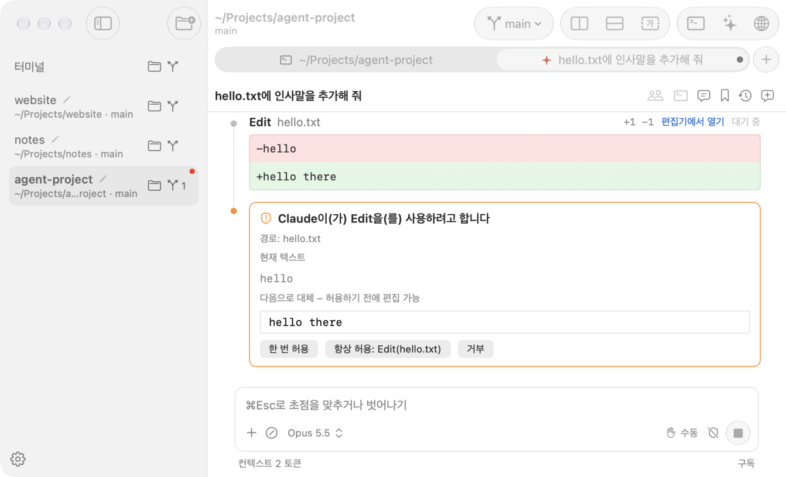

<p>&nbsp;&nbsp;&nbsp;</p>

# Tapa

**에이전트, 파일, 페이지를 위한 자리까지 갖춘, 빠르고 네이티브한 macOS용 터미널.**

Tapa는 무엇보다 터미널입니다. 자체 VT 코어와 Metal 렌더러, macOS 고유의 탭과 분할, 단축키 하나로 미끄러져 나오는 빠른 터미널, 명령 블록을 갖춘 셸 통합, 그리고 Warp 스타일의 제안을 보여 주는 선택 사항인 입력 필드를 갖추고 있습니다. 그 둘레로 Tapa는 [Dango](https://github.com/sventmueller/dango)의 여동생으로 자라났습니다. 프로젝트 폴더마다 작업 공간이 하나씩 놓이는 사이드바가 있고, 각 작업 공간에는 터미널, Claude, Codex, OpenCode, Antigravity 및 기타 ACP 에이전트를 위한 에이전트 탭, 브라우저 탭, 파일 목록과 Git 패널을 갖춘 편집기, 그리고 수식과 다이어그램을 지원하는 [Splat](https://github.com/sventmueller/splat)의 Markdown 미리보기가 있습니다. 프로젝트 폴더가 구성하는 것은 사용자가 그 작업 공간을 신뢰하기 전까지 아무것도 실행되지 않습니다. Tapa는 진짜 AppKit 컨트롤 위에서 Rust로 작성되었고, 35개 언어를 지원하며, 계정이 필요 없고, 원격 측정이 없습니다.

[](https://github.com/sventmueller/tapa/releases/latest/download/Tapa.dmg)

**[Tapa.dmg 다운로드](https://github.com/sventmueller/tapa/releases/latest/download/Tapa.dmg)**: 서명되고 Apple의 공증을 받은 디스크 이미지로, Apple Silicon 및 Intel 기반의 macOS 14 이상을 지원합니다.

**버그를 발견하셨나요?** [이슈를 열고](https://github.com/sventmueller/tapa/issues/new/choose) 어떤 셸, 어떤 에이전트, 어떤 프로그램에서 발생했는지 알려 주세요. Tapa가 유용하다면 [GitHub 스타](https://github.com/sventmueller/tapa)가 다른 사람들이 Tapa를 찾는 데 도움이 됩니다.

[](https://www.rust-lang.org) [](https://www.apple.com/macos/)  [](https://github.com/madsmtm/objc2) [](https://developer.apple.com/metal/) [](https://agentclientprotocol.com)    [](#라이선스)

[Bahasa Indonesia](../id/README.md) · [Bahasa Melayu](../ms/README.md) · [Català](../ca/README.md) · [Čeština](../cs/README.md) · [Dansk](../da/README.md) · [Deutsch](../de/README.md) · [English](../../../README.md) · [Español](../es/README.md) · [Français](../fr/README.md) · [Hrvatski](../hr/README.md) · [Italiano](../it/README.md) · [Magyar](../hu/README.md) · [Nederlands](../nl/README.md) · [Norsk](../no/README.md) · [Polski](../pl/README.md) · [Português (Brasil)](../pt_BR/README.md) · [Português (Portugal)](../pt_PT/README.md) · [Română](../ro/README.md) · [Slovenčina](../sk/README.md) · [Slovenščina](../sl/README.md) · [Suomi](../fi/README.md) · [Svenska](../sv/README.md) · [Tiếng Việt](../vi/README.md) · [Türkçe](../tr/README.md) · [Ελληνικά](../el/README.md) · [Русский](../ru/README.md) · [Українська](../uk/README.md) · [עברית](../he/README.md)‎ · [العربية](../ar/README.md)‎ · [हिन्दी](../hi/README.md) · [ไทย](../th/README.md) · **한국어** · [日本語](../ja/README.md) · [简体中文](../zh-Hans/README.md) · [繁體中文](../zh-Hant/README.md)

## 목차

- [주요 기능](#주요-기능)
- [요구 사항](#요구-사항)
- [설치](#설치)
- [시작하기](#시작하기)
- [작업 공간](#작업-공간)
- [터미널](#터미널)
  - [탭과 분할](#탭과-분할)
  - [셸 통합과 명령 블록](#셸-통합과-명령-블록)
  - [입력 필드와 제안](#입력-필드와-제안)
  - [찾기, 선택, 복사](#찾기-선택-복사)
  - [빠른 터미널](#빠른-터미널)
- [에이전트](#에이전트)
- [편집기, 파일, Git](#편집기-파일-git)
- [미리보기](#미리보기)
- [브라우저](#브라우저)
- [받아쓰기](#받아쓰기)
- [설정](#설정)
- [화면 모양과 손쉬운 사용](#화면-모양과-손쉬운-사용)
- [언어](#언어)
- [키보드 단축키](#키보드-단축키)
- [신뢰](#신뢰)
- [개인 정보 보호와 보안](#개인-정보-보호와-보안)
- [알려진 제한 사항](#알려진-제한-사항)
- [개발자용](#개발자용)
  - [서드파티 구성 요소](#서드파티-구성-요소)
- [라이선스](#라이선스)

## 주요 기능

- **자체 개발한 빠른 터미널.** Tapa는 자체 VT 코어로 파싱하고, 디스플레이마다 하나의 스레드에서 Metal로, 디스플레이의 주사율에 맞춰, 바뀐 부분만 그립니다. esctest 검사를 262개 통과하며(Alacritty의 코어는 121개), 모든 변경은 버전이 고정된 Ghostty와 비교해 측정됩니다.
- **뼛속까지 네이티브.** 진짜 macOS 탭, 윈도우 복원, 메뉴, 서비스 메뉴, 알림, 보안 키보드 엔트리, 받아쓰기, 입력기를 지원합니다. Electron은 쓰지 않으며, WebKit은 페이지나 미리보기에 필요한 곳에서만 씁니다.
- **작업 공간.** 사이드바에는 프로젝트 폴더마다 작업 공간이 하나씩 있으며, 각각 자신의 탭, 브랜치, 패널을 가집니다. 맨 위의 '터미널' 작업 공간은 매번 새로 시작하고, 나머지 작업 공간은 모두 사용자가 제거할 때까지 남습니다.
- **네이티브 채팅 보기 속의 에이전트.** Claude, Codex, OpenCode, Antigravity, Gemini CLI 및 Agent Client Protocol을 사용하는 기타 에이전트가 각자의 탭에서 실행되며, 답변, 도구 호출, diff, 권한 요청이 하나의 타임라인에 표시됩니다. Tapa는 요청하면 에이전트를 설치하고 업데이트합니다.
- **셸 통합과 명령 블록.** zsh, bash, fish를 지원하며 `ssh`를 통해서도 작동합니다. 프롬프트에서 프롬프트로 이동하고, 명령의 출력을 선택, 복사, 저장, 접을 수 있으며, 실패한 명령과 각 명령에 걸린 시간을 볼 수 있습니다.
- **원한다면 Warp와 같은 입력 필드.** 명령 줄을 텍스트처럼 편집하고, 기록, 700개가 넘는 명령 줄 도구의 사양, 프로젝트 상태에서 나온 제안을 받을 수 있으며, 이 모든 것이 사용자의 Mac에서 처리됩니다.
- **셸 옆에 파일, Git, 브라우저.** 구문 색상을 지원하는 편집기, 파일 목록, 스테이징, 커밋, 브랜치, 워크트리를 다루는 Git 패널, 수식과 다이어그램을 지원하는 Markdown 미리보기, 그리고 브라우저 탭이 있습니다.
- **폴더를 신중하게 다룹니다.** 신뢰하지 않은 작업 공간은 그 폴더가 구성하는 것을 아무것도 시작하지 않습니다. Git 훅도, 프로젝트 MCP 서버도, 에이전트용 프로젝트 설정도, 파일 페이지의 JavaScript도 실행되지 않습니다.
- **비공개.** 계정도 원격 측정도 없습니다. Tapa는 사용자가 요청할 때만 네트워크에 연결하며, 디스크에 저장되는 복원용 기록은 키체인에 있는 키로 암호화됩니다.
- **사용자의 언어로.** 인터페이스는 35개 언어로 제공됩니다. 아랍어, 카탈루냐어, 중국어(간체), 중국어(번체), 크로아티아어, 체코어, 덴마크어, 네덜란드어, 영어, 핀란드어, 프랑스어, 독일어, 그리스어, 히브리어, 힌디어, 헝가리어, 인도네시아어, 이탈리아어, 일본어, 한국어, 말레이어, 노르웨이어, 폴란드어, 포르투갈어(브라질), 포르투갈어(포르투갈), 루마니아어, 러시아어, 슬로바키아어, 슬로베니아어, 스페인어, 스웨덴어, 태국어, 튀르키예어, 우크라이나어, 베트남어.

## 요구 사항

- macOS 14 Sonoma 이상, Apple Silicon 또는 Intel. Tapa는 macOS 27에서 개발 및 테스트됩니다.
- 셸 통합에는 zsh, bash 또는 fish가 필요합니다. 다른 셸은 셸 통합 없이 실행됩니다.
- 에이전트 탭에는 사용하려는 에이전트가 필요합니다. 이미 설치되어 있거나, 요청하면 Tapa가 설치합니다([에이전트](#에이전트) 참고).

## 설치

**디스크 이미지로 설치.** 각 릴리스는 디스크 이미지 `Tapa-<version>.dmg`이며, Apple Silicon과 Intel용 유니버설 앱 하나가 들어 있고, Developer ID로 서명되고 Apple의 공증을 거쳤습니다. 이미지를 열고 Tapa를 응용 프로그램 폴더로 드래그하십시오.

**Homebrew로 설치.** 전용 tap에 있는 cask가 같은 디스크 이미지를 설치합니다.

```sh
brew install --cask sventmueller/tap/tapa
```

**업데이트.** 디스크 이미지나 Homebrew로 설치한 Tapa는 [Sparkle](https://sparkle-project.org)로 스스로 최신 상태를 유지합니다. 두 번째로 실행하면 직접 업데이트를 확인해도 되는지 묻습니다. 동의하기 전까지는 아무런 요청도 보내지 않습니다. **Tapa › 업데이트 확인…** 항목은 바로 확인합니다. Tapa는 개발자의 서명이 있는 업데이트만 설치합니다. 직접 빌드한 버전에는 업데이트 기능이 없습니다.

**소스에서 빌드.** [개발자용](#개발자용)을 참고하십시오.

**기본 터미널로 사용.** Tapa는 셸 스크립트(`.command`, `.tool`), 아이콘 위에 놓은 폴더, `ssh://` 링크를 열 수 있습니다. Finder에서 **파일 › 정보 가져오기 › 다음으로 열기**로 Tapa를 선택하십시오.

## 시작하기

1. **윈도우**에는 왼쪽에 작업 공간 사이드바, 위쪽에 선택한 작업 공간의 탭, 그 위에 도구 막대가 있습니다. ⌃⌘S로 사이드바를 보이거나 가립니다.
2. **새 작업 공간**은 사이드바 맨 위의 폴더 버튼이나 **셸 › 새로운 작업 공간…**(⇧⌘N)으로 만듭니다. 최근 폴더 중 하나를 고르거나 **폴더 선택…** 항목을 선택합니다.
3. **새 탭**은 작업 공간의 폴더에서 시작합니다. 터미널은 ⌘T로, 터미널, 에이전트, 브라우저 탭은 도구 막대 오른쪽의 버튼으로, 또는 탭 막대 끝의 **+**로 엽니다.
4. **설정**은 ⌘,나 사이드바 아래쪽의 톱니바퀴로 엽니다.
5. **명령어 팔레트**(⇧⌘P)는 이름으로 모든 명령을 찾고, **탭 찾기…**(⌘P)는 모든 작업 공간의 모든 탭을 찾습니다.

도구 막대에는 왼쪽부터 작업 공간 저장소의 브랜치 풀다운 메뉴, 터미널을 오른쪽과 아래로 분할하는 버튼과 입력 필드를 보여 주는 버튼, 그리고 새 터미널, 에이전트, 브라우저 탭을 여는 버튼이 있습니다. 분할 버튼과 입력 필드 버튼은 터미널 탭이 앞에 없는 동안 회색으로 표시됩니다.

## 작업 공간

작업 공간은 폴더와 그 탭입니다. 사이드바의 행에는 이름, 폴더, Git 브랜치가 표시되고, 오른쪽에는 파일 목록과 Git 패널을 여는 버튼이 있습니다. 둘 중 하나를 클릭하면 작업 공간 목록 대신 해당 패널이 표시되며, 맨 위의 **작업 공간**을 누르면 돌아갑니다.

- **'터미널' 작업 공간**은 항상 맨 위에 있습니다. 실행할 때마다 설정에서 지정한 폴더에서 빈 터미널 하나로 새로 시작합니다. 아무것도 저장되지 않으며, 이름을 바꾸거나 제거할 수 없습니다.
- **다른 모든 작업 공간은 남습니다.** 탭이 없더라도 사용자가 제거할 때까지 남습니다. Tapa는 이름, 탭, 터미널의 내용(복원 설정이 허용하는 범위까지), 에이전트 세션, 윈도우의 위치를 보관합니다. 아직 실행 중인 프로그램은 Tapa를 종료하면 끝납니다.
- **이름 변경.** 이름 뒤의 연필을 클릭하거나, 선택한 작업 공간의 이름을 클릭하거나, **셸 › 작업 공간 이름 변경**을 선택합니다. 이름은 바로 저장됩니다.
- **상태.** 행의 초록색 점은 작업 공간의 에이전트가 작업 중이라는 뜻이며, 하위 에이전트나 백그라운드 작업도 포함합니다. 빨간색 점은 에이전트가 사용자를 기다리고 있다는 뜻입니다. 터미널은 여기에 아무것도 표시하지 않습니다.
- **전환.** ⌃⌘[와 ⌃⌘]로 작업 공간 사이를 이동합니다. 윈도우는 제자리에 있고, 선택한 작업 공간의 탭이 다른 탭의 자리를 대신합니다.
- **워크트리.** 도구 막대의 브랜치 풀다운 메뉴에 있는 **새로운 워크트리…** 항목은 새 브랜치에 Git 워크트리를 만들고 별도의 작업 공간으로 엽니다.

작업 공간의 마지막 탭을 닫아도 작업 공간은 목록에 남습니다. 모든 탭을 닫으면 윈도우만 닫히며, Dock 아이콘이나 ⌘N으로 작업 공간과 함께 윈도우를 다시 불러옵니다.

## 터미널

Tapa는 자체 코어인 `term-vt`로 동작합니다. xterm과 VT520을 지원하며, Kitty 키보드 프로토콜, OSC 8 하이퍼링크, 읽기에 별도의 권한이 필요한 OSC 52 클립보드 접근, 동기화된 출력, 색상 밑줄과 물결 밑줄, 트루컬러, 색상 조회, 프로그램에 라이트 및 다크 모드 알림, 괄호 붙여넣기, 포커스 이벤트, 마우스 보고를 지원합니다. 윈도우 크기가 바뀌면 기록을 포함한 텍스트가 다시 배치됩니다. 합자, 서체 기능, 패치된 서체 없이 쓰는 Nerd Font 기호, 픽셀 단위로 정확한 상자 그리기, Powerline, 점자 글리프가 내장되어 있습니다.

### 탭과 분할

- **탭**은 macOS 고유의 탭입니다. 드래그해서 순서를 바꾸거나 별도의 윈도우로 끌어낼 수 있으며, **모든 탭 보기**(⇧⌘\\), ⌘1~⌘8, 마지막 탭은 ⌘9, 전환은 ⇧⌘[ / ⇧⌘]입니다. 각 탭은 제목 앞에 탭 종류의 아이콘을 보여 줍니다.
- **분할.** **오른쪽으로 분할**(⌘D 또는 ⌃⌘T)과 **아래로 분할**(⇧⌘D 또는 ⌃⌥⌘T)은 원하는 만큼 깊게 중첩할 수 있습니다. 구분선을 드래그하거나 ⌃⌘와 화살표 키로 옮기고, **패널 최대화**(⌃⇧⌘↩), **패널 크기 균등하게 맞추기**(⌃⌘=)를 사용하며, ⌘[와 ⌘]로 패널 사이를 이동합니다.
- **작업 폴더.** 새 탭, 윈도우, 분할은 앞에 있는 터미널의 폴더에서 시작합니다. 세 가지 각각에 대해 설정에서 정할 수 있습니다.
- **닫기.** 프로그램이 실행 중인 탭, 윈도우 또는 앱을 닫기 전에 Tapa가 확인합니다.
- **복원.** 다시 시작하면 작업 공간, 탭, 패널, 폴더, 각 터미널의 마지막 줄들이 돌아옵니다. 토큰과 암호 같은 비밀 정보는 저장되기 전에 가려집니다.

### 셸 통합과 명령 블록

Tapa는 사용자의 설정 파일을 건드리지 않고 zsh, bash, fish용 셸 통합을 스스로 설정하며, `ssh`로 다른 호스트에 접속할 때도 함께 가져갑니다. 셸 통합을 사용하면 모든 명령과 그 출력이 하나의 블록이 됩니다.

- **프롬프트.** ⌘↑와 ⌘↓로 이전 및 다음 프롬프트로 이동합니다. 명령 줄을 클릭하면 커서가 그곳으로 옮겨집니다.
- **블록.** **블록 선택**(⇧⌘A), **출력 복사하기**(⌥⌘C), **출력 저장…**(⌥⌘S), **블록 접기/펼치기**(⇧⌘↩). 포인터 아래에 있는 블록 위에는 상태, 걸린 시간, 같은 동작을 위한 버튼이 표시됩니다.
- **실패한 명령**은 표시되며, 아직 실행 중인 명령은 출력이 스크롤되는 동안에도 맨 위에 계속 보입니다.
- **책갈피.** **책갈피 설정/해제**(⇧⌘M)로 줄을 표시하고, ⇧⌘↑와 ⇧⌘↓로 책갈피 사이를 이동합니다.
- **알림**은 프로그램이 요청하고(OSC 9 및 OSC 777) 터미널이 앞에 없을 때 나타나며, 진행 막대(OSC 9;4)는 탭과 Dock 아이콘에 표시됩니다.

### 입력 필드와 제안

입력 필드는 Warp처럼 명령 줄을 패널 아래쪽의 텍스트 필드로 바꾸고, 그 위에 폴더와 Git 브랜치 칩을 보여 줍니다. **입력 필드 보기/가리기**(⌘I)나 도구 막대의 버튼으로 터미널 하나에 대해 전환하고, **설정 › 입력**에서 새 터미널에 대해 켭니다. 셸 통합이 필요하며, vim, htop, claude 같은 전체 화면 프로그램에서는 자리를 비켜 줍니다.

- **Return**은 필드 전체를 셸로 보내며, 여러 줄 텍스트는 한 번의 붙여넣기로 보냅니다. 셸은 평소처럼 실행하고 기록에 남깁니다. 셸이 더 많은 입력을 요구하면, 필드는 다음 프롬프트까지 키 입력을 셸에 돌려줍니다.
- **↑, ↓, ⌃R**은 기록을 검색하며, 각 명령이 실행된 폴더, 브랜치, 종료 코드도 보여 줍니다.
- **Tab**은 700개가 넘는 명령 줄 도구의 사양, 경로, 그리고 git 브랜치, docker 컨테이너, kubectl 리소스, ssh 호스트, `package.json` 스크립트, make, just, cargo 타깃 같은 실시간 값으로 완성합니다.
- 필드의 **Vim 키**는 같은 설정의 스위치로 켭니다.
- **입력하기 전에 다음 명령을.** 이 프로젝트에서 보통 다음에 오는 것(`git add` 다음에는 `git commit`), 프로젝트 상태가 요구하는 것(`node_modules`보다 새로운 잠금 파일), 그리고 'command not found' 뒤의 수정 제안(오타 또는 로컬 Homebrew 색인 기반)을 보여 줍니다.

입력 필드 없이 사용하면 제안은 커서 뒤에 회색 텍스트로 표시되고, →로 받아들입니다. fish나 zsh-autosuggestions처럼 자체 자동 제안이 있는 셸은 그것을 그대로 유지합니다. 제안은 네트워크를 절대 사용하지 않으며, 프로그램은 사용자의 `PATH`에서만 시작하고 프로젝트 폴더에서는 절대 시작하지 않습니다.

**붙여넣기.** 여러 줄 붙여넣기는 실행하기 전에 보여 줄 수 있습니다(**여러 줄 붙여넣기를 먼저 표시**). 터미널에 놓은 파일은 따옴표로 묶인 경로가 됩니다. ⌥←/→, ⌘←/→, ⌘⌫는 다른 Mac 텍스트 필드에서처럼 단어와 줄 단위로 이동하고 삭제합니다.

### 찾기, 선택, 복사

- **찾기…**(⌘F)는 정규 표현식, 대소문자 구분, 전체 단어 일치로 기록을 검색하고 일치 항목을 셉니다. 스크롤 막대에는 일치 항목이 프롬프트, 오류와 함께 표시됩니다.
- **스마트 선택.** 이중 클릭하면 URL, 경로, 해시, IP 주소를 통째로 선택하고, ⌥-드래그하면 사각형 영역을 선택합니다. 링크는 OSC 8이 없어도 찾아내며, ⌘-클릭으로 엽니다. 경로는 Dango가 설치되어 있으면 Dango에서 엽니다.
- **키보드로 선택**(⇧⌘C)은 Vim 키로 선택 영역을 움직입니다.
- **서식 포함 복사**(⇧⌥⌘C)는 색상과 스타일을 유지합니다. 선택 시 복사는 설정에서 고를 수 있습니다. **지우기**(⌘K)는 터미널을 지웁니다.

### 빠른 터미널

**빠른 터미널 보기/가리기**(⌃⌥⌘Space)는 앱을 전환하지 않고, 다른 앱 위와 전체 화면 공간 위에서 화면 가장자리로부터 터미널을 미끄러져 나오게 합니다. 어느 가장자리에서 나올지, 크기, 다른 곳을 클릭하면 가릴지는 설정에서 정합니다. 가려져 있는 동안에도 세션은 계속 실행됩니다.

## 에이전트

에이전트 탭은 작업 공간의 폴더에서 코딩 에이전트를 실행하며, Dango에서 가져온 네이티브 에이전트 보기로 표시합니다.

| 에이전트 | 실행 방식 | 필요한 것 |
|---|---|---|
| Claude | `claude` 명령, stream-json 프로토콜로 통신 | `claude`가 설치되어 있고 로그인되어 있을 것. 요청하면 Tapa가 Claude의 자체 설치 프로그램으로 설치합니다 |
| Codex | `codex app-server`, 이전 Codex에서는 `codex-acp` | `codex`에 로그인되어 있을 것. 요청하면 Tapa가 버전이 고정된 어댑터를 설치합니다 |
| OpenCode | `opencode serve`, 이전 OpenCode에서는 `opencode acp` | `PATH`에 있는 사용자의 `opencode`, 또는 버전이 고정된 다운로드 |
| Antigravity | `agy acp` | `PATH`에 있는 사용자의 `agy`, 또는 버전이 고정된 다운로드 |
| Gemini CLI | `gemini --acp`, **설정 › 에이전트**에서 켜면 제공됩니다 | 사용자의 `gemini`, 또는 버전이 고정된 다운로드 |
| 기타 ACP 에이전트 | ACP 레지스트리에서, 요청할 때만 불러옵니다 | 레지스트리 항목이 지정하는 것. 체크섬이 없는 항목은 사용자가 확인한 뒤에만 설치됩니다 |

Tapa는 각 에이전트의 자체 로그인을 사용하며 에이전트 자격 증명을 저장하지 않습니다. 로그인 셸의 `PATH`에서 찾은 에이전트가 우선하며, 없으면 Tapa가 자신의 데이터 폴더에 설치한 버전을 실행합니다. 작업 공간에 있는 프로그램은 절대 실행하지 않습니다.

- **타임라인**은 답변, 출력과 diff가 포함된 도구 호출, 질문, 권한 요청을 보여 줍니다. 요청에는 **한 번 허용**, **항상 허용**, **거부**로 답하며, 편집 내용은 허용하기 전에 바꿀 수 있습니다.
- **상태.** 에이전트가 작업하는 동안 탭과 작업 공간 행에 초록색 점이, 사용자를 기다리는 동안 빨간색 점이 표시됩니다. 다른 곳을 보고 있을 때 에이전트가 기다리면 알림으로 알려 줍니다.
- **메시지 필드**는 아래쪽에 있으며, 프롬프트, 그 위에 놓은 파일, 받아쓰기를 받습니다. ⌘Esc로 키보드 포커스를 필드로 옮기고 다시 되돌립니다. 모델과 권한 모드는 그곳에서 세션별로 고를 수 있습니다.
- **설정 › 에이전트**에서는 새 세션의 권한 모드(Claude, Codex), 모델(Claude, Codex, OpenCode), 사고 수준(Claude, Codex), 그리고 새 탭에서 제공할 에이전트를 정합니다. 각 에이전트의 프로그램이 어디에 있는지 보여 주며, **설치…**, **…(으)로 업데이트**, 이전 버전으로 되돌리는 **…(으)로 돌아가기**, ACP 레지스트리를 위한 **레지스트리 불러오기**가 있습니다. Claude가 '항상 허용'으로 저장한 규칙도 그곳에서 확인하고 제거할 수 있습니다.
- **검증된 다운로드.** 압축 파일은 SHA-256으로, npm 패키지는 잠금 파일의 무결성 값으로 검증하며, 버전이 고정되지 않은 패키지는 거부합니다. 없는 에이전트는 자신의 탭에서도 설치를 제안합니다.

## 편집기, 파일, Git

- 작업 공간의 **파일 목록**은 폴더를 트리로 보여 주며 파일이 바뀌면 갱신됩니다. 원하면 Git이 무시하는 파일을 흐리게 표시합니다. 클릭하면 파일이 미리보기 탭으로 열리며, 편집하기 전까지는 다음 클릭이 그 탭을 대신합니다. 이중 클릭하면 탭이 유지됩니다.
- **편집기**는 작업 공간의 탭에서 파일을 열며, 구문 색상, 여러 개의 캐럿, 접기, `.editorconfig`의 들여쓰기, 선택 사항인 Vim 키, 마지막 커밋 이후 바뀐 부분의 표시를 지원합니다. 디스크에서 파일이 바뀌거나 충돌 표시가 들어 있으면 이를 알아챕니다. Markdown 파일에는 서식 막대와 **Splat에서 열기**가 생깁니다. **저장**(⌘S), **별도 저장…**, **모두 저장**은 평소처럼 작동하며, 저장하지 않은 텍스트를 닫기 전에 Tapa가 확인합니다.
- **충돌 후에도** 저장하지 않은 텍스트가 돌아옵니다. 입력하는 동안 Tapa가 그 텍스트의 암호화된 복사본을 보관합니다.
- **Git 패널**은 스테이징된 변경과 스테이징되지 않은 변경을 보여 주고, 파일과 개별 헝크를 스테이징하거나 해제하며, 커밋(⌘↩), amend, 커밋 후 푸시, 페치를 하고, 브랜치, stash, cherry-pick, 충돌을 처리합니다. 아래에는 커밋 기록이 있습니다. 파일을 클릭하면 그 diff를 보여 줍니다.
- 도구 막대의 **브랜치 풀다운 메뉴**는 브랜치를 전환하고 만들며, 워크트리를 만듭니다.

편집기는 포매터나 언어 서버를 시작하지 않습니다. 언어 서버와 디버거를 갖춘 완전한 IDE가 필요하면 [Dango](https://github.com/sventmueller/dango)를 사용하십시오.

## 미리보기

- **Markdown**은 Splat의 렌더러를 통해 편집기 옆에 표시됩니다. 수식, 다이어그램, 이미지를 포함한 GitHub Flavored Markdown이며, 텍스트와 함께 단락 단위로 스크롤됩니다.
- **이미지**는 별도의 탭에서 열리고, PDF는 PDFKit으로, 사운드, 동영상, 서체, 오피스 문서는 훑어보기로 열립니다.
- **격리된 디코딩.** 신뢰할 수 없는 출처의 모든 이미지(프로젝트 파일, Markdown, 에이전트 첨부 파일과 붙여넣기)는 파일과 네트워크가 없는 전용 App Sandbox 안에서 실행되는 Splat의 서비스 `Decoder.xpc`에서 디코딩되며, 앱 안에서는 절대 디코딩되지 않습니다.

## 브라우저

**새로운 브라우저 탭**(⇧⌘B)은 작업 공간에 WebKit 탭을 엽니다. 주소 필드에는 주소나, 선택한 검색 엔진(DuckDuckGo, Google, Bing 또는 Startpage)으로 검색할 단어를 입력합니다. ⌘L, ⌘R, ⌘[, ⌘]는 Safari에서처럼 작동합니다. `localhost`의 페이지는 프로젝트의 개발 서버를 위해 평소처럼 실행됩니다. 작업 공간의 HTML 파일은 자신의 폴더만 읽을 수 있으며, 신뢰하지 않은 작업 공간에서는 JavaScript를 실행하지 않습니다.

## 받아쓰기

마이크 버튼이나 **편집 › 받아쓰기 시작**(⌃⌥D)으로 에이전트의 메시지 필드나 편집기에 받아쓰기할 수 있습니다. 음성 인식은 [Lowspeak](https://github.com/sventmueller/lowspeak)의 것을 사용하지만, Lowspeak을 설치할 필요는 없습니다. **설정 › 받아쓰기**에서는 OpenAI나 Groq를 이용한 온라인 전사, 또는 녹음을 Mac 밖으로 내보내지 않는 로컬 Whisper 및 Parakeet 모델 중에서 고르고, 언어, 후처리, 마이크, 사용자 어휘를 정합니다. OpenAI와 Groq의 키는 키체인에 보관됩니다. 받아쓰기는 릴리스 빌드에만 들어 있습니다.

## 설정

**Tapa › 설정…**(⌘,)에는 일반, 서체, 색상, 커서, 터미널, 입력, 편집기, 에이전트, 받아쓰기, 프로파일, 단축키 패널이 있습니다. 설정은 `~/Library/Application Support` 아래 Tapa 폴더에 있는 TOML 파일 하나, `config.toml`에 기록되며, 이 파일을 직접 편집할 수도 있습니다. Tapa는 실행 중에 이 파일을 다시 불러오며, **설정 다시 불러오기**(⇧⌘,)는 바로 다시 불러옵니다.

- **네 가지 서체 크기**가 일반 패널에 있습니다. 인터페이스(사이드바, 패널, 파일 목록, Git 패널, 탭 제목), 편집기(텍스트, 줄 번호, Markdown 미리보기), 터미널, 에이전트입니다. ⌘+, ⌘−, ⌘0은 앞에 있는 터미널의 크기를 바꿉니다.
- **화면 모드:** 라이트, 다크 또는 시스템과 동일.
- **색상.** 라이트 모드용 테마와 다크 모드용 테마를 하나씩 Ghostty의 테마 형식으로 고르며, 최소 대비를 지정하면 부실한 테마에서도 텍스트를 읽을 수 있습니다. 직접 만든 테마는 테마 폴더에 넣습니다.
- **프로파일**은 서체, 색상, 셸, 환경, 폴더를 하나로 묶습니다.
- **단축키**는 모두 바꿀 수 있으며, 충돌은 표시됩니다.

## 화면 모양과 손쉬운 사용

- **다크 모드**는 시스템이나 사용자의 선택을 따릅니다. 강조 색상, 동작 줄이기, 대비 증가 설정이 반영됩니다.
- **VoiceOver**는 터미널의 줄과 프롬프트를 읽고 새 출력을 알립니다. 사이드바, 탭, 도구 막대 버튼, 에이전트 타임라인의 카드에는 이름이 붙어 있습니다.
- **키보드.** 모든 명령에 메뉴 항목과 단축키가 있으며, 전체 키보드 접근으로 모든 컨트롤에 닿을 수 있습니다.
- **크기.** 설정의 네 가지 서체 크기로 인터페이스, 편집기, 터미널, 에이전트의 크기를 각각 따로 조절합니다.
- **오른쪽에서 왼쪽으로.** 아랍어와 히브리어에서는 인터페이스가 좌우 반전되지만, 터미널 격자는 왼쪽에서 오른쪽으로 유지됩니다.

자세한 내용과 알려진 부족한 점은 [ACCESSIBILITY.md](../../../ACCESSIBILITY.md)에 있습니다.

## 언어

인터페이스는 35개 언어로 번역되어 있습니다. 아랍어, 카탈루냐어, 중국어(간체), 중국어(번체), 크로아티아어, 체코어, 덴마크어, 네덜란드어, 영어, 핀란드어, 프랑스어, 독일어, 그리스어, 히브리어, 힌디어, 헝가리어, 인도네시아어, 이탈리아어, 일본어, 한국어, 말레이어, 노르웨이어, 폴란드어, 포르투갈어(브라질), 포르투갈어(포르투갈), 루마니아어, 러시아어, 슬로바키아어, 슬로베니아어, 스페인어, 스웨덴어, 태국어, 튀르키예어, 우크라이나어, 베트남어.

Tapa는 **시스템 설정 › 일반 › 언어 및 지역**의 언어 순서를 따릅니다. 같은 곳의 **응용 프로그램**에서 Tapa에만 적용할 언어를 따로 고를 수도 있습니다. 사용자의 언어로 된 번역이 없으면 영어를 사용합니다.

## 키보드 단축키

| 동작 | 단축키 |
|---|---|
| 새 윈도우, 작업 공간, 탭 | ⌘N, ⇧⌘N, ⌘T |
| 새 브라우저 탭 | ⇧⌘B |
| 새 파일, 파일 열기 | ⌥⌘N, ⌘O |
| 패널 또는 탭 닫기, 탭 닫기, 윈도우 닫기 | ⌘W, ⌥⌘W, ⇧⌘W |
| 오른쪽으로 분할, 아래로 분할 | ⌘D 또는 ⌃⌘T, ⇧⌘D 또는 ⌃⌥⌘T |
| 패널 최대화, 패널 크기 균등하게 맞추기, 패널 닫기 | ⌃⇧⌘↩, ⌃⌘=, ⌃⇧⌘W |
| 구분선 이동 | ⌃⌘←, ⌃⌘→, ⌃⌘↑, ⌃⌘↓ |
| 다음, 이전 패널 | ⌘], ⌘[ |
| 다음, 이전 탭; 탭 1~8, 마지막 탭 | ⇧⌘], ⇧⌘[; ⌘1~⌘8, ⌘9 |
| 다음, 이전 작업 공간 | ⌃⌘], ⌃⌘[ |
| 탭 찾기, 명령어 팔레트 | ⌘P, ⇧⌘P |
| 사이드바, 입력 필드 보기 또는 가리기 | ⌃⌘S, ⌘I |
| 빠른 터미널 | ⌃⌥⌘Space |
| 찾기, 다음 찾기, 이전 찾기 | ⌘F, ⌘G, ⇧⌘G |
| 이전, 다음 프롬프트 | ⌘↑, ⌘↓ |
| 블록 선택, 출력 복사, 출력 저장, 블록 접기 | ⇧⌘A, ⌥⌘C, ⌥⌘S, ⇧⌘↩ |
| 책갈피 설정 또는 해제; 이전, 다음 책갈피 | ⇧⌘M; ⇧⌘↑, ⇧⌘↓ |
| 키보드로 선택 | ⇧⌘C |
| 서식 포함 복사 | ⇧⌥⌘C |
| 지우기 | ⌘K |
| 맨 위, 맨 아래, 이전 페이지, 다음 페이지 | ⌘Home, ⌘End, ⌘PageUp, ⌘PageDown |
| 크게, 작게, 원래 크기(터미널) | ⌘+, ⌘−, ⌘0 |
| 에이전트 탭의 메시지 필드 | ⌘Esc |
| 받아쓰기 시작 | ⌃⌥D |
| 설정, 설정 다시 불러오기 | ⌘,, ⇧⌘, |

모든 단축키는 **설정 › 단축키**나 설정 파일의 `[keys]` 섹션에서 바꿀 수 있습니다.

## 신뢰

프로젝트 폴더는 그 안에서 무언가가 시작되자마자 프로그램을 실행하게 할 수 있습니다. Git 훅과 `core.fsmonitor` 같은 저장소 설정, 에이전트 훅, 프로젝트 MCP 서버, 에이전트의 프로젝트 설정이 그렇습니다. 그래서 새 작업 공간은 신뢰되지 않은 상태입니다.

- **신뢰하지 않음:** 에이전트는 프로젝트의 훅, MCP 서버, 구성 없이 시작합니다(Claude는 `--setting-sources=user --strict-mcp-config`로, Codex는 폴더를 신뢰하지 않음으로 표시한 채로, OpenCode는 프로젝트 구성 없이). Git은 무력화된 상태로 실행됩니다. 훅, 필터, diff 드라이버, fsmonitor, `sshCommand`, 페이저가 모두 꺼지고, 전역 자격 증명 도우미만 사용됩니다. HTML 파일은 JavaScript 없이 열립니다. Git 패널과 에이전트 탭은 이를 알리고 작업 공간을 신뢰하도록 제안합니다.
- **신뢰함:** **셸 › 작업 공간 신뢰**는 폴더가 의도한 대로 이 모든 것을 불러옵니다. **신뢰 해제**는 이를 되돌립니다. 신뢰는 작업 공간별로 유지됩니다.

신뢰 여부와 관계없이 Tapa는 프로젝트 폴더의 프로그램을 스스로 실행하지 않습니다. 제안은 프로젝트 밖의 `PATH`에서만 프로그램을 시작하고, 사이드바는 `.git` 파일에서 Git 상태를 읽습니다. '터미널'처럼 홈 폴더에 있는 작업 공간은 프로젝트가 아닙니다. 그곳에서는 `~/.local/bin/claude`처럼 `~` 아래에 있는 프로그램을 사용자 자신의 것으로 간주합니다.

## 개인 정보 보호와 보안

- **원격 측정 없음, 계정 없음.** Tapa는 사용자가 앱을 어떻게 사용하는지 아무것도 보고하지 않으며, 완전히 오프라인에서 작동합니다. 사용자가 요청할 때만 네트워크에 연결합니다. 에이전트를 설치하거나 업데이트할 때, ACP 레지스트리를 불러올 때, 동의한 뒤 업데이트를 확인할 때, 그리고 브라우저 탭에서 여는 페이지를 위해서입니다. 에이전트 자체는 늘 그렇듯 각자의 제공업체와 통신합니다.
- **디스크의 기록**은 세션 복원에 쓰이며, 키체인에 있는 키로 암호화되고, 끌 수 있으며, 기록되기 전에 API 키, 토큰, 암호 같은 비밀 정보가 가려집니다. 저장하지 않은 편집기 텍스트의 복사본도 같은 키로 암호화됩니다.
- **보안 키보드 엔트리**는 암호 프롬프트에서 스스로 켜지며, 앱 메뉴에서 계속 켜 둘 수도 있습니다.
- **이스케이프 시퀀스** 중 제목 보고, 클립보드 읽기, 붙여넣기 속임수처럼 정보를 유출하거나 입력을 주입할 수 있는 것은 차단되거나 먼저 확인을 요청합니다. 파서는 CI에서 퍼징됩니다.
- 신뢰할 수 없는 출처의 이미지에 대한 **격리된 디코딩**은 [미리보기](#미리보기)를 참고하십시오.
- **코드 서명**은 Hardened Runtime으로 합니다. macOS는 터미널 안의 프로그램이 하는 접근을 Tapa의 것으로 간주하므로, Tapa는 보호되는 모든 서비스에 대해 사용 목적 설명을 갖추고 있습니다.

보안 문제는 비공개로 신고해 주십시오. [SECURITY.md](../../../SECURITY.md)를 참고하십시오.

## 알려진 제한 사항

- 터미널에 **인라인 이미지가 아직 없습니다.** Kitty 그래픽, Sixel, iTerm2 이미지는 1.0 이후에 계획되어 있습니다.
- **tmux 제어 모드가 없으며**, 세션은 Tapa를 종료한 뒤까지 유지되지 않습니다.
- 터미널 격자의 **오른쪽에서 왼쪽으로 쓰는 텍스트**는 왼쪽에서 오른쪽으로 유지됩니다.
- **⌘+와 ⌘−**는 앞에 있는 터미널만 바꿉니다.
- **편집기**에는 의도적으로 언어 서버, 포매터, 디버거가 없습니다. 이는 Dango에 있습니다.
- **받아쓰기**는 릴리스 빌드에만 있으며, 디버그 빌드에는 없습니다.
- **VoiceOver**는 아직 사람이 처음부터 끝까지 확인하지 않았습니다.

## 개발자용

Xcode Command Line Tools가 설치된 macOS 14 이상, `rust-toolchain.toml`이 지정하는 Rust(유니버설 빌드에는 두 가지 Mac 타깃이 모두 설치된 rustup), 이 저장소 옆에 체크아웃한 [splat](https://github.com/sventmueller/splat)과 [lowspeak](https://github.com/sventmueller/lowspeak)(`../splat`, `../lowspeak`), 그리고 받아쓰기를 포함한 빌드에는 cmake가 필요합니다.

| 명령 | 하는 일 |
|---|---|
| `make help` | 타깃 목록을 보여 줍니다 |
| `cargo xtask run` | 디버그 앱을 빌드하고 엽니다 |
| `make build` | 받아쓰기를 포함한 릴리스 앱을 `target/release`에 빌드하고, 이 Mac용으로 임시 서명합니다 |
| `make lint` | 포맷, 경고를 오류로 처리하는 clippy, 파일의 형태, 인터페이스 텍스트 |
| `make check` | `lint` 다음에 모든 테스트. 윈도우와 네트워크가 필요 없습니다 |
| `make selftest STEPS="split_right,type:ls\n,shot:x"` | 앱을 조작하고 `target/selftest/`에 윈도우 이미지를 남깁니다 |
| `make esctest`, `make vttest` | 앱 안의 두 코어 모두에 대해 esctest와 vttest를 실행합니다 |
| `make perf` | 버전이 고정된 Ghostty와 비교하는 벤치마크. 유휴 상태의 Mac에서만 의미가 있습니다 |
| `make fuzz` | cargo-fuzz를 사용한 퍼징 타깃 |
| `make release` | 릴리스 시험 실행: 받아쓰기가 포함된 유니버설 앱과 그 디스크 이미지, 업데이트 피드, cask를 `target/release-dry-run`에 만듭니다. 아무 데도 아무것도 보내지 않습니다 |
| `make release-notarized` | 현재 버전을 Developer ID로 서명하고 Apple의 공증과 스테이플링을 마쳐 `dist/`에 만듭니다. `Cargo.toml`은 바뀌지 않습니다 |
| `make deploy` | 다음 버전을 공증하고, `Cargo.toml`을 커밋하고, 초안 릴리스를 업로드하고, `main`과 태그를 푸시한 다음 릴리스를 게시합니다. [docs/development.md](../../../docs/development.md#deploy)를 참고하십시오 |

기여 방법은 [CONTRIBUTING.md](../../../CONTRIBUTING.md)에 있습니다. 모든 인터페이스 텍스트는 독일어를 키로 하며, 35개 언어 모두로 번역되어 있습니다. 번역이 빠지면 `cargo xtask strings`가 실패합니다.

### 서드파티 구성 요소

| 구성 요소 | 용도 | 라이선스 |
|---|---|---|
| [objc2](https://github.com/madsmtm/objc2) 및 그 프레임워크 crate | AppKit, Metal, WebKit 및 기타 Apple 프레임워크 | MIT, Zlib 또는 Apache-2.0 |
| Splat의 crate | Markdown, 미리보기, Git 읽기, 이미지 디코더, 번역 | MIT 또는 Apache-2.0 |
| [Lowspeak](https://github.com/sventmueller/lowspeak) 및 [whisper.cpp](https://github.com/ggml-org/whisper.cpp) | 받아쓰기 | MIT |
| [Fig autocomplete specs](https://github.com/withfig/autocomplete) | 제안에 표시되는 명령 설명 | MIT |
| [rusqlite](https://github.com/rusqlite/rusqlite) 및 SQLite | 명령 기록 | MIT, 퍼블릭 도메인 |
| [Simple Icons](https://simpleicons.org) | 언어와 프로그램의 로고 | CC0, 일부 로고는 자체 조건을 따름 |
| [Sparkle](https://sparkle-project.org) 2.10.1 | 릴리스 빌드의 업데이트 | MIT |

## 라이선스

Tapa는 다음 둘 중 하나의 라이선스로 제공됩니다.

- Apache 라이선스 2.0 버전 ([LICENSE-APACHE](../../../LICENSE-APACHE))
- MIT 라이선스 ([LICENSE-MIT](../../../LICENSE-MIT))

사용자의 선택에 따릅니다. `assets/simple-icons`에 있는 로고에는 각자의 라이선스가 적용되며, 그곳의 README를 참고하십시오.

별도로 명시하지 않는 한, Apache-2.0 라이선스에서 정의하는 바와 같이 사용자가 Tapa에 포함하도록 의도적으로 제출한 기여물은 추가 약관이나 조건 없이 위와 같이 이중 라이선스로 제공됩니다.
