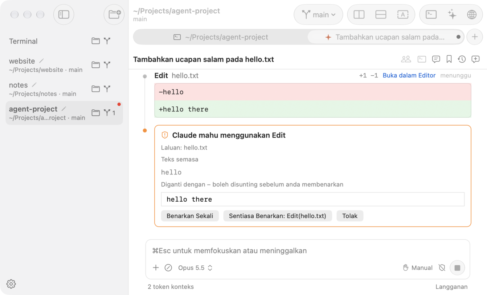

<p>&nbsp;&nbsp;&nbsp;</p>

# Tapa

**Terminal asli yang pantas untuk macOS, yang kini turut memberi ruang kepada ejen, fail dan halaman anda.**

Tapa ialah terminal terlebih dahulu: teras VT sendiri dan pemapar Metal, tab dan pisahan asli macOS, terminal pantas yang meluncur masuk dengan satu pintasan, integrasi shell dengan blok arahan, dan medan input pilihan dengan cadangan gaya Warp. Di sekelilingnya, Tapa berkembang menjadi adik kepada [Dango](https://github.com/sventmueller/dango): bar sisi ruang kerja, satu bagi setiap folder projek, masing-masing dengan terminalnya, tab ejen untuk Claude, Codex, OpenCode, Antigravity dan ejen ACP lain, tab pelayar, penyunting dengan senarai fail dan panel Git, serta pratonton Markdown daripada [Splat](https://github.com/sventmueller/splat) dengan formula dan rajah. Tiada apa-apa yang dikonfigurasikan oleh folder projek akan berjalan sehingga anda mempercayai ruang kerjanya. Tapa ditulis dalam Rust di atas kawalan AppKit tulen, menyokong 35 bahasa, tidak memerlukan akaun dan tidak mempunyai telemetri.

[](https://github.com/sventmueller/tapa/releases/latest/download/Tapa.dmg)

**[Muat turun Tapa.dmg](https://github.com/sventmueller/tapa/releases/latest/download/Tapa.dmg)**: ditandatangani dan dinotarisasi oleh Apple, untuk macOS 14 atau lebih baharu pada Apple Silicon dan Intel.

**Jumpa pepijat?** [Buka isu](https://github.com/sventmueller/tapa/issues/new/choose) dan nyatakan dengan shell, ejen atau program mana ia berlaku. Jika Tapa berguna kepada anda, [bintang di GitHub](https://github.com/sventmueller/tapa) membantu orang lain menemuinya.

[](https://www.rust-lang.org) [](https://www.apple.com/macos/)  [](https://github.com/madsmtm/objc2) [](https://developer.apple.com/metal/) [](https://agentclientprotocol.com)    [](#lesen)

[Bahasa Indonesia](../id/README.md) · **Bahasa Melayu** · [Català](../ca/README.md) · [Čeština](../cs/README.md) · [Dansk](../da/README.md) · [Deutsch](../de/README.md) · [English](../../../README.md) · [Español](../es/README.md) · [Français](../fr/README.md) · [Hrvatski](../hr/README.md) · [Italiano](../it/README.md) · [Magyar](../hu/README.md) · [Nederlands](../nl/README.md) · [Norsk](../no/README.md) · [Polski](../pl/README.md) · [Português (Brasil)](../pt_BR/README.md) · [Português (Portugal)](../pt_PT/README.md) · [Română](../ro/README.md) · [Slovenčina](../sk/README.md) · [Slovenščina](../sl/README.md) · [Suomi](../fi/README.md) · [Svenska](../sv/README.md) · [Tiếng Việt](../vi/README.md) · [Türkçe](../tr/README.md) · [Ελληνικά](../el/README.md) · [Русский](../ru/README.md) · [Українська](../uk/README.md) · [עברית](../he/README.md)‎ · [العربية](../ar/README.md)‎ · [हिन्दी](../hi/README.md) · [ไทย](../th/README.md) · [한국어](../ko/README.md) · [日本語](../ja/README.md) · [简体中文](../zh-Hans/README.md) · [繁體中文](../zh-Hant/README.md)

## Kandungan

- [Ciri-ciri sepintas lalu](#ciri-ciri-sepintas-lalu)
- [Keperluan](#keperluan)
- [Pemasangan](#pemasangan)
- [Bermula](#bermula)
- [Ruang kerja](#ruang-kerja)
- [Terminal](#terminal)
  - [Tab dan pisahan](#tab-dan-pisahan)
  - [Integrasi shell dan blok arahan](#integrasi-shell-dan-blok-arahan)
  - [Medan input dan cadangan](#medan-input-dan-cadangan)
  - [Carian, pemilihan dan penyalinan](#carian-pemilihan-dan-penyalinan)
  - [Terminal pantas](#terminal-pantas)
- [Ejen](#ejen)
- [Penyunting, fail dan Git](#penyunting-fail-dan-git)
- [Pratonton](#pratonton)
- [Pelayar](#pelayar)
- [Perencanaan](#perencanaan)
- [Seting](#seting)
- [Penampilan dan kebolehcapaian](#penampilan-dan-kebolehcapaian)
- [Bahasa](#bahasa)
- [Pintasan papan kekunci](#pintasan-papan-kekunci)
- [Kepercayaan](#kepercayaan)
- [Privasi dan keselamatan](#privasi-dan-keselamatan)
- [Had yang diketahui](#had-yang-diketahui)
- [Untuk pembangun](#untuk-pembangun)
  - [Komponen pihak ketiga](#komponen-pihak-ketiga)
- [Lesen](#lesen)

## Ciri-ciri sepintas lalu

- **Terminal pantas tersendiri.** Tapa menghurai dengan teras VT sendiri dan melukis dengan Metal pada satu thread bagi setiap paparan, mengikut kadar segar semula paparan, dan hanya bahagian yang berubah. Ia lulus 262 semakan esctest berbanding 121 bagi teras Alacritty, dan setiap perubahan padanya diukur berbanding Ghostty dengan versi yang ditetapkan.
- **Asli hingga ke tulang.** Tab macOS sebenar, pemulihan tetingkap, menu, menu Perkhidmatan, pemberitahuan, Entri Papan Kekunci Selamat, perencanaan dan kaedah input. Tiada Electron, dan WebKit hanya di tempat halaman atau pratonton memerlukannya.
- **Ruang kerja.** Bar sisi memuatkan satu ruang kerja bagi setiap folder projek, masing-masing dengan tab, cabang dan panelnya sendiri. Ruang kerja "Terminal" di bahagian atas bermula baharu setiap kali; semua yang lain kekal sehingga anda membuangnya.
- **Ejen dalam paparan sembang asli.** Claude, Codex, OpenCode, Antigravity, Gemini CLI dan ejen Agent Client Protocol lain berjalan dalam tab tersendiri, dengan jawapan, panggilan alat, diff dan permintaan kebenaran dalam satu garis masa. Tapa memasang dan mengemas kininya apabila diminta.
- **Integrasi shell dan blok arahan** untuk zsh, bash dan fish, juga melalui `ssh`: lompat dari prompt ke prompt, pilih, salin, simpan dan lipat output sesuatu arahan, lihat arahan yang gagal dan berapa lama setiap satunya berjalan.
- **Medan input seperti Warp, jika anda mahu.** Edit baris arahan sebagai teks, dengan cadangan daripada sejarah anda, daripada spesifikasi bagi lebih 700 alat baris arahan dan daripada keadaan projek, semuanya pada Mac anda.
- **Fail, Git dan pelayar di sebelah shell.** Penyunting dengan warna sintaks, senarai fail, panel Git dengan staging, commit, cabang dan worktree, pratonton Markdown dengan formula dan rajah, serta tab pelayar.
- **Berhati-hati dengan folder anda.** Ruang kerja yang belum anda percayai tidak memulakan apa-apa yang dikonfigurasikan oleh foldernya: tiada git hook, tiada pelayan MCP projek, tiada seting projek untuk ejen, tiada JavaScript dalam halaman failnya.
- **Peribadi.** Tiada akaun, tiada telemetri. Tapa menggunakan rangkaian hanya apabila anda memintanya, dan sejarah yang dipulihkan pada cakera disulitkan dengan kunci dalam rantai kunci anda.
- **Dalam bahasa anda.** Antara muka tersedia dalam 35 bahasa: Arab, Katalan, Cina (Ringkas), Cina (Tradisional), Croatia, Czech, Denmark, Belanda, Inggeris, Finland, Perancis, Jerman, Yunani, Ibrani, Hindi, Hungary, Indonesia, Itali, Jepun, Korea, Melayu, Norway, Poland, Portugis (Brazil), Portugis (Portugal), Romania, Rusia, Slovak, Slovenia, Sepanyol, Sweden, Thai, Turki, Ukraine dan Vietnam.

## Keperluan

- macOS 14 Sonoma atau lebih baharu, pada Apple Silicon atau Intel. Tapa dibangunkan dan diuji pada macOS 27.
- zsh, bash atau fish untuk integrasi shell; shell lain berjalan tanpanya.
- Untuk tab ejen, ejen yang ingin anda gunakan, sama ada sudah dipasang atau dipasang oleh Tapa apabila anda memintanya (lihat [Ejen](#ejen)).

## Pemasangan

**Daripada imej cakera.** Setiap keluaran ialah imej cakera, `Tapa-<version>.dmg`, dengan satu app universal untuk Apple Silicon dan Intel, ditandatangani dengan Developer ID dan dinotarisasi oleh Apple. Bukanya dan seret Tapa ke folder Aplikasi.

**Dengan Homebrew.** Cask dalam tap tersendiri memasang imej cakera yang sama:

```sh
brew install --cask sventmueller/tap/tapa
```

**Kemas kini.** Tapa daripada imej cakera atau Homebrew mengemas kini dirinya sendiri melalui [Sparkle](https://sparkle-project.org). Pada pelancaran kali kedua, ia bertanya sama ada ia boleh mencari kemas kini sendiri; sehingga anda bersetuju, ia tidak membuat sebarang permintaan. **Tapa › Semak Kemas Kini…** menyemak serta-merta. Tapa memasang kemas kini hanya jika ia membawa tandatangan pembangun. Binaan anda sendiri tidak mempunyai pengemas kini.

**Daripada kod sumber.** Lihat [Untuk pembangun](#untuk-pembangun).

**Sebagai terminal lalai.** Tapa boleh membuka skrip shell (`.command`, `.tool`), folder yang dilepaskan pada ikonnya dan pautan `ssh://`. Pilihnya dalam Finder dengan **Fail › Dapatkan Info › Buka dengan**.

## Bermula

1. **Tetingkap** mempunyai bar sisi ruang kerja di sebelah kiri, tab ruang kerja yang dipilih di bahagian atas dan bar alat di atasnya. ⌃⌘S menunjukkan dan menyembunyikan bar sisi.
2. **Ruang kerja baharu** datang daripada butang folder di bahagian atas bar sisi, atau **Shell › Ruang Kerja Baharu…** (⇧⌘N): pilih salah satu folder terkini atau **Pilih Folder…**.
3. **Tab baharu** bermula dalam folder ruang kerja: ⌘T untuk terminal, butang di sebelah kanan bar alat untuk tab terminal, ejen atau pelayar, atau **+** di hujung bar tab.
4. **Seting** dibuka dengan ⌘, atau gear di bahagian bawah bar sisi.
5. **Palet arahan** (⇧⌘P) mencari setiap arahan mengikut nama, dan **Cari Tab…** (⌘P) setiap tab dalam setiap ruang kerja.

Bar alat memuatkan, dari kiri, menu tarik turun cabang bagi repositori ruang kerja, butang untuk memisahkan terminal ke kanan dan ke bawah serta untuk menunjukkan medan input, dan butang untuk tab terminal, ejen dan pelayar baharu. Butang pisahan dan medan input berwarna kelabu selagi tiada tab terminal di hadapan.

## Ruang kerja

Ruang kerja ialah folder bersama tabnya. Barisnya dalam bar sisi menunjukkan nama, folder dan cabang Git, dan di sebelah kanan butang untuk senarai fail dan panel Git. Klik pada salah satunya menunjukkan panel itu di tempat senarai ruang kerja; **Ruang Kerja** di bahagian atas membawa anda kembali.

- **Ruang kerja "Terminal"** sentiasa berada di atas. Ia bermula baharu pada setiap pelancaran, dalam folder yang dinamakan oleh seting, dengan satu terminal kosong. Tiada apa-apa daripadanya disimpan, dan ia tidak boleh dinamakan semula atau dibuang.
- **Setiap ruang kerja lain kekal** sehingga anda membuangnya, walaupun tanpa tab. Tapa menyimpan namanya, tab, kandungan terminalnya (setakat yang dibenarkan oleh seting pemulihan), sesi ejennya dan kedudukan tetingkap. Program yang masih berjalan tamat apabila Tapa ditutup.
- **Menamakan semula.** Klik pensel selepas nama, klik nama ruang kerja yang dipilih, atau pilih **Shell › Namakan Semula Ruang Kerja**. Nama itu disimpan serta-merta.
- **Status.** Titik hijau pada baris bermaksud ejen ruang kerja itu sedang bekerja, juga dengan subejen atau di latar belakang; titik merah bermaksud salah satunya sedang menunggu anda. Terminal tidak menandakan apa-apa di situ.
- **Bertukar.** ⌃⌘[ dan ⌃⌘] berpindah antara ruang kerja. Tetingkap kekal di tempatnya, dan tab ruang kerja yang dipilih mengambil tempat tab yang lain.
- **Worktree.** **Worktree Baharu…** dalam menu tarik turun cabang pada bar alat mencipta worktree Git pada cabang baharu dan membukanya sebagai ruang kerja tersendiri.

Apabila tab terakhir sesuatu ruang kerja ditutup, ruang kerja itu kekal dalam senarai. Apabila semua tab ditutup, hanya tetingkap yang hilang; ikon Dock atau ⌘N membawanya kembali bersama ruang kerjanya.

## Terminal

Tapa berjalan pada terasnya sendiri, `term-vt`. Ia memahami xterm dan VT520 dengan protokol papan kekunci Kitty, hiperpautan OSC 8, akses papan keratan OSC 52 dengan kebenaran berasingan untuk membaca, output segerak, garis bawah berwarna dan beralun, truecolor, pertanyaan warna, laporan mod cerah dan gelap kepada program, tampalan berpembatas (bracketed paste), peristiwa fokus dan pelaporan tetikus. Teks disusun semula apabila saiz tetingkap berubah, termasuk sejarahnya. Ligatur, ciri fon, simbol Nerd Font tanpa fon yang ditampal, serta aksara lukisan kotak, Powerline dan Braille yang tepat hingga piksel tersedia secara terbina dalam.

### Tab dan pisahan

- **Tab** ialah tab macOS sendiri: seretnya untuk menyusun semula atau keluar ke tetingkap tersendiri, **Tunjukkan Semua Tab** (⇧⌘\\), ⌘1 hingga ⌘8, ⌘9 untuk tab terakhir, dan ⇧⌘[ / ⇧⌘] untuk bertukar. Setiap tab menunjukkan ikon jenisnya di hadapan tajuknya.
- **Pisahan.** **Pisah ke Kanan** (⌘D atau ⌃⌘T) dan **Pisah ke Bawah** (⇧⌘D atau ⌃⌥⌘T), bersarang sedalam yang anda mahu. Seret pembahagi, alihkannya dengan ⌃⌘ dan kekunci anak panah, **Maksimumkan Anak Tetingkap** (⌃⇧⌘↩), **Samakan Anak Tetingkap** (⌃⌘=), dan berpindah antara anak tetingkap dengan ⌘[ dan ⌘].
- **Folder kerja.** Tab, tetingkap dan pisahan baharu bermula dalam folder terminal yang berada di hadapan; seting menentukan perkara ini bagi setiap satu daripada ketiga-tiganya.
- **Menutup.** Tapa bertanya sebelum ia menutup tab, tetingkap atau app semasa program sedang berjalan di dalamnya.
- **Pemulihan.** Selepas mula semula, ruang kerja, tab, anak tetingkap, folder dan baris terakhir setiap terminal kembali. Rahsia seperti token dan kata laluan disembunyikan sebelum apa-apa disimpan.

### Integrasi shell dan blok arahan

Tapa menyediakan integrasi shell untuk zsh, bash dan fish dengan sendirinya, tanpa menyentuh fail konfigurasi anda, dan membawanya bersama apabila anda `ssh` ke hos lain. Dengannya, setiap arahan dan outputnya membentuk satu blok:

- **Prompt.** ⌘↑ dan ⌘↓ melompat ke prompt sebelumnya dan seterusnya. Klik dalam baris arahan mengalihkan kursor ke situ.
- **Blok.** **Pilih Blok** (⇧⌘A), **Salin Output** (⌥⌘C), **Simpan Output…** (⌥⌘S) dan **Kuncupkan/Kembangkan Blok** (⇧⌘↩). Di atas blok di bawah penuding, butang menunjukkan status, tempoh dan tindakan yang sama.
- **Arahan yang gagal** ditandakan, dan arahan yang masih berjalan kekal kelihatan di bahagian atas semasa outputnya menatal.
- **Penanda buku.** **Tambah/Buang Penanda Buku** (⇧⌘M) menandakan satu baris; ⇧⌘↑ dan ⇧⌘↓ melompat antara penanda buku.
- **Pemberitahuan** muncul apabila program memintanya (OSC 9 dan OSC 777) dan terminal tidak berada di hadapan, dan bar kemajuan (OSC 9;4) ditunjukkan pada tab dan pada ikon Dock.

### Medan input dan cadangan

Medan input menukar baris arahan menjadi medan teks di bahagian bawah anak tetingkap, seperti dalam Warp, dengan cip untuk folder dan cabang Git di atasnya. **Tunjukkan/Sembunyikan Medan Input** (⌘I) atau butang dalam bar alat menghidupkan dan mematikannya untuk satu terminal; **Seting › Input** menghidupkannya untuk terminal baharu. Ia memerlukan integrasi shell dan memberi laluan kepada program skrin penuh seperti vim, htop atau claude.

- **Return** menghantar seluruh medan ke shell, teks berbilang baris sebagai satu tampalan; shell menjalankan dan mengingatinya seperti biasa. Jika shell meminta lebih, medan menyerahkan kekunci kembali kepadanya sehingga prompt seterusnya.
- **↑, ↓ dan ⌃R** mencari sejarah anda, dengan folder, cabang dan kod keluar setiap arahan semasa ia dijalankan.
- **Tab** melengkapkan dengan spesifikasi bagi lebih 700 alat baris arahan, laluan, dan nilai langsung seperti cabang git, bekas docker, sumber kubectl, hos ssh, skrip `package.json` serta sasaran make, just dan cargo.
- **Kekunci Vim** dalam medan ini ialah suis dalam seting yang sama.
- **Arahan seterusnya sebelum anda menaip**: apa yang biasanya menyusul dalam projek ini (selepas `git add` datang `git commit`), apa yang diminta oleh keadaan projek (fail lock yang lebih baharu daripada `node_modules`), dan pembetulan selepas "command not found", daripada salah taip atau daripada indeks Homebrew setempat anda.

Tanpa medan input, cadangan ditunjukkan sebagai teks kelabu di belakang kursor, dan → menerimanya. Shell dengan cadangan automatiknya sendiri, seperti fish atau zsh-autosuggestions, mengekalkan cadangan masing-masing. Cadangan tidak pernah menggunakan rangkaian, dan ia memulakan program hanya daripada `PATH` anda sendiri, tidak pernah daripada folder projek.

**Menampal.** Tampalan berbilang baris boleh ditunjukkan sebelum ia dijalankan (**Tunjukkan tampalan berbilang baris dahulu**). Fail yang dilepaskan pada terminal tiba sebagai laluan berpetik; ⌥←/→, ⌘←/→ dan ⌘⌫ mengalih dan memadam mengikut perkataan dan baris seperti dalam mana-mana medan teks Mac.

### Carian, pemilihan dan penyalinan

- **Cari** (⌘F) mencari sejarah dengan ungkapan nalar, huruf besar-kecil dan perkataan penuh, serta mengira padanan; bar tatal menandakannya bersama prompt dan ralat.
- **Pemilihan pintar.** Klik dua kali memilih URL, laluan, cincangan atau alamat IP secara keseluruhan, dan seret dengan ⌥ memilih segi empat tepat. Pautan ditemui walaupun tanpa OSC 8; ⌘-klik membukanya, dan membuka laluan dalam Dango jika ia dipasang.
- **Pilih dengan Papan Kekunci** (⇧⌘C) mengalihkan pilihan dengan kekunci Vim.
- **Salin dengan Format** (⇧⌥⌘C) mengekalkan warna dan gaya; salin semasa memilih ialah satu seting. **Kosongkan** (⌘K) mengosongkan terminal.

### Terminal pantas

**Tunjukkan/Sembunyikan Terminal Pantas** (⌃⌥⌘Space) meluncurkan terminal masuk dari tepi skrin, di atas app lain dan di atas ruang skrin penuh, tanpa bertukar app. Tepi skrin, saiznya dan sama ada ia bersembunyi apabila anda klik di tempat lain ialah seting. Sesinya terus berjalan semasa ia tersembunyi.

## Ejen

Tab ejen menjalankan ejen pengekodan dalam folder ruang kerja, dalam paparan ejen asli daripada Dango.

| Ejen | Cara ia berjalan | Apa yang diperlukan |
|---|---|---|
| Claude | arahan `claude`, dihubungi melalui protokol stream-json miliknya | `claude` dipasang dan didaftar masuk; Tapa memasangnya dengan pemasang Claude sendiri apabila anda memintanya |
| Codex | `codex app-server`, atau `codex-acp` untuk Codex yang lebih lama | `codex` didaftar masuk; Tapa memasang penyesuai berversi tetap apabila anda memintanya |
| OpenCode | `opencode serve`, atau `opencode acp` untuk OpenCode yang lebih lama | `opencode` anda sendiri pada `PATH`, atau muat turun berversi tetap |
| Antigravity | `agy acp` | `agy` anda sendiri pada `PATH`, atau muat turun berversi tetap |
| Gemini CLI | `gemini --acp`, ditawarkan sebaik sahaja anda menghidupkannya dalam **Seting › Ejen** | `gemini` anda sendiri, atau muat turun berversi tetap |
| Ejen ACP lain | daripada registri ACP, dimuatkan hanya apabila anda memintanya | apa yang dinamakan oleh entri registri; entri tanpa checksum dipasang hanya selepas anda mengesahkan |

Tapa menggunakan daftar masuk setiap ejen sendiri dan tidak menyimpan sebarang bukti kelayakan ejen. Ejen yang ditemui pada `PATH` shell log masuk anda didahulukan; jika tidak, Tapa menjalankan versi yang dipasangnya ke dalam folder datanya sendiri, tidak pernah program daripada ruang kerja.

- **Garis masa** menunjukkan jawapan, panggilan alat bersama output dan diff-nya, soalan dan permintaan kebenaran. **Benarkan Sekali**, **Sentiasa Benarkan** dan **Tolak** menjawab sesuatu permintaan, dan suntingan boleh diubah sebelum anda membenarkannya.
- **Status.** Tab dan baris ruang kerja menunjukkan titik hijau semasa ejen bekerja dan titik merah semasa ia menunggu anda, dan pemberitahuan memaklumkan anda apabila ia menunggu ketika anda melihat ke tempat lain.
- **Medan mesej** di bahagian bawah menerima prompt anda, fail yang dilepaskan padanya dan perencanaan. ⌘Esc mengalihkan fokus papan kekunci ke dalamnya dan kembali. Model dan mod kebenaran boleh dipilih di situ untuk sesi itu.
- **Seting › Ejen** menetapkan untuk sesi baharu mod kebenaran (Claude, Codex), model (Claude, Codex, OpenCode) dan usaha pemikiran (Claude, Codex), serta ejen mana yang ditawarkan oleh tab baharu. Ia menunjukkan lokasi program setiap ejen, dengan **Pasang…**, **Kemas Kini ke …** dan **Kembali ke …** untuk versi sebelumnya, serta **Muatkan Daftar** untuk registri ACP. Peraturan yang disimpan oleh Claude dengan "Sentiasa Benarkan" boleh dilihat dan dibuang di situ.
- **Muat turun yang disemak.** Arkib disemak berbanding SHA-256 masing-masing, pakej npm berbanding integriti dalam fail lock-nya, dan pakej tanpa versi tetap ditolak. Ejen yang tiada juga menawarkan pemasangannya dalam tabnya sendiri.

## Penyunting, fail dan Git

- **Senarai fail** sesuatu ruang kerja menunjukkan foldernya sebagai pepohon, dikemas kini apabila fail berubah, dengan fail yang diabaikan Git dimalapkan jika anda mahu. Klik membuka fail sebagai tab pratonton, yang digantikan oleh klik seterusnya sehingga anda mengeditnya; klik dua kali mengekalkannya.
- **Penyunting** membuka fail dalam tab ruang kerja, dengan warna sintaks, beberapa karet, lipatan, inden daripada `.editorconfig`, kekunci Vim pilihan dan tanda bagi apa yang berubah sejak commit terakhir. Ia menyedari apabila fail berubah pada cakera atau mengandungi penanda konflik. Fail Markdown mendapat bar format dan **Buka dalam Splat**. **Simpan** (⌘S), **Simpan Sebagai…** dan **Simpan Semua** berfungsi seperti biasa, dan Tapa bertanya sebelum ia menutup teks yang belum disimpan.
- **Selepas ranap**, teks yang belum disimpan kembali: Tapa menyimpan salinan tersulitnya semasa anda menaip.
- **Panel Git** menunjukkan perubahan yang telah dan belum di-stage, melakukan stage dan unstage pada fail dan hunk tunggal, membuat commit (⌘↩), meminda commit terakhir, membuat commit lalu push, melakukan fetch, dan mengendalikan cabang, stash, cherry-pick dan konflik, dengan sejarah commit di bawahnya. Klik pada fail menunjukkan diff-nya.
- **Menu tarik turun cabang** dalam bar alat menukar dan mencipta cabang serta membuat worktree.

Penyunting tidak memulakan pemformat atau pelayan bahasa. Untuk IDE penuh dengan pelayan bahasa dan penyahpepijat, gunakan [Dango](https://github.com/sventmueller/dango).

## Pratonton

- **Markdown** ditunjukkan di sebelah penyuntingnya melalui pemapar Splat: GitHub Flavored Markdown dengan formula, rajah dan gambar, menatal perenggan demi perenggan bersama teks.
- **Gambar** dibuka dalam tab tersendiri, PDF melalui PDFKit, dan bunyi, filem, fon serta dokumen pejabat melalui Quick Look.
- **Penyahkodan terasing.** Setiap gambar daripada sumber yang tidak dipercayai (fail projek, Markdown, lampiran dan tampalan ejen) dinyahkod dalam perkhidmatan `Decoder.xpc` milik Splat, dalam App Sandbox tersendiri tanpa fail atau rangkaian, tidak pernah dalam app.

## Pelayar

**Tab Pelayar Baharu** (⇧⌘B) membuka tab WebKit dalam ruang kerja. Medan alamat menerima alamat atau perkataan untuk enjin carian pilihan anda (DuckDuckGo, Google, Bing atau Startpage); ⌘L, ⌘R, ⌘[ dan ⌘] berfungsi seperti dalam Safari. Halaman daripada `localhost` berjalan seperti biasa, untuk pelayan pembangunan projek anda. Fail HTML sesuatu ruang kerja hanya boleh membaca foldernya sendiri, dan dalam ruang kerja yang belum anda percayai, ia tidak menjalankan JavaScript.

## Perencanaan

Rencanakan ke dalam medan mesej ejen atau penyunting dengan butang mikrofon atau **Edit › Mulakan Perencanaan** (⌃⌥D). Pengecaman pertuturan ialah milik [Lowspeak](https://github.com/sventmueller/lowspeak), yang tidak perlu dipasang. **Seting › Perencanaan** memilih transkripsi dalam talian dengan OpenAI atau Groq, atau model setempat Whisper dan Parakeet yang menyimpan rakaman pada Mac anda, serta bahasa, pasca pemprosesan, mikrofon dan perbendaharaan kata anda sendiri. Kunci untuk OpenAI dan Groq disimpan dalam rantai kunci anda. Perencanaan hanya terdapat dalam binaan keluaran.

## Seting

**Tapa › Seting…** (⌘,) mempunyai anak tetingkap Umum, Fon, Warna, Kursor, Terminal, Input, Penyunting, Ejen, Perencanaan, Profil dan Pintasan Papan Kekunci. Semuanya menulis satu fail TOML, `config.toml` dalam folder Tapa di bawah `~/Library/Application Support`, yang juga boleh anda edit secara manual; Tapa memuatkannya semula semasa ia berjalan, dan **Muat Semula Seting** (⇧⌘,) melakukannya serta-merta.

- **Empat saiz fon** di bawah Umum: Antara muka (bar sisi, panel, senarai fail, panel Git dan tajuk tab), Penyunting (teks, nombor baris dan pratonton Markdown), Terminal dan Ejen. ⌘+, ⌘− dan ⌘0 menukar saiz terminal yang berada di hadapan.
- **Penampilan:** Cerah, Gelap atau Sama seperti Sistem.
- **Warna.** Satu tema untuk mod cerah dan satu untuk mod gelap, dalam format tema Ghostty, dengan kontras minimum yang memastikan teks boleh dibaca pada tema yang lemah. Tema anda sendiri diletakkan dalam folder tema.
- **Profil** menghimpunkan fon, warna, shell, persekitaran dan folder.
- **Pintasan** semuanya boleh diubah, dan konflik ditunjukkan.

## Penampilan dan kebolehcapaian

- **Mod gelap** mengikut sistem atau pilihan anda; warna aksen, Kurangkan Gerakan dan Tingkatkan Kontras dihormati.
- **VoiceOver** membaca baris dan prompt terminal serta mengumumkan output baharu; bar sisi, tab, butang bar alat dan kad garis masa ejen dinamakan.
- **Papan kekunci.** Setiap arahan mempunyai item menu dan pintasan, dan Akses Papan Kekunci Penuh mencapai setiap kawalan.
- **Saiz.** Empat saiz fon dalam seting menskalakan antara muka, penyunting, terminal dan ejen secara berasingan.
- **Kanan ke kiri.** Antara muka dicerminkan dalam bahasa Arab dan Ibrani, manakala grid terminal kekal dari kiri ke kanan.

Butiran dan jurang yang diketahui terdapat dalam [ACCESSIBILITY.md](../../../ACCESSIBILITY.md).

## Bahasa

Antara muka diterjemahkan ke dalam 35 bahasa: Arab, Katalan, Cina (Ringkas), Cina (Tradisional), Croatia, Czech, Denmark, Belanda, Inggeris, Finland, Perancis, Jerman, Yunani, Ibrani, Hindi, Hungary, Indonesia, Itali, Jepun, Korea, Melayu, Norway, Poland, Portugis (Brazil), Portugis (Portugal), Romania, Rusia, Slovak, Slovenia, Sepanyol, Sweden, Thai, Turki, Ukraine dan Vietnam.

Tapa mengikut susunan bahasa dalam **Seting Sistem › Umum › Bahasa & Rantau**; anda juga boleh memilih bahasa untuk Tapa sahaja di situ di bawah **Aplikasi**. Tanpa terjemahan untuk bahasa anda, ia menggunakan bahasa Inggeris.

## Pintasan papan kekunci

| Tindakan | Pintasan |
|---|---|
| Tetingkap, ruang kerja, tab baharu | ⌘N, ⇧⌘N, ⌘T |
| Tab pelayar baharu | ⇧⌘B |
| Fail baharu, buka fail | ⌥⌘N, ⌘O |
| Tutup anak tetingkap atau tab, tutup tab, tutup tetingkap | ⌘W, ⌥⌘W, ⇧⌘W |
| Pisah ke kanan, pisah ke bawah | ⌘D atau ⌃⌘T, ⇧⌘D atau ⌃⌥⌘T |
| Maksimumkan anak tetingkap, samakan anak tetingkap, tutup anak tetingkap | ⌃⇧⌘↩, ⌃⌘=, ⌃⇧⌘W |
| Alihkan pembahagi | ⌃⌘←, ⌃⌘→, ⌃⌘↑, ⌃⌘↓ |
| Anak tetingkap seterusnya, sebelumnya | ⌘], ⌘[ |
| Tab seterusnya, sebelumnya; tab 1 hingga 8, tab terakhir | ⇧⌘], ⇧⌘[; ⌘1 hingga ⌘8, ⌘9 |
| Ruang kerja seterusnya, sebelumnya | ⌃⌘], ⌃⌘[ |
| Cari tab, palet arahan | ⌘P, ⇧⌘P |
| Tunjukkan atau sembunyikan bar sisi, medan input | ⌃⌘S, ⌘I |
| Terminal pantas | ⌃⌥⌘Space |
| Cari, cari seterusnya, cari sebelumnya | ⌘F, ⌘G, ⇧⌘G |
| Prompt sebelumnya, seterusnya | ⌘↑, ⌘↓ |
| Pilih blok, salin output, simpan output, lipat blok | ⇧⌘A, ⌥⌘C, ⌥⌘S, ⇧⌘↩ |
| Tambah atau buang penanda buku; penanda buku sebelumnya, seterusnya | ⇧⌘M; ⇧⌘↑, ⇧⌘↓ |
| Pilih dengan papan kekunci | ⇧⌘C |
| Salin dengan format | ⇧⌥⌘C |
| Kosongkan | ⌘K |
| Atas, bawah, halaman atas, halaman bawah | ⌘Home, ⌘End, ⌘PageUp, ⌘PageDown |
| Lebih besar, lebih kecil, saiz asal (terminal) | ⌘+, ⌘−, ⌘0 |
| Medan mesej tab ejen | ⌘Esc |
| Mulakan perencanaan | ⌃⌥D |
| Seting, muat semula seting | ⌘,, ⇧⌘, |

Setiap pintasan boleh diubah dalam **Seting › Pintasan Papan Kekunci** atau dalam bahagian `[keys]` fail seting.

## Kepercayaan

Folder projek boleh menyebabkan program berjalan sebaik sahaja sesuatu bermula di dalamnya: git hook dan seting repositori seperti `core.fsmonitor`, hook ejen, pelayan MCP projek dan seting projek bagi ejen. Oleh itu, ruang kerja baharu tidak dipercayai.

- **Tidak dipercayai:** ejen bermula tanpa hook, pelayan MCP dan konfigurasi projek (Claude dengan `--setting-sources=user --strict-mcp-config`, Codex dengan folder ditandakan sebagai tidak dipercayai, OpenCode tanpa konfigurasi projek). Git berjalan secara dineutralkan: tiada hook, penapis, pemacu diff, fsmonitor, `sshCommand` atau pager, dan hanya pembantu bukti kelayakan global. Fail HTML dibuka tanpa JavaScript. Panel Git dan tab ejen menyatakannya dan menawarkan untuk mempercayai ruang kerja.
- **Dipercayai:** **Shell › Percayai Ruang Kerja** memuatkan semua itu seperti yang dikehendaki folder. **Tarik Balik Kepercayaan** menariknya semula. Kepercayaan disimpan bagi setiap ruang kerja.

Apa pun tahap kepercayaannya, Tapa tidak pernah menjalankan program daripada folder projek dengan sendirinya: cadangan memulakan program hanya daripada `PATH` anda di luar projek, dan bar sisi membaca keadaan Git daripada fail `.git`. Ruang kerja dalam folder rumah anda, seperti "Terminal", bukanlah projek: program di bawah `~` seperti `~/.local/bin/claude` dikira sebagai milik anda sendiri di situ.

## Privasi dan keselamatan

- **Tiada telemetri, tiada akaun.** Tapa tidak melaporkan apa-apa tentang cara anda menggunakannya dan berfungsi sepenuhnya di luar talian. Ia menggunakan rangkaian hanya apabila anda meminta: untuk memasang atau mengemas kini ejen, untuk memuatkan registri ACP, untuk menyemak kemas kini setelah anda bersetuju, dan untuk halaman yang anda buka dalam tab pelayar. Ejen itu sendiri berhubung dengan penyedianya seperti biasa.
- **Sejarah pada cakera** untuk memulihkan sesi disulitkan dengan kunci dalam rantai kunci anda, boleh dimatikan, dan rahsia seperti kunci API, token dan kata laluan disembunyikan sebelum ia ditulis. Salinan teks penyunting yang belum disimpan disulitkan dengan kunci yang sama.
- **Entri Papan Kekunci Selamat** dihidupkan dengan sendirinya pada gesaan kata laluan, dan boleh dihidupkan secara kekal dalam menu app.
- **Jujukan escape** yang boleh membocorkan atau menyuntik data, seperti laporan tajuk, bacaan papan keratan dan helah tampalan, disekat atau dimintakan kebenaran terlebih dahulu. Penghurai diuji dengan fuzzing dalam CI.
- **Penyahkodan terasing** bagi gambar daripada sumber yang tidak dipercayai, lihat [Pratonton](#pratonton).
- **Penandatanganan kod** dengan Hardened Runtime. macOS mengaitkan akses program dalam terminal kepada Tapa, jadi ia membawa perihalan penggunaan bagi setiap perkhidmatan yang dilindungi.

Masalah keselamatan dilaporkan secara peribadi, lihat [SECURITY.md](../../../SECURITY.md).

## Had yang diketahui

- **Belum ada gambar sebaris** dalam terminal: grafik Kitty, Sixel dan gambar iTerm2 dirancang selepas 1.0.
- **Tiada mod kawalan tmux**, dan sesi tidak kekal selepas Tapa ditutup.
- **Teks kanan ke kiri** dalam grid terminal kekal dari kiri ke kanan.
- **⌘+ dan ⌘−** hanya mengubah terminal yang berada di hadapan.
- **Penyunting** tidak mempunyai pelayan bahasa, pemformat atau penyahpepijat, dengan sengaja; Dango mempunyainya.
- **Perencanaan** hanya terdapat dalam binaan keluaran, bukan dalam binaan nyahpepijat.
- **VoiceOver** belum disemak dari awal hingga akhir oleh manusia.

## Untuk pembangun

Anda memerlukan macOS 14 atau lebih baharu dengan Xcode Command Line Tools, Rust seperti yang dinamakan oleh `rust-toolchain.toml` (rustup dengan kedua-dua sasaran Mac untuk binaan universal), salinan checkout [splat](https://github.com/sventmueller/splat) dan [lowspeak](https://github.com/sventmueller/lowspeak) di sebelah repositori ini (`../splat`, `../lowspeak`), dan cmake untuk binaan dengan perencanaan.

| Arahan | Fungsinya |
|---|---|
| `make help` | menyenaraikan sasaran |
| `cargo xtask run` | membina app nyahpepijat dan membukanya |
| `make build` | membina app keluaran dengan perencanaan ke dalam `target/release`, ditandatangani secara ad hoc untuk Mac ini |
| `make lint` | pemformatan, clippy dengan amaran sebagai ralat, bentuk fail dan teks antara muka |
| `make check` | `lint`, kemudian semua ujian; tidak memerlukan tetingkap atau rangkaian |
| `make selftest STEPS="split_right,type:ls\n,shot:x"` | mengendalikan app dan meninggalkan gambar tetingkap dalam `target/selftest/` |
| `make esctest`, `make vttest` | menjalankan esctest dan vttest terhadap kedua-dua teras dalam app |
| `make perf` | penanda aras berbanding Ghostty berversi tetap; hanya bermakna pada Mac yang melahu |
| `make fuzz` | sasaran fuzzing dengan cargo-fuzz |
| `make release` | larian percubaan keluaran: app universal dengan perencanaan, imej cakeranya, suapan kemas kini dan cask dalam `target/release-dry-run`; tidak menghantar apa-apa ke mana-mana |
| `make release-notarized` | versi semasa yang ditandatangani dengan Developer ID, dinotarisasi oleh Apple dan di-staple, ke dalam `dist/`; `Cargo.toml` tidak berubah |
| `make deploy` | menotarisasi versi seterusnya, meng-commit `Cargo.toml`, memuat naik draf keluaran, mem-push `main` dan tag, kemudian menerbitkan keluaran itu; lihat [docs/development.md](../../../docs/development.md#deploy) |

Cara menyumbang terdapat dalam [CONTRIBUTING.md](../../../CONTRIBUTING.md). Setiap teks antara muka menggunakan bahasa Jerman sebagai kunci, dengan terjemahan ke dalam kesemua 35 bahasa; `cargo xtask strings` gagal jika ada yang tertinggal.

### Komponen pihak ketiga

| Komponen | Digunakan untuk | Lesen |
|---|---|---|
| [objc2](https://github.com/madsmtm/objc2) dan crate rangka kerjanya | AppKit, Metal, WebKit dan rangka kerja Apple yang lain | MIT, Zlib atau Apache-2.0 |
| Crate Splat | Markdown, pratonton, pembacaan Git, penyahkod gambar dan terjemahan | MIT atau Apache-2.0 |
| [Lowspeak](https://github.com/sventmueller/lowspeak) dengan [whisper.cpp](https://github.com/ggml-org/whisper.cpp) | perencanaan | MIT |
| [Spesifikasi autolengkap Fig](https://github.com/withfig/autocomplete) | perihalan arahan bagi cadangan | MIT |
| [rusqlite](https://github.com/rusqlite/rusqlite) dengan SQLite | sejarah arahan | MIT, domain awam |
| [Simple Icons](https://simpleicons.org) | logo bahasa dan program | CC0, sesetengah logo di bawah terma sendiri |
| [Sparkle](https://sparkle-project.org) 2.10.1 | kemas kini binaan keluaran | MIT |

## Lesen

Tapa dilesenkan di bawah mana-mana satu daripada

- Lesen Apache, Versi 2.0 ([LICENSE-APACHE](../../../LICENSE-APACHE))
- Lesen MIT ([LICENSE-MIT](../../../LICENSE-MIT))

mengikut pilihan anda. Logo dalam `assets/simple-icons` membawa lesen masing-masing, lihat README di situ.

Melainkan anda menyatakan sebaliknya secara jelas, sebarang sumbangan yang sengaja dikemukakan untuk dimasukkan ke dalam Tapa oleh anda, seperti yang ditakrifkan dalam lesen Apache-2.0, akan dilesenkan dua kali seperti di atas, tanpa sebarang terma atau syarat tambahan.
