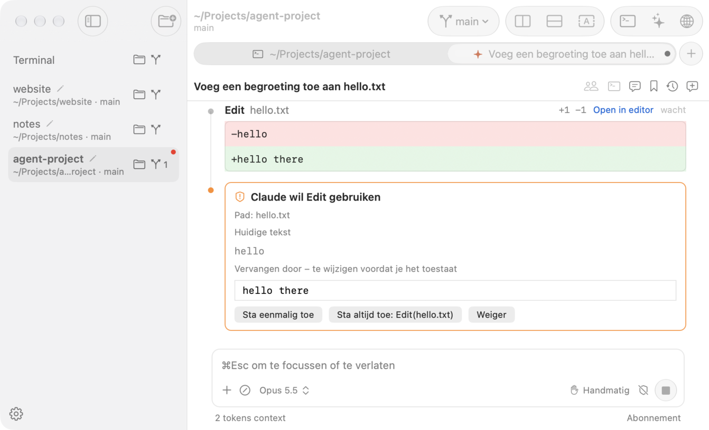

<p>&nbsp;&nbsp;&nbsp;</p>

# Tapa

**De snelle, native terminal voor macOS die ruimte kreeg voor je agents, bestanden en pagina's.**

Tapa is in de eerste plaats een terminal: een eigen VT-kern en een Metal-renderer, native macOS-tabbladen en -splitsingen, een snelle terminal die met één toetscombinatie in beeld schuift, shell-integratie met opdrachtblokken en een optioneel invoerveld met suggesties in de stijl van Warp. Daaromheen groeide Tapa uit tot het kleine zusje van [Dango](https://github.com/sventmueller/dango): een navigatiekolom met werkruimtes, één per projectmap, elk met zijn terminals, agenttabbladen voor Claude, Codex, OpenCode, Antigravity en andere ACP-agents, browsertabbladen, een editor met een bestandslijst en een Git-paneel, en een Markdown-voorvertoning van [Splat](https://github.com/sventmueller/splat) met formules en diagrammen. Niets wat een projectmap instelt, wordt uitgevoerd totdat je de werkruimte ervan vertrouwt. Tapa is geschreven in Rust op echte AppKit-besturingselementen, spreekt 35 talen, heeft geen account nodig en heeft geen telemetrie.

[](https://github.com/sventmueller/tapa/releases/latest/download/Tapa.dmg)

**[Download Tapa.dmg](https://github.com/sventmueller/tapa/releases/latest/download/Tapa.dmg)**: ondertekend en genotariseerd door Apple, voor macOS 14 of nieuwer op Apple Silicon en Intel.

**Een bug gevonden?** [Open een issue](https://github.com/sventmueller/tapa/issues/new/choose) en vermeld met welke shell, welke agent of welk programma het gebeurde. Heb je iets aan Tapa, dan helpt een [ster op GitHub](https://github.com/sventmueller/tapa) anderen het te vinden.

[](https://www.rust-lang.org) [](https://www.apple.com/macos/)  [](https://github.com/madsmtm/objc2) [](https://developer.apple.com/metal/) [](https://agentclientprotocol.com)    [](#licentie)

[Bahasa Indonesia](../id/README.md) · [Bahasa Melayu](../ms/README.md) · [Català](../ca/README.md) · [Čeština](../cs/README.md) · [Dansk](../da/README.md) · [Deutsch](../de/README.md) · [English](../../../README.md) · [Español](../es/README.md) · [Français](../fr/README.md) · [Hrvatski](../hr/README.md) · [Italiano](../it/README.md) · [Magyar](../hu/README.md) · **Nederlands** · [Norsk](../no/README.md) · [Polski](../pl/README.md) · [Português (Brasil)](../pt_BR/README.md) · [Português (Portugal)](../pt_PT/README.md) · [Română](../ro/README.md) · [Slovenčina](../sk/README.md) · [Slovenščina](../sl/README.md) · [Suomi](../fi/README.md) · [Svenska](../sv/README.md) · [Tiếng Việt](../vi/README.md) · [Türkçe](../tr/README.md) · [Ελληνικά](../el/README.md) · [Русский](../ru/README.md) · [Українська](../uk/README.md) · [עברית](../he/README.md)‎ · [العربية](../ar/README.md)‎ · [हिन्दी](../hi/README.md) · [ไทย](../th/README.md) · [한국어](../ko/README.md) · [日本語](../ja/README.md) · [简体中文](../zh-Hans/README.md) · [繁體中文](../zh-Hant/README.md)

## Inhoud

- [Functies in het kort](#functies-in-het-kort)
- [Systeemvereisten](#systeemvereisten)
- [Installatie](#installatie)
- [Aan de slag](#aan-de-slag)
- [Werkruimtes](#werkruimtes)
- [De terminal](#de-terminal)
  - [Tabbladen en splitsingen](#tabbladen-en-splitsingen)
  - [Shell-integratie en opdrachtblokken](#shell-integratie-en-opdrachtblokken)
  - [Het invoerveld en suggesties](#het-invoerveld-en-suggesties)
  - [Zoeken, selecteren en kopiëren](#zoeken-selecteren-en-kopiëren)
  - [De snelle terminal](#de-snelle-terminal)
- [Agents](#agents)
- [Editor, bestanden en Git](#editor-bestanden-en-git)
- [Voorvertoningen](#voorvertoningen)
- [Browser](#browser)
- [Dicteren](#dicteren)
- [Instellingen](#instellingen)
- [Uiterlijk en toegankelijkheid](#uiterlijk-en-toegankelijkheid)
- [Talen](#talen)
- [Toetscombinaties](#toetscombinaties)
- [Vertrouwen](#vertrouwen)
- [Privacy en beveiliging](#privacy-en-beveiliging)
- [Bekende beperkingen](#bekende-beperkingen)
- [Voor ontwikkelaars](#voor-ontwikkelaars)
  - [Componenten van derden](#componenten-van-derden)
- [Licentie](#licentie)

## Functies in het kort

- **Een snelle terminal met een eigen kern.** Tapa parseert met zijn eigen VT-kern en tekent met Metal op een thread per beeldscherm, in het tempo van het beeldscherm en alleen wat er veranderd is. Het doorstaat 262 esctest-controles waar de kern van Alacritty er 121 doorstaat, en elke wijziging eraan wordt gemeten tegen een vastgezette Ghostty.
- **Tot op het bot native.** Echte macOS-tabbladen, vensterherstel, menu's, het menu Voorzieningen, meldingen, Beveilig toetsenbordinvoer, dicteren en invoermethoden. Geen Electron, en WebKit alleen waar een pagina of een voorvertoning het nodig heeft.
- **Werkruimtes.** De navigatiekolom bevat één werkruimte per projectmap, elk met eigen tabbladen, een eigen branch en eigen panelen. De werkruimte "Terminal" bovenaan begint elke keer opnieuw; alle andere blijven tot je ze verwijdert.
- **Agents in een native chatweergave.** Claude, Codex, OpenCode, Antigravity, Gemini CLI en andere agents van het Agent Client Protocol draaien in hun eigen tabbladen, met antwoorden, toolaanroepen, diffs en toestemmingsverzoeken in één tijdlijn. Tapa installeert en werkt ze bij als je daarom vraagt.
- **Shell-integratie en opdrachtblokken** voor zsh, bash en fish, ook via `ssh`: spring van prompt naar prompt, selecteer, kopieer, bewaar en vouw de uitvoer van een opdracht in, en zie welke opdrachten mislukten en hoelang elke opdracht duurde.
- **Een invoerveld zoals dat van Warp, als je dat wilt.** Bewerk de opdrachtregel als tekst, met suggesties uit je geschiedenis, uit specificaties voor meer dan 700 opdrachtregeltools en uit de toestand van het project, allemaal op je Mac.
- **Bestanden, Git en een browser naast de shell.** Een editor met syntaxiskleuren, een bestandslijst, een Git-paneel met klaarzetten, commits, branches en worktrees, een Markdown-voorvertoning met formules en diagrammen, en browsertabbladen.
- **Zorgvuldig met je mappen.** Een werkruimte die je niet hebt vertrouwd, start niets wat de map ervan instelt: geen Git-hooks, geen MCP-servers van het project, geen projectinstellingen voor agents, geen JavaScript in de bestandspagina's.
- **Privé.** Geen account, geen telemetrie. Tapa gaat alleen online als je daarom vraagt, en de herstelde geschiedenis op schijf is versleuteld met een sleutel in je sleutelhanger.
- **In jouw taal.** De interface is er in 35 talen: Arabisch, Catalaans, Chinees (vereenvoudigd), Chinees (traditioneel), Kroatisch, Tsjechisch, Deens, Nederlands, Engels, Fins, Frans, Duits, Grieks, Hebreeuws, Hindi, Hongaars, Indonesisch, Italiaans, Japans, Koreaans, Maleis, Noors, Pools, Portugees (Brazilië), Portugees (Portugal), Roemeens, Russisch, Slowaaks, Sloveens, Spaans, Zweeds, Thai, Turks, Oekraïens en Vietnamees.

## Systeemvereisten

- macOS 14 Sonoma of nieuwer, op Apple Silicon of Intel. Tapa wordt ontwikkeld en getest op macOS 27.
- zsh, bash of fish voor de shell-integratie; andere shells werken zonder.
- Voor agenttabbladen de agent die je wilt gebruiken, al geïnstalleerd of door Tapa geïnstalleerd als je daarom vraagt (zie [Agents](#agents)).

## Installatie

**Van de schijfkopie.** Elke release is een schijfkopie, `Tapa-<version>.dmg`, met één universele app voor Apple Silicon en Intel, ondertekend met een Developer ID en genotariseerd door Apple. Open hem en sleep Tapa naar de map Programma's.

**Met Homebrew.** De cask in een eigen tap installeert dezelfde schijfkopie:

```sh
brew install --cask sventmueller/tap/tapa
```

**Updates.** Tapa vanaf de schijfkopie of via Homebrew houdt zichzelf up-to-date met [Sparkle](https://sparkle-project.org). Bij de tweede start vraagt het of het zelf naar updates mag zoeken; tot je akkoord gaat, doet het geen enkel verzoek. **Tapa › Zoek naar updates…** zoekt meteen. Tapa installeert een update alleen als die de handtekening van de ontwikkelaar draagt. Een eigen build heeft geen updater.

**Vanaf de broncode.** Zie [Voor ontwikkelaars](#voor-ontwikkelaars).

**Als standaardterminal.** Tapa kan shellscripts (`.command`, `.tool`), mappen die op zijn symbool worden gesleept en `ssh://`-links openen. Kies het in de Finder met **Archief › Toon info › Open met**.

## Aan de slag

1. **Het venster** heeft links de navigatiekolom met werkruimtes, bovenaan de tabbladen van de geselecteerde werkruimte en daarboven de knoppenbalk. ⌃⌘S toont en verbergt de navigatiekolom.
2. **Een nieuwe werkruimte** maak je met de mapknop boven in de navigatiekolom of met **Shell › Nieuwe werkruimte…** (⇧⌘N): kies een van de recente mappen of **Kies map…**.
3. **Nieuwe tabbladen** beginnen in de map van de werkruimte: ⌘T voor een terminal, de knoppen rechts in de knoppenbalk voor een terminal-, agent- of browsertabblad, of de **+** aan het einde van de tabbladbalk.
4. **De instellingen** open je met ⌘, of met het tandwiel onder in de navigatiekolom.
5. **Het opdrachtpalet** (⇧⌘P) vindt elke opdracht op naam, en **Zoek tabblad…** (⌘P) elk tabblad van elke werkruimte.

De knoppenbalk bevat van links naar rechts het branchmenu van de repository van de werkruimte, de knoppen om de terminal naar rechts en naar onder te splitsen en het invoerveld te tonen, en de knoppen voor nieuwe terminal-, agent- en browsertabbladen. De knoppen voor splitsingen en het invoerveld zijn grijs zolang er geen terminaltabblad vooraan staat.

## Werkruimtes

Een werkruimte is een map met zijn tabbladen. De rij ervan in de navigatiekolom toont de naam, de map en de Git-branch, en rechts de knoppen voor de bestandslijst en het Git-paneel. Een klik op een van die knoppen toont dat paneel in plaats van de lijst met werkruimtes; **Werkruimtes** bovenaan leidt terug.

- **De werkruimte "Terminal"** staat altijd bovenaan. Ze begint bij elke start opnieuw, in de map die de instellingen noemen, met één lege terminal. Er wordt niets van bewaard, en ze kan niet een andere naam krijgen of worden verwijderd.
- **Elke andere werkruimte blijft** tot je haar verwijdert, ook zonder tabbladen. Tapa onthoudt de naam, de tabbladen, de inhoud van de terminals (voor zover de herstelinstellingen dat zeggen), de agentsessies en de positie van het venster. Programma's die nog draaien, stoppen wanneer Tapa stopt.
- **Naam wijzigen.** Klik op het potlood na de naam, klik op de naam van de geselecteerde werkruimte of kies **Shell › Wijzig naam van werkruimte**. De naam wordt meteen bewaard.
- **Status.** Een groene stip op de rij betekent dat een agent van de werkruimte bezig is, ook met subagents of op de achtergrond; een rode stip betekent dat er een op je wacht. Terminals markeren daar niets.
- **Wisselen.** ⌃⌘[ en ⌃⌘] wisselen tussen werkruimtes. Het venster blijft op zijn plaats, en de tabbladen van de geselecteerde werkruimte nemen de plaats in van de andere.
- **Worktrees.** **Nieuwe worktree…** in het branchmenu van de knoppenbalk maakt een Git-worktree aan op een nieuwe branch en opent die als eigen werkruimte.

Als het laatste tabblad van een werkruimte sluit, blijft de werkruimte in de lijst staan. Zijn alle tabbladen gesloten, dan verdwijnt alleen het venster; het Dock-symbool of ⌘N brengt het terug met zijn werkruimtes.

## De terminal

Tapa draait op een eigen kern, `term-vt`. Hij spreekt xterm en VT520 met het Kitty-toetsenbordprotocol, OSC 8-hyperlinks, toegang tot het klembord via OSC 52 met aparte toestemming voor lezen, gesynchroniseerde uitvoer, gekleurde en gekrulde onderstrepingen, truecolor, kleurvragen, meldingen van lichte en donkere modus aan programma's, bracketed paste, focusgebeurtenissen en muisrapportage. Tekst loopt opnieuw door wanneer het venster van grootte verandert, de geschiedenis inbegrepen. Ligaturen, lettertypefuncties, Nerd Font-symbolen zonder gepatchte lettertypen, en pixelprecieze kaderlijnen, Powerline- en brailletekens zijn ingebouwd.

### Tabbladen en splitsingen

- **Tabbladen** zijn die van macOS zelf: sleep ze om de volgorde te wijzigen of naar een eigen venster, **Toon alle tabbladen** (⇧⌘\\), ⌘1 tot ⌘8, ⌘9 voor het laatste tabblad, en ⇧⌘[ / ⇧⌘] om te wisselen. Elk tabblad toont het symbool van zijn soort vóór de titel.
- **Splitsingen.** **Splits rechts** (⌘D of ⌃⌘T) en **Splits onder** (⇧⌘D of ⌃⌥⌘T), zo diep genest als je wilt. Sleep een scheidingslijn, verplaats die met ⌃⌘ en de pijltoetsen, **Maximaliseer paneel** (⌃⇧⌘↩), **Maak panelen even groot** (⌃⌘=), en wissel tussen panelen met ⌘[ en ⌘].
- **Werkmap.** Nieuwe tabbladen, vensters en splitsingen beginnen in de map van de terminal vooraan; de instellingen bepalen dit voor elk van de drie.
- **Sluiten.** Tapa vraagt het voordat het een tabblad, een venster of de app sluit terwijl er een programma in draait.
- **Herstel.** Na een herstart komen werkruimtes, tabbladen, panelen, mappen en de laatste regels van elke terminal terug. Geheimen zoals tokens en wachtwoorden worden gemaskeerd voordat er iets wordt bewaard.

### Shell-integratie en opdrachtblokken

Tapa stelt zijn shell-integratie voor zsh, bash en fish zelf in, zonder je configuratiebestanden aan te raken, en neemt haar mee wanneer je met `ssh` naar een andere host gaat. Daarmee vormen elke opdracht en de uitvoer ervan een blok:

- **Prompts.** ⌘↑ en ⌘↓ springen naar de vorige en volgende prompt. Een klik in de opdrachtregel zet de cursor daar.
- **Blokken.** **Selecteer blok** (⇧⌘A), **Kopieer uitvoer** (⌥⌘C), **Bewaar uitvoer…** (⌥⌘S) en **Klap blok in/uit** (⇧⌘↩). Boven het blok onder de aanwijzer tonen knoppen de status, de duur en dezelfde acties.
- **Mislukte opdrachten** worden gemarkeerd, en de opdracht die nog draait, blijft bovenaan zichtbaar terwijl de uitvoer ervan scrolt.
- **Bladwijzers.** **Zet/verwijder bladwijzer** (⇧⌘M) markeert een regel; ⇧⌘↑ en ⇧⌘↓ springen tussen bladwijzers.
- **Meldingen** verschijnen wanneer een programma erom vraagt (OSC 9 en OSC 777) en de terminal niet vooraan staat, en een voortgangsbalk (OSC 9;4) verschijnt in het tabblad en op het Dock-symbool.

### Het invoerveld en suggesties

Het invoerveld maakt van de opdrachtregel een tekstveld onder in het paneel, zoals in Warp, met chips voor de map en de Git-branch erboven. **Toon/verberg invoerveld** (⌘I) of de knop in de knoppenbalk schakelt het om voor één terminal; **Instellingen › Invoer** zet het aan voor nieuwe terminals. Het heeft de shell-integratie nodig en gaat opzij voor schermvullende programma's zoals vim, htop of claude.

- **Return** stuurt het hele veld naar de shell, tekst van meerdere regels als één keer plakken; de shell voert het zoals gewoonlijk uit en onthoudt het. Vraagt de shell om meer, dan geeft het veld de toetsen aan haar terug tot de volgende prompt.
- **↑, ↓ en ⌃R** doorzoeken je geschiedenis, met de map, de branch en de afsluitcode waarmee elke opdracht draaide.
- **Tab** vult aan met specificaties voor meer dan 700 opdrachtregeltools, paden en actuele waarden zoals Git-branches, Docker-containers, kubectl-resources, SSH-hosts, `package.json`-scripts en doelen van make, just en cargo.
- **Vim-toetsen** in het veld zijn een schakelaar in dezelfde instellingen.
- **De volgende opdracht voordat je typt**: wat er in dit project meestal volgt (na `git add` komt `git commit`), waar de toestand van het project om vraagt (een lockbestand dat nieuwer is dan `node_modules`), en een oplossing na "command not found", op basis van typefouten of je lokale Homebrew-index.

Zonder het invoerveld verschijnen suggesties als grijze tekst achter de cursor, en → neemt ze over. Shells met hun eigen automatische suggesties, zoals fish of zsh-autosuggestions, houden die van zichzelf. Suggesties gebruiken nooit het netwerk, en ze starten programma's alleen uit je eigen `PATH`, nooit uit de projectmap.

**Plakken.** Plakken van meerdere regels kan worden getoond voordat het wordt uitgevoerd (**Toon plakken van meerdere regels eerst**). Bestanden die op een terminal worden gesleept, komen aan als paden tussen aanhalingstekens; ⌥←/→, ⌘←/→ en ⌘⌫ verplaatsen en verwijderen per woord en per regel, zoals in elk tekstveld op de Mac.

### Zoeken, selecteren en kopiëren

- **Zoek…** (⌘F) doorzoekt de geschiedenis met reguliere expressies, hoofdlettergevoelig en op hele woorden, en telt de treffers; de scrollbalk markeert ze samen met de prompts en fouten.
- **Slimme selectie.** Een dubbelklik selecteert een URL, een pad, een hash of een IP-adres in zijn geheel, en slepen met ⌥ selecteert een rechthoek. Links worden ook zonder OSC 8 gevonden; ⌘-klik opent ze, en een pad in Dango als dat geïnstalleerd is.
- **Selecteer met het toetsenbord** (⇧⌘C) verplaatst een selectie met de toetsen van Vim.
- **Kopieer met opmaak** (⇧⌥⌘C) behoudt kleuren en stijlen; kopiëren bij selecteren is een instelling. **Wis** (⌘K) wist de terminal.

### De snelle terminal

**Toon/verberg snelle terminal** (⌃⌥⌘Space) schuift een terminal in beeld vanaf een rand van het scherm, boven andere apps en over schermvullende spaces, zonder van app te wisselen. De rand, de grootte en of hij verdwijnt wanneer je ergens anders klikt, zijn instellingen. Zijn sessies blijven draaien terwijl hij verborgen is.

## Agents

Een agenttabblad voert een codeeragent uit in de map van de werkruimte, in de native agentweergave van Dango.

| Agent | Hoe hij draait | Wat hij nodig heeft |
|---|---|---|
| Claude | de opdracht `claude`, aangesproken via zijn stream-json-protocol | `claude` geïnstalleerd en aangemeld; Tapa installeert het met het eigen installatieprogramma van Claude als je daarom vraagt |
| Codex | `codex app-server`, of `codex-acp` voor een oudere Codex | `codex` aangemeld; Tapa installeert de vastgezette adapter als je daarom vraagt |
| OpenCode | `opencode serve`, of `opencode acp` voor een oudere OpenCode | je eigen `opencode` in het `PATH`, of de vastgezette download |
| Antigravity | `agy acp` | je eigen `agy` in het `PATH`, of de vastgezette download |
| Gemini CLI | `gemini --acp`, aangeboden zodra je het aanzet in **Instellingen › Agents** | je eigen `gemini`, of de vastgezette download |
| Andere ACP-agents | uit het ACP-register, alleen geladen als je daarom vraagt | wat de registervermelding noemt; vermeldingen zonder controlesom worden pas geïnstalleerd nadat je bevestigt |

Tapa gebruikt de eigen aanmelding van elke agent en bewaart geen inloggegevens van agents. Een agent die in het `PATH` van je inlogshell staat, heeft voorrang; anders voert Tapa de versie uit die het in zijn eigen gegevensmap heeft geïnstalleerd, nooit een programma uit de werkruimte.

- **De tijdlijn** toont antwoorden, toolaanroepen met hun uitvoer en diffs, vragen en toestemmingsverzoeken. **Sta eenmalig toe**, **Sta altijd toe** en **Weiger** beantwoorden een verzoek, en een bewerking kan worden aangepast voordat je haar toestaat.
- **Status.** Het tabblad en de rij van de werkruimte tonen een groene stip terwijl de agent bezig is en een rode terwijl hij op je wacht, en een melding laat je weten wanneer hij wacht terwijl je ergens anders kijkt.
- **Het berichtveld** onderaan neemt je prompt, bestanden die je erop sleept en dicteren aan. ⌘Esc verplaatst de toetsenbordfocus erheen en terug. Het model en de toestemmingsmodus kunnen daar voor de sessie worden gekozen.
- **Instellingen › Agents** stelt voor nieuwe sessies de toestemmingsmodus (Claude, Codex), het model (Claude, Codex, OpenCode) en de denkinspanning (Claude, Codex) in, en welke agents nieuwe tabbladen aanbieden. Het toont waar het programma van elke agent staat, met **Installeer…**, **Werk bij naar …** en **Terug naar …** voor de vorige versie, en **Laad register** voor het ACP-register. De regels die Claude met "Sta altijd toe" heeft bewaard, zijn daar te zien en te verwijderen.
- **Gecontroleerde downloads.** Archieven worden gecontroleerd tegen hun SHA-256, npm-pakketten tegen de integriteit in hun lockbestand, en pakketten zonder vaste versie worden geweigerd. Een ontbrekende agent biedt zijn installatie ook in zijn eigen tabblad aan.

## Editor, bestanden en Git

- **De bestandslijst** van een werkruimte toont de map als boomstructuur, bijgewerkt zodra bestanden veranderen, met bestanden die Git negeert gedimd als je dat wilt. Een klik opent een bestand als voorvertoningstabblad, dat de volgende klik vervangt totdat je het bewerkt; een dubbelklik houdt het.
- **De editor** opent bestanden in tabbladen van de werkruimte, met syntaxiskleuren, meerdere invoegpunten, invouwen, de inspringing van `.editorconfig`, optionele Vim-toetsen en markeringen voor wat er sinds de laatste commit is gewijzigd. Hij merkt het wanneer een bestand op schijf is gewijzigd of conflictmarkeringen bevat. Markdown-bestanden krijgen een opmaakbalk en **Open in Splat**. **Bewaar** (⌘S), **Bewaar als…** en **Bewaar alles** werken zoals gewoonlijk, en Tapa vraagt het voordat het niet-bewaarde tekst sluit.
- **Na een crash** komt niet-bewaarde tekst terug: Tapa houdt er versleutelde kopieën van bij terwijl je typt.
- **Het Git-paneel** toont klaargezette en niet-klaargezette wijzigingen, zet bestanden en losse hunks klaar en haalt ze weer weg, commit (⌘↩), past de laatste commit aan, commit en pusht, haalt op (fetch) en regelt branches, stashes, cherry-picks en conflicten, met de commitgeschiedenis eronder. Een klik op een bestand toont de diff ervan.
- **Het branchmenu** in de knoppenbalk wisselt en maakt branches en maakt worktrees aan.

De editor start geen formatter en geen language server. Gebruik voor een volledige IDE met language servers en een debugger [Dango](https://github.com/sventmueller/dango).

## Voorvertoningen

- **Markdown** verschijnt naast zijn editor via de renderer van Splat: GitHub Flavored Markdown met formules, diagrammen en afbeeldingen, die alinea voor alinea met de tekst meescrolt.
- **Afbeeldingen** openen in een eigen tabblad, pdf's via PDFKit, en geluid, films, lettertypen en kantoordocumenten via Snelle weergave.
- **Geïsoleerd decoderen.** Elke afbeelding uit een onbetrouwbare bron (projectbestanden, Markdown, bijlagen van agents en geplakte inhoud) wordt gedecodeerd in de dienst `Decoder.xpc` van Splat, in een eigen App Sandbox zonder bestanden of netwerk, nooit in de app.

## Browser

**Nieuw browsertabblad** (⇧⌘B) opent een WebKit-tabblad in de werkruimte. Het adresveld neemt een adres of zoekwoorden voor de zoekmachine van je keuze (DuckDuckGo, Google, Bing of Startpage); ⌘L, ⌘R, ⌘[ en ⌘] werken zoals in Safari. Pagina's van `localhost` werken zoals gewoonlijk, voor de ontwikkelserver van je project. HTML-bestanden van een werkruimte mogen alleen hun eigen map lezen, en in een werkruimte die je niet hebt vertrouwd, voeren ze geen JavaScript uit.

## Dicteren

Dicteer in het berichtveld van een agent of in de editor met de microfoonknop of **Wijzig › Start dicteren** (⌃⌥D). De spraakherkenning is die van [Lowspeak](https://github.com/sventmueller/lowspeak), dat daarvoor niet geïnstalleerd hoeft te zijn. **Instellingen › Dicteerfunctie** kiest online transcriptie met OpenAI of Groq, of lokale Whisper- en Parakeet-modellen die de opname op je Mac houden, de taal, de nabewerking, de microfoon en je eigen woordenlijst. De sleutels voor OpenAI en Groq worden in je sleutelhanger bewaard. Dicteren zit alleen in de releasebuild.

## Instellingen

**Tapa › Instellingen…** (⌘,) heeft de panelen Algemeen, Lettertype, Kleuren, Cursor, Terminal, Invoer, Editor, Agents, Dicteerfunctie, Profielen en Toetscombinaties. Ze schrijven één TOML-bestand, `config.toml` in de map van Tapa onder `~/Library/Application Support`, dat je ook met de hand kunt bewerken; Tapa laadt het opnieuw terwijl het draait, en **Laad instellingen opnieuw** (⇧⌘,) doet dat meteen.

- **Vier lettergroottes** onder Algemeen: Interface (navigatiekolom, panelen, bestandslijst, Git-paneel en tabbladtitels), Editor (tekst, regelnummers en Markdown-voorvertoning), Terminal en Agents. ⌘+, ⌘− en ⌘0 wijzigen de grootte van de terminal vooraan.
- **Weergave:** Licht, Donker of Zoals systeem.
- **Kleuren.** Een thema voor de lichte en een voor de donkere modus, in de themaopmaak van Ghostty, met een minimaal contrast dat tekst leesbaar houdt bij een slecht thema. Je eigen thema's gaan in de themamap.
- **Profielen** bundelen lettertype, kleuren, shell, omgeving en map.
- **Toetscombinaties** kunnen allemaal worden gewijzigd, en conflicten worden getoond.

## Uiterlijk en toegankelijkheid

- **Donkere modus** volgt het systeem of je eigen keuze; de accentkleur, Verminder beweging en Verhoog contrast worden gerespecteerd.
- **VoiceOver** leest de regels en prompts van de terminal voor en kondigt nieuwe uitvoer aan; de navigatiekolom, tabbladen, knoppen in de knoppenbalk en de kaarten van de agenttijdlijn hebben een naam.
- **Toetsenbord.** Elke opdracht heeft een menu-onderdeel en een toetscombinatie, en Volledige toetsenbordtoegang bereikt elk besturingselement.
- **Groottes.** De vier lettergroottes in de instellingen schalen de interface, de editor, de terminal en de agents onafhankelijk van elkaar.
- **Van rechts naar links.** In het Arabisch en Hebreeuws is de interface gespiegeld, terwijl het raster van de terminal van links naar rechts blijft.

Details en bekende tekortkomingen staan in [ACCESSIBILITY.md](../../../ACCESSIBILITY.md).

## Talen

De interface is vertaald in 35 talen: Arabisch, Catalaans, Chinees (vereenvoudigd), Chinees (traditioneel), Kroatisch, Tsjechisch, Deens, Nederlands, Engels, Fins, Frans, Duits, Grieks, Hebreeuws, Hindi, Hongaars, Indonesisch, Italiaans, Japans, Koreaans, Maleis, Noors, Pools, Portugees (Brazilië), Portugees (Portugal), Roemeens, Russisch, Slowaaks, Sloveens, Spaans, Zweeds, Thai, Turks, Oekraïens en Vietnamees.

Tapa volgt de taalvolgorde in **Systeeminstellingen › Algemeen › Taal en regio**; daar kun je onder **Apps** ook een taal voor Tapa alleen kiezen. Is er geen vertaling voor jouw taal, dan gebruikt het Engels.

## Toetscombinaties

| Actie | Toetscombinatie |
|---|---|
| Nieuw venster, nieuwe werkruimte, nieuw tabblad | ⌘N, ⇧⌘N, ⌘T |
| Nieuw browsertabblad | ⇧⌘B |
| Nieuw bestand, bestand openen | ⌥⌘N, ⌘O |
| Paneel of tabblad sluiten, tabblad sluiten, venster sluiten | ⌘W, ⌥⌘W, ⇧⌘W |
| Rechts splitsen, onder splitsen | ⌘D of ⌃⌘T, ⇧⌘D of ⌃⌥⌘T |
| Paneel maximaliseren, panelen even groot maken, paneel sluiten | ⌃⇧⌘↩, ⌃⌘=, ⌃⇧⌘W |
| Scheidingslijn verplaatsen | ⌃⌘←, ⌃⌘→, ⌃⌘↑, ⌃⌘↓ |
| Volgend, vorig paneel | ⌘], ⌘[ |
| Volgend, vorig tabblad; tabblad 1 tot 8, laatste tabblad | ⇧⌘], ⇧⌘[; ⌘1 tot ⌘8, ⌘9 |
| Volgende, vorige werkruimte | ⌃⌘], ⌃⌘[ |
| Tabblad zoeken, opdrachtpalet | ⌘P, ⇧⌘P |
| Navigatiekolom, invoerveld tonen of verbergen | ⌃⌘S, ⌘I |
| Snelle terminal | ⌃⌥⌘Space |
| Zoeken, volgende zoeken, vorige zoeken | ⌘F, ⌘G, ⇧⌘G |
| Vorige, volgende prompt | ⌘↑, ⌘↓ |
| Blok selecteren, uitvoer kopiëren, uitvoer bewaren, blok invouwen | ⇧⌘A, ⌥⌘C, ⌥⌘S, ⇧⌘↩ |
| Bladwijzer zetten of verwijderen; vorige, volgende bladwijzer | ⇧⌘M; ⇧⌘↑, ⇧⌘↓ |
| Selecteren met het toetsenbord | ⇧⌘C |
| Kopiëren met opmaak | ⇧⌥⌘C |
| Wissen | ⌘K |
| Begin, einde, pagina omhoog, pagina omlaag | ⌘Home, ⌘End, ⌘PageUp, ⌘PageDown |
| Groter, kleiner, oorspronkelijke grootte (terminal) | ⌘+, ⌘−, ⌘0 |
| Berichtveld van een agenttabblad | ⌘Esc |
| Dicteren starten | ⌃⌥D |
| Instellingen, instellingen opnieuw laden | ⌘,, ⇧⌘, |

Elke toetscombinatie kan worden gewijzigd in **Instellingen › Toetscombinaties** of in de sectie `[keys]` van het instellingenbestand.

## Vertrouwen

Een projectmap kan programma's laten draaien zodra er iets in start: Git-hooks en repository-instellingen zoals `core.fsmonitor`, hooks van agents, MCP-servers van het project en projectinstellingen van agents. Daarom wordt een nieuwe werkruimte niet vertrouwd.

- **Niet vertrouwd:** agents starten zonder de hooks, MCP-servers en configuratie van het project (Claude met `--setting-sources=user --strict-mcp-config`, Codex met de map gemarkeerd als niet vertrouwd, OpenCode zonder de configuratie van het project). Git draait onschadelijk gemaakt: geen hooks, filters, diff-drivers, fsmonitor, `sshCommand` of pager, en alleen globale credential helpers. HTML-bestanden openen zonder JavaScript. Het Git-paneel en het agenttabblad melden dit en bieden aan de werkruimte te vertrouwen.
- **Vertrouwd:** **Shell › Werkruimte vertrouwen** laadt dat allemaal zoals de map het bedoelt. **Vertrouwen intrekken** draait het terug. Vertrouwen wordt per werkruimte bewaard.

Hoe het ook met het vertrouwen staat, Tapa voert nooit uit zichzelf een programma uit een projectmap uit: suggesties starten programma's alleen uit je `PATH` buiten het project, en de navigatiekolom leest de Git-status uit de bestanden in `.git`. Een werkruimte in je thuismap, zoals "Terminal", is geen project: programma's onder `~` zoals `~/.local/bin/claude` gelden daar als je eigen programma's.

## Privacy en beveiliging

- **Geen telemetrie, geen account.** Tapa meldt niets over hoe je het gebruikt en werkt volledig offline. Het gaat alleen online als je daarom vraagt: om een agent te installeren of bij te werken, om het ACP-register te laden, om naar updates te zoeken nadat je daarmee akkoord ging, en voor de pagina's die je in een browsertabblad opent. De agents zelf praten zoals altijd met hun aanbieders.
- **De geschiedenis op schijf** voor het herstellen van sessies is versleuteld met een sleutel in je sleutelhanger, kan worden uitgeschakeld, en geheimen zoals API-sleutels, tokens en wachtwoorden worden gemaskeerd voordat ze wordt weggeschreven. De kopieën van niet-bewaarde tekst in de editor zijn versleuteld met dezelfde sleutel.
- **Beveilig toetsenbordinvoer** gaat vanzelf aan bij wachtwoordvragen en kan in het appmenu blijvend worden aangezet.
- **Escapereeksen** die iets kunnen lekken of injecteren, zoals titelrapporten, het lezen van het klembord en plaktrucs, worden geblokkeerd of eerst gevraagd. De parser wordt in de CI gefuzzd.
- **Geïsoleerd decoderen** van afbeeldingen uit onbetrouwbare bronnen, zie [Voorvertoningen](#voorvertoningen).
- **Codeondertekening** met de Hardened Runtime. macOS rekent de toegang van de programma's in een terminal toe aan Tapa, dus het bevat een gebruiksbeschrijving voor elke beschermde dienst.

Beveiligingsproblemen meld je vertrouwelijk, zie [SECURITY.md](../../../SECURITY.md).

## Bekende beperkingen

- **Nog geen inline afbeeldingen** in de terminal: Kitty-graphics, Sixel en iTerm2-afbeeldingen zijn gepland na 1.0.
- **Geen tmux-besturingsmodus**, en sessies overleven het stoppen van Tapa niet.
- **Tekst van rechts naar links** blijft in het raster van de terminal van links naar rechts.
- **⌘+ en ⌘−** wijzigen alleen de terminal vooraan.
- **De editor** heeft bewust geen language servers, formatters of debugger; Dango heeft ze wel.
- **Dicteren** zit alleen in de releasebuild, niet in een debugbuild.
- **VoiceOver** is nog niet van begin tot eind door een mens gecontroleerd.

## Voor ontwikkelaars

Je hebt macOS 14 of nieuwer nodig met de Xcode Command Line Tools, Rust zoals `rust-toolchain.toml` het noemt (rustup met beide Mac-targets voor de universele build), checkouts van [splat](https://github.com/sventmueller/splat) en [lowspeak](https://github.com/sventmueller/lowspeak) naast deze (`../splat`, `../lowspeak`), en cmake voor builds met dicteren.

| Opdracht | Wat het doet |
|---|---|
| `make help` | toont de targets |
| `cargo xtask run` | bouwt de debug-app en opent die |
| `make build` | bouwt de release-app met dicteren in `target/release`, ad hoc ondertekend voor deze Mac |
| `make lint` | opmaak, clippy met waarschuwingen als fouten, de vorm van de bestanden en de interfaceteksten |
| `make check` | `lint`, daarna alle tests; heeft geen venster en geen netwerk nodig |
| `make selftest STEPS="split_right,type:ls\n,shot:x"` | bestuurt de app en laat afbeeldingen van vensters achter in `target/selftest/` |
| `make esctest`, `make vttest` | voert esctest en vttest uit tegen beide kernen in de app |
| `make perf` | de benchmark tegen een vastgezette Ghostty; alleen zinvol op een Mac die verder niets doet |
| `make fuzz` | de fuzz-targets met cargo-fuzz |
| `make release` | een proefrun van de release: de universele app met dicteren, zijn schijfkopie, updatefeed en cask in `target/release-dry-run`; verstuurt niets |
| `make release-notarized` | de huidige versie, ondertekend met de Developer ID, door Apple genotariseerd en gestapled, in `dist/`; `Cargo.toml` blijft ongewijzigd |
| `make deploy` | notariseert de volgende versie, commit `Cargo.toml`, uploadt een conceptrelease, pusht `main` en de tag en publiceert daarna de release; zie [docs/development.md](../../../docs/development.md#deploy) |

Hoe je kunt bijdragen staat in [CONTRIBUTING.md](../../../CONTRIBUTING.md). Elke interfacetekst heeft het Duits als sleutel, met een vertaling in alle 35 talen; `cargo xtask strings` faalt als er een ontbreekt.

### Componenten van derden

| Component | Gebruikt voor | Licentie |
|---|---|---|
| [objc2](https://github.com/madsmtm/objc2) en zijn framework-crates | AppKit, Metal, WebKit en de andere frameworks van Apple | MIT, Zlib of Apache-2.0 |
| De crates van Splat | Markdown, de voorvertoning, het lezen van Git, de afbeeldingsdecoder en de vertalingen | MIT of Apache-2.0 |
| [Lowspeak](https://github.com/sventmueller/lowspeak) met [whisper.cpp](https://github.com/ggml-org/whisper.cpp) | dicteren | MIT |
| [Fig autocomplete specs](https://github.com/withfig/autocomplete) | de opdrachtbeschrijvingen van de suggesties | MIT |
| [rusqlite](https://github.com/rusqlite/rusqlite) met SQLite | de opdrachtgeschiedenis | MIT, publiek domein |
| [Simple Icons](https://simpleicons.org) | logo's van talen en programma's | CC0, sommige logo's onder eigen voorwaarden |
| [Sparkle](https://sparkle-project.org) 2.10.1 | updates van de releasebuild | MIT |

## Licentie

Tapa is gelicenseerd onder een van de volgende twee licenties

- Apache-licentie, versie 2.0 ([LICENSE-APACHE](../../../LICENSE-APACHE))
- MIT-licentie ([LICENSE-MIT](../../../LICENSE-MIT))

naar jouw keuze. Logo's in `assets/simple-icons` hebben hun eigen licenties, zie de README daar.

Tenzij je uitdrukkelijk anders aangeeft, wordt elke bijdrage die je opzettelijk indient voor opname in Tapa, zoals gedefinieerd in de Apache-2.0-licentie, onder dubbele licentie geplaatst zoals hierboven, zonder aanvullende voorwaarden.
