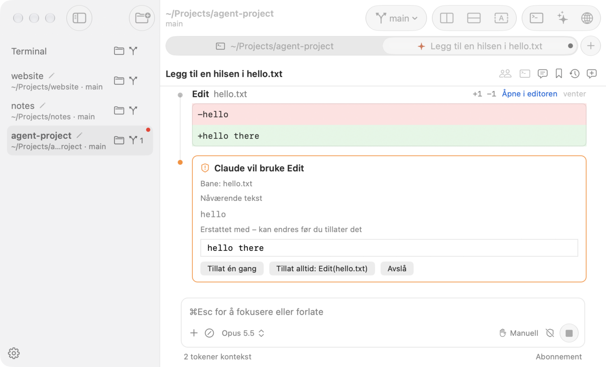

<p>&nbsp;&nbsp;&nbsp;</p>

# Tapa

**Den raske, opprinnelige terminalen for macOS som har fått plass til agentene, filene og sidene dine.**

Tapa er først og fremst en terminal: en egen VT-kjerne og en Metal-renderer, opprinnelige macOS-faner og -delinger, en hurtigterminal som glir inn med én hurtigtast, skallintegrering med kommandoblokker og et valgfritt inndatafelt med forslag i Warps stil. Rundt dette har Tapa vokst til lillesøsteren til [Dango](https://github.com/sventmueller/dango): et sidepanel med arbeidsområder, ett per prosjektmappe, hvert med sine terminaler, agentfaner for Claude, Codex, OpenCode, Antigravity og andre ACP-agenter, nettleserfaner, en editor med en filliste og et Git-panel, og en Markdown-forhåndsvisning fra [Splat](https://github.com/sventmueller/splat) med formler og diagrammer. Ingenting som en prosjektmappe konfigurerer, kjører før du stoler på arbeidsområdet. Tapa er skrevet i Rust på ekte AppKit-kontroller, finnes på 35 språk, krever ingen konto og har ingen telemetri.

[](https://github.com/sventmueller/tapa/releases/latest/download/Tapa.dmg)

**[Last ned Tapa.dmg](https://github.com/sventmueller/tapa/releases/latest/download/Tapa.dmg)**: signert og notarisert av Apple, for macOS 14 eller nyere på Apple Silicon og Intel.

**Fant du en feil?** Du kan [opprette et issue](https://github.com/sventmueller/tapa/issues/new/choose) og skrive hvilket skall, hvilken agent eller hvilket program det skjedde med. Hvis du har nytte av Tapa, hjelper en [stjerne på GitHub](https://github.com/sventmueller/tapa) andre med å finne det.

[](https://www.rust-lang.org) [](https://www.apple.com/macos/)  [](https://github.com/madsmtm/objc2) [](https://developer.apple.com/metal/) [](https://agentclientprotocol.com)    [](#lisens)

[Bahasa Indonesia](../id/README.md) · [Bahasa Melayu](../ms/README.md) · [Català](../ca/README.md) · [Čeština](../cs/README.md) · [Dansk](../da/README.md) · [Deutsch](../de/README.md) · [English](../../../README.md) · [Español](../es/README.md) · [Français](../fr/README.md) · [Hrvatski](../hr/README.md) · [Italiano](../it/README.md) · [Magyar](../hu/README.md) · [Nederlands](../nl/README.md) · **Norsk** · [Polski](../pl/README.md) · [Português (Brasil)](../pt_BR/README.md) · [Português (Portugal)](../pt_PT/README.md) · [Română](../ro/README.md) · [Slovenčina](../sk/README.md) · [Slovenščina](../sl/README.md) · [Suomi](../fi/README.md) · [Svenska](../sv/README.md) · [Tiếng Việt](../vi/README.md) · [Türkçe](../tr/README.md) · [Ελληνικά](../el/README.md) · [Русский](../ru/README.md) · [Українська](../uk/README.md) · [עברית](../he/README.md)‎ · [العربية](../ar/README.md)‎ · [हिन्दी](../hi/README.md) · [ไทย](../th/README.md) · [한국어](../ko/README.md) · [日本語](../ja/README.md) · [简体中文](../zh-Hans/README.md) · [繁體中文](../zh-Hant/README.md)

## Innhold

- [Funksjoner i korte trekk](#funksjoner-i-korte-trekk)
- [Krav](#krav)
- [Installasjon](#installasjon)
- [Kom i gang](#kom-i-gang)
- [Arbeidsområder](#arbeidsområder)
- [Terminalen](#terminalen)
  - [Faner og delinger](#faner-og-delinger)
  - [Skallintegrering og kommandoblokker](#skallintegrering-og-kommandoblokker)
  - [Inndatafeltet og forslag](#inndatafeltet-og-forslag)
  - [Søk, markering og kopiering](#søk-markering-og-kopiering)
  - [Hurtigterminalen](#hurtigterminalen)
- [Agenter](#agenter)
- [Editor, filer og Git](#editor-filer-og-git)
- [Forhåndsvisninger](#forhåndsvisninger)
- [Nettleser](#nettleser)
- [Diktering](#diktering)
- [Innstillinger](#innstillinger)
- [Utseende og tilgjengelighet](#utseende-og-tilgjengelighet)
- [Språk](#språk)
- [Hurtigtaster](#hurtigtaster)
- [Tillit](#tillit)
- [Personvern og sikkerhet](#personvern-og-sikkerhet)
- [Kjente begrensninger](#kjente-begrensninger)
- [For utviklere](#for-utviklere)
  - [Tredjepartskomponenter](#tredjepartskomponenter)
- [Lisens](#lisens)

## Funksjoner i korte trekk

- **En rask terminal med egen kjerne.** Tapa tolker med sin egen VT-kjerne og tegner med Metal på en tråd per skjerm, i skjermens takt og bare det som er endret. Den består 262 esctest-kontroller der kjernen til Alacritty består 121, og hver endring i den måles mot en fastlåst Ghostty.
- **Opprinnelig helt inn til beinet.** Ekte macOS-faner, gjenoppretting av vinduer, menyer, Tjenester-menyen, varslinger, sikker tastaturinnskriving, diktering og inndatametoder. Ingen Electron, og WebKit bare der en side eller en forhåndsvisning trenger det.
- **Arbeidsområder.** Sidepanelet har ett arbeidsområde per prosjektmappe, hvert med egne faner, egen gren og egne paneler. Arbeidsområdet «Terminal» øverst starter på nytt hver gang; alle andre blir værende til du fjerner dem.
- **Agenter i en opprinnelig chattevisning.** Claude, Codex, OpenCode, Antigravity, Gemini CLI og andre agenter i Agent Client Protocol kjører i egne faner, med svar, verktøykall, differ og forespørsler om tillatelse i én tidslinje. Tapa installerer og oppdaterer dem når du ber om det.
- **Skallintegrering og kommandoblokker** for zsh, bash og fish, også over `ssh`: hopp fra ledetekst til ledetekst, marker, kopier, lagre og skjul utdataene fra en kommando, og se mislykkede kommandoer og hvor lang tid hver av dem tok.
- **Et inndatafelt som Warps, hvis du vil.** Rediger kommandolinjen som tekst, med forslag fra historikken din, fra beskrivelser av over 700 kommandolinjeverktøy og fra tilstanden til prosjektet, alt på Macen din.
- **Filer, Git og en nettleser ved siden av skallet.** En editor med syntaksfarger, en filliste, et Git-panel med klargjøring, commits, grener og worktrees, en Markdown-forhåndsvisning med formler og diagrammer, og nettleserfaner.
- **Forsiktig med mappene dine.** Et arbeidsområde du ikke stoler på, starter ingenting som mappen konfigurerer: ingen Git-hooks, ingen MCP-servere fra prosjektet, ingen prosjektinnstillinger for agenter, ikke noe JavaScript i filsidene.
- **Privat.** Ingen konto, ingen telemetri. Tapa går bare på nettet når du ber om det, og den gjenopprettede historikken på disken er kryptert med en nøkkel i nøkkelringen din.
- **På ditt språk.** Grensesnittet finnes på 35 språk: arabisk, katalansk, kinesisk (forenklet), kinesisk (tradisjonelt), kroatisk, tsjekkisk, dansk, nederlandsk, engelsk, finsk, fransk, tysk, gresk, hebraisk, hindi, ungarsk, indonesisk, italiensk, japansk, koreansk, malayisk, norsk, polsk, portugisisk (Brasil), portugisisk (Portugal), rumensk, russisk, slovakisk, slovensk, spansk, svensk, thai, tyrkisk, ukrainsk og vietnamesisk.

## Krav

- macOS 14 Sonoma eller nyere, på Apple Silicon eller Intel. Tapa er utviklet og testet på macOS 27.
- zsh, bash eller fish for skallintegreringen; andre skall kjører uten den.
- For agentfaner den agenten du vil bruke, enten allerede installert eller installert av Tapa når du ber om det (se [Agenter](#agenter)).

## Installasjon

**Fra diskbildet.** Hver utgivelse er et diskbilde, `Tapa-<version>.dmg`, med én universell app for Apple Silicon og Intel, signert med en Developer ID og notarisert av Apple. Åpne det og dra Tapa til Apper-mappen.

**Med Homebrew.** Cask-pakken i en egen tap installerer det samme diskbildet:

```sh
brew install --cask sventmueller/tap/tapa
```

**Oppdateringer.** Tapa fra diskbildet eller Homebrew holder seg selv oppdatert med [Sparkle](https://sparkle-project.org). Ved andre oppstart spør appen om den får se etter oppdateringer på egen hånd; før du samtykker, sender den ingen forespørsel. **Tapa › Se etter oppdateringer…** ser etter med en gang. Tapa installerer en oppdatering bare hvis den har utviklerens signatur. Et bygg du har laget selv, har ingen oppdaterer.

**Fra kildekoden.** Se [For utviklere](#for-utviklere).

**Som standardterminal.** Tapa kan åpne skallskript (`.command`, `.tool`), mapper som slippes på symbolet, og `ssh://`-lenker. Velg den i Finder med **Fil › Vis info › Åpne med**.

## Kom i gang

1. **Vinduet** har sidepanelet med arbeidsområder til venstre, fanene i det valgte arbeidsområdet øverst og verktøylinjen over dem. ⌃⌘S viser og skjuler sidepanelet.
2. **Et nytt arbeidsområde** får du med mappeknappen øverst i sidepanelet eller med **Skall › Nytt arbeidsområde…** (⇧⌘N): velg en av de nylige mappene eller **Velg mappe…**.
3. **Nye faner** starter i mappen til arbeidsområdet: ⌘T for en terminal, knappene til høyre i verktøylinjen for en terminal-, agent- eller nettleserfane, eller **+** på slutten av fanelinjen.
4. **Innstillingene** åpnes med ⌘, eller tannhjulet nederst i sidepanelet.
5. **Kommandopaletten** (⇧⌘P) finner hver kommando etter navn, og **Finn fane…** (⌘P) hver fane i hvert arbeidsområde.

Verktøylinjen inneholder fra venstre grenmenyen for arbeidsområdets repositorium, knappene for å dele terminalen til høyre og nedover og for å vise inndatafeltet, og knappene for nye terminal-, agent- og nettleserfaner. Knappene for delinger og inndatafeltet er grå så lenge ingen terminalfane ligger fremst.

## Arbeidsområder

Et arbeidsområde er en mappe med fanene sine. Raden i sidepanelet viser navnet, mappen og Git-grenen, og til høyre knappene for fillisten og Git-panelet. Et klikk på en av dem viser det panelet i stedet for listen over arbeidsområder; **Arbeidsområder** øverst fører tilbake.

- **Arbeidsområdet «Terminal»** ligger alltid øverst. Det starter på nytt ved hver oppstart, i mappen innstillingene angir, med én tom terminal. Ingenting av det lagres, og det kan verken få nytt navn eller fjernes.
- **Alle andre arbeidsområder blir værende** til du fjerner dem, også uten faner. Tapa tar vare på navnet, fanene, innholdet i terminalene (så langt gjenopprettingsinnstillingene sier), agentøktene og vinduets plassering. Programmer som fortsatt kjører, avsluttes når Tapa avsluttes.
- **Gi nytt navn.** Klikk på blyanten etter navnet, klikk på navnet til det valgte arbeidsområdet, eller velg **Skall › Gi nytt navn til arbeidsområde**. Navnet lagres med en gang.
- **Status.** En grønn prikk på raden betyr at en agent i arbeidsområdet arbeider, også med underagenter eller i bakgrunnen; en rød prikk betyr at en venter på deg. Terminaler markerer ingenting der.
- **Bytte.** ⌃⌘[ og ⌃⌘] bytter mellom arbeidsområder. Vinduet blir der det er, og fanene i det valgte arbeidsområdet tar plassen til de andre.
- **Worktrees.** **Nytt worktree…** i grenmenyen i verktøylinjen oppretter et Git-worktree på en ny gren og åpner det som et eget arbeidsområde.

Når den siste fanen i et arbeidsområde lukkes, blir arbeidsområdet værende i listen. Når alle faner er lukket, forsvinner bare vinduet; Dock-symbolet eller ⌘N henter det tilbake med arbeidsområdene sine.

## Terminalen

Tapa kjører på sin egen kjerne, `term-vt`. Den snakker xterm og VT520 med Kittys tastaturprotokoll, OSC 8-hyperlenker, tilgang til utklippstavlen via OSC 52 med egen tillatelse for lesing, synkroniserte utdata, fargede og bølgete understrekinger, truecolor, fargeforespørsler, meldinger om lys og mørk modus til programmer, bracketed paste, fokushendelser og muserapportering. Teksten brytes om på nytt når vinduet endrer størrelse, historikken medregnet. Ligaturer, skriftfunksjoner, Nerd Font-symboler uten patchede skrifter, og pikselnøyaktige rammelinjer, Powerline- og punktskrifttegn er innebygd.

### Faner og delinger

- **Faner** er macOS sine egne: dra dem for å endre rekkefølgen eller ut i et eget vindu, **Vis alle faner** (⇧⌘\\), ⌘1 til ⌘8, ⌘9 for den siste fanen og ⇧⌘[ / ⇧⌘] for å bytte. Hver fane viser symbolet for sin type foran tittelen.
- **Delinger.** **Del til høyre** (⌘D eller ⌃⌘T) og **Del nedover** (⇧⌘D eller ⌃⌥⌘T), nestet så dypt du vil. Dra i en skillelinje, flytt den med ⌃⌘ og piltastene, **Maksimer rute** (⌃⇧⌘↩), **Utjevn ruter** (⌃⌘=), og bytt mellom ruter med ⌘[ og ⌘].
- **Arbeidsmappe.** Nye faner, vinduer og delinger starter i mappen til terminalen som ligger fremst; innstillingene avgjør dette for hver av de tre.
- **Lukking.** Tapa spør før den lukker en fane, et vindu eller appen mens et program kjører i den.
- **Gjenoppretting.** Etter en omstart kommer arbeidsområder, faner, ruter, mapper og de siste linjene i hver terminal tilbake. Hemmeligheter som tokener og passord maskeres før noe lagres.

### Skallintegrering og kommandoblokker

Tapa setter opp skallintegreringen sin for zsh, bash og fish selv, uten å røre konfigurasjonsfilene dine, og tar den med når du bruker `ssh` til en annen vert. Med den danner hver kommando og utdataene dens en blokk:

- **Ledetekster.** ⌘↑ og ⌘↓ hopper til forrige og neste ledetekst. Et klikk i kommandolinjen flytter markøren dit.
- **Blokker.** **Merk blokk** (⇧⌘A), **Kopier utdata** (⌥⌘C), **Lagre utdata…** (⌥⌘S) og **Skjul/utvid blokk** (⇧⌘↩). Over blokken under pekeren viser knapper statusen, varigheten og de samme handlingene.
- **Mislykkede kommandoer** markeres, og kommandoen som fortsatt kjører, forblir synlig øverst mens utdataene ruller.
- **Bokmerker.** **Sett/fjern bokmerke** (⇧⌘M) markerer en linje; ⇧⌘↑ og ⇧⌘↓ hopper mellom bokmerker.
- **Varslinger** vises når et program ber om det (OSC 9 og OSC 777) og terminalen ikke ligger fremst, og en fremdriftslinje (OSC 9;4) vises i fanen og på Dock-symbolet.

### Inndatafeltet og forslag

Inndatafeltet gjør kommandolinjen til et tekstfelt nederst i ruten, som i Warp, med brikker for mappen og Git-grenen over seg. **Vis/skjul inndatafelt** (⌘I) eller knappen i verktøylinjen slår det av og på for én terminal; **Innstillinger › Inndata** slår det på for nye terminaler. Det krever skallintegreringen og trer til side for fullskjermprogrammer som vim, htop eller claude.

- **Retur** sender hele feltet til skallet, tekst over flere linjer som én innliming; skallet kjører og husker den som vanlig. Hvis skallet ber om mer, gir feltet tastene tilbake til det fram til neste ledetekst.
- **↑, ↓ og ⌃R** søker i historikken din, med mappen, grenen og avslutningskoden hver kommando kjørte med.
- **Tab** fullfører med beskrivelser av over 700 kommandolinjeverktøy, stier og aktuelle verdier som Git-grener, Docker-containere, kubectl-ressurser, SSH-verter, `package.json`-skript og mål for make, just og cargo.
- **Vim-taster** i feltet er en bryter i de samme innstillingene.
- **Neste kommando før du skriver**: det som vanligvis følger i dette prosjektet (etter `git add` kommer `git commit`), det prosjektets tilstand ber om (en låsefil som er nyere enn `node_modules`), og en rettelse etter «command not found», ut fra skrivefeil eller den lokale Homebrew-indeksen din.

Uten inndatafeltet vises forslag som grå tekst bak markøren, og → tar dem. Skall med egne autoforslag, som fish eller zsh-autosuggestions, beholder sine. Forslag bruker aldri nettverket, og de starter bare programmer fra din egen `PATH`, aldri fra prosjektmappen.

**Innliming.** Innliming av flere linjer kan vises før den kjøres (**Vis innliming av flere linjer først**). Filer som slippes på en terminal, kommer fram som stier i anførselstegn; ⌥←/→, ⌘←/→ og ⌘⌫ flytter og sletter ord for ord og linje for linje som i alle tekstfelt på Mac.

### Søk, markering og kopiering

- **Finn…** (⌘F) søker i historikken med regulære uttrykk, store og små bokstaver og hele ord, og teller treffene; rullefeltet markerer dem sammen med ledetekstene og feilene.
- **Smart markering.** Et dobbeltklikk markerer en URL, en sti, en hash eller en IP-adresse som en helhet, og å dra med ⌥ markerer et rektangel. Lenker finnes også uten OSC 8; ⌘-klikk åpner dem, og en sti i Dango hvis det er installert.
- **Marker med tastaturet** (⇧⌘C) flytter en markering med tastene til Vim.
- **Kopier med formatering** (⇧⌥⌘C) beholder farger og stiler; kopiering ved markering er en innstilling. **Tøm** (⌘K) tømmer terminalen.

### Hurtigterminalen

**Vis/skjul hurtigterminal** (⌃⌥⌘Space) lar en terminal gli inn fra en kant av skjermen, over andre apper og over fullskjermområder, uten å bytte app. Kanten, størrelsen og om den skjules når du klikker et annet sted, er innstillinger. Øktene i den fortsetter å kjøre mens den er skjult.

## Agenter

En agentfane kjører en kodeagent i mappen til arbeidsområdet, i den opprinnelige agentvisningen fra Dango.

| Agent | Hvordan den kjører | Hva den trenger |
|---|---|---|
| Claude | kommandoen `claude`, som det snakkes med over stream-json-protokollen dens | `claude` installert og pålogget; Tapa installerer den med Claudes eget installasjonsprogram når du ber om det |
| Codex | `codex app-server`, eller `codex-acp` for en eldre Codex | `codex` pålogget; Tapa installerer den fastlåste adapteren når du ber om det |
| OpenCode | `opencode serve`, eller `opencode acp` for en eldre OpenCode | din egen `opencode` i `PATH`, eller den fastlåste nedlastingen |
| Antigravity | `agy acp` | din egen `agy` i `PATH`, eller den fastlåste nedlastingen |
| Gemini CLI | `gemini --acp`, tilbys når du slår den på i **Innstillinger › Agenter** | din egen `gemini`, eller den fastlåste nedlastingen |
| Andre ACP-agenter | fra ACP-registeret, lastes bare inn når du ber om det | det registeroppføringen angir; oppføringer uten sjekksum installeres først etter at du har bekreftet |

Tapa bruker hver agents egen pålogging og lagrer ingen påloggingsopplysninger for agenter. En agent som finnes i `PATH` for påloggingsskallet ditt, kommer først; ellers kjører Tapa versjonen den har installert i sin egen datamappe, aldri et program fra arbeidsområdet.

- **Tidslinjen** viser svar, verktøykall med utdata og differ, spørsmål og forespørsler om tillatelse. **Tillat én gang**, **Tillat alltid** og **Avslå** besvarer en forespørsel, og en endring kan justeres før du tillater den.
- **Status.** Fanen og raden til arbeidsområdet viser en grønn prikk mens agenten arbeider og en rød mens den venter på deg, og en varsling sier fra når den venter mens du ser et annet sted.
- **Meldingsfeltet** nederst tar imot ledeteksten din, filer som slippes på det, og diktering. ⌘Esc flytter tastaturfokuset inn i det og tilbake. Modellen og tillatelsesmodusen kan velges der for økten.
- **Innstillinger › Agenter** angir for nye økter tillatelsesmodusen (Claude, Codex), modellen (Claude, Codex, OpenCode) og tenkeinnsatsen (Claude, Codex), og hvilke agenter nye faner tilbyr. Der vises hvor programmet til hver agent ligger, med **Installer…**, **Oppdater til …** og **Tilbake til …** for den forrige versjonen, og **Last inn register** for ACP-registeret. Reglene Claude har lagret med «Tillat alltid», kan vises og fjernes der.
- **Kontrollerte nedlastinger.** Arkiver kontrolleres mot SHA-256-summen sin, npm-pakker mot integriteten i låsefilen sin, og pakker uten fast versjon avvises. En agent som mangler, tilbyr også installasjonen sin i sin egen fane.

## Editor, filer og Git

- **Fillisten** for et arbeidsområde viser mappen som et tre, oppdatert når filer endres, med filer Git ignorerer nedtonet hvis du vil. Et klikk åpner en fil som en forhåndsvisningsfane, som neste klikk erstatter til du redigerer den; et dobbeltklikk beholder den.
- **Editoren** åpner filer i faner i arbeidsområdet, med syntaksfarger, flere innsettingspunkter, sammenbretting, innrykket fra `.editorconfig`, valgfrie Vim-taster og markeringer for det som er endret siden siste commit. Den merker når en fil er endret på disken eller inneholder konfliktmarkører. Markdown-filer får en formatlinje og **Åpne i Splat**. **Lagre** (⌘S), **Lagre som…** og **Lagre alle** virker som vanlig, og Tapa spør før den lukker tekst som ikke er lagret.
- **Etter et krasj** kommer tekst som ikke var lagret, tilbake: Tapa holder krypterte kopier av den mens du skriver.
- **Git-panelet** viser klargjorte og ikke-klargjorte endringer, klargjør filer og enkeltstående hunks og tar dem ut igjen, gjør commit (⌘↩), endrer siste commit, gjør commit og push, henter og håndterer grener, stasher, cherry-picks og konflikter, med commit-historikken under. Et klikk på en fil viser diffen.
- **Grenmenyen** i verktøylinjen bytter og oppretter grener og lager worktrees.

Editoren starter ingen formaterer og ingen språkserver. For en fullverdig IDE med språkservere og en feilsøker kan du bruke [Dango](https://github.com/sventmueller/dango).

## Forhåndsvisninger

- **Markdown** vises ved siden av editoren via Splats renderer: GitHub Flavored Markdown med formler, diagrammer og bilder, som ruller avsnitt for avsnitt med teksten.
- **Bilder** åpnes i en egen fane, PDF-er via PDFKit, og lyd, filmer, skrifter og kontordokumenter via Hurtigvisning.
- **Isolert dekoding.** Hvert bilde fra en upålitelig kilde (prosjektfiler, Markdown, vedlegg fra agenter og innliminger) dekodes i Splats tjeneste `Decoder.xpc`, i en egen App Sandbox uten filer eller nettverk, aldri i appen.

## Nettleser

**Ny nettleserfane** (⇧⌘B) åpner en WebKit-fane i arbeidsområdet. Adressefeltet tar imot en adresse eller søkeord for søkemotoren du velger (DuckDuckGo, Google, Bing eller Startpage); ⌘L, ⌘R, ⌘[ og ⌘] virker som i Safari. Sider fra `localhost` kjører som vanlig, for utviklingsserveren til prosjektet ditt. HTML-filer i et arbeidsområde får bare lese sin egen mappe, og i et arbeidsområde du ikke stoler på, kjører de ikke JavaScript.

## Diktering

Dikter i meldingsfeltet til en agent eller i editoren med mikrofonknappen eller **Rediger › Start diktering** (⌃⌥D). Talegjenkjenningen kommer fra [Lowspeak](https://github.com/sventmueller/lowspeak), som ikke trenger å være installert. **Innstillinger › Diktering** velger transkribering på nett med OpenAI eller Groq, eller lokale Whisper- og Parakeet-modeller som holder opptaket på Macen din, språket, etterbehandlingen, mikrofonen og ditt eget ordforråd. Nøklene for OpenAI og Groq oppbevares i nøkkelringen din. Diktering finnes bare i utgivelsesbygget.

## Innstillinger

**Tapa › Innstillinger…** (⌘,) har rutene Generelt, Skrift, Farger, Markør, Terminal, Inndata, Redigering, Agenter, Diktering, Profiler og Hurtigtaster. De skriver én TOML-fil, `config.toml` i mappen til Tapa under `~/Library/Application Support`, som du også kan redigere for hånd; Tapa laster den inn på nytt mens appen kjører, og **Last inn innstillinger på nytt** (⇧⌘,) gjør det med en gang.

- **Fire skriftstørrelser** under Generelt: Grensesnitt (sidepanel, paneler, filliste, Git-panel og fanetitler), Redigering (tekst, linjenumre og Markdown-forhåndsvisning), Terminal og Agenter. ⌘+, ⌘− og ⌘0 endrer størrelsen på terminalen som ligger fremst.
- **Utseende:** Lyst, Mørkt eller Som systemet.
- **Farger.** Ett tema for lys og ett for mørk modus, i temaformatet til Ghostty, med en minstekontrast som holder teksten lesbar med et dårlig tema. Dine egne temaer legges i temamappen.
- **Profiler** samler skrift, farger, skall, miljø og mappe.
- **Hurtigtaster** kan alle endres, og konflikter vises.

## Utseende og tilgjengelighet

- **Mørk modus** følger systemet eller valget ditt; aksentfargen, Reduser bevegelse og Øk kontrast respekteres.
- **VoiceOver** leser opp linjene og ledetekstene i terminalen og kunngjør nye utdata; sidepanelet, fanene, knappene i verktøylinjen og kortene i agenttidslinjen har navn.
- **Tastatur.** Hver kommando har et menyvalg og en hurtigtast, og Full tastaturtilgang når hver kontroll.
- **Størrelser.** De fire skriftstørrelsene i innstillingene skalerer grensesnittet, editoren, terminalen og agentene uavhengig av hverandre.
- **Høyre mot venstre.** Grensesnittet speilvendes på arabisk og hebraisk, mens rutenettet i terminalen forblir venstre mot høyre.

Detaljer og kjente mangler finnes i [ACCESSIBILITY.md](../../../ACCESSIBILITY.md).

## Språk

Grensesnittet er oversatt til 35 språk: arabisk, katalansk, kinesisk (forenklet), kinesisk (tradisjonelt), kroatisk, tsjekkisk, dansk, nederlandsk, engelsk, finsk, fransk, tysk, gresk, hebraisk, hindi, ungarsk, indonesisk, italiensk, japansk, koreansk, malayisk, norsk, polsk, portugisisk (Brasil), portugisisk (Portugal), rumensk, russisk, slovakisk, slovensk, spansk, svensk, thai, tyrkisk, ukrainsk og vietnamesisk.

Tapa følger språkrekkefølgen i **Systeminnstillinger › Generelt › Språk og område**; der kan du også velge et språk bare for Tapa under **Apper**. Finnes det ingen oversettelse for språket ditt, bruker appen engelsk.

## Hurtigtaster

| Handling | Hurtigtast |
|---|---|
| Nytt vindu, nytt arbeidsområde, ny fane | ⌘N, ⇧⌘N, ⌘T |
| Ny nettleserfane | ⇧⌘B |
| Ny fil, åpne fil | ⌥⌘N, ⌘O |
| Lukk rute eller fane, lukk fane, lukk vindu | ⌘W, ⌥⌘W, ⇧⌘W |
| Del til høyre, del nedover | ⌘D eller ⌃⌘T, ⇧⌘D eller ⌃⌥⌘T |
| Maksimer rute, utjevn ruter, lukk rute | ⌃⇧⌘↩, ⌃⌘=, ⌃⇧⌘W |
| Flytt en skillelinje | ⌃⌘←, ⌃⌘→, ⌃⌘↑, ⌃⌘↓ |
| Neste, forrige rute | ⌘], ⌘[ |
| Neste, forrige fane; fane 1 til 8, siste fane | ⇧⌘], ⇧⌘[; ⌘1 til ⌘8, ⌘9 |
| Neste, forrige arbeidsområde | ⌃⌘], ⌃⌘[ |
| Finn fane, kommandopalett | ⌘P, ⇧⌘P |
| Vis eller skjul sidepanelet, inndatafeltet | ⌃⌘S, ⌘I |
| Hurtigterminal | ⌃⌥⌘Space |
| Finn, finn neste, finn forrige | ⌘F, ⌘G, ⇧⌘G |
| Forrige, neste ledetekst | ⌘↑, ⌘↓ |
| Merk blokk, kopier utdata, arkiver utdata, skjul blokk | ⇧⌘A, ⌥⌘C, ⌥⌘S, ⇧⌘↩ |
| Sett eller fjern et bokmerke; forrige, neste bokmerke | ⇧⌘M; ⇧⌘↑, ⇧⌘↓ |
| Marker med tastaturet | ⇧⌘C |
| Kopier med formatering | ⇧⌥⌘C |
| Tøm | ⌘K |
| Topp, bunn, side opp, side ned | ⌘Home, ⌘End, ⌘PageUp, ⌘PageDown |
| Større, mindre, opprinnelig størrelse (terminal) | ⌘+, ⌘−, ⌘0 |
| Meldingsfeltet i en agentfane | ⌘Esc |
| Start diktering | ⌃⌥D |
| Innstillinger, last inn innstillinger på nytt | ⌘,, ⇧⌘, |

Hver hurtigtast kan endres i **Innstillinger › Hurtigtaster** eller i delen `[keys]` i innstillingsfilen.

## Tillit

En prosjektmappe kan få programmer til å kjøre så snart noe starter i den: Git-hooks og repositoriuminnstillinger som `core.fsmonitor`, agenthooks, MCP-servere fra prosjektet og prosjektinnstillinger for agenter. Derfor er et nytt arbeidsområde ikke klarert.

- **Ikke klarert:** agenter starter uten prosjektets hooks, MCP-servere og konfigurasjon (Claude med `--setting-sources=user --strict-mcp-config`, Codex med mappen merket som upålitelig, OpenCode uten prosjektets konfigurasjon). Git kjører nøytralisert: ingen hooks, filtre, diff-drivere, fsmonitor, `sshCommand` eller pager, og bare globale credential helpers. HTML-filer åpnes uten JavaScript. Git-panelet og agentfanen sier fra om dette og tilbyr å klarere arbeidsområdet.
- **Klarert:** **Skall › Stol på arbeidsområdet** laster inn alt dette slik mappen har tenkt. **Trekk tilbake tillit** tar det tilbake. Tilliten lagres per arbeidsområde.

Uansett tillit kjører Tapa aldri av seg selv et program fra en prosjektmappe: forslag starter bare programmer fra din `PATH` utenfor prosjektet, og sidepanelet leser Git-tilstanden fra filene i `.git`. Et arbeidsområde i hjemmemappen din, som «Terminal», er ikke noe prosjekt: programmer under `~` som `~/.local/bin/claude` regnes der som dine egne.

## Personvern og sikkerhet

- **Ingen telemetri, ingen konto.** Tapa rapporterer ingenting om hvordan du bruker appen, og virker helt uten nett. Den går bare på nettet når du ber om det: for å installere eller oppdatere en agent, for å laste inn ACP-registeret, for å se etter oppdateringer når du har samtykket, og for sidene du åpner i en nettleserfane. Agentene selv snakker med leverandørene sine slik de alltid gjør.
- **Historikken på disken** for gjenoppretting av økter er kryptert med en nøkkel i nøkkelringen din, kan slås av, og hemmeligheter som API-nøkler, tokener og passord maskeres før den skrives. Kopiene av tekst i editoren som ikke er lagret, er kryptert med den samme nøkkelen.
- **Sikker tastaturinnskriving** slår seg på av seg selv ved passordforespørsler, og kan slås på for godt i appmenyen.
- **Escape-sekvenser** som kunne lekke eller injisere noe, som tittelrapporter, lesing av utklippstavlen og innlimingstriks, blokkeres eller krever først ditt samtykke. Parseren fuzzes i CI.
- **Isolert dekoding** av bilder fra upålitelige kilder, se [Forhåndsvisninger](#forhåndsvisninger).
- **Kodesignering** med Hardened Runtime. macOS tilskriver Tapa tilgangen til programmene i en terminal, så appen har en bruksbeskrivelse for hver beskyttet tjeneste.

Sikkerhetsproblemer rapporteres fortrolig, se [SECURITY.md](../../../SECURITY.md).

## Kjente begrensninger

- **Ingen innebygde bilder** i terminalen ennå: Kitty-grafikk, Sixel og iTerm2-bilder er planlagt etter 1.0.
- **Ingen kontrollmodus for tmux**, og økter overlever ikke at Tapa avsluttes.
- **Tekst fra høyre mot venstre** forblir venstre mot høyre i rutenettet i terminalen.
- **⌘+ og ⌘−** endrer bare terminalen som ligger fremst.
- **Editoren** har med vilje ingen språkservere, formaterere eller feilsøker; Dango har dem.
- **Diktering** finnes bare i utgivelsesbygget, ikke i et feilsøkingsbygg.
- **VoiceOver** er ennå ikke kontrollert fra ende til annen av et menneske.

## For utviklere

Du trenger macOS 14 eller nyere med Xcode Command Line Tools, Rust slik `rust-toolchain.toml` angir (rustup med begge Mac-målene for det universelle bygget), utsjekkinger av [splat](https://github.com/sventmueller/splat) og [lowspeak](https://github.com/sventmueller/lowspeak) ved siden av denne (`../splat`, `../lowspeak`), og cmake for bygg med diktering.

| Kommando | Hva den gjør |
|---|---|
| `make help` | lister målene |
| `cargo xtask run` | bygger feilsøkingsappen og åpner den |
| `make build` | bygger utgivelsesappen med diktering til `target/release`, ad hoc-signert for denne Macen |
| `make lint` | formatering, clippy med advarsler som feil, formen på filene og tekstene i grensesnittet |
| `make check` | `lint`, deretter alle tester; trenger ikke vindu og ikke nettverk |
| `make selftest STEPS="split_right,type:ls\n,shot:x"` | styrer appen og legger igjen bilder av vinduer i `target/selftest/` |
| `make esctest`, `make vttest` | kjører esctest og vttest mot begge kjernene i appen |
| `make perf` | ytelsestesten mot en fastlåst Ghostty; bare meningsfull på en Mac som ellers ikke gjør noe |
| `make fuzz` | fuzz-målene med cargo-fuzz |
| `make release` | en prøvekjøring av utgivelsen: den universelle appen med diktering, diskbildet, oppdateringsfeeden og cask-pakken i `target/release-dry-run`; sender ingenting noe sted |
| `make release-notarized` | den gjeldende versjonen, signert med Developer ID, notarisert av Apple og med stiftet billett, i `dist/`; `Cargo.toml` uendret |
| `make deploy` | notariserer neste versjon, committer `Cargo.toml`, laster opp et utkast til utgivelsen, pusher `main` og taggen og publiserer så utgivelsen; se [docs/development.md](../../../docs/development.md#deploy) |

Hvordan du kan bidra, står i [CONTRIBUTING.md](../../../CONTRIBUTING.md). Hver tekst i grensesnittet har tysk som nøkkel, med en oversettelse til alle 35 språk; `cargo xtask strings` feiler hvis en mangler.

### Tredjepartskomponenter

| Komponent | Brukt til | Lisens |
|---|---|---|
| [objc2](https://github.com/madsmtm/objc2) og rammeverk-cratene dens | AppKit, Metal, WebKit og de andre rammeverkene fra Apple | MIT, Zlib eller Apache-2.0 |
| Splats crates | Markdown, forhåndsvisningen, lesing av Git, bildedekoderen og oversettelsene | MIT eller Apache-2.0 |
| [Lowspeak](https://github.com/sventmueller/lowspeak) med [whisper.cpp](https://github.com/ggml-org/whisper.cpp) | diktering | MIT |
| [Fig autocomplete specs](https://github.com/withfig/autocomplete) | kommandobeskrivelsene i forslagene | MIT |
| [rusqlite](https://github.com/rusqlite/rusqlite) med SQLite | kommandohistorikken | MIT, allemannseie |
| [Simple Icons](https://simpleicons.org) | logoer for språk og programmer | CC0, noen logoer under egne vilkår |
| [Sparkle](https://sparkle-project.org) 2.10.1 | oppdateringer av utgivelsesbygget | MIT |

## Lisens

Tapa er lisensiert under enten

- Apache-lisensen, versjon 2.0 ([LICENSE-APACHE](../../../LICENSE-APACHE))
- MIT-lisensen ([LICENSE-MIT](../../../LICENSE-MIT))

etter eget valg. Logoer i `assets/simple-icons` har egne lisenser, se README-filen der.

Med mindre du uttrykkelig sier noe annet, skal ethvert bidrag som du bevisst sender inn for å bli tatt med i Tapa, slik det er definert i Apache-2.0-lisensen, ha dobbel lisens som ovenfor, uten ytterligere vilkår.
