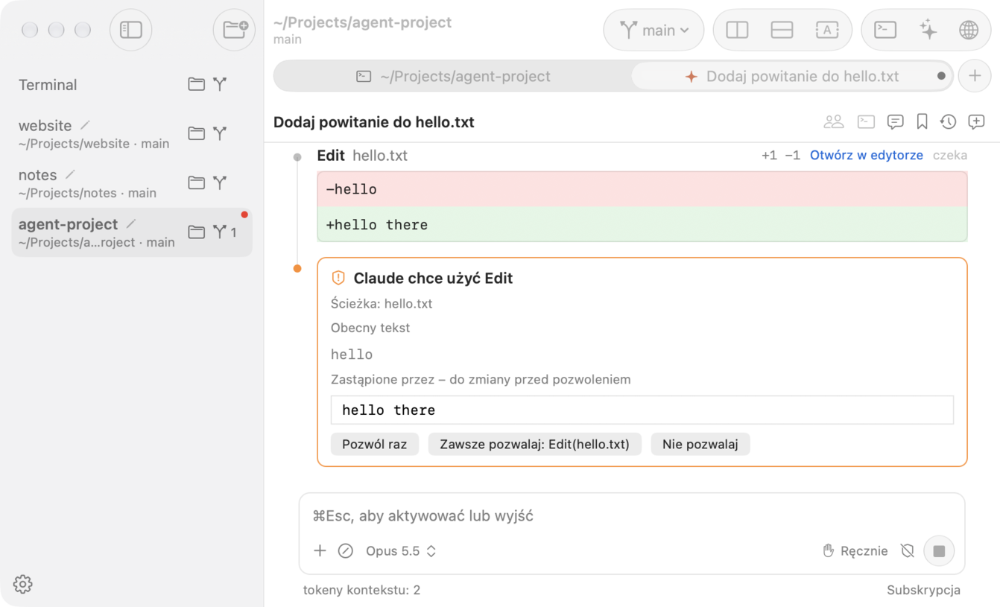

<p>&nbsp;&nbsp;&nbsp;</p>

# Tapa

**Szybki, natywny terminal dla macOS, w którym znalazło się miejsce na twoich agentów, pliki i strony.**

Tapa to przede wszystkim terminal: własny rdzeń VT i renderer Metal, natywne karty i podziały macOS, szybki terminal, który wysuwa się jednym skrótem, integracja z powłoką z blokami poleceń oraz opcjonalne pole wprowadzania z podpowiedziami w stylu Warpa. Wokół tego Tapa wyrosła na młodszą siostrę [Dango](https://github.com/sventmueller/dango): panel boczny z obszarami roboczymi, po jednym na folder projektu, każdy z własnymi terminalami, karty agentów dla Claude, Codex, OpenCode, Antigravity i innych agentów ACP, karty przeglądarki, edytor z listą plików i panelem Git oraz podgląd Markdown ze [Splata](https://github.com/sventmueller/splat) ze wzorami i diagramami. Nic, co konfiguruje folder projektu, nie uruchamia się, dopóki nie zaufasz jego obszarowi roboczemu. Tapa jest napisana w Ruście na prawdziwych kontrolkach AppKit, mówi w 35 językach, nie wymaga konta i nie ma telemetrii.

[](https://github.com/sventmueller/tapa/releases/latest/download/Tapa.dmg)

**[Pobierz Tapa.dmg](https://github.com/sventmueller/tapa/releases/latest/download/Tapa.dmg)**: podpisany i poświadczony notarialnie przez Apple, dla macOS 14 lub nowszego na Apple Silicon i Intel.

**Trafił się błąd?** [Otwórz zgłoszenie](https://github.com/sventmueller/tapa/issues/new/choose) i napisz, w jakiej powłoce, z jakim agentem lub w jakim programie wystąpił. Jeśli Tapa jest dla ciebie przydatna, [gwiazdka na GitHubie](https://github.com/sventmueller/tapa) pomoże innym ją znaleźć.

[](https://www.rust-lang.org) [](https://www.apple.com/macos/)  [](https://github.com/madsmtm/objc2) [](https://developer.apple.com/metal/) [](https://agentclientprotocol.com)    [](#licencja)

[Bahasa Indonesia](../id/README.md) · [Bahasa Melayu](../ms/README.md) · [Català](../ca/README.md) · [Čeština](../cs/README.md) · [Dansk](../da/README.md) · [Deutsch](../de/README.md) · [English](../../../README.md) · [Español](../es/README.md) · [Français](../fr/README.md) · [Hrvatski](../hr/README.md) · [Italiano](../it/README.md) · [Magyar](../hu/README.md) · [Nederlands](../nl/README.md) · [Norsk](../no/README.md) · **Polski** · [Português (Brasil)](../pt_BR/README.md) · [Português (Portugal)](../pt_PT/README.md) · [Română](../ro/README.md) · [Slovenčina](../sk/README.md) · [Slovenščina](../sl/README.md) · [Suomi](../fi/README.md) · [Svenska](../sv/README.md) · [Tiếng Việt](../vi/README.md) · [Türkçe](../tr/README.md) · [Ελληνικά](../el/README.md) · [Русский](../ru/README.md) · [Українська](../uk/README.md) · [עברית](../he/README.md)‎ · [العربية](../ar/README.md)‎ · [हिन्दी](../hi/README.md) · [ไทย](../th/README.md) · [한국어](../ko/README.md) · [日本語](../ja/README.md) · [简体中文](../zh-Hans/README.md) · [繁體中文](../zh-Hant/README.md)

## Spis treści

- [Najważniejsze cechy](#najważniejsze-cechy)
- [Wymagania](#wymagania)
- [Instalacja](#instalacja)
- [Pierwsze kroki](#pierwsze-kroki)
- [Obszary robocze](#obszary-robocze)
- [Terminal](#terminal)
  - [Karty i podziały](#karty-i-podziały)
  - [Integracja z powłoką i bloki poleceń](#integracja-z-powłoką-i-bloki-poleceń)
  - [Pole wprowadzania i podpowiedzi](#pole-wprowadzania-i-podpowiedzi)
  - [Wyszukiwanie, zaznaczanie i kopiowanie](#wyszukiwanie-zaznaczanie-i-kopiowanie)
  - [Szybki terminal](#szybki-terminal)
- [Agenty](#agenty)
- [Edytor, pliki i Git](#edytor-pliki-i-git)
- [Podglądy](#podglądy)
- [Przeglądarka](#przeglądarka)
- [Dyktowanie](#dyktowanie)
- [Ustawienia](#ustawienia)
- [Wygląd i dostępność](#wygląd-i-dostępność)
- [Języki](#języki)
- [Skróty klawiszowe](#skróty-klawiszowe)
- [Zaufanie](#zaufanie)
- [Prywatność i bezpieczeństwo](#prywatność-i-bezpieczeństwo)
- [Znane ograniczenia](#znane-ograniczenia)
- [Dla programistów](#dla-programistów)
  - [Komponenty zewnętrzne](#komponenty-zewnętrzne)
- [Licencja](#licencja)

## Najważniejsze cechy

- **Szybki, własny terminal.** Tapa analizuje dane własnym rdzeniem VT i rysuje przez Metal w osobnym wątku dla każdego ekranu, z jego częstotliwością odświeżania i tylko to, co się zmieniło. Przechodzi 262 testy esctest, podczas gdy rdzeń Alacritty przechodzi 121, a każda jego zmiana jest mierzona względem przypiętej wersji Ghostty.
- **Natywna na wskroś.** Prawdziwe karty macOS, przywracanie okien, menu, menu Usługi, powiadomienia, Bezpieczne wprowadzanie z klawiatury, dyktowanie i metody wprowadzania. Bez Electrona, a WebKit tylko tam, gdzie potrzebuje go strona lub podgląd.
- **Obszary robocze.** Panel boczny mieści po jednym obszarze roboczym na folder projektu, każdy z własnymi kartami, gałęzią i panelami. Obszar roboczy „Terminal” na górze za każdym razem zaczyna od nowa; wszystkie inne zostają, dopóki ich nie usuniesz.
- **Agenty w natywnym widoku czatu.** Claude, Codex, OpenCode, Antigravity, Gemini CLI i inne agenty Agent Client Protocol działają we własnych kartach, z odpowiedziami, wywołaniami narzędzi, różnicami i prośbami o uprawnienia na jednej osi czasu. Tapa instaluje je i uaktualnia na żądanie.
- **Integracja z powłoką i bloki poleceń** dla zsh, bash i fish, także przez `ssh`: przeskakuj od znaku zachęty do znaku zachęty, zaznaczaj, kopiuj, zapisuj i zwijaj wynik polecenia, sprawdzaj nieudane polecenia i to, jak długo trwało każde z nich.
- **Pole wprowadzania jak w Warpie, jeśli chcesz.** Edytuj wiersz poleceń jak zwykły tekst, z podpowiedziami z twojej historii, ze specyfikacji ponad 700 narzędzi wiersza poleceń i ze stanu projektu, a wszystko to na twoim Macu.
- **Pliki, Git i przeglądarka obok powłoki.** Edytor z kolorowaniem składni, lista plików, panel Git z przygotowywaniem zmian, commitami, gałęziami i worktree, podgląd Markdown ze wzorami i diagramami oraz karty przeglądarki.
- **Ostrożna z twoimi folderami.** Obszar roboczy, któremu nie udzielono zaufania, nie uruchamia niczego, co konfiguruje jego folder: żadnych hooków git, żadnych projektowych serwerów MCP, żadnych ustawień projektu dla agentów, żadnego JavaScriptu na jego stronach plików.
- **Prywatna.** Bez konta, bez telemetrii. Tapa łączy się z siecią tylko wtedy, gdy o to poprosisz, a przywracana historia na dysku jest zaszyfrowana kluczem z twojego pęku kluczy.
- **W Twoim języku.** Interfejs jest dostępny w 35 językach: arabski, kataloński, chiński (uproszczony), chiński (tradycyjny), chorwacki, czeski, duński, holenderski, angielski, fiński, francuski, niemiecki, grecki, hebrajski, hindi, węgierski, indonezyjski, włoski, japoński, koreański, malajski, norweski, polski, portugalski (Brazylia), portugalski (Portugalia), rumuński, rosyjski, słowacki, słoweński, hiszpański, szwedzki, tajski, turecki, ukraiński i wietnamski.

## Wymagania

- macOS 14 Sonoma lub nowszy, na Apple Silicon lub Intel. Tapa powstaje i jest testowana na macOS 27.
- zsh, bash lub fish dla integracji z powłoką; inne powłoki działają bez niej.
- Do kart agentów: agent, którego chcesz używać, już zainstalowany albo zainstalowany przez Tapę na twoją prośbę (zob. [Agenty](#agenty)).

## Instalacja

**Z obrazu dysku.** Każde wydanie to obraz dysku, `Tapa-<version>.dmg`, z jedną uniwersalną aplikacją dla Apple Silicon i Intel, podpisaną certyfikatem Developer ID i poświadczoną notarialnie przez Apple. Otwórz go i przeciągnij Tapę do folderu Programy.

**Przez Homebrew.** Cask we własnym tapie instaluje ten sam obraz dysku:

```sh
brew install --cask sventmueller/tap/tapa
```

**Uaktualnienia.** Tapa z obrazu dysku lub z Homebrew sama dba o aktualność dzięki [Sparkle](https://sparkle-project.org). Przy drugim uruchomieniu pyta, czy może samodzielnie szukać uaktualnień; dopóki się nie zgodzisz, nie wysyła żadnego żądania. **Tapa › Sprawdź uaktualnienia…** sprawdza od razu. Tapa instaluje uaktualnienie tylko wtedy, gdy ma ono podpis autora. Własna kompilacja nie ma mechanizmu uaktualnień.

**Ze źródeł.** Zob. [Dla programistów](#dla-programistów).

**Jako domyślny terminal.** Tapa potrafi otwierać skrypty powłoki (`.command`, `.tool`), foldery upuszczone na jej ikonę i łącza `ssh://`. Wybierz ją w Finderze przez **Plik › Informacje › Otwórz w aplikacji**.

## Pierwsze kroki

1. **Okno** ma po lewej panel boczny z obszarami roboczymi, u góry karty wybranego obszaru roboczego, a nad nimi pasek narzędzi. ⌃⌘S pokazuje i ukrywa panel boczny.
2. **Nowy obszar roboczy** tworzy przycisk folderu u góry panelu bocznego albo **Powłoka › Nowy obszar roboczy…** (⇧⌘N): wybierz jeden z ostatnich folderów albo **Wybierz folder…**.
3. **Nowe karty** zaczynają w folderze obszaru roboczego: ⌘T dla terminala, przyciski po prawej stronie paska narzędzi dla karty terminala, agenta lub przeglądarki albo **+** na końcu paska kart.
4. **Ustawienia** otwiera ⌘, lub koło zębate na dole panelu bocznego.
5. **Paleta poleceń** (⇧⌘P) znajduje każde polecenie po nazwie, a **Znajdź kartę…** (⌘P) każdą kartę każdego obszaru roboczego.

Pasek narzędzi zawiera, licząc od lewej, rozwijane menu gałęzi repozytorium obszaru roboczego, przyciski podziału terminala w prawo i w dół oraz pokazania pola wprowadzania, a także przyciski nowych kart terminala, agenta i przeglądarki. Przyciski podziału i pola wprowadzania są szare, dopóki z przodu nie ma karty terminala.

## Obszary robocze

Obszar roboczy to folder wraz z jego kartami. Jego wiersz w panelu bocznym pokazuje nazwę, folder i gałąź Git, a po prawej przyciski listy plików i panelu Git. Kliknięcie jednego z nich pokazuje ten panel w miejscu listy obszarów roboczych; **Obszary robocze** u góry prowadzi z powrotem.

- **Obszar roboczy „Terminal”** jest zawsze na górze. Przy każdym uruchomieniu zaczyna od nowa, w folderze wskazanym w ustawieniach, z jednym pustym terminalem. Nic z niego nie jest zapisywane i nie można zmienić jego nazwy ani go usunąć.
- **Każdy inny obszar roboczy zostaje**, dopóki go nie usuniesz, nawet bez kart. Tapa zachowuje jego nazwę, karty, zawartość terminali (w zakresie, na jaki pozwalają ustawienia przywracania), sesje agentów i położenie okna. Programy, które wciąż działają, kończą się, gdy Tapa się zamyka.
- **Zmiana nazwy.** Kliknij ołówek za nazwą, kliknij nazwę wybranego obszaru roboczego albo wybierz **Powłoka › Zmień nazwę obszaru roboczego**. Nazwa zapisuje się od razu.
- **Stan.** Zielona kropka w wierszu oznacza, że agent obszaru roboczego pracuje, także z podagentami lub w tle; czerwona kropka oznacza, że któryś czeka na ciebie. Terminale niczego tam nie oznaczają.
- **Przełączanie.** ⌃⌘[ i ⌃⌘] przechodzą między obszarami roboczymi. Okno zostaje na swoim miejscu, a karty wybranego obszaru roboczego zajmują miejsce pozostałych.
- **Worktree.** **Nowy worktree…** w rozwijanym menu gałęzi na pasku narzędzi tworzy worktree Git na nowej gałęzi i otwiera go jako osobny obszar roboczy.

Gdy zamyka się ostatnia karta obszaru roboczego, obszar roboczy zostaje na liście. Po zamknięciu wszystkich kart znika tylko okno; ikona w Docku lub ⌘N przywraca je wraz z obszarami roboczymi.

## Terminal

Tapa działa na własnym rdzeniu, `term-vt`. Obsługuje xterm i VT520 z protokołem klawiatury Kitty, hiperłączami OSC 8, dostępem do schowka OSC 52 z osobnym uprawnieniem do odczytu, synchronizowanym wyjściem, kolorowymi i falistymi podkreśleniami, truecolor, zapytaniami o kolory, informowaniem programów o trybie jasnym i ciemnym, bracketed paste, zdarzeniami fokusu i raportowaniem myszy. Gdy okno zmienia rozmiar, tekst jest na nowo łamany, łącznie z historią. Ligatury, funkcje czcionek, symbole Nerd Font bez łatanych czcionek oraz dokładne co do piksela znaki ramek, Powerline i Braille’a są wbudowane.

### Karty i podziały

- **Karty** są własnymi kartami macOS: przeciągaj je, aby zmienić kolejność, albo wyciągaj do osobnego okna, **Pokaż wszystkie karty** (⇧⌘\\), ⌘1 do ⌘8, ⌘9 dla ostatniej karty oraz ⇧⌘[ / ⇧⌘] do przełączania. Każda karta pokazuje przed tytułem ikonę swojego rodzaju.
- **Podziały.** **Podziel w prawo** (⌘D lub ⌃⌘T) i **Podziel w dół** (⇧⌘D lub ⌃⌥⌘T), zagnieżdżane dowolnie głęboko. Przeciągnij separator, przesuwaj go ⌃⌘ i klawiszami strzałek, **Maksymalizuj panel** (⌃⇧⌘↩), **Wyrównaj panele** (⌃⌘=), a między panelami przechodź ⌘[ i ⌘].
- **Folder roboczy.** Nowe karty, okna i podziały zaczynają w folderze terminala z przodu; ustawienia decydują o tym osobno dla każdego z tych trzech.
- **Zamykanie.** Tapa pyta, zanim zamknie kartę, okno lub aplikację, w której działa program.
- **Przywracanie.** Po ponownym uruchomieniu wracają obszary robocze, karty, panele, foldery i ostatnie wiersze każdego terminala. Sekrety, takie jak tokeny i hasła, są maskowane, zanim cokolwiek zostanie zapisane.

### Integracja z powłoką i bloki poleceń

Tapa sama konfiguruje integrację z powłoką dla zsh, bash i fish, nie dotykając twoich plików konfiguracyjnych, i zabiera ją ze sobą, gdy łączysz się przez `ssh` z innym hostem. Dzięki niej każde polecenie wraz ze swoim wynikiem tworzy blok:

- **Znaki zachęty.** ⌘↑ i ⌘↓ przeskakują do poprzedniego i następnego znaku zachęty. Kliknięcie w wiersz poleceń przenosi tam kursor.
- **Bloki.** **Zaznacz blok** (⇧⌘A), **Kopiuj wynik** (⌥⌘C), **Zachowaj wynik…** (⌥⌘S) i **Zwiń/rozwiń blok** (⇧⌘↩). Nad blokiem pod wskaźnikiem przyciski pokazują jego stan, czas trwania i te same czynności.
- **Nieudane polecenia** są oznaczane, a polecenie, które wciąż działa, pozostaje widoczne u góry, gdy jego wynik się przewija.
- **Zakładki.** **Dodaj/usuń zakładkę** (⇧⌘M) oznacza wiersz; ⇧⌘↑ i ⇧⌘↓ przeskakują między zakładkami.
- **Powiadomienia** pojawiają się, gdy program o nie poprosi (OSC 9 i OSC 777), a terminal nie jest z przodu, zaś pasek postępu (OSC 9;4) widać na karcie i na ikonie w Docku.

### Pole wprowadzania i podpowiedzi

Pole wprowadzania zamienia wiersz poleceń w pole tekstowe na dole panelu, jak w Warpie, z etykietami folderu i gałęzi Git nad nim. **Pokaż/ukryj pole wprowadzania** (⌘I) lub przycisk na pasku narzędzi przełącza je dla jednego terminala; **Ustawienia › Wprowadzanie** włącza je dla nowych terminali. Wymaga integracji z powłoką i ustępuje miejsca programom pełnoekranowym, takim jak vim, htop czy claude.

- **Return** wysyła całe pole do powłoki, a tekst wielowierszowy jako jedno wklejenie; powłoka wykonuje go i zapamiętuje jak zwykle. Jeśli powłoka prosi o więcej, pole oddaje jej klawisze aż do następnego znaku zachęty.
- **↑, ↓ i ⌃R** przeszukują historię, wraz z folderem, gałęzią i kodem wyjścia, z jakimi wykonano każde polecenie.
- **Tab** uzupełnia na podstawie specyfikacji ponad 700 narzędzi wiersza poleceń, ścieżek i bieżących wartości, takich jak gałęzie git, kontenery docker, zasoby kubectl, hosty ssh, skrypty `package.json` oraz cele make, just i cargo.
- **Klawisze Vima** w polu włącza przełącznik w tych samych ustawieniach.
- **Następne polecenie, zanim zaczniesz pisać**: to, co zwykle następuje w tym projekcie (po `git add` przychodzi `git commit`), to, czego wymaga stan projektu (plik blokady nowszy niż `node_modules`), oraz poprawka po „command not found”, na podstawie literówek lub twojego lokalnego indeksu Homebrew.

Bez pola wprowadzania podpowiedzi pojawiają się jako szary tekst za kursorem, a → je przyjmuje. Powłoki z własnymi autosugestiami, takie jak fish czy zsh-autosuggestions, zachowują swoje. Podpowiedzi nigdy nie korzystają z sieci i uruchamiają programy tylko z twojej własnej `PATH`, nigdy z folderu projektu.

**Wklejanie.** Wielowierszowe wklejenia mogą być pokazywane, zanim zostaną wykonane (**Najpierw pokazuj wklejanie wielu wierszy**). Pliki upuszczone na terminal trafiają do niego jako ścieżki w cudzysłowach; ⌥←/→, ⌘←/→ i ⌘⌫ przesuwają i usuwają po słowie i wierszu jak w każdym polu tekstowym na Macu.

### Wyszukiwanie, zaznaczanie i kopiowanie

- **Znajdź** (⌘F) przeszukuje historię z wyrażeniami regularnymi, uwzględnianiem wielkości liter i całymi słowami oraz liczy trafienia; pasek przewijania oznacza je razem ze znakami zachęty i błędami.
- **Inteligentne zaznaczanie.** Dwukrotne kliknięcie zaznacza w całości URL, ścieżkę, hash lub adres IP, a przeciąganie z ⌥ zaznacza prostokąt. Łącza są wykrywane nawet bez OSC 8; ⌘-kliknięcie je otwiera, a ścieżkę w Dango, jeśli jest zainstalowane.
- **Zaznaczanie klawiaturą** (⇧⌘C) przesuwa zaznaczenie klawiszami Vima.
- **Kopiuj z formatowaniem** (⇧⌥⌘C) zachowuje kolory i style; kopiowanie przy zaznaczaniu można włączyć w ustawieniach. **Wyczyść** (⌘K) czyści terminal.

### Szybki terminal

**Pokaż/ukryj szybki terminal** (⌃⌥⌘Space) wysuwa terminal z krawędzi ekranu, ponad innymi aplikacjami i nad przestrzeniami pełnoekranowymi, bez przełączania aplikacji. Krawędź, rozmiar i to, czy chowa się po kliknięciu gdzie indziej, ustawia się w ustawieniach. Jego sesje działają dalej, gdy jest ukryty.

## Agenty

Karta agenta uruchamia agenta programistycznego w folderze obszaru roboczego, w natywnym widoku agenta z Dango.

| Agent | Jak działa | Czego potrzebuje |
|---|---|---|
| Claude | polecenie `claude`, z którym Tapa komunikuje się przez jego protokół stream-json | zainstalowany i zalogowany `claude`; Tapa instaluje go własnym instalatorem Claude, gdy o to poprosisz |
| Codex | `codex app-server` lub `codex-acp` dla starszego Codexa | zalogowany `codex`; Tapa instaluje przypiętą wersję adaptera, gdy o to poprosisz |
| OpenCode | `opencode serve` lub `opencode acp` dla starszego OpenCode | własny `opencode` w `PATH` lub przypięta wersja do pobrania |
| Antigravity | `agy acp` | własny `agy` w `PATH` lub przypięta wersja do pobrania |
| Gemini CLI | `gemini --acp`, dostępny po włączeniu w **Ustawienia › Agenty** | własny `gemini` lub przypięta wersja do pobrania |
| Inne agenty ACP | z rejestru ACP, wczytywanego tylko na twoje żądanie | to, co wskazuje wpis w rejestrze; wpisy bez sumy kontrolnej instalują się dopiero po twoim potwierdzeniu |

Tapa korzysta z własnego logowania każdego agenta i nie przechowuje żadnych danych uwierzytelniających agentów. Agent znaleziony w `PATH` twojej powłoki logowania ma pierwszeństwo; w przeciwnym razie Tapa uruchamia wersję, którą zainstalowała we własnym folderze danych, nigdy program z obszaru roboczego.

- **Oś czasu** pokazuje odpowiedzi, wywołania narzędzi wraz z ich wynikiem i różnicami, pytania i prośby o uprawnienia. **Pozwól raz**, **Zawsze pozwalaj** i **Nie pozwalaj** odpowiadają na prośbę, a edycję można zmienić, zanim na nią pozwolisz.
- **Stan.** Karta i wiersz obszaru roboczego pokazują zieloną kropkę, gdy agent pracuje, i czerwoną, gdy czeka na ciebie, a powiadomienie informuje cię, że czeka, gdy patrzysz gdzie indziej.
- **Pole wiadomości** na dole przyjmuje twój prompt, upuszczone na nie pliki i dyktowanie. ⌘Esc przenosi do niego fokus klawiatury i z powrotem. Model i tryb uprawnień można tam wybrać dla sesji.
- **Ustawienia › Agenty** określa dla nowych sesji tryb uprawnień (Claude, Codex), model (Claude, Codex, OpenCode) i poziom namysłu (Claude, Codex) oraz to, których agentów proponują nowe karty. Pokazuje, gdzie leży program każdego agenta, z przyciskami **Zainstaluj…**, **Uaktualnij do …** i **Wróć do …** dla poprzedniej wersji oraz **Wczytaj rejestr** dla rejestru ACP. Można tam też zobaczyć i usunąć reguły, które Claude zapisał przez „Zawsze pozwalaj”.
- **Sprawdzane pobrania.** Archiwa są sprawdzane względem ich SHA-256, pakiety npm względem integralności zapisanej w ich pliku blokady, a pakiety bez ustalonej wersji są odrzucane. Brakujący agent proponuje swoją instalację także we własnej karcie.

## Edytor, pliki i Git

- **Lista plików** obszaru roboczego pokazuje jego folder jako drzewo, aktualizowane wraz ze zmianami plików, a jeśli chcesz, z przyciemnionymi plikami ignorowanymi przez Git. Kliknięcie otwiera plik jako kartę podglądu, którą następne kliknięcie zastępuje, dopóki go nie zmienisz; dwukrotne kliknięcie go zachowuje.
- **Edytor** otwiera pliki w kartach obszaru roboczego, z kolorowaniem składni, wieloma kursorami, zwijaniem, wcięciami z `.editorconfig`, opcjonalnymi klawiszami Vima i znacznikami tego, co zmieniło się od ostatniego commitu. Zauważa, gdy plik zmienił się na dysku lub zawiera znaczniki konfliktu. Pliki Markdown dostają pasek formatowania i **Otwórz w Splat**. **Zachowaj** (⌘S), **Zachowaj jako…** i **Zachowaj wszystko** działają jak zwykle, a Tapa pyta, zanim zamknie niezapisany tekst.
- **Po awarii** niezapisany tekst wraca: Tapa przechowuje jego zaszyfrowane kopie, gdy piszesz.
- **Panel Git** pokazuje zmiany przygotowane i nieprzygotowane do commitu, przygotowuje i wycofuje pliki oraz pojedyncze fragmenty, tworzy commity (⌘↩), poprawia je, tworzy commit i od razu wypycha, pobiera zmiany oraz obsługuje gałęzie, schowki, cherry-picki i konflikty, z historią commitów poniżej. Kliknięcie pliku pokazuje jego różnice.
- **Rozwijane menu gałęzi** na pasku narzędzi przełącza i tworzy gałęzie oraz tworzy worktree.

Edytor nie uruchamia żadnego formatera ani serwera języka. Jeśli potrzebujesz pełnego IDE z serwerami języka i debugerem, użyj [Dango](https://github.com/sventmueller/dango).

## Podglądy

- **Markdown** wyświetla się obok swojego edytora przez renderer Splata: GitHub Flavored Markdown ze wzorami, diagramami i obrazkami, przewijany akapit po akapicie razem z tekstem.
- **Obrazki** otwierają się we własnej karcie, pliki PDF przez PDFKit, a dźwięk, filmy, czcionki i dokumenty biurowe przez Quick Look.
- **Izolowane dekodowanie.** Każdy obrazek z niezaufanego źródła (pliki projektu, Markdown, załączniki i wklejenia agentów) jest dekodowany w usłudze Splata `Decoder.xpc`, we własnej App Sandbox bez dostępu do plików i sieci, nigdy w samej aplikacji.

## Przeglądarka

**Nowa karta przeglądarki** (⇧⌘B) otwiera kartę WebKit w obszarze roboczym. Pole adresu przyjmuje adres lub słowa dla wybranej przez ciebie wyszukiwarki (DuckDuckGo, Google, Bing lub Startpage); ⌘L, ⌘R, ⌘[ i ⌘] działają jak w Safari. Strony z `localhost` działają normalnie, z myślą o serwerze deweloperskim twojego projektu. Pliki HTML obszaru roboczego mogą czytać tylko własny folder, a w obszarze roboczym, któremu nie udzielono zaufania, nie uruchamiają JavaScriptu.

## Dyktowanie

Dyktuj do pola wiadomości agenta lub do edytora przyciskiem mikrofonu albo przez **Edycja › Rozpocznij dyktowanie** (⌃⌥D). Rozpoznawanie mowy pochodzi z [Lowspeak](https://github.com/sventmueller/lowspeak), którego nie trzeba instalować. **Ustawienia › Dyktowanie** wybiera transkrypcję online przez OpenAI lub Groq albo lokalne modele Whisper i Parakeet, które zatrzymują nagranie na twoim Macu, a także język, obróbkę końcową, mikrofon i twoje własne słownictwo. Klucze do OpenAI i Groq są przechowywane w twoim pęku kluczy. Dyktowanie jest dostępne tylko w kompilacji wydania.

## Ustawienia

**Tapa › Ustawienia…** (⌘,) ma panele Ogólne, Czcionka, Kolory, Kursor, Terminal, Wprowadzanie, Edytor, Agenty, Dyktowanie, Profile i Skróty klawiszowe. Zapisują one jeden plik TOML, `config.toml` w folderze Tapy w `~/Library/Application Support`, który możesz też edytować ręcznie; Tapa wczytuje go ponownie podczas działania, a **Wczytaj ponownie ustawienia** (⇧⌘,) robi to od razu.

- **Cztery rozmiary czcionki** w panelu Ogólne: Interfejs (panel boczny, panele, lista plików, panel Git i tytuły kart), Edytor (tekst, numery wierszy i podgląd Markdown), Terminal i Agenty. ⌘+, ⌘− i ⌘0 zmieniają rozmiar terminala z przodu.
- **Wygląd:** Jasny, Ciemny lub Jak system.
- **Kolory.** Jeden motyw dla trybu jasnego i jeden dla ciemnego, w formacie motywów Ghostty, z minimalnym kontrastem, który utrzymuje czytelność tekstu nawet przy słabym motywie. Własne motywy trafiają do folderu motywów.
- **Profile** łączą czcionkę, kolory, powłokę, środowisko i folder.
- **Skróty klawiszowe** można zmienić wszystkie, a konflikty są pokazywane.

## Wygląd i dostępność

- **Tryb ciemny** podąża za systemem lub twoim wyborem; kolor akcentu, Ogranicz ruch i Zwiększ kontrast są respektowane.
- **VoiceOver** odczytuje wiersze i znaki zachęty terminala i ogłasza nowy wynik; panel boczny, karty, przyciski paska narzędzi i karty na osi czasu agenta mają nazwy.
- **Klawiatura.** Każde polecenie ma pozycję w menu i skrót, a Pełny dostęp z klawiatury sięga do każdej kontrolki.
- **Rozmiary.** Cztery rozmiary czcionki z ustawień niezależnie skalują interfejs, edytor, terminal i agentów.
- **Od prawej do lewej.** Interfejs jest odbity lustrzanie po arabsku i hebrajsku, a siatka terminala pozostaje od lewej do prawej.

Szczegóły i znane braki opisuje [ACCESSIBILITY.md](../../../ACCESSIBILITY.md).

## Języki

Interfejs jest przetłumaczony na 35 języków: arabski, kataloński, chiński (uproszczony), chiński (tradycyjny), chorwacki, czeski, duński, holenderski, angielski, fiński, francuski, niemiecki, grecki, hebrajski, hindi, węgierski, indonezyjski, włoski, japoński, koreański, malajski, norweski, polski, portugalski (Brazylia), portugalski (Portugalia), rumuński, rosyjski, słowacki, słoweński, hiszpański, szwedzki, tajski, turecki, ukraiński i wietnamski.

Tapa podąża za kolejnością języków w **Ustawienia systemowe › Ogólne › Język i region**; tam w sekcji **Aplikacje** możesz też wybrać język tylko dla Tapy. Jeśli nie ma tłumaczenia na twój język, używa angielskiego.

## Skróty klawiszowe

| Czynność | Skrót |
|---|---|
| Nowe okno, obszar roboczy, karta | ⌘N, ⇧⌘N, ⌘T |
| Nowa karta przeglądarki | ⇧⌘B |
| Nowy plik, otwórz plik | ⌥⌘N, ⌘O |
| Zamknij panel lub kartę, zamknij kartę, zamknij okno | ⌘W, ⌥⌘W, ⇧⌘W |
| Podziel w prawo, podziel w dół | ⌘D lub ⌃⌘T, ⇧⌘D lub ⌃⌥⌘T |
| Maksymalizuj panel, wyrównaj panele, zamknij panel | ⌃⇧⌘↩, ⌃⌘=, ⌃⇧⌘W |
| Przesuń separator | ⌃⌘←, ⌃⌘→, ⌃⌘↑, ⌃⌘↓ |
| Następny, poprzedni panel | ⌘], ⌘[ |
| Następna, poprzednia karta; karta 1 do 8, ostatnia karta | ⇧⌘], ⇧⌘[; ⌘1 do ⌘8, ⌘9 |
| Następny, poprzedni obszar roboczy | ⌃⌘], ⌃⌘[ |
| Znajdź kartę, paleta poleceń | ⌘P, ⇧⌘P |
| Pokaż lub ukryj panel boczny, pole wprowadzania | ⌃⌘S, ⌘I |
| Szybki terminal | ⌃⌥⌘Space |
| Znajdź, znajdź następny, znajdź poprzedni | ⌘F, ⌘G, ⇧⌘G |
| Poprzedni, następny znak zachęty | ⌘↑, ⌘↓ |
| Zaznacz blok, kopiuj wynik, zapisz wynik, zwiń blok | ⇧⌘A, ⌥⌘C, ⌥⌘S, ⇧⌘↩ |
| Dodaj lub usuń zakładkę; poprzednia, następna zakładka | ⇧⌘M; ⇧⌘↑, ⇧⌘↓ |
| Zaznaczanie klawiaturą | ⇧⌘C |
| Kopiuj z formatowaniem | ⇧⌥⌘C |
| Wyczyść | ⌘K |
| Początek, koniec, strona w górę, strona w dół | ⌘Home, ⌘End, ⌘PageUp, ⌘PageDown |
| Większy, mniejszy, oryginalny rozmiar (terminal) | ⌘+, ⌘−, ⌘0 |
| Pole wiadomości karty agenta | ⌘Esc |
| Rozpocznij dyktowanie | ⌃⌥D |
| Ustawienia, wczytaj ponownie ustawienia | ⌘,, ⇧⌘, |

Każdy skrót można zmienić w **Ustawienia › Skróty klawiszowe** lub w sekcji `[keys]` pliku ustawień.

## Zaufanie

Folder projektu może sprawić, że programy uruchomią się, gdy tylko coś w nim wystartuje: hooki git i ustawienia repozytorium, takie jak `core.fsmonitor`, hooki agentów, projektowe serwery MCP i ustawienia projektu dla agentów. Dlatego nowy obszar roboczy nie jest zaufany.

- **Niezaufany:** agenty startują bez hooków, serwerów MCP i konfiguracji projektu (Claude z `--setting-sources=user --strict-mcp-config`, Codex z folderem oznaczonym jako niezaufany, OpenCode bez konfiguracji projektu). Git działa w trybie zneutralizowanym: bez hooków, filtrów, sterowników diff, fsmonitor, `sshCommand` i pagera, i tylko z globalnymi pomocnikami poświadczeń. Pliki HTML otwierają się bez JavaScriptu. Panel Git i karta agenta informują o tym i proponują zaufanie obszarowi roboczemu.
- **Zaufany:** **Powłoka › Zaufaj obszarowi roboczemu** wczytuje to wszystko tak, jak przewiduje folder. **Cofnij zaufanie** to odwołuje. Zaufanie jest zapamiętywane osobno dla każdego obszaru roboczego.

Niezależnie od zaufania Tapa nigdy sama nie uruchamia programu z folderu projektu: podpowiedzi uruchamiają programy tylko z twojej `PATH` poza projektem, a panel boczny odczytuje stan Git z plików `.git`. Obszar roboczy w twoim folderze domowym, taki jak „Terminal”, nie jest projektem: programy w `~`, takie jak `~/.local/bin/claude`, liczą się tam jako twoje własne.

## Prywatność i bezpieczeństwo

- **Bez telemetrii, bez konta.** Tapa nie zgłasza niczego o tym, jak jej używasz, i działa całkowicie offline. Łączy się z siecią tylko wtedy, gdy o to poprosisz: aby zainstalować lub uaktualnić agenta, wczytać rejestr ACP, sprawdzić uaktualnienia, gdy się na to zgodzisz, oraz dla stron, które otwierasz w karcie przeglądarki. Same agenty komunikują się ze swoimi dostawcami tak jak zawsze.
- **Historia na dysku** do przywracania sesji jest szyfrowana kluczem z twojego pęku kluczy, można ją wyłączyć, a sekrety, takie jak klucze API, tokeny i hasła, są w niej maskowane przed zapisaniem. Kopie niezapisanego tekstu edytora są szyfrowane tym samym kluczem.
- **Bezpieczne wprowadzanie z klawiatury** włącza się samo przy pytaniach o hasło i można je włączyć na stałe w menu aplikacji.
- **Sekwencje sterujące**, które mogłyby ujawnić dane lub coś wstrzyknąć, takie jak raporty tytułu, odczyty schowka i sztuczki z wklejaniem, są blokowane lub wymagają wcześniejszej zgody. Parser jest testowany fuzzingiem w CI.
- **Izolowane dekodowanie** obrazków z niezaufanych źródeł, zob. [Podglądy](#podglądy).
- **Podpisywanie kodu** z Hardened Runtime. macOS przypisuje dostęp programów uruchomionych w terminalu Tapie, dlatego ma ona opis użycia dla każdej chronionej usługi.

Problemy z bezpieczeństwem zgłasza się prywatnie, zob. [SECURITY.md](../../../SECURITY.md).

## Znane ograniczenia

- **Brak obrazków w tekście** terminala: grafika Kitty, Sixel i obrazki iTerm2 są planowane po wersji 1.0.
- **Brak trybu sterowania tmux**, a sesje nie przetrwają zamknięcia Tapy.
- **Tekst od prawej do lewej** w siatce terminala pozostaje od lewej do prawej.
- **⌘+ i ⌘−** zmieniają tylko terminal z przodu.
- **Edytor** celowo nie ma serwerów języka, formaterów ani debugera; ma je Dango.
- **Dyktowanie** jest dostępne tylko w kompilacji wydania, nie w kompilacji debug.
- **VoiceOver** nie został jeszcze w całości sprawdzony przez człowieka.

## Dla programistów

Potrzebujesz macOS 14 lub nowszego z Xcode Command Line Tools, Rusta w wersji wskazanej w `rust-toolchain.toml` (rustup z oboma celami Maca dla kompilacji uniwersalnej), kopii repozytoriów [splat](https://github.com/sventmueller/splat) i [lowspeak](https://github.com/sventmueller/lowspeak) obok tego (`../splat`, `../lowspeak`) oraz cmake do kompilacji z dyktowaniem.

| Polecenie | Co robi |
|---|---|
| `make help` | wyświetla listę celów |
| `cargo xtask run` | kompiluje aplikację debug i ją otwiera |
| `make build` | kompiluje aplikację release z dyktowaniem do `target/release`, podpisaną ad hoc dla tego Maca |
| `make lint` | formatowanie, clippy z ostrzeżeniami jako błędami, kształt plików i teksty interfejsu |
| `make check` | `lint`, potem wszystkie testy; nie wymaga okna ani sieci |
| `make selftest STEPS="split_right,type:ls\n,shot:x"` | steruje aplikacją i zostawia obrazy okien w `target/selftest/` |
| `make esctest`, `make vttest` | uruchamia esctest i vttest względem obu rdzeni w aplikacji |
| `make perf` | benchmark względem przypiętej wersji Ghostty; miarodajny tylko na bezczynnym Macu |
| `make fuzz` | cele fuzzingu z cargo-fuzz |
| `make release` | przebieg próbny wydania: uniwersalna aplikacja z dyktowaniem, jej obraz dysku, kanał uaktualnień i cask w `target/release-dry-run`; niczego nigdzie nie wysyła |
| `make release-notarized` | bieżąca wersja podpisana certyfikatem Developer ID, poświadczona notarialnie przez Apple i z dołączonym biletem notaryzacji, w `dist/`; `Cargo.toml` bez zmian |
| `make deploy` | poświadcza notarialnie następną wersję, commituje `Cargo.toml`, przesyła szkic wydania, wypycha `main` i tag, a potem publikuje wydanie; zob. [docs/development.md](../../../docs/development.md#deploy) |

Sposób współtworzenia opisuje [CONTRIBUTING.md](../../../CONTRIBUTING.md). Kluczem każdego tekstu interfejsu jest tekst niemiecki, z tłumaczeniem na wszystkie 35 języków; `cargo xtask strings` kończy się błędem, gdy któregoś brakuje.

### Komponenty zewnętrzne

| Komponent | Do czego | Licencja |
|---|---|---|
| [objc2](https://github.com/madsmtm/objc2) i jego crate’y frameworków | AppKit, Metal, WebKit i pozostałe frameworki Apple | MIT, Zlib lub Apache-2.0 |
| Crate’y Splata | Markdown, podgląd, odczyt Git, dekoder obrazków i tłumaczenia | MIT lub Apache-2.0 |
| [Lowspeak](https://github.com/sventmueller/lowspeak) z [whisper.cpp](https://github.com/ggml-org/whisper.cpp) | dyktowanie | MIT |
| [Fig autocomplete specs](https://github.com/withfig/autocomplete) | opisy poleceń w podpowiedziach | MIT |
| [rusqlite](https://github.com/rusqlite/rusqlite) z SQLite | historia poleceń | MIT, domena publiczna |
| [Simple Icons](https://simpleicons.org) | logotypy języków i programów | CC0, niektóre logotypy na własnych warunkach |
| [Sparkle](https://sparkle-project.org) 2.10.1 | uaktualnienia kompilacji wydania | MIT |

## Licencja

Tapa jest udostępniana na licencji, do wyboru, albo

- Licencja Apache, wersja 2.0 ([LICENSE-APACHE](../../../LICENSE-APACHE))
- Licencja MIT ([LICENSE-MIT](../../../LICENSE-MIT))

według Twojego wyboru. Logotypy w `assets/simple-icons` mają własne licencje, zob. tamtejszy plik README.

O ile wyraźnie nie zaznaczysz inaczej, każdy wkład celowo przekazany do włączenia do Tapy przez Ciebie, w rozumieniu licencji Apache-2.0, będzie objęty podwójną licencją jak wyżej, bez dodatkowych warunków.
