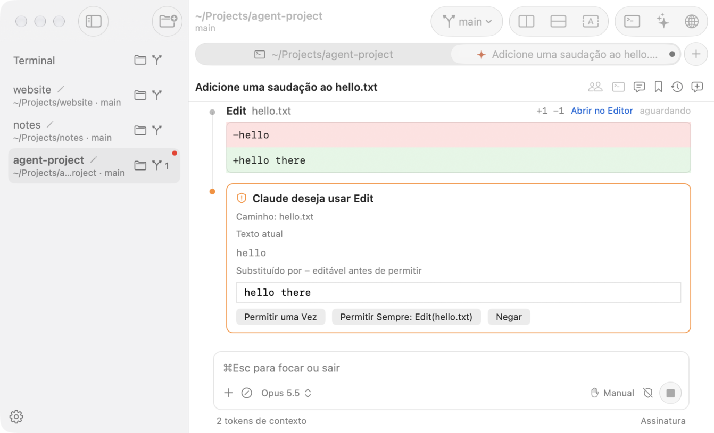

<p>&nbsp;&nbsp;&nbsp;</p>

# Tapa

**O terminal rápido e nativo para macOS que ganhou espaço para seus agentes, arquivos e páginas.**

O Tapa é antes de tudo um terminal: núcleo VT próprio e renderizador Metal, abas e divisões nativas do macOS, um terminal rápido que desliza para dentro com um atalho, integração com o shell com blocos de comando e um campo de entrada opcional com sugestões no estilo do Warp. Em volta disso, o Tapa virou a irmã mais nova do [Dango](https://github.com/sventmueller/dango): uma barra lateral de espaços de trabalho, um por pasta de projeto, cada um com seus terminais, abas de agente para Claude, Codex, OpenCode, Antigravity e outros agentes ACP, abas de navegador, um editor com lista de arquivos e painel Git, e uma pré-visualização de Markdown do [Splat](https://github.com/sventmueller/splat) com fórmulas e diagramas. Nada que uma pasta de projeto configure roda antes de você confiar no espaço de trabalho dela. O Tapa é escrito em Rust sobre controles AppKit genuínos, fala 35 idiomas, não precisa de conta e não tem telemetria.

[](https://github.com/sventmueller/tapa/releases/latest/download/Tapa.dmg)

**[Baixar Tapa.dmg](https://github.com/sventmueller/tapa/releases/latest/download/Tapa.dmg)**: assinado e notarizado pela Apple, para macOS 14 ou posterior, em Apple Silicon e Intel.

**Encontrou um bug?** [Abra uma issue](https://github.com/sventmueller/tapa/issues/new/choose) e diga com qual shell, qual agente ou qual programa isso aconteceu. Se o Tapa for útil para você, uma [estrela no GitHub](https://github.com/sventmueller/tapa) ajuda outras pessoas a encontrá-lo.

[](https://www.rust-lang.org) [](https://www.apple.com/macos/)  [](https://github.com/madsmtm/objc2) [](https://developer.apple.com/metal/) [](https://agentclientprotocol.com)    [](#licença)

[Bahasa Indonesia](../id/README.md) · [Bahasa Melayu](../ms/README.md) · [Català](../ca/README.md) · [Čeština](../cs/README.md) · [Dansk](../da/README.md) · [Deutsch](../de/README.md) · [English](../../../README.md) · [Español](../es/README.md) · [Français](../fr/README.md) · [Hrvatski](../hr/README.md) · [Italiano](../it/README.md) · [Magyar](../hu/README.md) · [Nederlands](../nl/README.md) · [Norsk](../no/README.md) · [Polski](../pl/README.md) · **Português (Brasil)** · [Português (Portugal)](../pt_PT/README.md) · [Română](../ro/README.md) · [Slovenčina](../sk/README.md) · [Slovenščina](../sl/README.md) · [Suomi](../fi/README.md) · [Svenska](../sv/README.md) · [Tiếng Việt](../vi/README.md) · [Türkçe](../tr/README.md) · [Ελληνικά](../el/README.md) · [Русский](../ru/README.md) · [Українська](../uk/README.md) · [עברית](../he/README.md)‎ · [العربية](../ar/README.md)‎ · [हिन्दी](../hi/README.md) · [ไทย](../th/README.md) · [한국어](../ko/README.md) · [日本語](../ja/README.md) · [简体中文](../zh-Hans/README.md) · [繁體中文](../zh-Hant/README.md)

## Conteúdo

- [Recursos em resumo](#recursos-em-resumo)
- [Requisitos](#requisitos)
- [Instalação](#instalação)
- [Primeiros passos](#primeiros-passos)
- [Espaços de trabalho](#espaços-de-trabalho)
- [O terminal](#o-terminal)
  - [Abas e divisões](#abas-e-divisões)
  - [Integração com o shell e blocos de comando](#integração-com-o-shell-e-blocos-de-comando)
  - [O campo de entrada e as sugestões](#o-campo-de-entrada-e-as-sugestões)
  - [Busca, seleção e cópia](#busca-seleção-e-cópia)
  - [O terminal rápido](#o-terminal-rápido)
- [Agentes](#agentes)
- [Editor, arquivos e Git](#editor-arquivos-e-git)
- [Pré-visualizações](#pré-visualizações)
- [Navegador](#navegador)
- [Ditado](#ditado)
- [Ajustes](#ajustes)
- [Aparência e acessibilidade](#aparência-e-acessibilidade)
- [Idiomas](#idiomas)
- [Atalhos de teclado](#atalhos-de-teclado)
- [Confiança](#confiança)
- [Privacidade e segurança](#privacidade-e-segurança)
- [Limitações conhecidas](#limitações-conhecidas)
- [Para desenvolvedores](#para-desenvolvedores)
  - [Componentes de terceiros](#componentes-de-terceiros)
- [Licença](#licença)

## Recursos em resumo

- **Um terminal rápido e próprio.** O Tapa interpreta com seu próprio núcleo VT e desenha com Metal em uma thread por tela, na frequência da tela, e só o que mudou. Ele passa em 262 verificações do esctest, enquanto o núcleo do Alacritty passa em 121, e cada alteração nele é medida contra um Ghostty de versão fixada.
- **Nativo até o osso.** Abas de verdade do macOS, restauração de janelas, menus, o menu Serviços, notificações, Entrada de Teclado Segura, ditado e métodos de entrada. Nada de Electron, e WebKit só onde uma página ou uma pré-visualização precisa dele.
- **Espaços de trabalho.** A barra lateral reúne um espaço de trabalho por pasta de projeto, cada um com suas próprias abas, branch e painéis. O espaço de trabalho "Terminal", no topo, começa do zero toda vez; todos os outros ficam até você removê-los.
- **Agentes em uma visualização de chat nativa.** Claude, Codex, OpenCode, Antigravity, Gemini CLI e outros agentes do Agent Client Protocol rodam em abas próprias, com respostas, chamadas de ferramentas, diffs e pedidos de permissão em uma única linha do tempo. O Tapa os instala e atualiza quando você pede.
- **Integração com o shell e blocos de comando** para zsh, bash e fish, também via `ssh`: pule de prompt em prompt, selecione, copie, salve e recolha a saída de um comando, veja quais comandos falharam e quanto tempo cada um levou.
- **Um campo de entrada como o do Warp, se você quiser.** Edite a linha de comando como texto, com sugestões do seu histórico, de especificações para mais de 700 ferramentas de linha de comando e do estado do projeto, tudo no seu Mac.
- **Arquivos, Git e um navegador ao lado do shell.** Um editor com cores de sintaxe, uma lista de arquivos, um painel Git com staging, commits, branches e worktrees, uma pré-visualização de Markdown com fórmulas e diagramas, e abas de navegador.
- **Cuidadoso com as suas pastas.** Um espaço de trabalho em que você não confiou não inicia nada que a pasta dele configure: nenhum hook do git, nenhum servidor MCP do projeto, nenhum ajuste de projeto para agentes, nenhum JavaScript nas páginas de arquivo dele.
- **Privado.** Sem conta, sem telemetria. O Tapa só acessa a rede quando você pede, e o histórico restaurado no disco é criptografado com uma chave no seu chaveiro.
- **No seu idioma.** A interface vem em 35 idiomas: alemão, árabe, catalão, checo, chinês (simplificado), chinês (tradicional), coreano, croata, dinamarquês, eslovaco, esloveno, espanhol, finlandês, francês, grego, hebraico, hindi, holandês, húngaro, indonésio, inglês, italiano, japonês, malaio, norueguês, polonês, português (Brasil), português (Portugal), romeno, russo, sueco, tailandês, turco, ucraniano e vietnamita.

## Requisitos

- macOS 14 Sonoma ou posterior, em Apple Silicon ou Intel. O Tapa é desenvolvido e testado no macOS 27.
- zsh, bash ou fish para a integração com o shell; outros shells funcionam sem ela.
- Para as abas de agente, o agente que você quer usar, já instalado ou instalado pelo Tapa quando você pedir (veja [Agentes](#agentes)).

## Instalação

**Pela imagem de disco.** Cada versão é uma imagem de disco, `Tapa-<version>.dmg`, com um único app universal para Apple Silicon e Intel, assinado com um Developer ID e notarizado pela Apple. Abra-a e arraste o Tapa para a pasta Aplicativos.

**Com o Homebrew.** O cask, em um tap próprio, instala a mesma imagem de disco:

```sh
brew install --cask sventmueller/tap/tapa
```

**Atualizações.** O Tapa instalado pela imagem de disco ou pelo Homebrew se mantém atualizado com o [Sparkle](https://sparkle-project.org). Na segunda abertura, ele pergunta se pode buscar atualizações por conta própria; até você concordar, ele não faz nenhuma requisição. **Tapa › Buscar Atualizações…** busca na hora. O Tapa só instala uma atualização se ela tiver a assinatura do desenvolvedor. Uma versão compilada por você não tem atualizador.

**Pelo código-fonte.** Veja [Para desenvolvedores](#para-desenvolvedores).

**Como terminal padrão.** O Tapa pode abrir scripts de shell (`.command`, `.tool`), pastas soltas sobre o ícone dele e links `ssh://`. Escolha-o no Finder com **Arquivo › Obter Informações › Abrir com**.

## Primeiros passos

1. **A janela** tem a barra lateral de espaços de trabalho à esquerda, as abas do espaço de trabalho selecionado em cima e a barra de ferramentas acima delas. ⌃⌘S mostra e oculta a barra lateral.
2. **Um novo espaço de trabalho** vem do botão de pasta no topo da barra lateral ou de **Shell › Novo Espaço de Trabalho…** (⇧⌘N): escolha uma das pastas recentes ou **Escolher Pasta…**.
3. **Novas abas** começam na pasta do espaço de trabalho: ⌘T para um terminal, os botões à direita da barra de ferramentas para um terminal, um agente ou uma aba de navegador, ou o **+** no fim da barra de abas.
4. **Os ajustes** abrem com ⌘, ou com a engrenagem na parte de baixo da barra lateral.
5. **A paleta de comandos** (⇧⌘P) encontra qualquer comando pelo nome, e **Buscar Aba…** (⌘P) qualquer aba de qualquer espaço de trabalho.

A barra de ferramentas contém, a partir da esquerda, o menu suspenso de branches do repositório do espaço de trabalho, os botões para dividir o terminal à direita e abaixo e para mostrar o campo de entrada, e os botões para novas abas de terminal, de agente e de navegador. Os botões de divisão e do campo de entrada ficam cinza enquanto nenhuma aba de terminal estiver em primeiro plano.

## Espaços de trabalho

Um espaço de trabalho é uma pasta com suas abas. A linha dele na barra lateral mostra o nome, a pasta e o branch do Git e, à direita, os botões da lista de arquivos e do painel Git. Um clique em um deles mostra esse painel no lugar da lista de espaços de trabalho; **Espaços de Trabalho**, no topo, leva de volta.

- **O espaço de trabalho "Terminal"** fica sempre no topo. Ele começa do zero a cada abertura, na pasta indicada nos ajustes, com um terminal vazio. Nada dele é guardado, e ele não pode ser renomeado nem removido.
- **Todos os outros espaços de trabalho ficam** até você removê-los, mesmo sem abas. O Tapa guarda o nome, as abas, o conteúdo dos terminais (até onde os ajustes de restauração permitem), as sessões de agente e a posição da janela. Programas ainda em execução terminam quando o Tapa é encerrado.
- **Renomear.** Clique no lápis depois do nome, clique no nome do espaço de trabalho selecionado ou escolha **Shell › Renomear Espaço de Trabalho**. O nome é salvo na hora.
- **Status.** Um ponto verde na linha significa que um agente do espaço de trabalho está trabalhando, também com subagentes ou em segundo plano; um ponto vermelho significa que um deles está esperando por você. Terminais não marcam nada ali.
- **Alternar.** ⌃⌘[ e ⌃⌘] passam de um espaço de trabalho para outro. A janela fica no lugar, e as abas do espaço de trabalho selecionado tomam o lugar das outras.
- **Worktrees.** **Novo Worktree…** no menu suspenso de branches da barra de ferramentas cria um worktree do Git em um novo branch e o abre como um espaço de trabalho próprio.

Quando a última aba de um espaço de trabalho fecha, o espaço de trabalho continua na lista. Com todas as abas fechadas, só a janela some; o ícone do Dock ou ⌘N a traz de volta com seus espaços de trabalho.

## O terminal

O Tapa roda sobre o próprio núcleo, `term-vt`. Ele fala xterm e VT520 com o protocolo de teclado do Kitty, hiperlinks OSC 8, acesso à área de transferência via OSC 52 com permissão separada para leitura, saída sincronizada, sublinhados coloridos e ondulados, truecolor, consultas de cor, avisos de modo claro e escuro para os programas, colagem delimitada (bracketed paste), eventos de foco e relato do mouse. O texto se reorganiza quando a janela muda de tamanho, histórico incluído. Ligaduras, recursos de fonte, símbolos Nerd Font sem fontes modificadas e caracteres de desenho de caixas, Powerline e Braille exatos ao pixel já vêm embutidos.

### Abas e divisões

- **As abas** são as do próprio macOS: arraste-as para reordenar ou para fora, para uma janela própria, **Mostrar Todas as Abas** (⇧⌘\\), ⌘1 a ⌘8, ⌘9 para a última aba e ⇧⌘[ / ⇧⌘] para alternar. Cada aba mostra o ícone do seu tipo antes do título.
- **Divisões.** **Dividir à Direita** (⌘D ou ⌃⌘T) e **Dividir Abaixo** (⇧⌘D ou ⌃⌥⌘T), aninhadas tão fundo quanto você quiser. Arraste um divisor, mova-o com ⌃⌘ e as teclas de seta, **Maximizar Painel** (⌃⇧⌘↩), **Igualar Painéis** (⌃⌘=), e passe de um painel a outro com ⌘[ e ⌘].
- **Pasta de trabalho.** Novas abas, janelas e divisões começam na pasta do terminal em primeiro plano; os ajustes decidem isso para cada um dos três.
- **Fechar.** O Tapa pergunta antes de fechar uma aba, uma janela ou o app enquanto um programa roda nele.
- **Restauração.** Depois de reiniciar, voltam os espaços de trabalho, as abas, os painéis, as pastas e as últimas linhas de cada terminal. Segredos como tokens e senhas são mascarados antes de qualquer coisa ser guardada.

### Integração com o shell e blocos de comando

O Tapa configura sozinho a integração com o shell para zsh, bash e fish, sem tocar nos seus arquivos de configuração, e a leva junto quando você usa `ssh` para entrar em outro host. Com ela, cada comando e sua saída formam um bloco:

- **Prompts.** ⌘↑ e ⌘↓ pulam para o prompt anterior e o seguinte. Um clique na linha de comando move o cursor para lá.
- **Blocos.** **Selecionar Bloco** (⇧⌘A), **Copiar Saída** (⌥⌘C), **Salvar Saída…** (⌥⌘S) e **Recolher/Expandir Bloco** (⇧⌘↩). Sobre o bloco sob o ponteiro, botões mostram o status, a duração e as mesmas ações.
- **Comandos que falharam** ficam marcados, e o comando ainda em execução continua visível no topo enquanto a saída dele rola.
- **Marcadores.** **Adicionar/Remover Marcador** (⇧⌘M) marca uma linha; ⇧⌘↑ e ⇧⌘↓ pulam entre marcadores.
- **Notificações** aparecem quando um programa pede uma (OSC 9 e OSC 777) e o terminal não está em primeiro plano, e uma barra de progresso (OSC 9;4) aparece na aba e no ícone do Dock.

### O campo de entrada e as sugestões

O campo de entrada transforma a linha de comando em um campo de texto na parte de baixo do painel, como no Warp, com etiquetas para a pasta e o branch do Git acima dele. **Mostrar/Ocultar Campo de Entrada** (⌘I) ou o botão na barra de ferramentas o liga e desliga para um terminal; **Ajustes › Entrada** o ativa para novos terminais. Ele precisa da integração com o shell e sai do caminho de programas de tela cheia como vim, htop ou claude.

- **Return** envia o campo inteiro para o shell, texto de várias linhas como uma única colagem; o shell o executa e o guarda no histórico como de costume. Se o shell pedir mais, o campo devolve as teclas a ele até o próximo prompt.
- **↑, ↓ e ⌃R** buscam no seu histórico, com a pasta, o branch e o código de saída com que cada comando rodou.
- **Tab** completa com especificações para mais de 700 ferramentas de linha de comando, caminhos e valores ao vivo como branches do git, contêineres do docker, recursos do kubectl, hosts ssh, scripts do `package.json` e alvos do make, do just e do cargo.
- **As teclas do Vim** no campo são uma opção nos mesmos ajustes.
- **O próximo comando antes de você digitar**: o que costuma vir em seguida neste projeto (depois de `git add` vem `git commit`), o que o estado do projeto pede (um arquivo de lock mais novo que `node_modules`) e uma correção depois de "command not found", a partir de erros de digitação ou do seu índice local do Homebrew.

Sem o campo de entrada, as sugestões aparecem como texto cinza atrás do cursor, e → as aceita. Shells com autossugestões próprias, como fish ou zsh-autosuggestions, mantêm as deles. As sugestões nunca usam a rede e só iniciam programas do seu próprio `PATH`, nunca da pasta do projeto.

**Colar.** Colagens de várias linhas podem ser mostradas antes de rodar (**Mostrar antes colagens de várias linhas**). Arquivos soltos sobre um terminal chegam como caminhos entre aspas; ⌥←/→, ⌘←/→ e ⌘⌫ movem e apagam por palavra e por linha como em qualquer campo de texto do Mac.

### Busca, seleção e cópia

- **Buscar** (⌘F) pesquisa o histórico com expressões regulares, maiúsculas e minúsculas e palavras inteiras, e conta as ocorrências; a barra de rolagem as marca junto com os prompts e os erros.
- **Seleção inteligente.** Um clique duplo seleciona por inteiro uma URL, um caminho, um hash ou um endereço IP, e arrastar com ⌥ seleciona um retângulo. Links são encontrados mesmo sem OSC 8; ⌘-clique os abre, e abre um caminho no Dango, se ele estiver instalado.
- **Selecionar com o Teclado** (⇧⌘C) move uma seleção com as teclas do Vim.
- **Copiar com Formatação** (⇧⌥⌘C) mantém cores e estilos; copiar ao selecionar é um ajuste. **Limpar** (⌘K) limpa o terminal.

### O terminal rápido

**Mostrar/Ocultar Terminal Rápido** (⌃⌥⌘Space) faz um terminal deslizar a partir de uma borda da tela, acima dos outros apps e sobre espaços em tela cheia, sem trocar de app. A borda, o tamanho e se ele se oculta quando você clica em outro lugar são ajustes. As sessões dele continuam rodando enquanto ele está oculto.

## Agentes

Uma aba de agente roda um agente de programação na pasta do espaço de trabalho, na visualização nativa de agentes vinda do Dango.

| Agente | Como roda | Do que precisa |
|---|---|---|
| Claude | o comando `claude`, com o qual fala pelo protocolo stream-json dele | `claude` instalado e com login feito; o Tapa o instala com o instalador do próprio Claude quando você pede |
| Codex | `codex app-server`, ou `codex-acp` para um Codex mais antigo | `codex` com login feito; o Tapa instala o adaptador de versão fixada quando você pede |
| OpenCode | `opencode serve`, ou `opencode acp` para um OpenCode mais antigo | o seu próprio `opencode` no `PATH`, ou o download de versão fixada |
| Antigravity | `agy acp` | o seu próprio `agy` no `PATH`, ou o download de versão fixada |
| Gemini CLI | `gemini --acp`, oferecido assim que você o ativa em **Ajustes › Agentes** | o seu próprio `gemini`, ou o download de versão fixada |
| Outros agentes ACP | do registro ACP, carregado só quando você pede | o que a entrada do registro indica; entradas sem checksum só são instaladas depois que você confirma |

O Tapa usa o login próprio de cada agente e não guarda credenciais de agentes. Um agente encontrado no `PATH` do seu shell de login vem primeiro; caso contrário, o Tapa roda a versão que instalou na própria pasta de dados, nunca um programa do espaço de trabalho.

- **A linha do tempo** mostra respostas, chamadas de ferramentas com a saída e os diffs delas, perguntas e pedidos de permissão. **Permitir uma Vez**, **Permitir Sempre** e **Negar** respondem a um pedido, e uma edição pode ser alterada antes de você permiti-la.
- **Status.** A aba e a linha do espaço de trabalho mostram um ponto verde enquanto o agente trabalha e um vermelho enquanto ele espera por você, e uma notificação avisa quando ele está esperando enquanto você olha para outro lugar.
- **O campo de mensagem** na parte de baixo recebe o seu prompt, arquivos soltos sobre ele e ditado. ⌘Esc leva o foco do teclado para ele e de volta. O modelo e o modo de permissão podem ser escolhidos ali para a sessão.
- **Ajustes › Agentes** define para novas sessões o modo de permissão (Claude, Codex), o modelo (Claude, Codex, OpenCode) e o esforço de raciocínio (Claude, Codex), e quais agentes as novas abas oferecem. Ali aparece onde está o programa de cada agente, com **Instalar…**, **Atualizar para …** e **Voltar para …** para a versão anterior, e **Carregar Registro** para o registro ACP. As regras que o Claude salvou com "Permitir Sempre" podem ser vistas e removidas ali.
- **Downloads verificados.** Arquivos compactados são conferidos com o SHA-256 deles, pacotes npm com a integridade registrada no arquivo de lock, e pacotes sem versão fixa são recusados. Um agente ausente também oferece a instalação na própria aba.

## Editor, arquivos e Git

- **A lista de arquivos** de um espaço de trabalho mostra a pasta como uma árvore, atualizada conforme os arquivos mudam, com os arquivos que o Git ignora esmaecidos, se você quiser. Um clique abre um arquivo como aba de pré-visualização, que o próximo clique substitui até você editá-lo; um clique duplo o mantém.
- **O editor** abre arquivos em abas do espaço de trabalho, com cores de sintaxe, vários cursores, recolhimento de código, a indentação do `.editorconfig`, teclas do Vim opcionais e marcas para o que mudou desde o último commit. Ele percebe quando um arquivo mudou no disco ou contém marcadores de conflito. Arquivos Markdown ganham uma barra de formatação e **Abrir no Splat**. **Salvar** (⌘S), **Salvar Como…** e **Salvar Tudo** funcionam como de costume, e o Tapa pergunta antes de fechar texto não salvo.
- **Depois de uma falha**, o texto não salvo volta: o Tapa guarda cópias criptografadas dele enquanto você digita.
- **O painel Git** mostra alterações preparadas e não preparadas, prepara e desfaz a preparação de arquivos e de trechos individuais, faz commit (⌘↩), emenda o último commit, faz commit e push, faz fetch e cuida de branches, stashes, cherry-picks e conflitos, com o histórico de commits embaixo. Um clique em um arquivo mostra o diff dele.
- **O menu suspenso de branches** na barra de ferramentas troca e cria branches e cria worktrees.

O editor não inicia nenhum formatador nem servidor de linguagem. Para um IDE completo com servidores de linguagem e depurador, use o [Dango](https://github.com/sventmueller/dango).

## Pré-visualizações

- **O Markdown** aparece ao lado do editor pelo renderizador do Splat: GitHub Flavored Markdown com fórmulas, diagramas e imagens, rolando parágrafo a parágrafo junto com o texto.
- **Imagens** abrem em uma aba própria, PDFs pelo PDFKit, e áudio, vídeos, fontes e documentos de escritório pelo Quick Look.
- **Decodificação isolada.** Toda imagem de uma fonte não confiável (arquivos do projeto, Markdown, anexos e colagens de agentes) é decodificada no serviço `Decoder.xpc` do Splat, em uma App Sandbox própria, sem arquivos nem rede, nunca no app.

## Navegador

**Nova aba de navegador** (⇧⌘B) abre uma aba WebKit no espaço de trabalho. O campo de endereço aceita um endereço ou palavras para o buscador de sua escolha (DuckDuckGo, Google, Bing ou Startpage); ⌘L, ⌘R, ⌘[ e ⌘] funcionam como no Safari. Páginas de `localhost` rodam normalmente, para o servidor de desenvolvimento do seu projeto. Arquivos HTML de um espaço de trabalho só podem ler a própria pasta e, em um espaço de trabalho em que você não confiou, não rodam JavaScript.

## Ditado

Dite no campo de mensagem de um agente ou no editor com o botão de microfone ou **Editar › Iniciar Ditado** (⌃⌥D). O reconhecimento de fala é o do [Lowspeak](https://github.com/sventmueller/lowspeak), que não precisa estar instalado. **Ajustes › Ditado** escolhe a transcrição online com OpenAI ou Groq, ou modelos locais Whisper e Parakeet que mantêm a gravação no seu Mac, além do idioma, do pós-processamento, do microfone e do seu próprio vocabulário. As chaves da OpenAI e do Groq ficam guardadas no seu chaveiro. O ditado só faz parte da versão de lançamento.

## Ajustes

**Tapa › Ajustes…** (⌘,) tem os painéis Geral, Fonte, Cores, Cursor, Terminal, Entrada, Editor, Agentes, Ditado, Perfis e Atalhos de Teclado. Eles gravam um único arquivo TOML, `config.toml`, na pasta do Tapa em `~/Library/Application Support`, que você também pode editar à mão; o Tapa o recarrega enquanto roda, e **Recarregar Ajustes** (⇧⌘,) faz isso na hora.

- **Quatro tamanhos de fonte** em Geral: Interface (barra lateral, painéis, lista de arquivos, painel Git e títulos das abas), Editor (texto, números de linha e pré-visualização de Markdown), Terminal e Agentes. ⌘+, ⌘− e ⌘0 mudam o tamanho do terminal em primeiro plano.
- **Aparência:** Clara, Escura ou Igual ao Sistema.
- **Cores.** Um tema para o modo claro e um para o modo escuro, no formato de temas do Ghostty, com um contraste mínimo que mantém o texto legível mesmo com um tema ruim. Seus próprios temas vão na pasta de temas.
- **Perfis** reúnem fonte, cores, shell, ambiente e pasta.
- **Todos os atalhos** podem ser alterados, e os conflitos são mostrados.

## Aparência e acessibilidade

- **O modo escuro** segue o sistema ou a sua escolha; a cor de destaque, Reduzir movimento e Aumentar contraste são respeitados.
- **O VoiceOver** lê as linhas e os prompts do terminal e anuncia nova saída; a barra lateral, as abas, os botões da barra de ferramentas e os cartões da linha do tempo dos agentes têm nome.
- **Teclado.** Todo comando tem um item de menu e um atalho, e o Acesso Total pelo Teclado alcança todos os controles.
- **Tamanhos.** Os quatro tamanhos de fonte dos ajustes escalam a interface, o editor, o terminal e os agentes de forma independente.
- **Da direita para a esquerda.** A interface é espelhada em árabe e hebraico, enquanto a grade do terminal continua da esquerda para a direita.

Detalhes e lacunas conhecidas estão em [ACCESSIBILITY.md](../../../ACCESSIBILITY.md).

## Idiomas

A interface está traduzida para 35 idiomas: alemão, árabe, catalão, checo, chinês (simplificado), chinês (tradicional), coreano, croata, dinamarquês, eslovaco, esloveno, espanhol, finlandês, francês, grego, hebraico, hindi, holandês, húngaro, indonésio, inglês, italiano, japonês, malaio, norueguês, polonês, português (Brasil), português (Portugal), romeno, russo, sueco, tailandês, turco, ucraniano e vietnamita.

O Tapa segue a ordem de idiomas em **Ajustes do Sistema › Geral › Idioma e Região**; ali você também pode escolher um idioma só para o Tapa em **Aplicativos**. Sem tradução para o seu idioma, ele usa inglês.

## Atalhos de teclado

| Ação | Atalho |
|---|---|
| Nova janela, espaço de trabalho, aba | ⌘N, ⇧⌘N, ⌘T |
| Nova aba de navegador | ⇧⌘B |
| Novo arquivo, abrir arquivo | ⌥⌘N, ⌘O |
| Fechar painel ou aba, fechar aba, fechar janela | ⌘W, ⌥⌘W, ⇧⌘W |
| Dividir à direita, dividir abaixo | ⌘D ou ⌃⌘T, ⇧⌘D ou ⌃⌥⌘T |
| Maximizar painel, igualar painéis, fechar painel | ⌃⇧⌘↩, ⌃⌘=, ⌃⇧⌘W |
| Mover um divisor | ⌃⌘←, ⌃⌘→, ⌃⌘↑, ⌃⌘↓ |
| Próximo painel, painel anterior | ⌘], ⌘[ |
| Próxima aba, aba anterior; aba 1 a 8, última aba | ⇧⌘], ⇧⌘[; ⌘1 a ⌘8, ⌘9 |
| Próximo espaço de trabalho, anterior | ⌃⌘], ⌃⌘[ |
| Buscar aba, paleta de comandos | ⌘P, ⇧⌘P |
| Mostrar ou ocultar a barra lateral, o campo de entrada | ⌃⌘S, ⌘I |
| Terminal rápido | ⌃⌥⌘Space |
| Buscar, buscar próxima, buscar anterior | ⌘F, ⌘G, ⇧⌘G |
| Prompt anterior, próximo | ⌘↑, ⌘↓ |
| Selecionar bloco, copiar saída, salvar saída, recolher bloco | ⇧⌘A, ⌥⌘C, ⌥⌘S, ⇧⌘↩ |
| Adicionar ou remover um marcador; marcador anterior, próximo | ⇧⌘M; ⇧⌘↑, ⇧⌘↓ |
| Selecionar com o teclado | ⇧⌘C |
| Copiar com formatação | ⇧⌥⌘C |
| Limpar | ⌘K |
| Início, fim, página acima, página abaixo | ⌘Home, ⌘End, ⌘PageUp, ⌘PageDown |
| Aumentar, diminuir, tamanho original (terminal) | ⌘+, ⌘−, ⌘0 |
| Campo de mensagem de uma aba de agente | ⌘Esc |
| Iniciar ditado | ⌃⌥D |
| Ajustes, recarregar ajustes | ⌘,, ⇧⌘, |

Todo atalho pode ser alterado em **Ajustes › Atalhos de Teclado** ou na seção `[keys]` do arquivo de ajustes.

## Confiança

Uma pasta de projeto pode fazer programas rodarem assim que algo começa nela: hooks do git e ajustes do repositório como `core.fsmonitor`, hooks de agentes, servidores MCP do projeto e ajustes de projeto dos agentes. Por isso, um novo espaço de trabalho não é confiável.

- **Não confiável:** os agentes começam sem os hooks, os servidores MCP e a configuração do projeto (Claude com `--setting-sources=user --strict-mcp-config`, Codex com a pasta marcada como não confiável, OpenCode sem a configuração do projeto). O Git roda neutralizado: sem hooks, filtros, drivers de diff, fsmonitor, `sshCommand` ou pager, e só com auxiliares de credenciais globais. Arquivos HTML abrem sem JavaScript. O painel Git e a aba de agente avisam isso e oferecem confiar no espaço de trabalho.
- **Confiável:** **Shell › Confiar no espaço de trabalho** carrega tudo isso como a pasta pretende. **Retirar confiança** desfaz isso. A confiança é guardada por espaço de trabalho.

Seja qual for a confiança, o Tapa nunca roda por conta própria um programa de uma pasta de projeto: as sugestões só iniciam programas do seu `PATH` fora do projeto, e a barra lateral lê o estado do Git a partir dos arquivos `.git`. Um espaço de trabalho na sua pasta pessoal, como "Terminal", não é um projeto: programas em `~`, como `~/.local/bin/claude`, contam ali como seus.

## Privacidade e segurança

- **Sem telemetria, sem conta.** O Tapa não informa nada sobre como você o usa e funciona totalmente offline. Ele só acessa a rede quando você pede: para instalar ou atualizar um agente, para carregar o registro ACP, para buscar atualizações depois que você concordou e para as páginas que você abre em uma aba de navegador. Os próprios agentes falam com seus provedores como sempre.
- **O histórico no disco** usado para restaurar sessões é criptografado com uma chave no seu chaveiro, pode ser desligado e tem segredos como chaves de API, tokens e senhas mascarados antes de ser gravado. As cópias de texto não salvo do editor são criptografadas com a mesma chave.
- **A Entrada de Teclado Segura** liga sozinha em pedidos de senha e pode ser ligada de vez no menu do app.
- **Sequências de escape** que poderiam vazar ou injetar dados, como relatos de título, leituras da área de transferência e truques de colagem, são bloqueadas ou pedem permissão antes. O parser passa por fuzzing na CI.
- **Decodificação isolada** de imagens de fontes não confiáveis, veja [Pré-visualizações](#pré-visualizações).
- **Assinatura de código** com o Hardened Runtime. O macOS atribui ao Tapa os acessos dos programas que rodam em um terminal, por isso ele traz uma descrição de uso para cada serviço protegido.

Problemas de segurança são relatados de forma privada, veja [SECURITY.md](../../../SECURITY.md).

## Limitações conhecidas

- **Ainda sem imagens embutidas** no terminal: gráficos do Kitty, Sixel e imagens do iTerm2 estão planejados para depois da 1.0.
- **Sem modo de controle do tmux**, e as sessões não sobrevivem ao encerramento do Tapa.
- **Texto da direita para a esquerda** na grade do terminal continua da esquerda para a direita.
- **⌘+ e ⌘−** mudam só o terminal em primeiro plano.
- **O editor** não tem servidores de linguagem, formatadores nem depurador, de propósito; o Dango tem.
- **O ditado** só existe na versão de lançamento, não em uma versão de depuração.
- **O VoiceOver** ainda não foi verificado de ponta a ponta por uma pessoa.

## Para desenvolvedores

Você precisa do macOS 14 ou posterior com as Xcode Command Line Tools, do Rust na versão que o `rust-toolchain.toml` indica (rustup com os dois alvos do Mac para a compilação universal), de clones do [splat](https://github.com/sventmueller/splat) e do [lowspeak](https://github.com/sventmueller/lowspeak) ao lado deste (`../splat`, `../lowspeak`) e do cmake para compilações com ditado.

| Comando | O que faz |
|---|---|
| `make help` | lista os alvos |
| `cargo xtask run` | compila o app de depuração e o abre |
| `make build` | compila o app de lançamento com ditado em `target/release`, com assinatura ad hoc para este Mac |
| `make lint` | formatação, clippy com avisos tratados como erros, a forma dos arquivos e os textos da interface |
| `make check` | `lint` e depois todos os testes; não precisa de janela nem de rede |
| `make selftest STEPS="split_right,type:ls\n,shot:x"` | controla o app e deixa imagens das janelas em `target/selftest/` |
| `make esctest`, `make vttest` | roda o esctest e o vttest contra os dois núcleos no app |
| `make perf` | o benchmark contra um Ghostty de versão fixada; só faz sentido em um Mac ocioso |
| `make fuzz` | os alvos de fuzzing com cargo-fuzz |
| `make release` | um ensaio da publicação: o app universal com ditado, sua imagem de disco, o feed de atualizações e o cask em `target/release-dry-run`; não envia nada a lugar nenhum |
| `make release-notarized` | a versão atual assinada com o Developer ID, notarizada pela Apple e com o ticket grampeado, em `dist/`; `Cargo.toml` não muda |
| `make deploy` | notariza a próxima versão, faz commit de `Cargo.toml`, envia um rascunho da publicação, faz push de `main` e da tag e depois publica a versão; veja [docs/development.md](../../../docs/development.md#deploy) |

Como contribuir está em [CONTRIBUTING.md](../../../CONTRIBUTING.md). Todo texto da interface tem o alemão como chave, com tradução para todos os 35 idiomas; `cargo xtask strings` falha se faltar alguma.

### Componentes de terceiros

| Componente | Usado para | Licença |
|---|---|---|
| [objc2](https://github.com/madsmtm/objc2) e seus crates de frameworks | AppKit, Metal, WebKit e os outros frameworks da Apple | MIT, Zlib ou Apache-2.0 |
| Crates do Splat | Markdown, a pré-visualização, a leitura do Git, o decodificador de imagens e as traduções | MIT ou Apache-2.0 |
| [Lowspeak](https://github.com/sventmueller/lowspeak) com [whisper.cpp](https://github.com/ggml-org/whisper.cpp) | ditado | MIT |
| [Especificações de autocompletar do Fig](https://github.com/withfig/autocomplete) | as descrições de comandos das sugestões | MIT |
| [rusqlite](https://github.com/rusqlite/rusqlite) com SQLite | o histórico de comandos | MIT, domínio público |
| [Simple Icons](https://simpleicons.org) | logotipos de linguagens e programas | CC0, alguns logotipos sob termos próprios |
| [Sparkle](https://sparkle-project.org) 2.10.1 | atualizações da versão de lançamento | MIT |

## Licença

O Tapa é licenciado sob qualquer uma das duas

- Licença Apache, Versão 2.0 ([LICENSE-APACHE](../../../LICENSE-APACHE))
- Licença MIT ([LICENSE-MIT](../../../LICENSE-MIT))

à sua escolha. Os logotipos em `assets/simple-icons` têm licenças próprias; veja o README dessa pasta.

Salvo declaração explícita em contrário, qualquer contribuição enviada intencionalmente por você para inclusão no Tapa, conforme definida na licença Apache-2.0, terá licença dupla como acima, sem termos ou condições adicionais.
