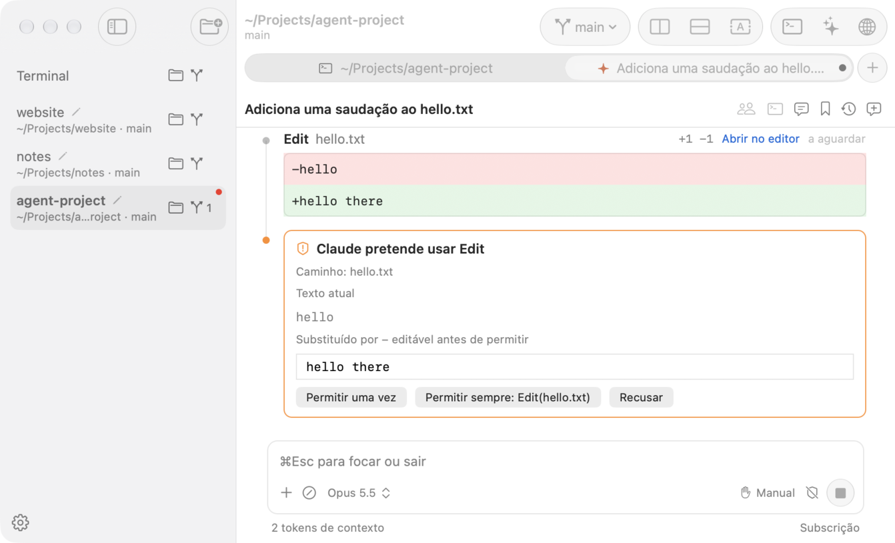

<p>&nbsp;&nbsp;&nbsp;</p>

# Tapa

**O terminal rápido e nativo para macOS que ganhou espaço para os seus agentes, ficheiros e páginas.**

O Tapa é, antes de mais, um terminal: núcleo VT próprio e motor de desenho Metal, separadores e divisões nativos do macOS, um terminal rápido que desliza para o ecrã com um atalho, integração com a shell com blocos de comando e um campo de entrada opcional com sugestões ao estilo do Warp. À volta disso, o Tapa tornou-se a irmã mais nova do [Dango](https://github.com/sventmueller/dango): uma barra lateral de espaços de trabalho, um por pasta de projeto, cada um com os seus terminais, separadores de agente para Claude, Codex, OpenCode, Antigravity e outros agentes ACP, separadores de navegador, um editor com lista de ficheiros e painel Git, e uma pré-visualização de Markdown do [Splat](https://github.com/sventmueller/splat) com fórmulas e diagramas. Nada do que uma pasta de projeto configure é executado antes de confiar no respetivo espaço de trabalho. O Tapa está escrito em Rust sobre controlos AppKit genuínos, fala 35 idiomas, não precisa de conta e não tem telemetria.

[](https://github.com/sventmueller/tapa/releases/latest/download/Tapa.dmg)

**[Descarregar Tapa.dmg](https://github.com/sventmueller/tapa/releases/latest/download/Tapa.dmg)**: assinado e notarizado pela Apple, para macOS 14 ou posterior em Apple Silicon e Intel.

**Encontrou um erro?** [Abra uma issue](https://github.com/sventmueller/tapa/issues/new/choose) e indique com que shell, com que agente ou com que programa aconteceu. Se o Tapa lhe for útil, uma [estrela no GitHub](https://github.com/sventmueller/tapa) ajuda outras pessoas a encontrá-lo.

[](https://www.rust-lang.org) [](https://www.apple.com/macos/)  [](https://github.com/madsmtm/objc2) [](https://developer.apple.com/metal/) [](https://agentclientprotocol.com)    [](#licença)

[Bahasa Indonesia](../id/README.md) · [Bahasa Melayu](../ms/README.md) · [Català](../ca/README.md) · [Čeština](../cs/README.md) · [Dansk](../da/README.md) · [Deutsch](../de/README.md) · [English](../../../README.md) · [Español](../es/README.md) · [Français](../fr/README.md) · [Hrvatski](../hr/README.md) · [Italiano](../it/README.md) · [Magyar](../hu/README.md) · [Nederlands](../nl/README.md) · [Norsk](../no/README.md) · [Polski](../pl/README.md) · [Português (Brasil)](../pt_BR/README.md) · **Português (Portugal)** · [Română](../ro/README.md) · [Slovenčina](../sk/README.md) · [Slovenščina](../sl/README.md) · [Suomi](../fi/README.md) · [Svenska](../sv/README.md) · [Tiếng Việt](../vi/README.md) · [Türkçe](../tr/README.md) · [Ελληνικά](../el/README.md) · [Русский](../ru/README.md) · [Українська](../uk/README.md) · [עברית](../he/README.md)‎ · [العربية](../ar/README.md)‎ · [हिन्दी](../hi/README.md) · [ไทย](../th/README.md) · [한국어](../ko/README.md) · [日本語](../ja/README.md) · [简体中文](../zh-Hans/README.md) · [繁體中文](../zh-Hant/README.md)

## Índice

- [Funcionalidades em resumo](#funcionalidades-em-resumo)
- [Requisitos](#requisitos)
- [Instalação](#instalação)
- [Primeiros passos](#primeiros-passos)
- [Espaços de trabalho](#espaços-de-trabalho)
- [O terminal](#o-terminal)
  - [Separadores e divisões](#separadores-e-divisões)
  - [Integração com a shell e blocos de comando](#integração-com-a-shell-e-blocos-de-comando)
  - [O campo de entrada e as sugestões](#o-campo-de-entrada-e-as-sugestões)
  - [Pesquisa, seleção e cópia](#pesquisa-seleção-e-cópia)
  - [O terminal rápido](#o-terminal-rápido)
- [Agentes](#agentes)
- [Editor, ficheiros e Git](#editor-ficheiros-e-git)
- [Pré-visualizações](#pré-visualizações)
- [Navegador](#navegador)
- [Ditado](#ditado)
- [Definições](#definições)
- [Aparência e acessibilidade](#aparência-e-acessibilidade)
- [Idiomas](#idiomas)
- [Atalhos de teclado](#atalhos-de-teclado)
- [Confiança](#confiança)
- [Privacidade e segurança](#privacidade-e-segurança)
- [Limitações conhecidas](#limitações-conhecidas)
- [Para programadores](#para-programadores)
  - [Componentes de terceiros](#componentes-de-terceiros)
- [Licença](#licença)

## Funcionalidades em resumo

- **Um terminal rápido e próprio.** O Tapa interpreta com o seu próprio núcleo VT e desenha com Metal num fio de execução por ecrã, à frequência do ecrã, e apenas o que mudou. Passa em 262 verificações do esctest, quando o núcleo do Alacritty passa em 121, e cada alteração é medida face a um Ghostty de versão fixa.
- **Nativo até ao tutano.** Separadores verdadeiros do macOS, restauro de janelas, menus, o menu Serviços, notificações, Entrada de teclado segura, ditado e métodos de introdução. Nada de Electron, e WebKit apenas onde uma página ou uma pré-visualização precisa dele.
- **Espaços de trabalho.** A barra lateral reúne um espaço de trabalho por pasta de projeto, cada um com os seus próprios separadores, branch e painéis. O espaço de trabalho "Terminal", no topo, começa sempre do zero; todos os outros ficam até os remover.
- **Agentes numa vista de conversa nativa.** Claude, Codex, OpenCode, Antigravity, Gemini CLI e outros agentes do Agent Client Protocol são executados em separadores próprios, com respostas, chamadas de ferramentas, diffs e pedidos de permissão numa única cronologia. O Tapa instala-os e atualiza-os a pedido.
- **Integração com a shell e blocos de comando** para zsh, bash e fish, também através de `ssh`: salte de prompt em prompt, selecione, copie, guarde e recolha a saída de um comando, veja que comandos falharam e quanto tempo demorou cada um.
- **Um campo de entrada como o do Warp, se quiser.** Edite a linha de comandos como texto, com sugestões do seu histórico, de especificações para mais de 700 ferramentas de linha de comandos e do estado do projeto, tudo no seu Mac.
- **Ficheiros, Git e um navegador ao lado da shell.** Um editor com cores de sintaxe, uma lista de ficheiros, um painel Git com staging, commits, branches e worktrees, uma pré-visualização de Markdown com fórmulas e diagramas, e separadores de navegador.
- **Cuidadoso com as suas pastas.** Um espaço de trabalho em que não confiou não inicia nada do que a sua pasta configure: nenhum hook do git, nenhum servidor MCP do projeto, nenhuma definição de projeto para agentes, nenhum JavaScript nas suas páginas de ficheiro.
- **Privado.** Sem conta, sem telemetria. O Tapa só acede à rede quando lho pede, e o histórico restaurado no disco é encriptado com uma chave no seu porta-chaves.
- **No seu idioma.** A interface existe em 35 idiomas: alemão, árabe, catalão, checo, chinês (simplificado), chinês (tradicional), coreano, croata, dinamarquês, eslovaco, esloveno, espanhol, finlandês, francês, grego, hebraico, hindi, húngaro, indonésio, inglês, italiano, japonês, malaio, neerlandês, norueguês, polaco, português (Brasil), português (Portugal), romeno, russo, sueco, tailandês, turco, ucraniano e vietnamita.

## Requisitos

- macOS 14 Sonoma ou posterior, em Apple Silicon ou Intel. O Tapa é desenvolvido e testado no macOS 27.
- zsh, bash ou fish para a integração com a shell; as outras shells funcionam sem ela.
- Para os separadores de agente, o agente que pretende utilizar, já instalado ou instalado pelo Tapa quando o pedir (consulte [Agentes](#agentes)).

## Instalação

**A partir da imagem de disco.** Cada versão é uma imagem de disco, `Tapa-<version>.dmg`, com uma única aplicação universal para Apple Silicon e Intel, assinada com um Developer ID e notarizada pela Apple. Abra-a e arraste o Tapa para a pasta Aplicações.

**Com o Homebrew.** O cask, num tap próprio, instala a mesma imagem de disco:

```sh
brew install --cask sventmueller/tap/tapa
```

**Atualizações.** O Tapa instalado a partir da imagem de disco ou do Homebrew mantém-se atualizado através do [Sparkle](https://sparkle-project.org). No segundo arranque, pergunta se pode procurar atualizações por si; enquanto não concordar, não faz nenhum pedido. **Tapa › Procurar atualizações…** procura de imediato. O Tapa só instala uma atualização se esta tiver a assinatura do programador. Uma compilação própria não tem atualizador.

**A partir do código-fonte.** Consulte [Para programadores](#para-programadores).

**Como terminal predefinido.** O Tapa consegue abrir scripts de shell (`.command`, `.tool`), pastas largadas no seu ícone e ligações `ssh://`. Escolha-o no Finder com **Ficheiro › Informações › Abrir com**.

## Primeiros passos

1. **A janela** tem a barra lateral de espaços de trabalho à esquerda, os separadores do espaço de trabalho selecionado em cima e a barra de ferramentas por cima deles. ⌃⌘S mostra e oculta a barra lateral.
2. **Um novo espaço de trabalho** obtém-se com o botão de pasta no topo da barra lateral ou com **Shell › Novo espaço de trabalho…** (⇧⌘N): escolha uma das pastas recentes ou **Escolher pasta…**.
3. **Os novos separadores** começam na pasta do espaço de trabalho: ⌘T para um terminal, os botões à direita da barra de ferramentas para um separador de terminal, de agente ou de navegador, ou o **+** no fim da barra de separadores.
4. **As definições** abrem com ⌘, ou com a roda dentada no fundo da barra lateral.
5. **A paleta de comandos** (⇧⌘P) encontra qualquer comando pelo nome, e **Procurar separador…** (⌘P) qualquer separador de qualquer espaço de trabalho.

A barra de ferramentas contém, a partir da esquerda, o menu pendente de branches do repositório do espaço de trabalho, os botões para dividir o terminal à direita e abaixo e para mostrar o campo de entrada, e os botões para novos separadores de terminal, de agente e de navegador. Os botões das divisões e do campo de entrada ficam a cinzento enquanto não houver nenhum separador de terminal à frente.

## Espaços de trabalho

Um espaço de trabalho é uma pasta com os seus separadores. A respetiva linha na barra lateral mostra o nome, a pasta e o branch do Git e, à direita, os botões da lista de ficheiros e do painel Git. Um clique num deles mostra esse painel no lugar da lista de espaços de trabalho; **Espaços de trabalho**, no topo, volta atrás.

- **O espaço de trabalho "Terminal"** está sempre no topo. Começa do zero em cada arranque, na pasta indicada nas definições, com um terminal vazio. Nada dele é guardado, e não é possível mudar-lhe o nome nem removê-lo.
- **Todos os outros espaços de trabalho ficam** até os remover, mesmo sem separadores. O Tapa guarda o nome, os separadores, o conteúdo dos terminais (na medida em que as definições de restauro o indiquem), as sessões de agente e a posição da janela. Os programas ainda em execução terminam quando sai do Tapa.
- **Mudar o nome.** Clique no lápis a seguir ao nome, clique no nome do espaço de trabalho selecionado ou escolha **Shell › Mudar o nome do espaço de trabalho**. O nome é guardado de imediato.
- **Estado.** Um ponto verde na linha significa que um agente do espaço de trabalho está a trabalhar, também com subagentes ou em segundo plano; um ponto vermelho significa que um deles está à sua espera. Os terminais não assinalam nada ali.
- **Alternar.** ⌃⌘[ e ⌃⌘] passam de um espaço de trabalho para outro. A janela mantém a posição, e os separadores do espaço de trabalho selecionado ocupam o lugar dos outros.
- **Worktrees.** **Novo worktree…** no menu pendente de branches da barra de ferramentas cria um worktree do Git num novo branch e abre-o como espaço de trabalho próprio.

Quando o último separador de um espaço de trabalho fecha, o espaço de trabalho fica na lista. Com todos os separadores fechados, só a janela desaparece; o ícone na Dock ou ⌘N trazem-na de volta com os seus espaços de trabalho.

## O terminal

O Tapa funciona com o seu próprio núcleo, `term-vt`. Fala xterm e VT520 com o protocolo de teclado do Kitty, hiperligações OSC 8, acesso à área de transferência por OSC 52 com permissão separada para leitura, saída sincronizada, sublinhados coloridos e ondulados, truecolor, consultas de cor, comunicação do modo claro e escuro aos programas, colagem delimitada (bracketed paste), eventos de foco e comunicação do rato. O texto reorganiza-se quando a janela muda de tamanho, histórico incluído. Ligaduras, funcionalidades tipográficas, símbolos Nerd Font sem tipos de letra modificados e carateres de desenho de caixas, Powerline e Braille exatos ao píxel vêm incluídos.

### Separadores e divisões

- **Os separadores** são os do próprio macOS: arraste-os para os reordenar ou para fora, para uma janela própria, **Mostrar todos os separadores** (⇧⌘\\), ⌘1 a ⌘8, ⌘9 para o último separador e ⇧⌘[ / ⇧⌘] para alternar. Cada separador mostra o ícone do seu tipo antes do título.
- **Divisões.** **Dividir à direita** (⌘D ou ⌃⌘T) e **Dividir abaixo** (⇧⌘D ou ⌃⌥⌘T), encaixadas com a profundidade que quiser. Arraste um divisor, mova-o com ⌃⌘ e as teclas de seta, **Maximizar painel** (⌃⇧⌘↩), **Igualar painéis** (⌃⌘=), e passe de painel em painel com ⌘[ e ⌘].
- **Pasta de trabalho.** Os novos separadores, janelas e divisões começam na pasta do terminal que está à frente; as definições decidem isto para cada um dos três.
- **Fechar.** O Tapa pergunta antes de fechar um separador, uma janela ou a aplicação enquanto há um programa em execução.
- **Restauro.** Depois de reiniciar, regressam os espaços de trabalho, os separadores, os painéis, as pastas e as últimas linhas de cada terminal. Segredos como tokens e palavras-passe são mascarados antes de qualquer coisa ser guardada.

### Integração com a shell e blocos de comando

O Tapa configura por si a integração com a shell para zsh, bash e fish, sem tocar nos seus ficheiros de configuração, e leva-a consigo quando usa `ssh` para outro anfitrião. Com ela, cada comando e a respetiva saída formam um bloco:

- **Prompts.** ⌘↑ e ⌘↓ saltam para o prompt anterior e o seguinte. Um clique na linha de comandos move o cursor para lá.
- **Blocos.** **Selecionar bloco** (⇧⌘A), **Copiar saída** (⌥⌘C), **Guardar saída…** (⌥⌘S) e **Recolher/expandir bloco** (⇧⌘↩). Sobre o bloco que está sob o ponteiro, há botões que mostram o estado, a duração e as mesmas ações.
- **Os comandos que falharam** ficam assinalados, e o comando ainda em execução mantém-se visível no topo enquanto a saída se desloca.
- **Marcadores.** **Adicionar/remover marcador** (⇧⌘M) assinala uma linha; ⇧⌘↑ e ⇧⌘↓ saltam entre marcadores.
- **As notificações** aparecem quando um programa as pede (OSC 9 e OSC 777) e o terminal não está à frente, e uma barra de progresso (OSC 9;4) surge no separador e no ícone na Dock.

### O campo de entrada e as sugestões

O campo de entrada transforma a linha de comandos num campo de texto no fundo do painel, como no Warp, com etiquetas para a pasta e o branch do Git por cima. **Mostrar/ocultar campo de entrada** (⌘I) ou o botão na barra de ferramentas ativa-o e desativa-o para um terminal; **Definições › Entrada** ativa-o para os novos terminais. Precisa da integração com a shell e afasta-se perante programas de ecrã inteiro como vim, htop ou claude.

- **Return** envia todo o campo para a shell, o texto de várias linhas como uma única colagem; a shell executa-o e guarda-o no histórico como habitualmente. Se a shell pedir mais, o campo devolve-lhe as teclas até ao prompt seguinte.
- **↑, ↓ e ⌃R** pesquisam o seu histórico, com a pasta, o branch e o código de saída com que cada comando foi executado.
- **Tab** completa com especificações para mais de 700 ferramentas de linha de comandos, caminhos e valores em direto como branches do git, contentores do docker, recursos do kubectl, anfitriões ssh, scripts do `package.json` e alvos do make, do just e do cargo.
- **As teclas do Vim** no campo são uma opção nas mesmas definições.
- **O comando seguinte antes de escrever**: o que costuma vir a seguir neste projeto (depois de `git add` vem `git commit`), o que o estado do projeto pede (um ficheiro de lock mais recente do que `node_modules`) e uma correção depois de "command not found", a partir de gralhas ou do seu índice local do Homebrew.

Sem o campo de entrada, as sugestões aparecem como texto cinzento atrás do cursor, e → aceita-as. As shells com sugestões automáticas próprias, como o fish ou o zsh-autosuggestions, mantêm as suas. As sugestões nunca utilizam a rede e só iniciam programas do seu próprio `PATH`, nunca da pasta do projeto.

**Colar.** As colagens de várias linhas podem ser mostradas antes de serem executadas (**Mostrar antes as colagens de várias linhas**). Os ficheiros largados num terminal chegam como caminhos entre aspas; ⌥←/→, ⌘←/→ e ⌘⌫ movem e apagam por palavra e por linha, como em qualquer campo de texto do Mac.

### Pesquisa, seleção e cópia

- **Procurar** (⌘F) pesquisa o histórico com expressões regulares, maiúsculas e minúsculas e palavras inteiras, e conta as ocorrências; a barra de deslocamento assinala-as juntamente com os prompts e os erros.
- **Seleção inteligente.** Um duplo clique seleciona por inteiro um URL, um caminho, um hash ou um endereço IP, e arrastar com ⌥ seleciona um retângulo. As hiperligações são encontradas mesmo sem OSC 8; ⌘-clique abre-as, e abre um caminho no Dango, se estiver instalado.
- **Selecionar com o teclado** (⇧⌘C) move uma seleção com as teclas do Vim.
- **Copiar com formatação** (⇧⌥⌘C) mantém cores e estilos; copiar ao selecionar é uma definição. **Limpar** (⌘K) limpa o terminal.

### O terminal rápido

**Mostrar/ocultar terminal rápido** (⌃⌥⌘Space) faz deslizar um terminal a partir de uma margem do ecrã, por cima das outras aplicações e sobre espaços em ecrã inteiro, sem mudar de aplicação. A margem, o tamanho e se se oculta quando clica noutro sítio são definições. As suas sessões continuam em execução enquanto está oculto.

## Agentes

Um separador de agente executa um agente de programação na pasta do espaço de trabalho, na vista nativa de agentes herdada do Dango.

| Agente | Como é executado | Do que precisa |
|---|---|---|
| Claude | o comando `claude`, com o qual comunica pelo seu protocolo stream-json | `claude` instalado e com sessão iniciada; o Tapa instala-o com o instalador do próprio Claude quando o pedir |
| Codex | `codex app-server`, ou `codex-acp` para um Codex mais antigo | `codex` com sessão iniciada; o Tapa instala o adaptador de versão fixa quando o pedir |
| OpenCode | `opencode serve`, ou `opencode acp` para um OpenCode mais antigo | o seu próprio `opencode` no `PATH`, ou a transferência de versão fixa |
| Antigravity | `agy acp` | o seu próprio `agy` no `PATH`, ou a transferência de versão fixa |
| Gemini CLI | `gemini --acp`, disponível assim que o ativar em **Definições › Agentes** | o seu próprio `gemini`, ou a transferência de versão fixa |
| Outros agentes ACP | do registo ACP, carregado apenas quando o pedir | o que a entrada do registo indicar; as entradas sem soma de verificação só são instaladas depois de confirmar |

O Tapa utiliza o início de sessão próprio de cada agente e não guarda credenciais de agentes. Um agente encontrado no `PATH` da sua shell de início de sessão tem prioridade; caso contrário, o Tapa executa a versão que instalou na sua própria pasta de dados, nunca um programa do espaço de trabalho.

- **A cronologia** mostra respostas, chamadas de ferramentas com a respetiva saída e diffs, perguntas e pedidos de permissão. **Permitir uma vez**, **Permitir sempre** e **Recusar** respondem a um pedido, e uma edição pode ser alterada antes de a permitir.
- **Estado.** O separador e a linha do espaço de trabalho mostram um ponto verde enquanto o agente trabalha e um vermelho enquanto está à sua espera, e uma notificação avisa-o quando ele espera enquanto está a olhar para outro lado.
- **O campo de mensagem** no fundo recebe o seu prompt, ficheiros largados sobre ele e ditado. ⌘Esc leva o foco do teclado para lá e de volta. O modelo e o modo de permissão podem ser escolhidos ali para a sessão.
- **Definições › Agentes** define, para as novas sessões, o modo de permissão (Claude, Codex), o modelo (Claude, Codex, OpenCode) e o esforço de raciocínio (Claude, Codex), e que agentes os novos separadores propõem. Mostra onde se encontra o programa de cada agente, com **Instalar…**, **Atualizar para …** e **Voltar a …** para a versão anterior, e **Carregar registo** para o registo ACP. As regras que o Claude guardou com "Permitir sempre" podem ser consultadas e removidas ali.
- **Transferências verificadas.** Os arquivos são verificados face ao respetivo SHA-256, os pacotes npm face à integridade indicada no ficheiro de lock, e os pacotes sem versão fixa são recusados. Um agente em falta propõe também a sua instalação no próprio separador.

## Editor, ficheiros e Git

- **A lista de ficheiros** de um espaço de trabalho mostra a pasta em árvore, atualizada à medida que os ficheiros mudam, com os ficheiros que o Git ignora esbatidos, se quiser. Um clique abre um ficheiro num separador de pré-visualização, que o clique seguinte substitui até o editar; um duplo clique mantém-no.
- **O editor** abre ficheiros em separadores do espaço de trabalho, com cores de sintaxe, vários cursores, recolha de código, a indentação do `.editorconfig`, teclas do Vim opcionais e marcas para o que mudou desde o último commit. Deteta quando um ficheiro mudou no disco ou contém marcadores de conflito. Os ficheiros Markdown ganham uma barra de formatação e **Abrir no Splat**. **Guardar** (⌘S), **Guardar como…** e **Guardar tudo** funcionam como habitualmente, e o Tapa pergunta antes de fechar texto não guardado.
- **Depois de uma falha**, o texto não guardado regressa: o Tapa guarda cópias encriptadas dele enquanto escreve.
- **O painel Git** mostra as alterações preparadas e não preparadas, prepara e anula a preparação de ficheiros e de blocos de alterações individuais, faz commit (⌘↩), corrige o último commit, faz commit e push, faz fetch e trata de branches, stashes, cherry-picks e conflitos, com o histórico de commits por baixo. Um clique num ficheiro mostra o respetivo diff.
- **O menu pendente de branches** na barra de ferramentas muda e cria branches e cria worktrees.

O editor não inicia nenhum formatador nem servidor de linguagem. Para um IDE completo com servidores de linguagem e depurador, utilize o [Dango](https://github.com/sventmueller/dango).

## Pré-visualizações

- **O Markdown** aparece ao lado do editor através do motor de apresentação do Splat: GitHub Flavored Markdown com fórmulas, diagramas e imagens, a deslocar-se parágrafo a parágrafo com o texto.
- **As imagens** abrem num separador próprio, os PDF através do PDFKit, e o som, os filmes, os tipos de letra e os documentos de escritório através do Quick Look.
- **Descodificação isolada.** Cada imagem de uma origem não fiável (ficheiros do projeto, Markdown, anexos e colagens de agentes) é descodificada no serviço `Decoder.xpc` do Splat, numa App Sandbox própria sem ficheiros nem rede, nunca na aplicação.

## Navegador

**Novo separador de navegador** (⇧⌘B) abre um separador WebKit no espaço de trabalho. O campo de endereço aceita um endereço ou palavras para o motor de pesquisa à sua escolha (DuckDuckGo, Google, Bing ou Startpage); ⌘L, ⌘R, ⌘[ e ⌘] funcionam como no Safari. As páginas de `localhost` funcionam normalmente, para o servidor de desenvolvimento do seu projeto. Os ficheiros HTML de um espaço de trabalho só podem ler a sua própria pasta e, num espaço de trabalho em que não confiou, não executam JavaScript.

## Ditado

Dite para o campo de mensagem de um agente ou para o editor com o botão do microfone ou com **Edição › Iniciar ditado** (⌃⌥D). O reconhecimento de voz é o do [Lowspeak](https://github.com/sventmueller/lowspeak), que não precisa de estar instalado. **Definições › Ditado** escolhe a transcrição online com OpenAI ou Groq, ou modelos locais Whisper e Parakeet que mantêm a gravação no seu Mac, bem como o idioma, o pós-processamento, o microfone e o seu próprio vocabulário. As chaves da OpenAI e da Groq ficam guardadas no seu porta-chaves. O ditado só faz parte da versão de lançamento.

## Definições

**Tapa › Definições…** (⌘,) tem os painéis Geral, Tipo de letra, Cores, Cursor, Terminal, Entrada, Editor, Agentes, Ditado, Perfis e Atalhos de teclado. Escrevem um único ficheiro TOML, `config.toml`, na pasta do Tapa em `~/Library/Application Support`, que também pode editar à mão; o Tapa recarrega-o enquanto está em execução, e **Recarregar definições** (⇧⌘,) fá-lo de imediato.

- **Quatro tamanhos de letra** em Geral: Interface (barra lateral, painéis, lista de ficheiros, painel Git e títulos dos separadores), Editor (texto, números de linha e pré-visualização de Markdown), Terminal e Agentes. ⌘+, ⌘− e ⌘0 alteram o tamanho do terminal que está à frente.
- **Aspeto:** Claro, Escuro ou Igual ao sistema.
- **Cores.** Um tema para o modo claro e outro para o modo escuro, no formato de temas do Ghostty, com um contraste mínimo que mantém o texto legível mesmo com um tema fraco. Os seus próprios temas vão para a pasta de temas.
- **Os perfis** reúnem tipo de letra, cores, shell, ambiente e pasta.
- **Todos os atalhos** podem ser alterados, e os conflitos são mostrados.

## Aparência e acessibilidade

- **O modo escuro** segue o sistema ou a sua escolha; a cor de destaque, Reduzir movimento e Aumentar contraste são respeitados.
- **O VoiceOver** lê as linhas e os prompts do terminal e anuncia a nova saída; a barra lateral, os separadores, os botões da barra de ferramentas e os cartões da cronologia dos agentes têm nome.
- **Teclado.** Cada comando tem um item de menu e um atalho, e o Acesso total pelo teclado chega a todos os controlos.
- **Tamanhos.** Os quatro tamanhos de letra das definições ajustam a interface, o editor, o terminal e os agentes de forma independente.
- **Da direita para a esquerda.** A interface é espelhada em árabe e hebraico, enquanto a grelha do terminal continua da esquerda para a direita.

Os pormenores e as lacunas conhecidas estão em [ACCESSIBILITY.md](../../../ACCESSIBILITY.md).

## Idiomas

A interface está traduzida em 35 idiomas: alemão, árabe, catalão, checo, chinês (simplificado), chinês (tradicional), coreano, croata, dinamarquês, eslovaco, esloveno, espanhol, finlandês, francês, grego, hebraico, hindi, húngaro, indonésio, inglês, italiano, japonês, malaio, neerlandês, norueguês, polaco, português (Brasil), português (Portugal), romeno, russo, sueco, tailandês, turco, ucraniano e vietnamita.

O Tapa segue a ordem de idiomas em **Definições do Sistema › Geral › Idioma e região**; também pode escolher ali um idioma só para o Tapa, em **Aplicações**. Sem tradução para o seu idioma, usa o inglês.

## Atalhos de teclado

| Ação | Atalho |
|---|---|
| Nova janela, espaço de trabalho, separador | ⌘N, ⇧⌘N, ⌘T |
| Novo separador de navegador | ⇧⌘B |
| Novo ficheiro, abrir ficheiro | ⌥⌘N, ⌘O |
| Fechar painel ou separador, fechar separador, fechar janela | ⌘W, ⌥⌘W, ⇧⌘W |
| Dividir à direita, dividir abaixo | ⌘D ou ⌃⌘T, ⇧⌘D ou ⌃⌥⌘T |
| Maximizar painel, igualar painéis, fechar painel | ⌃⇧⌘↩, ⌃⌘=, ⌃⇧⌘W |
| Mover um divisor | ⌃⌘←, ⌃⌘→, ⌃⌘↑, ⌃⌘↓ |
| Painel seguinte, anterior | ⌘], ⌘[ |
| Separador seguinte, anterior; separador 1 a 8, último separador | ⇧⌘], ⇧⌘[; ⌘1 a ⌘8, ⌘9 |
| Espaço de trabalho seguinte, anterior | ⌃⌘], ⌃⌘[ |
| Procurar separador, paleta de comandos | ⌘P, ⇧⌘P |
| Mostrar ou ocultar a barra lateral, o campo de entrada | ⌃⌘S, ⌘I |
| Terminal rápido | ⌃⌥⌘Space |
| Procurar, procurar seguinte, procurar anterior | ⌘F, ⌘G, ⇧⌘G |
| Prompt anterior, seguinte | ⌘↑, ⌘↓ |
| Selecionar bloco, copiar saída, guardar saída, recolher bloco | ⇧⌘A, ⌥⌘C, ⌥⌘S, ⇧⌘↩ |
| Adicionar ou remover um marcador; marcador anterior, seguinte | ⇧⌘M; ⇧⌘↑, ⇧⌘↓ |
| Selecionar com o teclado | ⇧⌘C |
| Copiar com formatação | ⇧⌥⌘C |
| Limpar | ⌘K |
| Início, fim, página acima, página abaixo | ⌘Home, ⌘End, ⌘PageUp, ⌘PageDown |
| Maior, menor, tamanho original (terminal) | ⌘+, ⌘−, ⌘0 |
| Campo de mensagem de um separador de agente | ⌘Esc |
| Iniciar ditado | ⌃⌥D |
| Definições, recarregar definições | ⌘,, ⇧⌘, |

Todos os atalhos podem ser alterados em **Definições › Atalhos de teclado** ou na secção `[keys]` do ficheiro de definições.

## Confiança

Uma pasta de projeto pode pôr programas em execução assim que algo começa nela: hooks do git e definições do repositório como `core.fsmonitor`, hooks de agentes, servidores MCP do projeto e definições de projeto dos agentes. Por isso, um novo espaço de trabalho não é fiável.

- **Não fiável:** os agentes começam sem os hooks, os servidores MCP e a configuração do projeto (Claude com `--setting-sources=user --strict-mcp-config`, Codex com a pasta marcada como não fiável, OpenCode sem a configuração do projeto). O Git é executado de forma neutralizada: sem hooks, filtros, controladores de diff, fsmonitor, `sshCommand` nem paginador, e apenas com auxiliares de credenciais globais. Os ficheiros HTML abrem sem JavaScript. O painel Git e o separador de agente indicam-no e propõem confiar no espaço de trabalho.
- **Fiável:** **Shell › Confiar no espaço de trabalho** carrega tudo isso como a pasta pretende. **Retirar confiança** anula-o. A confiança é guardada por espaço de trabalho.

Seja qual for a confiança, o Tapa nunca executa por si um programa de uma pasta de projeto: as sugestões só iniciam programas do seu `PATH` fora do projeto, e a barra lateral lê o estado do Git a partir dos ficheiros `.git`. Um espaço de trabalho na sua pasta pessoal, como "Terminal", não é um projeto: os programas em `~`, como `~/.local/bin/claude`, contam ali como seus.

## Privacidade e segurança

- **Sem telemetria, sem conta.** O Tapa não comunica nada sobre a forma como o utiliza e funciona totalmente offline. Só acede à rede quando lho pede: para instalar ou atualizar um agente, para carregar o registo ACP, para procurar atualizações depois de o autorizar e para as páginas que abrir num separador de navegador. Os próprios agentes comunicam com os seus fornecedores como sempre.
- **O histórico no disco** usado para restaurar sessões é encriptado com uma chave no seu porta-chaves, pode ser desativado e tem os segredos, como chaves de API, tokens e palavras-passe, mascarados antes de ser escrito. As cópias do texto não guardado do editor são encriptadas com a mesma chave.
- **A Entrada de teclado segura** ativa-se sozinha nos pedidos de palavra-passe e pode ser ativada de forma permanente no menu da aplicação.
- **As sequências de escape** que possam divulgar ou injetar dados, como pedidos do título, leituras da área de transferência e truques de colagem, são bloqueadas ou pedem autorização primeiro. O analisador é submetido a fuzzing na CI.
- **Descodificação isolada** das imagens de origens não fiáveis, consulte [Pré-visualizações](#pré-visualizações).
- **Assinatura de código** com o Hardened Runtime. O macOS atribui ao Tapa os acessos dos programas executados num terminal, por isso a aplicação inclui uma descrição de utilização para cada serviço protegido.

Os problemas de segurança são comunicados de forma privada, consulte [SECURITY.md](../../../SECURITY.md).

## Limitações conhecidas

- **Ainda sem imagens incorporadas** no terminal: os gráficos do Kitty, o Sixel e as imagens do iTerm2 estão planeados para depois da 1.0.
- **Sem modo de controlo do tmux**, e as sessões não sobrevivem à saída do Tapa.
- **O texto da direita para a esquerda** na grelha do terminal continua da esquerda para a direita.
- **⌘+ e ⌘−** alteram apenas o terminal que está à frente.
- **O editor** não tem servidores de linguagem, formatadores nem depurador, propositadamente; o Dango tem.
- **O ditado** só existe na versão de lançamento, não numa compilação de depuração.
- **O VoiceOver** ainda não foi verificado de ponta a ponta por uma pessoa.

## Para programadores

Precisa do macOS 14 ou posterior com as Xcode Command Line Tools, do Rust na versão indicada em `rust-toolchain.toml` (rustup com os dois alvos do Mac para a compilação universal), de cópias locais do [splat](https://github.com/sventmueller/splat) e do [lowspeak](https://github.com/sventmueller/lowspeak) ao lado desta (`../splat`, `../lowspeak`) e do cmake para compilações com ditado.

| Comando | O que faz |
|---|---|
| `make help` | lista os alvos |
| `cargo xtask run` | compila a aplicação de depuração e abre-a |
| `make build` | compila a aplicação de lançamento com ditado em `target/release`, com assinatura ad hoc para este Mac |
| `make lint` | formatação, clippy com avisos tratados como erros, a forma dos ficheiros e os textos da interface |
| `make check` | `lint` e depois todos os testes; não precisa de janela nem de rede |
| `make selftest STEPS="split_right,type:ls\n,shot:x"` | controla a aplicação e deixa imagens das janelas em `target/selftest/` |
| `make esctest`, `make vttest` | executa o esctest e o vttest contra os dois núcleos na aplicação |
| `make perf` | o benchmark face a um Ghostty de versão fixa; só tem significado num Mac em repouso |
| `make fuzz` | os alvos de fuzzing com cargo-fuzz |
| `make release` | um ensaio da publicação: a aplicação universal com ditado, a respetiva imagem de disco, o feed de atualizações e o cask em `target/release-dry-run`; não envia nada para lado nenhum |
| `make release-notarized` | a versão atual assinada com o Developer ID, notarizada pela Apple e com o ticket agrafado, em `dist/`; `Cargo.toml` mantém-se inalterada |
| `make deploy` | notariza a versão seguinte, faz commit de `Cargo.toml`, carrega um rascunho da publicação, faz push de `main` e da etiqueta e depois publica a versão; consulte [docs/development.md](../../../docs/development.md#deploy) |

A forma de contribuir está em [CONTRIBUTING.md](../../../CONTRIBUTING.md). Cada texto da interface tem o alemão como chave, com tradução para todos os 35 idiomas; `cargo xtask strings` falha se faltar alguma.

### Componentes de terceiros

| Componente | Utilizado para | Licença |
|---|---|---|
| [objc2](https://github.com/madsmtm/objc2) e as suas crates de frameworks | AppKit, Metal, WebKit e os outros frameworks da Apple | MIT, Zlib ou Apache-2.0 |
| Crates do Splat | Markdown, a pré-visualização, a leitura do Git, o descodificador de imagens e as traduções | MIT ou Apache-2.0 |
| [Lowspeak](https://github.com/sventmueller/lowspeak) com [whisper.cpp](https://github.com/ggml-org/whisper.cpp) | ditado | MIT |
| [Especificações de preenchimento automático do Fig](https://github.com/withfig/autocomplete) | as descrições dos comandos nas sugestões | MIT |
| [rusqlite](https://github.com/rusqlite/rusqlite) com SQLite | o histórico de comandos | MIT, domínio público |
| [Simple Icons](https://simpleicons.org) | logótipos de linguagens e programas | CC0, alguns logótipos com termos próprios |
| [Sparkle](https://sparkle-project.org) 2.10.1 | atualizações da versão de lançamento | MIT |

## Licença

O Tapa está licenciado ao abrigo de uma das seguintes licenças

- Licença Apache, Versão 2.0 ([LICENSE-APACHE](../../../LICENSE-APACHE))
- Licença MIT ([LICENSE-MIT](../../../LICENSE-MIT))

à sua escolha. Os logótipos em `assets/simple-icons` têm licenças próprias; consulte o README dessa pasta.

Salvo indicação explícita em contrário, qualquer contribuição intencionalmente submetida por si para inclusão no Tapa, tal como definida na licença Apache-2.0, será licenciada em licença dupla como acima, sem quaisquer termos ou condições adicionais.
