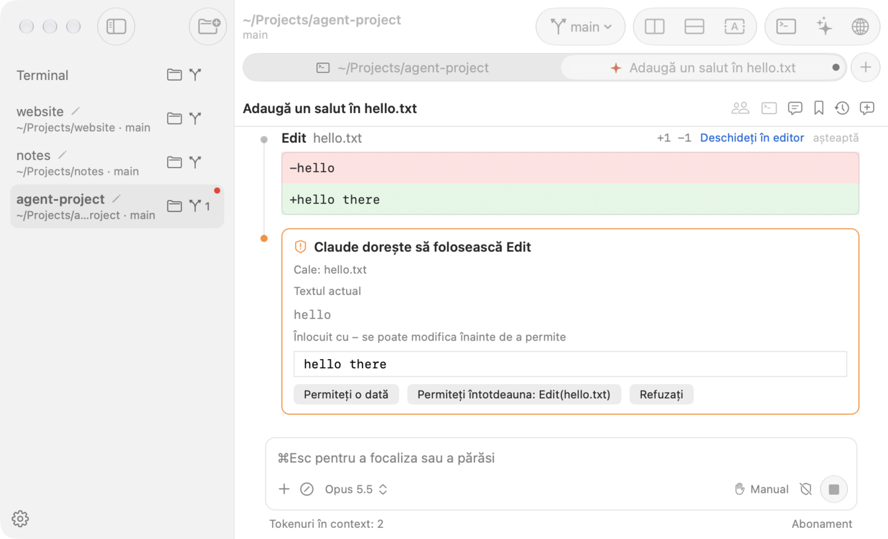

<p>&nbsp;&nbsp;&nbsp;</p>

# Tapa

**Terminalul rapid și nativ pentru macOS care și-a făcut loc pentru agenții, fișierele și paginile dumneavoastră.**

Tapa este în primul rând un terminal: propriul nucleu VT și un motor de randare Metal, file și împărțiri native macOS, un terminal rapid care apare cu o singură scurtătură, integrare cu shell-ul cu blocuri de comenzi și, dacă doriți, un câmp de introducere cu sugestii în stilul Warp. În jurul acestora, Tapa a devenit sora mai mică a lui [Dango](https://github.com/sventmueller/dango): o bară laterală cu spații de lucru, câte unul pentru fiecare dosar de proiect, fiecare cu terminalele sale, file de agent pentru Claude, Codex, OpenCode, Antigravity și alți agenți ACP, file de browser, un editor cu o listă de fișiere și un panou Git, precum și o previzualizare Markdown de la [Splat](https://github.com/sventmueller/splat), cu formule și diagrame. Nimic din ce configurează un dosar de proiect nu rulează până nu acordați încredere spațiului său de lucru. Tapa este scris în Rust pe controale AppKit autentice, vorbește 35 de limbi, nu cere niciun cont și nu are telemetrie.

[](https://github.com/sventmueller/tapa/releases/latest/download/Tapa.dmg)

**[Descărcați Tapa.dmg](https://github.com/sventmueller/tapa/releases/latest/download/Tapa.dmg)**: semnat și notarizat de Apple, pentru macOS 14 sau mai nou, pe Apple Silicon și Intel.

**Ați găsit o eroare?** [Deschideți un issue](https://github.com/sventmueller/tapa/issues/new/choose) și spuneți cu ce shell, cu ce agent sau cu ce program s-a întâmplat. Dacă Tapa vă este util, o [stea pe GitHub](https://github.com/sventmueller/tapa) îi ajută pe alții să îl găsească.

[](https://www.rust-lang.org) [](https://www.apple.com/macos/)  [](https://github.com/madsmtm/objc2) [](https://developer.apple.com/metal/) [](https://agentclientprotocol.com)    [](#licență)

[Bahasa Indonesia](../id/README.md) · [Bahasa Melayu](../ms/README.md) · [Català](../ca/README.md) · [Čeština](../cs/README.md) · [Dansk](../da/README.md) · [Deutsch](../de/README.md) · [English](../../../README.md) · [Español](../es/README.md) · [Français](../fr/README.md) · [Hrvatski](../hr/README.md) · [Italiano](../it/README.md) · [Magyar](../hu/README.md) · [Nederlands](../nl/README.md) · [Norsk](../no/README.md) · [Polski](../pl/README.md) · [Português (Brasil)](../pt_BR/README.md) · [Português (Portugal)](../pt_PT/README.md) · **Română** · [Slovenčina](../sk/README.md) · [Slovenščina](../sl/README.md) · [Suomi](../fi/README.md) · [Svenska](../sv/README.md) · [Tiếng Việt](../vi/README.md) · [Türkçe](../tr/README.md) · [Ελληνικά](../el/README.md) · [Русский](../ru/README.md) · [Українська](../uk/README.md) · [עברית](../he/README.md)‎ · [العربية](../ar/README.md)‎ · [हिन्दी](../hi/README.md) · [ไทย](../th/README.md) · [한국어](../ko/README.md) · [日本語](../ja/README.md) · [简体中文](../zh-Hans/README.md) · [繁體中文](../zh-Hant/README.md)

## Cuprins

- [Pe scurt](#pe-scurt)
- [Cerințe](#cerințe)
- [Instalare](#instalare)
- [Primii pași](#primii-pași)
- [Spații de lucru](#spații-de-lucru)
- [Terminalul](#terminalul)
  - [File și împărțiri](#file-și-împărțiri)
  - [Integrarea cu shell-ul și blocurile de comenzi](#integrarea-cu-shell-ul-și-blocurile-de-comenzi)
  - [Câmpul de introducere și sugestiile](#câmpul-de-introducere-și-sugestiile)
  - [Căutare, selectare și copiere](#căutare-selectare-și-copiere)
  - [Terminalul rapid](#terminalul-rapid)
- [Agenți](#agenți)
- [Editor, fișiere și Git](#editor-fișiere-și-git)
- [Previzualizări](#previzualizări)
- [Browser](#browser)
- [Dictare](#dictare)
- [Configurări](#configurări)
- [Aspect și accesibilitate](#aspect-și-accesibilitate)
- [Limbi](#limbi)
- [Scurtături de tastatură](#scurtături-de-tastatură)
- [Încredere](#încredere)
- [Confidențialitate și securitate](#confidențialitate-și-securitate)
- [Limitări cunoscute](#limitări-cunoscute)
- [Pentru dezvoltatori](#pentru-dezvoltatori)
  - [Componente terțe](#componente-terțe)
- [Licență](#licență)

## Pe scurt

- **Un terminal rapid, cu nucleu propriu.** Tapa analizează cu propriul nucleu VT și desenează cu Metal pe câte un fir de execuție pentru fiecare ecran, la frecvența ecranului și doar ce s-a schimbat. Trece 262 de teste esctest acolo unde nucleul Alacritty trece 121, iar fiecare modificare este măsurată față de o versiune fixată a Ghostty.
- **Nativ până în măduva oaselor.** File macOS reale, restaurarea ferestrelor, meniuri, meniul Servicii, notificări, introducere securizată de la tastatură, dictare și metode de introducere. Fără Electron, iar WebKit doar acolo unde o pagină sau o previzualizare are nevoie de el.
- **Spații de lucru.** Bara laterală conține câte un spațiu de lucru pentru fiecare dosar de proiect, fiecare cu propriile file, propria ramură și propriile panouri. Spațiul de lucru „Terminal”, din capul listei, pornește de la zero de fiecare dată; toate celelalte rămân până când le eliminați.
- **Agenți într-o vizualizare de chat nativă.** Claude, Codex, OpenCode, Antigravity, Gemini CLI și alți agenți ai Agent Client Protocol rulează în file proprii, cu răspunsuri, apeluri de unelte, diff-uri și cereri de permisiune într-o singură cronologie. Tapa îi instalează și îi actualizează la cerere.
- **Integrare cu shell-ul și blocuri de comenzi** pentru zsh, bash și fish, inclusiv prin `ssh`: săriți de la un prompt la altul, selectați, copiați, salvați și restrângeți ieșirea unei comenzi, vedeți comenzile eșuate și cât a durat fiecare.
- **Un câmp de introducere ca al lui Warp, dacă îl doriți.** Editați linia de comandă ca text, cu sugestii din istoricul dumneavoastră, din specificațiile a peste 700 de unelte de linie de comandă și din starea proiectului, totul pe Mac-ul dumneavoastră.
- **Fișiere, Git și un browser lângă shell.** Un editor cu evidențierea sintaxei, o listă de fișiere, un panou Git cu pregătirea modificărilor (staging), commituri, ramuri și worktree-uri, o previzualizare Markdown cu formule și diagrame, precum și file de browser.
- **Atent cu dosarele dumneavoastră.** Un spațiu de lucru căruia nu i-ați acordat încredere nu pornește nimic din ce configurează dosarul său: fără hookuri Git, fără servere MCP ale proiectului, fără setări de proiect pentru agenți, fără JavaScript în paginile sale de fișiere.
- **Privat.** Fără cont, fără telemetrie. Tapa accesează rețeaua doar când îi cereți, iar istoricul restaurat de pe disc este criptat cu o cheie din portchei.
- **În limba dumneavoastră.** Interfața există în 35 de limbi: arabă, catalană, chineză (simplificată), chineză (tradițională), croată, cehă, daneză, olandeză, engleză, finlandeză, franceză, germană, greacă, ebraică, hindi, maghiară, indoneziană, italiană, japoneză, coreeană, malaeză, norvegiană, poloneză, portugheză (Brazilia), portugheză (Portugalia), română, rusă, slovacă, slovenă, spaniolă, suedeză, thailandeză, turcă, ucraineană și vietnameză.

## Cerințe

- macOS 14 Sonoma sau mai nou, pe Apple Silicon sau Intel. Tapa este dezvoltat și testat pe macOS 27.
- zsh, bash sau fish pentru integrarea cu shell-ul; celelalte shell-uri rulează fără ea.
- Pentru filele de agent, agentul pe care doriți să îl folosiți, fie deja instalat, fie instalat de Tapa la cererea dumneavoastră (vedeți [Agenți](#agenți)).

## Instalare

**Din imaginea de disc.** Fiecare versiune este o imagine de disc, `Tapa-<version>.dmg`, cu o singură aplicație universală pentru Apple Silicon și Intel, semnată cu un Developer ID și notarizată de Apple. Deschideți-o și trageți Tapa în dosarul Aplicații.

**Cu Homebrew.** Cask-ul dintr-un tap propriu instalează aceeași imagine de disc:

```sh
brew install --cask sventmueller/tap/tapa
```

**Actualizări.** Tapa din imaginea de disc sau din Homebrew se actualizează singur prin [Sparkle](https://sparkle-project.org). La a doua pornire întreabă dacă are voie să caute singur actualizări; până când sunteți de acord, nu face nicio cerere. **Tapa › Căutați actualizări…** caută imediat. Tapa instalează o actualizare doar dacă are semnătura dezvoltatorului. O versiune compilată de dumneavoastră nu are mecanism de actualizare.

**Din sursă.** Vedeți [Pentru dezvoltatori](#pentru-dezvoltatori).

**Ca terminal implicit.** Tapa poate deschide scripturi shell (`.command`, `.tool`), dosare trase pe pictograma sa și linkuri `ssh://`. Alegeți-l în Finder cu **Fișier › Obțineți informații › Deschideți cu**.

## Primii pași

1. **Fereastra** are în stânga bara laterală cu spațiile de lucru, sus filele spațiului de lucru selectat și, deasupra lor, bara de instrumente. ⌃⌘S afișează și ascunde bara laterală.
2. **Un spațiu de lucru nou** se creează cu butonul de dosar din partea de sus a barei laterale sau cu **Shell › Spațiu de lucru nou…** (⇧⌘N): alegeți unul dintre dosarele recente sau **Alegeți dosarul…**.
3. **Filele noi** pornesc în dosarul spațiului de lucru: ⌘T pentru un terminal, butoanele din dreapta barei de instrumente pentru un terminal, un agent sau o filă de browser, ori **+** de la capătul barei de file.
4. **Configurările** se deschid cu ⌘, sau cu rotița dințată din partea de jos a barei laterale.
5. **Paleta de comenzi** (⇧⌘P) găsește orice comandă după nume, iar **Căutați o filă…** (⌘P) orice filă din orice spațiu de lucru.

Bara de instrumente conține, de la stânga, meniul derulant cu ramurile depozitului spațiului de lucru, butoanele pentru împărțirea terminalului la dreapta și în jos și pentru afișarea câmpului de introducere, precum și butoanele pentru file noi de terminal, de agent și de browser. Butoanele pentru împărțiri și pentru câmpul de introducere sunt gri cât timp nicio filă de terminal nu se află în prim-plan.

## Spații de lucru

Un spațiu de lucru este un dosar împreună cu filele sale. Rândul său din bara laterală arată numele, dosarul și ramura Git, iar în dreapta butoanele pentru lista de fișiere și pentru panoul Git. Un clic pe unul dintre ele afișează acel panou în locul listei de spații de lucru; **Spații de lucru**, sus, vă duce înapoi.

- **Spațiul de lucru „Terminal”** se află mereu în capul listei. Pornește de la zero la fiecare lansare, în dosarul indicat de configurări, cu un singur terminal gol. Nimic din el nu este păstrat, iar el nu poate fi redenumit sau eliminat.
- **Toate celelalte spații de lucru rămân** până când le eliminați, chiar și fără file. Tapa le păstrează numele, filele, conținutul terminalelor (în măsura în care o permit configurările de restaurare), sesiunile de agent și poziția ferestrei. Programele care încă rulează se opresc când Tapa se închide.
- **Redenumire.** Faceți clic pe creionul de după nume, faceți clic pe numele spațiului de lucru selectat sau alegeți **Shell › Redenumiți spațiul de lucru**. Numele este salvat imediat.
- **Stare.** Un punct verde pe rând înseamnă că un agent al spațiului de lucru lucrează, inclusiv cu subagenți sau în fundal; un punct roșu înseamnă că unul vă așteaptă. Terminalele nu marchează nimic acolo.
- **Comutare.** ⌃⌘[ și ⌃⌘] trec de la un spațiu de lucru la altul. Fereastra rămâne pe loc, iar filele spațiului de lucru selectat iau locul celorlalte.
- **Worktree-uri.** **Worktree nou…** din meniul derulant cu ramuri al barei de instrumente creează un worktree Git pe o ramură nouă și îl deschide ca spațiu de lucru separat.

Când se închide ultima filă a unui spațiu de lucru, spațiul de lucru rămâne în listă. Cu toate filele închise, dispare doar fereastra; pictograma din Dock sau ⌘N o readuc împreună cu spațiile ei de lucru.

## Terminalul

Tapa rulează pe propriul nucleu, `term-vt`. Vorbește xterm și VT520 cu protocolul de tastatură Kitty, hyperlinkuri OSC 8, acces la clipboard OSC 52 cu permisiune separată pentru citire, ieșire sincronizată, sublinieri colorate și ondulate, truecolor, interogări de culoare, raportarea modului luminos și întunecat către programe, lipire între paranteze (bracketed paste), evenimente de focalizare și raportarea mouse-ului. Textul se rearanjează când fereastra își schimbă dimensiunea, inclusiv istoricul. Ligaturile, funcțiile fonturilor, simbolurile Nerd Font fără fonturi modificate și desenarea exactă la nivel de pixel a caracterelor de chenar, a glifelor Powerline și a Braille-ului sunt integrate.

### File și împărțiri

- **Filele** sunt cele ale macOS: trageți-le pentru a le reordona sau pentru a le scoate într-o fereastră proprie, **Afișați toate filele** (⇧⌘\\), ⌘1 până la ⌘8, ⌘9 pentru ultima filă și ⇧⌘[ / ⇧⌘] pentru a comuta. Fiecare filă arată pictograma tipului său în fața titlului.
- **Împărțiri.** **Împărțiți la dreapta** (⌘D sau ⌃⌘T) și **Împărțiți în jos** (⇧⌘D sau ⌃⌥⌘T), imbricate oricât de adânc doriți. Trageți un separator, mutați-l cu ⌃⌘ și tastele săgeți, **Maximizați panoul** (⌃⇧⌘↩), **Egalizați panourile** (⌃⌘=) și treceți de la un panou la altul cu ⌘[ și ⌘].
- **Dosarul de lucru.** Filele, ferestrele și împărțirile noi pornesc în dosarul terminalului din prim-plan; configurările decid acest lucru pentru fiecare dintre cele trei.
- **Închidere.** Tapa întreabă înainte de a închide o filă, o fereastră sau aplicația cât timp în ea rulează un program.
- **Restaurare.** După o repornire revin spațiile de lucru, filele, panourile, dosarele și ultimele rânduri ale fiecărui terminal. Secretele precum tokenurile și parolele sunt mascate înainte ca ceva să fie stocat.

### Integrarea cu shell-ul și blocurile de comenzi

Tapa își configurează singur integrarea cu shell-ul pentru zsh, bash și fish, fără să vă atingă fișierele de configurare, și o ia cu el când vă conectați prin `ssh` la o altă gazdă. Cu ea, fiecare comandă și ieșirea ei formează un bloc:

- **Prompturi.** ⌘↑ și ⌘↓ sar la promptul anterior și la cel următor. Un clic în linia de comandă mută cursorul acolo.
- **Blocuri.** **Selectați blocul** (⇧⌘A), **Copiați ieșirea** (⌥⌘C), **Salvați ieșirea…** (⌥⌘S) și **Restrângeți/extindeți blocul** (⇧⌘↩). Deasupra blocului de sub cursor, butoane îi arată starea, durata și aceleași acțiuni.
- **Comenzile eșuate** sunt marcate, iar comanda care încă rulează rămâne vizibilă sus în timp ce ieșirea ei derulează.
- **Marcaje.** **Adăugați/eliminați marcajul** (⇧⌘M) marchează un rând; ⇧⌘↑ și ⇧⌘↓ sar de la un marcaj la altul.
- **Notificările** apar când un program cere una (OSC 9 și OSC 777) și terminalul nu este în prim-plan, iar o bară de progres (OSC 9;4) apare în filă și pe pictograma din Dock.

### Câmpul de introducere și sugestiile

Câmpul de introducere transformă linia de comandă într-un câmp de text în partea de jos a panoului, ca în Warp, cu etichete pentru dosar și ramura Git deasupra lui. **Afișați/ascundeți câmpul de introducere** (⌘I) sau butonul din bara de instrumente îl comută pentru un terminal; **Configurări › Introducere** îl activează pentru terminalele noi. Are nevoie de integrarea cu shell-ul și se dă la o parte pentru programele pe ecran complet precum vim, htop sau claude.

- **Retur** trimite întregul câmp către shell, textul pe mai multe rânduri ca o singură lipire; shell-ul îl rulează și îl reține ca de obicei. Dacă shell-ul cere mai mult, câmpul îi predă tastele până la următorul prompt.
- **↑, ↓ și ⌃R** caută în istoricul dumneavoastră, cu dosarul, ramura și codul de ieșire cu care a rulat fiecare comandă.
- **Tab** completează cu specificațiile a peste 700 de unelte de linie de comandă, căi și valori în timp real precum ramuri Git, containere Docker, resurse kubectl, gazde ssh, scripturi din `package.json` și ținte make, just și cargo.
- **Tastele Vim** în câmp se activează dintr-un comutator din aceleași configurări.
- **Următoarea comandă înainte să o tastați**: ce urmează de obicei în acest proiect (după `git add` vine `git commit`), ce cere starea proiectului (un fișier de blocare mai nou decât `node_modules`) și o corectură după „command not found”, pe baza greșelilor de tastare sau a indexului Homebrew local.

Fără câmpul de introducere, sugestiile apar ca text gri în spatele cursorului, iar → le acceptă. Shell-urile cu propriile sugestii automate, precum fish sau zsh-autosuggestions, le păstrează pe ale lor. Sugestiile nu folosesc niciodată rețeaua și pornesc programe doar din propriul dumneavoastră `PATH`, niciodată din dosarul proiectului.

**Lipire.** Lipirile pe mai multe rânduri pot fi afișate înainte de a rula (**Arătați întâi lipirile pe mai multe linii**). Fișierele trase pe un terminal ajung ca căi între ghilimele; ⌥←/→, ⌘←/→ și ⌘⌫ mută și șterg pe cuvinte și pe rânduri, ca în orice câmp de text de pe Mac.

### Căutare, selectare și copiere

- **Găsiți…** (⌘F) caută în istoric cu expresii regulate, cu respectarea majusculelor și pe cuvinte întregi, și numără potrivirile; bara de derulare le marchează împreună cu prompturile și erorile.
- **Selectare inteligentă.** Un dublu clic selectează în întregime un URL, o cale, un hash sau o adresă IP, iar tragerea cu ⌥ selectează un dreptunghi. Linkurile sunt găsite chiar și fără OSC 8; ⌘-clic le deschide, iar o cale se deschide în Dango, dacă este instalat.
- **Selectare cu tastatura** (⇧⌘C) mută o selecție cu tastele Vim.
- **Copiați cu formatare** (⇧⌥⌘C) păstrează culorile și stilurile; copierea la selectare este o configurare. **Goliți** (⌘K) golește terminalul.

### Terminalul rapid

**Afișați/ascundeți terminalul rapid** (⌃⌥⌘Space) glisează un terminal de la o margine a ecranului, deasupra celorlalte aplicații și peste spațiile pe ecran complet, fără să schimbați aplicația. Marginea, dimensiunea și dacă se ascunde când faceți clic în altă parte sunt configurări. Sesiunile sale continuă să ruleze cât timp este ascuns.

## Agenți

O filă de agent rulează un agent de programare în dosarul spațiului de lucru, în vizualizarea de agent nativă preluată din Dango.

| Agent | Cum rulează | De ce are nevoie |
|---|---|---|
| Claude | comanda `claude`, controlată prin protocolul său stream-json | `claude` instalat și autentificat; Tapa îl instalează cu programul de instalare al lui Claude, la cerere |
| Codex | `codex app-server` sau `codex-acp` pentru un Codex mai vechi | `codex` autentificat; Tapa instalează adaptorul cu versiune fixată, la cerere |
| OpenCode | `opencode serve` sau `opencode acp` pentru un OpenCode mai vechi | propriul `opencode` în `PATH` sau descărcarea cu versiune fixată |
| Antigravity | `agy acp` | propriul `agy` în `PATH` sau descărcarea cu versiune fixată |
| Gemini CLI | `gemini --acp`, oferit după ce îl activați în **Configurări › Agenți** | propriul `gemini` sau descărcarea cu versiune fixată |
| Alți agenți ACP | din registrul ACP, încărcat doar la cerere | ce indică intrarea din registru; intrările fără sumă de control se instalează doar după ce confirmați |

Tapa folosește autentificarea proprie a fiecărui agent și nu stochează date de autentificare ale agenților. Un agent găsit în `PATH`-ul shell-ului de autentificare are prioritate; altfel, Tapa rulează versiunea pe care a instalat-o în propriul dosar de date, niciodată un program din spațiul de lucru.

- **Cronologia** arată răspunsuri, apeluri de unelte cu ieșirea și diff-urile lor, întrebări și cereri de permisiune. **Permiteți o dată**, **Permiteți întotdeauna** și **Refuzați** răspund la o cerere, iar o editare poate fi modificată înainte să o permiteți.
- **Stare.** Fila și rândul spațiului de lucru arată un punct verde cât timp agentul lucrează și unul roșu cât timp vă așteaptă, iar o notificare vă anunță când așteaptă în timp ce vă uitați în altă parte.
- **Câmpul de mesaj** din partea de jos primește promptul dumneavoastră, fișierele trase pe el și dictarea. ⌘Esc mută focalizarea tastaturii în el și înapoi. Modelul și modul de permisiuni pot fi alese acolo pentru sesiune.
- **Configurări › Agenți** stabilește pentru sesiunile noi modul de permisiuni (Claude, Codex), modelul (Claude, Codex, OpenCode) și efortul de gândire (Claude, Codex), precum și ce agenți oferă filele noi. Arată unde se află programul fiecărui agent, cu **Instalați…**, **Actualizați la …** și **Înapoi la …** pentru versiunea anterioară, și **Încărcați registrul** pentru registrul ACP. Regulile salvate de Claude cu „Permiteți întotdeauna” pot fi văzute și eliminate acolo.
- **Descărcări verificate.** Arhivele sunt verificate față de SHA-256-ul lor, pachetele npm față de integritatea din fișierul lor de blocare, iar pachetele fără versiune fixă sunt refuzate. Un agent lipsă își oferă instalarea și în propria filă.

## Editor, fișiere și Git

- **Lista de fișiere** a unui spațiu de lucru arată dosarul acestuia ca arbore, actualizat pe măsură ce fișierele se schimbă, cu fișierele ignorate de Git estompate, dacă doriți. Un clic deschide un fișier într-o filă de previzualizare, pe care următorul clic o înlocuiește până când îl editați; un dublu clic îl păstrează.
- **Editorul** deschide fișierele în file ale spațiului de lucru, cu evidențierea sintaxei, mai multe cursoare, pliere, indentarea din `.editorconfig`, taste Vim opționale și marcaje pentru ce s-a schimbat de la ultimul commit. Observă când un fișier s-a schimbat pe disc sau conține marcaje de conflict. Fișierele Markdown primesc o bară de formatare și **Deschideți în Splat**. **Salvați** (⌘S), **Salvați ca…** și **Salvați tot** funcționează ca de obicei, iar Tapa întreabă înainte de a închide text nesalvat.
- **După o blocare**, textul nesalvat revine: Tapa păstrează copii criptate ale lui în timp ce tastați.
- **Panoul Git** arată modificările pregătite și nepregătite, pregătește și retrage fișiere și fragmente individuale, face commituri (⌘↩), le modifică (amend), face commit și push, fetch și gestionează ramuri, stash-uri, cherry-pick-uri și conflicte, cu istoricul commiturilor dedesubt. Un clic pe un fișier îi arată diff-ul.
- **Meniul derulant cu ramuri** din bara de instrumente comută și creează ramuri și creează worktree-uri.

Editorul nu pornește niciun formatator și niciun server de limbaj. Pentru un IDE complet cu servere de limbaj și depanator, folosiți [Dango](https://github.com/sventmueller/dango).

## Previzualizări

- **Markdown** se afișează lângă editorul său prin motorul de randare al Splat: GitHub Flavored Markdown cu formule, diagrame și imagini, derulând paragraf cu paragraf odată cu textul.
- **Imaginile** se deschid într-o filă proprie, PDF-urile prin PDFKit, iar sunetul, filmele, fonturile și documentele de birou prin Privire rapidă.
- **Decodare izolată.** Orice imagine dintr-o sursă nesigură (fișiere ale proiectului, Markdown, atașamente și lipiri ale agenților) este decodată în serviciul `Decoder.xpc` al Splat, într-un App Sandbox propriu, fără fișiere și fără rețea, niciodată în aplicație.

## Browser

**Filă de browser nouă** (⇧⌘B) deschide o filă WebKit în spațiul de lucru. Câmpul de adresă primește o adresă sau cuvinte pentru motorul de căutare ales de dumneavoastră (DuckDuckGo, Google, Bing sau Startpage); ⌘L, ⌘R, ⌘[ și ⌘] funcționează ca în Safari. Paginile de pe `localhost` rulează normal, pentru serverul de dezvoltare al proiectului dumneavoastră. Fișierele HTML ale unui spațiu de lucru pot citi doar propriul dosar, iar într-un spațiu de lucru căruia nu i-ați acordat încredere nu rulează JavaScript.

## Dictare

Dictați în câmpul de mesaj al unui agent sau în editor cu butonul de microfon ori cu **Editare › Porniți dictarea** (⌃⌥D). Recunoașterea vorbirii este cea a [Lowspeak](https://github.com/sventmueller/lowspeak), care nu trebuie instalat. **Configurări › Dictare** alege transcrierea online cu OpenAI sau Groq ori modele locale Whisper și Parakeet care păstrează înregistrarea pe Mac-ul dumneavoastră, limba, postprocesarea, microfonul și propriul vocabular. Cheile pentru OpenAI și Groq sunt păstrate în portchei. Dictarea face parte doar din versiunea de distribuție.

## Configurări

**Tapa › Configurări…** (⌘,) are panourile General, Font, Culori, Cursor, Terminal, Introducere, Editor, Agenți, Dictare, Profiluri și Scurtături. Ele scriu un singur fișier TOML, `config.toml`, în dosarul Tapa din `~/Library/Application Support`, pe care îl puteți edita și de mână; Tapa îl reîncarcă în timp ce rulează, iar **Reîncărcați configurările** (⇧⌘,) o face imediat.

- **Patru mărimi de font** la General: Interfață (bara laterală, panourile, lista de fișiere, panoul Git și titlurile filelor), Editor (text, numere de rând și previzualizarea Markdown), Terminal și Agenți. ⌘+, ⌘− și ⌘0 schimbă mărimea terminalului din prim-plan.
- **Aspect:** Luminos, Întunecat sau Ca sistemul.
- **Culori.** O temă pentru modul luminos și una pentru modul întunecat, în formatul de teme Ghostty, cu un contrast minim care păstrează textul lizibil chiar și cu o temă slabă. Temele proprii merg în dosarul de teme.
- **Profilurile** grupează fontul, culorile, shell-ul, mediul și dosarul.
- **Scurtăturile** pot fi toate schimbate, iar conflictele sunt afișate.

## Aspect și accesibilitate

- **Modul întunecat** urmează sistemul sau alegerea dumneavoastră; culoarea de accent, Reduceți mișcarea și Măriți contrastul sunt respectate.
- **VoiceOver** citește rândurile și prompturile terminalului și anunță ieșirea nouă; bara laterală, filele, butoanele barei de instrumente și cardurile din cronologia agenților au nume.
- **Tastatură.** Fiecare comandă are un element de meniu și o scurtătură, iar accesul complet de la tastatură ajunge la fiecare control.
- **Mărimi.** Cele patru mărimi de font din configurări scalează independent interfața, editorul, terminalul și agenții.
- **De la dreapta la stânga.** Interfața este oglindită în arabă și ebraică, în timp ce grila terminalului rămâne de la stânga la dreapta.

Detaliile și lipsurile cunoscute se află în [ACCESSIBILITY.md](../../../ACCESSIBILITY.md).

## Limbi

Interfața este tradusă în 35 de limbi: arabă, catalană, chineză (simplificată), chineză (tradițională), croată, cehă, daneză, olandeză, engleză, finlandeză, franceză, germană, greacă, ebraică, hindi, maghiară, indoneziană, italiană, japoneză, coreeană, malaeză, norvegiană, poloneză, portugheză (Brazilia), portugheză (Portugalia), română, rusă, slovacă, slovenă, spaniolă, suedeză, thailandeză, turcă, ucraineană și vietnameză.

Tapa urmează ordinea limbilor din **Configurări sistem › General › Limbă și regiune**; tot acolo puteți alege o limbă doar pentru Tapa, la **Aplicații**. Fără o traducere în limba dumneavoastră, folosește engleza.

## Scurtături de tastatură

| Acțiune | Scurtătură |
|---|---|
| Fereastră, spațiu de lucru, filă nouă | ⌘N, ⇧⌘N, ⌘T |
| Filă de browser nouă | ⇧⌘B |
| Fișier nou, deschidere fișier | ⌥⌘N, ⌘O |
| Închidere panou sau filă, închidere filă, închidere fereastră | ⌘W, ⌥⌘W, ⇧⌘W |
| Împărțire la dreapta, împărțire în jos | ⌘D sau ⌃⌘T, ⇧⌘D sau ⌃⌥⌘T |
| Maximizare panou, egalizare panouri, închidere panou | ⌃⇧⌘↩, ⌃⌘=, ⌃⇧⌘W |
| Mutarea unui separator | ⌃⌘←, ⌃⌘→, ⌃⌘↑, ⌃⌘↓ |
| Panoul următor, anterior | ⌘], ⌘[ |
| Fila următoare, anterioară; filele 1–8, ultima filă | ⇧⌘], ⇧⌘[; ⌘1 până la ⌘8, ⌘9 |
| Spațiul de lucru următor, anterior | ⌃⌘], ⌃⌘[ |
| Căutare filă, paleta de comenzi | ⌘P, ⇧⌘P |
| Afișarea sau ascunderea barei laterale, a câmpului de introducere | ⌃⌘S, ⌘I |
| Terminal rapid | ⌃⌥⌘Space |
| Căutare, următorul rezultat, rezultatul anterior | ⌘F, ⌘G, ⇧⌘G |
| Promptul anterior, următor | ⌘↑, ⌘↓ |
| Selectare bloc, copiere ieșire, salvare ieșire, restrângere bloc | ⇧⌘A, ⌥⌘C, ⌥⌘S, ⇧⌘↩ |
| Adăugarea sau eliminarea unui marcaj; marcajul anterior, următor | ⇧⌘M; ⇧⌘↑, ⇧⌘↓ |
| Selectare cu tastatura | ⇧⌘C |
| Copiere cu formatare | ⇧⌥⌘C |
| Golire | ⌘K |
| Început, sfârșit, o pagină în sus, o pagină în jos | ⌘Home, ⌘End, ⌘PageUp, ⌘PageDown |
| Mai mare, mai mic, mărime originală (terminal) | ⌘+, ⌘−, ⌘0 |
| Câmpul de mesaj al unei file de agent | ⌘Esc |
| Pornirea dictării | ⌃⌥D |
| Configurări, reîncărcarea configurărilor | ⌘,, ⇧⌘, |

Orice scurtătură poate fi schimbată în **Configurări › Scurtături** sau în secțiunea `[keys]` a fișierului de configurări.

## Încredere

Un dosar de proiect poate face să ruleze programe imediat ce ceva pornește în el: hookuri Git și setări ale depozitului precum `core.fsmonitor`, hookuri ale agenților, servere MCP ale proiectului și setări de proiect ale agenților. De aceea, un spațiu de lucru nou nu este considerat de încredere.

- **Fără încredere:** agenții pornesc fără hookurile, serverele MCP și configurația proiectului (Claude cu `--setting-sources=user --strict-mcp-config`, Codex cu dosarul marcat ca nesigur, OpenCode fără configurația proiectului). Git rulează neutralizat: fără hookuri, filtre, drivere de diff, fsmonitor, `sshCommand` sau pager și doar cu asistenții de autentificare globali. Fișierele HTML se deschid fără JavaScript. Panoul Git și fila de agent spun acest lucru și se oferă să acorde încredere spațiului de lucru.
- **De încredere:** **Shell › Considerați spațiul de lucru de încredere** încarcă toate acestea așa cum intenționează dosarul. **Retrageți încrederea** le anulează. Încrederea se păstrează pentru fiecare spațiu de lucru.

Oricare ar fi nivelul de încredere, Tapa nu rulează niciodată de la sine un program dintr-un dosar de proiect: sugestiile pornesc programe doar din `PATH`-ul dumneavoastră, din afara proiectului, iar bara laterală citește starea Git din fișierele `.git`. Un spațiu de lucru din dosarul de pornire, precum „Terminal”, nu este un proiect: acolo, programele de sub `~`, precum `~/.local/bin/claude`, contează ca fiind ale dumneavoastră.

## Confidențialitate și securitate

- **Fără telemetrie, fără cont.** Tapa nu raportează nimic despre felul în care îl folosiți și funcționează complet offline. Accesează rețeaua doar când îi cereți: pentru a instala sau actualiza un agent, pentru a încărca registrul ACP, pentru a căuta actualizări după ce ați fost de acord și pentru paginile pe care le deschideți într-o filă de browser. Agenții înșiși comunică cu furnizorii lor ca întotdeauna.
- **Istoricul de pe disc** pentru restaurarea sesiunilor este criptat cu o cheie din portchei, poate fi dezactivat, iar secretele precum cheile API, tokenurile și parolele sunt mascate înainte de a fi scris. Copiile textului nesalvat din editor sunt criptate cu aceeași cheie.
- **Introducerea securizată de la tastatură** se activează singură la solicitările de parolă și poate fi activată permanent din meniul aplicației.
- **Secvențele escape** care ar putea divulga sau injecta date, precum raportările titlului, citirile din clipboard și trucurile de lipire, sunt blocate sau necesită întâi confirmare. Parserul este supus fuzzingului în CI.
- **Decodarea izolată** a imaginilor din surse nesigure, vedeți [Previzualizări](#previzualizări).
- **Semnarea codului** cu Hardened Runtime. macOS atribuie lui Tapa accesul programelor dintr-un terminal, așa că Tapa include o descriere de utilizare pentru fiecare serviciu protejat.

Problemele de securitate se raportează în privat, vedeți [SECURITY.md](../../../SECURITY.md).

## Limitări cunoscute

- **Încă fără imagini inline** în terminal: grafica Kitty, Sixel și imaginile iTerm2 sunt planificate după versiunea 1.0.
- **Fără modul de control tmux**, iar sesiunile nu supraviețuiesc închiderii Tapa.
- **Textul de la dreapta la stânga** rămâne de la stânga la dreapta în grila terminalului.
- **⌘+ și ⌘−** schimbă doar terminalul din prim-plan.
- **Editorul** nu are servere de limbaj, formatatoare sau depanator, prin concepție; Dango le are.
- **Dictarea** există doar în versiunea de distribuție, nu și într-o versiune de depanare.
- **VoiceOver** nu a fost încă verificat cap-coadă de o persoană.

## Pentru dezvoltatori

Aveți nevoie de macOS 14 sau mai nou cu Command Line Tools pentru Xcode, Rust așa cum îl indică `rust-toolchain.toml` (rustup cu ambele ținte Mac pentru compilarea universală), copii ale [splat](https://github.com/sventmueller/splat) și [lowspeak](https://github.com/sventmueller/lowspeak) alături de aceasta (`../splat`, `../lowspeak`) și cmake pentru compilările cu dictare.

| Comandă | Ce face |
|---|---|
| `make help` | listează țintele |
| `cargo xtask run` | compilează aplicația de depanare și o deschide |
| `make build` | compilează aplicația de distribuție cu dictare în `target/release`, semnată ad hoc pentru acest Mac |
| `make lint` | formatarea, clippy cu avertismentele tratate ca erori, forma fișierelor și textele interfeței |
| `make check` | `lint`, apoi toate testele; nu are nevoie de fereastră și nici de rețea |
| `make selftest STEPS="split_right,type:ls\n,shot:x"` | controlează aplicația și lasă imagini ale ferestrelor în `target/selftest/` |
| `make esctest`, `make vttest` | rulează esctest și vttest pe ambele nuclee din aplicație |
| `make perf` | testul de performanță față de o versiune fixată a Ghostty; relevant doar pe un Mac inactiv |
| `make fuzz` | țintele de fuzzing cu cargo-fuzz |
| `make release` | o rulare de probă a lansării: aplicația universală cu dictare, imaginea ei de disc, fluxul de actualizări și cask-ul în `target/release-dry-run`; nu trimite nimic nicăieri |
| `make release-notarized` | versiunea curentă semnată cu Developer ID, notarizată de Apple și cu tichetul atașat (staple), în `dist/`; `Cargo.toml` rămâne neschimbat |
| `make deploy` | notarizează versiunea următoare, face commit pentru `Cargo.toml`, încarcă lansarea ca ciornă, face push pentru `main` și pentru etichetă, apoi publică lansarea; vedeți [docs/development.md](../../../docs/development.md#deploy) |

Modul de a contribui se află în [CONTRIBUTING.md](../../../CONTRIBUTING.md). Fiecare text al interfeței are germana drept cheie, cu o traducere în toate cele 35 de limbi; `cargo xtask strings` eșuează dacă lipsește una.

### Componente terțe

| Componentă | Folosită pentru | Licență |
|---|---|---|
| [objc2](https://github.com/madsmtm/objc2) și crate-urile sale pentru framework-uri | AppKit, Metal, WebKit și celelalte framework-uri Apple | MIT, Zlib sau Apache-2.0 |
| Crate-urile Splat | Markdown, previzualizarea, citirea Git, decodorul de imagini și traducerile | MIT sau Apache-2.0 |
| [Lowspeak](https://github.com/sventmueller/lowspeak) cu [whisper.cpp](https://github.com/ggml-org/whisper.cpp) | dictarea | MIT |
| [Specificațiile de completare automată Fig](https://github.com/withfig/autocomplete) | descrierile comenzilor din sugestii | MIT |
| [rusqlite](https://github.com/rusqlite/rusqlite) cu SQLite | istoricul comenzilor | MIT, domeniu public |
| [Simple Icons](https://simpleicons.org) | logourile limbajelor și programelor | CC0, unele logouri în condiții proprii |
| [Sparkle](https://sparkle-project.org) 2.10.1 | actualizările versiunii de distribuție | MIT |

## Licență

Tapa este licențiat sub oricare dintre

- Licența Apache, versiunea 2.0 ([LICENSE-APACHE](../../../LICENSE-APACHE))
- Licența MIT ([LICENSE-MIT](../../../LICENSE-MIT))

la alegerea dumneavoastră. Logourile din `assets/simple-icons` au propriile licențe, vedeți README-ul de acolo.

Dacă nu declarați explicit altfel, orice contribuție trimisă în mod intenționat pentru includere în Tapa de către dumneavoastră, așa cum este definită în licența Apache-2.0, va fi licențiată dublu ca mai sus, fără termeni sau condiții suplimentare.
