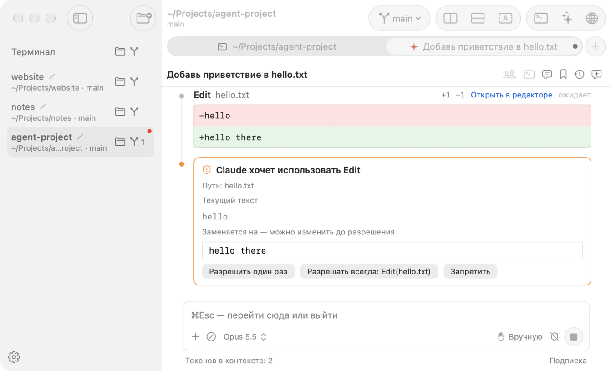

<p>&nbsp;&nbsp;&nbsp;</p>

# Tapa

**Быстрый нативный терминал для macOS, в котором нашлось место для ваших агентов, файлов и страниц.**

Tapa — прежде всего терминал: собственное ядро VT и рендерер на Metal, нативные вкладки и разделение окна macOS, быстрый терминал, который выезжает по одному сочетанию клавиш, интеграция с оболочкой с блоками команд и необязательное поле ввода с подсказками в стиле Warp. Вокруг этого Tapa превратился в младшую сестру [Dango](https://github.com/sventmueller/dango): боковая панель с рабочими областями, по одной на папку проекта, и в каждой — свои терминалы, вкладки агентов для Claude, Codex, OpenCode, Antigravity и других агентов ACP, вкладки браузера, редактор со списком файлов и панелью Git, а также предварительный просмотр Markdown от [Splat](https://github.com/sventmueller/splat) с формулами и диаграммами. Ничто из того, что настраивает папка проекта, не запускается, пока вы не доверитесь её рабочей области. Tapa написан на Rust с настоящими элементами AppKit, переведён на 35 языков, не требует учётной записи и не содержит телеметрии.

[](https://github.com/sventmueller/tapa/releases/latest/download/Tapa.dmg)

**[Скачать Tapa.dmg](https://github.com/sventmueller/tapa/releases/latest/download/Tapa.dmg)**: подписанный и заверенный Apple образ диска для macOS 14 и новее на Apple Silicon и Intel.

**Нашли ошибку?** [Откройте issue](https://github.com/sventmueller/tapa/issues/new/choose) и укажите, в какой оболочке, с каким агентом или с какой программой она возникла. Если Tapa вам полезен, [звезда на GitHub](https://github.com/sventmueller/tapa) поможет другим его найти.

[](https://www.rust-lang.org) [](https://www.apple.com/macos/)  [](https://github.com/madsmtm/objc2) [](https://developer.apple.com/metal/) [](https://agentclientprotocol.com)    [](#лицензия)

[Bahasa Indonesia](../id/README.md) · [Bahasa Melayu](../ms/README.md) · [Català](../ca/README.md) · [Čeština](../cs/README.md) · [Dansk](../da/README.md) · [Deutsch](../de/README.md) · [English](../../../README.md) · [Español](../es/README.md) · [Français](../fr/README.md) · [Hrvatski](../hr/README.md) · [Italiano](../it/README.md) · [Magyar](../hu/README.md) · [Nederlands](../nl/README.md) · [Norsk](../no/README.md) · [Polski](../pl/README.md) · [Português (Brasil)](../pt_BR/README.md) · [Português (Portugal)](../pt_PT/README.md) · [Română](../ro/README.md) · [Slovenčina](../sk/README.md) · [Slovenščina](../sl/README.md) · [Suomi](../fi/README.md) · [Svenska](../sv/README.md) · [Tiếng Việt](../vi/README.md) · [Türkçe](../tr/README.md) · [Ελληνικά](../el/README.md) · **Русский** · [Українська](../uk/README.md) · [עברית](../he/README.md)‎ · [العربية](../ar/README.md)‎ · [हिन्दी](../hi/README.md) · [ไทย](../th/README.md) · [한국어](../ko/README.md) · [日本語](../ja/README.md) · [简体中文](../zh-Hans/README.md) · [繁體中文](../zh-Hant/README.md)

## Содержание

- [Коротко о возможностях](#коротко-о-возможностях)
- [Требования](#требования)
- [Установка](#установка)
- [Начало работы](#начало-работы)
- [Рабочие области](#рабочие-области)
- [Терминал](#терминал)
  - [Вкладки и разделение](#вкладки-и-разделение)
  - [Интеграция с оболочкой и блоки команд](#интеграция-с-оболочкой-и-блоки-команд)
  - [Поле ввода и подсказки](#поле-ввода-и-подсказки)
  - [Поиск, выделение и копирование](#поиск-выделение-и-копирование)
  - [Быстрый терминал](#быстрый-терминал)
- [Агенты](#агенты)
- [Редактор, файлы и Git](#редактор-файлы-и-git)
- [Предварительный просмотр](#предварительный-просмотр)
- [Браузер](#браузер)
- [Диктовка](#диктовка)
- [Настройки](#настройки)
- [Оформление и универсальный доступ](#оформление-и-универсальный-доступ)
- [Языки](#языки)
- [Сочетания клавиш](#сочетания-клавиш)
- [Доверие](#доверие)
- [Конфиденциальность и безопасность](#конфиденциальность-и-безопасность)
- [Известные ограничения](#известные-ограничения)
- [Для разработчиков](#для-разработчиков)
  - [Сторонние компоненты](#сторонние-компоненты)
- [Лицензия](#лицензия)

## Коротко о возможностях

- **Собственный быстрый терминал.** Tapa разбирает вывод собственным ядром VT и рисует через Metal в отдельном потоке для каждого дисплея, с частотой дисплея и только то, что изменилось. Он проходит 262 проверки esctest, тогда как ядро Alacritty — 121, а каждое его изменение измеряется по сравнению с зафиксированной версией Ghostty.
- **Нативный до мозга костей.** Настоящие вкладки macOS, восстановление окон, меню, меню «Службы», уведомления, безопасный ввод с клавиатуры, диктовка и методы ввода. Никакого Electron, а WebKit — только там, где он нужен странице или окну просмотра.
- **Рабочие области.** На боковой панели — по одной рабочей области на папку проекта, у каждой свои вкладки, ветка и панели. Рабочая область «Терминал» наверху при каждом запуске начинается заново; все остальные остаются, пока вы их не удалите.
- **Агенты в нативном окне чата.** Claude, Codex, OpenCode, Antigravity, Gemini CLI и другие агенты Agent Client Protocol работают в собственных вкладках, а ответы, вызовы инструментов, диффы и запросы разрешений собраны в одной ленте. По вашему запросу Tapa устанавливает и обновляет их.
- **Интеграция с оболочкой и блоки команд** для zsh, bash и fish, в том числе через `ssh`: переходите от приглашения к приглашению, выделяйте, копируйте, сохраняйте и сворачивайте вывод команды, видите неудачные команды и время выполнения каждой.
- **Поле ввода как в Warp, если хотите.** Редактируйте командную строку как текст, с подсказками из вашей истории, из описаний более чем 700 инструментов командной строки и из состояния проекта — всё это на вашем Mac.
- **Файлы, Git и браузер рядом с оболочкой.** Редактор с подсветкой синтаксиса, список файлов, панель Git с индексированием, коммитами, ветками и worktree, предварительный просмотр Markdown с формулами и диаграммами и вкладки браузера.
- **Бережно к вашим папкам.** Рабочая область, которой вы не доверились, не запускает ничего, что настраивает её папка: ни хуков git, ни MCP-серверов проекта, ни настроек проекта для агентов, ни JavaScript в её файловых страницах.
- **Приватно.** Ни учётной записи, ни телеметрии. Tapa выходит в сеть, только когда вы об этом просите, а сохранённая на диске история для восстановления зашифрована ключом из вашей связки ключей.
- **На вашем языке.** Интерфейс доступен на 35 языках: английском, арабском, венгерском, вьетнамском, голландском, греческом, датском, иврите, индонезийском, испанском, итальянском, каталанском, китайском (упрощённое письмо), китайском (традиционное письмо), корейском, малайском, немецком, норвежском, польском, португальском (Бразилия), португальском (Португалия), румынском, русском, словацком, словенском, тайском, турецком, украинском, финском, французском, хинди, хорватском, чешском, шведском и японском.

## Требования

- macOS 14 Sonoma или новее, на Apple Silicon или Intel. Tapa разрабатывается и тестируется в macOS 27.
- zsh, bash или fish для интеграции с оболочкой; другие оболочки работают без неё.
- Для вкладок агентов — нужный вам агент, уже установленный или установленный Tapa по вашему запросу (см. [Агенты](#агенты)).

## Установка

**Из образа диска.** Каждый выпуск — это образ диска `Tapa-<version>.dmg` с одним универсальным приложением для Apple Silicon и Intel, подписанным сертификатом Developer ID и заверенным Apple. Откройте его и перетащите Tapa в папку «Программы».

**Через Homebrew.** Cask в собственном tap устанавливает тот же образ диска:

```sh
brew install --cask sventmueller/tap/tapa
```

**Обновления.** Tapa из образа диска или из Homebrew обновляется сам с помощью [Sparkle](https://sparkle-project.org). При втором запуске он спрашивает, можно ли самостоятельно проверять наличие обновлений; пока вы не согласитесь, он не делает ни одного запроса. **Tapa › Проверить обновления…** проверяет сразу. Tapa устанавливает обновление, только если оно подписано разработчиком. У собственной сборки нет механизма обновления.

**Из исходного кода.** См. [Для разработчиков](#для-разработчиков).

**Как терминал по умолчанию.** Tapa умеет открывать сценарии оболочки (`.command`, `.tool`), папки, перетащенные на его значок, и ссылки `ssh://`. Выберите его в Finder через **Файл › Свойства › Открывать в приложении**.

## Начало работы

1. **В окне** слева находится боковая панель с рабочими областями, сверху — вкладки выбранной рабочей области, а над ними — панель инструментов. ⌃⌘S показывает и скрывает боковую панель.
2. **Новая рабочая область** создаётся кнопкой с папкой вверху боковой панели или через **Оболочка › Новая рабочая область…** (⇧⌘N): выберите одну из недавних папок или **Выбрать папку…**.
3. **Новые вкладки** открываются в папке рабочей области: ⌘T — терминал, кнопки справа на панели инструментов — терминал, агент или вкладка браузера, либо **+** в конце панели вкладок.
4. **Настройки** открываются по ⌘, или шестерёнкой внизу боковой панели.
5. **Палитра команд** (⇧⌘P) находит любую команду по названию, а **Найти вкладку…** (⌘P) — любую вкладку любой рабочей области.

На панели инструментов слева направо расположены: всплывающее меню веток репозитория рабочей области, кнопки разделения терминала вправо и вниз и показа поля ввода, а также кнопки новых вкладок терминала, агента и браузера. Кнопки разделения и поля ввода неактивны, пока впереди нет вкладки терминала.

## Рабочие области

Рабочая область — это папка со своими вкладками. Её строка на боковой панели показывает имя, папку и ветку Git, а справа — кнопки списка файлов и панели Git. Щелчок по одной из них показывает эту панель вместо списка рабочих областей; кнопка **Рабочие области** вверху ведёт обратно.

- **Рабочая область «Терминал»** всегда наверху. При каждом запуске она начинается заново, в папке, указанной в настройках, с одним пустым терминалом. Из неё ничего не сохраняется, и её нельзя переименовать или удалить.
- **Любая другая рабочая область остаётся**, пока вы её не удалите, даже без вкладок. Tapa сохраняет её имя, вкладки, содержимое её терминалов (насколько это разрешают настройки восстановления), сеансы её агентов и положение окна. Программы, которые ещё работают, завершаются при выходе из Tapa.
- **Переименование.** Щёлкните карандаш после имени, щёлкните имя выбранной рабочей области или выберите **Оболочка › Переименовать рабочую область**. Имя сохраняется сразу.
- **Состояние.** Зелёная точка в строке означает, что агент рабочей области работает, в том числе с субагентами или в фоне; красная точка — что один из них ждёт вас. Терминалы там ничего не отмечают.
- **Переключение.** ⌃⌘[ и ⌃⌘] переключают рабочие области. Окно остаётся на месте, а вкладки выбранной рабочей области занимают место прежних.
- **Worktree.** **Новый worktree…** во всплывающем меню веток на панели инструментов создаёт worktree Git на новой ветке и открывает его как отдельную рабочую область.

Когда закрывается последняя вкладка рабочей области, рабочая область остаётся в списке. Если закрыты все вкладки, исчезает только окно; значок в Dock или ⌘N возвращает его вместе с рабочими областями.

## Терминал

Tapa работает на собственном ядре `term-vt`. Оно понимает xterm и VT520 с протоколом клавиатуры Kitty, гиперссылки OSC 8, доступ к буферу обмена через OSC 52 с отдельным разрешением на чтение, синхронизированный вывод, цветные и волнистые подчёркивания, truecolor, запросы цветов, сообщения программам о светлом и тёмном режиме, bracketed paste, события фокуса и передачу событий мыши. При изменении размера окна текст переносится заново, включая историю. Лигатуры, возможности шрифтов, символы Nerd Font без пропатченных шрифтов и попиксельно точные символы псевдографики, Powerline и Брайля встроены.

### Вкладки и разделение

- **Вкладки** — собственные вкладки macOS: перетаскивайте их, чтобы изменить порядок или вынести в отдельное окно, **Показать все вкладки** (⇧⌘\\), ⌘1–⌘8, ⌘9 для последней вкладки и ⇧⌘[ / ⇧⌘] для переключения. Перед названием каждой вкладки стоит значок её типа.
- **Разделение.** **Разделить вправо** (⌘D или ⌃⌘T) и **Разделить вниз** (⇧⌘D или ⌃⌥⌘T) с любой глубиной вложенности. Перетаскивайте разделитель или двигайте его с ⌃⌘ и клавишами со стрелками, **Развернуть панель** (⌃⇧⌘↩), **Выровнять панели** (⌃⌘=), а между панелями переходите с ⌘[ и ⌘].
- **Рабочая папка.** Новые вкладки, окна и разделения открываются в папке терминала, который находится впереди; настройки определяют это для каждого из трёх случаев.
- **Закрытие.** Tapa спрашивает, прежде чем закрыть вкладку, окно или приложение, в котором работает программа.
- **Восстановление.** После перезапуска возвращаются рабочие области, вкладки, панели, папки и последние строки каждого терминала. Секреты вроде токенов и паролей маскируются до того, как что-либо сохраняется.

### Интеграция с оболочкой и блоки команд

Tapa сам настраивает интеграцию с оболочкой для zsh, bash и fish, не трогая ваши файлы конфигурации, и берёт её с собой, когда вы подключаетесь по `ssh` к другому хосту. С ней каждая команда вместе с выводом образует блок:

- **Приглашения.** ⌘↑ и ⌘↓ переходят к предыдущему и следующему приглашению. Щелчок в командной строке перемещает туда курсор.
- **Блоки.** **Выделить блок** (⇧⌘A), **Скопировать вывод** (⌥⌘C), **Сохранить вывод…** (⌥⌘S) и **Свернуть/развернуть блок** (⇧⌘↩). Над блоком под указателем кнопки показывают его состояние, длительность и те же действия.
- **Неудачные команды** отмечаются, а команда, которая ещё выполняется, остаётся видна вверху, пока прокручивается её вывод.
- **Закладки.** **Поставить/снять закладку** (⇧⌘M) отмечает строку; ⇧⌘↑ и ⇧⌘↓ переходят между закладками.
- **Уведомления** появляются, когда программа их запрашивает (OSC 9 и OSC 777), а терминал не впереди, а индикатор выполнения (OSC 9;4) показывается во вкладке и на значке в Dock.

### Поле ввода и подсказки

Поле ввода превращает командную строку в текстовое поле внизу панели, как в Warp, а над ним — метки с папкой и веткой Git. **Показать/скрыть поле ввода** (⌘I) или кнопка на панели инструментов переключает его для одного терминала; **Настройки › Ввод** включает его для новых терминалов. Ему нужна интеграция с оболочкой, и оно уступает место полноэкранным программам вроде vim, htop или claude.

- **Return** отправляет в оболочку всё поле, многострочный текст — одной вставкой; оболочка выполняет и запоминает его как обычно. Если оболочка просит продолжения, поле передаёт ей клавиши до следующего приглашения.
- **↑, ↓ и ⌃R** ищут по вашей истории с папкой, веткой и кодом завершения, с которыми выполнялась каждая команда.
- **Tab** дополняет по описаниям более чем 700 инструментов командной строки, путям и живым значениям вроде веток git, контейнеров docker, ресурсов kubectl, хостов ssh, скриптов `package.json` и целей make, just и cargo.
- **Клавиши Vim** в поле включаются переключателем в тех же настройках.
- **Следующая команда ещё до того, как вы начали печатать**: то, что обычно следует в этом проекте (после `git add` идёт `git commit`), то, чего требует состояние проекта (файл блокировки новее `node_modules`), и исправление после «command not found» — по опечаткам или из вашего локального индекса Homebrew.

Без поля ввода подсказки показываются серым текстом за курсором, а → принимает их. Оболочки с собственными автоподсказками, например fish или zsh-autosuggestions, сохраняют свои. Подсказки никогда не используют сеть и запускают программы только из вашего собственного `PATH`, никогда из папки проекта.

**Вставка.** Многострочную вставку можно показать до выполнения (**Сначала показывать многострочную вставку**). Файлы, перетащенные на терминал, приходят как пути в кавычках; ⌥←/→, ⌘←/→ и ⌘⌫ перемещают и удаляют по словам и строкам, как в любом текстовом поле Mac.

### Поиск, выделение и копирование

- **Найти…** (⌘F) ищет по истории с регулярными выражениями, с учётом регистра и целых слов и считает совпадения; полоса прокрутки отмечает их вместе с приглашениями и ошибками.
- **Умное выделение.** Двойной щелчок выделяет URL, путь, хеш или IP-адрес целиком, а перетаскивание с ⌥ выделяет прямоугольник. Ссылки находятся даже без OSC 8; ⌘-щелчок открывает их, а путь — в Dango, если он установлен.
- **Выделение с клавиатуры** (⇧⌘C) перемещает выделение клавишами Vim.
- **Копировать с форматированием** (⇧⌥⌘C) сохраняет цвета и стили; копирование при выделении включается в настройках. **Очистить** (⌘K) очищает терминал.

### Быстрый терминал

**Показать/скрыть быстрый терминал** (⌃⌥⌘Пробел) выдвигает терминал от края экрана поверх других приложений и полноэкранных пространств, не переключая приложение. Край, размер и то, прячется ли он при щелчке в другом месте, задаются в настройках. Пока он скрыт, его сеансы продолжают работать.

## Агенты

Вкладка агента запускает агента для программирования в папке рабочей области, в нативном представлении агента из Dango.

| Агент | Как запускается | Что нужно |
|---|---|---|
| Claude | команда `claude`, общение по её протоколу stream-json | установленный `claude` с выполненным входом; по вашему запросу Tapa устанавливает его собственным установщиком Claude |
| Codex | `codex app-server` или `codex-acp` для старого Codex | `codex` с выполненным входом; по вашему запросу Tapa устанавливает зафиксированную версию адаптера |
| OpenCode | `opencode serve` или `opencode acp` для старого OpenCode | ваш собственный `opencode` в `PATH` или зафиксированная загрузка |
| Antigravity | `agy acp` | ваш собственный `agy` в `PATH` или зафиксированная загрузка |
| Gemini CLI | `gemini --acp`, предлагается, как только вы включите его в **Настройки › Агенты** | ваш собственный `gemini` или зафиксированная загрузка |
| Другие агенты ACP | из реестра ACP, загружаемого только по вашему запросу | то, что указано в записи реестра; записи без контрольной суммы устанавливаются только после вашего подтверждения |

Tapa использует собственный вход каждого агента и не хранит учётные данные агентов. Агент, найденный в `PATH` вашей оболочки входа, имеет приоритет; иначе Tapa запускает версию, которую установил в собственную папку данных, и никогда — программу из рабочей области.

- **Лента** показывает ответы, вызовы инструментов с их выводом и диффами, вопросы и запросы разрешений. **Разрешить один раз**, **Разрешать всегда** и **Запретить** отвечают на запрос, а правку можно изменить, прежде чем разрешить её.
- **Состояние.** Вкладка и строка рабочей области показывают зелёную точку, пока агент работает, и красную, пока он ждёт вас, а уведомление сообщает, что он ждёт, если вы смотрите в другое место.
- **Поле сообщения** внизу принимает ваш запрос, перетащенные на него файлы и диктовку. ⌘Esc переводит в него фокус клавиатуры и обратно. Там же для сеанса выбираются модель и режим разрешений.
- **Настройки › Агенты** задаёт для новых сеансов режим разрешений (Claude, Codex), модель (Claude, Codex, OpenCode) и глубину размышлений (Claude, Codex), а также то, каких агентов предлагают новые вкладки. Там видно, где лежит программа каждого агента, есть **Установить…**, **Обновить до …** и **Назад к …** для предыдущей версии, а также **Загрузить реестр** для реестра ACP. Там же можно просмотреть и удалить правила, которые Claude сохранил через «Разрешать всегда».
- **Проверенные загрузки.** Архивы проверяются по SHA-256, пакеты npm — по полю integrity в их lock-файле, а пакеты без фиксированной версии отклоняются. Отсутствующий агент тоже предлагает установку в собственной вкладке.

## Редактор, файлы и Git

- **Список файлов** рабочей области показывает её папку в виде дерева, обновляемого при изменении файлов; файлы, которые Git игнорирует, по желанию затемняются. Щелчок открывает файл во вкладке предварительного просмотра, которую следующий щелчок заменяет, пока вы не начнёте её редактировать; двойной щелчок оставляет её.
- **Редактор** открывает файлы во вкладках рабочей области, с подсветкой синтаксиса, несколькими курсорами, сворачиванием, отступами из `.editorconfig`, необязательными клавишами Vim и отметками того, что изменилось с последнего коммита. Он замечает, когда файл изменился на диске или содержит маркеры конфликта. У файлов Markdown есть панель форматирования и **Открыть в Splat**. **Сохранить** (⌘S), **Сохранить как…** и **Сохранить все** работают как обычно, а прежде чем закрыть несохранённый текст, Tapa спрашивает.
- **После сбоя** несохранённый текст возвращается: пока вы печатаете, Tapa хранит его зашифрованные копии.
- **Панель Git** показывает проиндексированные и непроиндексированные изменения, индексирует и убирает из индекса файлы и отдельные фрагменты, делает коммиты (⌘↩), исправляет последний коммит, делает коммит с отправкой, получает изменения и работает с ветками, stash, cherry-pick и конфликтами, а ниже показывает историю коммитов. Щелчок по файлу показывает его дифф.
- **Всплывающее меню веток** на панели инструментов переключает и создаёт ветки и создаёт worktree.

Редактор не запускает ни форматировщик, ни языковой сервер. Для полноценной IDE с языковыми серверами и отладчиком используйте [Dango](https://github.com/sventmueller/dango).

## Предварительный просмотр

- **Markdown** показывается рядом со своим редактором с помощью рендерера Splat: GitHub Flavored Markdown с формулами, диаграммами и изображениями, прокручивается вместе с текстом абзац за абзацем.
- **Изображения** открываются в отдельной вкладке, PDF — через PDFKit, а звук, видео, шрифты и офисные документы — через «Быстрый просмотр».
- **Изолированное декодирование.** Любое изображение из недоверенного источника (файлы проекта, Markdown, вложения агентов и вставки) декодируется в службе Splat `Decoder.xpc`, в собственной App Sandbox без доступа к файлам и сети, и никогда — в самом приложении.

## Браузер

**Новая вкладка браузера** (⇧⌘B) открывает вкладку WebKit в рабочей области. Адресное поле принимает адрес или слова для выбранной вами поисковой системы (DuckDuckGo, Google, Bing или Startpage); ⌘L, ⌘R, ⌘[ и ⌘] работают как в Safari. Страницы с `localhost` работают как обычно — для сервера разработки вашего проекта. HTML-файлы рабочей области могут читать только собственную папку, а в рабочей области, которой вы не доверились, они не выполняют JavaScript.

## Диктовка

Диктуйте в поле сообщения агента или в редактор кнопкой микрофона или через **Правка › Начать диктовку** (⌃⌥D). Распознавание речи — от [Lowspeak](https://github.com/sventmueller/lowspeak), устанавливать его не нужно. **Настройки › Диктовка** выбирает онлайн-транскрипцию через OpenAI или Groq либо локальные модели Whisper и Parakeet, которые оставляют запись на вашем Mac, а также язык, постобработку, микрофон и ваш собственный словарь. Ключи для OpenAI и Groq хранятся в вашей связке ключей. Диктовка есть только в выпускной сборке.

## Настройки

**Tapa › Настройки…** (⌘,) содержит разделы «Основные», «Шрифт», «Цвета», «Курсор», «Терминал», «Ввод», «Редактор», «Агенты», «Диктовка», «Профили» и «Сочетания клавиш». Они записывают один файл TOML, `config.toml` в папке Tapa внутри `~/Library/Application Support`, который можно редактировать и вручную; Tapa перечитывает его во время работы, а **Перезагрузить настройки** (⇧⌘,) делает это сразу.

- **Четыре размера шрифта** в разделе «Основные»: «Интерфейс» (боковая панель, панели, список файлов, панель Git и названия вкладок), «Редактор» (текст, номера строк и предварительный просмотр Markdown), «Терминал» и «Агенты». ⌘+, ⌘− и ⌘0 меняют размер терминала, который находится впереди.
- **Оформление:** «Светлое», «Темное» или «Как в системе».
- **Цвета.** Тема для светлого и тема для тёмного режима в формате тем Ghostty, с минимальным контрастом, который сохраняет текст читаемым даже в неудачной теме. Собственные темы кладите в папку тем.
- **Профили** объединяют шрифт, цвета, оболочку, окружение и папку.
- **Сочетания клавиш** можно изменить все, а конфликты показываются.

## Оформление и универсальный доступ

- **Тёмный режим** следует системе или вашему выбору; цвет акцента, «Уменьшение движения» и «Увеличение контраста» учитываются.
- **VoiceOver** читает строки и приглашения терминала и объявляет новый вывод; у боковой панели, вкладок, кнопок панели инструментов и карточек ленты агента есть названия.
- **Клавиатура.** У каждой команды есть пункт меню и сочетание клавиш, а полный доступ с клавиатуры достигает любого элемента управления.
- **Размеры.** Четыре размера шрифта в настройках масштабируют интерфейс, редактор, терминал и агентов независимо друг от друга.
- **Справа налево.** На арабском и иврите интерфейс отражается зеркально, а сетка терминала остаётся слева направо.

Подробности и известные пробелы — в [ACCESSIBILITY.md](../../../ACCESSIBILITY.md).

## Языки

Интерфейс переведён на 35 языков: английский, арабский, венгерский, вьетнамский, голландский, греческий, датский, иврит, индонезийский, испанский, итальянский, каталанский, китайский (упрощённое письмо), китайский (традиционное письмо), корейский, малайский, немецкий, норвежский, польский, португальский (Бразилия), португальский (Португалия), румынский, русский, словацкий, словенский, тайский, турецкий, украинский, финский, французский, хинди, хорватский, чешский, шведский и японский.

Tapa следует порядку языков в **Системные настройки › Основные › Язык и регион**; там же в разделе **Приложения** можно выбрать язык только для Tapa. Если вашего языка нет среди переводов, используется английский.

## Сочетания клавиш

| Действие | Сочетание |
|---|---|
| Новое окно, рабочая область, вкладка | ⌘N, ⇧⌘N, ⌘T |
| Новая вкладка браузера | ⇧⌘B |
| Новый файл, открыть файл | ⌥⌘N, ⌘O |
| Закрыть панель или вкладку, закрыть вкладку, закрыть окно | ⌘W, ⌥⌘W, ⇧⌘W |
| Разделить вправо, разделить вниз | ⌘D или ⌃⌘T, ⇧⌘D или ⌃⌥⌘T |
| Развернуть панель, выровнять панели, закрыть панель | ⌃⇧⌘↩, ⌃⌘=, ⌃⇧⌘W |
| Сдвинуть разделитель | ⌃⌘←, ⌃⌘→, ⌃⌘↑, ⌃⌘↓ |
| Следующая, предыдущая панель | ⌘], ⌘[ |
| Следующая, предыдущая вкладка; вкладки 1–8, последняя вкладка | ⇧⌘], ⇧⌘[; ⌘1–⌘8, ⌘9 |
| Следующая, предыдущая рабочая область | ⌃⌘], ⌃⌘[ |
| Найти вкладку, палитра команд | ⌘P, ⇧⌘P |
| Показать или скрыть боковую панель, поле ввода | ⌃⌘S, ⌘I |
| Быстрый терминал | ⌃⌥⌘Пробел |
| Найти, найти далее, найти ранее | ⌘F, ⌘G, ⇧⌘G |
| Предыдущее, следующее приглашение | ⌘↑, ⌘↓ |
| Выделить блок, скопировать вывод, сохранить вывод, свернуть блок | ⇧⌘A, ⌥⌘C, ⌥⌘S, ⇧⌘↩ |
| Поставить или снять закладку; предыдущая, следующая закладка | ⇧⌘M; ⇧⌘↑, ⇧⌘↓ |
| Выделение с клавиатуры | ⇧⌘C |
| Копировать с форматированием | ⇧⌥⌘C |
| Очистить | ⌘K |
| В начало, в конец, страница вверх, страница вниз | ⌘Home, ⌘End, ⌘PageUp, ⌘PageDown |
| Крупнее, мельче, исходный размер (терминал) | ⌘+, ⌘−, ⌘0 |
| Поле сообщения вкладки агента | ⌘Esc |
| Начать диктовку | ⌃⌥D |
| Настройки, перезагрузить настройки | ⌘,, ⇧⌘, |

Любое сочетание можно изменить в **Настройки › Сочетания клавиш** или в разделе `[keys]` файла настроек.

## Доверие

Папка проекта может заставить программы запуститься, как только в ней что-то стартует: хуки git и настройки репозитория вроде `core.fsmonitor`, хуки агентов, MCP-серверы проекта и настройки проекта для агентов. Поэтому новая рабочая область не считается доверенной.

- **Без доверия:** агенты запускаются без хуков, MCP-серверов и конфигурации проекта (Claude с `--setting-sources=user --strict-mcp-config`, Codex с папкой, помеченной как недоверенная, OpenCode без конфигурации проекта). Git работает в нейтрализованном режиме: без хуков, фильтров, драйверов диффа, fsmonitor, `sshCommand` и пейджера, и только с глобальными помощниками учётных данных. HTML-файлы открываются без JavaScript. Панель Git и вкладка агента сообщают об этом и предлагают довериться рабочей области.
- **С доверием:** **Оболочка › Доверять рабочей области** загружает всё это так, как задумано в папке. **Отозвать доверие** отменяет это. Доверие хранится для каждой рабочей области отдельно.

Каким бы ни было доверие, Tapa никогда сам не запускает программу из папки проекта: подсказки запускают программы только из вашего `PATH` вне проекта, а боковая панель читает состояние Git из файлов `.git`. Рабочая область в вашей домашней папке, такая как «Терминал», проектом не считается: программы в `~`, например `~/.local/bin/claude`, считаются там вашими собственными.

## Конфиденциальность и безопасность

- **Без телеметрии и учётной записи.** Tapa ничего не сообщает о том, как вы им пользуетесь, и полностью работает офлайн. Он выходит в сеть, только когда вы просите: чтобы установить или обновить агента, загрузить реестр ACP, проверить обновления после вашего согласия и для страниц, которые вы открываете во вкладке браузера. Сами агенты обращаются к своим провайдерам как обычно.
- **История на диске** для восстановления сеансов зашифрована ключом из вашей связки ключей, может быть отключена, а секреты вроде ключей API, токенов и паролей маскируются в ней до записи. Копии несохранённого текста редактора зашифрованы тем же ключом.
- **Безопасный ввод с клавиатуры** включается сам при запросах пароля, и его можно включить насовсем в меню приложения.
- **Escape-последовательности**, через которые возможна утечка или внедрение, например запросы заголовка, чтение буфера обмена и трюки со вставкой, блокируются или сначала требуют подтверждения. Парсер проходит фаззинг в CI.
- **Изолированное декодирование** изображений из недоверенных источников, см. [Предварительный просмотр](#предварительный-просмотр).
- **Подпись кода** с Hardened Runtime. macOS приписывает доступ программ в терминале самому Tapa, поэтому у него есть описание назначения для каждой защищённой службы.

О проблемах безопасности сообщайте конфиденциально, см. [SECURITY.md](../../../SECURITY.md).

## Известные ограничения

- **Пока нет встроенных изображений** в терминале: графика Kitty, Sixel и изображения iTerm2 запланированы после версии 1.0.
- **Нет управляющего режима tmux**, и сеансы не переживают выход из Tapa.
- **Текст справа налево** в сетке терминала остаётся слева направо.
- **⌘+ и ⌘−** меняют только терминал, который находится впереди.
- **В редакторе** нет языковых серверов, форматировщиков и отладчика — так задумано; они есть в Dango.
- **Диктовка** есть только в выпускной сборке, не в отладочной.
- **VoiceOver** ещё не проверен человеком от начала до конца.

## Для разработчиков

Нужны macOS 14 или новее с Xcode Command Line Tools, Rust в версии, указанной в `rust-toolchain.toml` (rustup с обеими целями Mac для универсальной сборки), рабочие копии [splat](https://github.com/sventmueller/splat) и [lowspeak](https://github.com/sventmueller/lowspeak) рядом с этой (`../splat`, `../lowspeak`) и cmake для сборок с диктовкой.

| Команда | Что делает |
|---|---|
| `make help` | перечисляет цели |
| `cargo xtask run` | собирает отладочное приложение и открывает его |
| `make build` | собирает выпускное приложение с диктовкой в `target/release`, с ad-hoc-подписью для этого Mac |
| `make lint` | форматирование, clippy с предупреждениями как ошибками, структура файлов и тексты интерфейса |
| `make check` | `lint`, затем все тесты; не требует ни окна, ни сети |
| `make selftest STEPS="split_right,type:ls\n,shot:x"` | управляет приложением и оставляет снимки окна в `target/selftest/` |
| `make esctest`, `make vttest` | запускает esctest и vttest против обоих ядер в приложении |
| `make perf` | бенчмарк против зафиксированной версии Ghostty; имеет смысл только на простаивающем Mac |
| `make fuzz` | цели фаззинга с cargo-fuzz |
| `make release` | пробный прогон выпуска: универсальное приложение с диктовкой, его образ диска, лента обновлений и cask в `target/release-dry-run`; ничего никуда не отправляет |
| `make release-notarized` | текущая версия, подписанная Developer ID, заверенная Apple и со скреплённым билетом, в `dist/`; `Cargo.toml` не меняется |
| `make deploy` | заверяет следующую версию, коммитит `Cargo.toml`, загружает черновик выпуска, отправляет `main` и тег, затем публикует выпуск; см. [docs/development.md](../../../docs/development.md#deploy) |

О том, как внести вклад, рассказано в [CONTRIBUTING.md](../../../CONTRIBUTING.md). Ключом каждого текста интерфейса служит немецкий текст, с переводом на все 35 языков; `cargo xtask strings` завершается ошибкой, если какого-то перевода нет.

### Сторонние компоненты

| Компонент | Для чего | Лицензия |
|---|---|---|
| [objc2](https://github.com/madsmtm/objc2) и его крейты фреймворков | AppKit, Metal, WebKit и другие фреймворки Apple | MIT, Zlib или Apache-2.0 |
| Крейты Splat | Markdown, предварительный просмотр, чтение Git, декодер изображений и переводы | MIT или Apache-2.0 |
| [Lowspeak](https://github.com/sventmueller/lowspeak) с [whisper.cpp](https://github.com/ggml-org/whisper.cpp) | диктовка | MIT |
| [Спецификации автодополнения Fig](https://github.com/withfig/autocomplete) | описания команд в подсказках | MIT |
| [rusqlite](https://github.com/rusqlite/rusqlite) с SQLite | история команд | MIT, общественное достояние |
| [Simple Icons](https://simpleicons.org) | логотипы языков и программ | CC0, некоторые логотипы на собственных условиях |
| [Sparkle](https://sparkle-project.org) 2.10.1 | обновления выпускной сборки | MIT |

## Лицензия

Tapa распространяется по любой из следующих лицензий

- Лицензия Apache, версия 2.0 ([LICENSE-APACHE](../../../LICENSE-APACHE))
- Лицензия MIT ([LICENSE-MIT](../../../LICENSE-MIT))

на ваш выбор. Логотипы в `assets/simple-icons` распространяются по собственным лицензиям, см. README в той папке.

Если вы явно не указали иное, любой вклад, намеренно предоставленный вами для включения в Tapa, как это определено в лицензии Apache-2.0, лицензируется на указанных выше двух условиях, без каких-либо дополнительных положений или условий.
