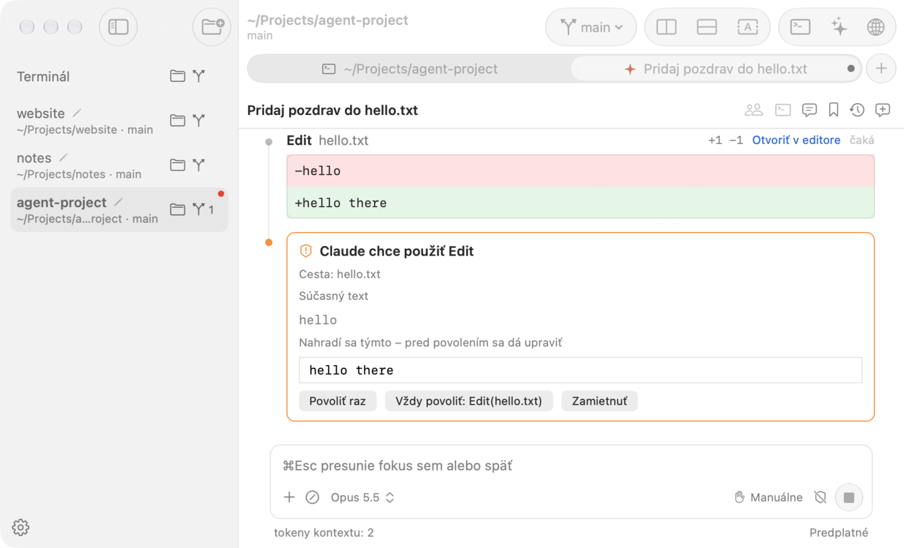

<p>&nbsp;&nbsp;&nbsp;</p>

# Tapa

**Rýchly, natívny terminál pre macOS, v ktorom sa našlo miesto pre vašich agentov, súbory a stránky.**

Tapa je predovšetkým terminál: vlastné jadro VT a renderer Metal, natívne taby a rozdelenia macOS, rýchly terminál, ktorý sa vysunie jedinou skratkou, integrácia so shellom s blokmi príkazov a voliteľné vstupné pole s návrhmi v štýle Warpu. Okolo toho Tapa vyrástla na mladšiu sestru aplikácie [Dango](https://github.com/sventmueller/dango): bočný panel s pracovnými priestormi, jedným pre každý priečinok projektu, každý s vlastnými terminálmi, taby agentov pre Claude, Codex, OpenCode, Antigravity a ďalších agentov ACP, taby prehliadača, editor so zoznamom súborov a panelom Git a náhľad Markdownu zo [Splatu](https://github.com/sventmueller/splat) so vzorcami a diagramami. Nič, čo nastavuje priečinok projektu, sa nespustí, kým jeho pracovnému priestoru nedôverujete. Tapa je napísaná v Ruste na skutočných ovládacích prvkoch AppKit, hovorí 35 jazykmi, nepotrebuje účet a nemá telemetriu.

[](https://github.com/sventmueller/tapa/releases/latest/download/Tapa.dmg)

**[Stiahnuť Tapa.dmg](https://github.com/sventmueller/tapa/releases/latest/download/Tapa.dmg)**: podpísaný a overený spoločnosťou Apple (notarizovaný), pre macOS 14 alebo novší na Apple Silicon aj Intel.

**Našli ste chybu?** [Založte issue](https://github.com/sventmueller/tapa/issues/new/choose) a uveďte, s akým shellom, akým agentom alebo akým programom sa to stalo. Ak je pre vás Tapa užitočná, [hviezdička na GitHube](https://github.com/sventmueller/tapa) pomôže ostatným nájsť ju.

[](https://www.rust-lang.org) [](https://www.apple.com/macos/)  [](https://github.com/madsmtm/objc2) [](https://developer.apple.com/metal/) [](https://agentclientprotocol.com)    [](#licencia)

[Bahasa Indonesia](../id/README.md) · [Bahasa Melayu](../ms/README.md) · [Català](../ca/README.md) · [Čeština](../cs/README.md) · [Dansk](../da/README.md) · [Deutsch](../de/README.md) · [English](../../../README.md) · [Español](../es/README.md) · [Français](../fr/README.md) · [Hrvatski](../hr/README.md) · [Italiano](../it/README.md) · [Magyar](../hu/README.md) · [Nederlands](../nl/README.md) · [Norsk](../no/README.md) · [Polski](../pl/README.md) · [Português (Brasil)](../pt_BR/README.md) · [Português (Portugal)](../pt_PT/README.md) · [Română](../ro/README.md) · **Slovenčina** · [Slovenščina](../sl/README.md) · [Suomi](../fi/README.md) · [Svenska](../sv/README.md) · [Tiếng Việt](../vi/README.md) · [Türkçe](../tr/README.md) · [Ελληνικά](../el/README.md) · [Русский](../ru/README.md) · [Українська](../uk/README.md) · [עברית](../he/README.md)‎ · [العربية](../ar/README.md)‎ · [हिन्दी](../hi/README.md) · [ไทย](../th/README.md) · [한국어](../ko/README.md) · [日本語](../ja/README.md) · [简体中文](../zh-Hans/README.md) · [繁體中文](../zh-Hant/README.md)

## Obsah

- [Funkcie na prvý pohľad](#funkcie-na-prvý-pohľad)
- [Požiadavky](#požiadavky)
- [Inštalácia](#inštalácia)
- [Prvé kroky](#prvé-kroky)
- [Pracovné priestory](#pracovné-priestory)
- [Terminál](#terminál)
  - [Taby a rozdelenia](#taby-a-rozdelenia)
  - [Integrácia so shellom a bloky príkazov](#integrácia-so-shellom-a-bloky-príkazov)
  - [Vstupné pole a návrhy](#vstupné-pole-a-návrhy)
  - [Hľadanie, výber a kopírovanie](#hľadanie-výber-a-kopírovanie)
  - [Rýchly terminál](#rýchly-terminál)
- [Agenti](#agenti)
- [Editor, súbory a Git](#editor-súbory-a-git)
- [Náhľady](#náhľady)
- [Prehliadač](#prehliadač)
- [Diktovanie](#diktovanie)
- [Nastavenia](#nastavenia)
- [Vzhľad a prístupnosť](#vzhľad-a-prístupnosť)
- [Jazyky](#jazyky)
- [Klávesové skratky](#klávesové-skratky)
- [Dôvera](#dôvera)
- [Súkromie a zabezpečenie](#súkromie-a-zabezpečenie)
- [Známe obmedzenia](#známe-obmedzenia)
- [Pre vývojárov](#pre-vývojárov)
  - [Komponenty tretích strán](#komponenty-tretích-strán)
- [Licencia](#licencia)

## Funkcie na prvý pohľad

- **Rýchly terminál s vlastným jadrom.** Tapa spracúva výstup vlastným jadrom VT a vykresľuje cez Metal vo vlastnom vlákne pre každý displej, s obnovovacou frekvenciou displeja a iba to, čo sa zmenilo. Prejde 262 kontrolami esctest, kde jadro Alacritty prejde 121, a každá jeho zmena sa meria voči pevne stanovenej verzii Ghostty.
- **Natívna do posledného detailu.** Skutočné taby macOS, obnovenie okien, menu, menu Služby, hlásenia, zabezpečené zadávanie z klávesnice, diktovanie a metódy zadávania. Žiadny Electron a WebKit iba tam, kde ho potrebuje stránka alebo náhľad.
- **Pracovné priestory.** Bočný panel obsahuje jeden pracovný priestor pre každý priečinok projektu, každý s vlastnými tabmi, vetvou a prehľadmi. Pracovný priestor „Terminál“ hore začína zakaždým odznova; všetky ostatné zostanú, kým ich neodstránite.
- **Agenti v natívnom zobrazení chatu.** Claude, Codex, OpenCode, Antigravity, Gemini CLI a ďalší agenti protokolu Agent Client Protocol bežia vo vlastných taboch, s odpoveďami, volaniami nástrojov, rozdielmi a žiadosťami o povolenie v jednej časovej osi. Tapa ich na požiadanie nainštaluje a aktualizuje.
- **Integrácia so shellom a bloky príkazov** pre zsh, bash a fish, aj cez `ssh`: skáčte z výzvy na výzvu, vyberajte, kopírujte, ukladajte a zbaľujte výstup príkazu, sledujte neúspešné príkazy a ako dlho každý trval.
- **Vstupné pole ako vo Warpe, ak chcete.** Upravujte príkazový riadok ako text, s návrhmi z vašej histórie, zo špecifikácií pre viac než 700 nástrojov príkazového riadka a zo stavu projektu, všetko priamo vo vašom Macu.
- **Súbory, Git a prehliadač vedľa shellu.** Editor s farbami syntaxe, zoznam súborov, panel Git s prípravou zmien, commitmi, vetvami a worktree, náhľad Markdownu so vzorcami a diagramami a taby prehliadača.
- **Opatrná s vašimi priečinkami.** Pracovný priestor, ktorému ste nedôverovali, nespustí nič, čo nastavuje jeho priečinok: žiadne git hooky, žiadne projektové servery MCP, žiadne projektové nastavenia agentov, žiadny JavaScript v jeho súborových stránkach.
- **Súkromná.** Žiadny účet, žiadna telemetria. Tapa ide na sieť, iba keď ju o to požiadate, a obnovovaná história na disku je šifrovaná kľúčom vo vašej kľúčenke.
- **Vo vašom jazyku.** Rozhranie je v 35 jazykoch: arabčina, katalánčina, čínština (zjednodušená), čínština (tradičná), chorvátčina, čeština, dánčina, holandčina, angličtina, fínčina, francúzština, nemčina, gréčtina, hebrejčina, hindčina, maďarčina, indonézština, taliančina, japončina, kórejčina, malajčina, nórčina, poľština, portugalčina (Brazília), portugalčina (Portugalsko), rumunčina, ruština, slovenčina, slovinčina, španielčina, švédčina, thajčina, turečtina, ukrajinčina a vietnamčina.

## Požiadavky

- macOS 14 Sonoma alebo novší, na Apple Silicon alebo Intel. Tapa sa vyvíja a testuje na macOS 27.
- zsh, bash alebo fish pre integráciu so shellom; ostatné shelly fungujú bez nej.
- Pre taby agentov agent, ktorého chcete používať, buď už nainštalovaný, alebo nainštalovaný Tapou, keď o to požiadate (pozrite [Agenti](#agenti)).

## Inštalácia

**Z obrazu disku.** Každé vydanie je obraz disku, `Tapa-<version>.dmg`, s jedinou univerzálnou aplikáciou pre Apple Silicon aj Intel, podpísanou certifikátom Developer ID a overenou spoločnosťou Apple (notarizovanou). Otvorte ho a pretiahnite Tapu do priečinka Aplikácie.

**Cez Homebrew.** Cask vo vlastnom tape nainštaluje ten istý obraz disku:

```sh
brew install --cask sventmueller/tap/tapa
```

**Aktualizácie.** Tapa z obrazu disku alebo z Homebrew sa aktualizuje sama cez [Sparkle](https://sparkle-project.org). Pri druhom spustení sa spýta, či môže sama vyhľadávať aktualizácie; kým nesúhlasíte, nepošle žiadnu požiadavku. **Tapa › Vyhľadať aktualizácie…** vyhľadá ihneď. Tapa nainštaluje aktualizáciu, iba ak nesie podpis vývojára. Vlastná zostavená verzia nemá aktualizátor.

**Zo zdrojového kódu.** Pozrite [Pre vývojárov](#pre-vývojárov).

**Ako predvolený terminál.** Tapa vie otvárať skripty shellu (`.command`, `.tool`), priečinky pretiahnuté na jej ikonu a odkazy `ssh://`. Vyberte ju vo Finderi cez **Súbor › Informácie › Otvoriť v aplikácii**.

## Prvé kroky

1. **Okno** má vľavo bočný panel s pracovnými priestormi, hore taby vybraného pracovného priestoru a nad nimi panel s nástrojmi. ⌃⌘S bočný panel zobrazí a skryje.
2. **Nový pracovný priestor** vytvoríte tlačidlom priečinka v hornej časti bočného panela alebo cez **Shell › Nový pracovný priestor…** (⇧⌘N): vyberte jeden z nedávnych priečinkov alebo **Vybrať priečinok…**.
3. **Nové taby** začínajú v priečinku pracovného priestoru: ⌘T pre terminál, tlačidlá vpravo na paneli s nástrojmi pre tab terminálu, agenta alebo prehliadača, alebo **+** na konci lišty s tabmi.
4. **Nastavenia** otvoríte pomocou ⌘, alebo ozubeným kolieskom dolu v bočnom paneli.
5. **Paleta príkazov** (⇧⌘P) nájde každý príkaz podľa názvu a **Nájsť tab…** (⌘P) každý tab každého pracovného priestoru.

Panel s nástrojmi obsahuje zľava rozbaľovacie menu vetiev repozitára pracovného priestoru, tlačidlá na rozdelenie terminálu doprava a nadol a na zobrazenie vstupného poľa a tlačidlá pre nové taby terminálu, agenta a prehliadača. Tlačidlá rozdelenia a vstupného poľa sú sivé, kým vpredu nie je tab terminálu.

## Pracovné priestory

Pracovný priestor je priečinok s jeho tabmi. Jeho riadok v bočnom paneli ukazuje názov, priečinok a vetvu Git a vpravo tlačidlá pre zoznam súborov a panel Git. Kliknutie na jedno z nich zobrazí daný prehľad namiesto zoznamu pracovných priestorov; **Pracovné priestory** hore vedie späť.

- **Pracovný priestor „Terminál“** je vždy hore. Pri každom spustení začína odznova, v priečinku určenom v nastaveniach, s jedným prázdnym terminálom. Nič z neho sa neukladá a nedá sa premenovať ani odstrániť.
- **Každý iný pracovný priestor zostáva**, kým ho neodstránite, aj bez tabov. Tapa si pamätá jeho názov, taby, obsah jeho terminálov (v rozsahu, aký určujú nastavenia obnovenia), jeho relácie agentov a polohu okna. Programy, ktoré ešte bežia, skončia, keď sa Tapa ukončí.
- **Premenovanie.** Kliknite na ceruzku za názvom, kliknite na názov vybraného pracovného priestoru alebo zvoľte **Shell › Premenovať pracovný priestor**. Názov sa uloží hneď.
- **Stav.** Zelená bodka na riadku znamená, že agent pracovného priestoru pracuje, aj so subagentmi alebo na pozadí; červená bodka znamená, že niektorý na vás čaká. Terminály tam nič neoznačujú.
- **Prepínanie.** ⌃⌘[ a ⌃⌘] prechádzajú medzi pracovnými priestormi. Okno zostane na svojom mieste a taby vybraného pracovného priestoru nahradia ostatné.
- **Worktree.** **Nový worktree…** v rozbaľovacom menu vetiev na paneli s nástrojmi vytvorí worktree Git na novej vetve a otvorí ho ako samostatný pracovný priestor.

Keď sa zavrie posledný tab pracovného priestoru, pracovný priestor v zozname zostane. Keď sú zavreté všetky taby, zmizne iba okno; ikona v Docku alebo ⌘N ho vráti aj s jeho pracovnými priestormi.

## Terminál

Tapa beží na vlastnom jadre `term-vt`. Ovláda xterm a VT520 s klávesnicovým protokolom Kitty, hypertextovými odkazmi OSC 8, prístupom do schránky OSC 52 so samostatným povolením na čítanie, synchronizovaným výstupom, farebným a vlnitým podčiarknutím, truecolor, dopytmi na farby, hlásením svetlého a tmavého režimu programom, bracketed paste, udalosťami fokusu a hlásením myši. Keď okno zmení veľkosť, text sa znova zalomí, vrátane histórie. Ligatúry, funkcie písiem, symboly Nerd Font bez upravených písiem a na pixel presné znaky rámčekov, Powerline a Braillovho písma sú vstavané.

### Taby a rozdelenia

- **Taby** sú vlastné taby macOS: presunutím ich preusporiadate alebo vytiahnete do vlastného okna, **Zobraziť všetky taby** (⇧⌘\\), ⌘1 až ⌘8, ⌘9 pre posledný tab a ⇧⌘[ / ⇧⌘] na prepínanie. Každý tab ukazuje pred svojím názvom ikonu svojho druhu.
- **Rozdelenia.** **Rozdeliť doprava** (⌘D alebo ⌃⌘T) a **Rozdeliť nadol** (⇧⌘D alebo ⌃⌥⌘T), vnorené ľubovoľne hlboko. Ťahajte deliacu čiaru, posúvajte ju pomocou ⌃⌘ a šípok, **Maximalizovať podokno** (⌃⇧⌘↩), **Vyrovnať podokná** (⌃⌘=) a medzi podoknami prechádzajte pomocou ⌘[ a ⌘].
- **Pracovný priečinok.** Nové taby, okná a rozdelenia začínajú v priečinku terminálu vpredu; nastavenia o tom rozhodujú pre každé z týchto troch zvlášť.
- **Zatváranie.** Tapa sa spýta, skôr než zavrie tab, okno alebo aplikáciu, v ktorých beží program.
- **Obnovenie.** Po reštarte sa vrátia pracovné priestory, taby, podokná, priečinky a posledné riadky každého terminálu. Tajné údaje ako tokeny a heslá sa pred uložením zamaskujú.

### Integrácia so shellom a bloky príkazov

Tapa si sama nastaví integráciu so shellom pre zsh, bash a fish bez zásahu do vašich konfiguračných súborov a vezme ju so sebou, keď sa cez `ssh` pripojíte k inému hostiteľovi. Vďaka nej tvorí každý príkaz so svojím výstupom blok:

- **Výzvy.** ⌘↑ a ⌘↓ skočia na predchádzajúcu a nasledujúcu výzvu. Kliknutie do príkazového riadka tam presunie kurzor.
- **Bloky.** **Vybrať blok** (⇧⌘A), **Kopírovať výstup** (⌥⌘C), **Uložiť výstup…** (⌥⌘S) a **Zbaliť/rozbaliť blok** (⇧⌘↩). Nad blokom pod ukazovateľom zobrazujú tlačidlá jeho stav, trvanie a tie isté akcie.
- **Neúspešné príkazy** sú označené a príkaz, ktorý ešte beží, zostáva viditeľný hore, kým sa jeho výstup posúva.
- **Záložky.** **Pridať/odstrániť záložku** (⇧⌘M) označí riadok; ⇧⌘↑ a ⇧⌘↓ skáču medzi záložkami.
- **Hlásenia** sa objavia, keď o ne program požiada (OSC 9 a OSC 777) a terminál nie je vpredu, a indikátor priebehu (OSC 9;4) sa zobrazí na tabe a na ikone v Docku.

### Vstupné pole a návrhy

Vstupné pole premení príkazový riadok na textové pole v dolnej časti podokna, ako vo Warpe, so štítkami priečinka a vetvy Git nad ním. **Zobraziť/skryť vstupné pole** (⌘I) alebo tlačidlo na paneli s nástrojmi ho prepne pre jeden terminál; **Nastavenia › Vstup** ho zapne pre nové terminály. Potrebuje integráciu so shellom a ustúpi programom na celú obrazovku, ako je vim, htop alebo claude.

- **Return** pošle celé pole do shellu, viacriadkový text ako jedno vloženie; shell ho spustí a zapamätá si ho ako zvyčajne. Ak shell žiada viac, pole mu až do ďalšej výzvy odovzdá klávesy.
- **↑, ↓ a ⌃R** prehľadávajú históriu, s priečinkom, vetvou a návratovým kódom, s ktorými každý príkaz bežal.
- **Tab** dopĺňa podľa špecifikácií pre viac než 700 nástrojov príkazového riadka, ciest a aktuálnych hodnôt, ako sú vetvy gitu, kontajnery dockera, prostriedky kubectl, hostitelia ssh, skripty `package.json` a ciele make, just a cargo.
- **Klávesy Vimu** v poli zapnete prepínačom v tých istých nastaveniach.
- **Ďalší príkaz skôr, než začnete písať**: čo v tomto projekte zvyčajne nasleduje (po `git add` prichádza `git commit`), čo vyžaduje stav projektu (zámkový súbor novší než `node_modules`) a oprava po „command not found“, podľa preklepov alebo podľa vášho miestneho indexu Homebrew.

Bez vstupného poľa sa návrhy zobrazujú ako sivý text za kurzorom a → ich prijme. Shelly s vlastnými automatickými návrhmi, ako fish alebo zsh-autosuggestions, si ponechajú svoje. Návrhy nikdy nepoužívajú sieť a spúšťajú programy iba z vašej vlastnej `PATH`, nikdy z priečinka projektu.

**Vkladanie.** Viacriadkové vloženia možno pred spustením zobraziť (**Viacriadkové vloženie najprv zobraziť**). Súbory pretiahnuté na terminál prídu ako cesty v úvodzovkách; ⌥←/→, ⌘←/→ a ⌘⌫ presúvajú a mažú po slovách a riadkoch ako v každom textovom poli na Macu.

### Hľadanie, výber a kopírovanie

- **Hľadať** (⌘F) prehľadáva históriu s regulárnymi výrazmi, rozlišovaním veľkosti písmen a celými slovami a počíta zhody; posuvník ich označuje spolu s výzvami a chybami.
- **Inteligentný výber.** Dvojité kliknutie vyberie celú adresu URL, cestu, hash alebo IP adresu a ťahanie s ⌥ vyberie obdĺžnik. Odkazy sa nájdu aj bez OSC 8; ⌘-kliknutie ich otvorí, a cestu v aplikácii Dango, ak je nainštalovaná.
- **Výber klávesnicou** (⇧⌘C) posúva výber klávesmi Vimu.
- **Kopírovať s formátovaním** (⇧⌥⌘C) zachová farby a štýly; kopírovanie pri výbere je voľba v nastaveniach. **Vyčistiť** (⌘K) vyčistí terminál.

### Rýchly terminál

**Zobraziť/skryť rýchly terminál** (⌃⌥⌘Space) vysunie terminál z okraja obrazovky, nad ostatnými aplikáciami a cez celoobrazovkové plochy, bez prepínania aplikácií. Okraj, veľkosť a to, či sa skryje, keď kliknete inam, sú voľby v nastaveniach. Jeho relácie bežia ďalej, aj keď je skrytý.

## Agenti

Tab agenta spúšťa programovacieho agenta v priečinku pracovného priestoru, v natívnom zobrazení agenta z aplikácie Dango.

| Agent | Ako beží | Čo potrebuje |
|---|---|---|
| Claude | príkaz `claude`, s ktorým Tapa komunikuje cez jeho protokol stream-json | nainštalovaný a prihlásený `claude`; Tapa ho na požiadanie nainštaluje vlastným inštalátorom Claude |
| Codex | `codex app-server`, alebo `codex-acp` pre starší Codex | prihlásený `codex`; Tapa na požiadanie nainštaluje pevne stanovenú verziu adaptéra |
| OpenCode | `opencode serve`, alebo `opencode acp` pre starší OpenCode | vlastný `opencode` v `PATH`, alebo stiahnutie pevne stanovenej verzie |
| Antigravity | `agy acp` | vlastný `agy` v `PATH`, alebo stiahnutie pevne stanovenej verzie |
| Gemini CLI | `gemini --acp`, ponúkaný, keď ho zapnete v **Nastavenia › Agenti** | vlastný `gemini`, alebo stiahnutie pevne stanovenej verzie |
| Ďalší agenti ACP | z registra ACP, načítaného iba na vašu požiadavku | to, čo uvádza záznam v registri; záznamy bez kontrolného súčtu sa nainštalujú až po vašom potvrdení |

Tapa používa vlastné prihlásenie každého agenta a neukladá žiadne prihlasovacie údaje agentov. Agent nájdený v `PATH` vášho prihlasovacieho shellu má prednosť; inak Tapa spustí verziu, ktorú nainštalovala do svojho vlastného dátového priečinka, nikdy program z pracovného priestoru.

- **Časová os** ukazuje odpovede, volania nástrojov s ich výstupom a rozdielmi, otázky a žiadosti o povolenie. **Povoliť raz**, **Vždy povoliť** a **Zamietnuť** na žiadosť odpovedia a úpravu možno zmeniť, skôr než ju povolíte.
- **Stav.** Tab a riadok pracovného priestoru ukazujú zelenú bodku, keď agent pracuje, a červenú, keď na vás čaká, a hlásenie vám dá vedieť, že čaká, kým sa pozeráte inam.
- **Pole správy** dole prijíma váš prompt, súbory naň pretiahnuté a diktovanie. ⌘Esc doň presunie fokus klávesnice a zase späť. Model a režim povolení sa tam dajú zvoliť pre reláciu.
- **Nastavenia › Agenti** určujú pre nové relácie režim povolení (Claude, Codex), model (Claude, Codex, OpenCode) a úsilie premýšľania (Claude, Codex) a tiež to, ktorých agentov ponúkajú nové taby. Ukazujú, kde leží program každého agenta, s tlačidlami **Inštalovať…**, **Aktualizovať na …** a **Späť na …** pre predchádzajúcu verziu a **Načítať register** pre register ACP. Pravidlá, ktoré Claude uložil cez „Vždy povoliť“, tam možno zobraziť a odstrániť.
- **Overené sťahovania.** Archívy sa overujú podľa ich SHA-256, balíky npm podľa integrity v ich zámkovom súbore a balíky bez pevnej verzie sa odmietnu. Chýbajúci agent ponúkne svoju inštaláciu aj vo svojom vlastnom tabe.

## Editor, súbory a Git

- **Zoznam súborov** pracovného priestoru zobrazuje jeho priečinok ako strom, aktualizovaný pri zmenách súborov, a ak chcete, so stlmenými súbormi, ktoré Git ignoruje. Kliknutie otvorí súbor ako náhľadový tab, ktorý ďalšie kliknutie nahradí, kým súbor neupravíte; dvojité kliknutie ho ponechá.
- **Editor** otvára súbory v taboch pracovného priestoru, s farbami syntaxe, viacerými kurzormi, zbaľovaním, odsadením z `.editorconfig`, voliteľnými klávesmi Vimu a značkami toho, čo sa zmenilo od posledného commitu. Všimne si, keď sa súbor na disku zmenil alebo obsahuje značky konfliktov. Súbory Markdown dostanú lištu formátovania a **Otvoriť v aplikácii Splat**. **Uložiť** (⌘S), **Uložiť ako…** a **Uložiť všetko** fungujú ako zvyčajne a Tapa sa spýta, skôr než zavrie neuložený text.
- **Po páde** sa neuložený text vráti: Tapa si počas písania uchováva jeho šifrované kópie.
- **Panel Git** ukazuje pripravené a nepripravené zmeny, pripravuje a vracia súbory aj jednotlivé bloky zmien, vytvára commity (⌘↩), opravuje ich, vytvára commit s odoslaním, sťahuje zmeny a zvláda vetvy, stashe, cherry-picky a konflikty, s históriou commitov pod tým. Kliknutie na súbor zobrazí jeho rozdiely.
- **Rozbaľovacie menu vetiev** na paneli s nástrojmi prepína a vytvára vetvy a vytvára worktree.

Editor nespúšťa žiadny formátovač ani jazykový server. Pre plnohodnotné IDE s jazykovými servermi a debuggerom použite [Dango](https://github.com/sventmueller/dango).

## Náhľady

- **Markdown** sa zobrazuje vedľa svojho editora cez renderer Splatu: GitHub Flavored Markdown so vzorcami, diagramami a obrázkami, posúvaný spolu s textom odsek po odseku.
- **Obrázky** sa otvárajú vo vlastnom tabe, PDF cez PDFKit a zvuk, filmy, písma a kancelárske dokumenty cez Rýchly náhľad.
- **Izolované dekódovanie.** Každý obrázok z nedôveryhodného zdroja (súbory projektu, Markdown, prílohy a vloženia agentov) sa dekóduje v službe Splatu `Decoder.xpc`, vo vlastnom App Sandboxe bez súborov a siete, nikdy v samotnej aplikácii.

## Prehliadač

**Nový tab prehliadača** (⇧⌘B) otvorí v pracovnom priestore tab WebKit. Pole adresy prijíma adresu alebo slová pre vami zvolený vyhľadávač (DuckDuckGo, Google, Bing alebo Startpage); ⌘L, ⌘R, ⌘[ a ⌘] fungujú ako v Safari. Stránky z `localhost` bežia ako zvyčajne, pre vývojový server vášho projektu. Súbory HTML pracovného priestoru smú čítať iba vlastný priečinok a v pracovnom priestore, ktorému ste nedôverovali, nespúšťajú žiadny JavaScript.

## Diktovanie

Diktujte do poľa správy agenta alebo do editora tlačidlom mikrofónu alebo cez **Upraviť › Spustiť diktovanie** (⌃⌥D). Rozpoznávanie reči pochádza z [Lowspeaku](https://github.com/sventmueller/lowspeak), ktorý netreba inštalovať. **Nastavenia › Diktovanie** volia online prepis cez OpenAI alebo Groq, alebo miestne modely Whisper a Parakeet, ktoré nahrávku ponechajú vo vašom Macu, a ďalej jazyk, následné spracovanie, mikrofón a vašu vlastnú slovnú zásobu. Kľúče pre OpenAI a Groq sa uchovávajú vo vašej kľúčenke. Diktovanie je súčasťou iba zostavenia na vydanie.

## Nastavenia

**Tapa › Nastavenia…** (⌘,) má časti Všeobecné, Písmo, Farby, Kurzor, Terminál, Vstup, Editor, Agenti, Diktovanie, Profily a Klávesové skratky. Zapisujú jeden súbor TOML, `config.toml` v priečinku Tapy v `~/Library/Application Support`, ktorý môžete upravovať aj ručne; Tapa ho znova načítava počas behu a **Znova načítať nastavenia** (⇧⌘,) to urobí hneď.

- **Štyri veľkosti písma** v časti Všeobecné: Rozhranie (bočný panel, prehľady, zoznam súborov, panel Git a názvy tabov), Editor (text, čísla riadkov a náhľad Markdownu), Terminál a Agenti. ⌘+, ⌘− a ⌘0 menia veľkosť terminálu vpredu.
- **Vzhľad:** Svetlý, Tmavý alebo Podľa systému.
- **Farby.** Jedna téma pre svetlý a jedna pre tmavý režim, vo formáte tém Ghostty, s minimálnym kontrastom, ktorý udrží text čitateľný aj pri nevydarenej téme. Vlastné témy patria do priečinka tém.
- **Profily** spájajú písmo, farby, shell, prostredie a priečinok.
- **Klávesové skratky** sa dajú zmeniť všetky a konflikty sa zobrazia.

## Vzhľad a prístupnosť

- **Tmavý režim** sleduje systém alebo vašu voľbu; farba zvýraznenia, Obmedziť pohyb a Zvýšiť kontrast sa rešpektujú.
- **VoiceOver** číta riadky a výzvy terminálu a oznamuje nový výstup; bočný panel, taby, tlačidlá panela s nástrojmi a karty časovej osi agenta majú názvy.
- **Klávesnica.** Každý príkaz má položku v menu a skratku a Úplný prístup z klávesnice siahne na každý ovládací prvok.
- **Veľkosti.** Štyri veľkosti písma z nastavení nezávisle škálujú rozhranie, editor, terminál a agentov.
- **Sprava doľava.** V arabčine a hebrejčine je rozhranie zrkadlené, zatiaľ čo mriežka terminálu zostáva zľava doprava.

Podrobnosti a známe medzery nájdete v [ACCESSIBILITY.md](../../../ACCESSIBILITY.md).

## Jazyky

Rozhranie je preložené do 35 jazykov: arabčina, katalánčina, čínština (zjednodušená), čínština (tradičná), chorvátčina, čeština, dánčina, holandčina, angličtina, fínčina, francúzština, nemčina, gréčtina, hebrejčina, hindčina, maďarčina, indonézština, taliančina, japončina, kórejčina, malajčina, nórčina, poľština, portugalčina (Brazília), portugalčina (Portugalsko), rumunčina, ruština, slovenčina, slovinčina, španielčina, švédčina, thajčina, turečtina, ukrajinčina a vietnamčina.

Tapa sa riadi poradím jazykov v **Systémové nastavenia › Všeobecné › Jazyk a región**; tam v časti **Aplikácie** môžete vybrať jazyk aj iba pre Tapu. Ak pre váš jazyk nie je preklad, použije angličtinu.

## Klávesové skratky

| Akcia | Skratka |
|---|---|
| Nové okno, pracovný priestor, tab | ⌘N, ⇧⌘N, ⌘T |
| Nový tab prehliadača | ⇧⌘B |
| Nový súbor, otvoriť súbor | ⌥⌘N, ⌘O |
| Zavrieť podokno alebo tab, zavrieť tab, zavrieť okno | ⌘W, ⌥⌘W, ⇧⌘W |
| Rozdeliť doprava, rozdeliť nadol | ⌘D alebo ⌃⌘T, ⇧⌘D alebo ⌃⌥⌘T |
| Maximalizovať podokno, vyrovnať podokná, zavrieť podokno | ⌃⇧⌘↩, ⌃⌘=, ⌃⇧⌘W |
| Posunúť deliacu čiaru | ⌃⌘←, ⌃⌘→, ⌃⌘↑, ⌃⌘↓ |
| Ďalšie, predchádzajúce podokno | ⌘], ⌘[ |
| Ďalší, predchádzajúci tab; tab 1 až 8, posledný tab | ⇧⌘], ⇧⌘[; ⌘1 až ⌘8, ⌘9 |
| Ďalší, predchádzajúci pracovný priestor | ⌃⌘], ⌃⌘[ |
| Nájsť tab, paleta príkazov | ⌘P, ⇧⌘P |
| Zobraziť alebo skryť bočný panel, vstupné pole | ⌃⌘S, ⌘I |
| Rýchly terminál | ⌃⌥⌘Space |
| Hľadať, hľadať ďalej, hľadať späť | ⌘F, ⌘G, ⇧⌘G |
| Predchádzajúca, nasledujúca výzva | ⌘↑, ⌘↓ |
| Vybrať blok, kopírovať výstup, uložiť výstup, zbaliť blok | ⇧⌘A, ⌥⌘C, ⌥⌘S, ⇧⌘↩ |
| Pridať alebo odstrániť záložku; predchádzajúca, nasledujúca záložka | ⇧⌘M; ⇧⌘↑, ⇧⌘↓ |
| Výber klávesnicou | ⇧⌘C |
| Kopírovať s formátovaním | ⇧⌥⌘C |
| Vyčistiť | ⌘K |
| Začiatok, koniec, stránka nahor, stránka nadol | ⌘Home, ⌘End, ⌘PageUp, ⌘PageDown |
| Väčšie, menšie, pôvodná veľkosť (terminál) | ⌘+, ⌘−, ⌘0 |
| Pole správy tabu agenta | ⌘Esc |
| Spustiť diktovanie | ⌃⌥D |
| Nastavenia, znova načítať nastavenia | ⌘,, ⇧⌘, |

Každú skratku môžete zmeniť v **Nastavenia › Klávesové skratky** alebo v časti `[keys]` súboru nastavení.

## Dôvera

Priečinok projektu môže spôsobiť, že sa programy spustia, len čo sa v ňom niečo spustí: git hooky a nastavenia repozitára ako `core.fsmonitor`, hooky agentov, projektové servery MCP a projektové nastavenia agentov. Preto nový pracovný priestor nie je dôveryhodný.

- **Nedôveryhodný:** agenti sa spúšťajú bez hookov, serverov MCP a konfigurácie projektu (Claude s `--setting-sources=user --strict-mcp-config`, Codex s priečinkom označeným ako nedôveryhodný, OpenCode bez konfigurácie projektu). Git beží v neutralizovanom režime: bez hookov, filtrov, ovládačov diff, fsmonitor, `sshCommand` a pagera a iba s globálnymi pomocníkmi pre prihlasovacie údaje. Súbory HTML sa otvárajú bez JavaScriptu. Panel Git a tab agenta na to upozornia a ponúknu, že pracovnému priestoru budete dôverovať.
- **Dôveryhodný:** **Shell › Dôverovať pracovnému priestoru** načíta všetko tak, ako to priečinok zamýšľa. **Odobrať dôveru** to vezme späť. Dôvera sa uchováva pre každý pracovný priestor zvlášť.

Bez ohľadu na dôveru Tapa nikdy sama nespustí program z priečinka projektu: návrhy spúšťajú programy iba z vašej `PATH` mimo projektu a bočný panel číta stav Git zo súborov `.git`. Pracovný priestor vo vašom domovskom priečinku, ako je „Terminál“, nie je projekt: programy pod `~`, ako `~/.local/bin/claude`, sa tam považujú za vaše vlastné.

## Súkromie a zabezpečenie

- **Žiadna telemetria, žiadny účet.** Tapa nehlási nič o tom, ako ju používate, a funguje úplne offline. Na sieť ide, iba keď o to požiadate: aby nainštalovala alebo aktualizovala agenta, načítala register ACP, vyhľadala aktualizácie, keď s tým budete súhlasiť, a pre stránky, ktoré otvoríte v tabe prehliadača. Samotní agenti komunikujú so svojimi poskytovateľmi ako vždy.
- **História na disku** na obnovenie relácií je šifrovaná kľúčom vo vašej kľúčenke, dá sa vypnúť a tajné údaje ako kľúče API, tokeny a heslá sa v nej pred zápisom zamaskujú. Kópie neuloženého textu editora sú šifrované tým istým kľúčom.
- **Zabezpečená klávesnica** sa sama zapne pri výzvach na zadanie hesla a v menu aplikácie ju možno zapnúť natrvalo.
- **Riadiace sekvencie**, ktoré by mohli niečo vyzradiť alebo podstrčiť, ako hlásenia titulku, čítanie schránky a triky s vkladaním, sa blokujú alebo sa na ne Tapa najprv spýta. Parser sa v CI testuje fuzzingom.
- **Izolované dekódovanie** obrázkov z nedôveryhodných zdrojov, pozrite [Náhľady](#náhľady).
- **Podpisovanie kódu** s Hardened Runtime. macOS pripisuje prístup programov v termináli Tape, preto obsahuje popis použitia pre každú chránenú službu.

Bezpečnostné problémy sa hlásia súkromne, pozrite [SECURITY.md](../../../SECURITY.md).

## Známe obmedzenia

- **Zatiaľ žiadne vložené obrázky** v termináli: grafika Kitty, Sixel a obrázky iTerm2 sú plánované po verzii 1.0.
- **Žiadny riadiaci režim tmux** a relácie neprežijú ukončenie Tapy.
- **Text sprava doľava** v mriežke terminálu zostáva zľava doprava.
- **⌘+ a ⌘−** menia iba terminál vpredu.
- **Editor** zámerne nemá jazykové servery, formátovače ani debugger; Dango ich má.
- **Diktovanie** je iba v zostavení na vydanie, nie v ladiacom zostavení.
- **VoiceOver** zatiaľ nikto neoveril od začiatku do konca.

## Pre vývojárov

Potrebujete macOS 14 alebo novší s Xcode Command Line Tools, Rust podľa `rust-toolchain.toml` (rustup s oboma cieľmi pre Mac kvôli univerzálnemu zostaveniu), klony [splat](https://github.com/sventmueller/splat) a [lowspeak](https://github.com/sventmueller/lowspeak) vedľa tohto repozitára (`../splat`, `../lowspeak`) a cmake na zostavenie s diktovaním.

| Príkaz | Čo robí |
|---|---|
| `make help` | vypíše ciele |
| `cargo xtask run` | zostaví ladiacu aplikáciu a otvorí ju |
| `make build` | zostaví aplikáciu na vydanie s diktovaním do `target/release`, podpísanú ad hoc pre tento Mac |
| `make lint` | formátovanie, clippy s varovaniami ako chybami, tvar súborov a texty rozhrania |
| `make check` | `lint`, potom všetky testy; nepotrebuje okno ani sieť |
| `make selftest STEPS="split_right,type:ls\n,shot:x"` | ovláda aplikáciu a zanechá obrázky okien v `target/selftest/` |
| `make esctest`, `make vttest` | spustí esctest a vttest voči obom jadrám v aplikácii |
| `make perf` | benchmark voči pevne stanovenej verzii Ghostty; zmysluplný iba na nečinnom Macu |
| `make fuzz` | fuzzovacie ciele s cargo-fuzz |
| `make release` | skúšobný beh vydania: univerzálna aplikácia s diktovaním, jej obraz disku, kanál aktualizácií a cask v `target/release-dry-run`; nikam nič neposiela |
| `make release-notarized` | aktuálna verzia podpísaná certifikátom Developer ID, notarizovaná spoločnosťou Apple a s pripojeným lístkom notarizácie, do `dist/`; `Cargo.toml` sa nemení |
| `make deploy` | notarizuje ďalšiu verziu, commitne `Cargo.toml`, nahrá koncept vydania, pushne `main` a tag a potom vydanie zverejní; pozri [docs/development.md](../../../docs/development.md#deploy) |

Postup na prispievanie je v [CONTRIBUTING.md](../../../CONTRIBUTING.md). Kľúčom každého textu rozhrania je jeho nemecké znenie, s prekladom do všetkých 35 jazykov; `cargo xtask strings` zlyhá, ak niektorý chýba.

### Komponenty tretích strán

| Komponent | Na čo sa používa | Licencia |
|---|---|---|
| [objc2](https://github.com/madsmtm/objc2) a jeho crates pre frameworky | AppKit, Metal, WebKit a ďalšie frameworky Apple | MIT, Zlib alebo Apache-2.0 |
| Crates Splatu | Markdown, náhľad, čítanie Gitu, dekodér obrázkov a preklady | MIT alebo Apache-2.0 |
| [Lowspeak](https://github.com/sventmueller/lowspeak) s [whisper.cpp](https://github.com/ggml-org/whisper.cpp) | diktovanie | MIT |
| [Fig autocomplete specs](https://github.com/withfig/autocomplete) | popisy príkazov v návrhoch | MIT |
| [rusqlite](https://github.com/rusqlite/rusqlite) so SQLite | história príkazov | MIT, voľné dielo |
| [Simple Icons](https://simpleicons.org) | logá jazykov a programov | CC0, niektoré logá podľa vlastných podmienok |
| [Sparkle](https://sparkle-project.org) 2.10.1 | aktualizácie zostavenia na vydanie | MIT |

## Licencia

Tapa je licencovaná podľa jednej z týchto licencií

- Licencia Apache, verzia 2.0 ([LICENSE-APACHE](../../../LICENSE-APACHE))
- Licencia MIT ([LICENSE-MIT](../../../LICENSE-MIT))

podľa vášho výberu. Logá v `assets/simple-icons` majú vlastné licencie, pozrite tamojší README.

Ak výslovne neuvediete inak, každý príspevok, ktorý ste zámerne odovzdali na zahrnutie do Tapy, ako je definované v licencii Apache-2.0, bude duálne licencovaný ako vyššie, bez ďalších podmienok.
