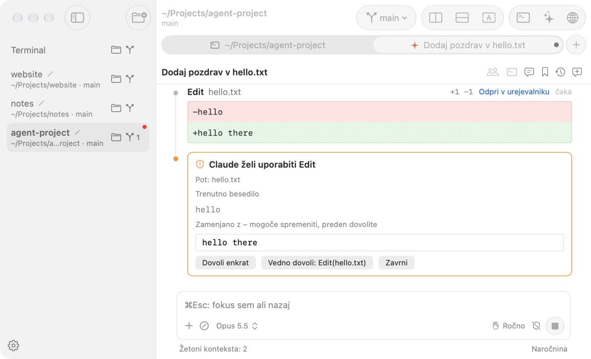

<p>&nbsp;&nbsp;&nbsp;</p>

# Tapa

**Hiter, izvorni terminal za macOS, v katerem je zraslo prostora za vaše agente, datoteke in strani.**

Tapa je najprej terminal: lastno jedro VT in izrisovalnik Metal, izvorni zavihki in razdelitve macOS, hitri terminal, ki z eno bližnjico zdrsne na zaslon, integracija z lupino z bloki ukazov in neobvezno vnosno polje s predlogi v slogu Warpa. Okoli tega je Tapa zrasla v mlajšo sestro aplikacije [Dango](https://github.com/sventmueller/dango): stranska vrstica z delovnimi prostori, po enim za vsako mapo projekta, vsak s svojimi terminali, zavihki agentov za Claude, Codex, OpenCode, Antigravity in druge agente ACP, zavihki brskalnika, urejevalnik s seznamom datotek in ploščo Git ter predogled Markdown iz [Splata](https://github.com/sventmueller/splat) s formulami in diagrami. Nič, kar nastavi mapa projekta, se ne zažene, dokler ne zaupate njenemu delovnemu prostoru. Tapa je napisana v Rustu na pravih kontrolnikih AppKit, govori 35 jezikov, ne potrebuje računa in nima telemetrije.

[](https://github.com/sventmueller/tapa/releases/latest/download/Tapa.dmg)

**[Prenesite Tapa.dmg](https://github.com/sventmueller/tapa/releases/latest/download/Tapa.dmg)**: podpisan in overjen pri Applu, za macOS 14 ali novejši na Applovih čipih in procesorjih Intel.

**Ste našli napako?** [Odprite issue](https://github.com/sventmueller/tapa/issues/new/choose) in navedite, s katero lupino, katerim agentom ali katerim programom se je zgodila. Če vam je Tapa koristna, [zvezdica na GitHubu](https://github.com/sventmueller/tapa) pomaga drugim, da jo najdejo.

[](https://www.rust-lang.org) [](https://www.apple.com/macos/)  [](https://github.com/madsmtm/objc2) [](https://developer.apple.com/metal/) [](https://agentclientprotocol.com)    [](#licenca)

[Bahasa Indonesia](../id/README.md) · [Bahasa Melayu](../ms/README.md) · [Català](../ca/README.md) · [Čeština](../cs/README.md) · [Dansk](../da/README.md) · [Deutsch](../de/README.md) · [English](../../../README.md) · [Español](../es/README.md) · [Français](../fr/README.md) · [Hrvatski](../hr/README.md) · [Italiano](../it/README.md) · [Magyar](../hu/README.md) · [Nederlands](../nl/README.md) · [Norsk](../no/README.md) · [Polski](../pl/README.md) · [Português (Brasil)](../pt_BR/README.md) · [Português (Portugal)](../pt_PT/README.md) · [Română](../ro/README.md) · [Slovenčina](../sk/README.md) · **Slovenščina** · [Suomi](../fi/README.md) · [Svenska](../sv/README.md) · [Tiếng Việt](../vi/README.md) · [Türkçe](../tr/README.md) · [Ελληνικά](../el/README.md) · [Русский](../ru/README.md) · [Українська](../uk/README.md) · [עברית](../he/README.md)‎ · [العربية](../ar/README.md)‎ · [हिन्दी](../hi/README.md) · [ไทย](../th/README.md) · [한국어](../ko/README.md) · [日本語](../ja/README.md) · [简体中文](../zh-Hans/README.md) · [繁體中文](../zh-Hant/README.md)

## Vsebina

- [Zmožnosti na prvi pogled](#zmožnosti-na-prvi-pogled)
- [Zahteve](#zahteve)
- [Namestitev](#namestitev)
- [Prvi koraki](#prvi-koraki)
- [Delovni prostori](#delovni-prostori)
- [Terminal](#terminal)
  - [Zavihki in razdelitve](#zavihki-in-razdelitve)
  - [Integracija z lupino in bloki ukazov](#integracija-z-lupino-in-bloki-ukazov)
  - [Vnosno polje in predlogi](#vnosno-polje-in-predlogi)
  - [Iskanje, izbiranje in kopiranje](#iskanje-izbiranje-in-kopiranje)
  - [Hitri terminal](#hitri-terminal)
- [Agenti](#agenti)
- [Urejevalnik, datoteke in Git](#urejevalnik-datoteke-in-git)
- [Predogledi](#predogledi)
- [Brskalnik](#brskalnik)
- [Narekovanje](#narekovanje)
- [Nastavitve](#nastavitve)
- [Videz in dostopnost](#videz-in-dostopnost)
- [Jeziki](#jeziki)
- [Bližnjice na tipkovnici](#bližnjice-na-tipkovnici)
- [Zaupanje](#zaupanje)
- [Zasebnost in varnost](#zasebnost-in-varnost)
- [Znane omejitve](#znane-omejitve)
- [Za razvijalce](#za-razvijalce)
  - [Komponente tretjih oseb](#komponente-tretjih-oseb)
- [Licenca](#licenca)

## Zmožnosti na prvi pogled

- **Hiter terminal z lastnim jedrom.** Tapa razčlenjuje z lastnim jedrom VT in izrisuje z Metalom v svoji niti za vsak zaslon, s hitrostjo osveževanja zaslona in le tisto, kar se je spremenilo. Opravi 262 preizkusov esctest, kjer jih jedro Alacritty opravi 121, vsaka sprememba pa se meri ob fiksni različici Ghostty.
- **Izvorna do zadnje podrobnosti.** Pravi zavihki macOS, obnovitev oken, meniji, meni Storitve, obvestila, zaščiten vnos s tipkovnico, narekovanje in načini vnosa. Brez Electrona, WebKit pa le tam, kjer ga potrebuje stran ali predogled.
- **Delovni prostori.** Stranska vrstica vsebuje en delovni prostor za vsako mapo projekta, vsak s svojimi zavihki, vejo in ploščami. Delovni prostor »Terminal« na vrhu se vsakič začne znova; vsi drugi ostanejo, dokler jih ne odstranite.
- **Agenti v izvornem pogledu klepeta.** Claude, Codex, OpenCode, Antigravity, Gemini CLI in drugi agenti protokola Agent Client Protocol tečejo v svojih zavihkih, z odgovori, klici orodij, razlikami in zahtevami za dovoljenja na eni časovnici. Tapa jih na zahtevo namesti in posodobi.
- **Integracija z lupino in bloki ukazov** za zsh, bash in fish, tudi prek `ssh`: skačite od poziva do poziva, izberite, kopirajte, shranite in strnite izhod ukaza, vidite neuspele ukaze in koliko časa je trajal vsak.
- **Vnosno polje kot v Warpu, če želite.** Urejajte ukazno vrstico kot besedilo, s predlogi iz vaše zgodovine, iz specifikacij za več kot 700 orodij ukazne vrstice in iz stanja projekta, vse na vašem Macu.
- **Datoteke, Git in brskalnik ob lupini.** Urejevalnik z barvanjem skladnje, seznam datotek, plošča Git s pripravo sprememb, commiti, vejami in worktreeji, predogled Markdown s formulami in diagrami ter zavihki brskalnika.
- **Previdna z vašimi mapami.** Delovni prostor, ki mu niste zaupali, ne zažene ničesar, kar nastavi njegova mapa: nobenih git hookov, nobenih projektnih strežnikov MCP, nobenih projektnih nastavitev za agente, nobenega JavaScripta na njegovih straneh datotek.
- **Zasebna.** Brez računa, brez telemetrije. Tapa gre v omrežje le, ko jo za to prosite, obnovljena zgodovina na disku pa je šifrirana s ključem v vaši verigi ključev.
- **V vašem jeziku.** Vmesnik je na voljo v 35 jezikih: arabščini, katalonščini, kitajščini (poenostavljeni), kitajščini (tradicionalni), hrvaščini, češčini, danščini, nizozemščini, angleščini, finščini, francoščini, nemščini, grščini, hebrejščini, hindijščini, madžarščini, indonezijščini, italijanščini, japonščini, korejščini, malajščini, norveščini, poljščini, portugalščini (Brazilija), portugalščini (Portugalska), romunščini, ruščini, slovaščini, slovenščini, španščini, švedščini, tajščini, turščini, ukrajinščini in vietnamščini.

## Zahteve

- macOS 14 Sonoma ali novejši, na Applovem čipu ali procesorju Intel. Tapa je razvita in preizkušena v macOS 27.
- zsh, bash ali fish za integracijo z lupino; druge lupine delujejo brez nje.
- Za zavihke agentov agent, ki ga želite uporabljati, bodisi že nameščen bodisi nameščen s Tapo, ko to zahtevate (glejte [Agenti](#agenti)).

## Namestitev

**S slike diska.** Vsaka izdaja je slika diska, `Tapa-<version>.dmg`, z eno univerzalno aplikacijo za Applove čipe in Intel, podpisano z ID-jem razvijalca in overjeno pri Applu. Odprite jo in povlecite Tapo v mapo Aplikacije.

**S Homebrewom.** Cask v lastnem tapu namesti isto sliko diska:

```sh
brew install --cask sventmueller/tap/tapa
```

**Posodobitve.** Tapa s slike diska ali iz Homebrewa se posodablja sama s pomočjo [Sparkla](https://sparkle-project.org). Ob drugem zagonu vpraša, ali sme sama preverjati, ali so na voljo posodobitve; dokler se ne strinjate, ne pošlje nobene zahteve. **Tapa › Preveri posodobitve…** preveri takoj. Tapa namesti posodobitev le, če nosi podpis razvijalca. Vaša lastna zgradba nima posodabljalnika.

**Iz izvorne kode.** Glejte [Za razvijalce](#za-razvijalce).

**Kot privzeti terminal.** Tapa zna odpirati skripte lupine (`.command`, `.tool`), mape, spuščene na njeno ikono, in povezave `ssh://`. Izberite jo v Finderju z **Datoteka › Pridobi informacije › Odpri v aplikaciji**.

## Prvi koraki

1. **Okno** ima na levi stransko vrstico z delovnimi prostori, na vrhu zavihke izbranega delovnega prostora, nad njimi pa orodno vrstico. ⌃⌘S pokaže in skrije stransko vrstico.
2. **Nov delovni prostor** ustvarite z gumbom za mapo na vrhu stranske vrstice ali z **Lupina › Nov delovni prostor…** (⇧⌘N): izberite eno od nedavnih map ali **Izberi mapo…**.
3. **Novi zavihki** se začnejo v mapi delovnega prostora: ⌘T za terminal, gumbi na desni strani orodne vrstice za zavihek terminala, agenta ali brskalnika ali **+** na koncu vrstice zavihkov.
4. **Nastavitve** odprete s ⌘, ali z zobnikom na dnu stranske vrstice.
5. **Paleta ukazov** (⇧⌘P) najde vsak ukaz po imenu, **Najdi zavihek…** (⌘P) pa vsak zavihek vsakega delovnega prostora.

Orodna vrstica vsebuje z leve spustni meni vej repozitorija delovnega prostora, gumbe za razdelitev terminala desno in spodaj ter za prikaz vnosnega polja in gumbe za nove zavihke terminala, agenta in brskalnika. Gumbi za razdelitve in vnosno polje so sivi, dokler spredaj ni zavihka terminala.

## Delovni prostori

Delovni prostor je mapa z njenimi zavihki. Njegova vrstica v stranski vrstici prikazuje ime, mapo in vejo Git, na desni pa gumba za seznam datotek in ploščo Git. Klik na enega od njiju prikaže to ploščo namesto seznama delovnih prostorov; **Delovni prostori** na vrhu vodi nazaj.

- **Delovni prostor »Terminal«** je vedno na vrhu. Ob vsakem zagonu se začne znova, v mapi, ki jo določajo nastavitve, z enim praznim terminalom. Nič od njega se ne shrani in ga ni mogoče preimenovati ali odstraniti.
- **Vsak drug delovni prostor ostane**, dokler ga ne odstranite, tudi brez zavihkov. Tapa ohrani njegovo ime, zavihke, vsebino njegovih terminalov (kolikor to dopuščajo nastavitve obnovitve), njegove seje agentov in položaj okna. Programi, ki še tečejo, se končajo, ko se Tapa zapre.
- **Preimenovanje.** Kliknite svinčnik za imenom, kliknite ime izbranega delovnega prostora ali izberite **Lupina › Preimenuj delovni prostor**. Ime se shrani takoj.
- **Stanje.** Zelena pika v vrstici pomeni, da agent delovnega prostora dela, tudi s podagenti ali v ozadju; rdeča pika pomeni, da vas eden čaka. Terminali tam ne označujejo ničesar.
- **Preklapljanje.** ⌃⌘[ in ⌃⌘] premikata med delovnimi prostori. Okno ostane na svojem mestu, zavihki izbranega delovnega prostora pa zamenjajo druge.
- **Worktreeji.** **Nov worktree …** v spustnem meniju vej v orodni vrstici ustvari worktree Git na novi veji in ga odpre kot samostojen delovni prostor.

Ko se zapre zadnji zavihek delovnega prostora, delovni prostor ostane na seznamu. Ko so zaprti vsi zavihki, izgine le okno; ikona v Docku ali ⌘N ga vrne skupaj z delovnimi prostori.

## Terminal

Tapa teče na lastnem jedru, `term-vt`. Govori xterm in VT520 s protokolom tipkovnice Kitty, hiperpovezavami OSC 8, dostopom do odložišča OSC 52 z ločenim dovoljenjem za branje, sinhroniziranim izhodom, barvnimi in valovitimi podčrtaji, truecolor, poizvedbami o barvah, sporočanjem svetlega in temnega načina programom, bracketed paste, dogodki fokusa in poročanjem miške. Ko okno spremeni velikost, se besedilo znova prelomi, skupaj z zgodovino. Ligature, funkcije pisav, simboli Nerd Font brez popravljenih pisav ter do slikovne pike natančni znaki okvirjev, Powerline in Braillove pisave so vgrajeni.

### Zavihki in razdelitve

- **Zavihki** so zavihki macOS: povlecite jih, da spremenite vrstni red, ali ven v lastno okno, **Prikaži vse zavihke** (⇧⌘\\), ⌘1 do ⌘8, ⌘9 za zadnji zavihek ter ⇧⌘[ / ⇧⌘] za preklapljanje. Vsak zavihek pred naslovom prikaže ikono svoje vrste.
- **Razdelitve.** **Razdeli desno** (⌘D ali ⌃⌘T) in **Razdeli spodaj** (⇧⌘D ali ⌃⌥⌘T), ugnezdene poljubno globoko. Povlecite delilnik, premikajte ga s ⌃⌘ in puščičnimi tipkami, **Maksimiraj podokno** (⌃⇧⌘↩), **Izenači podokna** (⌃⌘=), med podokni pa se premikajte s ⌘[ in ⌘].
- **Delovna mapa.** Novi zavihki, okna in razdelitve se začnejo v mapi terminala spredaj; nastavitve to določajo za vsakega od teh treh posebej.
- **Zapiranje.** Tapa vpraša, preden zapre zavihek, okno ali aplikacijo, v katerih teče program.
- **Obnovitev.** Po ponovnem zagonu se vrnejo delovni prostori, zavihki, podokna, mape in zadnje vrstice vsakega terminala. Skrivnosti, kot so žetoni in gesla, so zakrite, preden se karkoli shrani.

### Integracija z lupino in bloki ukazov

Tapa sama nastavi integracijo z lupino za zsh, bash in fish, ne da bi se dotaknila vaših konfiguracijskih datotek, in jo vzame s seboj, ko se prek `ssh` povežete z drugim gostiteljem. Z njo vsak ukaz in njegov izhod tvorita blok:

- **Pozivi.** ⌘↑ in ⌘↓ skočita na prejšnji in naslednji poziv. Klik v ukazno vrstico tja premakne kazalko.
- **Bloki.** **Izberi blok** (⇧⌘A), **Kopiraj izhod** (⌥⌘C), **Shrani izhod…** (⌥⌘S) in **Strni/razširi blok** (⇧⌘↩). Nad blokom pod kazalcem gumbi prikažejo njegovo stanje, trajanje in ista dejanja.
- **Neuspeli ukazi** so označeni, ukaz, ki še teče, pa ostane viden na vrhu, medtem ko se njegov izhod pomika.
- **Zaznamki.** **Dodaj/odstrani zaznamek** (⇧⌘M) označi vrstico; ⇧⌘↑ in ⇧⌘↓ skačeta med zaznamki.
- **Obvestila** se prikažejo, ko jih program zahteva (OSC 9 in OSC 777) in terminal ni spredaj, vrstica napredka (OSC 9;4) pa se prikaže na zavihku in na ikoni v Docku.

### Vnosno polje in predlogi

Vnosno polje spremeni ukazno vrstico v besedilno polje na dnu podokna, kot v Warpu, z oznakama mape in veje Git nad njim. **Pokaži/skrij vnosno polje** (⌘I) ali gumb v orodni vrstici ga preklopi za en terminal; **Nastavitve › Vnos** ga vklopi za nove terminale. Potrebuje integracijo z lupino in se umakne celozaslonskim programom, kot so vim, htop ali claude.

- **Return** pošlje celotno polje lupini, večvrstično besedilo kot eno lepljenje; lupina ga izvede in si ga zapomni kot običajno. Če lupina zahteva več, ji polje do naslednjega poziva prepusti tipke.
- **↑, ↓ in ⌃R** preiskujejo zgodovino, z mapo, vejo in izhodno kodo, s katerimi je tekel vsak ukaz.
- **Tab** dopolnjuje s specifikacijami za več kot 700 orodij ukazne vrstice, potmi in sprotnimi vrednostmi, kot so veje git, vsebniki docker, viri kubectl, gostitelji ssh, skripti `package.json` ter cilji make, just in cargo.
- **Tipke Vim** v polju vklopi stikalo v istih nastavitvah.
- **Naslednji ukaz, preden začnete tipkati**: kar v tem projektu običajno sledi (za `git add` pride `git commit`), kar zahteva stanje projekta (datoteka zaklepanja, novejša od `node_modules`), in popravek po »command not found«, iz tipkarskih napak ali iz vašega lokalnega indeksa Homebrew.

Brez vnosnega polja se predlogi prikažejo kot sivo besedilo za kazalko, → pa jih sprejme. Lupine z lastnimi samodejnimi predlogi, kot sta fish ali zsh-autosuggestions, obdržijo svoje. Predlogi nikoli ne uporabljajo omrežja in zaganjajo programe le iz vaše lastne `PATH`, nikoli iz mape projekta.

**Lepljenje.** Večvrstična lepljenja lahko prikažete, preden se izvedejo (**Najprej prikaži lepljenje več vrstic**). Datoteke, spuščene na terminal, prispejo kot poti v narekovajih; ⌥←/→, ⌘←/→ in ⌘⌫ premikajo in brišejo po besedah in vrsticah kot v vsakem besedilnem polju na Macu.

### Iskanje, izbiranje in kopiranje

- **Najdi** (⌘F) preiskuje zgodovino z regularnimi izrazi, z razlikovanjem velikih in malih črk in celimi besedami ter prešteje zadetke; drsni trak jih označi skupaj s pozivi in napakami.
- **Pametno izbiranje.** Dvoklik izbere celoten URL, pot, zgoščeno vrednost ali naslov IP, vlečenje s ⌥ pa izbere pravokotnik. Povezave se najdejo tudi brez OSC 8; ⌘-klik jih odpre, pot pa v aplikaciji Dango, če je nameščena.
- **Izbiranje s tipkovnico** (⇧⌘C) premika izbor s tipkami Vim.
- **Kopiraj z oblikovanjem** (⇧⌥⌘C) ohrani barve in sloge; kopiranje ob izbiri je nastavitev. **Počisti** (⌘K) počisti terminal.

### Hitri terminal

**Pokaži/skrij hitri terminal** (⌃⌥⌘Space) potisne terminal z roba zaslona, nad drugimi aplikacijami in čez celozaslonske prostore, ne da bi preklopili aplikacijo. Rob, velikost in to, ali se skrije, ko kliknete drugam, so nastavitve. Njegove seje tečejo naprej, ko je skrit.

## Agenti

Zavihek agenta zažene agenta za programiranje v mapi delovnega prostora, v izvornem pogledu agenta iz aplikacije Dango.

| Agent | Kako teče | Kaj potrebuje |
|---|---|---|
| Claude | ukaz `claude`, s katerim Tapa govori prek njegovega protokola stream-json | nameščen in prijavljen `claude`; Tapa ga na zahtevo namesti z Claudovim lastnim namestitvenim programom |
| Codex | `codex app-server` ali `codex-acp` za starejši Codex | prijavljen `codex`; Tapa na zahtevo namesti fiksno različico vmesnika |
| OpenCode | `opencode serve` ali `opencode acp` za starejši OpenCode | vaš lastni `opencode` v `PATH` ali prenos fiksne različice |
| Antigravity | `agy acp` | vaš lastni `agy` v `PATH` ali prenos fiksne različice |
| Gemini CLI | `gemini --acp`, na voljo, ko ga vklopite v **Nastavitve › Agenti** | vaš lastni `gemini` ali prenos fiksne različice |
| Drugi agenti ACP | iz registra ACP, naloženega le na vašo zahtevo | kar navaja vnos v registru; vnosi brez kontrolne vsote se namestijo šele po vaši potrditvi |

Tapa uporablja lastno prijavo vsakega agenta in ne shranjuje nobenih poverilnic agentov. Agent, najden v `PATH` vaše prijavne lupine, ima prednost; sicer Tapa zažene različico, ki jo je namestila v svojo podatkovno mapo, nikoli programa iz delovnega prostora.

- **Časovnica** prikazuje odgovore, klice orodij z njihovim izhodom in razlikami, vprašanja in zahteve za dovoljenja. **Dovoli enkrat**, **Vedno dovoli** in **Zavrni** odgovorijo na zahtevo, urejanje pa lahko spremenite, preden ga dovolite.
- **Stanje.** Zavihek in vrstica delovnega prostora prikazujeta zeleno piko, ko agent dela, in rdečo, ko vas čaka, obvestilo pa vam sporoči, da čaka, ko gledate drugam.
- **Polje za sporočilo** na dnu sprejme vaš poziv, nanj spuščene datoteke in narekovanje. ⌘Esc premakne fokus tipkovnice vanj in nazaj. Model in način dovoljenj lahko tam izberete za sejo.
- **Nastavitve › Agenti** za nove seje določa način dovoljenj (Claude, Codex), model (Claude, Codex, OpenCode) in napor razmišljanja (Claude, Codex) ter katere agente ponujajo novi zavihki. Prikazuje, kje je program vsakega agenta, z gumbi **Namesti …**, **Posodobi na …** in **Nazaj na …** za prejšnjo različico ter **Naloži register** za register ACP. Pravila, ki jih je Claude shranil z »Vedno dovoli«, si lahko tam ogledate in jih odstranite.
- **Preverjeni prenosi.** Arhivi se preverijo glede na njihov SHA-256, paketi npm glede na integriteto v njihovi datoteki zaklepanja, paketi brez fiksne različice pa so zavrnjeni. Manjkajoči agent ponudi svojo namestitev tudi v svojem zavihku.

## Urejevalnik, datoteke in Git

- **Seznam datotek** delovnega prostora prikazuje njegovo mapo kot drevo, posodobljeno ob spremembah datotek, in če želite, z zatemnjenimi datotekami, ki jih Git prezre. Klik odpre datoteko kot zavihek predogleda, ki ga naslednji klik zamenja, dokler je ne uredite; dvoklik jo obdrži.
- **Urejevalnik** odpira datoteke v zavihkih delovnega prostora, z barvanjem skladnje, več kazalkami, zgibanjem, zamiki iz `.editorconfig`, neobveznimi tipkami Vim in oznakami za to, kar se je spremenilo od zadnjega commita. Opazi, ko se je datoteka na disku spremenila ali vsebuje oznake sporov. Datoteke Markdown dobijo vrstico za oblikovanje in **Odpri v aplikaciji Splat**. **Shrani** (⌘S), **Shrani kot …** in **Shrani vse** delujejo kot običajno, Tapa pa vpraša, preden zapre neshranjeno besedilo.
- **Po sesutju** se neshranjeno besedilo vrne: Tapa med tipkanjem hrani njegove šifrirane kopije.
- **Plošča Git** prikazuje pripravljene in nepripravljene spremembe, pripravi in vrne datoteke in posamezne kose, ustvarja commite (⌘↩), jih popravlja, ustvari commit in ga potisne, pridobiva spremembe ter obravnava veje, shrambe (stash), cherry-picke in spore, z zgodovino commitov spodaj. Klik na datoteko prikaže njene razlike.
- **Spustni meni vej** v orodni vrstici preklaplja in ustvarja veje ter ustvarja worktreeje.

Urejevalnik ne zažene nobenega oblikovalnika ali jezikovnega strežnika. Za polno razvojno okolje z jezikovnimi strežniki in razhroščevalnikom uporabite [Dango](https://github.com/sventmueller/dango).

## Predogledi

- **Markdown** se prikaže ob svojem urejevalniku prek Splatovega izrisovalnika: GitHub Flavored Markdown s formulami, diagrami in slikami, ki se z besedilom pomika odstavek za odstavkom.
- **Slike** se odprejo v svojem zavihku, datoteke PDF prek PDFKit, zvok, filmi, pisave in pisarniški dokumenti pa prek Hitrega pregleda.
- **Izolirano dekodiranje.** Vsaka slika iz nezaupanega vira (projektne datoteke, Markdown, priloge in lepljenja agentov) se dekodira v Splatovi storitvi `Decoder.xpc`, v lastnem App Sandboxu brez datotek in omrežja, nikoli v sami aplikaciji.

## Brskalnik

**Nov zavihek brskalnika** (⇧⌘B) odpre zavihek WebKit v delovnem prostoru. Naslovno polje sprejme naslov ali besede za iskalnik po vaši izbiri (DuckDuckGo, Google, Bing ali Startpage); ⌘L, ⌘R, ⌘[ in ⌘] delujejo kot v Safariju. Strani z `localhost` delujejo kot običajno, za razvojni strežnik vašega projekta. Datoteke HTML delovnega prostora lahko berejo le svojo mapo, v delovnem prostoru, ki mu niste zaupali, pa ne izvajajo JavaScripta.

## Narekovanje

Narekujte v polje za sporočilo agenta ali v urejevalnik z gumbom za mikrofon ali z **Uredi › Začni narekovanje** (⌃⌥D). Prepoznavanje govora prihaja iz [Lowspeaka](https://github.com/sventmueller/lowspeak), ki ga ni treba namestiti. **Nastavitve › Narekovanje** izbere spletni prepis z OpenAI ali Groq ali lokalne modele Whisper in Parakeet, ki posnetek obdržijo na vašem Macu, ter jezik, naknadno obdelavo, mikrofon in vaše lastno besedišče. Ključi za OpenAI in Groq so shranjeni v vaši verigi ključev. Narekovanje je del le izdajne zgradbe.

## Nastavitve

**Tapa › Nastavitve …** (⌘,) ima podokna Splošno, Pisava, Barve, Kazalka, Terminal, Vnos, Urejevalnik, Agenti, Narekovanje, Profili in Bližnjice na tipkovnici. Zapisujejo eno datoteko TOML, `config.toml` v mapi Tape pod `~/Library/Application Support`, ki jo lahko urejate tudi ročno; Tapa jo med delovanjem znova naloži, **Znova naloži nastavitve** (⇧⌘,) pa to stori takoj.

- **Štiri velikosti pisave** pod Splošno: Vmesnik (stranska vrstica, plošče, seznam datotek, plošča Git in naslovi zavihkov), Urejevalnik (besedilo, številke vrstic in predogled Markdown), Terminal in Agenti. ⌘+, ⌘− in ⌘0 spremenijo velikost terminala spredaj.
- **Videz:** Svetel, Temen ali Kot sistem.
- **Barve.** Ena tema za svetli in ena za temni način, v Ghosttyjevi obliki tem, z najmanjšim kontrastom, ki ohranja besedilo berljivo tudi pri slabi temi. Lastne teme sodijo v mapo s temami.
- **Profili** združujejo pisavo, barve, lupino, okolje in mapo.
- **Bližnjice na tipkovnici** je mogoče spremeniti vse, spori pa so prikazani.

## Videz in dostopnost

- **Temni način** sledi sistemu ali vaši izbiri; poudarjalna barva, Zmanjšaj gibanje in Povečaj kontrast so upoštevani.
- **VoiceOver** bere vrstice in pozive terminala ter napoveduje nov izhod; stranska vrstica, zavihki, gumbi orodne vrstice in kartice časovnice agenta imajo imena.
- **Tipkovnica.** Vsak ukaz ima menijski element in bližnjico, Polni dostop s tipkovnico pa doseže vsak kontrolnik.
- **Velikosti.** Štiri velikosti pisave iz nastavitev neodvisno povečujejo vmesnik, urejevalnik, terminal in agente.
- **Od desne proti levi.** V arabščini in hebrejščini je vmesnik prezrcaljen, mreža terminala pa ostane od leve proti desni.

Podrobnosti in znane vrzeli so v [ACCESSIBILITY.md](../../../ACCESSIBILITY.md).

## Jeziki

Vmesnik je preveden v 35 jezikov: arabščino, katalonščino, kitajščino (poenostavljeno), kitajščino (tradicionalno), hrvaščino, češčino, danščino, nizozemščino, angleščino, finščino, francoščino, nemščino, grščino, hebrejščino, hindijščino, madžarščino, indonezijščino, italijanščino, japonščino, korejščino, malajščino, norveščino, poljščino, portugalščino (Brazilija), portugalščino (Portugalska), romunščino, ruščino, slovaščino, slovenščino, španščino, švedščino, tajščino, turščino, ukrajinščino in vietnamščino.

Tapa sledi vrstnemu redu jezikov v **Nastavitve sistema › Splošno › Jezik in regija**; tam lahko pod **Aplikacije** izberete tudi jezik samo za Tapo. Če za vaš jezik ni prevoda, uporabi angleščino.

## Bližnjice na tipkovnici

| Dejanje | Bližnjica |
|---|---|
| Novo okno, delovni prostor, zavihek | ⌘N, ⇧⌘N, ⌘T |
| Nov zavihek brskalnika | ⇧⌘B |
| Nova datoteka, odpri datoteko | ⌥⌘N, ⌘O |
| Zapri podokno ali zavihek, zapri zavihek, zapri okno | ⌘W, ⌥⌘W, ⇧⌘W |
| Razdeli desno, razdeli spodaj | ⌘D ali ⌃⌘T, ⇧⌘D ali ⌃⌥⌘T |
| Maksimiraj podokno, izenači podokna, zapri podokno | ⌃⇧⌘↩, ⌃⌘=, ⌃⇧⌘W |
| Premakni delilnik | ⌃⌘←, ⌃⌘→, ⌃⌘↑, ⌃⌘↓ |
| Naslednje, prejšnje podokno | ⌘], ⌘[ |
| Naslednji, prejšnji zavihek; zavihek 1 do 8, zadnji zavihek | ⇧⌘], ⇧⌘[; ⌘1 do ⌘8, ⌘9 |
| Naslednji, prejšnji delovni prostor | ⌃⌘], ⌃⌘[ |
| Najdi zavihek, paleta ukazov | ⌘P, ⇧⌘P |
| Pokaži ali skrij stransko vrstico, vnosno polje | ⌃⌘S, ⌘I |
| Hitri terminal | ⌃⌥⌘Space |
| Najdi, najdi naslednje, najdi prejšnje | ⌘F, ⌘G, ⇧⌘G |
| Prejšnji, naslednji poziv | ⌘↑, ⌘↓ |
| Izberi blok, kopiraj izhod, shrani izhod, strni blok | ⇧⌘A, ⌥⌘C, ⌥⌘S, ⇧⌘↩ |
| Dodaj ali odstrani zaznamek; prejšnji, naslednji zaznamek | ⇧⌘M; ⇧⌘↑, ⇧⌘↓ |
| Izbiranje s tipkovnico | ⇧⌘C |
| Kopiraj z oblikovanjem | ⇧⌥⌘C |
| Počisti | ⌘K |
| Na vrh, na dno, stran gor, stran dol | ⌘Home, ⌘End, ⌘PageUp, ⌘PageDown |
| Večje, manjše, izvirna velikost (terminal) | ⌘+, ⌘−, ⌘0 |
| Polje za sporočilo zavihka agenta | ⌘Esc |
| Začni narekovanje | ⌃⌥D |
| Nastavitve, znova naloži nastavitve | ⌘,, ⇧⌘, |

Vsako bližnjico lahko spremenite v **Nastavitve › Bližnjice na tipkovnici** ali v razdelku `[keys]` datoteke z nastavitvami.

## Zaupanje

Mapa projekta lahko povzroči, da se programi zaženejo, takoj ko se v njej kaj zažene: git hooki in nastavitve repozitorija, kot je `core.fsmonitor`, hooki agentov, projektni strežniki MCP in projektne nastavitve agentov. Zato nov delovni prostor ni zaupanja vreden.

- **Nezaupan:** agenti se zaženejo brez hookov, strežnikov MCP in konfiguracije projekta (Claude z `--setting-sources=user --strict-mcp-config`, Codex z mapo, označeno kot nezaupana, OpenCode brez konfiguracije projekta). Git teče nevtralizirano: brez hookov, filtrov, gonilnikov diff, fsmonitor, `sshCommand` in pagerja ter le z globalnimi pomočniki za poverilnice. Datoteke HTML se odprejo brez JavaScripta. Plošča Git in zavihek agenta to povesta in ponudita zaupanje delovnemu prostoru.
- **Zaupan:** **Lupina › Zaupaj delovnemu prostoru** naloži vse to tako, kot namerava mapa. **Prekliči zaupanje** to razveljavi. Zaupanje se hrani za vsak delovni prostor posebej.

Ne glede na zaupanje Tapa nikoli sama ne zažene programa iz mape projekta: predlogi zaganjajo programe le iz vaše `PATH` zunaj projekta, stranska vrstica pa bere stanje Git iz datotek `.git`. Delovni prostor v vaši domači mapi, kot je »Terminal«, ni projekt: programi pod `~`, kot je `~/.local/bin/claude`, tam veljajo za vaše lastne.

## Zasebnost in varnost

- **Brez telemetrije, brez računa.** Tapa ne sporoča ničesar o tem, kako jo uporabljate, in deluje povsem brez povezave. V omrežje gre le, ko to zahtevate: da namesti ali posodobi agenta, naloži register ACP, preveri posodobitve, ko se strinjate, in za strani, ki jih odprete v zavihku brskalnika. Agenti sami se s svojimi ponudniki pogovarjajo kot vedno.
- **Zgodovina na disku** za obnovitev sej je šifrirana s ključem v vaši verigi ključev, mogoče jo je izklopiti, skrivnosti, kot so ključi API, žetoni in gesla, pa so v njej zakrite, preden se zapiše. Kopije neshranjenega besedila urejevalnika so šifrirane z istim ključem.
- **Zaščiten vnos s tipkovnico** se sam vklopi pri pozivih za geslo, v meniju aplikacije pa ga lahko vklopite za stalno.
- **Ubežna zaporedja**, ki bi lahko kaj razkrila ali vrinila, kot so poročila o naslovu, branje odložišča in triki z lepljenjem, so blokirana ali pa Tapa najprej vpraša. Razčlenjevalnik se v CI preizkuša s fuzzingom.
- **Izolirano dekodiranje** slik iz nezaupanih virov, glejte [Predogledi](#predogledi).
- **Podpisovanje kode** s Hardened Runtime. macOS dostop programov v terminalu pripiše Tapi, zato ima ta opis uporabe za vsako zaščiteno storitev.

Varnostne težave se prijavljajo zasebno, glejte [SECURITY.md](../../../SECURITY.md).

## Znane omejitve

- **Še brez vrinjenih slik** v terminalu: grafika Kitty, Sixel in slike iTerm2 so načrtovane po različici 1.0.
- **Brez nadzornega načina tmux**, seje pa ne preživijo zapiranja Tape.
- **Besedilo od desne proti levi** v mreži terminala ostane od leve proti desni.
- **⌘+ in ⌘−** spremenita le terminal spredaj.
- **Urejevalnik** namenoma nima jezikovnih strežnikov, oblikovalnikov ali razhroščevalnika; Dango jih ima.
- **Narekovanje** je le v izdajni zgradbi, ne v razhroščevalni.
- **VoiceOver** še ni bil v celoti preverjen s strani človeka.

## Za razvijalce

Potrebujete macOS 14 ali novejši z Xcode Command Line Tools, Rust, kot ga določa `rust-toolchain.toml` (rustup z obema ciljema Mac za univerzalno zgradbo), kloni [splat](https://github.com/sventmueller/splat) in [lowspeak](https://github.com/sventmueller/lowspeak) poleg tega repozitorija (`../splat`, `../lowspeak`) ter cmake za zgradbe z narekovanjem.

| Ukaz | Kaj naredi |
|---|---|
| `make help` | izpiše cilje |
| `cargo xtask run` | zgradi razhroščevalno aplikacijo in jo odpre |
| `make build` | zgradi izdajno aplikacijo z narekovanjem v `target/release`, podpisano ad hoc za ta Mac |
| `make lint` | oblikovanje, clippy z opozorili kot napakami, oblika datotek in besedila vmesnika |
| `make check` | `lint`, nato vsi preizkusi; ne potrebuje okna ne omrežja |
| `make selftest STEPS="split_right,type:ls\n,shot:x"` | upravlja aplikacijo in pusti slike oken v `target/selftest/` |
| `make esctest`, `make vttest` | zažene esctest in vttest za obe jedri v aplikaciji |
| `make perf` | primerjalni preizkus s fiksno različico Ghostty; smiseln le na nedejavnem Macu |
| `make fuzz` | cilji fuzzinga s cargo-fuzz |
| `make release` | poskusni zagon izdaje: univerzalna aplikacija z narekovanjem, njena slika diska, vir posodobitev in cask v `target/release-dry-run`; ničesar nikamor ne pošlje |
| `make release-notarized` | trenutna različica, podpisana z ID-jem razvijalca, overjena pri Applu in s pripeto vozovnico overitve, v `dist/`; `Cargo.toml` ostane nespremenjen |
| `make deploy` | overi naslednjo različico, uveljavi `Cargo.toml`, naloži osnutek izdaje, potisne `main` in oznako ter nato objavi izdajo; glejte [docs/development.md](../../../docs/development.md#deploy) |

Način prispevanja je opisan v [CONTRIBUTING.md](../../../CONTRIBUTING.md). Ključ vsakega besedila vmesnika je njegovo nemško besedilo, s prevodom v vseh 35 jezikov; `cargo xtask strings` ne uspe, če kateri manjka.

### Komponente tretjih oseb

| Komponenta | Za kaj se uporablja | Licenca |
|---|---|---|
| [objc2](https://github.com/madsmtm/objc2) in njegovi crati za ogrodja | AppKit, Metal, WebKit in druga Applova ogrodja | MIT, Zlib ali Apache-2.0 |
| Splatovi crati | Markdown, predogled, branje Gita, dekodirnik slik in prevodi | MIT ali Apache-2.0 |
| [Lowspeak](https://github.com/sventmueller/lowspeak) z [whisper.cpp](https://github.com/ggml-org/whisper.cpp) | narekovanje | MIT |
| [Fig autocomplete specs](https://github.com/withfig/autocomplete) | opisi ukazov v predlogih | MIT |
| [rusqlite](https://github.com/rusqlite/rusqlite) s SQLite | zgodovina ukazov | MIT, javna domena |
| [Simple Icons](https://simpleicons.org) | logotipi jezikov in programov | CC0, nekateri logotipi pod lastnimi pogoji |
| [Sparkle](https://sparkle-project.org) 2.10.1 | posodobitve izdajne zgradbe | MIT |

## Licenca

Tapa je licencirana po eni od naslednjih licenc

- Licenca Apache, različica 2.0 ([LICENSE-APACHE](../../../LICENSE-APACHE))
- Licenca MIT ([LICENSE-MIT](../../../LICENSE-MIT))

po vaši izbiri. Logotipi v `assets/simple-icons` imajo lastne licence, glejte tamkajšnji README.

Če izrecno ne navedete drugače, je vsak prispevek, ki ga za vključitev v Tapo namenoma predložite, kot je opredeljeno v licenci Apache-2.0, dvojno licenciran kot zgoraj, brez dodatnih pogojev.
