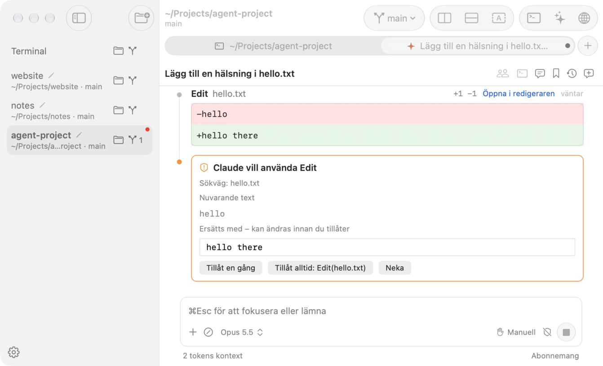

<p>&nbsp;&nbsp;&nbsp;</p>

# Tapa

**Den snabba, inbyggda terminalen för macOS som har fått plats för dina agenter, filer och sidor.**

Tapa är först och främst en terminal: en egen VT-kärna och en Metal-renderare, inbyggda macOS-flikar och -delningar, en snabbterminal som glider in med ett kortkommando, skalintegration med kommandoblock och ett valfritt inmatningsfält med förslag i Warps stil. Runt det har Tapa vuxit till lillasyster till [Dango](https://github.com/sventmueller/dango): ett sidofält med arbetsytor, en per projektmapp, var och en med sina terminaler, agentflikar för Claude, Codex, OpenCode, Antigravity och andra ACP-agenter, webbläsarflikar, en redigerare med en fillista och en Git-panel samt en Markdown-förhandsvisning från [Splat](https://github.com/sventmueller/splat) med formler och diagram. Inget som en projektmapp konfigurerar körs förrän du litar på dess arbetsyta. Tapa är skrivet i Rust med äkta AppKit-kontroller, finns på 35 språk, kräver inget konto och har ingen telemetri.

[](https://github.com/sventmueller/tapa/releases/latest/download/Tapa.dmg)

**[Ladda ner Tapa.dmg](https://github.com/sventmueller/tapa/releases/latest/download/Tapa.dmg)**: signerad och notariserad av Apple, för macOS 14 eller senare på Apple Silicon och Intel.

**Hittat en bugg?** [Öppna ett issue](https://github.com/sventmueller/tapa/issues/new/choose) och skriv vilket skal, vilken agent eller vilket program det hände med. Om du har nytta av Tapa hjälper en [stjärna på GitHub](https://github.com/sventmueller/tapa) andra att hitta det.

[](https://www.rust-lang.org) [](https://www.apple.com/macos/)  [](https://github.com/madsmtm/objc2) [](https://developer.apple.com/metal/) [](https://agentclientprotocol.com)    [](#licens)

[Bahasa Indonesia](../id/README.md) · [Bahasa Melayu](../ms/README.md) · [Català](../ca/README.md) · [Čeština](../cs/README.md) · [Dansk](../da/README.md) · [Deutsch](../de/README.md) · [English](../../../README.md) · [Español](../es/README.md) · [Français](../fr/README.md) · [Hrvatski](../hr/README.md) · [Italiano](../it/README.md) · [Magyar](../hu/README.md) · [Nederlands](../nl/README.md) · [Norsk](../no/README.md) · [Polski](../pl/README.md) · [Português (Brasil)](../pt_BR/README.md) · [Português (Portugal)](../pt_PT/README.md) · [Română](../ro/README.md) · [Slovenčina](../sk/README.md) · [Slovenščina](../sl/README.md) · [Suomi](../fi/README.md) · **Svenska** · [Tiếng Việt](../vi/README.md) · [Türkçe](../tr/README.md) · [Ελληνικά](../el/README.md) · [Русский](../ru/README.md) · [Українська](../uk/README.md) · [עברית](../he/README.md)‎ · [العربية](../ar/README.md)‎ · [हिन्दी](../hi/README.md) · [ไทย](../th/README.md) · [한국어](../ko/README.md) · [日本語](../ja/README.md) · [简体中文](../zh-Hans/README.md) · [繁體中文](../zh-Hant/README.md)

## Innehåll

- [Funktioner i korthet](#funktioner-i-korthet)
- [Krav](#krav)
- [Installation](#installation)
- [Komma igång](#komma-igång)
- [Arbetsytor](#arbetsytor)
- [Terminalen](#terminalen)
  - [Flikar och delningar](#flikar-och-delningar)
  - [Skalintegration och kommandoblock](#skalintegration-och-kommandoblock)
  - [Inmatningsfältet och förslag](#inmatningsfältet-och-förslag)
  - [Sökning, markering och kopiering](#sökning-markering-och-kopiering)
  - [Snabbterminalen](#snabbterminalen)
- [Agenter](#agenter)
- [Redigerare, filer och Git](#redigerare-filer-och-git)
- [Förhandsvisningar](#förhandsvisningar)
- [Webbläsare](#webbläsare)
- [Diktering](#diktering)
- [Inställningar](#inställningar)
- [Utseende och tillgänglighet](#utseende-och-tillgänglighet)
- [Språk](#språk)
- [Kortkommandon](#kortkommandon)
- [Förtroende](#förtroende)
- [Integritet och säkerhet](#integritet-och-säkerhet)
- [Kända begränsningar](#kända-begränsningar)
- [För utvecklare](#för-utvecklare)
  - [Komponenter från tredje part](#komponenter-från-tredje-part)
- [Licens](#licens)

## Funktioner i korthet

- **En snabb terminal med egen kärna.** Tapa tolkar med sin egen VT-kärna och ritar med Metal på en tråd per skärm, i skärmens takt och bara det som har ändrats. Den klarar 262 esctest-kontroller där Alacrittys kärna klarar 121, och varje ändring av den mäts mot en fastlåst Ghostty.
- **Inbyggd ända in i märgen.** Äkta macOS-flikar, återställning av fönster, menyer, menyn Tjänster, notiser, säker tangentbordsinmatning, diktering och inmatningsmetoder. Ingen Electron, och WebKit bara där en sida eller en förhandsvisning behöver det.
- **Arbetsytor.** Sidofältet rymmer en arbetsyta per projektmapp, var och en med egna flikar, egen gren och egna paneler. Arbetsytan "Terminal" överst börjar om från början varje gång; alla andra finns kvar tills du tar bort dem.
- **Agenter i en inbyggd chattvy.** Claude, Codex, OpenCode, Antigravity, Gemini CLI och andra agenter i Agent Client Protocol körs i egna flikar, med svar, verktygsanrop, diffar och behörighetsförfrågningar i en tidslinje. Tapa installerar och uppdaterar dem när du ber om det.
- **Skalintegration och kommandoblock** för zsh, bash och fish, även över `ssh`: hoppa från prompt till prompt, markera, kopiera, spara och fäll ihop ett kommandos utdata, och se misslyckade kommandon och hur lång tid vart och ett tog.
- **Ett inmatningsfält som Warps, om du vill.** Redigera kommandoraden som text, med förslag från din historik, från beskrivningar av fler än 700 kommandoradsverktyg och från projektets tillstånd, allt på din Mac.
- **Filer, Git och en webbläsare bredvid skalet.** En redigerare med syntaxfärger, en fillista, en Git-panel med köande, commits, grenar och worktrees, en Markdown-förhandsvisning med formler och diagram samt webbläsarflikar.
- **Försiktig med dina mappar.** En arbetsyta som du inte litar på startar inget som dess mapp konfigurerar: inga Git-hooks, inga MCP-servrar från projektet, inga projektinställningar för agenter, inget JavaScript i dess filsidor.
- **Privat.** Inget konto, ingen telemetri. Tapa går ut på nätet bara när du ber om det, och den återställda historiken på disken är krypterad med en nyckel i din nyckelring.
- **På ditt språk.** Gränssnittet finns på 35 språk: arabiska, katalanska, kinesiska (förenklad), kinesiska (traditionell), kroatiska, tjeckiska, danska, nederländska, engelska, finska, franska, tyska, grekiska, hebreiska, hindi, ungerska, indonesiska, italienska, japanska, koreanska, malajiska, norska, polska, portugisiska (Brasilien), portugisiska (Portugal), rumänska, ryska, slovakiska, slovenska, spanska, svenska, thailändska, turkiska, ukrainska och vietnamesiska.

## Krav

- macOS 14 Sonoma eller senare, på Apple Silicon eller Intel. Tapa utvecklas och testas på macOS 27.
- zsh, bash eller fish för skalintegrationen; andra skal körs utan den.
- För agentflikar den agent du vill använda, antingen redan installerad eller installerad av Tapa när du ber om det (se [Agenter](#agenter)).

## Installation

**Från skivavbilden.** Varje version är en skivavbild, `Tapa-<version>.dmg`, med en universell app för Apple Silicon och Intel, signerad med ett Developer ID och notariserad av Apple. Öppna den och dra Tapa till mappen Appar.

**Med Homebrew.** Cask-paketet i en egen tap installerar samma skivavbild:

```sh
brew install --cask sventmueller/tap/tapa
```

**Uppdateringar.** Tapa från skivavbilden eller Homebrew håller sig uppdaterat med [Sparkle](https://sparkle-project.org). Vid andra starten frågar appen om den får söka efter uppdateringar på egen hand; tills du går med på det skickar den ingen förfrågan. **Tapa › Sök efter uppdateringar…** söker direkt. Tapa installerar en uppdatering bara om den bär utvecklarens signatur. En egen build har ingen uppdateringsfunktion.

**Från källkod.** Se [För utvecklare](#för-utvecklare).

**Som standardterminal.** Tapa kan öppna skalskript (`.command`, `.tool`), mappar som släpps på dess symbol och `ssh://`-länkar. Välj det i Finder med **Arkiv › Visa info › Öppna med**.

## Komma igång

1. **Fönstret** har sidofältet med arbetsytor till vänster, flikarna för den valda arbetsytan överst och verktygsfältet ovanför dem. ⌃⌘S visar och gömmer sidofältet.
2. **En ny arbetsyta** får du med mappknappen överst i sidofältet eller med **Skal › Ny arbetsyta…** (⇧⌘N): välj en av de senaste mapparna eller **Välj mapp…**.
3. **Nya flikar** börjar i arbetsytans mapp: ⌘T för en terminal, knapparna till höger i verktygsfältet för en terminal-, agent- eller webbläsarflik, eller **+** i slutet av flikfältet.
4. **Inställningarna** öppnas med ⌘, eller kugghjulet längst ned i sidofältet.
5. **Kommandopaletten** (⇧⌘P) hittar varje kommando efter namn, och **Sök flik…** (⌘P) varje flik i varje arbetsyta.

Verktygsfältet innehåller från vänster grenmenyn för arbetsytans arkiv, knapparna för att dela terminalen åt höger och nedåt och för att visa inmatningsfältet, och knapparna för nya terminal-, agent- och webbläsarflikar. Knapparna för delningar och inmatningsfältet är grå så länge ingen terminalflik ligger längst fram.

## Arbetsytor

En arbetsyta är en mapp med dess flikar. Dess rad i sidofältet visar namnet, mappen och Git-grenen och till höger knapparna för fillistan och Git-panelen. Ett klick på en av dem visar den panelen i stället för listan över arbetsytor; **Arbetsytor** överst leder tillbaka.

- **Arbetsytan "Terminal"** ligger alltid överst. Den börjar om vid varje start, i den mapp som inställningarna anger, med en tom terminal. Inget av den sparas, och den kan varken byta namn eller tas bort.
- **Alla andra arbetsytor finns kvar** tills du tar bort dem, även utan flikar. Tapa behåller namnet, flikarna, innehållet i terminalerna (så långt återställningsinställningarna säger), agentsessionerna och fönstrets position. Program som fortfarande körs avslutas när Tapa avslutas.
- **Byta namn.** Klicka på pennan efter namnet, klicka på namnet på den valda arbetsytan eller välj **Skal › Byt namn på arbetsyta**. Namnet sparas direkt.
- **Status.** En grön prick på raden betyder att en agent i arbetsytan arbetar, även med underagenter eller i bakgrunden; en röd prick betyder att en väntar på dig. Terminaler markerar inget där.
- **Växla.** ⌃⌘[ och ⌃⌘] växlar mellan arbetsytor. Fönstret stannar på sin plats, och den valda arbetsytans flikar tar de andras plats.
- **Worktrees.** **Nytt worktree…** i verktygsfältets grenmeny skapar ett Git-worktree på en ny gren och öppnar det som en egen arbetsyta.

När den sista fliken i en arbetsyta stängs finns arbetsytan kvar i listan. När alla flikar är stängda försvinner bara fönstret; Dock-symbolen eller ⌘N tar tillbaka det med dess arbetsytor.

## Terminalen

Tapa kör på sin egen kärna, `term-vt`. Den talar xterm och VT520 med Kittys tangentbordsprotokoll, OSC 8-hyperlänkar, åtkomst till urklipp via OSC 52 med separat behörighet för läsning, synkroniserad utdata, färgade och vågiga understrykningar, truecolor, färgförfrågningar, rapporter om ljust och mörkt läge till program, bracketed paste, fokushändelser och musrapportering. Texten radbryts om när fönstret ändrar storlek, historiken inräknad. Ligaturer, typsnittsfunktioner, Nerd Font-symboler utan patchade typsnitt samt pixelexakta ramlinjer, Powerline- och punktskriftstecken är inbyggda.

### Flikar och delningar

- **Flikar** är macOS egna: dra dem för att ändra ordningen eller ut till ett eget fönster, **Visa alla flikar** (⇧⌘\\), ⌘1 till ⌘8, ⌘9 för den sista fliken och ⇧⌘[ / ⇧⌘] för att växla. Varje flik visar symbolen för sin typ framför sin titel.
- **Delningar.** **Dela åt höger** (⌘D eller ⌃⌘T) och **Dela nedåt** (⇧⌘D eller ⌃⌥⌘T), kapslade så djupt du vill. Dra i en avdelare, flytta den med ⌃⌘ och piltangenterna, **Maximera panel** (⌃⇧⌘↩), **Utjämna paneler** (⌃⌘=), och växla mellan paneler med ⌘[ och ⌘].
- **Arbetsmapp.** Nya flikar, fönster och delningar börjar i mappen för terminalen längst fram; inställningarna avgör det för var och en av de tre.
- **Stänga.** Tapa frågar innan det stänger en flik, ett fönster eller appen medan ett program körs i den.
- **Återställning.** Efter en omstart kommer arbetsytor, flikar, paneler, mappar och de sista raderna i varje terminal tillbaka. Hemligheter som tokens och lösenord maskeras innan något sparas.

### Skalintegration och kommandoblock

Tapa ställer själv in sin skalintegration för zsh, bash och fish, utan att röra dina konfigurationsfiler, och tar med den när du använder `ssh` till en annan värd. Med den bildar varje kommando och dess utdata ett block:

- **Promptar.** ⌘↑ och ⌘↓ hoppar till föregående och nästa prompt. Ett klick i kommandoraden flyttar markören dit.
- **Block.** **Markera block** (⇧⌘A), **Kopiera utdata** (⌥⌘C), **Spara utdata…** (⌥⌘S) och **Fäll ihop/ut block** (⇧⌘↩). Över blocket under pekaren visar knappar dess status, dess varaktighet och samma åtgärder.
- **Misslyckade kommandon** markeras, och kommandot som fortfarande körs förblir synligt överst medan dess utdata rullar.
- **Bokmärken.** **Lägg till/ta bort bokmärke** (⇧⌘M) markerar en rad; ⇧⌘↑ och ⇧⌘↓ hoppar mellan bokmärken.
- **Notiser** visas när ett program ber om en (OSC 9 och OSC 777) och terminalen inte ligger längst fram, och en förloppsindikator (OSC 9;4) visas i fliken och på Dock-symbolen.

### Inmatningsfältet och förslag

Inmatningsfältet gör kommandoraden till ett textfält längst ned i panelen, som i Warp, med chips för mappen och Git-grenen ovanför. **Visa/göm inmatningsfält** (⌘I) eller knappen i verktygsfältet slår på och av det för en terminal; **Inställningar › Inmatning** slår på det för nya terminaler. Det kräver skalintegrationen och kliver åt sidan för helskärmsprogram som vim, htop eller claude.

- **Retur** skickar hela fältet till skalet, text på flera rader som en inklistring; skalet kör och kommer ihåg den som vanligt. Om skalet ber om mer lämnar fältet tillbaka tangenterna till det fram till nästa prompt.
- **↑, ↓ och ⌃R** söker i din historik, med den mapp, den gren och den slutkod som varje kommando kördes med.
- **Tabb** kompletterar med beskrivningar av fler än 700 kommandoradsverktyg, sökvägar och aktuella värden som Git-grenar, Docker-containrar, kubectl-resurser, SSH-värdar, `package.json`-skript och mål för make, just och cargo.
- **Vim-tangenter** i fältet är en växel i samma inställningar.
- **Nästa kommando innan du skriver**: det som brukar följa i det här projektet (efter `git add` kommer `git commit`), det som projektets tillstånd kräver (en låsfil som är nyare än `node_modules`), och en rättelse efter "command not found", utifrån stavfel eller ditt lokala Homebrew-index.

Utan inmatningsfältet visas förslag som grå text bakom markören, och → tar dem. Skal med egna autoförslag, som fish eller zsh-autosuggestions, behåller sina. Förslag använder aldrig nätverket, och de startar bara program från din egen `PATH`, aldrig från projektmappen.

**Inklistring.** Inklistringar på flera rader kan visas innan de körs (**Visa inklistring av flera rader först**). Filer som släpps på en terminal kommer fram som sökvägar inom citattecken; ⌥←/→, ⌘←/→ och ⌘⌫ flyttar och raderar ord för ord och rad för rad som i alla textfält på Mac.

### Sökning, markering och kopiering

- **Sök…** (⌘F) söker i historiken med reguljära uttryck, skiftlägeskänsligt och på hela ord, och räknar träffarna; rullningslisten markerar dem tillsammans med promptarna och felen.
- **Smart markering.** Ett dubbelklick markerar en URL, en sökväg, en hash eller en IP-adress i sin helhet, och att dra med ⌥ markerar en rektangel. Länkar hittas även utan OSC 8; ⌘-klick öppnar dem, och en sökväg i Dango om det är installerat.
- **Markera med tangentbordet** (⇧⌘C) flyttar en markering med Vims tangenter.
- **Kopiera med formatering** (⇧⌥⌘C) behåller färger och stilar; kopiera vid markering är en inställning. **Rensa** (⌘K) rensar terminalen.

### Snabbterminalen

**Visa/göm snabbterminal** (⌃⌥⌘Space) låter en terminal glida in från en kant av skärmen, ovanför andra appar och över helskärmsrum, utan att byta app. Kanten, storleken och om den göms när du klickar någon annanstans är inställningar. Dess sessioner fortsätter att köras medan den är gömd.

## Agenter

En agentflik kör en kodagent i arbetsytans mapp, i den inbyggda agentvyn från Dango.

| Agent | Hur den körs | Vad den behöver |
|---|---|---|
| Claude | kommandot `claude`, som det talas med över dess stream-json-protokoll | `claude` installerat och inloggat; Tapa installerar det med Claudes eget installationsprogram när du ber om det |
| Codex | `codex app-server`, eller `codex-acp` för en äldre Codex | `codex` inloggat; Tapa installerar den fastlåsta adaptern när du ber om det |
| OpenCode | `opencode serve`, eller `opencode acp` för en äldre OpenCode | din egen `opencode` i `PATH`, eller den fastlåsta nedladdningen |
| Antigravity | `agy acp` | din egen `agy` i `PATH`, eller den fastlåsta nedladdningen |
| Gemini CLI | `gemini --acp`, erbjuds när du slår på den i **Inställningar › Agenter** | din egen `gemini`, eller den fastlåsta nedladdningen |
| Andra ACP-agenter | från ACP-registret, läses in bara när du ber om det | det som registerposten anger; poster utan kontrollsumma installeras först när du har bekräftat |

Tapa använder varje agents egen inloggning och sparar inga inloggningsuppgifter för agenter. En agent som finns i din inloggningsskals `PATH` går först; annars kör Tapa den version som det har installerat i sin egen datamapp, aldrig ett program från arbetsytan.

- **Tidslinjen** visar svar, verktygsanrop med deras utdata och diffar, frågor och behörighetsförfrågningar. **Tillåt en gång**, **Tillåt alltid** och **Neka** besvarar en förfrågan, och en ändring kan justeras innan du tillåter den.
- **Status.** Fliken och arbetsytans rad visar en grön prick medan agenten arbetar och en röd medan den väntar på dig, och en notis säger till när den väntar medan du tittar någon annanstans.
- **Meddelandefältet** längst ned tar emot din prompt, filer som släpps på det och diktering. ⌘Esc flyttar tangentbordsfokus in i det och tillbaka. Modellen och behörighetsläget kan väljas där för sessionen.
- **Inställningar › Agenter** ställer för nya sessioner in behörighetsläget (Claude, Codex), modellen (Claude, Codex, OpenCode) och tankeinsatsen (Claude, Codex), och vilka agenter nya flikar erbjuder. Där visas var varje agents program ligger, med **Installera…**, **Uppdatera till …** och **Tillbaka till …** för den föregående versionen, och **Läs in registret** för ACP-registret. Reglerna som Claude har sparat med "Tillåt alltid" kan visas och tas bort där.
- **Kontrollerade nedladdningar.** Arkiv kontrolleras mot sin SHA-256, npm-paket mot integriteten i sin låsfil, och paket utan fast version nekas. En agent som saknas erbjuder sin installation även i sin egen flik.

## Redigerare, filer och Git

- **Fillistan** för en arbetsyta visar dess mapp som ett träd, uppdaterat när filer ändras, med filer som Git ignorerar nedtonade om du vill. Ett klick öppnar en fil som en förhandsvisningsflik, som nästa klick ersätter tills du redigerar den; ett dubbelklick behåller den.
- **Redigeraren** öppnar filer i arbetsytans flikar, med syntaxfärger, flera insättningspunkter, ihopfällning, indraget från `.editorconfig`, valfria Vim-tangenter och markeringar för det som har ändrats sedan senaste commit. Den märker när en fil har ändrats på disken eller innehåller konfliktmarkeringar. Markdown-filer får ett formatfält och **Öppna i Splat**. **Spara** (⌘S), **Spara som…** och **Spara alla** fungerar som vanligt, och Tapa frågar innan det stänger osparad text.
- **Efter en krasch** kommer osparad text tillbaka: Tapa håller krypterade kopior av den medan du skriver.
- **Git-panelen** visar köade och icke köade ändringar, köar filer och enskilda hunks och tar bort dem igen, gör commit (⌘↩), ändrar den senaste commit, gör commit och push, hämtar och hanterar grenar, stashar, cherry-picks och konflikter, med commithistoriken nedanför. Ett klick på en fil visar dess diff.
- **Grenmenyn** i verktygsfältet byter och skapar grenar och gör worktrees.

Redigeraren startar ingen formaterare och ingen språkserver. För en fullständig IDE med språkservrar och en felsökare kan du använda [Dango](https://github.com/sventmueller/dango).

## Förhandsvisningar

- **Markdown** visas bredvid sin redigerare via Splats renderare: GitHub Flavored Markdown med formler, diagram och bilder, som rullar stycke för stycke med texten.
- **Bilder** öppnas i en egen flik, PDF-filer via PDFKit, och ljud, filmer, typsnitt och kontorsdokument via Snabbtitt.
- **Isolerad avkodning.** Varje bild från en opålitlig källa (projektfiler, Markdown, bilagor från agenter och inklistringar) avkodas i Splats tjänst `Decoder.xpc`, i en egen App Sandbox utan filer eller nätverk, aldrig i appen.

## Webbläsare

**Ny webbläsarflik** (⇧⌘B) öppnar en WebKit-flik i arbetsytan. Adressfältet tar emot en adress eller sökord för den sökmotor du väljer (DuckDuckGo, Google, Bing eller Startpage); ⌘L, ⌘R, ⌘[ och ⌘] fungerar som i Safari. Sidor från `localhost` körs som vanligt, för ditt projekts utvecklingsserver. HTML-filer i en arbetsyta får bara läsa sin egen mapp, och i en arbetsyta som du inte litar på kör de inget JavaScript.

## Diktering

Diktera i en agents meddelandefält eller i redigeraren med mikrofonknappen eller **Redigera › Starta diktering** (⌃⌥D). Taligenkänningen kommer från [Lowspeak](https://github.com/sventmueller/lowspeak), som inte behöver vara installerat. **Inställningar › Diktering** väljer onlinetranskribering med OpenAI eller Groq, eller lokala Whisper- och Parakeet-modeller som håller inspelningen på din Mac, språket, efterbearbetningen, mikrofonen och ditt eget ordförråd. Nycklarna för OpenAI och Groq förvaras i din nyckelring. Diktering finns bara i release-builden.

## Inställningar

**Tapa › Inställningar…** (⌘,) har panelerna Allmänt, Typsnitt, Färger, Markör, Terminal, Inmatning, Redigerare, Agenter, Diktering, Profiler och Kortkommandon. De skriver en TOML-fil, `config.toml` i Tapas mapp under `~/Library/Application Support`, som du även kan redigera för hand; Tapa läser in den igen medan det körs, och **Läs in inställningar igen** (⇧⌘,) gör det direkt.

- **Fyra textstorlekar** under Allmänt: Gränssnitt (sidofält, paneler, fillista, Git-panel och fliktitlar), Redigerare (text, radnummer och Markdown-förhandsvisning), Terminal och Agenter. ⌘+, ⌘− och ⌘0 ändrar storleken på terminalen längst fram.
- **Utseende:** Ljust, Mörkt eller Som systemet.
- **Färger.** Ett tema för ljust och ett för mörkt läge, i Ghosttys temaformat, med en minsta kontrast som håller texten läsbar med ett dåligt tema. Dina egna teman läggs i temamappen.
- **Profiler** samlar typsnitt, färger, skal, miljö och mapp.
- **Kortkommandon** kan alla ändras, och konflikter visas.

## Utseende och tillgänglighet

- **Mörkt läge** följer systemet eller ditt val; accentfärgen, Minska rörelse och Öka kontrast respekteras.
- **VoiceOver** läser upp terminalens rader och promptar och meddelar ny utdata; sidofältet, flikarna, verktygsfältets knappar och korten i agenttidslinjen har namn.
- **Tangentbord.** Varje kommando har ett menyalternativ och ett kortkommando, och Fullständig tangentbordsåtkomst når varje kontroll.
- **Storlekar.** De fyra textstorlekarna i inställningarna skalar gränssnittet, redigeraren, terminalen och agenterna oberoende av varandra.
- **Höger till vänster.** Gränssnittet speglas på arabiska och hebreiska, medan terminalens rutnät förblir från vänster till höger.

Detaljer och kända brister finns i [ACCESSIBILITY.md](../../../ACCESSIBILITY.md).

## Språk

Gränssnittet är översatt till 35 språk: arabiska, katalanska, kinesiska (förenklad), kinesiska (traditionell), kroatiska, tjeckiska, danska, nederländska, engelska, finska, franska, tyska, grekiska, hebreiska, hindi, ungerska, indonesiska, italienska, japanska, koreanska, malajiska, norska, polska, portugisiska (Brasilien), portugisiska (Portugal), rumänska, ryska, slovakiska, slovenska, spanska, svenska, thailändska, turkiska, ukrainska och vietnamesiska.

Tapa följer språkordningen under **Systeminställningar › Allmänt › Språk och region**; där kan du också välja ett språk enbart för Tapa under **Appar**. Saknas en översättning till ditt språk används engelska.

## Kortkommandon

| Åtgärd | Kortkommando |
|---|---|
| Nytt fönster, ny arbetsyta, ny flik | ⌘N, ⇧⌘N, ⌘T |
| Ny webbläsarflik | ⇧⌘B |
| Ny fil, öppna fil | ⌥⌘N, ⌘O |
| Stäng panel eller flik, stäng flik, stäng fönster | ⌘W, ⌥⌘W, ⇧⌘W |
| Dela åt höger, dela nedåt | ⌘D eller ⌃⌘T, ⇧⌘D eller ⌃⌥⌘T |
| Maximera panel, utjämna paneler, stäng panel | ⌃⇧⌘↩, ⌃⌘=, ⌃⇧⌘W |
| Flytta en avdelare | ⌃⌘←, ⌃⌘→, ⌃⌘↑, ⌃⌘↓ |
| Nästa, föregående panel | ⌘], ⌘[ |
| Nästa, föregående flik; flik 1 till 8, sista fliken | ⇧⌘], ⇧⌘[; ⌘1 till ⌘8, ⌘9 |
| Nästa, föregående arbetsyta | ⌃⌘], ⌃⌘[ |
| Sök flik, kommandopalett | ⌘P, ⇧⌘P |
| Visa eller göm sidofältet, inmatningsfältet | ⌃⌘S, ⌘I |
| Snabbterminal | ⌃⌥⌘Space |
| Sök, sök nästa, sök föregående | ⌘F, ⌘G, ⇧⌘G |
| Föregående, nästa prompt | ⌘↑, ⌘↓ |
| Markera block, kopiera utdata, spara utdata, fäll ihop block | ⇧⌘A, ⌥⌘C, ⌥⌘S, ⇧⌘↩ |
| Lägg till eller ta bort ett bokmärke; föregående, nästa bokmärke | ⇧⌘M; ⇧⌘↑, ⇧⌘↓ |
| Markera med tangentbordet | ⇧⌘C |
| Kopiera med formatering | ⇧⌥⌘C |
| Rensa | ⌘K |
| Överst, nederst, sida upp, sida ned | ⌘Home, ⌘End, ⌘PageUp, ⌘PageDown |
| Större, mindre, originalstorlek (terminal) | ⌘+, ⌘−, ⌘0 |
| Meddelandefältet i en agentflik | ⌘Esc |
| Starta diktering | ⌃⌥D |
| Inställningar, läs in inställningar igen | ⌘,, ⇧⌘, |

Varje kortkommando kan ändras i **Inställningar › Kortkommandon** eller i avsnittet `[keys]` i inställningsfilen.

## Förtroende

En projektmapp kan få program att köras så snart något startar i den: Git-hooks och arkivinställningar som `core.fsmonitor`, agenthooks, MCP-servrar från projektet och projektinställningar för agenter. Därför är en ny arbetsyta inte betrodd.

- **Inte betrodd:** agenter startar utan projektets hooks, MCP-servrar och konfiguration (Claude med `--setting-sources=user --strict-mcp-config`, Codex med mappen markerad som opålitlig, OpenCode utan projektets konfiguration). Git körs neutraliserat: inga hooks, filter, diff-drivrutiner, fsmonitor, `sshCommand` eller pager, och bara globala credential helpers. HTML-filer öppnas utan JavaScript. Git-panelen och agentfliken säger det och erbjuder att lita på arbetsytan.
- **Betrodd:** **Skal › Lita på arbetsytan** läser in allt detta så som mappen avser. **Återkalla förtroende** tar tillbaka det. Förtroendet sparas per arbetsyta.

Oavsett förtroende kör Tapa aldrig på eget initiativ ett program från en projektmapp: förslag startar bara program från din `PATH` utanför projektet, och sidofältet läser Git-tillståndet från filerna i `.git`. En arbetsyta i din hemmapp, som "Terminal", är inget projekt: program under `~` som `~/.local/bin/claude` räknas där som dina egna.

## Integritet och säkerhet

- **Ingen telemetri, inget konto.** Tapa rapporterar ingenting om hur du använder det och fungerar helt offline. Det går ut på nätet bara när du ber om det: för att installera eller uppdatera en agent, för att läsa in ACP-registret, för att söka efter uppdateringar när du har gått med på det, och för de sidor du öppnar i en webbläsarflik. Agenterna själva talar med sina leverantörer som de alltid gör.
- **Historiken på disken** för att återställa sessioner är krypterad med en nyckel i din nyckelring, kan stängas av, och hemligheter som API-nycklar, tokens och lösenord maskeras innan den skrivs. Kopiorna av osparad text i redigeraren är krypterade med samma nyckel.
- **Säker tangentbordsinmatning** slås på av sig själv vid lösenordsfrågor och kan slås på permanent i appmenyn.
- **Escape-sekvenser** som kan läcka eller injicera, som titelrapporter, läsning av urklipp och inklistringsknep, blockeras eller kräver först ditt godkännande. Tolken fuzzas i CI.
- **Isolerad avkodning** av bilder från opålitliga källor, se [Förhandsvisningar](#förhandsvisningar).
- **Kodsignering** med Hardened Runtime. macOS tillskriver Tapa åtkomsten för programmen i en terminal, så appen har en användningsbeskrivning för varje skyddad tjänst.

Säkerhetsproblem rapporteras konfidentiellt, se [SECURITY.md](../../../SECURITY.md).

## Kända begränsningar

- **Inga infogade bilder** i terminalen ännu: Kitty-grafik, Sixel och iTerm2-bilder är planerade efter 1.0.
- **Inget kontrolläge för tmux**, och sessioner överlever inte att Tapa avslutas.
- **Text från höger till vänster** förblir från vänster till höger i terminalens rutnät.
- **⌘+ och ⌘−** ändrar bara terminalen längst fram.
- **Redigeraren** har avsiktligt inga språkservrar, formaterare eller felsökare; Dango har dem.
- **Diktering** finns bara i release-builden, inte i en debug-build.
- **VoiceOver** har ännu inte kontrollerats från början till slut av en människa.

## För utvecklare

Du behöver macOS 14 eller senare med Xcode Command Line Tools, Rust så som `rust-toolchain.toml` anger (rustup med båda Mac-målen för den universella builden), utcheckningar av [splat](https://github.com/sventmueller/splat) och [lowspeak](https://github.com/sventmueller/lowspeak) bredvid den här (`../splat`, `../lowspeak`) och cmake för builds med diktering.

| Kommando | Vad det gör |
|---|---|
| `make help` | listar målen |
| `cargo xtask run` | bygger debug-appen och öppnar den |
| `make build` | bygger release-appen med diktering till `target/release`, ad hoc-signerad för den här Macen |
| `make lint` | formatering, clippy med varningar som fel, filernas form och gränssnittets texter |
| `make check` | `lint`, sedan alla tester; kräver inget fönster och inget nätverk |
| `make selftest STEPS="split_right,type:ls\n,shot:x"` | styr appen och lämnar bilder av fönster i `target/selftest/` |
| `make esctest`, `make vttest` | kör esctest och vttest mot båda kärnorna i appen |
| `make perf` | prestandatestet mot en fastlåst Ghostty; meningsfullt bara på en Mac som inte gör något annat |
| `make fuzz` | fuzz-målen med cargo-fuzz |
| `make release` | en provkörning av versionen: den universella appen med diktering, dess skivavbild, uppdateringsflöde och cask-paket i `target/release-dry-run`; skickar ingenting någonstans |
| `make release-notarized` | den aktuella versionen, signerad med Developer ID, notariserad av Apple och med häftad biljett, i `dist/`; `Cargo.toml` oförändrad |
| `make deploy` | notariserar nästa version, checkar in `Cargo.toml`, laddar upp ett utkast till versionen, pushar `main` och taggen och publicerar sedan versionen; se [docs/development.md](../../../docs/development.md#deploy) |

Hur du kan bidra står i [CONTRIBUTING.md](../../../CONTRIBUTING.md). Varje gränssnittstext har tyska som nyckel, med en översättning till alla 35 språk; `cargo xtask strings` misslyckas om en saknas.

### Komponenter från tredje part

| Komponent | Används för | Licens |
|---|---|---|
| [objc2](https://github.com/madsmtm/objc2) och dess ramverks-crates | AppKit, Metal, WebKit och Apples övriga ramverk | MIT, Zlib eller Apache-2.0 |
| Splats crates | Markdown, förhandsvisningen, läsning av Git, bildavkodaren och översättningarna | MIT eller Apache-2.0 |
| [Lowspeak](https://github.com/sventmueller/lowspeak) med [whisper.cpp](https://github.com/ggml-org/whisper.cpp) | diktering | MIT |
| [Fig autocomplete specs](https://github.com/withfig/autocomplete) | förslagens kommandobeskrivningar | MIT |
| [rusqlite](https://github.com/rusqlite/rusqlite) med SQLite | kommandohistoriken | MIT, allmän egendom |
| [Simple Icons](https://simpleicons.org) | logotyper för språk och program | CC0, vissa logotyper under egna villkor |
| [Sparkle](https://sparkle-project.org) 2.10.1 | uppdateringar av release-builden | MIT |

## Licens

Tapa är licensierat under någondera av

- Apache-licensen, version 2.0 ([LICENSE-APACHE](../../../LICENSE-APACHE))
- MIT-licensen ([LICENSE-MIT](../../../LICENSE-MIT))

efter eget val. Logotyperna i `assets/simple-icons` har egna licenser, se README-filen där.

Om du inte uttryckligen anger något annat ska varje bidrag som du avsiktligt lämnar in för att ingå i Tapa, enligt definitionen i licensen Apache-2.0, dubbellicensieras som ovan, utan ytterligare villkor.
