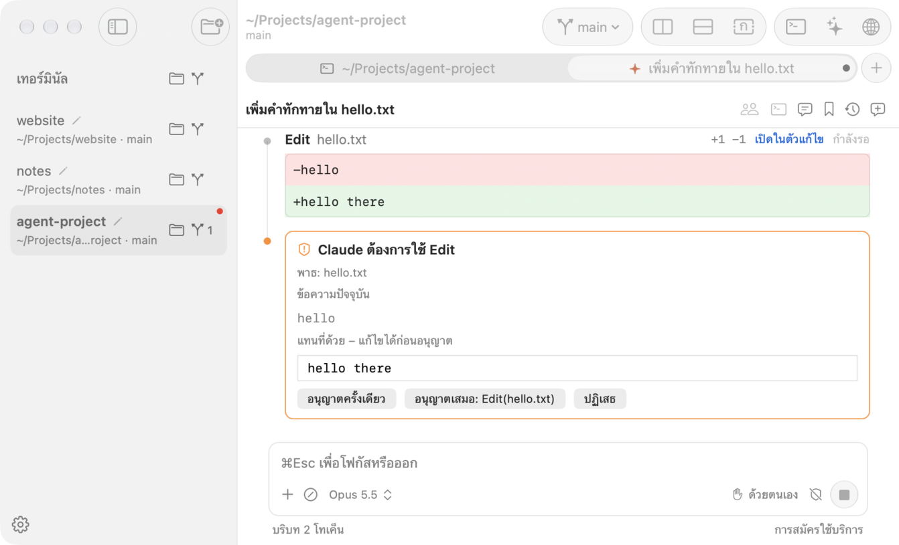

<p>&nbsp;&nbsp;&nbsp;</p>

# Tapa

**เทอร์มินัลที่เร็วและเป็นเนทีฟสำหรับ macOS ซึ่งขยายพื้นที่ให้เอเจนต์ ไฟล์ และหน้าเว็บของคุณ**

Tapa เป็นเทอร์มินัลก่อนสิ่งอื่น: มีแกน VT ของตัวเองและตัวเรนเดอร์ Metal มีแถบและการแบ่งบานแบบเนทีฟของ macOS มีเทอร์มินัลด่วนที่เลื่อนเข้ามาด้วยปุ่มลัดเดียว มีการผสานรวมเชลล์พร้อมบล็อกคำสั่ง และมีช่องป้อนข้อมูลที่เลือกใช้ได้พร้อมคำแนะนำในสไตล์ Warp รอบๆ สิ่งเหล่านี้ Tapa เติบโตจนเป็นน้องของ [Dango](https://github.com/sventmueller/dango): แถบด้านข้างของพื้นที่ทำงาน หนึ่งแห่งต่อหนึ่งโฟลเดอร์โปรเจกต์ แต่ละแห่งมีเทอร์มินัลของตัวเอง แถบเอเจนต์สำหรับ Claude, Codex, OpenCode, Antigravity และเอเจนต์ ACP อื่นๆ แถบเบราว์เซอร์ ตัวแก้ไขพร้อมรายการไฟล์และแผง Git และการแสดงตัวอย่าง Markdown จาก [Splat](https://github.com/sventmueller/splat) พร้อมสูตรและแผนภาพ สิ่งที่โฟลเดอร์โปรเจกต์กำหนดค่าไว้จะไม่ทำงานจนกว่าคุณจะเชื่อถือพื้นที่ทำงานของโฟลเดอร์นั้น Tapa เขียนด้วย Rust บนตัวควบคุม AppKit แท้ รองรับ 35 ภาษา ไม่ต้องใช้บัญชี และไม่มีการเก็บข้อมูลการใช้งาน

[](https://github.com/sventmueller/tapa/releases/latest/download/Tapa.dmg)

**[ดาวน์โหลด Tapa.dmg](https://github.com/sventmueller/tapa/releases/latest/download/Tapa.dmg)**: ลงนามและผ่านการรับรองโดย Apple สำหรับ macOS 14 ขึ้นไป บน Apple Silicon และ Intel

**พบข้อบกพร่องหรือไม่** โปรด[เปิด issue](https://github.com/sventmueller/tapa/issues/new/choose) และบอกว่าเกิดขึ้นกับเชลล์ใด เอเจนต์ใด หรือโปรแกรมใด หาก Tapa มีประโยชน์กับคุณ [การกดดาวบน GitHub](https://github.com/sventmueller/tapa) จะช่วยให้ผู้อื่นพบ Tapa

[](https://www.rust-lang.org) [](https://www.apple.com/macos/)  [](https://github.com/madsmtm/objc2) [](https://developer.apple.com/metal/) [](https://agentclientprotocol.com)    [](#สัญญาอนุญาต)

[Bahasa Indonesia](../id/README.md) · [Bahasa Melayu](../ms/README.md) · [Català](../ca/README.md) · [Čeština](../cs/README.md) · [Dansk](../da/README.md) · [Deutsch](../de/README.md) · [English](../../../README.md) · [Español](../es/README.md) · [Français](../fr/README.md) · [Hrvatski](../hr/README.md) · [Italiano](../it/README.md) · [Magyar](../hu/README.md) · [Nederlands](../nl/README.md) · [Norsk](../no/README.md) · [Polski](../pl/README.md) · [Português (Brasil)](../pt_BR/README.md) · [Português (Portugal)](../pt_PT/README.md) · [Română](../ro/README.md) · [Slovenčina](../sk/README.md) · [Slovenščina](../sl/README.md) · [Suomi](../fi/README.md) · [Svenska](../sv/README.md) · [Tiếng Việt](../vi/README.md) · [Türkçe](../tr/README.md) · [Ελληνικά](../el/README.md) · [Русский](../ru/README.md) · [Українська](../uk/README.md) · [עברית](../he/README.md)‎ · [العربية](../ar/README.md)‎ · [हिन्दी](../hi/README.md) · **ไทย** · [한국어](../ko/README.md) · [日本語](../ja/README.md) · [简体中文](../zh-Hans/README.md) · [繁體中文](../zh-Hant/README.md)

## สารบัญ

- [ภาพรวมความสามารถ](#ภาพรวมความสามารถ)
- [ความต้องการของระบบ](#ความต้องการของระบบ)
- [การติดตั้ง](#การติดตั้ง)
- [เริ่มต้นใช้งาน](#เริ่มต้นใช้งาน)
- [พื้นที่ทำงาน](#พื้นที่ทำงาน)
- [เทอร์มินัล](#เทอร์มินัล)
  - [แถบและการแบ่งบาน](#แถบและการแบ่งบาน)
  - [การผสานรวมเชลล์และบล็อกคำสั่ง](#การผสานรวมเชลล์และบล็อกคำสั่ง)
  - [ช่องป้อนข้อมูลและคำแนะนำ](#ช่องป้อนข้อมูลและคำแนะนำ)
  - [การค้นหา การเลือก และการคัดลอก](#การค้นหา-การเลือก-และการคัดลอก)
  - [เทอร์มินัลด่วน](#เทอร์มินัลด่วน)
- [เอเจนต์](#เอเจนต์)
- [ตัวแก้ไข ไฟล์ และ Git](#ตัวแก้ไข-ไฟล์-และ-git)
- [การแสดงตัวอย่าง](#การแสดงตัวอย่าง)
- [เบราว์เซอร์](#เบราว์เซอร์)
- [การป้อนตามคำบอก](#การป้อนตามคำบอก)
- [การตั้งค่า](#การตั้งค่า)
- [หน้าตาและการช่วยการเข้าถึง](#หน้าตาและการช่วยการเข้าถึง)
- [ภาษา](#ภาษา)
- [ปุ่มลัด](#ปุ่มลัด)
- [ความไว้วางใจ](#ความไว้วางใจ)
- [ความเป็นส่วนตัวและความปลอดภัย](#ความเป็นส่วนตัวและความปลอดภัย)
- [ข้อจำกัดที่ทราบ](#ข้อจำกัดที่ทราบ)
- [สำหรับนักพัฒนา](#สำหรับนักพัฒนา)
  - [ส่วนประกอบของบุคคลที่สาม](#ส่วนประกอบของบุคคลที่สาม)
- [สัญญาอนุญาต](#สัญญาอนุญาต)

## ภาพรวมความสามารถ

- **เทอร์มินัลที่เร็วในแบบของตัวเอง** Tapa แยกวิเคราะห์ด้วยแกน VT ของตัวเองและวาดด้วย Metal บนเธรดแยกสำหรับแต่ละจอ ตามอัตรารีเฟรชของจอ และวาดเฉพาะส่วนที่เปลี่ยน ผ่านการตรวจ esctest 262 รายการ ขณะที่แกนของ Alacritty ผ่าน 121 รายการ และทุกการเปลี่ยนแปลงจะวัดเทียบกับ Ghostty รุ่นที่ตรึงไว้
- **เนทีฟเต็มตัว** แถบ macOS แท้ การคืนค่าหน้าต่าง เมนู เมนูบริการ การแจ้งเตือน ป้อนข้อมูลผ่านแป้นพิมพ์แบบปลอดภัย การป้อนตามคำบอก และวิธีป้อนข้อมูล ไม่มี Electron และใช้ WebKit เฉพาะที่หน้าเว็บหรือการแสดงตัวอย่างต้องใช้
- **พื้นที่ทำงาน** แถบด้านข้างมีพื้นที่ทำงานหนึ่งแห่งต่อหนึ่งโฟลเดอร์โปรเจกต์ แต่ละแห่งมีแถบ สาขา และแผงของตัวเอง พื้นที่ทำงาน "เทอร์มินัล" ด้านบนสุดเริ่มใหม่ทุกครั้ง ส่วนที่เหลือทั้งหมดจะอยู่จนกว่าคุณจะเอาออก
- **เอเจนต์ในมุมมองแชทแบบเนทีฟ** Claude, Codex, OpenCode, Antigravity, Gemini CLI และเอเจนต์อื่นๆ ของ Agent Client Protocol ทำงานในแถบของตัวเอง โดยมีคำตอบ การเรียกเครื่องมือ diff และคำขอสิทธิ์อยู่ในไทม์ไลน์เดียว Tapa ติดตั้งและอัปเดตเอเจนต์ให้เมื่อคุณขอ
- **การผสานรวมเชลล์และบล็อกคำสั่ง** สำหรับ zsh, bash และ fish รวมถึงผ่าน `ssh`: กระโดดจากพรอมต์หนึ่งไปอีกพรอมต์ เลือก คัดลอก บันทึก และพับเอาต์พุตของคำสั่ง ดูคำสั่งที่ล้มเหลวและเวลาที่แต่ละคำสั่งใช้
- **ช่องป้อนข้อมูลแบบ Warp หากคุณต้องการ** แก้ไขบรรทัดคำสั่งเหมือนข้อความ พร้อมคำแนะนำจากประวัติของคุณ จากข้อกำหนดของเครื่องมือบรรทัดคำสั่งกว่า 700 ตัว และจากสถานะของโปรเจกต์ ทั้งหมดอยู่บน Mac ของคุณ
- **ไฟล์ Git และเบราว์เซอร์อยู่ข้างเชลล์** ตัวแก้ไขพร้อมสีไวยากรณ์ รายการไฟล์ แผง Git ที่จัดการ staging, commit, สาขา และ worktree การแสดงตัวอย่าง Markdown พร้อมสูตรและแผนภาพ และแถบเบราว์เซอร์
- **ระมัดระวังกับโฟลเดอร์ของคุณ** พื้นที่ทำงานที่คุณยังไม่ได้เชื่อถือจะไม่เริ่มสิ่งใดที่โฟลเดอร์ของมันกำหนดค่าไว้: ไม่มี git hook ไม่มีเซิร์ฟเวอร์ MCP ของโปรเจกต์ ไม่มีการตั้งค่าโปรเจกต์สำหรับเอเจนต์ ไม่มี JavaScript ในหน้าไฟล์
- **เป็นส่วนตัว** ไม่มีบัญชี ไม่มีการเก็บข้อมูลการใช้งาน Tapa จะเชื่อมต่อเครือข่ายก็ต่อเมื่อคุณขอเท่านั้น และประวัติที่คืนค่าซึ่งเก็บบนดิสก์จะเข้ารหัสด้วยกุญแจในพวงกุญแจของคุณ
- **ในภาษาของคุณ** อินเทอร์เฟซมีให้ใน 35 ภาษา ได้แก่ อาหรับ คาตาลัน จีน (ตัวย่อ) จีน (ตัวเต็ม) โครเอเชีย เช็ก เดนมาร์ก ดัตช์ อังกฤษ ฟินแลนด์ ฝรั่งเศส เยอรมัน กรีก ฮีบรู ฮินดี ฮังการี อินโดนีเซีย อิตาลี ญี่ปุ่น เกาหลี มาเลย์ นอร์เวย์ โปแลนด์ โปรตุเกส (บราซิล) โปรตุเกส (โปรตุเกส) โรมาเนีย รัสเซีย สโลวัก สโลวีเนีย สเปน สวีเดน ไทย ตุรกี ยูเครน และเวียดนาม

## ความต้องการของระบบ

- macOS 14 Sonoma ขึ้นไป บน Apple Silicon หรือ Intel Tapa พัฒนาและทดสอบบน macOS 27
- zsh, bash หรือ fish สำหรับการผสานรวมเชลล์ เชลล์อื่นทำงานได้โดยไม่มีการผสานรวม
- สำหรับแถบเอเจนต์ ต้องมีเอเจนต์ที่คุณต้องการใช้ ซึ่งติดตั้งไว้แล้ว หรือให้ Tapa ติดตั้งเมื่อคุณขอ (ดู [เอเจนต์](#เอเจนต์))

## การติดตั้ง

**จากดิสก์อิมเมจ** แต่ละรุ่นเผยแพร่เป็นดิสก์อิมเมจ `Tapa-<version>.dmg` ที่มีแอป Universal หนึ่งตัวสำหรับ Apple Silicon และ Intel ลงนามด้วย Developer ID และผ่านการรับรองโดย Apple เปิดไฟล์แล้วลาก Tapa ไปวางบนโฟลเดอร์แอปพลิเคชัน

**ผ่าน Homebrew** cask ที่อยู่ใน tap ของตัวเองจะติดตั้งดิสก์อิมเมจเดียวกันนี้:

```sh
brew install --cask sventmueller/tap/tapa
```

**การอัปเดต** Tapa ที่ติดตั้งจากดิสก์อิมเมจหรือ Homebrew อัปเดตตัวเองผ่าน [Sparkle](https://sparkle-project.org) เมื่อเปิดครั้งที่สอง Tapa จะถามว่าอนุญาตให้ตรวจหารายการอัปเดตเองหรือไม่ และจะไม่ส่งคำขอใดๆ จนกว่าคุณจะตกลง **Tapa › ตรวจหารายการอัปเดต…** จะตรวจทันที Tapa จะติดตั้งการอัปเดตก็ต่อเมื่อมีลายเซ็นของนักพัฒนาเท่านั้น บิลด์ที่คุณสร้างเองไม่มีตัวอัปเดต

**จากซอร์สโค้ด** ดู [สำหรับนักพัฒนา](#สำหรับนักพัฒนา)

**เป็นเทอร์มินัลเริ่มต้น** Tapa เปิดสคริปต์เชลล์ (`.command`, `.tool`) โฟลเดอร์ที่ลากมาวางบนไอคอน และลิงก์ `ssh://` ได้ เลือก Tapa ใน Finder ผ่าน **ไฟล์ › ขอรายละเอียด › เปิดด้วย**

## เริ่มต้นใช้งาน

1. **หน้าต่าง** มีแถบด้านข้างของพื้นที่ทำงานทางซ้าย แถบของพื้นที่ทำงานที่เลือกอยู่ด้านบน และแถบเครื่องมืออยู่เหนือแถบ ⌃⌘S แสดงและซ่อนแถบด้านข้าง
2. **พื้นที่ทำงานใหม่** สร้างได้จากปุ่มโฟลเดอร์ที่ด้านบนของแถบด้านข้าง หรือ **เชลล์ › พื้นที่ทำงานใหม่…** (⇧⌘N): เลือกโฟลเดอร์ล่าสุดโฟลเดอร์หนึ่ง หรือ **เลือกโฟลเดอร์…**
3. **แถบใหม่** เริ่มในโฟลเดอร์ของพื้นที่ทำงาน: ⌘T สำหรับเทอร์มินัล ปุ่มทางขวาของแถบเครื่องมือสำหรับเทอร์มินัล เอเจนต์ หรือแถบเบราว์เซอร์ หรือ **+** ที่ท้ายรายการแถบ
4. **การตั้งค่า** เปิดด้วย ⌘, หรือรูปเฟืองที่ด้านล่างของแถบด้านข้าง
5. **แผงคำสั่ง** (⇧⌘P) ค้นหาทุกคำสั่งตามชื่อ และ **ค้นหาแถบ…** (⌘P) ค้นหาทุกแถบของทุกพื้นที่ทำงาน

แถบเครื่องมือมี จากทางซ้าย เมนูดึงลงของสาขาในที่เก็บของพื้นที่ทำงาน ปุ่มแบ่งเทอร์มินัลไปทางขวาและลงด้านล่างและปุ่มแสดงช่องป้อนข้อมูล และปุ่มสำหรับแถบเทอร์มินัล เอเจนต์ และเบราว์เซอร์ใหม่ ปุ่มแบ่งบานและช่องป้อนข้อมูลจะเป็นสีเทาตราบที่ไม่มีแถบเทอร์มินัลอยู่ด้านหน้า

## พื้นที่ทำงาน

พื้นที่ทำงานคือโฟลเดอร์พร้อมแถบของมัน แถวของพื้นที่ทำงานในแถบด้านข้างแสดงชื่อ โฟลเดอร์ และสาขา Git และทางขวามีปุ่มสำหรับรายการไฟล์และแผง Git การคลิกปุ่มใดปุ่มหนึ่งจะแสดงแผงนั้นแทนรายการพื้นที่ทำงาน และ **พื้นที่ทำงาน** ที่ด้านบนจะพากลับ

- **พื้นที่ทำงาน "เทอร์มินัล"** อยู่บนสุดเสมอ เริ่มใหม่ทุกครั้งที่เปิดแอป ในโฟลเดอร์ที่การตั้งค่าระบุ พร้อมเทอร์มินัลว่างหนึ่งตัว ไม่มีสิ่งใดของพื้นที่ทำงานนี้ถูกจัดเก็บ และไม่สามารถเปลี่ยนชื่อหรือเอาออกได้
- **พื้นที่ทำงานอื่นทุกแห่งจะคงอยู่** จนกว่าคุณจะเอาออก แม้จะไม่มีแถบ Tapa เก็บชื่อ แถบ เนื้อหาของเทอร์มินัล (เท่าที่การตั้งค่าการคืนค่ากำหนด) เซสชันเอเจนต์ และตำแหน่งของหน้าต่างไว้ โปรแกรมที่ยังทำงานอยู่จะสิ้นสุดเมื่อออกจาก Tapa
- **การเปลี่ยนชื่อ** คลิกรูปดินสอหลังชื่อ คลิกชื่อของพื้นที่ทำงานที่เลือก หรือเลือก **เชลล์ › เปลี่ยนชื่อพื้นที่ทำงาน** ชื่อจะถูกบันทึกทันที
- **สถานะ** จุดสีเขียวบนแถวหมายความว่าเอเจนต์ของพื้นที่ทำงานกำลังทำงาน แม้จะใช้เอเจนต์ย่อยหรือทำงานเบื้องหลัง จุดสีแดงหมายความว่ามีเอเจนต์รอคุณอยู่ เทอร์มินัลไม่ทำเครื่องหมายใดๆ ที่นั่น
- **การสลับ** ⌃⌘[ และ ⌃⌘] สลับไปมาระหว่างพื้นที่ทำงาน หน้าต่างยังอยู่ที่เดิม และแถบของพื้นที่ทำงานที่เลือกจะเข้ามาแทนที่แถบอื่น
- **Worktree** **Worktree ใหม่…** ในเมนูดึงลงของสาขาบนแถบเครื่องมือจะสร้าง Git worktree บนสาขาใหม่และเปิดเป็นพื้นที่ทำงานแยกต่างหาก

เมื่อแถบสุดท้ายของพื้นที่ทำงานปิดลง พื้นที่ทำงานยังคงอยู่ในรายการ เมื่อปิดแถบทั้งหมด มีเพียงหน้าต่างที่หายไป ไอคอนใน Dock หรือ ⌘N จะนำหน้าต่างกลับมาพร้อมพื้นที่ทำงานของมัน

## เทอร์มินัล

Tapa ทำงานบนแกนของตัวเอง คือ `term-vt` รองรับ xterm และ VT520 พร้อมโปรโตคอลแป้นพิมพ์ของ Kitty ไฮเปอร์ลิงก์ OSC 8 การเข้าถึงคลิปบอร์ดผ่าน OSC 52 พร้อมสิทธิ์แยกสำหรับการอ่าน เอาต์พุตแบบซิงโครไนซ์ ขีดเส้นใต้แบบมีสีและแบบหยัก truecolor การสอบถามสี การแจ้งโหมดสว่างและมืดให้โปรแกรม bracketed paste เหตุการณ์โฟกัส และการรายงานเมาส์ ข้อความจะจัดเรียงใหม่เมื่อหน้าต่างเปลี่ยนขนาด รวมถึงประวัติด้วย มีอักษรควบ คุณสมบัติแบบอักษร สัญลักษณ์ Nerd Font โดยไม่ต้องใช้แบบอักษรที่แพตช์ และการวาดกรอบ Powerline และอักษร Braille ที่แม่นยำระดับพิกเซลในตัว

### แถบและการแบ่งบาน

- **แถบ** เป็นแถบของ macOS เอง: ลากเพื่อจัดลำดับใหม่หรือลากออกไปเป็นหน้าต่างของตัวเอง **แสดงแถบทั้งหมด** (⇧⌘\\) ⌘1 ถึง ⌘8 ⌘9 สำหรับแถบสุดท้าย และ ⇧⌘[ / ⇧⌘] เพื่อสลับ แต่ละแถบแสดงไอคอนตามประเภทไว้หน้าชื่อ
- **การแบ่งบาน** **แบ่งไปทางขวา** (⌘D หรือ ⌃⌘T) และ **แบ่งลงด้านล่าง** (⇧⌘D หรือ ⌃⌥⌘T) ซ้อนกันได้ลึกเท่าที่ต้องการ ลากเส้นแบ่ง ย้ายด้วย ⌃⌘ และปุ่มลูกศร **ขยายบานให้ใหญ่สุด** (⌃⇧⌘↩) **ปรับบานให้เท่ากัน** (⌃⌘=) และสลับไปมาระหว่างบานด้วย ⌘[ และ ⌘]
- **โฟลเดอร์ทำงาน** แถบ หน้าต่าง และบานใหม่เริ่มในโฟลเดอร์ของเทอร์มินัลที่อยู่ด้านหน้า การตั้งค่ากำหนดเรื่องนี้แยกสำหรับแต่ละอย่าง
- **การปิด** Tapa จะถามก่อนปิดแถบ หน้าต่าง หรือแอป ขณะที่มีโปรแกรมทำงานอยู่ข้างใน
- **การคืนค่า** หลังจากเริ่มใหม่ พื้นที่ทำงาน แถบ บาน โฟลเดอร์ และบรรทัดสุดท้ายของแต่ละเทอร์มินัลจะกลับมา ข้อมูลลับอย่างโทเค็นและรหัสผ่านจะถูกปิดบังก่อนจัดเก็บสิ่งใด

### การผสานรวมเชลล์และบล็อกคำสั่ง

Tapa ตั้งค่าการผสานรวมเชลล์สำหรับ zsh, bash และ fish ด้วยตัวเอง โดยไม่แตะไฟล์การกำหนดค่าของคุณ และนำติดตัวไปด้วยเมื่อคุณ `ssh` ไปยังโฮสต์อื่น เมื่อมีการผสานรวม แต่ละคำสั่งและเอาต์พุตของมันจะรวมเป็นบล็อก:

- **พรอมต์** ⌘↑ และ ⌘↓ กระโดดไปยังพรอมต์ก่อนหน้าและถัดไป การคลิกในบรรทัดคำสั่งจะย้ายเคอร์เซอร์ไปที่นั่น
- **บล็อก** **เลือกบล็อก** (⇧⌘A) **คัดลอกเอาต์พุต** (⌥⌘C) **บันทึกเอาต์พุต…** (⌥⌘S) และ **ยุบ/ขยายบล็อก** (⇧⌘↩) เหนือบล็อกที่อยู่ใต้ตัวชี้ จะมีปุ่มแสดงสถานะ ระยะเวลา และการทำงานเดียวกันนี้
- **คำสั่งที่ล้มเหลว** จะถูกทำเครื่องหมาย และคำสั่งที่ยังทำงานอยู่จะยังมองเห็นได้ที่ด้านบนขณะที่เอาต์พุตเลื่อนไป
- **บุ๊กมาร์ก** **ตั้ง/เอาบุ๊กมาร์กออก** (⇧⌘M) ทำเครื่องหมายบรรทัด ⇧⌘↑ และ ⇧⌘↓ กระโดดไปมาระหว่างบุ๊กมาร์ก
- **การแจ้งเตือน** จะปรากฏเมื่อโปรแกรมขอ (OSC 9 และ OSC 777) และเทอร์มินัลไม่ได้อยู่ด้านหน้า และแถบความคืบหน้า (OSC 9;4) จะแสดงในแถบและบนไอคอนใน Dock

### ช่องป้อนข้อมูลและคำแนะนำ

ช่องป้อนข้อมูลเปลี่ยนบรรทัดคำสั่งให้เป็นช่องข้อความที่ด้านล่างของบาน เหมือนใน Warp โดยมีป้ายโฟลเดอร์และสาขา Git อยู่ด้านบน **แสดง/ซ่อนช่องป้อนข้อมูล** (⌘I) หรือปุ่มในแถบเครื่องมือจะเปิดปิดช่องนี้สำหรับเทอร์มินัลหนึ่งตัว **การตั้งค่า › การป้อนข้อมูล** เปิดใช้สำหรับเทอร์มินัลใหม่ ช่องนี้ต้องใช้การผสานรวมเชลล์ และจะหลบให้โปรแกรมเต็มหน้าจออย่าง vim, htop หรือ claude

- **Return** ส่งทั้งช่องไปยังเชลล์ ข้อความหลายบรรทัดจะส่งเป็นการวางครั้งเดียว เชลล์จะรันและจดจำตามปกติ หากเชลล์ขอข้อมูลเพิ่ม ช่องจะคืนแป้นให้เชลล์จนถึงพรอมต์ถัดไป
- **↑, ↓ และ ⌃R** ค้นหาในประวัติของคุณ พร้อมโฟลเดอร์ สาขา และรหัสออกที่แต่ละคำสั่งใช้
- **Tab** เติมคำด้วยข้อกำหนดของเครื่องมือบรรทัดคำสั่งกว่า 700 ตัว พาธ และค่าสด เช่น สาขา git คอนเทนเนอร์ docker ทรัพยากร kubectl โฮสต์ ssh สคริปต์ใน `package.json` และเป้าหมายของ make, just และ cargo
- **ปุ่ม Vim** ในช่องเป็นสวิตช์ในการตั้งค่าเดียวกัน
- **คำสั่งถัดไปก่อนที่คุณจะพิมพ์**: สิ่งที่มักตามมาในโปรเจกต์นี้ (หลัง `git add` คือ `git commit`) สิ่งที่สถานะของโปรเจกต์ต้องการ (ไฟล์ล็อกที่ใหม่กว่า `node_modules`) และการแก้ไขหลัง "command not found" จากคำที่พิมพ์ผิดหรือจากดัชนี Homebrew ในเครื่องของคุณ

เมื่อไม่มีช่องป้อนข้อมูล คำแนะนำจะแสดงเป็นข้อความสีเทาหลังเคอร์เซอร์ และ → จะรับคำแนะนำนั้น เชลล์ที่มีคำแนะนำอัตโนมัติของตัวเอง เช่น fish หรือ zsh-autosuggestions จะยังใช้ของตัวเอง คำแนะนำไม่ใช้เครือข่ายเลย และเริ่มโปรแกรมจาก `PATH` ของคุณเองเท่านั้น ไม่เคยเริ่มจากโฟลเดอร์โปรเจกต์

**การวาง** การวางหลายบรรทัดสามารถแสดงให้ดูก่อนรันได้ (**แสดงการวางหลายบรรทัดก่อน**) ไฟล์ที่ลากมาวางบนเทอร์มินัลจะมาถึงเป็นพาธที่ใส่เครื่องหมายคำพูด ⌥←/→ ⌘←/→ และ ⌘⌫ ย้ายและลบทีละคำและทีละบรรทัดเหมือนช่องข้อความใดๆ บน Mac

### การค้นหา การเลือก และการคัดลอก

- **ค้นหา…** (⌘F) ค้นหาในประวัติด้วยนิพจน์ปกติ ตัวพิมพ์เล็กใหญ่ และทั้งคำ พร้อมนับจำนวนที่ตรงกัน แถบเลื่อนจะทำเครื่องหมายผลลัพธ์พร้อมพรอมต์และข้อผิดพลาด
- **การเลือกอัจฉริยะ** การดับเบิลคลิกเลือก URL พาธ ค่าแฮช หรือที่อยู่ IP ทั้งหมด และการลากพร้อม ⌥ เลือกเป็นสี่เหลี่ยม ลิงก์จะถูกตรวจพบแม้ไม่มี OSC 8 การคลิกพร้อม ⌘ จะเปิดลิงก์ และเปิดพาธใน Dango หากติดตั้งไว้
- **เลือกด้วยแป้นพิมพ์** (⇧⌘C) ย้ายการเลือกด้วยปุ่มของ Vim
- **คัดลอกพร้อมรูปแบบ** (⇧⌥⌘C) คงสีและสไตล์ไว้ การคัดลอกเมื่อเลือกเป็นการตั้งค่าหนึ่ง **ล้าง** (⌘K) ล้างเทอร์มินัล

### เทอร์มินัลด่วน

**แสดง/ซ่อนเทอร์มินัลด่วน** (⌃⌥⌘Space) เลื่อนเทอร์มินัลเข้ามาจากขอบจอ เหนือแอปอื่นและเหนือพื้นที่เต็มหน้าจอ โดยไม่ต้องสลับแอป ขอบ ขนาด และการซ่อนเมื่อคลิกที่อื่นเป็นการตั้งค่า เซสชันของเทอร์มินัลด่วนยังทำงานต่อขณะซ่อนอยู่

## เอเจนต์

แถบเอเจนต์รันเอเจนต์เขียนโค้ดในโฟลเดอร์ของพื้นที่ทำงาน ในมุมมองเอเจนต์แบบเนทีฟจาก Dango

| เอเจนต์ | ทำงานอย่างไร | ต้องมีอะไร |
|---|---|---|
| Claude | คำสั่ง `claude` สื่อสารผ่านโปรโตคอล stream-json ของมัน | ติดตั้ง `claude` และลงชื่อเข้าใช้แล้ว Tapa ติดตั้งให้ด้วยตัวติดตั้งของ Claude เองเมื่อคุณขอ |
| Codex | `codex app-server` หรือ `codex-acp` สำหรับ Codex รุ่นเก่า | ลงชื่อเข้าใช้ `codex` แล้ว Tapa ติดตั้งอะแดปเตอร์รุ่นที่ตรึงไว้เมื่อคุณขอ |
| OpenCode | `opencode serve` หรือ `opencode acp` สำหรับ OpenCode รุ่นเก่า | `opencode` ของคุณเองบน `PATH` หรือไฟล์ดาวน์โหลดรุ่นที่ตรึงไว้ |
| Antigravity | `agy acp` | `agy` ของคุณเองบน `PATH` หรือไฟล์ดาวน์โหลดรุ่นที่ตรึงไว้ |
| Gemini CLI | `gemini --acp` มีให้เลือกเมื่อคุณเปิดใช้ใน **การตั้งค่า › เอเจนต์** | `gemini` ของคุณเอง หรือไฟล์ดาวน์โหลดรุ่นที่ตรึงไว้ |
| เอเจนต์ ACP อื่นๆ | จากรีจิสทรี ACP โหลดเฉพาะเมื่อคุณขอ | สิ่งที่รายการในรีจิสทรีระบุ รายการที่ไม่มีค่าตรวจสอบจะติดตั้งหลังจากคุณยืนยันเท่านั้น |

Tapa ใช้การลงชื่อเข้าใช้ของเอเจนต์แต่ละตัวและไม่จัดเก็บข้อมูลประจำตัวของเอเจนต์ เอเจนต์ที่พบบน `PATH` ของล็อกอินเชลล์ของคุณมาก่อน มิฉะนั้น Tapa จะรันรุ่นที่ติดตั้งไว้ในโฟลเดอร์ข้อมูลของตัวเอง ไม่เคยรันโปรแกรมจากพื้นที่ทำงาน

- **ไทม์ไลน์** แสดงคำตอบ การเรียกเครื่องมือพร้อมเอาต์พุตและ diff คำถาม และคำขอสิทธิ์ **อนุญาตครั้งเดียว** **อนุญาตเสมอ** และ **ปฏิเสธ** ใช้ตอบคำขอ และสามารถเปลี่ยนการแก้ไขก่อนอนุญาตได้
- **สถานะ** แถบและแถวของพื้นที่ทำงานแสดงจุดสีเขียวขณะเอเจนต์ทำงานและจุดสีแดงขณะรอคุณ และการแจ้งเตือนจะบอกคุณเมื่อเอเจนต์รอขณะที่คุณดูที่อื่นอยู่
- **ช่องข้อความ** ที่ด้านล่างรับพรอมต์ของคุณ ไฟล์ที่ลากมาวาง และการป้อนตามคำบอก ⌘Esc ย้ายโฟกัสแป้นพิมพ์เข้าไปและกลับออกมา เลือกโมเดลและโหมดสิทธิ์สำหรับเซสชันได้ที่นั่น
- **การตั้งค่า › เอเจนต์** กำหนดสำหรับเซสชันใหม่ ได้แก่ โหมดสิทธิ์ (Claude, Codex) โมเดล (Claude, Codex, OpenCode) และระดับการคิด (Claude, Codex) และเอเจนต์ใดที่แถบใหม่เสนอให้ แสดงตำแหน่งโปรแกรมของแต่ละเอเจนต์ พร้อม **ติดตั้ง…** **อัปเดตเป็น …** และ **กลับไปที่ …** สำหรับรุ่นก่อนหน้า และ **โหลดรีจิสทรี** สำหรับรีจิสทรี ACP กฎที่ Claude บันทึกไว้ด้วย "อนุญาตเสมอ" ดูและเอาออกได้ที่นั่น
- **การดาวน์โหลดที่ผ่านการตรวจสอบ** ไฟล์เก็บถาวรตรวจกับ SHA-256 ของไฟล์ แพ็กเกจ npm ตรวจกับค่า integrity ในไฟล์ล็อก และแพ็กเกจที่ไม่มีเวอร์ชั่นตายตัวจะถูกปฏิเสธ เอเจนต์ที่ขาดหายจะเสนอการติดตั้งในแถบของตัวเองด้วย

## ตัวแก้ไข ไฟล์ และ Git

- **รายการไฟล์** ของพื้นที่ทำงานแสดงโฟลเดอร์เป็นต้นไม้ อัปเดตตามการเปลี่ยนแปลงของไฟล์ และแสดงไฟล์ที่ Git ละเว้นเป็นสีจางหากคุณต้องการ การคลิกเปิดไฟล์เป็นแถบแสดงตัวอย่าง ซึ่งการคลิกครั้งถัดไปจะแทนที่จนกว่าคุณจะแก้ไข การดับเบิลคลิกจะเก็บแถบไว้
- **ตัวแก้ไข** เปิดไฟล์ในแถบของพื้นที่ทำงาน พร้อมสีไวยากรณ์ เคอร์เซอร์หลายตัว การพับ การเยื้องตาม `.editorconfig` ปุ่ม Vim ที่เลือกใช้ได้ และเครื่องหมายสำหรับสิ่งที่เปลี่ยนตั้งแต่ commit ล่าสุด ตัวแก้ไขจะรู้เมื่อไฟล์เปลี่ยนบนดิสก์หรือมีเครื่องหมายความขัดแย้ง ไฟล์ Markdown จะมีแถบจัดรูปแบบและ **เปิดใน Splat** **บันทึก** (⌘S) **บันทึกเป็น…** และ **บันทึกทั้งหมด** ทำงานตามปกติ และ Tapa จะถามก่อนปิดข้อความที่ยังไม่ได้บันทึก
- **หลังแอปขัดข้อง** ข้อความที่ยังไม่ได้บันทึกจะกลับมา: Tapa เก็บสำเนาที่เข้ารหัสไว้ขณะที่คุณพิมพ์
- **แผง Git** แสดงการเปลี่ยนแปลงที่ stage แล้วและยังไม่ได้ stage, stage และ unstage ไฟล์และ hunk เดี่ยว, commit (⌘↩), amend, commit แล้ว push, fetch และจัดการสาขา stash, cherry-pick และความขัดแย้ง พร้อมประวัติ commit ด้านล่าง การคลิกไฟล์จะแสดง diff ของไฟล์นั้น
- **เมนูดึงลงของสาขา** ในแถบเครื่องมือใช้สลับและสร้างสาขา และสร้าง worktree

ตัวแก้ไขไม่เริ่มตัวจัดรูปแบบโค้ดหรือเซิร์ฟเวอร์ภาษาใดๆ หากต้องการ IDE เต็มรูปแบบพร้อมเซิร์ฟเวอร์ภาษาและดีบักเกอร์ ให้ใช้ [Dango](https://github.com/sventmueller/dango)

## การแสดงตัวอย่าง

- **Markdown** แสดงข้างตัวแก้ไขผ่านตัวเรนเดอร์ของ Splat: GitHub Flavored Markdown พร้อมสูตร แผนภาพ และรูปภาพ เลื่อนไปทีละย่อหน้าตามข้อความ
- **รูปภาพ** เปิดในแถบของตัวเอง PDF เปิดผ่าน PDFKit ส่วนเสียง ภาพยนตร์ แบบอักษร และเอกสารสำนักงานเปิดผ่าน Quick Look
- **การถอดรหัสแบบแยกส่วน** รูปภาพทุกรูปจากแหล่งที่ไม่น่าไว้ใจ (ไฟล์โปรเจกต์ Markdown ไฟล์แนบของเอเจนต์ และการวาง) จะถอดรหัสในบริการ `Decoder.xpc` ของ Splat ภายใน App Sandbox ของตัวเองที่ไม่มีไฟล์และเครือข่าย ไม่เคยถอดรหัสในแอป

## เบราว์เซอร์

**แถบเบราว์เซอร์ใหม่** (⇧⌘B) เปิดแถบ WebKit ในพื้นที่ทำงาน ช่องที่อยู่รับที่อยู่หรือคำสำหรับเครื่องมือค้นหาที่คุณเลือก (DuckDuckGo, Google, Bing หรือ Startpage) ⌘L ⌘R ⌘[ และ ⌘] ทำงานเหมือนใน Safari หน้าจาก `localhost` ทำงานตามปกติ สำหรับเซิร์ฟเวอร์พัฒนาของโปรเจกต์คุณ ไฟล์ HTML ของพื้นที่ทำงานอ่านได้เฉพาะโฟลเดอร์ของตัวเอง และในพื้นที่ทำงานที่คุณยังไม่ได้เชื่อถือจะไม่รัน JavaScript

## การป้อนตามคำบอก

ป้อนตามคำบอกลงในช่องข้อความของเอเจนต์หรือในตัวแก้ไขด้วยปุ่มไมโครโฟน หรือ **แก้ไข › เริ่มการป้อนตามคำบอก** (⌃⌥D) การรู้จำเสียงพูดมาจาก [Lowspeak](https://github.com/sventmueller/lowspeak) ซึ่งไม่จำเป็นต้องติดตั้ง **การตั้งค่า › การป้อนตามคำบอก** ใช้เลือกการถอดเสียงออนไลน์ด้วย OpenAI หรือ Groq หรือโมเดล Whisper และ Parakeet ในเครื่องที่เก็บการบันทึกเสียงไว้บน Mac ของคุณ รวมถึงภาษา การประมวลผลภายหลัง ไมโครโฟน และคำศัพท์ของคุณเอง กุญแจสำหรับ OpenAI และ Groq เก็บไว้ในพวงกุญแจของคุณ การป้อนตามคำบอกมีเฉพาะในบิลด์รุ่นเผยแพร่

## การตั้งค่า

**Tapa › การตั้งค่า…** (⌘,) มีบานหน้าต่าง ทั่วไป แบบอักษร สี เคอร์เซอร์ เทอร์มินัล การป้อนข้อมูล ตัวแก้ไข เอเจนต์ การป้อนตามคำบอก โปรไฟล์ และปุ่มลัด ทั้งหมดเขียนลงไฟล์ TOML ไฟล์เดียว คือ `config.toml` ในโฟลเดอร์ของ Tapa ใต้ `~/Library/Application Support` ซึ่งคุณแก้ไขเองได้ด้วย Tapa จะโหลดไฟล์ใหม่ขณะทำงาน และ **โหลดการตั้งค่าใหม่** (⇧⌘,) จะโหลดทันที

- **ขนาดแบบอักษรสี่ขนาด** ใต้ ทั่วไป: อินเทอร์เฟซ (แถบด้านข้าง แผง รายการไฟล์ แผง Git และชื่อแถบ) ตัวแก้ไข (ข้อความ เลขบรรทัด และการแสดงตัวอย่าง Markdown) เทอร์มินัล และเอเจนต์ ⌘+ ⌘− และ ⌘0 เปลี่ยนขนาดของเทอร์มินัลที่อยู่ด้านหน้า
- **หน้าตา:** สว่าง มืด หรือตามระบบ
- **สี** ธีมหนึ่งสำหรับโหมดสว่างและอีกธีมสำหรับโหมดมืด ในรูปแบบธีมของ Ghostty พร้อมความต่างของสีขั้นต่ำที่ทำให้ข้อความยังอ่านได้แม้ธีมไม่ดี ธีมของคุณเองให้ใส่ไว้ในโฟลเดอร์ธีม
- **โปรไฟล์** รวมแบบอักษร สี เชลล์ สภาพแวดล้อม และโฟลเดอร์ไว้ด้วยกัน
- **ปุ่มลัด** เปลี่ยนได้ทั้งหมด และจะแสดงปุ่มลัดที่ขัดแย้งกัน

## หน้าตาและการช่วยการเข้าถึง

- **โหมดมืด** เป็นไปตามระบบหรือตามที่คุณเลือก และเคารพสีเน้น ลดการเคลื่อนไหว และเพิ่มความต่างของสี
- **VoiceOver** อ่านบรรทัดและพรอมต์ของเทอร์มินัลและประกาศเอาต์พุตใหม่ แถบด้านข้าง แถบ ปุ่มในแถบเครื่องมือ และการ์ดในไทม์ไลน์ของเอเจนต์มีชื่อกำกับ
- **แป้นพิมพ์** ทุกคำสั่งมีรายการเมนูและปุ่มลัด และการเข้าถึงด้วยแป้นพิมพ์แบบเต็มเข้าถึงตัวควบคุมได้ทุกตัว
- **ขนาด** ขนาดแบบอักษรสี่ขนาดในการตั้งค่าปรับขนาดอินเทอร์เฟซ ตัวแก้ไข เทอร์มินัล และเอเจนต์แยกจากกัน
- **ขวาไปซ้าย** อินเทอร์เฟซจะสลับด้านในภาษาอาหรับและฮีบรู ขณะที่ตารางอักขระของเทอร์มินัลยังคงเรียงจากซ้ายไปขวา

รายละเอียดและข้อบกพร่องที่ทราบอยู่ใน [ACCESSIBILITY.md](../../../ACCESSIBILITY.md)

## ภาษา

อินเทอร์เฟซได้รับการแปลเป็น 35 ภาษา ได้แก่ อาหรับ คาตาลัน จีน (ตัวย่อ) จีน (ตัวเต็ม) โครเอเชีย เช็ก เดนมาร์ก ดัตช์ อังกฤษ ฟินแลนด์ ฝรั่งเศส เยอรมัน กรีก ฮีบรู ฮินดี ฮังการี อินโดนีเซีย อิตาลี ญี่ปุ่น เกาหลี มาเลย์ นอร์เวย์ โปแลนด์ โปรตุเกส (บราซิล) โปรตุเกส (โปรตุเกส) โรมาเนีย รัสเซีย สโลวัก สโลวีเนีย สเปน สวีเดน ไทย ตุรกี ยูเครน และเวียดนาม

Tapa ทำตามลำดับภาษาใน **การตั้งค่าระบบ › ทั่วไป › ภาษาและภูมิภาค** และคุณยังเลือกภาษาสำหรับ Tapa โดยเฉพาะได้ที่นั่นใต้ **แอปพลิเคชัน** หากไม่มีคำแปลของภาษาคุณ Tapa จะใช้ภาษาอังกฤษ

## ปุ่มลัด

| การทำงาน | ปุ่มลัด |
|---|---|
| หน้าต่าง พื้นที่ทำงาน แถบใหม่ | ⌘N, ⇧⌘N, ⌘T |
| แถบเบราว์เซอร์ใหม่ | ⇧⌘B |
| ไฟล์ใหม่ เปิดไฟล์ | ⌥⌘N, ⌘O |
| ปิดบานหรือแถบ ปิดแถบ ปิดหน้าต่าง | ⌘W, ⌥⌘W, ⇧⌘W |
| แบ่งไปทางขวา แบ่งลงด้านล่าง | ⌘D หรือ ⌃⌘T, ⇧⌘D หรือ ⌃⌥⌘T |
| ขยายบานให้ใหญ่สุด ปรับบานให้เท่ากัน ปิดบาน | ⌃⇧⌘↩, ⌃⌘=, ⌃⇧⌘W |
| ย้ายเส้นแบ่ง | ⌃⌘←, ⌃⌘→, ⌃⌘↑, ⌃⌘↓ |
| บานถัดไป ก่อนหน้า | ⌘], ⌘[ |
| แถบถัดไป ก่อนหน้า; แถบ 1 ถึง 8 แถบสุดท้าย | ⇧⌘], ⇧⌘[; ⌘1 ถึง ⌘8, ⌘9 |
| พื้นที่ทำงานถัดไป ก่อนหน้า | ⌃⌘], ⌃⌘[ |
| ค้นหาแถบ แผงคำสั่ง | ⌘P, ⇧⌘P |
| แสดงหรือซ่อนแถบด้านข้าง ช่องป้อนข้อมูล | ⌃⌘S, ⌘I |
| เทอร์มินัลด่วน | ⌃⌥⌘Space |
| ค้นหา ค้นหาถัดไป ค้นหาก่อนหน้า | ⌘F, ⌘G, ⇧⌘G |
| พรอมต์ก่อนหน้า ถัดไป | ⌘↑, ⌘↓ |
| เลือกบล็อก คัดลอกเอาต์พุต บันทึกเอาต์พุต พับบล็อก | ⇧⌘A, ⌥⌘C, ⌥⌘S, ⇧⌘↩ |
| ตั้งหรือเอาบุ๊กมาร์กออก; บุ๊กมาร์กก่อนหน้า ถัดไป | ⇧⌘M; ⇧⌘↑, ⇧⌘↓ |
| เลือกด้วยแป้นพิมพ์ | ⇧⌘C |
| คัดลอกพร้อมรูปแบบ | ⇧⌥⌘C |
| ล้าง | ⌘K |
| บนสุด ล่างสุด หน้าขึ้น หน้าลง | ⌘Home, ⌘End, ⌘PageUp, ⌘PageDown |
| ใหญ่ขึ้น เล็กลง ขนาดเดิม (เทอร์มินัล) | ⌘+, ⌘−, ⌘0 |
| ช่องข้อความของแถบเอเจนต์ | ⌘Esc |
| เริ่มการป้อนตามคำบอก | ⌃⌥D |
| การตั้งค่า โหลดการตั้งค่าใหม่ | ⌘,, ⇧⌘, |

เปลี่ยนปุ่มลัดทุกปุ่มได้ใน **การตั้งค่า › ปุ่มลัด** หรือในส่วน `[keys]` ของไฟล์การตั้งค่า

## ความไว้วางใจ

โฟลเดอร์โปรเจกต์สามารถทำให้โปรแกรมทำงานได้ทันทีที่มีบางอย่างเริ่มขึ้นในโฟลเดอร์นั้น: git hook และการตั้งค่าที่เก็บอย่าง `core.fsmonitor` hook ของเอเจนต์ เซิร์ฟเวอร์ MCP ของโปรเจกต์ และการตั้งค่าโปรเจกต์ของเอเจนต์ ดังนั้นพื้นที่ทำงานใหม่จึงยังไม่ได้รับความไว้วางใจ

- **ไม่ได้รับความไว้วางใจ:** เอเจนต์เริ่มทำงานโดยไม่มี hook เซิร์ฟเวอร์ MCP และการกำหนดค่าของโปรเจกต์ (Claude ใช้ `--setting-sources=user --strict-mcp-config` Codex ใช้โฟลเดอร์ที่ทำเครื่องหมายว่าไม่น่าไว้ใจ OpenCode ไม่มีการกำหนดค่าของโปรเจกต์) Git ทำงานแบบถูกทำให้เป็นกลาง: ไม่มี hook ตัวกรอง ไดรเวอร์ diff, fsmonitor, `sshCommand` หรือเพจเจอร์ และใช้เฉพาะตัวช่วยข้อมูลประจำตัวระดับโกลบอล ไฟล์ HTML เปิดโดยไม่มี JavaScript แผง Git และแถบเอเจนต์จะแจ้งเรื่องนี้และเสนอให้เชื่อถือพื้นที่ทำงาน
- **ได้รับความไว้วางใจ:** **เชลล์ › เชื่อถือพื้นที่ทำงาน** โหลดทั้งหมดนั้นตามที่โฟลเดอร์ตั้งใจไว้ **เพิกถอนความไว้วางใจ** ยกเลิกสิ่งนั้น ความไว้วางใจจัดเก็บแยกตามพื้นที่ทำงาน

ไม่ว่าความไว้วางใจจะเป็นอย่างไร Tapa ไม่เคยรันโปรแกรมจากโฟลเดอร์โปรเจกต์ด้วยตัวเอง: คำแนะนำเริ่มโปรแกรมจาก `PATH` ของคุณภายนอกโปรเจกต์เท่านั้น และแถบด้านข้างอ่านสถานะ Git จากไฟล์ `.git` พื้นที่ทำงานในโฟลเดอร์บ้านของคุณ เช่น "เทอร์มินัล" ไม่ถือเป็นโปรเจกต์: โปรแกรมใต้ `~` เช่น `~/.local/bin/claude` ถือเป็นโปรแกรมของคุณเองที่นั่น

## ความเป็นส่วนตัวและความปลอดภัย

- **ไม่มีการเก็บข้อมูลการใช้งาน ไม่มีบัญชี** Tapa ไม่รายงานสิ่งใดเกี่ยวกับวิธีที่คุณใช้งาน และทำงานแบบออฟไลน์ได้เต็มที่ จะเชื่อมต่อเครือข่ายเฉพาะเมื่อคุณขอ: เพื่อติดตั้งหรืออัปเดตเอเจนต์ เพื่อโหลดรีจิสทรี ACP เพื่อตรวจหารายการอัปเดตหลังจากคุณตกลงแล้ว และสำหรับหน้าที่คุณเปิดในแถบเบราว์เซอร์ ส่วนเอเจนต์เองสื่อสารกับผู้ให้บริการของตนตามปกติ
- **ประวัติบนดิสก์** สำหรับคืนค่าเซสชันจะเข้ารหัสด้วยกุญแจในพวงกุญแจของคุณ ปิดได้ และข้อมูลลับอย่างคีย์ API โทเค็น และรหัสผ่านจะถูกปิดบังก่อนเขียน สำเนาของข้อความในตัวแก้ไขที่ยังไม่ได้บันทึกก็เข้ารหัสด้วยกุญแจเดียวกัน
- **ป้อนข้อมูลผ่านแป้นพิมพ์แบบปลอดภัย** เปิดเองเมื่อมีพรอมต์รหัสผ่าน และเปิดถาวรได้จากเมนูแอป
- **ลำดับหลีก (escape sequence)** ที่อาจทำให้ข้อมูลรั่วไหลหรือถูกแทรก เช่น การรายงานชื่อเรื่อง การอ่านคลิปบอร์ด และกลเม็ดการวาง จะถูกบล็อกหรือถามก่อน ตัวแยกวิเคราะห์ผ่านการทดสอบแบบ fuzz ใน CI
- **การถอดรหัสแบบแยกส่วน** สำหรับรูปภาพจากแหล่งที่ไม่น่าไว้ใจ ดู [การแสดงตัวอย่าง](#การแสดงตัวอย่าง)
- **การลงนามโค้ด** พร้อม Hardened Runtime macOS ถือว่าการเข้าถึงของโปรแกรมในเทอร์มินัลเป็นของ Tapa ดังนั้น Tapa จึงมีคำอธิบายการใช้งานสำหรับบริการที่ได้รับการป้องกันทุกบริการ

ปัญหาด้านความปลอดภัยให้รายงานแบบส่วนตัว ดู [SECURITY.md](../../../SECURITY.md)

## ข้อจำกัดที่ทราบ

- **ยังไม่มีรูปภาพในบรรทัด** ในเทอร์มินัล: กราฟิก Kitty, Sixel และรูปภาพ iTerm2 วางแผนไว้หลัง 1.0
- **ไม่มีโหมดควบคุม tmux** และเซสชันไม่คงอยู่หลังออกจาก Tapa
- **ข้อความขวาไปซ้าย** ในตารางอักขระของเทอร์มินัลยังคงเรียงจากซ้ายไปขวา
- **⌘+ และ ⌘−** เปลี่ยนเฉพาะเทอร์มินัลที่อยู่ด้านหน้า
- **ตัวแก้ไข** ไม่มีเซิร์ฟเวอร์ภาษา ตัวจัดรูปแบบโค้ด หรือดีบักเกอร์ โดยตั้งใจ ซึ่ง Dango มีสิ่งเหล่านี้
- **การป้อนตามคำบอก** มีเฉพาะในบิลด์รุ่นเผยแพร่ ไม่มีในบิลด์ดีบัก
- **VoiceOver** ยังไม่ได้รับการตรวจสอบตั้งแต่ต้นจนจบโดยบุคคลจริง

## สำหรับนักพัฒนา

คุณต้องมี macOS 14 ขึ้นไปพร้อม Xcode Command Line Tools, Rust ตามที่ `rust-toolchain.toml` ระบุ (rustup พร้อมเป้าหมาย Mac ทั้งสองแบบสำหรับบิลด์ Universal) สำเนาของ [splat](https://github.com/sventmueller/splat) และ [lowspeak](https://github.com/sventmueller/lowspeak) ที่อยู่ข้างที่เก็บนี้ (`../splat`, `../lowspeak`) และ cmake สำหรับบิลด์ที่มีการป้อนตามคำบอก

| คำสั่ง | ทำอะไร |
|---|---|
| `make help` | แสดงรายการเป้าหมาย |
| `cargo xtask run` | บิลด์แอปดีบักแล้วเปิด |
| `make build` | บิลด์แอปรุ่นเผยแพร่ที่มีการป้อนตามคำบอกลงใน `target/release` ลงนามแบบ ad hoc สำหรับ Mac เครื่องนี้ |
| `make lint` | การจัดรูปแบบ, clippy ที่ถือคำเตือนเป็นข้อผิดพลาด, รูปร่างของไฟล์ และข้อความในอินเทอร์เฟซ |
| `make check` | `lint` แล้วตามด้วยการทดสอบทั้งหมด ไม่ต้องใช้หน้าต่างและเครือข่าย |
| `make selftest STEPS="split_right,type:ls\n,shot:x"` | ควบคุมแอปและเก็บภาพหน้าต่างไว้ใน `target/selftest/` |
| `make esctest`, `make vttest` | รัน esctest และ vttest กับทั้งสองแกนในแอป |
| `make perf` | การวัดประสิทธิภาพเทียบกับ Ghostty รุ่นที่ตรึงไว้ มีความหมายเฉพาะบน Mac ที่ว่างอยู่ |
| `make fuzz` | เป้าหมาย fuzz ด้วย cargo-fuzz |
| `make release` | การทดลองเผยแพร่แบบไม่ส่งจริง: แอป Universal พร้อมการป้อนตามคำบอก ดิสก์อิมเมจ ฟีดอัปเดต และ cask ใน `target/release-dry-run` โดยไม่ส่งสิ่งใดออกไปที่ใดเลย |
| `make release-notarized` | รุ่นปัจจุบันที่ลงนามด้วย Developer ID ผ่านการรับรองโดย Apple และ staple แล้ว ไว้ใน `dist/` โดยไม่เปลี่ยน `Cargo.toml` |
| `make deploy` | ส่งรุ่นถัดไปให้ Apple รับรอง commit ไฟล์ `Cargo.toml` อัปโหลดรุ่นเผยแพร่ฉบับร่าง push `main` และแท็ก แล้วจึงเผยแพร่รุ่นนั้น ดู [docs/development.md](../../../docs/development.md#deploy) |

วิธีร่วมพัฒนาอยู่ใน [CONTRIBUTING.md](../../../CONTRIBUTING.md) ข้อความทุกข้อความในอินเทอร์เฟซใช้ภาษาเยอรมันเป็นคีย์ พร้อมคำแปลครบทั้ง 35 ภาษา `cargo xtask strings` จะล้มเหลวเมื่อคำแปลใดขาดหาย

### ส่วนประกอบของบุคคลที่สาม

| ส่วนประกอบ | ใช้สำหรับ | สัญญาอนุญาต |
|---|---|---|
| [objc2](https://github.com/madsmtm/objc2) และ crate เฟรมเวิร์กของมัน | AppKit, Metal, WebKit และเฟรมเวิร์กอื่นๆ ของ Apple | MIT, Zlib หรือ Apache-2.0 |
| crate ของ Splat | Markdown การแสดงตัวอย่าง การอ่าน Git ตัวถอดรหัสรูปภาพ และคำแปล | MIT หรือ Apache-2.0 |
| [Lowspeak](https://github.com/sventmueller/lowspeak) พร้อม [whisper.cpp](https://github.com/ggml-org/whisper.cpp) | การป้อนตามคำบอก | MIT |
| [Fig autocomplete specs](https://github.com/withfig/autocomplete) | คำอธิบายคำสั่งในคำแนะนำ | MIT |
| [rusqlite](https://github.com/rusqlite/rusqlite) พร้อม SQLite | ประวัติคำสั่ง | MIT, สาธารณสมบัติ |
| [Simple Icons](https://simpleicons.org) | โลโก้ของภาษาและโปรแกรม | CC0 โลโก้บางส่วนอยู่ภายใต้เงื่อนไขของตัวเอง |
| [Sparkle](https://sparkle-project.org) 2.10.1 | การอัปเดตของบิลด์รุ่นเผยแพร่ | MIT |

## สัญญาอนุญาต

Tapa ได้รับอนุญาตภายใต้สัญญาอนุญาตอย่างใดอย่างหนึ่งต่อไปนี้

- สัญญาอนุญาต Apache เวอร์ชั่น 2.0 ([LICENSE-APACHE](../../../LICENSE-APACHE))
- สัญญาอนุญาต MIT ([LICENSE-MIT](../../../LICENSE-MIT))

ตามที่คุณเลือก โลโก้ใน `assets/simple-icons` มีสัญญาอนุญาตของตัวเอง ดู README ในโฟลเดอร์นั้น

เว้นแต่คุณจะระบุไว้เป็นอย่างอื่นอย่างชัดเจน ผลงานใดที่คุณตั้งใจส่งเข้ามาเพื่อรวมไว้ใน Tapa ตามที่นิยามไว้ในสัญญาอนุญาต Apache-2.0 จะได้รับอนุญาตแบบคู่ตามข้างต้น โดยไม่มีข้อกำหนดหรือเงื่อนไขเพิ่มเติม
