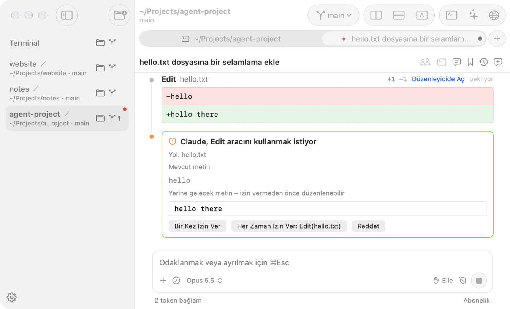

<p>&nbsp;&nbsp;&nbsp;</p>

# Tapa

**Ajanlarınıza, dosyalarınıza ve sayfalarınıza da yer açan, macOS için hızlı ve yerel terminal.**

Tapa her şeyden önce bir terminaldir: kendi VT çekirdeği ve bir Metal oluşturucusu, yerel macOS sekmeleri ve bölmeleri, tek bir kısayolla kayarak gelen hızlı bir terminal, komut bloklarıyla kabuk entegrasyonu ve Warp tarzında önerilerle isteğe bağlı bir giriş alanı. Bunun çevresinde Tapa, [Dango](https://github.com/sventmueller/dango)’nun küçük kardeşine dönüştü: her proje klasörü için bir çalışma alanı içeren bir kenar çubuğu; her çalışma alanında terminaller, Claude, Codex, OpenCode, Antigravity ve diğer ACP ajanları için ajan sekmeleri, tarayıcı sekmeleri, dosya listesi ve Git paneli olan bir düzenleyici ile formüller ve diyagramlar içeren, [Splat](https://github.com/sventmueller/splat)’ten gelen bir Markdown önizlemesi. Bir proje klasörünün yapılandırdığı hiçbir şey, siz o klasörün çalışma alanına güvenene kadar çalışmaz. Tapa, Rust ile gerçek AppKit denetimleri üzerine yazılmıştır, 35 dilde kullanılabilir, hesap gerektirmez ve telemetri içermez.

[](https://github.com/sventmueller/tapa/releases/latest/download/Tapa.dmg)

**[Tapa.dmg’yi indirin](https://github.com/sventmueller/tapa/releases/latest/download/Tapa.dmg)**: imzalanmış ve Apple tarafından notarize edilmiş disk görüntüsü; Apple Silicon ve Intel üzerinde macOS 14 veya üstü için.

**Bir hata mı buldunuz?** [Bir issue açın](https://github.com/sventmueller/tapa/issues/new/choose) ve hatanın hangi kabukta, hangi ajanda ya da hangi programda ortaya çıktığını belirtin. Tapa işinize yarıyorsa [GitHub’da bir yıldız](https://github.com/sventmueller/tapa) başkalarının da onu bulmasına yardımcı olur.

[](https://www.rust-lang.org) [](https://www.apple.com/macos/)  [](https://github.com/madsmtm/objc2) [](https://developer.apple.com/metal/) [](https://agentclientprotocol.com)    [](#lisans)

[Bahasa Indonesia](../id/README.md) · [Bahasa Melayu](../ms/README.md) · [Català](../ca/README.md) · [Čeština](../cs/README.md) · [Dansk](../da/README.md) · [Deutsch](../de/README.md) · [English](../../../README.md) · [Español](../es/README.md) · [Français](../fr/README.md) · [Hrvatski](../hr/README.md) · [Italiano](../it/README.md) · [Magyar](../hu/README.md) · [Nederlands](../nl/README.md) · [Norsk](../no/README.md) · [Polski](../pl/README.md) · [Português (Brasil)](../pt_BR/README.md) · [Português (Portugal)](../pt_PT/README.md) · [Română](../ro/README.md) · [Slovenčina](../sk/README.md) · [Slovenščina](../sl/README.md) · [Suomi](../fi/README.md) · [Svenska](../sv/README.md) · [Tiếng Việt](../vi/README.md) · **Türkçe** · [Ελληνικά](../el/README.md) · [Русский](../ru/README.md) · [Українська](../uk/README.md) · [עברית](../he/README.md)‎ · [العربية](../ar/README.md)‎ · [हिन्दी](../hi/README.md) · [ไทย](../th/README.md) · [한국어](../ko/README.md) · [日本語](../ja/README.md) · [简体中文](../zh-Hans/README.md) · [繁體中文](../zh-Hant/README.md)

## İçindekiler

- [Bir bakışta özellikler](#bir-bakışta-özellikler)
- [Gereksinimler](#gereksinimler)
- [Kurulum](#kurulum)
- [Başlarken](#başlarken)
- [Çalışma alanları](#çalışma-alanları)
- [Terminal](#terminal)
  - [Sekmeler ve bölmeler](#sekmeler-ve-bölmeler)
  - [Kabuk entegrasyonu ve komut blokları](#kabuk-entegrasyonu-ve-komut-blokları)
  - [Giriş alanı ve öneriler](#giriş-alanı-ve-öneriler)
  - [Arama, seçim ve kopyalama](#arama-seçim-ve-kopyalama)
  - [Hızlı terminal](#hızlı-terminal)
- [Ajanlar](#ajanlar)
- [Düzenleyici, dosyalar ve Git](#düzenleyici-dosyalar-ve-git)
- [Önizlemeler](#önizlemeler)
- [Tarayıcı](#tarayıcı)
- [Dikte](#dikte)
- [Ayarlar](#ayarlar)
- [Görünüm ve erişilebilirlik](#görünüm-ve-erişilebilirlik)
- [Diller](#diller)
- [Klavye kısayolları](#klavye-kısayolları)
- [Güven](#güven)
- [Gizlilik ve güvenlik](#gizlilik-ve-güvenlik)
- [Bilinen sınırlamalar](#bilinen-sınırlamalar)
- [Geliştiriciler için](#geliştiriciler-için)
  - [Üçüncü taraf bileşenler](#üçüncü-taraf-bileşenler)
- [Lisans](#lisans)

## Bir bakışta özellikler

- **Kendine ait hızlı bir terminal.** Tapa, kendi VT çekirdeğiyle ayrıştırır ve Metal ile her ekran için ayrı bir iş parçacığında, ekranın hızında ve yalnızca değişeni çizer. Alacritty’nin çekirdeği 121 esctest denetimini geçerken Tapa 262 denetimi geçer ve çekirdekteki her değişiklik sabitlenmiş bir Ghostty sürümüne karşı ölçülür.
- **Tepeden tırnağa yerel.** Gerçek macOS sekmeleri, pencere geri yükleme, menüler, Servisler menüsü, bildirimler, Güvenli Klavye Girişi, dikte ve giriş yöntemleri. Electron yok; WebKit yalnızca bir sayfanın ya da önizlemenin ihtiyaç duyduğu yerde.
- **Çalışma alanları.** Kenar çubuğu her proje klasörü için bir çalışma alanı tutar; her birinin kendi sekmeleri, dalı ve panelleri vardır. En üstteki “Terminal” çalışma alanı her seferinde sıfırdan başlar; diğerleri siz kaldırana kadar kalır.
- **Yerel bir sohbet görünümünde ajanlar.** Claude, Codex, OpenCode, Antigravity, Gemini CLI ve Agent Client Protocol’ün diğer ajanları kendi sekmelerinde çalışır; yanıtlar, araç çağrıları, diff’ler ve izin istekleri tek bir zaman çizelgesinde yer alır. Tapa onları istek üzerine kurar ve günceller.
- **Kabuk entegrasyonu ve komut blokları**, zsh, bash ve fish için, `ssh` üzerinden de: bir istemden diğerine atlayın, bir komutun çıktısını seçin, kopyalayın, kaydedin ve daraltın, başarısız komutları ve her birinin ne kadar sürdüğünü görün.
- **İsterseniz Warp’takine benzer bir giriş alanı.** Komut satırını metin olarak düzenleyin; öneriler geçmişinizden, 700’den fazla komut satırı aracının tanımlarından ve projenin durumundan gelir, hepsi Mac’inizde.
- **Kabuğun yanında dosyalar, Git ve bir tarayıcı.** Sözdizimi renkli bir düzenleyici, bir dosya listesi, hazırlama, commit, dal ve worktree desteği olan bir Git paneli, formüller ve diyagramlar içeren bir Markdown önizlemesi ve tarayıcı sekmeleri.
- **Klasörlerinize özen gösterir.** Güvenmediğiniz bir çalışma alanı, klasörünün yapılandırdığı hiçbir şeyi başlatmaz: git kancası yok, proje MCP sunucusu yok, ajanlar için proje ayarı yok, dosya sayfalarında JavaScript yok.
- **Gizliliğe saygılı.** Hesap yok, telemetri yok. Tapa ağa yalnızca siz istediğinizde çıkar ve diskteki geri yüklenen geçmiş, anahtar zincirinizdeki bir anahtarla şifrelenir.
- **Kendi dilinizde.** Arayüz 35 dilde gelir: Arapça, Katalanca, Çince (Basitleştirilmiş), Çince (Geleneksel), Hırvatça, Çekçe, Danca, Felemenkçe, İngilizce, Fince, Fransızca, Almanca, Yunanca, İbranice, Hintçe, Macarca, Endonezce, İtalyanca, Japonca, Korece, Malayca, Norveççe, Lehçe, Portekizce (Brezilya), Portekizce (Portekiz), Romence, Rusça, Slovakça, Slovence, İspanyolca, İsveççe, Tayca, Türkçe, Ukraynaca ve Vietnamca.

## Gereksinimler

- Apple Silicon veya Intel üzerinde macOS 14 Sonoma veya üstü. Tapa macOS 27’de geliştirilir ve test edilir.
- Kabuk entegrasyonu için zsh, bash veya fish; diğer kabuklar entegrasyon olmadan çalışır.
- Ajan sekmeleri için kullanmak istediğiniz ajanı; ya önceden kurulu ya da siz istediğinizde Tapa tarafından kurulur (bkz. [Ajanlar](#ajanlar)).

## Kurulum

**Disk görüntüsünden.** Her sürüm, Apple Silicon ve Intel için tek bir evrensel uygulama içeren, Developer ID ile imzalanmış ve Apple tarafından notarize edilmiş bir disk görüntüsüdür: `Tapa-<version>.dmg`. Görüntüyü açın ve Tapa’yı Applications klasörüne sürükleyin.

**Homebrew ile.** Kendi tap’indeki cask aynı disk görüntüsünü kurar:

```sh
brew install --cask sventmueller/tap/tapa
```

**Güncellemeler.** Disk görüntüsünden ya da Homebrew ile kurulan Tapa kendini [Sparkle](https://sparkle-project.org) ile güncel tutar. İkinci açılışta kendiliğinden güncelleme arayıp arayamayacağını sorar; siz onay verene kadar hiçbir istek göndermez. **Tapa › Güncellemeleri Denetle…** hemen denetler. Tapa bir güncellemeyi yalnızca geliştiricinin imzasını taşıyorsa kurar. Kendi derlemenizde güncelleyici yoktur.

**Kaynaktan.** Bkz. [Geliştiriciler için](#geliştiriciler-için).

**Varsayılan terminal olarak.** Tapa kabuk betiklerini (`.command`, `.tool`), simgesine bırakılan klasörleri ve `ssh://` bağlantılarını açabilir. Finder’da **Dosya › Bilgi Ver › Şununla Aç** ile onu seçin.

## Başlarken

1. **Pencerede** solda çalışma alanlarının kenar çubuğu, üstte seçili çalışma alanının sekmeleri ve onların üstünde araç çubuğu bulunur. ⌃⌘S kenar çubuğunu gösterir ve gizler.
2. **Yeni bir çalışma alanı**, kenar çubuğunun üstündeki klasör düğmesinden ya da **Kabuk › Yeni Çalışma Alanı…** (⇧⌘N) ile açılır: son klasörlerden birini seçin ya da **Klasör Seç…**’e tıklayın.
3. **Yeni sekmeler** çalışma alanının klasöründe başlar: terminal için ⌘T, terminal, ajan ya da tarayıcı sekmesi için araç çubuğunun sağındaki düğmeler veya sekme çubuğunun sonundaki **+**.
4. **Ayarlar** ⌘, ile ya da kenar çubuğunun altındaki dişli simgesiyle açılır.
5. **Komut paleti** (⇧⌘P) her komutu adıyla bulur, **Sekme Bul…** (⌘P) ise her çalışma alanının her sekmesini.

Araç çubuğunda soldan başlayarak çalışma alanının deposuna ait dal açılır menüsü, terminali sağa ve aşağı bölme ile giriş alanını gösterme düğmeleri ve yeni terminal, ajan ve tarayıcı sekmesi düğmeleri yer alır. Önde bir terminal sekmesi yokken bölme ve giriş alanı düğmeleri gri görünür.

## Çalışma alanları

Bir çalışma alanı, sekmeleriyle birlikte bir klasördür. Kenar çubuğundaki satırı adı, klasörü ve Git dalını, sağda ise dosya listesi ve Git paneli düğmelerini gösterir. Bunlardan birine tıklamak, çalışma alanları listesinin yerine o paneli gösterir; üstteki **Çalışma Alanları** geri götürür.

- **“Terminal” çalışma alanı** her zaman en üsttedir. Her açılışta, ayarlarda belirtilen klasörde, tek bir boş terminalle sıfırdan başlar. Ondan hiçbir şey saklanmaz; adı değiştirilemez ve kaldırılamaz.
- **Diğer her çalışma alanı**, sekmesi olmasa bile siz kaldırana kadar kalır. Tapa adını, sekmelerini, terminallerinin içeriğini (geri yükleme ayarlarının izin verdiği ölçüde), ajan oturumlarını ve pencerenin konumunu saklar. Hâlâ çalışan programlar Tapa’dan çıkıldığında sona erer.
- **Ad değiştirme.** Adın arkasındaki kaleme tıklayın, seçili çalışma alanının adına tıklayın ya da **Kabuk › Çalışma Alanının Adını Değiştir**’i seçin. Ad hemen kaydedilir.
- **Durum.** Satırdaki yeşil nokta, çalışma alanının bir ajanının çalıştığını gösterir, alt ajanlarla ya da arka planda da olsa; kırmızı nokta, birinin sizi beklediğini gösterir. Terminaller orada hiçbir şey işaretlemez.
- **Geçiş.** ⌃⌘[ ve ⌃⌘] çalışma alanları arasında gezinir. Pencere yerinde kalır ve seçili çalışma alanının sekmeleri diğerlerinin yerini alır.
- **Worktree’ler.** Araç çubuğunun dal açılır menüsündeki **Yeni Worktree…**, yeni bir dalda bir Git worktree’si oluşturur ve onu ayrı bir çalışma alanı olarak açar.

Bir çalışma alanının son sekmesi kapandığında çalışma alanı listede kalır. Tüm sekmeler kapandığında yalnızca pencere gider; Dock simgesi ya da ⌘N onu çalışma alanlarıyla birlikte geri getirir.

## Terminal

Tapa kendi çekirdeği `term-vt` üzerinde çalışır. Kitty klavye protokolü ile xterm ve VT520, OSC 8 köprüleri, okuma için ayrı izinli OSC 52 pano erişimi, eşzamanlı çıktı, renkli ve kıvrımlı alt çizgiler, truecolor, renk sorguları, programlara açık ve koyu mod bildirimleri, köşeli parantezli yapıştırma (bracketed paste), odak olayları ve fare bildirimini destekler. Pencere boyutu değiştiğinde metin geçmiş dahil yeniden akar. Bitişik harfler, yazı tipi özellikleri, yamalı yazı tipleri gerektirmeyen Nerd Font simgeleri ve piksel hassasiyetinde kutu çizimi, Powerline ve Braille glifleri yerleşiktir.

### Sekmeler ve bölmeler

- **Sekmeler** macOS’un kendi sekmeleridir: yeniden sıralamak için sürükleyin ya da kendi penceresine çekin, **Tüm Sekmeleri Göster** (⇧⌘\\), ⌘1 ile ⌘8 arası, son sekme için ⌘9 ve geçiş için ⇧⌘[ / ⇧⌘]. Her sekme, başlığının önünde türünün simgesini gösterir.
- **Bölmeler.** **Sağa Böl** (⌘D veya ⌃⌘T) ve **Aşağı Böl** (⇧⌘D veya ⌃⌥⌘T), istediğiniz kadar iç içe. Bir ayırıcıyı sürükleyin, ⌃⌘ ve ok tuşlarıyla taşıyın, **Bölmeyi Büyüt** (⌃⇧⌘↩), **Bölmeleri Eşitle** (⌃⌘=) ve ⌘[ ile ⌘] ile bölmeler arasında gezinin.
- **Çalışma klasörü.** Yeni sekmeler, pencereler ve bölmeler öndeki terminalin klasöründe başlar; üçünün her biri için bunu ayarlar belirler.
- **Kapatma.** Tapa, içinde bir program çalışırken bir sekmeyi, bir pencereyi ya da uygulamayı kapatmadan önce sorar.
- **Geri yükleme.** Yeniden başlatmanın ardından çalışma alanları, sekmeler, bölmeler, klasörler ve her terminalin son satırları geri gelir. Token’lar ve parolalar gibi gizli bilgiler, herhangi bir şey saklanmadan önce maskelenir.

### Kabuk entegrasyonu ve komut blokları

Tapa, zsh, bash ve fish için kabuk entegrasyonunu yapılandırma dosyalarınıza dokunmadan kendisi kurar ve başka bir ana bilgisayara `ssh` ile bağlandığınızda onu da yanında götürür. Entegrasyonla her komut ve çıktısı bir blok oluşturur:

- **İstemler.** ⌘↑ ve ⌘↓ önceki ve sonraki isteme atlar. Komut satırına tıklamak imleci oraya taşır.
- **Bloklar.** **Bloğu Seç** (⇧⌘A), **Çıktıyı Kopyala** (⌥⌘C), **Çıktıyı Kaydet…** (⌥⌘S) ve **Bloğu Daralt/Genişlet** (⇧⌘↩). İşaretçinin altındaki bloğun üzerinde düğmeler, bloğun durumunu, süresini ve aynı eylemleri gösterir.
- **Başarısız komutlar** işaretlenir ve hâlâ çalışan komut, çıktısı kayarken üstte görünür kalır.
- **Yer işaretleri.** **Yer İşareti Ekle/Kaldır** (⇧⌘M) bir satırı işaretler; ⇧⌘↑ ve ⇧⌘↓ yer işaretleri arasında atlar.
- **Bildirimler**, bir program istediğinde (OSC 9 ve OSC 777) ve terminal önde değilken görünür; bir ilerleme çubuğu (OSC 9;4) sekmede ve Dock simgesinde gösterilir.

### Giriş alanı ve öneriler

Giriş alanı komut satırını, Warp’taki gibi bölmenin altında, üstünde klasör ve Git dalı etiketleri bulunan bir metin alanına dönüştürür. **Giriş Alanını Göster/Gizle** (⌘I) ya da araç çubuğundaki düğme onu tek bir terminal için açıp kapatır; **Ayarlar › Giriş** onu yeni terminaller için açar. Kabuk entegrasyonu gerektirir ve vim, htop ya da claude gibi tam ekran programlara yer açmak için kenara çekilir.

- **Return** alanın tamamını kabuğa gönderir, çok satırlı metni tek bir yapıştırma olarak; kabuk onu her zamanki gibi çalıştırır ve hatırlar. Kabuk daha fazlasını isterse alan, bir sonraki isteme kadar tuşları ona bırakır.
- **↑, ↓ ve ⌃R** geçmişinizde arar; her komutun çalıştığı klasör, dal ve çıkış koduyla birlikte.
- **Tab**, 700’den fazla komut satırı aracının tanımları, yollar ve git dalları, docker konteynerleri, kubectl kaynakları, ssh ana bilgisayarları, `package.json` betikleri ile make, just ve cargo hedefleri gibi canlı değerlerle tamamlar.
- **Vim tuşları** alanda, aynı ayarlarda bir anahtarla açılır.
- **Siz yazmadan önce bir sonraki komut**: bu projede genellikle ardından gelen (`git add` sonrasında `git commit`), projenin durumunun gerektirdiği (`node_modules`’dan daha yeni bir kilit dosyası) ve “command not found” sonrasında yazım hatalarından ya da yerel Homebrew dizininizden bir düzeltme.

Giriş alanı olmadan öneriler imlecin arkasında gri metin olarak görünür ve → onları kabul eder. fish ya da zsh-autosuggestions gibi kendi otomatik önerileri olan kabuklar kendi önerilerini korur. Öneriler asla ağı kullanmaz ve programları yalnızca kendi `PATH`’inizden başlatır, asla proje klasöründen değil.

**Yapıştırma.** Çok satırlı yapıştırmalar çalışmadan önce gösterilebilir (**Çok satırlı yapıştırmaları önce göster**). Bir terminale bırakılan dosyalar tırnak içine alınmış yollar olarak gelir; ⌥←/→, ⌘←/→ ve ⌘⌫ her Mac metin alanında olduğu gibi sözcük ve satır bazında taşır ve siler.

### Arama, seçim ve kopyalama

- **Bul…** (⌘F) geçmişte düzenli ifadelerle, büyük/küçük harf ve tam sözcük seçenekleriyle arar ve eşleşmeleri sayar; kaydırma çubuğu onları istemler ve hatalarla birlikte işaretler.
- **Akıllı seçim.** Çift tıklama bir URL’yi, bir yolu, bir hash’i ya da bir IP adresini bütün olarak seçer; ⌥ ile sürükleme bir dikdörtgen seçer. Bağlantılar OSC 8 olmadan da bulunur; ⌘ ile tıklama onları açar, bir yolu da kuruluysa Dango’da.
- **Klavyeyle Seç** (⇧⌘C) bir seçimi Vim tuşlarıyla taşır.
- **Biçimlendirmeyle Kopyala** (⇧⌥⌘C) renkleri ve stilleri korur; seçince kopyalama bir ayardır. **Temizle** (⌘K) terminali temizler.

### Hızlı terminal

**Hızlı Terminali Göster/Gizle** (⌃⌥⌘Space), uygulama değiştirmeden, diğer uygulamaların üstünde ve tam ekran alanların üzerinde ekranın bir kenarından bir terminal kaydırarak getirir. Kenar, boyutu ve başka bir yere tıkladığınızda gizlenip gizlenmeyeceği birer ayardır. Gizliyken oturumları çalışmaya devam eder.

## Ajanlar

Bir ajan sekmesi, çalışma alanının klasöründe, Dango’dan gelen yerel ajan görünümünde bir kodlama ajanı çalıştırır.

| Ajan | Nasıl çalışır | Neye ihtiyaç duyar |
|---|---|---|
| Claude | `claude` komutu, stream-json protokolü üzerinden konuşulur | `claude` kurulu ve oturum açılmış olmalı; siz istediğinizde Tapa onu Claude’un kendi yükleyicisiyle kurar |
| Codex | `codex app-server` ya da eski bir Codex için `codex-acp` | `codex` oturumu açılmış olmalı; siz istediğinizde Tapa sabitlenmiş bağdaştırıcıyı kurar |
| OpenCode | `opencode serve` ya da eski bir OpenCode için `opencode acp` | `PATH` üzerinde kendi `opencode`’unuz ya da sabitlenmiş indirme |
| Antigravity | `agy acp` | `PATH` üzerinde kendi `agy`’niz ya da sabitlenmiş indirme |
| Gemini CLI | `gemini --acp`, **Ayarlar › Ajanlar** içinde açtığınızda sunulur | kendi `gemini`’niz ya da sabitlenmiş indirme |
| Diğer ACP ajanları | ACP kayıt defterinden, yalnızca siz istediğinizde yüklenir | kayıt defteri girdisinin belirttiği; sağlama toplamı olmayan girdiler ancak siz onayladıktan sonra kurulur |

Tapa her ajanın kendi oturum açma yöntemini kullanır ve ajan kimlik bilgilerini saklamaz. Oturum açma kabuğunuzun `PATH`’inde bulunan bir ajan önceliklidir; aksi hâlde Tapa kendi veri klasörüne kurduğu sürümü çalıştırır, asla çalışma alanından bir programı değil.

- **Zaman çizelgesi** yanıtları, çıktıları ve diff’leriyle araç çağrılarını, soruları ve izin isteklerini gösterir. **Bir Kez İzin Ver**, **Her Zaman İzin Ver** ve **Reddet** bir isteği yanıtlar; bir düzenleme, siz izin vermeden önce değiştirilebilir.
- **Durum.** Sekme ve çalışma alanının satırı, ajan çalışırken yeşil, sizi beklerken kırmızı bir nokta gösterir; siz başka yere bakarken beklediğinde bir bildirim bunu size haber verir.
- **Altta bulunan ileti alanı** isteminizi, üzerine bırakılan dosyaları ve dikteyi alır. ⌘Esc klavye odağını oraya taşır ve geri getirir. Model ve izin modu oturum için orada seçilebilir.
- **Ayarlar › Ajanlar**, yeni oturumlar için izin modunu (Claude, Codex), modeli (Claude, Codex, OpenCode) ve düşünme çabasını (Claude, Codex) ve yeni sekmelerin hangi ajanları sunacağını belirler. Her ajanın programının nerede bulunduğunu, **Yükle…**, **… Sürümüne Güncelle** ve önceki sürüm için **… Sürümüne Dön** ile, ACP kayıt defteri için de **Kayıt Defterini Yükle** ile gösterir. Claude’un “Her Zaman İzin Ver” ile kaydettiği kurallar orada görülebilir ve kaldırılabilir.
- **Denetlenen indirmeler.** Arşivler SHA-256 değerlerine, npm paketleri kilit dosyalarındaki bütünlük değerine karşı denetlenir; sabit bir sürümü olmayan paketler reddedilir. Eksik bir ajan, kurulumunu kendi sekmesinde de sunar.

## Düzenleyici, dosyalar ve Git

- **Bir çalışma alanının dosya listesi**, klasörünü bir ağaç olarak gösterir; dosyalar değiştikçe güncellenir, isterseniz Git’in yok saydığı dosyalar soluk gösterilir. Bir tıklama bir dosyayı önizleme sekmesi olarak açar; siz düzenleyene kadar bir sonraki tıklama onun yerini alır; çift tıklama onu tutar.
- **Düzenleyici** dosyaları çalışma alanının sekmelerinde açar: sözdizimi renkleri, birden çok imleç, katlama, `.editorconfig` girintisi, isteğe bağlı Vim tuşları ve son commit’ten beri değişenler için işaretlerle. Bir dosyanın diskte değiştiğini ya da çakışma işaretleri içerdiğini fark eder. Markdown dosyaları bir biçim çubuğu ve **Splat’te Aç** alır. **Kaydet** (⌘S), **Farklı Kaydet…** ve **Tümünü Kaydet** her zamanki gibi çalışır; Tapa kaydedilmemiş metni kapatmadan önce sorar.
- **Bir çökmeden sonra** kaydedilmemiş metin geri gelir: Tapa siz yazarken onun şifrelenmiş kopyalarını tutar.
- **Git paneli** hazırlanmış ve hazırlanmamış değişiklikleri gösterir, dosyaları ve tek tek parçaları (hunk) hazırlar ve hazırlıktan çıkarır, commit eder (⌘↩), değiştirir (amend), commit edip push eder, fetch eder ve dalları, stash’leri, cherry-pick’leri ve çakışmaları yönetir; altta commit geçmişi bulunur. Bir dosyaya tıklamak onun diff’ini gösterir.
- **Araç çubuğundaki dal açılır menüsü** dallar arasında geçiş yapar, dal oluşturur ve worktree’ler yapar.

Düzenleyici hiçbir biçimlendirici ve dil sunucusu başlatmaz. Dil sunucuları ve hata ayıklayıcısı olan tam bir IDE için [Dango](https://github.com/sventmueller/dango)’yu kullanın.

## Önizlemeler

- **Markdown**, düzenleyicisinin yanında Splat’in görüntüleyicisiyle gösterilir: formüller, diyagramlar ve resimler içeren GitHub Flavored Markdown, metinle birlikte paragraf paragraf kayar.
- **Resimler** kendi sekmelerinde, PDF’ler PDFKit ile, ses, filmler, yazı tipleri ve ofis belgeleri Quick Look ile açılır.
- **Yalıtılmış çözme.** Güvenilmeyen bir kaynaktan gelen her resim (proje dosyaları, Markdown, ajan ekleri ve yapıştırmalar), uygulamada değil, Splat’in `Decoder.xpc` hizmetinde, dosyaları ve ağı olmayan kendine ait bir App Sandbox içinde çözülür.

## Tarayıcı

**Yeni Tarayıcı Sekmesi** (⇧⌘B), çalışma alanında bir WebKit sekmesi açar. Adres alanı bir adresi ya da seçtiğiniz arama motoru (DuckDuckGo, Google, Bing veya Startpage) için sözcükleri alır; ⌘L, ⌘R, ⌘[ ve ⌘] Safari’deki gibi çalışır. Projenizin geliştirme sunucusu için `localhost` sayfaları her zamanki gibi çalışır. Bir çalışma alanının HTML dosyaları yalnızca kendi klasörlerini okuyabilir ve güvenmediğiniz bir çalışma alanında JavaScript çalıştırmaz.

## Dikte

Mikrofon düğmesiyle ya da **Düzen › Dikteyi Başlat** (⌃⌥D) ile bir ajanın ileti alanına ya da düzenleyiciye dikte edin. Konuşma tanıma [Lowspeak](https://github.com/sventmueller/lowspeak)’e aittir; Lowspeak’in kurulu olması gerekmez. **Ayarlar › Dikte**, OpenAI veya Groq ile çevrimiçi yazıya dökmeyi ya da kaydı Mac’inizde tutan yerel Whisper ve Parakeet modellerini, dili, son işlemeyi, mikrofonu ve kendi sözcük dağarcığınızı seçer. OpenAI ve Groq anahtarları anahtar zincirinizde saklanır. Dikte yalnızca yayım derlemesinin parçasıdır.

## Ayarlar

**Tapa › Ayarlar…** (⌘,) şu bölmeleri içerir: Genel, Yazı Tipi, Renkler, İmleç, Terminal, Giriş, Düzenleyici, Ajanlar, Dikte, Profiller ve Klavye Kısayolları. Bunlar tek bir TOML dosyasına yazar: `~/Library/Application Support` altındaki Tapa klasöründe bulunan ve elle de düzenleyebileceğiniz `config.toml`; Tapa onu çalışırken yeniden yükler, **Ayarları Yeniden Yükle** (⇧⌘,) ise bunu hemen yapar.

- **Dört yazı tipi boyutu**, Genel altında: Arayüz (kenar çubuğu, paneller, dosya listesi, Git paneli ve sekme başlıkları), Düzenleyici (metin, satır numaraları ve Markdown önizlemesi), Terminal ve Ajanlar. ⌘+, ⌘− ve ⌘0 öndeki terminalin boyutunu değiştirir.
- **Görünüm:** Açık, Koyu ya da Sistemle Aynı.
- **Renkler.** Açık mod için bir tema ve koyu mod için bir tema, Ghostty’nin tema biçiminde; zayıf bir temada metni okunabilir tutan asgari bir karşıtlıkla. Kendi temalarınız temalar klasörüne gider.
- **Profiller** yazı tipini, renkleri, kabuğu, ortamı ve klasörü bir araya getirir.
- **Kısayolların** tümü değiştirilebilir ve çakışmalar gösterilir.

## Görünüm ve erişilebilirlik

- **Koyu mod** sistemi ya da sizin seçiminizi izler; vurgu rengi, Hareketi Azalt ve Kontrastı Artır dikkate alınır.
- **VoiceOver** terminalin satırlarını ve istemlerini okur ve yeni çıktıyı duyurur; kenar çubuğu, sekmeler, araç çubuğu düğmeleri ve ajan zaman çizelgesinin kartları adlandırılmıştır.
- **Klavye.** Her komutun bir menü öğesi ve bir kısayolu vardır; Tam Klavye Erişimi her denetime ulaşır.
- **Boyutlar.** Ayarlardaki dört yazı tipi boyutu arayüzü, düzenleyiciyi, terminali ve ajanları birbirinden bağımsız ölçekler.
- **Sağdan sola.** Arayüz Arapça ve İbranicede aynalanır; terminal ızgarası ise soldan sağa kalır.

Ayrıntılar ve bilinen eksikler [ACCESSIBILITY.md](../../../ACCESSIBILITY.md) dosyasındadır.

## Diller

Arayüz 35 dile çevrilmiştir: Arapça, Katalanca, Çince (Basitleştirilmiş), Çince (Geleneksel), Hırvatça, Çekçe, Danca, Felemenkçe, İngilizce, Fince, Fransızca, Almanca, Yunanca, İbranice, Hintçe, Macarca, Endonezce, İtalyanca, Japonca, Korece, Malayca, Norveççe, Lehçe, Portekizce (Brezilya), Portekizce (Portekiz), Romence, Rusça, Slovakça, Slovence, İspanyolca, İsveççe, Tayca, Türkçe, Ukraynaca ve Vietnamca.

Tapa, **Sistem Ayarları › Genel › Dil ve Bölge** içindeki dil sırasını izler; orada **Uygulamalar** altından yalnızca Tapa için de bir dil seçebilirsiniz. Dilinizde çeviri yoksa İngilizceyi kullanır.

## Klavye kısayolları

| Eylem | Kısayol |
|---|---|
| Yeni pencere, çalışma alanı, sekme | ⌘N, ⇧⌘N, ⌘T |
| Yeni tarayıcı sekmesi | ⇧⌘B |
| Yeni dosya, dosya aç | ⌥⌘N, ⌘O |
| Bölmeyi veya sekmeyi kapat, sekmeyi kapat, pencereyi kapat | ⌘W, ⌥⌘W, ⇧⌘W |
| Sağa böl, aşağı böl | ⌘D veya ⌃⌘T, ⇧⌘D veya ⌃⌥⌘T |
| Bölmeyi büyüt, bölmeleri eşitle, bölmeyi kapat | ⌃⇧⌘↩, ⌃⌘=, ⌃⇧⌘W |
| Bir ayırıcıyı taşı | ⌃⌘←, ⌃⌘→, ⌃⌘↑, ⌃⌘↓ |
| Sonraki, önceki bölme | ⌘], ⌘[ |
| Sonraki, önceki sekme; 1’den 8’e sekme, son sekme | ⇧⌘], ⇧⌘[; ⌘1 ile ⌘8 arası, ⌘9 |
| Sonraki, önceki çalışma alanı | ⌃⌘], ⌃⌘[ |
| Sekme bul, komut paleti | ⌘P, ⇧⌘P |
| Kenar çubuğunu, giriş alanını göster veya gizle | ⌃⌘S, ⌘I |
| Hızlı terminal | ⌃⌥⌘Space |
| Bul, sonrakini bul, öncekini bul | ⌘F, ⌘G, ⇧⌘G |
| Önceki, sonraki istem | ⌘↑, ⌘↓ |
| Bloğu seç, çıktıyı kopyala, çıktıyı kaydet, bloğu daralt | ⇧⌘A, ⌥⌘C, ⌥⌘S, ⇧⌘↩ |
| Yer işareti ekle veya kaldır; önceki, sonraki yer işareti | ⇧⌘M; ⇧⌘↑, ⇧⌘↓ |
| Klavyeyle seç | ⇧⌘C |
| Biçimlendirmeyle kopyala | ⇧⌥⌘C |
| Temizle | ⌘K |
| En üst, en alt, sayfa yukarı, sayfa aşağı | ⌘Home, ⌘End, ⌘PageUp, ⌘PageDown |
| Büyüt, küçült, gerçek boyut (terminal) | ⌘+, ⌘−, ⌘0 |
| Bir ajan sekmesinin ileti alanı | ⌘Esc |
| Dikteyi başlat | ⌃⌥D |
| Ayarlar, ayarları yeniden yükle | ⌘,, ⇧⌘, |

Her kısayol **Ayarlar › Klavye Kısayolları** içinde ya da ayarlar dosyasının `[keys]` bölümünde değiştirilebilir.

## Güven

Bir proje klasörü, içinde bir şey başlar başlamaz programların çalışmasına yol açabilir: git kancaları ve `core.fsmonitor` gibi depo ayarları, ajan kancaları, proje MCP sunucuları ve ajanların proje ayarları. Bu yüzden yeni bir çalışma alanına güvenilmez.

- **Güvenilmeyen:** ajanlar projenin kancaları, MCP sunucuları ve yapılandırması olmadan başlar (Claude `--setting-sources=user --strict-mcp-config` ile, Codex klasör güvenilmez olarak işaretlenmiş hâlde, OpenCode projenin yapılandırması olmadan). Git etkisizleştirilmiş olarak çalışır: kanca, filtre, diff sürücüsü, fsmonitor, `sshCommand` ya da sayfalayıcı yoktur ve yalnızca genel kimlik bilgisi yardımcıları kullanılır. HTML dosyaları JavaScript olmadan açılır. Git paneli ve ajan sekmesi bunu belirtir ve çalışma alanına güvenmeyi önerir.
- **Güvenilen:** **Kabuk › Çalışma alanına güven** bunların hepsini klasörün öngördüğü gibi yükler. **Güveni Geri Al** bunu geri alır. Güven her çalışma alanı için ayrı saklanır.

Güven durumu ne olursa olsun Tapa, bir proje klasöründeki programı asla kendiliğinden çalıştırmaz: öneriler programları yalnızca proje dışındaki `PATH`’inizden başlatır ve kenar çubuğu Git durumunu `.git` dosyalarından okur. “Terminal” gibi Ana klasörünüzdeki bir çalışma alanı proje değildir: orada `~/.local/bin/claude` gibi `~` altındaki programlar sizin kendi programlarınız sayılır.

## Gizlilik ve güvenlik

- **Telemetri yok, hesap yok.** Tapa onu nasıl kullandığınız hakkında hiçbir şey bildirmez ve tamamen çevrimdışı çalışır. Ağa yalnızca siz istediğinizde çıkar: bir ajanı kurmak ya da güncellemek, ACP kayıt defterini yüklemek, onay verdikten sonra güncellemeleri denetlemek ve bir tarayıcı sekmesinde açtığınız sayfalar için. Ajanların kendileri sağlayıcılarıyla her zamanki gibi konuşur.
- **Diskteki geçmiş**, oturumları geri yüklemek için anahtar zincirinizdeki bir anahtarla şifrelenir, kapatılabilir ve yazılmadan önce API anahtarları, token’lar ve parolalar gibi gizli bilgiler maskelenir. Kaydedilmemiş düzenleyici metninin kopyaları da aynı anahtarla şifrelenir.
- **Güvenli Klavye Girişi** parola istemlerinde kendiliğinden açılır ve uygulama menüsünden kalıcı olarak açılabilir.
- **Kaçış dizileri** sızıntıya ya da enjeksiyona yol açabilecekse, örneğin başlık bildirimleri, pano okumaları ve yapıştırma hileleri, engellenir ya da önce sorulur. Ayrıştırıcı CI’da fuzz testinden geçirilir.
- **Yalıtılmış çözme**, güvenilmeyen kaynaklardan gelen resimler için; bkz. [Önizlemeler](#önizlemeler).
- **Kod imzalama**, Hardened Runtime ile. macOS, bir terminaldeki programların erişimini Tapa’ya atfeder; bu yüzden Tapa her korumalı hizmet için bir kullanım açıklaması taşır.

Güvenlik sorunları gizli olarak bildirilir; bkz. [SECURITY.md](../../../SECURITY.md).

## Bilinen sınırlamalar

- **Terminalde henüz satır içi görüntü yok**: Kitty grafikleri, Sixel ve iTerm2 görüntüleri 1.0 sonrasına planlanmıştır.
- **tmux denetim modu yok** ve oturumlar Tapa’dan çıkıldığında sürmez.
- **Sağdan sola metin** terminal ızgarasında soldan sağa kalır.
- **⌘+ ve ⌘−** yalnızca öndeki terminali değiştirir.
- **Düzenleyicinin** bilerek dil sunucusu, biçimlendiricisi ya da hata ayıklayıcısı yoktur; bunlar Dango’da vardır.
- **Dikte** yalnızca yayım derlemesinde vardır, hata ayıklama derlemesinde yoktur.
- **VoiceOver** henüz bir kişi tarafından baştan sona denetlenmemiştir.

## Geliştiriciler için

Xcode Command Line Tools ile macOS 14 veya üstüne, `rust-toolchain.toml` dosyasının belirttiği Rust’a (evrensel derleme için her iki Mac hedefiyle rustup), bu deponun yanında [splat](https://github.com/sventmueller/splat) ve [lowspeak](https://github.com/sventmueller/lowspeak) kopyalarına (`../splat`, `../lowspeak`) ve dikte içeren derlemeler için cmake’e ihtiyacınız var.

| Komut | Ne yapar |
|---|---|
| `make help` | hedefleri listeler |
| `cargo xtask run` | hata ayıklama uygulamasını derler ve açar |
| `make build` | dikte içeren yayım uygulamasını `target/release` içine, bu Mac için ad hoc imzalı olarak derler |
| `make lint` | biçimlendirme, uyarıları hata sayan clippy, dosyaların biçimi ve arayüz metinleri |
| `make check` | `lint`, ardından tüm testler; pencere ve ağ gerektirmez |
| `make selftest STEPS="split_right,type:ls\n,shot:x"` | uygulamayı yönetir ve pencere resimlerini `target/selftest/` içinde bırakır |
| `make esctest`, `make vttest` | uygulamada esctest ve vttest’i iki çekirdeğe karşı çalıştırır |
| `make perf` | sabitlenmiş bir Ghostty’ye karşı kıyaslama; yalnızca boştaki bir Mac’te anlamlıdır |
| `make fuzz` | cargo-fuzz ile fuzz hedefleri |
| `make release` | sürümün deneme çalıştırması: dikte destekli evrensel uygulama, disk görüntüsü, güncelleme akışı ve cask’ı `target/release-dry-run` içinde; hiçbir yere hiçbir şey göndermez |
| `make release-notarized` | geçerli sürüm, Developer ID ile imzalanmış, Apple tarafından notarize edilmiş ve zımbalanmış (stapled) olarak `dist/` içine; `Cargo.toml` değişmez |
| `make deploy` | sonraki sürümü notarize eder, `Cargo.toml`’ı commit eder, bir taslak sürüm yükler, `main` dalını ve etiketi push eder, ardından sürümü yayımlar; bkz. [docs/development.md](../../../docs/development.md#deploy) |

Nasıl katkıda bulunulacağı [CONTRIBUTING.md](../../../CONTRIBUTING.md) dosyasında yer alır. Her arayüz metninin anahtarı Almancadır ve 35 dilin tümüne çevirisi vardır; `cargo xtask strings` eksik bir çeviride başarısız olur.

### Üçüncü taraf bileşenler

| Bileşen | Kullanım amacı | Lisans |
|---|---|---|
| [objc2](https://github.com/madsmtm/objc2) ve framework crate’leri | AppKit, Metal, WebKit ve diğer Apple framework’leri | MIT, Zlib veya Apache-2.0 |
| Splat’in crate’leri | Markdown, önizleme, Git okuma, resim çözücü ve çeviriler | MIT veya Apache-2.0 |
| [whisper.cpp](https://github.com/ggml-org/whisper.cpp) ile [Lowspeak](https://github.com/sventmueller/lowspeak) | dikte | MIT |
| [Fig autocomplete specs](https://github.com/withfig/autocomplete) | önerilerin komut açıklamaları | MIT |
| SQLite ile [rusqlite](https://github.com/rusqlite/rusqlite) | komut geçmişi | MIT, kamu malı |
| [Simple Icons](https://simpleicons.org) | dillerin ve programların logoları | CC0, bazı logolar kendi koşullarıyla |
| [Sparkle](https://sparkle-project.org) 2.10.1 | yayım derlemesinin güncellemeleri | MIT |

## Lisans

Tapa, aşağıdakilerden herhangi birinin altında lisanslanmıştır

- Apache Lisansı, Sürüm 2.0 ([LICENSE-APACHE](../../../LICENSE-APACHE))
- MIT Lisansı ([LICENSE-MIT](../../../LICENSE-MIT))

tercihinize bağlı olarak. `assets/simple-icons` içindeki logolar kendi lisanslarını taşır; oradaki README dosyasına bakın.

Siz açıkça başka türlü belirtmedikçe, Apache-2.0 lisansında tanımlandığı üzere Tapa’ya dahil edilmek üzere sizin tarafınızdan kasıtlı olarak sunulan her katkı, ek hüküm ya da koşul olmaksızın yukarıdaki gibi çift lisanslı olacaktır.
