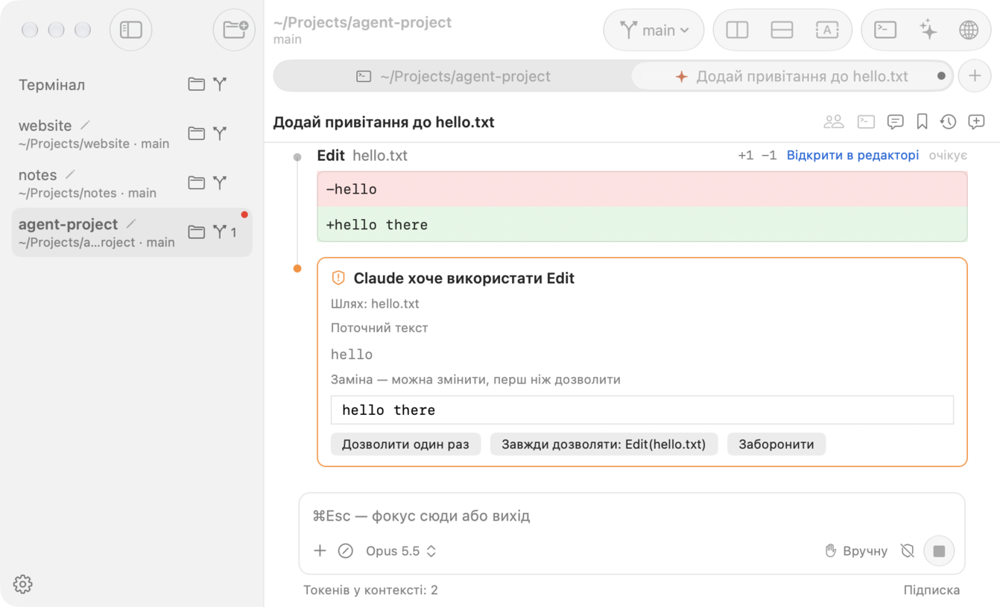

<p>&nbsp;&nbsp;&nbsp;</p>

# Tapa

**Швидкий нативний термінал для macOS, у якому знайшлося місце для ваших агентів, файлів і сторінок.**

Tapa — передусім термінал: власне ядро VT і рендерер на Metal, нативні вкладки й розділення вікна macOS, швидкий термінал, що висувається одним сполученням клавіш, інтеграція з оболонкою з блоками команд і необов’язкове поле введення з підказками в стилі Warp. Довкола цього Tapa виріс у молодшу сестру [Dango](https://github.com/sventmueller/dango): бічна панель із робочими просторами, по одному на теку проєкту, і в кожному — власні термінали, вкладки агентів для Claude, Codex, OpenCode, Antigravity та інших агентів ACP, вкладки браузера, редактор зі списком файлів і панеллю Git, а також попередній перегляд Markdown від [Splat](https://github.com/sventmueller/splat) з формулами й діаграмами. Ніщо з того, що налаштовує тека проєкту, не запускається, доки ви не довіритеся її робочому простору. Tapa написано на Rust зі справжніми елементами AppKit, перекладено 35 мовами, він не потребує облікового запису й не містить телеметрії.

[](https://github.com/sventmueller/tapa/releases/latest/download/Tapa.dmg)

**[Завантажити Tapa.dmg](https://github.com/sventmueller/tapa/releases/latest/download/Tapa.dmg)**: підписаний і нотаризований Apple образ диска для macOS 14 або новішої на Apple Silicon та Intel.

**Знайшли помилку?** [Відкрийте issue](https://github.com/sventmueller/tapa/issues/new/choose) і вкажіть, в якій оболонці, з яким агентом або з якою програмою вона трапилася. Якщо Tapa вам корисний, [зірка на GitHub](https://github.com/sventmueller/tapa) допоможе іншим його знайти.

[](https://www.rust-lang.org) [](https://www.apple.com/macos/)  [](https://github.com/madsmtm/objc2) [](https://developer.apple.com/metal/) [](https://agentclientprotocol.com)    [](#ліцензія)

[Bahasa Indonesia](../id/README.md) · [Bahasa Melayu](../ms/README.md) · [Català](../ca/README.md) · [Čeština](../cs/README.md) · [Dansk](../da/README.md) · [Deutsch](../de/README.md) · [English](../../../README.md) · [Español](../es/README.md) · [Français](../fr/README.md) · [Hrvatski](../hr/README.md) · [Italiano](../it/README.md) · [Magyar](../hu/README.md) · [Nederlands](../nl/README.md) · [Norsk](../no/README.md) · [Polski](../pl/README.md) · [Português (Brasil)](../pt_BR/README.md) · [Português (Portugal)](../pt_PT/README.md) · [Română](../ro/README.md) · [Slovenčina](../sk/README.md) · [Slovenščina](../sl/README.md) · [Suomi](../fi/README.md) · [Svenska](../sv/README.md) · [Tiếng Việt](../vi/README.md) · [Türkçe](../tr/README.md) · [Ελληνικά](../el/README.md) · [Русский](../ru/README.md) · **Українська** · [עברית](../he/README.md)‎ · [العربية](../ar/README.md)‎ · [हिन्दी](../hi/README.md) · [ไทย](../th/README.md) · [한국어](../ko/README.md) · [日本語](../ja/README.md) · [简体中文](../zh-Hans/README.md) · [繁體中文](../zh-Hant/README.md)

## Зміст

- [Коротко про можливості](#коротко-про-можливості)
- [Вимоги](#вимоги)
- [Інсталяція](#інсталяція)
- [Початок роботи](#початок-роботи)
- [Робочі простори](#робочі-простори)
- [Термінал](#термінал)
  - [Вкладки й розділення](#вкладки-й-розділення)
  - [Інтеграція з оболонкою та блоки команд](#інтеграція-з-оболонкою-та-блоки-команд)
  - [Поле введення й підказки](#поле-введення-й-підказки)
  - [Пошук, виділення й копіювання](#пошук-виділення-й-копіювання)
  - [Швидкий термінал](#швидкий-термінал)
- [Агенти](#агенти)
- [Редактор, файли та Git](#редактор-файли-та-git)
- [Попередній перегляд](#попередній-перегляд)
- [Браузер](#браузер)
- [Диктування](#диктування)
- [Параметри](#параметри)
- [Вигляд і доступність](#вигляд-і-доступність)
- [Мови](#мови)
- [Скорочення клавіатури](#скорочення-клавіатури)
- [Довіра](#довіра)
- [Приватність і безпека](#приватність-і-безпека)
- [Відомі обмеження](#відомі-обмеження)
- [Для розробників](#для-розробників)
  - [Сторонні компоненти](#сторонні-компоненти)
- [Ліцензія](#ліцензія)

## Коротко про можливості

- **Власний швидкий термінал.** Tapa розбирає вивід власним ядром VT і малює через Metal в окремому потоці для кожного дисплея, з частотою дисплея й лише те, що змінилося. Він проходить 262 перевірки esctest, тоді як ядро Alacritty — 121, а кожну його зміну вимірюють порівняно з зафіксованою версією Ghostty.
- **Нативний до кісток.** Справжні вкладки macOS, відновлення вікон, меню, меню «Служби», сповіщення, захищений ввід із клавіатури, диктування та методи введення. Жодного Electron, а WebKit — лише там, де він потрібен сторінці чи попередньому перегляду.
- **Робочі простори.** На бічній панелі — по одному робочому простору на теку проєкту, у кожного власні вкладки, гілка й панелі. Робочий простір «Термінал» угорі щоразу починається з чистого аркуша; усі інші лишаються, доки ви їх не вилучите.
- **Агенти в нативному вікні чату.** Claude, Codex, OpenCode, Antigravity, Gemini CLI та інші агенти Agent Client Protocol працюють у власних вкладках, а відповіді, виклики інструментів, диффи й запити дозволів зібрано в одній стрічці. На ваш запит Tapa інсталює та оновлює їх.
- **Інтеграція з оболонкою та блоки команд** для zsh, bash і fish, зокрема через `ssh`: переходьте від запрошення до запрошення, виділяйте, копіюйте, зберігайте й згортайте вивід команди, бачте невдалі команди й тривалість кожної.
- **Поле введення як у Warp, якщо хочете.** Редагуйте командний рядок як текст, з підказками з вашої історії, з описів понад 700 інструментів командного рядка та зі стану проєкту — усе на вашому Mac.
- **Файли, Git і браузер поруч з оболонкою.** Редактор із підсвічуванням синтаксису, список файлів, панель Git з індексуванням, комітами, гілками й worktree, попередній перегляд Markdown з формулами й діаграмами та вкладки браузера.
- **Дбайливо з вашими теками.** Робочий простір, якому ви не довірилися, не запускає нічого, що налаштовує його тека: ні хуків git, ні MCP-серверів проєкту, ні параметрів проєкту для агентів, ні JavaScript у її файлових сторінках.
- **Приватно.** Ні облікового запису, ні телеметрії. Tapa виходить у мережу, лише коли ви про це просите, а збережену на диску історію для відновлення зашифровано ключем із вашої в’язки ключів.
- **Вашою мовою.** Інтерфейс доступний 35 мовами: англійською, арабською, в’єтнамською, гінді, голландською, грецькою, данською, івритом, індонезійською, іспанською, італійською, каталанською, китайською (спрощеною), китайською (традиційною), корейською, малайською, німецькою, норвезькою, польською, португальською (Бразилія), португальською (Португалія), російською, румунською, словацькою, словенською, тайською, турецькою, угорською, українською, фінською, французькою, хорватською, чеською, шведською та японською.

## Вимоги

- macOS 14 Sonoma або новіша, на Apple Silicon або Intel. Tapa розробляють і тестують на macOS 27.
- zsh, bash або fish для інтеграції з оболонкою; інші оболонки працюють без неї.
- Для вкладок агентів — потрібний вам агент, уже інстальований або інстальований Tapa на ваш запит (див. [Агенти](#агенти)).

## Інсталяція

**З образу диска.** Кожен випуск — це образ диска `Tapa-<version>.dmg` з однією універсальною програмою для Apple Silicon та Intel, підписаною сертифікатом Developer ID і нотаризованою Apple. Відкрийте його й перетягніть Tapa до теки «Програми».

**Через Homebrew.** Cask у власному tap інсталює той самий образ диска:

```sh
brew install --cask sventmueller/tap/tapa
```

**Оновлення.** Tapa з образу диска або з Homebrew оновлюється сам за допомогою [Sparkle](https://sparkle-project.org). Під час другого запуску він питає, чи можна самостійно перевіряти оновлення; доки ви не погодитеся, він не робить жодного запиту. **Tapa › Перевірити оновлення…** перевіряє одразу. Tapa інсталює оновлення, лише якщо його підписано розробником. Власна збірка не має механізму оновлення.

**З вихідного коду.** Див. [Для розробників](#для-розробників).

**Як термінал за замовчуванням.** Tapa може відкривати сценарії оболонки (`.command`, `.tool`), теки, перетягнуті на його піктограму, і посилання `ssh://`. Виберіть його у Finder через **Файл › Досьє › Відкривати програмою**.

## Початок роботи

1. **У вікні** ліворуч розташована бічна панель із робочими просторами, угорі — вкладки вибраного робочого простору, а над ними — панель інструментів. ⌃⌘S показує й ховає бічну панель.
2. **Новий робочий простір** створює кнопка з текою вгорі бічної панелі або **Оболонка › Новий робочий простір…** (⇧⌘N): виберіть одну з нещодавніх тек або **Вибрати папку…**.
3. **Нові вкладки** відкриваються в теці робочого простору: ⌘T — термінал, кнопки праворуч на панелі інструментів — термінал, агент або вкладка браузера, чи **+** наприкінці панелі вкладок.
4. **Параметри** відкриваються через ⌘, або шестернею внизу бічної панелі.
5. **Палітра команд** (⇧⌘P) знаходить будь-яку команду за назвою, а **Знайти вкладку…** (⌘P) — будь-яку вкладку будь-якого робочого простору.

На панелі інструментів зліва направо розташовано: спливне меню гілок репозиторію робочого простору, кнопки розділення термінала праворуч і донизу та показу поля введення, а також кнопки нових вкладок термінала, агента й браузера. Кнопки розділення й поля введення неактивні, доки попереду немає вкладки термінала.

## Робочі простори

Робочий простір — це тека з її вкладками. Його рядок на бічній панелі показує назву, теку й гілку Git, а праворуч — кнопки списку файлів і панелі Git. Клацання на одній із них показує цю панель замість списку робочих просторів; кнопка **Робочі простори** вгорі веде назад.

- **Робочий простір «Термінал»** завжди вгорі. Під час кожного запуску він починається з чистого аркуша, у теці, указаній у параметрах, з одним порожнім терміналом. З нього нічого не зберігається, і його не можна перейменувати чи вилучити.
- **Кожен інший робочий простір лишається**, доки ви його не вилучите, навіть без вкладок. Tapa зберігає його назву, вкладки, вміст його терміналів (наскільки дозволяють параметри відновлення), сеанси його агентів і положення вікна. Програми, які ще працюють, завершуються, коли Tapa закривається.
- **Перейменування.** Клацніть олівець після назви, клацніть назву вибраного робочого простору або виберіть **Оболонка › Перейменувати робочий простір**. Назва зберігається одразу.
- **Стан.** Зелена крапка в рядку означає, що агент робочого простору працює, зокрема із субагентами чи у фоні; червона — що один із них чекає на вас. Термінали там нічого не позначають.
- **Перемикання.** ⌃⌘[ і ⌃⌘] перемикають робочі простори. Вікно лишається на місці, а вкладки вибраного робочого простору займають місце попередніх.
- **Worktree.** **Новий worktree…** у спливному меню гілок на панелі інструментів створює worktree Git на новій гілці й відкриває його як окремий робочий простір.

Коли закривається остання вкладка робочого простору, робочий простір лишається в списку. Якщо закрито всі вкладки, зникає лише вікно; піктограма в Dock або ⌘N повертає його разом із робочими просторами.

## Термінал

Tapa працює на власному ядрі `term-vt`. Воно розуміє xterm і VT520 із протоколом клавіатури Kitty, гіперпосилання OSC 8, доступ до буфера обміну через OSC 52 з окремим дозволом на читання, синхронізований вивід, кольорові й хвилясті підкреслення, truecolor, запити кольорів, повідомлення програмам про світлий і темний режим, bracketed paste, події фокуса й передавання подій миші. Коли розмір вікна змінюється, текст переноситься заново, разом з історією. Лігатури, можливості шрифтів, символи Nerd Font без пропатчених шрифтів і піксельно точні символи псевдографіки, Powerline і Брайля вбудовано.

### Вкладки й розділення

- **Вкладки** — власні вкладки macOS: перетягуйте їх, щоб змінити порядок або винести в окреме вікно, **Показати всі вкладки** (⇧⌘\\), ⌘1–⌘8, ⌘9 для останньої вкладки та ⇧⌘[ / ⇧⌘] для перемикання. Перед назвою кожної вкладки стоїть піктограма її типу.
- **Розділення.** **Розділити праворуч** (⌘D або ⌃⌘T) і **Розділити донизу** (⇧⌘D або ⌃⌥⌘T) з будь-якою глибиною вкладеності. Перетягуйте роздільник або пересувайте його з ⌃⌘ і клавішами зі стрілками, **Розгорнути панель** (⌃⇧⌘↩), **Вирівняти панелі** (⌃⌘=), а між панелями переходьте з ⌘[ і ⌘].
- **Робоча тека.** Нові вкладки, вікна й розділення відкриваються в теці термінала, що попереду; параметри визначають це для кожного з трьох випадків.
- **Закриття.** Tapa питає, перш ніж закрити вкладку, вікно чи саму програму, поки в них щось працює.
- **Відновлення.** Після перезапуску повертаються робочі простори, вкладки, панелі, теки й останні рядки кожного термінала. Секрети на кшталт токенів і паролів маскуються, перш ніж будь-що зберігається.

### Інтеграція з оболонкою та блоки команд

Tapa сам налаштовує інтеграцію з оболонкою для zsh, bash і fish, не торкаючись ваших файлів конфігурації, і бере її з собою, коли ви підключаєтеся через `ssh` до іншого хоста. З нею кожна команда разом із виводом утворює блок:

- **Запрошення.** ⌘↑ і ⌘↓ переходять до попереднього й наступного запрошення. Клацання в командному рядку переміщує туди курсор.
- **Блоки.** **Виділити блок** (⇧⌘A), **Скопіювати вивід** (⌥⌘C), **Зберегти вивід…** (⌥⌘S) і **Згорнути/розгорнути блок** (⇧⌘↩). Над блоком під указівником кнопки показують його стан, тривалість і ті самі дії.
- **Невдалі команди** позначаються, а команда, що ще виконується, лишається видимою вгорі, поки прокручується її вивід.
- **Закладки.** **Додати/вилучити закладку** (⇧⌘M) позначає рядок; ⇧⌘↑ і ⇧⌘↓ переходять між закладками.
- **Сповіщення** з’являються, коли програма їх запитує (OSC 9 і OSC 777), а термінал не попереду, а індикатор поступу (OSC 9;4) показується у вкладці й на піктограмі в Dock.

### Поле введення й підказки

Поле введення перетворює командний рядок на текстове поле внизу панелі, як у Warp, а над ним — мітки з текою й гілкою Git. **Показати/сховати поле введення** (⌘I) або кнопка на панелі інструментів перемикає його для одного термінала; **Параметри › Введення** вмикає його для нових терміналів. Йому потрібна інтеграція з оболонкою, і воно поступається місцем повноекранним програмам на кшталт vim, htop чи claude.

- **Return** надсилає в оболонку все поле, багаторядковий текст — одним вставленням; оболонка виконує й запам’ятовує його як зазвичай. Якщо оболонка просить продовження, поле передає їй клавіші до наступного запрошення.
- **↑, ↓ і ⌃R** шукають у вашій історії з текою, гілкою й кодом завершення, з якими виконувалася кожна команда.
- **Tab** доповнює за описами понад 700 інструментів командного рядка, шляхами та живими значеннями, як-от гілки git, контейнери docker, ресурси kubectl, хости ssh, скрипти `package.json` і цілі make, just і cargo.
- **Клавіші Vim** у полі вмикаються перемикачем у тих самих параметрах.
- **Наступна команда ще до того, як ви почали друкувати**: те, що зазвичай іде далі в цьому проєкті (після `git add` іде `git commit`), те, чого вимагає стан проєкту (файл блокування новіший за `node_modules`), і виправлення після «command not found» — за друкарськими помилками або з вашого локального індексу Homebrew.

Без поля введення підказки показуються сірим текстом за курсором, а → приймає їх. Оболонки з власними автопідказками, як-от fish або zsh-autosuggestions, зберігають свої. Підказки ніколи не використовують мережу й запускають програми лише з вашого власного `PATH`, ніколи з теки проєкту.

**Вставлення.** Багаторядкове вставлення можна показати перед виконанням (**Спершу показувати багаторядкове вставлення**). Файли, перетягнуті на термінал, надходять як шляхи в лапках; ⌥←/→, ⌘←/→ і ⌘⌫ переміщують і видаляють за словами й рядками, як у будь-якому текстовому полі Mac.

### Пошук, виділення й копіювання

- **Знайти…** (⌘F) шукає в історії з регулярними виразами, з урахуванням регістру й цілих слів і підраховує збіги; смуга прокручування позначає їх разом із запрошеннями та помилками.
- **Розумне виділення.** Подвійне клацання виділяє URL, шлях, хеш або IP-адресу цілком, а перетягування з ⌥ виділяє прямокутник. Посилання знаходяться навіть без OSC 8; ⌘-клацання відкриває їх, а шлях — у Dango, якщо його інстальовано.
- **Виділення з клавіатури** (⇧⌘C) пересуває виділення клавішами Vim.
- **Копіювати з форматуванням** (⇧⌥⌘C) зберігає кольори й стилі; копіювання під час виділення вмикається в параметрах. **Очистити** (⌘K) очищає термінал.

### Швидкий термінал

**Показати/сховати швидкий термінал** (⌃⌥⌘Пробіл) висуває термінал від краю екрана поверх інших програм і повноекранних просторів, не перемикаючи програму. Край, розмір і те, чи ховається він після клацання деінде, задаються в параметрах. Поки він схований, його сеанси працюють далі.

## Агенти

Вкладка агента запускає агента для програмування в теці робочого простору, у нативному поданні агента з Dango.

| Агент | Як запускається | Що потрібно |
|---|---|---|
| Claude | команда `claude`, спілкування через її протокол stream-json | інстальований `claude` з виконаним входом; на ваш запит Tapa інсталює його власним інсталятором Claude |
| Codex | `codex app-server` або `codex-acp` для старішого Codex | `codex` з виконаним входом; на ваш запит Tapa інсталює зафіксовану версію адаптера |
| OpenCode | `opencode serve` або `opencode acp` для старішого OpenCode | ваш власний `opencode` у `PATH` або зафіксоване завантаження |
| Antigravity | `agy acp` | ваш власний `agy` у `PATH` або зафіксоване завантаження |
| Gemini CLI | `gemini --acp`, пропонується, щойно ви ввімкнете його в **Параметри › Агенти** | ваш власний `gemini` або зафіксоване завантаження |
| Інші агенти ACP | з реєстру ACP, який завантажується лише на ваш запит | те, що вказано в записі реєстру; записи без контрольної суми інсталюються лише після вашого підтвердження |

Tapa використовує власний вхід кожного агента й не зберігає облікових даних агентів. Агент, знайдений у `PATH` вашої оболонки входу, має пріоритет; інакше Tapa запускає версію, яку інсталював у власну теку даних, і ніколи — програму з робочого простору.

- **Стрічка** показує відповіді, виклики інструментів із їхнім виводом і диффами, запитання й запити дозволів. **Дозволити один раз**, **Завжди дозволяти** і **Заборонити** відповідають на запит, а правку можна змінити, перш ніж дозволити її.
- **Стан.** Вкладка й рядок робочого простору показують зелену крапку, поки агент працює, і червону, поки він чекає на вас, а сповіщення повідомляє, що він чекає, коли ви дивитеся деінде.
- **Поле повідомлення** внизу приймає ваш запит, перетягнуті на нього файли й диктування. ⌘Esc переводить у нього фокус клавіатури й назад. Там само для сеансу вибирають модель і режим дозволів.
- **Параметри › Агенти** задає для нових сеансів режим дозволів (Claude, Codex), модель (Claude, Codex, OpenCode) і глибину міркувань (Claude, Codex), а також те, яких агентів пропонують нові вкладки. Там видно, де лежить програма кожного агента, є **Інсталювати…**, **Оновити до …** і **Повернутися до …** для попередньої версії, а також **Завантажити реєстр** для реєстру ACP. Там само можна переглянути й вилучити правила, які Claude зберіг через «Завжди дозволяти».
- **Перевірені завантаження.** Архіви перевіряються за SHA-256, пакети npm — за полем integrity у їхньому lock-файлі, а пакети без фіксованої версії відхиляються. Відсутній агент теж пропонує інсталяцію у власній вкладці.

## Редактор, файли та Git

- **Список файлів** робочого простору показує його теку у вигляді дерева, що оновлюється, коли змінюються файли; файли, які Git ігнорує, за бажання тьмяніють. Клацання відкриває файл у вкладці попереднього перегляду, яку наступне клацання замінює, доки ви не почнете її редагувати; подвійне клацання залишає її.
- **Редактор** відкриває файли у вкладках робочого простору, з підсвічуванням синтаксису, кількома курсорами, згортанням, відступами з `.editorconfig`, необов’язковими клавішами Vim і позначками того, що змінилося від останнього коміту. Він помічає, коли файл змінився на диску або містить маркери конфлікту. Файли Markdown мають панель форматування й **Відкрити в Splat**. **Зберегти** (⌘S), **Зберегти як…** і **Зберегти все** працюють як зазвичай, а перш ніж закрити незбережений текст, Tapa питає.
- **Після збою** незбережений текст повертається: поки ви друкуєте, Tapa зберігає його зашифровані копії.
- **Панель Git** показує проіндексовані й непроіндексовані зміни, додає до індексу й вилучає з нього файли та окремі фрагменти, робить коміти (⌘↩), виправляє останній коміт, робить коміт із надсиланням, отримує зміни й працює з гілками, stash, cherry-pick і конфліктами, а нижче показує історію комітів. Клацання на файлі показує його дифф.
- **Спливне меню гілок** на панелі інструментів перемикає й створює гілки та створює worktree.

Редактор не запускає ні форматувальника, ні мовного сервера. Для повноцінного IDE з мовними серверами й налагоджувачем використовуйте [Dango](https://github.com/sventmueller/dango).

## Попередній перегляд

- **Markdown** показується поруч зі своїм редактором за допомогою рендерера Splat: GitHub Flavored Markdown з формулами, діаграмами й зображеннями, прокручується разом із текстом абзац за абзацом.
- **Зображення** відкриваються в окремій вкладці, PDF — через PDFKit, а звук, відео, шрифти й офісні документи — через «Швидкий перегляд».
- **Ізольоване декодування.** Кожне зображення з недовіреного джерела (файли проєкту, Markdown, вкладення агентів і вставлення) декодується в службі Splat `Decoder.xpc`, у власній App Sandbox без доступу до файлів і мережі, і ніколи — у самій програмі.

## Браузер

**Нова вкладка браузера** (⇧⌘B) відкриває вкладку WebKit у робочому просторі. Поле адреси приймає адресу або слова для вибраної вами пошукової системи (DuckDuckGo, Google, Bing або Startpage); ⌘L, ⌘R, ⌘[ і ⌘] працюють як у Safari. Сторінки з `localhost` працюють як зазвичай — для сервера розробки вашого проєкту. HTML-файли робочого простору можуть читати лише власну теку, а в робочому просторі, якому ви не довірилися, вони не виконують JavaScript.

## Диктування

Диктуйте в поле повідомлення агента або в редактор кнопкою мікрофона чи через **Редагування › Почати диктування** (⌃⌥D). Розпізнавання мовлення надає [Lowspeak](https://github.com/sventmueller/lowspeak), інсталювати його не потрібно. **Параметри › Диктування** вибирає онлайн-транскрипцію через OpenAI або Groq чи локальні моделі Whisper і Parakeet, які залишають запис на вашому Mac, а також мову, постобробку, мікрофон і ваш власний словник. Ключі для OpenAI і Groq зберігаються у вашій в’язці ключів. Диктування є лише у випускній збірці.

## Параметри

**Tapa › Параметри…** (⌘,) містить розділи «Загальні», «Шрифт», «Кольори», «Курсор», «Термінал», «Введення», «Редактор», «Агенти», «Диктування», «Профілі» та «Сполучення клавіш». Вони записують один файл TOML, `config.toml` у теці Tapa в `~/Library/Application Support`, який можна редагувати й вручну; Tapa перечитує його під час роботи, а **Перезавантажити параметри** (⇧⌘,) робить це одразу.

- **Чотири розміри шрифту** в розділі «Загальні»: «Інтерфейс» (бічна панель, панелі, список файлів, панель Git і назви вкладок), «Редактор» (текст, номери рядків і попередній перегляд Markdown), «Термінал» і «Агенти». ⌘+, ⌘− і ⌘0 змінюють розмір термінала, що попереду.
- **Вигляд:** «Світлий», «Темний» або «Як у системі».
- **Кольори.** Тема для світлого й тема для темного режиму у форматі тем Ghostty, з мінімальним контрастом, що зберігає текст читабельним навіть у невдалій темі. Власні теми кладіть у теку тем.
- **Профілі** об’єднують шрифт, кольори, оболонку, середовище й теку.
- **Сполучення клавіш** можна змінити всі, а конфлікти показуються.

## Вигляд і доступність

- **Темний режим** дотримується системи або вашого вибору; колір акценту, «Зменшити рух» і «Збільшити контраст» ураховуються.
- **VoiceOver** читає рядки й запрошення термінала та оголошує новий вивід; бічна панель, вкладки, кнопки панелі інструментів і картки стрічки агента мають назви.
- **Клавіатура.** Кожна команда має пункт меню й сполучення клавіш, а повний доступ із клавіатури досягає кожного елемента керування.
- **Розміри.** Чотири розміри шрифту в параметрах масштабують інтерфейс, редактор, термінал і агентів незалежно один від одного.
- **Справа наліво.** Арабською та івритом інтерфейс віддзеркалюється, а сітка термінала залишається зліва направо.

Подробиці й відомі прогалини — в [ACCESSIBILITY.md](../../../ACCESSIBILITY.md).

## Мови

Інтерфейс перекладено 35 мовами: англійською, арабською, в’єтнамською, гінді, голландською, грецькою, данською, івритом, індонезійською, іспанською, італійською, каталанською, китайською (спрощеною), китайською (традиційною), корейською, малайською, німецькою, норвезькою, польською, португальською (Бразилія), португальською (Португалія), російською, румунською, словацькою, словенською, тайською, турецькою, угорською, українською, фінською, французькою, хорватською, чеською, шведською та японською.

Tapa дотримується порядку мов у **Системні параметри › Загальні › Мова і регіон**; там само в розділі **Програми** можна вибрати мову лише для Tapa. Якщо вашої мови немає серед перекладів, програма використовує англійську.

## Скорочення клавіатури

| Дія | Скорочення |
|---|---|
| Нове вікно, робочий простір, вкладка | ⌘N, ⇧⌘N, ⌘T |
| Нова вкладка браузера | ⇧⌘B |
| Новий файл, відкрити файл | ⌥⌘N, ⌘O |
| Закрити панель або вкладку, закрити вкладку, закрити вікно | ⌘W, ⌥⌘W, ⇧⌘W |
| Розділити праворуч, розділити донизу | ⌘D або ⌃⌘T, ⇧⌘D або ⌃⌥⌘T |
| Розгорнути панель, вирівняти панелі, закрити панель | ⌃⇧⌘↩, ⌃⌘=, ⌃⇧⌘W |
| Пересунути роздільник | ⌃⌘←, ⌃⌘→, ⌃⌘↑, ⌃⌘↓ |
| Наступна, попередня панель | ⌘], ⌘[ |
| Наступна, попередня вкладка; вкладки 1–8, остання вкладка | ⇧⌘], ⇧⌘[; ⌘1–⌘8, ⌘9 |
| Наступний, попередній робочий простір | ⌃⌘], ⌃⌘[ |
| Знайти вкладку, палітра команд | ⌘P, ⇧⌘P |
| Показати або сховати бічну панель, поле введення | ⌃⌘S, ⌘I |
| Швидкий термінал | ⌃⌥⌘Пробіл |
| Знайти, знайти наступне, знайти попереднє | ⌘F, ⌘G, ⇧⌘G |
| Попереднє, наступне запрошення | ⌘↑, ⌘↓ |
| Виділити блок, скопіювати вивід, зберегти вивід, згорнути блок | ⇧⌘A, ⌥⌘C, ⌥⌘S, ⇧⌘↩ |
| Додати або вилучити закладку; попередня, наступна закладка | ⇧⌘M; ⇧⌘↑, ⇧⌘↓ |
| Виділення з клавіатури | ⇧⌘C |
| Копіювати з форматуванням | ⇧⌥⌘C |
| Очистити | ⌘K |
| На початок, у кінець, сторінка вгору, сторінка вниз | ⌘Home, ⌘End, ⌘PageUp, ⌘PageDown |
| Більше, менше, початковий розмір (термінал) | ⌘+, ⌘−, ⌘0 |
| Поле повідомлення вкладки агента | ⌘Esc |
| Почати диктування | ⌃⌥D |
| Параметри, перезавантажити параметри | ⌘,, ⇧⌘, |

Кожне скорочення можна змінити в **Параметри › Сполучення клавіш** або в розділі `[keys]` файла параметрів.

## Довіра

Тека проєкту може змусити програми запуститися, щойно в ній щось стартує: хуки git і параметри репозиторію на кшталт `core.fsmonitor`, хуки агентів, MCP-сервери проєкту й параметри проєкту для агентів. Тому новий робочий простір не вважається довіреним.

- **Без довіри:** агенти запускаються без хуків, MCP-серверів і конфігурації проєкту (Claude з `--setting-sources=user --strict-mcp-config`, Codex з текою, позначеною як недовірена, OpenCode без конфігурації проєкту). Git працює в знешкодженому режимі: без хуків, фільтрів, драйверів диффа, fsmonitor, `sshCommand` і пейджера, і лише з глобальними помічниками облікових даних. HTML-файли відкриваються без JavaScript. Панель Git і вкладка агента повідомляють про це й пропонують довіритися робочому простору.
- **З довірою:** **Оболонка › Довіряти робочому простору** завантажує все це так, як задумано в теці. **Відкликати довіру** скасовує це. Довіра зберігається для кожного робочого простору окремо.

Хай якою є довіра, Tapa ніколи сам не запускає програму з теки проєкту: підказки запускають програми лише з вашого `PATH` поза проєктом, а бічна панель читає стан Git із файлів `.git`. Робочий простір у вашій домашній теці, як-от «Термінал», не є проєктом: програми в `~`, наприклад `~/.local/bin/claude`, вважаються там вашими власними.

## Приватність і безпека

- **Без телеметрії й облікового запису.** Tapa нічого не повідомляє про те, як ви ним користуєтеся, і повністю працює офлайн. Він виходить у мережу, лише коли ви просите: щоб інсталювати чи оновити агента, завантажити реєстр ACP, перевірити оновлення після вашої згоди й для сторінок, які ви відкриваєте у вкладці браузера. Самі агенти звертаються до своїх постачальників як завжди.
- **Історію на диску** для відновлення сеансів зашифровано ключем із вашої в’язки ключів, її можна вимкнути, а секрети на кшталт ключів API, токенів і паролів маскуються в ній перед записом. Копії незбереженого тексту редактора зашифровано тим самим ключем.
- **Захищений ввід із клавіатури** вмикається сам під час запитів пароля, і його можна ввімкнути назавжди в меню програми.
- **Escape-послідовності**, через які можливий витік або вставлення, як-от запити заголовка, читання буфера обміну й трюки зі вставленням, блокуються або спершу потребують підтвердження. Парсер проходить фазинг у CI.
- **Ізольоване декодування** зображень із недовірених джерел, див. [Попередній перегляд](#попередній-перегляд).
- **Підписування коду** з Hardened Runtime. macOS приписує доступ програм у терміналі самому Tapa, тому він містить опис призначення для кожної захищеної служби.

Про проблеми безпеки повідомляйте конфіденційно, див. [SECURITY.md](../../../SECURITY.md).

## Відомі обмеження

- **Поки немає вбудованих зображень** у терміналі: графіку Kitty, Sixel і зображення iTerm2 заплановано після версії 1.0.
- **Немає керувального режиму tmux**, і сеанси не переживають закриття Tapa.
- **Текст справа наліво** в сітці термінала залишається зліва направо.
- **⌘+ і ⌘−** змінюють лише термінал, що попереду.
- **У редакторі** немає мовних серверів, форматувальників і налагоджувача — так задумано; вони є в Dango.
- **Диктування** є лише у випускній збірці, не в налагоджувальній.
- **VoiceOver** ще не перевірено людиною від початку до кінця.

## Для розробників

Потрібні macOS 14 або новіша з Xcode Command Line Tools, Rust у версії, указаній у `rust-toolchain.toml` (rustup з обома цілями Mac для універсальної збірки), робочі копії [splat](https://github.com/sventmueller/splat) і [lowspeak](https://github.com/sventmueller/lowspeak) поруч із цією (`../splat`, `../lowspeak`) і cmake для збірок із диктуванням.

| Команда | Що робить |
|---|---|
| `make help` | перелічує цілі |
| `cargo xtask run` | збирає налагоджувальну програму й відкриває її |
| `make build` | збирає випускну програму з диктуванням у `target/release`, з ad-hoc-підписом для цього Mac |
| `make lint` | форматування, clippy з попередженнями як помилками, структура файлів і тексти інтерфейсу |
| `make check` | `lint`, потім усі тести; не потребує ні вікна, ні мережі |
| `make selftest STEPS="split_right,type:ls\n,shot:x"` | керує програмою й залишає знімки вікна в `target/selftest/` |
| `make esctest`, `make vttest` | запускає esctest і vttest проти обох ядер у програмі |
| `make perf` | бенчмарк проти зафіксованої версії Ghostty; має сенс лише на Mac без навантаження |
| `make fuzz` | цілі фазингу з cargo-fuzz |
| `make release` | пробний прогін випуску: універсальна програма з диктуванням, її образ диска, стрічка оновлень і cask у `target/release-dry-run`; нічого нікуди не надсилає |
| `make release-notarized` | поточна версія, підписана Developer ID, нотаризована Apple й зі скріпленим квитком, у `dist/`; `Cargo.toml` не змінюється |
| `make deploy` | нотаризує наступну версію, комітить `Cargo.toml`, вивантажує чернетку випуску, надсилає `main` і тег, а потім публікує випуск; див. [docs/development.md](../../../docs/development.md#deploy) |

Як зробити внесок, описано в [CONTRIBUTING.md](../../../CONTRIBUTING.md). Ключем кожного тексту інтерфейсу є німецький текст, з перекладом усіма 35 мовами; `cargo xtask strings` завершується помилкою, якщо якогось перекладу немає.

### Сторонні компоненти

| Компонент | Для чого | Ліцензія |
|---|---|---|
| [objc2](https://github.com/madsmtm/objc2) і його крейти фреймворків | AppKit, Metal, WebKit та інші фреймворки Apple | MIT, Zlib або Apache-2.0 |
| Крейти Splat | Markdown, попередній перегляд, читання Git, декодер зображень і переклади | MIT або Apache-2.0 |
| [Lowspeak](https://github.com/sventmueller/lowspeak) з [whisper.cpp](https://github.com/ggml-org/whisper.cpp) | диктування | MIT |
| [Специфікації автодоповнення Fig](https://github.com/withfig/autocomplete) | описи команд у підказках | MIT |
| [rusqlite](https://github.com/rusqlite/rusqlite) з SQLite | історія команд | MIT, суспільне надбання |
| [Simple Icons](https://simpleicons.org) | логотипи мов і програм | CC0, деякі логотипи на власних умовах |
| [Sparkle](https://sparkle-project.org) 2.10.1 | оновлення випускної збірки | MIT |

## Ліцензія

Tapa ліцензовано на вибір за однією з

- Ліцензія Apache, версія 2.0 ([LICENSE-APACHE](../../../LICENSE-APACHE))
- Ліцензія MIT ([LICENSE-MIT](../../../LICENSE-MIT))

на ваш розсуд. Логотипи в `assets/simple-icons` мають власні ліцензії, див. README у тій теці.

Якщо ви прямо не заявите інакше, будь-який внесок, свідомо поданий вами для включення до Tapa, як визначено в ліцензії Apache-2.0, ліцензується на двох умовах, як зазначено вище, без жодних додаткових положень чи умов.
