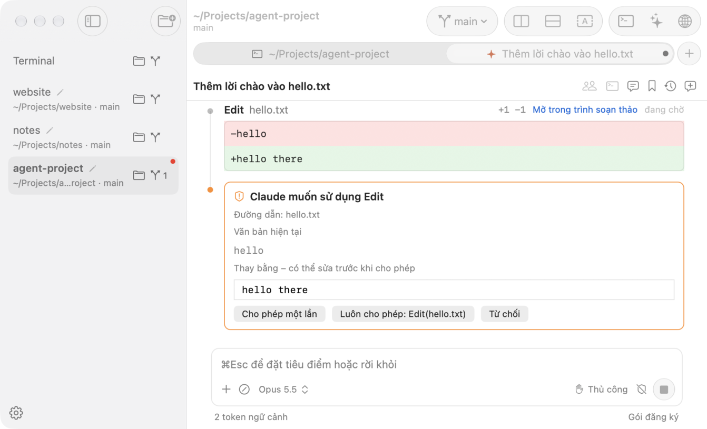

<p>&nbsp;&nbsp;&nbsp;</p>

# Tapa

**Terminal chính gốc, nhanh cho macOS, nay có thêm chỗ cho tác nhân, tệp và trang web của bạn.**

Trước hết, Tapa là một terminal: lõi VT riêng và bộ kết xuất Metal, tab và khung chia chính gốc của macOS, một terminal nhanh trượt vào chỉ bằng một phím tắt, tích hợp shell với các khối lệnh, và một trường nhập tùy chọn với gợi ý theo phong cách Warp. Xung quanh đó, Tapa trở thành em gái của [Dango](https://github.com/sventmueller/dango): một thanh bên chứa các không gian làm việc, mỗi thư mục dự án một không gian, mỗi không gian có các terminal của nó, tab tác nhân cho Claude, Codex, OpenCode, Antigravity và các tác nhân ACP khác, tab trình duyệt, trình soạn thảo kèm danh sách tệp và bảng Git, cùng bản xem trước Markdown của [Splat](https://github.com/sventmueller/splat) có công thức và sơ đồ. Không gì do một thư mục dự án cấu hình được chạy cho đến khi bạn tin cậy không gian làm việc của nó. Tapa được viết bằng Rust trên các điều khiển AppKit chính gốc, có 35 ngôn ngữ, không cần tài khoản và không có telemetry.

[](https://github.com/sventmueller/tapa/releases/latest/download/Tapa.dmg)

**[Tải Tapa.dmg](https://github.com/sventmueller/tapa/releases/latest/download/Tapa.dmg)**: được ký và được Apple công chứng, dành cho macOS 14 trở lên trên Apple Silicon và Intel.

**Bạn phát hiện lỗi?** Hãy [mở một issue](https://github.com/sventmueller/tapa/issues/new/choose) và cho biết lỗi xảy ra với shell nào, tác nhân nào hoặc chương trình nào. Nếu Tapa hữu ích với bạn, một [sao trên GitHub](https://github.com/sventmueller/tapa) sẽ giúp người khác tìm thấy nó.

[](https://www.rust-lang.org) [](https://www.apple.com/macos/)  [](https://github.com/madsmtm/objc2) [](https://developer.apple.com/metal/) [](https://agentclientprotocol.com)    [](#giấy-phép)

[Bahasa Indonesia](../id/README.md) · [Bahasa Melayu](../ms/README.md) · [Català](../ca/README.md) · [Čeština](../cs/README.md) · [Dansk](../da/README.md) · [Deutsch](../de/README.md) · [English](../../../README.md) · [Español](../es/README.md) · [Français](../fr/README.md) · [Hrvatski](../hr/README.md) · [Italiano](../it/README.md) · [Magyar](../hu/README.md) · [Nederlands](../nl/README.md) · [Norsk](../no/README.md) · [Polski](../pl/README.md) · [Português (Brasil)](../pt_BR/README.md) · [Português (Portugal)](../pt_PT/README.md) · [Română](../ro/README.md) · [Slovenčina](../sk/README.md) · [Slovenščina](../sl/README.md) · [Suomi](../fi/README.md) · [Svenska](../sv/README.md) · **Tiếng Việt** · [Türkçe](../tr/README.md) · [Ελληνικά](../el/README.md) · [Русский](../ru/README.md) · [Українська](../uk/README.md) · [עברית](../he/README.md)‎ · [العربية](../ar/README.md)‎ · [हिन्दी](../hi/README.md) · [ไทย](../th/README.md) · [한국어](../ko/README.md) · [日本語](../ja/README.md) · [简体中文](../zh-Hans/README.md) · [繁體中文](../zh-Hant/README.md)

## Nội dung

- [Tính năng nổi bật](#tính-năng-nổi-bật)
- [Yêu cầu](#yêu-cầu)
- [Cài đặt](#cài-đặt)
- [Bắt đầu](#bắt-đầu)
- [Không gian làm việc](#không-gian-làm-việc)
- [Terminal](#terminal)
  - [Tab và chia khung](#tab-và-chia-khung)
  - [Tích hợp shell và khối lệnh](#tích-hợp-shell-và-khối-lệnh)
  - [Trường nhập và gợi ý](#trường-nhập-và-gợi-ý)
  - [Tìm kiếm, chọn và sao chép](#tìm-kiếm-chọn-và-sao-chép)
  - [Terminal nhanh](#terminal-nhanh)
- [Tác nhân](#tác-nhân)
- [Trình soạn thảo, tệp và Git](#trình-soạn-thảo-tệp-và-git)
- [Bản xem trước](#bản-xem-trước)
- [Trình duyệt](#trình-duyệt)
- [Đọc chính tả](#đọc-chính-tả)
- [Cửa sổ Cài đặt](#cửa-sổ-cài-đặt)
- [Giao diện và trợ năng](#giao-diện-và-trợ-năng)
- [Ngôn ngữ](#ngôn-ngữ)
- [Phím tắt](#phím-tắt)
- [Tin cậy](#tin-cậy)
- [Quyền riêng tư và bảo mật](#quyền-riêng-tư-và-bảo-mật)
- [Hạn chế đã biết](#hạn-chế-đã-biết)
- [Dành cho nhà phát triển](#dành-cho-nhà-phát-triển)
  - [Thành phần của bên thứ ba](#thành-phần-của-bên-thứ-ba)
- [Giấy phép](#giấy-phép)

## Tính năng nổi bật

- **Một terminal nhanh của riêng nó.** Tapa phân tích bằng lõi VT riêng và vẽ bằng Metal trên một luồng cho mỗi màn hình, theo đúng tần số của màn hình, và chỉ vẽ những gì đã thay đổi. Nó vượt qua 262 bài kiểm tra esctest, trong khi lõi của Alacritty vượt qua 121, và mọi thay đổi trên nó đều được đo so với một bản Ghostty cố định phiên bản.
- **Chính gốc đến tận cốt lõi.** Tab macOS thật, khôi phục cửa sổ, menu, menu Dịch vụ, thông báo, Nhập dùng Bàn phím An Toàn, đọc chính tả và phương thức nhập. Không có Electron, và chỉ dùng WebKit ở nơi một trang web hoặc bản xem trước cần đến.
- **Không gian làm việc.** Thanh bên chứa mỗi thư mục dự án một không gian làm việc, mỗi không gian có tab, nhánh và bảng riêng. Không gian làm việc "Terminal" ở trên cùng luôn bắt đầu mới mỗi lần; tất cả không gian khác được giữ lại cho đến khi bạn xóa chúng.
- **Tác nhân trong một giao diện trò chuyện chính gốc.** Claude, Codex, OpenCode, Antigravity, Gemini CLI và các tác nhân khác của Agent Client Protocol chạy trong tab riêng, với câu trả lời, lệnh gọi công cụ, diff và yêu cầu cấp quyền trên cùng một dòng thời gian. Tapa cài đặt và cập nhật chúng khi bạn yêu cầu.
- **Tích hợp shell và khối lệnh** cho zsh, bash và fish, cả qua `ssh`: nhảy từ dấu nhắc này sang dấu nhắc khác, chọn, sao chép, lưu và thu gọn đầu ra của một lệnh, xem những lệnh nào thất bại và mỗi lệnh mất bao lâu.
- **Một trường nhập như của Warp, nếu bạn muốn.** Sửa dòng lệnh như văn bản, với gợi ý từ lịch sử của bạn, từ đặc tả của hơn 700 công cụ dòng lệnh và từ trạng thái của dự án, tất cả đều trên máy Mac của bạn.
- **Tệp, Git và trình duyệt ngay cạnh shell.** Trình soạn thảo tô màu cú pháp, danh sách tệp, bảng Git với staging, commit, nhánh và worktree, bản xem trước Markdown có công thức và sơ đồ, cùng các tab trình duyệt.
- **Cẩn trọng với thư mục của bạn.** Một không gian làm việc bạn chưa tin cậy sẽ không khởi chạy bất cứ thứ gì thư mục của nó cấu hình: không git hook, không máy chủ MCP của dự án, không cài đặt dự án cho tác nhân, không JavaScript trong các trang tệp của nó.
- **Riêng tư.** Không tài khoản, không telemetry. Tapa chỉ kết nối mạng khi bạn yêu cầu, và lịch sử được khôi phục trên đĩa được mã hóa bằng một khóa trong chuỗi khóa của bạn.
- **Bằng ngôn ngữ của bạn.** Giao diện có 35 ngôn ngữ: Ả Rập, Catalan, Trung Quốc (Giản thể), Trung Quốc (Phồn thể), Croatia, Séc, Đan Mạch, Hà Lan, Anh, Phần Lan, Pháp, Đức, Hy Lạp, Do Thái, Hindi, Hungary, Indonesia, Ý, Nhật, Hàn, Mã Lai, Na Uy, Ba Lan, Bồ Đào Nha (Brazil), Bồ Đào Nha (Bồ Đào Nha), Romania, Nga, Slovakia, Slovenia, Tây Ban Nha, Thụy Điển, Thái, Thổ Nhĩ Kỳ, Ukraina và Việt Nam.

## Yêu cầu

- macOS 14 Sonoma trở lên, trên Apple Silicon hoặc Intel. Tapa được phát triển và thử nghiệm trên macOS 27.
- zsh, bash hoặc fish cho tích hợp shell; các shell khác vẫn chạy nhưng không có tích hợp này.
- Với tab tác nhân, cần có tác nhân bạn muốn dùng, đã được cài sẵn hoặc do Tapa cài khi bạn yêu cầu (xem [Tác nhân](#tác-nhân)).

## Cài đặt

**Từ ảnh đĩa.** Mỗi bản phát hành là một ảnh đĩa, `Tapa-<version>.dmg`, chứa một ứng dụng universal duy nhất cho Apple Silicon và Intel, được ký bằng Developer ID và được Apple công chứng. Mở ảnh đĩa và kéo Tapa vào thư mục Ứng dụng.

**Với Homebrew.** Cask trong một tap riêng cài đúng ảnh đĩa đó:

```sh
brew install --cask sventmueller/tap/tapa
```

**Cập nhật.** Tapa cài từ ảnh đĩa hoặc Homebrew tự cập nhật nhờ [Sparkle](https://sparkle-project.org). Ở lần mở thứ hai, Tapa hỏi xem nó có được tự tìm bản cập nhật hay không; cho đến khi bạn đồng ý, nó không gửi yêu cầu nào. **Tapa › Kiểm tra cập nhật…** kiểm tra ngay lập tức. Tapa chỉ cài bản cập nhật nếu nó mang chữ ký của nhà phát triển. Bản tự build không có trình cập nhật.

**Từ mã nguồn.** Xem [Dành cho nhà phát triển](#dành-cho-nhà-phát-triển).

**Làm terminal mặc định.** Tapa có thể mở các script shell (`.command`, `.tool`), thư mục được thả lên biểu tượng của nó và liên kết `ssh://`. Hãy chọn nó trong Finder qua **Tệp › Lấy thông tin › Mở bằng**.

## Bắt đầu

1. **Cửa sổ** có thanh bên chứa các không gian làm việc ở bên trái, các tab của không gian làm việc đang chọn ở trên cùng và thanh công cụ phía trên chúng. ⌃⌘S hiện và ẩn thanh bên.
2. **Một không gian làm việc mới** được tạo từ nút thư mục ở đầu thanh bên, hoặc **Shell › Không gian làm việc mới…** (⇧⌘N): chọn một trong các thư mục gần đây hoặc **Chọn thư mục…**.
3. **Tab mới** bắt đầu trong thư mục của không gian làm việc: ⌘T cho một terminal, các nút ở bên phải thanh công cụ cho một tab terminal, tác nhân hoặc trình duyệt, hoặc nút **+** ở cuối thanh tab.
4. **Cài đặt** mở bằng ⌘, hoặc nút bánh răng ở cuối thanh bên.
5. **Bảng lệnh** (⇧⌘P) tìm mọi lệnh theo tên, và **Tìm tab…** (⌘P) tìm mọi tab của mọi không gian làm việc.

Từ trái sang, thanh công cụ chứa menu kéo xuống chọn nhánh của kho mã thuộc không gian làm việc, các nút để chia terminal sang phải và xuống dưới và để hiện trường nhập, cùng các nút tạo tab terminal, tác nhân và trình duyệt mới. Các nút chia khung và trường nhập chuyển sang màu xám khi không có tab terminal nào ở phía trước.

## Không gian làm việc

Một không gian làm việc là một thư mục cùng các tab của nó. Hàng của nó trên thanh bên hiển thị tên, thư mục và nhánh Git, và ở bên phải là các nút cho danh sách tệp và bảng Git. Bấm vào một trong hai nút sẽ hiện bảng đó thay cho danh sách không gian làm việc; **Không gian làm việc** ở trên cùng đưa bạn quay lại.

- **Không gian làm việc "Terminal"** luôn ở trên cùng. Nó bắt đầu mới mỗi lần khởi chạy, trong thư mục mà cài đặt chỉ định, với một terminal trống. Không gì trong đó được lưu lại, và nó không thể được đổi tên hay xóa.
- **Mọi không gian làm việc khác được giữ lại** cho đến khi bạn xóa chúng, kể cả khi không còn tab nào. Tapa giữ tên, các tab, nội dung các terminal (trong phạm vi cài đặt khôi phục cho phép), các phiên tác nhân và vị trí cửa sổ. Các chương trình còn đang chạy sẽ kết thúc khi Tapa thoát.
- **Đổi tên.** Bấm vào cây bút sau tên, bấm vào tên của không gian làm việc đang chọn, hoặc chọn **Shell › Đổi tên không gian làm việc**. Tên được lưu ngay lập tức.
- **Trạng thái.** Một chấm xanh lá trên hàng nghĩa là một tác nhân của không gian làm việc đang làm việc, kể cả với tác nhân con hoặc ở chế độ nền; một chấm đỏ nghĩa là một tác nhân đang chờ bạn. Terminal không đánh dấu gì ở đó.
- **Chuyển đổi.** ⌃⌘[ và ⌃⌘] chuyển giữa các không gian làm việc. Cửa sổ giữ nguyên vị trí, và các tab của không gian làm việc được chọn thế chỗ cho các tab khác.
- **Worktree.** **Worktree mới…** trong menu kéo xuống chọn nhánh trên thanh công cụ tạo một worktree Git trên một nhánh mới và mở nó thành một không gian làm việc riêng.

Khi tab cuối cùng của một không gian làm việc đóng lại, không gian làm việc đó vẫn ở trong danh sách. Khi mọi tab đều đã đóng, chỉ cửa sổ biến mất; biểu tượng trên Dock hoặc ⌘N đưa nó trở lại cùng các không gian làm việc.

## Terminal

Tapa chạy trên lõi riêng, `term-vt`. Nó hiểu xterm và VT520 với giao thức bàn phím Kitty, siêu liên kết OSC 8, truy cập bảng nhớ tạm qua OSC 52 với quyền đọc riêng biệt, đầu ra đồng bộ, gạch chân có màu và gạch chân lượn sóng, truecolor, truy vấn màu, báo chế độ sáng và tối cho chương trình, dán có đánh dấu (bracketed paste), sự kiện tiêu điểm và báo cáo chuột. Văn bản tự dàn lại khi cửa sổ đổi kích thước, kể cả lịch sử. Chữ ghép, tính năng phông chữ, ký hiệu Nerd Font mà không cần phông đã vá, cùng ký tự vẽ khung, Powerline và Braille chính xác đến từng điểm ảnh đều có sẵn.

### Tab và chia khung

- **Tab** là tab của chính macOS: kéo để sắp xếp lại hoặc kéo ra thành cửa sổ riêng, **Hiển thị Tất cả Tab** (⇧⌘\\), ⌘1 đến ⌘8, ⌘9 cho tab cuối cùng, và ⇧⌘[ / ⇧⌘] để chuyển tab. Mỗi tab hiển thị biểu tượng loại của nó trước tiêu đề.
- **Chia khung.** **Chia sang phải** (⌘D hoặc ⌃⌘T) và **Chia xuống dưới** (⇧⌘D hoặc ⌃⌥⌘T), lồng nhau sâu bao nhiêu tùy ý. Kéo đường phân cách, di chuyển nó bằng ⌃⌘ và các phím mũi tên, **Phóng to khung** (⌃⇧⌘↩), **Cân bằng các khung** (⌃⌘=), và chuyển giữa các khung bằng ⌘[ và ⌘].
- **Thư mục làm việc.** Tab, cửa sổ và khung chia mới bắt đầu trong thư mục của terminal đang ở phía trước; cài đặt quyết định điều này cho từng loại trong ba loại đó.
- **Đóng.** Tapa hỏi trước khi đóng một tab, một cửa sổ hoặc ứng dụng khi có chương trình đang chạy trong đó.
- **Khôi phục.** Sau khi khởi động lại, các không gian làm việc, tab, khung, thư mục và những dòng cuối của mỗi terminal đều trở lại. Các bí mật như token và mật khẩu được che đi trước khi bất cứ thứ gì được lưu.

### Tích hợp shell và khối lệnh

Tapa tự thiết lập tích hợp shell cho zsh, bash và fish mà không đụng tới các tệp cấu hình của bạn, và mang theo nó khi bạn `ssh` sang máy chủ khác. Với tích hợp này, mỗi lệnh và đầu ra của nó tạo thành một khối:

- **Dấu nhắc.** ⌘↑ và ⌘↓ nhảy tới dấu nhắc trước và sau. Bấm vào dòng lệnh sẽ đưa con trỏ tới đó.
- **Khối.** **Chọn khối** (⇧⌘A), **Sao chép đầu ra** (⌥⌘C), **Lưu đầu ra…** (⌥⌘S) và **Thu gọn/mở rộng khối** (⇧⌘↩). Trên khối nằm dưới con trỏ chuột, các nút hiển thị trạng thái, thời lượng và cùng những thao tác đó.
- **Lệnh thất bại** được đánh dấu, và lệnh còn đang chạy vẫn hiển thị ở trên cùng trong khi đầu ra của nó cuộn đi.
- **Dấu trang.** **Đặt/bỏ dấu trang** (⇧⌘M) đánh dấu một dòng; ⇧⌘↑ và ⇧⌘↓ nhảy giữa các dấu trang.
- **Thông báo** xuất hiện khi một chương trình yêu cầu (OSC 9 và OSC 777) và terminal không ở phía trước, còn thanh tiến trình (OSC 9;4) hiển thị trên tab và trên biểu tượng Dock.

### Trường nhập và gợi ý

Trường nhập biến dòng lệnh thành một trường văn bản ở cuối khung, như trong Warp, với các nhãn cho thư mục và nhánh Git ở phía trên. **Hiện/ẩn trường nhập** (⌘I) hoặc nút trên thanh công cụ bật tắt nó cho một terminal; **Cài đặt › Nhập liệu** bật nó cho các terminal mới. Nó cần tích hợp shell và tự nhường chỗ cho các chương trình toàn màn hình như vim, htop hay claude.

- **Return** gửi toàn bộ trường tới shell, văn bản nhiều dòng như một lần dán; shell chạy và ghi nhớ nó như thường lệ. Nếu shell cần thêm, trường sẽ trả lại các phím cho shell cho tới dấu nhắc tiếp theo.
- **↑, ↓ và ⌃R** tìm trong lịch sử của bạn, kèm thư mục, nhánh và mã thoát mà mỗi lệnh đã chạy cùng.
- **Tab** hoàn thành bằng đặc tả của hơn 700 công cụ dòng lệnh, đường dẫn, và các giá trị trực tiếp như nhánh git, container docker, tài nguyên kubectl, máy chủ ssh, script trong `package.json` và các target của make, just và cargo.
- **Phím Vim** trong trường là một công tắc trong cùng phần cài đặt đó.
- **Lệnh tiếp theo trước khi bạn gõ**: thứ thường đi tiếp trong dự án này (sau `git add` là `git commit`), thứ trạng thái dự án đòi hỏi (một tệp lock mới hơn `node_modules`), và cách sửa sau "command not found", dựa trên lỗi gõ hoặc chỉ mục Homebrew cục bộ của bạn.

Khi không có trường nhập, gợi ý hiển thị dưới dạng chữ xám phía sau con trỏ, và → nhận gợi ý. Các shell có gợi ý tự động riêng, như fish hay zsh-autosuggestions, vẫn giữ gợi ý của chúng. Gợi ý không bao giờ dùng mạng, và chỉ khởi chạy chương trình từ `PATH` của chính bạn, không bao giờ từ thư mục dự án.

**Dán.** Các lần dán nhiều dòng có thể được hiển thị trước khi chạy (**Hiển thị trước khi dán nhiều dòng**). Tệp thả vào terminal sẽ đến dưới dạng đường dẫn trong dấu ngoặc kép; ⌥←/→, ⌘←/→ và ⌘⌫ di chuyển và xóa theo từ và theo dòng như trong mọi trường văn bản trên Mac.

### Tìm kiếm, chọn và sao chép

- **Tìm** (⌘F) tìm trong lịch sử bằng biểu thức chính quy, phân biệt chữ hoa chữ thường và nguyên từ, và đếm số kết quả; thanh cuộn đánh dấu chúng cùng với các dấu nhắc và lỗi.
- **Chọn thông minh.** Nhấp đúp chọn trọn một URL, một đường dẫn, một mã băm hoặc một địa chỉ IP, và kéo với ⌥ chọn một vùng chữ nhật. Liên kết được nhận ra ngay cả khi không có OSC 8; ⌘-bấm để mở, và mở đường dẫn trong Dango nếu Dango đã được cài.
- **Chọn bằng bàn phím** (⇧⌘C) di chuyển vùng chọn bằng các phím của Vim.
- **Sao chép kèm định dạng** (⇧⌥⌘C) giữ màu và kiểu chữ; sao chép khi chọn là một tùy chọn cài đặt. **Xóa sạch** (⌘K) xóa nội dung terminal.

### Terminal nhanh

**Hiện/ẩn Terminal nhanh** (⌃⌥⌘Space) cho một terminal trượt vào từ một cạnh màn hình, nằm trên các ứng dụng khác và trên các không gian toàn màn hình, mà không phải chuyển ứng dụng. Cạnh màn hình, kích thước và việc nó có tự ẩn khi bạn bấm chỗ khác hay không đều là tùy chọn cài đặt. Các phiên của nó vẫn tiếp tục chạy khi nó bị ẩn.

## Tác nhân

Một tab tác nhân chạy một tác nhân lập trình trong thư mục của không gian làm việc, trong giao diện tác nhân chính gốc lấy từ Dango.

| Tác nhân | Cách chạy | Cần gì |
|---|---|---|
| Claude | lệnh `claude`, giao tiếp qua giao thức stream-json của nó | `claude` đã cài và đã đăng nhập; Tapa cài nó bằng trình cài đặt của chính Claude khi bạn yêu cầu |
| Codex | `codex app-server`, hoặc `codex-acp` cho Codex đời cũ | `codex` đã đăng nhập; Tapa cài bộ chuyển đổi cố định phiên bản khi bạn yêu cầu |
| OpenCode | `opencode serve`, hoặc `opencode acp` cho OpenCode đời cũ | `opencode` của riêng bạn trong `PATH`, hoặc bản tải về cố định phiên bản |
| Antigravity | `agy acp` | `agy` của riêng bạn trong `PATH`, hoặc bản tải về cố định phiên bản |
| Gemini CLI | `gemini --acp`, được cung cấp khi bạn bật nó trong **Cài đặt › Tác nhân** | `gemini` của riêng bạn, hoặc bản tải về cố định phiên bản |
| Các tác nhân ACP khác | từ sổ đăng ký ACP, chỉ được tải khi bạn yêu cầu | những gì mục trong sổ đăng ký nêu ra; các mục không có checksum chỉ được cài sau khi bạn xác nhận |

Tapa dùng cách đăng nhập riêng của từng tác nhân và không lưu thông tin xác thực nào của tác nhân. Tác nhân tìm thấy trong `PATH` của shell đăng nhập được ưu tiên; nếu không, Tapa chạy phiên bản mà nó đã cài vào thư mục dữ liệu riêng của mình, không bao giờ chạy chương trình từ không gian làm việc.

- **Dòng thời gian** hiển thị câu trả lời, lệnh gọi công cụ cùng đầu ra và diff của chúng, câu hỏi và yêu cầu cấp quyền. **Cho phép một lần**, **Luôn cho phép** và **Từ chối** trả lời một yêu cầu, và một chỉnh sửa có thể được thay đổi trước khi bạn cho phép.
- **Trạng thái.** Tab và hàng của không gian làm việc hiển thị chấm xanh lá khi tác nhân đang làm việc và chấm đỏ khi nó đang chờ bạn, và một thông báo cho bạn biết khi nó đang chờ trong lúc bạn nhìn sang chỗ khác.
- **Trường tin nhắn** ở dưới cùng nhận prompt của bạn, các tệp thả vào đó và nội dung đọc chính tả. ⌘Esc chuyển tiêu điểm bàn phím vào đó và quay lại. Có thể chọn mô hình và chế độ cấp quyền cho phiên ngay tại đó.
- **Cài đặt › Tác nhân** đặt cho các phiên mới chế độ cấp quyền (Claude, Codex), mô hình (Claude, Codex, OpenCode) và mức độ suy luận (Claude, Codex), cùng những tác nhân mà tab mới đề xuất. Tại đó hiển thị vị trí chương trình của từng tác nhân, kèm **Cài…**, **Cập nhật lên …** và **Quay lại …** cho phiên bản trước, và **Tải sổ đăng ký** cho sổ đăng ký ACP. Các quy tắc Claude đã lưu bằng "Luôn cho phép" có thể được xem và xóa ở đó.
- **Bản tải về được kiểm tra.** Tệp nén được đối chiếu với SHA-256 của chúng, gói npm với giá trị integrity trong tệp lock, và các gói không có phiên bản cố định bị từ chối. Một tác nhân còn thiếu cũng đề xuất cài đặt ngay trong tab của nó.

## Trình soạn thảo, tệp và Git

- **Danh sách tệp** của một không gian làm việc hiển thị thư mục của nó dưới dạng cây, được cập nhật khi tệp thay đổi, với các tệp Git bỏ qua được làm mờ nếu bạn muốn. Một lần bấm mở tệp dưới dạng tab xem trước, tab này bị lần bấm tiếp theo thay thế cho đến khi bạn sửa nó; nhấp đúp sẽ giữ nó lại.
- **Trình soạn thảo** mở tệp trong các tab của không gian làm việc, với tô màu cú pháp, nhiều con trỏ, thu gọn mã, thụt lề theo `.editorconfig`, phím Vim tùy chọn và dấu cho những gì đã thay đổi kể từ commit gần nhất. Nó nhận biết khi một tệp đã thay đổi trên đĩa hoặc chứa dấu xung đột. Tệp Markdown có thêm thanh định dạng và **Mở trong Splat**. **Lưu** (⌘S), **Lưu thành…** và **Lưu tất cả** hoạt động như thường lệ, và Tapa hỏi trước khi đóng văn bản chưa lưu.
- **Sau một sự cố**, văn bản chưa lưu sẽ trở lại: Tapa giữ các bản sao được mã hóa của nó trong khi bạn gõ.
- **Bảng Git** hiển thị các thay đổi đã stage và chưa stage, stage và bỏ stage từng tệp và từng hunk, commit (⌘↩), sửa commit gần nhất (amend), commit rồi push, fetch, và xử lý nhánh, stash, cherry-pick và xung đột, với lịch sử commit ở bên dưới. Bấm vào một tệp sẽ hiện diff của nó.
- **Menu kéo xuống chọn nhánh** trên thanh công cụ chuyển và tạo nhánh, và tạo worktree.

Trình soạn thảo không khởi chạy trình định dạng hay máy chủ ngôn ngữ nào. Nếu cần một IDE đầy đủ với máy chủ ngôn ngữ và trình gỡ lỗi, hãy dùng [Dango](https://github.com/sventmueller/dango).

## Bản xem trước

- **Markdown** hiển thị bên cạnh trình soạn thảo qua bộ kết xuất của Splat: GitHub Flavored Markdown có công thức, sơ đồ và hình ảnh, cuộn theo từng đoạn cùng với văn bản.
- **Hình ảnh** mở trong tab riêng, PDF qua PDFKit, còn âm thanh, phim, phông chữ và tài liệu văn phòng qua Quick Look.
- **Giải mã cô lập.** Mọi hình ảnh từ nguồn không đáng tin (tệp dự án, Markdown, tệp đính kèm và nội dung dán của tác nhân) được giải mã trong dịch vụ `Decoder.xpc` của Splat, trong một App Sandbox riêng không có tệp và không có mạng, không bao giờ trong ứng dụng.

## Trình duyệt

**Tab trình duyệt mới** (⇧⌘B) mở một tab WebKit trong không gian làm việc. Trường địa chỉ nhận một địa chỉ hoặc các từ khóa cho công cụ tìm kiếm bạn chọn (DuckDuckGo, Google, Bing hoặc Startpage); ⌘L, ⌘R, ⌘[ và ⌘] hoạt động như trong Safari. Các trang từ `localhost` chạy bình thường, dành cho máy chủ phát triển của dự án. Tệp HTML của một không gian làm việc chỉ được đọc thư mục của chính nó, và trong không gian làm việc bạn chưa tin cậy, chúng không chạy JavaScript.

## Đọc chính tả

Đọc chính tả vào trường tin nhắn của tác nhân hoặc vào trình soạn thảo bằng nút micrô hoặc **Sửa › Bắt đầu đọc chính tả** (⌃⌥D). Công nghệ nhận dạng giọng nói là của [Lowspeak](https://github.com/sventmueller/lowspeak), không cần cài đặt riêng. **Cài đặt › Đọc chính tả** chọn chép lời trực tuyến với OpenAI hoặc Groq, hoặc mô hình cục bộ Whisper và Parakeet giữ bản ghi âm trên máy Mac của bạn, cùng ngôn ngữ, bước hậu xử lý, micrô và từ vựng riêng của bạn. Khóa cho OpenAI và Groq được giữ trong chuỗi khóa của bạn. Đọc chính tả chỉ có trong bản phát hành.

## Cửa sổ Cài đặt

**Tapa › Cài đặt…** (⌘,) có các trang Chung, Phông chữ, Màu, Con trỏ, Terminal, Nhập liệu, Trình soạn thảo, Tác nhân, Đọc chính tả, Hồ sơ và Phím tắt. Chúng ghi vào một tệp TOML duy nhất, `config.toml` trong thư mục của Tapa dưới `~/Library/Application Support`, tệp này bạn cũng có thể sửa bằng tay; Tapa tải lại nó trong lúc chạy, và **Tải lại cài đặt** (⇧⌘,) làm việc đó ngay lập tức.

- **Bốn cỡ chữ** trong Chung: Giao diện (thanh bên, các bảng, danh sách tệp, bảng Git và tiêu đề tab), Trình soạn thảo (văn bản, số dòng và bản xem trước Markdown), Terminal và Tác nhân. ⌘+, ⌘− và ⌘0 đổi cỡ chữ của terminal đang ở phía trước.
- **Diện mạo:** Sáng, Tối hoặc Giống Hệ thống.
- **Màu.** Một chủ đề cho chế độ sáng và một cho chế độ tối, theo định dạng chủ đề của Ghostty, với độ tương phản tối thiểu giúp văn bản vẫn dễ đọc trên một chủ đề kém. Chủ đề của riêng bạn đặt vào thư mục chủ đề.
- **Hồ sơ** gom phông chữ, màu, shell, môi trường và thư mục lại với nhau.
- **Phím tắt** đều có thể thay đổi, và các xung đột được hiển thị.

## Giao diện và trợ năng

- **Chế độ tối** theo hệ thống hoặc theo lựa chọn của bạn; màu nhấn, Giảm chuyển động và Tăng độ tương phản đều được tôn trọng.
- **VoiceOver** đọc các dòng và dấu nhắc của terminal và thông báo đầu ra mới; thanh bên, các tab, nút trên thanh công cụ và các thẻ trên dòng thời gian của tác nhân đều có tên.
- **Bàn phím.** Mọi lệnh đều có mục menu và phím tắt, và Truy cập bàn phím toàn phần tới được mọi điều khiển.
- **Kích thước.** Bốn cỡ chữ trong cài đặt điều chỉnh độc lập giao diện, trình soạn thảo, terminal và tác nhân.
- **Từ phải sang trái.** Giao diện được lật gương trong tiếng Ả Rập và tiếng Do Thái, còn lưới terminal vẫn từ trái sang phải.

Chi tiết và những thiếu sót đã biết có trong [ACCESSIBILITY.md](../../../ACCESSIBILITY.md).

## Ngôn ngữ

Giao diện được dịch sang 35 ngôn ngữ: Ả Rập, Catalan, Trung Quốc (Giản thể), Trung Quốc (Phồn thể), Croatia, Séc, Đan Mạch, Hà Lan, Anh, Phần Lan, Pháp, Đức, Hy Lạp, Do Thái, Hindi, Hungary, Indonesia, Ý, Nhật, Hàn, Mã Lai, Na Uy, Ba Lan, Bồ Đào Nha (Brazil), Bồ Đào Nha (Bồ Đào Nha), Romania, Nga, Slovakia, Slovenia, Tây Ban Nha, Thụy Điển, Thái, Thổ Nhĩ Kỳ, Ukraina và Việt Nam.

Tapa theo thứ tự ngôn ngữ trong **Cài đặt hệ thống › Cài đặt chung › Ngôn ngữ & Vùng**; tại đó bạn cũng có thể chọn riêng một ngôn ngữ cho Tapa trong **Ứng dụng**. Nếu không có bản dịch cho ngôn ngữ của bạn, nó dùng tiếng Anh.

## Phím tắt

| Thao tác | Phím tắt |
|---|---|
| Cửa sổ, không gian làm việc, tab mới | ⌘N, ⇧⌘N, ⌘T |
| Tab trình duyệt mới | ⇧⌘B |
| Tệp mới, mở tệp | ⌥⌘N, ⌘O |
| Đóng khung hoặc tab, đóng tab, đóng cửa sổ | ⌘W, ⌥⌘W, ⇧⌘W |
| Chia sang phải, chia xuống dưới | ⌘D hoặc ⌃⌘T, ⇧⌘D hoặc ⌃⌥⌘T |
| Phóng to khung, cân bằng các khung, đóng khung | ⌃⇧⌘↩, ⌃⌘=, ⌃⇧⌘W |
| Di chuyển đường phân cách | ⌃⌘←, ⌃⌘→, ⌃⌘↑, ⌃⌘↓ |
| Khung sau, khung trước | ⌘], ⌘[ |
| Tab sau, tab trước; tab 1 đến 8, tab cuối | ⇧⌘], ⇧⌘[; ⌘1 đến ⌘8, ⌘9 |
| Không gian làm việc sau, trước | ⌃⌘], ⌃⌘[ |
| Tìm tab, bảng lệnh | ⌘P, ⇧⌘P |
| Hiện hoặc ẩn thanh bên, trường nhập | ⌃⌘S, ⌘I |
| Terminal nhanh | ⌃⌥⌘Space |
| Tìm, tìm tiếp, tìm ngược lại | ⌘F, ⌘G, ⇧⌘G |
| Dấu nhắc trước, sau | ⌘↑, ⌘↓ |
| Chọn khối, sao chép đầu ra, lưu đầu ra, thu gọn khối | ⇧⌘A, ⌥⌘C, ⌥⌘S, ⇧⌘↩ |
| Đặt hoặc bỏ dấu trang; dấu trang trước, sau | ⇧⌘M; ⇧⌘↑, ⇧⌘↓ |
| Chọn bằng bàn phím | ⇧⌘C |
| Sao chép kèm định dạng | ⇧⌥⌘C |
| Xóa sạch | ⌘K |
| Đầu, cuối, lên một trang, xuống một trang | ⌘Home, ⌘End, ⌘PageUp, ⌘PageDown |
| Phóng to, thu nhỏ, cỡ gốc (terminal) | ⌘+, ⌘−, ⌘0 |
| Trường tin nhắn của tab tác nhân | ⌘Esc |
| Bắt đầu đọc chính tả | ⌃⌥D |
| Cài đặt, tải lại cài đặt | ⌘,, ⇧⌘, |

Mọi phím tắt đều có thể thay đổi trong **Cài đặt › Phím tắt** hoặc trong phần `[keys]` của tệp cài đặt.

## Tin cậy

Một thư mục dự án có thể khiến chương trình chạy ngay khi có thứ gì đó khởi động trong nó: git hook và các cài đặt kho mã như `core.fsmonitor`, hook của tác nhân, máy chủ MCP của dự án và cài đặt dự án của tác nhân. Vì vậy, một không gian làm việc mới không được tin cậy.

- **Không được tin cậy:** tác nhân khởi động mà không có hook, máy chủ MCP và cấu hình của dự án (Claude với `--setting-sources=user --strict-mcp-config`, Codex với thư mục được đánh dấu là không đáng tin, OpenCode không có cấu hình của dự án). Git chạy ở trạng thái vô hiệu hóa: không hook, bộ lọc, trình điều khiển diff, fsmonitor, `sshCommand` hay pager, và chỉ dùng các trình trợ giúp thông tin xác thực toàn cục. Tệp HTML mở mà không có JavaScript. Bảng Git và tab tác nhân thông báo điều này và đề nghị tin cậy không gian làm việc.
- **Được tin cậy:** **Shell › Tin cậy không gian làm việc** nạp tất cả những thứ đó như thư mục dự định. **Thu hồi tin cậy** rút lại điều đó. Sự tin cậy được lưu theo từng không gian làm việc.

Dù mức tin cậy thế nào, Tapa không bao giờ tự chạy một chương trình từ thư mục dự án: gợi ý chỉ khởi chạy chương trình từ `PATH` của bạn bên ngoài dự án, và thanh bên đọc trạng thái Git từ các tệp `.git`. Một không gian làm việc trong thư mục nhà của bạn, như "Terminal", không phải là dự án: các chương trình dưới `~` như `~/.local/bin/claude` được coi là của chính bạn ở đó.

## Quyền riêng tư và bảo mật

- **Không telemetry, không tài khoản.** Tapa không báo cáo gì về cách bạn sử dụng nó và hoạt động hoàn toàn ngoại tuyến. Nó chỉ kết nối mạng khi bạn yêu cầu: để cài đặt hoặc cập nhật một tác nhân, để tải sổ đăng ký ACP, để kiểm tra cập nhật sau khi bạn đã đồng ý, và cho các trang bạn mở trong tab trình duyệt. Bản thân các tác nhân vẫn liên lạc với nhà cung cấp của chúng như mọi khi.
- **Lịch sử trên đĩa** dùng để khôi phục phiên được mã hóa bằng một khóa trong chuỗi khóa của bạn, có thể tắt, và các bí mật như khóa API, token và mật khẩu được che đi trước khi ghi. Các bản sao văn bản chưa lưu của trình soạn thảo được mã hóa bằng cùng khóa đó.
- **Nhập dùng Bàn phím An Toàn** tự bật khi có dấu nhắc nhập mật khẩu, và có thể bật vĩnh viễn trong menu ứng dụng.
- **Chuỗi thoát** có thể làm lộ hoặc chèn dữ liệu, như báo cáo tiêu đề, đọc bảng nhớ tạm và các mánh dán, đều bị chặn hoặc phải hỏi trước. Bộ phân tích được kiểm thử fuzzing trong CI.
- **Giải mã cô lập** cho hình ảnh từ nguồn không đáng tin, xem [Bản xem trước](#bản-xem-trước).
- **Ký mã** với Hardened Runtime. macOS quy quyền truy cập của các chương trình trong terminal cho Tapa, nên Tapa kèm theo một mô tả sử dụng cho mọi dịch vụ được bảo vệ.

Các vấn đề bảo mật được báo cáo riêng tư, xem [SECURITY.md](../../../SECURITY.md).

## Hạn chế đã biết

- **Chưa có hình ảnh nội dòng** trong terminal: đồ họa Kitty, Sixel và hình ảnh iTerm2 được lên kế hoạch sau bản 1.0.
- **Không có chế độ điều khiển tmux**, và các phiên không tồn tại sau khi thoát Tapa.
- **Văn bản từ phải sang trái** trong lưới terminal vẫn hiển thị từ trái sang phải.
- **⌘+ và ⌘−** chỉ thay đổi terminal đang ở phía trước.
- **Trình soạn thảo** không có máy chủ ngôn ngữ, trình định dạng hay trình gỡ lỗi, theo chủ ý; Dango có những thứ đó.
- **Đọc chính tả** chỉ có trong bản phát hành, không có trong bản gỡ lỗi.
- **VoiceOver** chưa được một người kiểm tra trọn vẹn từ đầu đến cuối.

## Dành cho nhà phát triển

Bạn cần macOS 14 trở lên với Xcode Command Line Tools, Rust theo phiên bản mà `rust-toolchain.toml` ghi (rustup với cả hai target Mac cho bản build universal), bản checkout của [splat](https://github.com/sventmueller/splat) và [lowspeak](https://github.com/sventmueller/lowspeak) nằm cạnh kho này (`../splat`, `../lowspeak`), và cmake cho các bản build có đọc chính tả.

| Lệnh | Tác dụng |
|---|---|
| `make help` | liệt kê các target |
| `cargo xtask run` | build ứng dụng gỡ lỗi và mở nó |
| `make build` | build ứng dụng phát hành có đọc chính tả vào `target/release`, ký ad hoc cho máy Mac này |
| `make lint` | định dạng, clippy coi cảnh báo là lỗi, hình thức của các tệp và văn bản giao diện |
| `make check` | `lint`, rồi tất cả các bài kiểm thử; không cần cửa sổ và không cần mạng |
| `make selftest STEPS="split_right,type:ls\n,shot:x"` | điều khiển ứng dụng và để lại ảnh cửa sổ trong `target/selftest/` |
| `make esctest`, `make vttest` | chạy esctest và vttest với cả hai lõi trong ứng dụng |
| `make perf` | phép đo hiệu năng so với một bản Ghostty cố định phiên bản; chỉ có ý nghĩa trên máy Mac đang rảnh |
| `make fuzz` | các target fuzzing với cargo-fuzz |
| `make release` | chạy thử bản phát hành: ứng dụng universal có đọc chính tả, ảnh đĩa của nó, nguồn cấp cập nhật và cask trong `target/release-dry-run`; không gửi gì đi đâu cả |
| `make release-notarized` | phiên bản hiện tại được ký bằng Developer ID, được Apple công chứng và đính kèm vé công chứng, vào `dist/`; `Cargo.toml` không đổi |
| `make deploy` | công chứng phiên bản tiếp theo, commit `Cargo.toml`, tải lên một bản phát hành nháp, push `main` và tag, rồi phát hành bản đó; xem [docs/development.md](../../../docs/development.md#deploy) |

Cách đóng góp nằm trong [CONTRIBUTING.md](../../../CONTRIBUTING.md). Mọi văn bản giao diện đều dùng tiếng Đức làm khóa, có bản dịch sang cả 35 ngôn ngữ; `cargo xtask strings` báo lỗi nếu thiếu một bản dịch.

### Thành phần của bên thứ ba

| Thành phần | Dùng cho | Giấy phép |
|---|---|---|
| [objc2](https://github.com/madsmtm/objc2) và các crate framework của nó | AppKit, Metal, WebKit và các framework khác của Apple | MIT, Zlib hoặc Apache-2.0 |
| Các crate của Splat | Markdown, bản xem trước, đọc Git, bộ giải mã hình ảnh và các bản dịch | MIT hoặc Apache-2.0 |
| [Lowspeak](https://github.com/sventmueller/lowspeak) với [whisper.cpp](https://github.com/ggml-org/whisper.cpp) | đọc chính tả | MIT |
| [Đặc tả tự hoàn thành của Fig](https://github.com/withfig/autocomplete) | mô tả lệnh trong các gợi ý | MIT |
| [rusqlite](https://github.com/rusqlite/rusqlite) với SQLite | lịch sử lệnh | MIT, phạm vi công cộng |
| [Simple Icons](https://simpleicons.org) | logo của ngôn ngữ và chương trình | CC0, một số logo theo điều khoản riêng |
| [Sparkle](https://sparkle-project.org) 2.10.1 | cập nhật cho bản phát hành | MIT |

## Giấy phép

Tapa được cấp phép theo một trong hai giấy phép sau

- Giấy phép Apache, Phiên bản 2.0 ([LICENSE-APACHE](../../../LICENSE-APACHE))
- Giấy phép MIT ([LICENSE-MIT](../../../LICENSE-MIT))

tùy bạn chọn. Các logo trong `assets/simple-icons` có giấy phép riêng, xem README ở đó.

Trừ khi bạn tuyên bố rõ ràng khác đi, mọi đóng góp được bạn cố ý gửi để đưa vào Tapa, theo định nghĩa trong giấy phép Apache-2.0, sẽ được cấp phép kép như trên, không có thêm điều khoản hay điều kiện nào.
