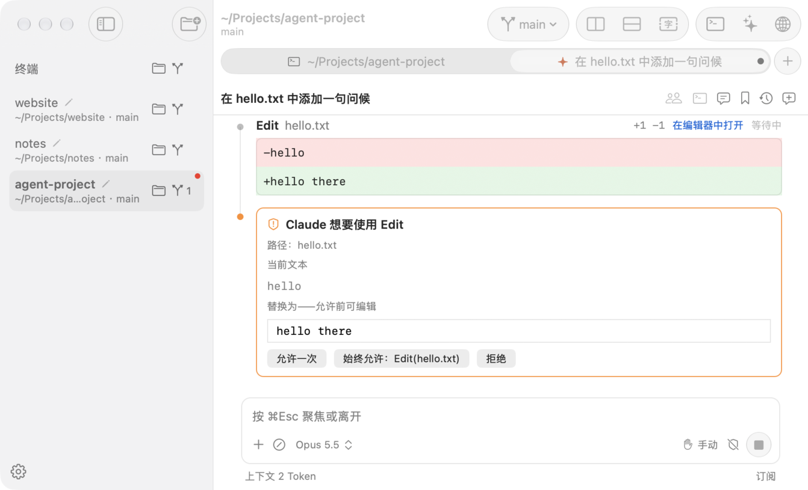

<p>&nbsp;&nbsp;&nbsp;</p>

# Tapa

**快速的原生 macOS 终端，还为你的智能体、文件和网页留出了空间。**

Tapa 首先是一个终端：自有的 VT 内核和 Metal 渲染器，原生的 macOS 标签页和拆分，一个快捷键就能滑入的快速终端，带命令块的 Shell 集成，以及可选的、带 Warp 风格建议的输入栏。在此基础上，Tapa 成长为 [Dango](https://github.com/sventmueller/dango) 的小妹妹：边栏中按项目文件夹列出工作区，每个工作区都有自己的终端、用于 Claude、Codex、OpenCode、Antigravity 及其他 ACP 智能体的智能体标签页、浏览器标签页、带文件列表和 Git 面板的编辑器，以及由 [Splat](https://github.com/sventmueller/splat) 提供、支持公式和图表的 Markdown 预览。项目文件夹所配置的任何东西，在你信任其工作区之前都不会运行。Tapa 用 Rust 编写，基于原生 AppKit 控件，支持 35 种语言，无需账户，没有遥测功能。

[](https://github.com/sventmueller/tapa/releases/latest/download/Tapa.dmg)

**[下载 Tapa.dmg](https://github.com/sventmueller/tapa/releases/latest/download/Tapa.dmg)**：已签名并经 Apple 公证的磁盘映像，适用于 Apple 芯片和 Intel 处理器上的 macOS 14 或更高版本。

**发现 Bug 了？** 请[提交 Issue](https://github.com/sventmueller/tapa/issues/new/choose)，并说明问题出现在哪个 Shell、哪个智能体或哪个程序中。如果 Tapa 对你有用，在 [GitHub 上点个 Star](https://github.com/sventmueller/tapa) 能帮助更多人找到它。

[](https://www.rust-lang.org) [](https://www.apple.com/macos/)  [](https://github.com/madsmtm/objc2) [](https://developer.apple.com/metal/) [](https://agentclientprotocol.com)    [](#许可证)

[Bahasa Indonesia](../id/README.md) · [Bahasa Melayu](../ms/README.md) · [Català](../ca/README.md) · [Čeština](../cs/README.md) · [Dansk](../da/README.md) · [Deutsch](../de/README.md) · [English](../../../README.md) · [Español](../es/README.md) · [Français](../fr/README.md) · [Hrvatski](../hr/README.md) · [Italiano](../it/README.md) · [Magyar](../hu/README.md) · [Nederlands](../nl/README.md) · [Norsk](../no/README.md) · [Polski](../pl/README.md) · [Português (Brasil)](../pt_BR/README.md) · [Português (Portugal)](../pt_PT/README.md) · [Română](../ro/README.md) · [Slovenčina](../sk/README.md) · [Slovenščina](../sl/README.md) · [Suomi](../fi/README.md) · [Svenska](../sv/README.md) · [Tiếng Việt](../vi/README.md) · [Türkçe](../tr/README.md) · [Ελληνικά](../el/README.md) · [Русский](../ru/README.md) · [Українська](../uk/README.md) · [עברית](../he/README.md)‎ · [العربية](../ar/README.md)‎ · [हिन्दी](../hi/README.md) · [ไทย](../th/README.md) · [한국어](../ko/README.md) · [日本語](../ja/README.md) · **简体中文** · [繁體中文](../zh-Hant/README.md)

## 目录

- [功能一览](#功能一览)
- [系统要求](#系统要求)
- [安装](#安装)
- [开始使用](#开始使用)
- [工作区](#工作区)
- [终端](#终端)
  - [标签页和拆分](#标签页和拆分)
  - [Shell 集成和命令块](#shell-集成和命令块)
  - [输入栏和建议](#输入栏和建议)
  - [查找、选择和拷贝](#查找选择和拷贝)
  - [快速终端](#快速终端)
- [智能体](#智能体)
- [编辑器、文件和 Git](#编辑器文件和-git)
- [预览](#预览)
- [浏览器](#浏览器)
- [听写](#听写)
- [设置](#设置)
- [外观和辅助功能](#外观和辅助功能)
- [语言](#语言)
- [键盘快捷键](#键盘快捷键)
- [信任](#信任)
- [隐私和安全](#隐私和安全)
- [已知限制](#已知限制)
- [开发者须知](#开发者须知)
  - [第三方组件](#第三方组件)
- [许可证](#许可证)

## 功能一览

- **自有的快速终端。** Tapa 用自己的 VT 内核解析，用 Metal 在每块显示器各自的线程上按显示器的刷新率绘制，而且只绘制发生变化的部分。它通过了 262 项 esctest 检查，而 Alacritty 的内核通过 121 项；对它的每一处改动都会与固定版本的 Ghostty 对比测量。
- **彻头彻尾的原生。** 真正的 macOS 标签页、窗口恢复、菜单、服务菜单、通知、安全键盘输入、听写和输入法。没有 Electron，只在网页或预览需要时才用 WebKit。
- **工作区。** 边栏中每个项目文件夹对应一个工作区，各有自己的标签页、分支和面板。顶部的“终端”工作区每次都重新开始；其他所有工作区都会保留，直到你将其移除。
- **原生聊天视图中的智能体。** Claude、Codex、OpenCode、Antigravity、Gemini CLI 以及其他 Agent Client Protocol 智能体在各自的标签页中运行，回答、工具调用、diff 和权限请求都在同一条时间线中显示。Tapa 会按你的要求安装和更新它们。
- **Shell 集成和命令块**，适用于 zsh、bash 和 fish，通过 `ssh` 也可用：在提示符之间跳转，选择、拷贝、保存和折叠某条命令的输出，查看失败的命令以及每条命令的耗时。
- **如果你想要，还有像 Warp 那样的输入栏。** 把命令行当作文本编辑，建议来自你的历史记录、700 多个命令行工具的规格以及项目的状态，全部在你的 Mac 上完成。
- **Shell 旁边就是文件、Git 和浏览器。** 带语法着色的编辑器、文件列表、支持暂存、提交、分支和工作树的 Git 面板、支持公式和图表的 Markdown 预览，以及浏览器标签页。
- **谨慎对待你的文件夹。** 你尚未信任的工作区不会启动其文件夹配置的任何东西：没有 Git 钩子，没有项目 MCP 服务器，没有面向智能体的项目设置，文件页面中也没有 JavaScript。
- **注重隐私。** 无需账户，没有遥测。Tapa 只在你要求时才联网，磁盘上用于恢复的历史记录使用你钥匙串中的密钥加密。
- **说你的语言。** 界面提供 35 种语言：阿拉伯语、加泰罗尼亚语、简体中文、繁体中文、克罗地亚语、捷克语、丹麦语、荷兰语、英语、芬兰语、法语、德语、希腊语、希伯来语、印地语、匈牙利语、印度尼西亚语、意大利语、日语、韩语、马来语、挪威语、波兰语、葡萄牙语（巴西）、葡萄牙语（葡萄牙）、罗马尼亚语、俄语、斯洛伐克语、斯洛文尼亚语、西班牙语、瑞典语、泰语、土耳其语、乌克兰语和越南语。

## 系统要求

- macOS 14 Sonoma 或更高版本，搭载 Apple 芯片或 Intel 处理器。Tapa 在 macOS 27 上开发和测试。
- Shell 集成需要 zsh、bash 或 fish；其他 Shell 可以运行，但没有 Shell 集成。
- 智能体标签页需要你想使用的智能体：要么已经安装，要么在你要求时由 Tapa 安装（见[智能体](#智能体)）。

## 安装

**通过磁盘映像。** 每个版本都是一个磁盘映像 `Tapa-<version>.dmg`，内含一个同时支持 Apple 芯片和 Intel 的通用 App，已使用 Developer ID 签名并经 Apple 公证。打开它，将 Tapa 拖到“应用程序”文件夹。

**通过 Homebrew。** 专属 tap 中的 Cask 安装的是同一个磁盘映像：

```sh
brew install --cask sventmueller/tap/tapa
```

**更新。** 通过磁盘映像或 Homebrew 安装的 Tapa 会借助 [Sparkle](https://sparkle-project.org) 自行保持最新。第二次启动时，它会询问是否可以自行检查更新；在你同意之前，它不会发出任何请求。**Tapa › 检查更新…** 会立即检查。只有带有开发者签名的更新，Tapa 才会安装。自行构建的版本没有更新功能。

**从源代码构建。** 见[开发者须知](#开发者须知)。

**作为默认终端。** Tapa 可以打开 Shell 脚本（`.command`、`.tool`）、拖到其图标上的文件夹以及 `ssh://` 链接。在访达中通过 **文件 › 显示简介 › 打开方式** 选择它。

## 开始使用

1. **窗口**左侧是工作区边栏，顶部是所选工作区的标签页，其上方是工具栏。⌃⌘S 可显示或隐藏边栏。
2. **新工作区**可通过边栏顶部的文件夹按钮或 **Shell › 新建工作区…**（⇧⌘N）创建：选择一个最近使用的文件夹，或选择 **选取文件夹…**。
3. **新标签页**在工作区的文件夹中启动：⌘T 打开终端，工具栏右侧的按钮可打开终端、智能体或浏览器标签页，也可以点按标签栏末尾的 **+**。
4. **设置**可通过 ⌘, 或边栏底部的齿轮打开。
5. **命令面板**（⇧⌘P）可按名称找到每条命令，**查找标签页…**（⌘P）可找到每个工作区的每个标签页。

工具栏从左起依次是工作区仓库的分支下拉菜单、向右和向下拆分终端的按钮及显示输入栏的按钮，以及新建终端、智能体和浏览器标签页的按钮。当前面没有终端标签页时，拆分和输入栏按钮呈灰色。

## 工作区

工作区就是一个文件夹及其标签页。它在边栏中的行显示名称、文件夹和 Git 分支，右侧是文件列表和 Git 面板的按钮。点按其中一个，就会以该面板替换工作区列表；点按顶部的 **工作区** 即可返回。

- **“终端”工作区**始终位于顶部。每次启动时，它都在设置指定的文件夹中以一个空终端重新开始。它的内容不会被存储，也无法重命名或移除。
- **其他所有工作区都会保留**，即使没有标签页，也会保留到你将其移除为止。Tapa 会保留它的名称、标签页、终端内容（在恢复设置允许的范围内）、智能体会话以及窗口位置。仍在运行的程序会在 Tapa 退出时结束。
- **重命名。** 点按名称后的铅笔，点按所选工作区的名称，或选取 **Shell › 重命名工作区**。名称会立即存储。
- **状态。** 行上的绿点表示该工作区的某个智能体正在工作，也包括子智能体或在后台工作的情况；红点表示有智能体在等你。终端不会在这里显示任何标记。
- **切换。** ⌃⌘[ 和 ⌃⌘] 可在工作区之间切换。窗口位置不变，所选工作区的标签页会取代其他工作区的标签页。
- **工作树。** 工具栏分支下拉菜单中的 **新建工作树…** 会在新分支上创建一个 Git 工作树，并将其作为独立的工作区打开。

关闭工作区的最后一个标签页后，工作区仍留在列表中。关闭所有标签页后，只有窗口会关闭；点按程序坞图标或按 ⌘N，窗口就会连同其工作区一起回来。

## 终端

Tapa 运行在自有的内核 `term-vt` 上。它支持 xterm 和 VT520，以及 Kitty 键盘协议、OSC 8 超链接、读取需单独授权的 OSC 52 剪贴板访问、同步输出、彩色和波浪下划线、真彩色、颜色查询、向程序报告浅色和深色模式、括号粘贴、焦点事件和鼠标报告。窗口尺寸改变时，文本会重新排布，历史记录也不例外。连字、字体特性、无需打补丁字体的 Nerd Font 符号，以及像素级精确的制表符、Powerline 和盲文字形均已内置。

### 标签页和拆分

- **标签页**是 macOS 原生的：拖移即可重新排序，或拖出成为独立窗口；**显示所有标签页**（⇧⌘\\），⌘1 至 ⌘8，⌘9 切到最后一个标签页，⇧⌘[ / ⇧⌘] 用于切换。每个标签页都在标题前显示其类型的图标。
- **拆分。** **向右拆分**（⌘D 或 ⌃⌘T）和 **向下拆分**（⇧⌘D 或 ⌃⌥⌘T），可以任意多层嵌套。拖移分隔线，或用 ⌃⌘ 加方向键移动它；**最大化窗格**（⌃⇧⌘↩）、**均分窗格**（⌃⌘=），用 ⌘[ 和 ⌘] 在窗格之间移动。
- **工作文件夹。** 新标签页、窗口和拆分都在前面终端的文件夹中启动；这三者分别由设置决定。
- **关闭。** 当标签页、窗口或 App 中仍有程序在运行时，Tapa 会在关闭前询问。
- **恢复。** 重新启动后，工作区、标签页、窗格、文件夹以及每个终端的最后几行都会回来。令牌和密码等机密信息在存储前会被遮盖。

### Shell 集成和命令块

Tapa 会自行为 zsh、bash 和 fish 设置 Shell 集成，不会改动你的配置文件；当你用 `ssh` 连接到另一台主机时，它也会随之带上。有了它，每条命令及其输出都构成一个块：

- **提示符。** ⌘↑ 和 ⌘↓ 跳转到上一个和下一个提示符。点按命令行即可把光标移到那里。
- **块。** **选择块**（⇧⌘A）、**拷贝输出**（⌥⌘C）、**保存输出…**（⌥⌘S）和 **折叠/展开块**（⇧⌘↩）。指针下方的块上会出现按钮，显示其状态、耗时以及同样的操作。
- **失败的命令**会被标记；仍在运行的命令在其输出滚动时始终显示在顶部。
- **书签。** **设置/移除书签**（⇧⌘M）标记一行；⇧⌘↑ 和 ⇧⌘↓ 在书签之间跳转。
- **通知**会在程序请求时（OSC 9 和 OSC 777）且终端不在前面时出现，进度条（OSC 9;4）会显示在标签页和程序坞图标上。

### 输入栏和建议

输入栏会像 Warp 一样，把命令行变成窗格底部的一个文本栏，其上方显示文件夹和 Git 分支的标签。**显示/隐藏输入栏**（⌘I）或工具栏中的按钮可为单个终端切换它；**设置 › 输入** 可为新终端启用它。它需要 Shell 集成，遇到 vim、htop 或 claude 等全屏程序时会让开。

- **Return** 把整个输入栏发送给 Shell，多行文本作为一次粘贴发送；Shell 照常运行并记住它。如果 Shell 要求更多输入，输入栏会把按键交还给 Shell，直到下一个提示符出现。
- **↑、↓ 和 ⌃R** 搜索你的历史记录，并显示每条命令运行时所在的文件夹、分支和退出码。
- **Tab** 根据 700 多个命令行工具的规格、路径以及实时值进行补全，例如 git 分支、docker 容器、kubectl 资源、ssh 主机、`package.json` 脚本，以及 make、just 和 cargo 目标。
- 输入栏中的 **Vim 按键** 是同一设置中的一个开关。
- **在你输入之前给出下一条命令**：这个项目中通常接下来会做什么（`git add` 之后是 `git commit`），项目状态需要什么（锁定文件比 `node_modules` 更新），以及出现“command not found”后的修正建议，来源是拼写错误或你本地的 Homebrew 索引。

不使用输入栏时，建议会以灰色文本显示在光标后面，按 → 即可采用。自带自动建议的 Shell，例如 fish 或 zsh-autosuggestions，会保留自己的建议。建议从不联网，并且只从你自己的 `PATH` 启动程序，绝不从项目文件夹启动。

**粘贴。** 多行粘贴可以在运行前先显示（**先显示多行粘贴**）。拖到终端上的文件会以加引号的路径出现；⌥←/→、⌘←/→ 和 ⌘⌫ 会像在任何 Mac 文本栏中一样按单词和按行移动和删除。

### 查找、选择和拷贝

- **查找…**（⌘F）使用正则表达式、区分大小写和全字匹配搜索历史记录，并统计匹配数；滚动条会把匹配项与提示符和错误一起标出。
- **智能选择。** 连按两次可整体选中 URL、路径、哈希值或 IP 地址，按住 ⌥ 拖移可选中矩形区域。即使没有 OSC 8 也能识别链接；按住 ⌘ 点按即可打开，如果安装了 Dango，路径会在 Dango 中打开。
- **使用键盘选择**（⇧⌘C）用 Vim 的按键移动选区。
- **带格式拷贝**（⇧⌥⌘C）保留颜色和样式；选中即拷贝是一项设置。**清除**（⌘K）清空终端。

### 快速终端

**显示/隐藏快速终端**（⌃⌥⌘Space）会让终端从屏幕边缘滑入，位于其他 App 之上，也能覆盖在全屏幕空间上，无需切换 App。从哪个边缘滑入、尺寸多大，以及点按别处时是否隐藏，都可以在设置中决定。隐藏期间，它的会话会继续运行。

## 智能体

智能体标签页在工作区的文件夹中运行编码智能体，使用来自 Dango 的原生智能体视图。

| 智能体 | 运行方式 | 所需条件 |
|---|---|---|
| Claude | `claude` 命令，通过其 stream-json 协议通信 | 已安装并登录 `claude`；你要求时，Tapa 会用 Claude 自己的安装器安装它 |
| Codex | `codex app-server`，旧版 Codex 则用 `codex-acp` | 已登录 `codex`；你要求时，Tapa 会安装固定版本的适配器 |
| OpenCode | `opencode serve`，旧版 OpenCode 则用 `opencode acp` | 你自己在 `PATH` 中的 `opencode`，或固定版本的下载 |
| Antigravity | `agy acp` | 你自己在 `PATH` 中的 `agy`，或固定版本的下载 |
| Gemini CLI | `gemini --acp`，在 **设置 › 智能体** 中启用后提供 | 你自己的 `gemini`，或固定版本的下载 |
| 其他 ACP 智能体 | 来自 ACP 注册表，仅在你要求时载入 | 注册表条目所指定的内容；没有校验和的条目只有在你确认后才会安装 |

Tapa 使用每个智能体自己的登录，不存储任何智能体凭证。在你登录 Shell 的 `PATH` 中找到的智能体优先；否则 Tapa 会运行它安装到自身数据文件夹中的版本，绝不运行工作区中的程序。

- **时间线**显示回答、附带输出和 diff 的工具调用、提问以及权限请求。用 **允许一次**、**始终允许** 和 **拒绝** 回应请求；某处编辑可以在你允许之前先修改。
- **状态。** 智能体工作时，标签页和工作区的行上显示绿点；等你时显示红点。如果它在你看别处时开始等待，会有通知告诉你。
- 底部的**消息栏**接收你的提示、拖到其上的文件以及听写。⌘Esc 可把键盘焦点移入其中并移回。可以在那里为本次会话选择模型和权限模式。
- **设置 › 智能体** 为新会话设置权限模式（Claude、Codex）、模型（Claude、Codex、OpenCode）和思考强度（Claude、Codex），以及新标签页提供哪些智能体。它会显示每个智能体的程序所在位置，并提供 **安装…**、**更新到 …**、用于退回上一版本的 **返回 …**，以及用于 ACP 注册表的 **载入注册表**。Claude 通过“始终允许”存储的规则也可以在那里查看和移除。
- **经过校验的下载。** 压缩包对照其 SHA-256 校验，npm 包对照其锁定文件中的 integrity 校验，没有固定版本的包会被拒绝。缺失的智能体也会在自己的标签页中提供安装。

## 编辑器、文件和 Git

- 工作区的**文件列表**以树状显示其文件夹，并随文件变化更新；如果你愿意，Git 忽略的文件会变暗显示。点按会把文件作为预览标签页打开，在你编辑它之前，下一次点按会替换它；连按两次则会保留它。
- **编辑器**在工作区的标签页中打开文件，支持语法着色、多个插入点、折叠、`.editorconfig` 的缩进、可选的 Vim 按键，以及自上次提交以来的更改标记。它会察觉文件在磁盘上被更改或含有冲突标记。Markdown 文件会获得格式栏和 **在 Splat 中打开**。**保存**（⌘S）、**保存为…** 和 **全部保存** 照常工作，关闭未保存的文本之前 Tapa 会询问。
- **崩溃之后**，未保存的文本会回来：你输入时，Tapa 会保留其加密拷贝。
- **Git 面板**显示已暂存和未暂存的更改，可暂存和取消暂存文件及单个代码块，提交（⌘↩）、修补提交、提交并推送、获取，处理分支、储藏、拣选和冲突，下方是提交历史。点按某个文件会显示其 diff。
- 工具栏中的**分支下拉菜单**可切换和创建分支，并创建工作树。

编辑器不会启动格式化工具或语言服务器。如需带语言服务器和调试器的完整 IDE，请使用 [Dango](https://github.com/sventmueller/dango)。

## 预览

- **Markdown** 通过 Splat 的渲染器显示在其编辑器旁边：带公式、图表和图片的 GitHub Flavored Markdown，随文本逐段落滚动。
- **图片**在独立的标签页中打开，PDF 通过 PDFKit 打开，声音、影片、字体和办公文稿通过快速查看打开。
- **隔离解码。** 来自不受信任来源的每张图片（项目文件、Markdown、智能体附件和粘贴内容）都在 Splat 的服务 `Decoder.xpc` 中解码，该服务运行在专属的 App 沙盒中，没有文件，也没有网络；绝不会在 App 中解码。

## 浏览器

**新建浏览器标签页**（⇧⌘B）会在工作区中打开一个 WebKit 标签页。地址栏可输入地址，或输入要交给你所选搜索引擎（DuckDuckGo、Google、Bing 或 Startpage）的关键词；⌘L、⌘R、⌘[ 和 ⌘] 的用法与 Safari 浏览器中相同。来自 `localhost` 的页面照常运行，方便你使用项目的开发服务器。工作区中的 HTML 文件只能读取自己所在的文件夹，在你尚未信任的工作区中，它们不会运行 JavaScript。

## 听写

用麦克风按钮或 **编辑 › 开始听写**（⌃⌥D）向智能体的消息栏或编辑器中听写。语音识别来自 [Lowspeak](https://github.com/sventmueller/lowspeak)，但无需安装 Lowspeak。**设置 › 听写** 可以选择使用 OpenAI 或 Groq 的在线转写，或者把录音留在你 Mac 上的本地 Whisper 和 Parakeet 模型，还可以设置语言、后期处理、麦克风以及你自己的词汇。OpenAI 和 Groq 的密钥保存在你的钥匙串中。听写仅包含在发布版本中。

## 设置

**Tapa › 设置…**（⌘,）包含通用、字体、颜色、光标、终端、输入、编辑器、智能体、听写、描述文件和快捷键这些面板。它们写入一个 TOML 文件，即 `~/Library/Application Support` 下 Tapa 文件夹中的 `config.toml`，你也可以手动编辑它；Tapa 在运行时会重新载入它，**重新载入设置**（⇧⌘,）则会立即重新载入。

- 通用面板中有**四种字体大小**：界面（边栏、面板、文件列表、Git 面板和标签页标题）、编辑器（文本、行号和 Markdown 预览）、终端和智能体。⌘+、⌘− 和 ⌘0 可更改前面终端的字体大小。
- **外观：** 浅色、深色或跟随系统。
- **颜色。** 浅色模式和深色模式各一个主题，采用 Ghostty 的主题格式，并有最低对比度设置，让文本在欠佳的主题下也保持可读。你自己的主题放入主题文件夹。
- **描述文件**把字体、颜色、Shell、环境变量和文件夹打包在一起。
- **快捷键**都可以更改，冲突会显示出来。

## 外观和辅助功能

- **深色模式**跟随系统或你的选择；强调色、“减弱动态效果”和“增强对比度”都会得到遵循。
- **旁白**会朗读终端的行和提示符，并播报新的输出；边栏、标签页、工具栏按钮以及智能体时间线中的卡片都有名称。
- **键盘。** 每条命令都有菜单项和快捷键，全键盘控制可以访问每个控件。
- **尺寸。** 设置中的四种字体大小分别独立缩放界面、编辑器、终端和智能体。
- **从右到左。** 在阿拉伯语和希伯来语中，界面会镜像显示，而终端网格保持从左到右。

详细信息和已知不足见 [ACCESSIBILITY.md](../../../ACCESSIBILITY.md)。

## 语言

界面已翻译为 35 种语言：阿拉伯语、加泰罗尼亚语、简体中文、繁体中文、克罗地亚语、捷克语、丹麦语、荷兰语、英语、芬兰语、法语、德语、希腊语、希伯来语、印地语、匈牙利语、印度尼西亚语、意大利语、日语、韩语、马来语、挪威语、波兰语、葡萄牙语（巴西）、葡萄牙语（葡萄牙）、罗马尼亚语、俄语、斯洛伐克语、斯洛文尼亚语、西班牙语、瑞典语、泰语、土耳其语、乌克兰语和越南语。

Tapa 遵循 **系统设置 › 通用 › 语言与地区** 中的语言顺序；你也可以在那里的 **应用程序** 下单独为 Tapa 选择语言。如果没有你所用语言的翻译，它会使用英语。

## 键盘快捷键

| 操作 | 快捷键 |
|---|---|
| 新建窗口、工作区、标签页 | ⌘N、⇧⌘N、⌘T |
| 新建浏览器标签页 | ⇧⌘B |
| 新建文件、打开文件 | ⌥⌘N、⌘O |
| 关闭窗格或标签页、关闭标签页、关闭窗口 | ⌘W、⌥⌘W、⇧⌘W |
| 向右拆分、向下拆分 | ⌘D 或 ⌃⌘T、⇧⌘D 或 ⌃⌥⌘T |
| 最大化窗格、均分窗格、关闭窗格 | ⌃⇧⌘↩、⌃⌘=、⌃⇧⌘W |
| 移动分隔线 | ⌃⌘←、⌃⌘→、⌃⌘↑、⌃⌘↓ |
| 下一个、上一个窗格 | ⌘]、⌘[ |
| 下一个、上一个标签页；标签页 1 至 8、最后一个标签页 | ⇧⌘]、⇧⌘[；⌘1 至 ⌘8、⌘9 |
| 下一个、上一个工作区 | ⌃⌘]、⌃⌘[ |
| 查找标签页、命令面板 | ⌘P、⇧⌘P |
| 显示或隐藏边栏、输入栏 | ⌃⌘S、⌘I |
| 快速终端 | ⌃⌥⌘Space |
| 查找、查找下一个、查找上一个 | ⌘F、⌘G、⇧⌘G |
| 上一个、下一个提示符 | ⌘↑、⌘↓ |
| 选择块、拷贝输出、保存输出、折叠块 | ⇧⌘A、⌥⌘C、⌥⌘S、⇧⌘↩ |
| 设置或移除书签；上一个、下一个书签 | ⇧⌘M；⇧⌘↑、⇧⌘↓ |
| 使用键盘选择 | ⇧⌘C |
| 带格式拷贝 | ⇧⌥⌘C |
| 清除 | ⌘K |
| 顶部、底部、上一页、下一页 | ⌘Home、⌘End、⌘PageUp、⌘PageDown |
| 放大、缩小、原始大小（终端） | ⌘+、⌘−、⌘0 |
| 智能体标签页的消息栏 | ⌘Esc |
| 开始听写 | ⌃⌥D |
| 设置、重新载入设置 | ⌘,、⇧⌘, |

每个快捷键都可以在 **设置 › 快捷键** 或设置文件的 `[keys]` 部分中更改。

## 信任

项目文件夹可以让程序在其中有东西启动时立即运行：Git 钩子和 `core.fsmonitor` 等仓库设置、智能体钩子、项目 MCP 服务器以及智能体的项目设置。因此，新的工作区是不受信任的。

- **不受信任：** 智能体启动时不带项目的钩子、MCP 服务器和配置（Claude 使用 `--setting-sources=user --strict-mcp-config`，Codex 把该文件夹标记为不受信任，OpenCode 不带项目配置）。Git 以中和后的方式运行：没有钩子、过滤器、diff 驱动、fsmonitor、`sshCommand` 或分页器，只使用全局凭证助手。HTML 文件打开时不带 JavaScript。Git 面板和智能体标签页会说明这一点，并提供信任该工作区的选项。
- **受信任：** **Shell › 信任工作区** 会按文件夹的意图载入上述全部内容。**撤销信任** 会将其收回。信任按工作区分别保存。

无论信任与否，Tapa 都绝不会自行运行项目文件夹中的程序：建议只从项目之外的 `PATH` 启动程序，边栏从 `.git` 文件中读取 Git 状态。位于你个人文件夹中的工作区（例如“终端”）不算项目：在那里，`~` 下的程序（例如 `~/.local/bin/claude`）被视为你自己的程序。

## 隐私和安全

- **无遥测，无需账户。** Tapa 不会报告任何关于你如何使用它的信息，并且可以完全离线工作。它只在你要求时才联网：安装或更新智能体、载入 ACP 注册表、在你同意后检查更新，以及打开你在浏览器标签页中访问的页面。智能体本身照常与各自的提供商通信。
- **磁盘上的历史记录**用于恢复会话，使用你钥匙串中的密钥加密，可以关闭，并且在写入前会遮盖 API 密钥、令牌和密码等机密信息。未保存的编辑器文本的拷贝也使用同一密钥加密。
- **安全键盘输入**会在密码提示时自动开启，也可以在 App 菜单中将其永久开启。
- 可能泄露信息或注入内容的**转义序列**，例如标题报告、剪贴板读取和粘贴花招，会被阻止或先征求同意。解析器在 CI 中经过模糊测试。
- 来自不受信任来源的图片会进行**隔离解码**，见[预览](#预览)。
- **代码签名**使用 Hardened Runtime。macOS 会把终端中程序的访问归于 Tapa，因此它为每项受保护的服务都附有用途说明。

安全问题请私下报告，见 [SECURITY.md](../../../SECURITY.md)。

## 已知限制

- 终端中**尚不支持内嵌图片**：Kitty 图形、Sixel 和 iTerm2 图片计划在 1.0 之后支持。
- **没有 tmux 控制模式**，退出 Tapa 后会话也不会保留。
- 终端网格中的**从右到左文本**仍保持从左到右。
- **⌘+ 和 ⌘−** 只会更改前面的终端。
- **编辑器**有意不提供语言服务器、格式化工具或调试器；Dango 提供这些功能。
- **听写**仅在发布版本中提供，调试版本中没有。
- **旁白**尚未由真人完整地从头到尾检查过。

## 开发者须知

你需要 macOS 14 或更高版本以及 Xcode Command Line Tools，`rust-toolchain.toml` 所指定的 Rust（通用构建需要装有两个 Mac 目标的 rustup），在本仓库旁边检出的 [splat](https://github.com/sventmueller/splat) 和 [lowspeak](https://github.com/sventmueller/lowspeak)（`../splat`、`../lowspeak`），以及用于带听写构建的 cmake。

| 命令 | 作用 |
|---|---|
| `make help` | 列出所有目标 |
| `cargo xtask run` | 构建调试版 App 并打开它 |
| `make build` | 将带听写的发布版 App 构建到 `target/release`，并为这台 Mac 进行临时签名 |
| `make lint` | 格式检查、将警告视为错误的 clippy、文件结构以及界面文本 |
| `make check` | 先 `lint`，再运行所有测试；不需要窗口，也不需要网络 |
| `make selftest STEPS="split_right,type:ls\n,shot:x"` | 驱动 App，并在 `target/selftest/` 中留下窗口截图 |
| `make esctest`、`make vttest` | 针对 App 中的两个内核运行 esctest 和 vttest |
| `make perf` | 与固定版本的 Ghostty 对比的基准测试；只有在空闲的 Mac 上才有意义 |
| `make fuzz` | 使用 cargo-fuzz 的模糊测试目标 |
| `make release` | 发布的试运行：在 `target/release-dry-run` 中生成带听写功能的通用 App 及其磁盘映像、更新源和 Cask；不向任何地方发送任何内容 |
| `make release-notarized` | 将当前版本使用 Developer ID 签名、经 Apple 公证并装订票据，生成到 `dist/`；`Cargo.toml` 保持不变 |
| `make deploy` | 公证下一个版本，提交 `Cargo.toml`，上传草稿发布，推送 `main` 和标签，然后发布该版本；参见 [docs/development.md](../../../docs/development.md#deploy) |

参与贡献的方式见 [CONTRIBUTING.md](../../../CONTRIBUTING.md)。每条界面文本都以德语作为键，并已翻译为全部 35 种语言；缺少翻译时 `cargo xtask strings` 会失败。

### 第三方组件

| 组件 | 用途 | 许可证 |
|---|---|---|
| [objc2](https://github.com/madsmtm/objc2) 及其框架 crate | AppKit、Metal、WebKit 和其他 Apple 框架 | MIT、Zlib 或 Apache-2.0 |
| Splat 的 crate | Markdown、预览、Git 读取、图片解码器和翻译 | MIT 或 Apache-2.0 |
| [Lowspeak](https://github.com/sventmueller/lowspeak) 与 [whisper.cpp](https://github.com/ggml-org/whisper.cpp) | 听写 | MIT |
| [Fig autocomplete specs](https://github.com/withfig/autocomplete) | 建议中的命令说明 | MIT |
| [rusqlite](https://github.com/rusqlite/rusqlite) 与 SQLite | 命令历史记录 | MIT、公有领域 |
| [Simple Icons](https://simpleicons.org) | 语言和程序的标志 | CC0，部分标志适用其各自的条款 |
| [Sparkle](https://sparkle-project.org) 2.10.1 | 发布版本的更新 | MIT |

## 许可证

Tapa 依据以下任一许可证授权

- Apache License, Version 2.0（[LICENSE-APACHE](../../../LICENSE-APACHE)）
- MIT License（[LICENSE-MIT](../../../LICENSE-MIT)）

由你选择。`assets/simple-icons` 中的标志带有各自的许可证，见该处的 README。

除非你明确另行声明，否则你有意提交以纳入 Tapa 的任何贡献，按 Apache-2.0 许可证中的定义，均应按上述方式双重授权，不附加任何其他条款或条件。
