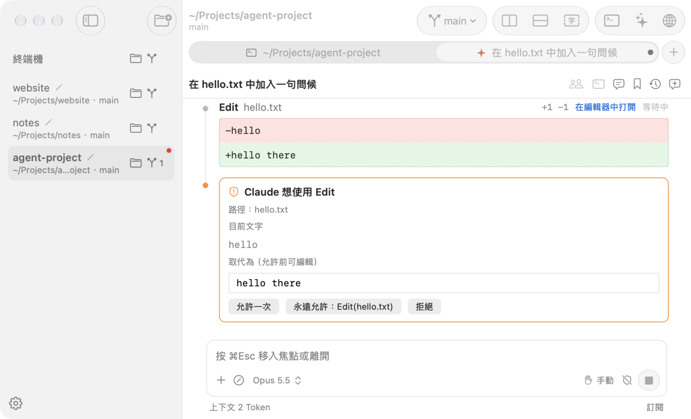

<p>&nbsp;&nbsp;&nbsp;</p>

# Tapa

**快速、原生的 macOS 終端機，還為你的代理程式、檔案和網頁騰出了空間。**

Tapa 首先是一個終端機：自己的 VT 核心和 Metal 繪圖引擎、macOS 原生的標籤頁與分割、按一個快速鍵就會滑入的快速終端機、帶有指令區塊的 Shell 整合，以及可選用、帶有 Warp 風格建議的輸入欄位。在這個基礎上，Tapa 長成了 [Dango](https://github.com/sventmueller/dango) 的小妹妹：側邊欄中每個專案檔案夾各有一個工作區，每個工作區都有自己的終端機、用於 Claude、Codex、OpenCode、Antigravity 和其他 ACP 代理程式的代理程式標籤頁、瀏覽器標籤頁、附檔案列表和 Git 面板的編輯器，以及由 [Splat](https://github.com/sventmueller/splat) 提供、支援公式和圖表的 Markdown 預覽。專案檔案夾所設定的任何東西，在你信任它的工作區之前都不會執行。Tapa 以 Rust 寫成，建立在原生 AppKit 控制項之上，支援 35 種語言，不需要帳號，也沒有遙測功能。

[](https://github.com/sventmueller/tapa/releases/latest/download/Tapa.dmg)

**[下載 Tapa.dmg](https://github.com/sventmueller/tapa/releases/latest/download/Tapa.dmg)**：已簽署並經 Apple 公證的磁碟映像檔，適用於搭載 Apple 晶片或 Intel 處理器的 macOS 14 或以上版本。

**發現 Bug 了嗎？** 請[提交 Issue](https://github.com/sventmueller/tapa/issues/new/choose)，並說明問題是在哪個 Shell、哪個代理程式或哪個程式中發生的。如果 Tapa 對你有用，在 [GitHub 上按個 Star](https://github.com/sventmueller/tapa) 能幫助更多人找到它。

[](https://www.rust-lang.org) [](https://www.apple.com/macos/)  [](https://github.com/madsmtm/objc2) [](https://developer.apple.com/metal/) [](https://agentclientprotocol.com)    [](#授權條款)

[Bahasa Indonesia](../id/README.md) · [Bahasa Melayu](../ms/README.md) · [Català](../ca/README.md) · [Čeština](../cs/README.md) · [Dansk](../da/README.md) · [Deutsch](../de/README.md) · [English](../../../README.md) · [Español](../es/README.md) · [Français](../fr/README.md) · [Hrvatski](../hr/README.md) · [Italiano](../it/README.md) · [Magyar](../hu/README.md) · [Nederlands](../nl/README.md) · [Norsk](../no/README.md) · [Polski](../pl/README.md) · [Português (Brasil)](../pt_BR/README.md) · [Português (Portugal)](../pt_PT/README.md) · [Română](../ro/README.md) · [Slovenčina](../sk/README.md) · [Slovenščina](../sl/README.md) · [Suomi](../fi/README.md) · [Svenska](../sv/README.md) · [Tiếng Việt](../vi/README.md) · [Türkçe](../tr/README.md) · [Ελληνικά](../el/README.md) · [Русский](../ru/README.md) · [Українська](../uk/README.md) · [עברית](../he/README.md)‎ · [العربية](../ar/README.md)‎ · [हिन्दी](../hi/README.md) · [ไทย](../th/README.md) · [한국어](../ko/README.md) · [日本語](../ja/README.md) · [简体中文](../zh-Hans/README.md) · **繁體中文**

## 目錄

- [功能一覽](#功能一覽)
- [系統需求](#系統需求)
- [安裝](#安裝)
- [開始使用](#開始使用)
- [工作區](#工作區)
- [終端機](#終端機)
  - [標籤頁與分割](#標籤頁與分割)
  - [Shell 整合與指令區塊](#shell-整合與指令區塊)
  - [輸入欄位與建議](#輸入欄位與建議)
  - [尋找、選取與拷貝](#尋找選取與拷貝)
  - [快速終端機](#快速終端機)
- [代理程式](#代理程式)
- [編輯器、檔案與 Git](#編輯器檔案與-git)
- [預覽](#預覽)
- [瀏覽器](#瀏覽器)
- [聽寫](#聽寫)
- [設定](#設定)
- [外觀與輔助使用](#外觀與輔助使用)
- [語言](#語言)
- [鍵盤快速鍵](#鍵盤快速鍵)
- [信任](#信任)
- [隱私與安全性](#隱私與安全性)
- [已知限制](#已知限制)
- [給開發者](#給開發者)
  - [第三方元件](#第三方元件)
- [授權條款](#授權條款)

## 功能一覽

- **自己打造的快速終端機。** Tapa 用自己的 VT 核心解析，並以 Metal 在每部顯示器各自的執行緒上、依顯示器的更新頻率繪製，而且只繪製有變動的部分。它通過了 262 項 esctest 檢查，Alacritty 的核心則通過 121 項；它的每一處更動都會與固定版本的 Ghostty 比較測量。
- **從裡到外都是原生。** 真正的 macOS 標籤頁、視窗回復、選單、服務選單、通知、加密的鍵盤輸入、聽寫和輸入法。沒有 Electron，只在網頁或預覽需要時才使用 WebKit。
- **工作區。** 側邊欄中每個專案檔案夾各有一個工作區，各自擁有標籤頁、分支和面板。最上方的「終端機」工作區每次都會全新開始；其他所有工作區都會保留，直到你移除為止。
- **原生聊天顯示方式中的代理程式。** Claude、Codex、OpenCode、Antigravity、Gemini CLI 以及其他 Agent Client Protocol 代理程式都在自己的標籤頁中執行，回答、工具呼叫、diff 和權限請求都排在同一條時間軸上。Tapa 會依你的要求安裝並更新它們。
- **Shell 整合與指令區塊**，適用於 zsh、bash 和 fish，透過 `ssh` 也能使用：在提示字元之間跳轉，選取、拷貝、儲存和收合某個指令的輸出，並查看失敗的指令以及每個指令花了多少時間。
- **你想要的話，也有像 Warp 那樣的輸入欄位。** 把指令列當成文字來編輯，建議來自你的歷史記錄、700 多個命令列工具的規格以及專案的狀態，全部都在你的 Mac 上處理。
- **Shell 旁邊就有檔案、Git 和瀏覽器。** 帶語法上色的編輯器、檔案列表、支援暫存、提交、分支和工作樹的 Git 面板、支援公式和圖表的 Markdown 預覽，以及瀏覽器標籤頁。
- **小心對待你的檔案夾。** 你還沒信任的工作區，不會啟動它的檔案夾所設定的任何東西：沒有 Git 掛鉤、沒有專案的 MCP 伺服器、沒有給代理程式的專案設定，檔案頁面中也沒有 JavaScript。
- **重視隱私。** 不需要帳號，沒有遙測。Tapa 只在你要求時才連上網路，而磁碟上用來回復的歷史記錄，會以你鑰匙圈中的密鑰加密。
- **說你的語言。** 介面提供 35 種語言：阿拉伯文、加泰隆尼亞文、簡體中文、繁體中文、克羅埃西亞文、捷克文、丹麥文、荷蘭文、英文、芬蘭文、法文、德文、希臘文、希伯來文、印地文、匈牙利文、印尼文、義大利文、日文、韓文、馬來文、挪威文、波蘭文、葡萄牙文（巴西）、葡萄牙文（葡萄牙）、羅馬尼亞文、俄文、斯洛伐克文、斯洛維尼亞文、西班牙文、瑞典文、泰文、土耳其文、烏克蘭文和越南文。

## 系統需求

- macOS 14 Sonoma 或以上版本，搭載 Apple 晶片或 Intel 處理器。Tapa 在 macOS 27 上開發與測試。
- Shell 整合需要 zsh、bash 或 fish；其他 Shell 也能執行，只是沒有 Shell 整合。
- 代理程式標籤頁需要你想使用的代理程式：可以是已經安裝好的，也可以在你要求時由 Tapa 安裝（請參閱「[代理程式](#代理程式)」）。

## 安裝

**從磁碟映像檔安裝。** 每個版本都是一個磁碟映像檔 `Tapa-<version>.dmg`，內含一個同時支援 Apple 晶片與 Intel 的通用 App，已用 Developer ID 簽署並由 Apple 公證。打開它，然後將 Tapa 拖到「應用程式」檔案夾。

**透過 Homebrew 安裝。** 專屬 tap 中的 Cask 安裝的是同一個磁碟映像檔：

```sh
brew install --cask sventmueller/tap/tapa
```

**更新。** 從磁碟映像檔或 Homebrew 安裝的 Tapa 會透過 [Sparkle](https://sparkle-project.org) 自行保持最新。第二次啟動時，它會詢問是否可以自行檢查更新；在你同意之前，它不會送出任何請求。**Tapa › 檢查更新項目…** 會立即檢查。Tapa 只會安裝帶有開發者簽章的更新。自行建置的版本沒有更新功能。

**從原始碼安裝。** 請參閱「[給開發者](#給開發者)」。

**作為預設終端機。** Tapa 可以打開 Shell 腳本（`.command`、`.tool`）、拖到它圖像上的檔案夾，以及 `ssh://` 連結。請在 Finder 中透過 **檔案 › 取得資訊 › 打開檔案的應用程式** 選擇它。

## 開始使用

1. **視窗**左邊是工作區的側邊欄，上方是所選工作區的標籤頁，再上方是工具列。⌃⌘S 可顯示或隱藏側邊欄。
2. **新的工作區**可透過側邊欄頂端的檔案夾按鈕或 **Shell › 新增工作區…**（⇧⌘N）建立：選擇一個最近使用的檔案夾，或選擇 **選擇檔案夾…**。
3. **新的標籤頁**會在工作區的檔案夾中開始：⌘T 開啟終端機，工具列右側的按鈕可開啟終端機、代理程式或瀏覽器標籤頁，也可以按一下標籤列尾端的 **+**。
4. **設定**可用 ⌘, 或側邊欄底部的齒輪打開。
5. **指令面板**（⇧⌘P）能依名稱找到每個指令，**尋找標籤頁…**（⌘P）能找到每個工作區的每個標籤頁。

工具列由左至右依序是工作區儲存庫的分支彈出式選單、向右和向下分割終端機的按鈕與顯示輸入欄位的按鈕，以及新增終端機、代理程式和瀏覽器標籤頁的按鈕。前方沒有終端機標籤頁時，分割和輸入欄位的按鈕會呈灰色。

## 工作區

工作區就是一個檔案夾及其標籤頁。它在側邊欄中的那一列會顯示名稱、檔案夾和 Git 分支，右側則是檔案列表和 Git 面板的按鈕。按一下其中一個，就會以該面板取代工作區列表；按一下頂端的 **工作區** 即可返回。

- **「終端機」工作區**永遠在最上方。每次啟動時，它都會在設定所指定的檔案夾中，以一個空白終端機全新開始。它的任何內容都不會儲存，也不能重新命名或移除。
- **其他所有工作區都會保留**，即使沒有標籤頁，也會保留到你移除為止。Tapa 會保留它的名稱、標籤頁、終端機內容（在回復設定允許的範圍內）、代理程式工作階段以及視窗位置。仍在執行的程式會在 Tapa 結束時一併結束。
- **重新命名。** 按一下名稱後方的鉛筆、按一下所選工作區的名稱，或選擇 **Shell › 重新命名工作區**。名稱會立即儲存。
- **狀態。** 列上的綠點表示該工作區的某個代理程式正在工作，包括子代理程式或在背景工作的情況；紅點表示有代理程式在等你。終端機不會在這裡顯示任何標記。
- **切換。** ⌃⌘[ 和 ⌃⌘] 可在工作區之間移動。視窗位置不變，所選工作區的標籤頁會取代其他工作區的標籤頁。
- **工作樹。** 工具列分支彈出式選單中的 **新增工作樹…** 會在新的分支上建立 Git 工作樹，並將它作為獨立的工作區打開。

關閉工作區的最後一個標籤頁後，工作區仍會留在列表中。關閉所有標籤頁後，只有視窗會關閉；按一下 Dock 圖像或按 ⌘N，視窗就會連同它的工作區一起回來。

## 終端機

Tapa 執行於自己的核心 `term-vt`。它支援 xterm 和 VT520，還有 Kitty 鍵盤協定、OSC 8 超連結、讀取需另外授權的 OSC 52 剪貼板存取、同步輸出、彩色與波浪底線、全彩、顏色查詢、向程式回報淺色與深色模式、括號貼上、焦點事件以及滑鼠回報。視窗大小改變時，文字會重新排列，歷史記錄也不例外。連字、字體功能、不需修補字體的 Nerd Font 符號，以及精確到像素的框線、Powerline 和點字字符都已內建。

### 標籤頁與分割

- **標籤頁**是 macOS 原生的：拖移即可重新排序，或拖出成為獨立的視窗；**顯示所有標籤頁**（⇧⌘\\），⌘1 至 ⌘8，⌘9 前往最後一個標籤頁，⇧⌘[ / ⇧⌘] 用來切換。每個標籤頁的標題前都會顯示其類型的圖像。
- **分割。** **向右分割**（⌘D 或 ⌃⌘T）和 **向下分割**（⇧⌘D 或 ⌃⌥⌘T），可以任意多層巢狀。拖移分隔線，或用 ⌃⌘ 加方向鍵移動它；**最大化窗格**（⌃⇧⌘↩）、**平均分配窗格**（⌃⌘=），並用 ⌘[ 和 ⌘] 在窗格之間移動。
- **工作檔案夾。** 新的標籤頁、視窗和分割，都會在前方終端機的檔案夾中開始；這三者分別由設定決定。
- **關閉。** 當標籤頁、視窗或 App 中有程式正在執行時，Tapa 會在關閉前先詢問。
- **回復。** 重新啟動後，工作區、標籤頁、窗格、檔案夾以及每個終端機的最後幾行都會回來。權杖和密碼等機密資訊在儲存前會先遮蔽。

### Shell 整合與指令區塊

Tapa 會自行為 zsh、bash 和 fish 設定 Shell 整合，不會動到你的設定檔；當你用 `ssh` 連到另一台主機時，它也會一起帶過去。有了它，每個指令和它的輸出都會構成一個區塊：

- **提示字元。** ⌘↑ 和 ⌘↓ 會跳到上一個和下一個提示字元。按一下指令列，游標就會移到那裡。
- **區塊。** **選取區塊**（⇧⌘A）、**拷貝輸出**（⌥⌘C）、**儲存輸出…**（⌥⌘S）和 **收合／展開區塊**（⇧⌘↩）。指標所在的區塊上會出現按鈕，顯示它的狀態、所花時間以及同樣的動作。
- **失敗的指令**會加上標記；仍在執行的指令在輸出捲動時會一直顯示在頂端。
- **書籤。** **設定／移除書籤**（⇧⌘M）會標記一行；⇧⌘↑ 和 ⇧⌘↓ 會在書籤之間跳轉。
- **通知**會在程式要求時（OSC 9 和 OSC 777）且終端機不在前方時出現，進度列（OSC 9;4）則會顯示在標籤頁和 Dock 圖像上。

### 輸入欄位與建議

輸入欄位會像 Warp 一樣，把指令列變成窗格底部的文字欄位，上方顯示檔案夾和 Git 分支的標籤。**顯示／隱藏輸入欄位**（⌘I）或工具列中的按鈕可為單一終端機切換它；**設定 › 輸入** 可為新的終端機開啟它。它需要 Shell 整合，遇到 vim、htop 或 claude 等全螢幕程式時會自動讓開。

- **Return** 會把整個欄位送給 Shell，多行文字會作為一次貼上送出；Shell 照常執行並記住它。如果 Shell 要求更多輸入，欄位會把按鍵交還給 Shell，直到下一個提示字元出現。
- **↑、↓ 和 ⌃R** 會搜尋你的歷史記錄，並顯示每個指令執行時所在的檔案夾、分支和結束代碼。
- **Tab** 會根據 700 多個命令列工具的規格、路徑以及即時值來補齊，例如 git 分支、docker 容器、kubectl 資源、ssh 主機、`package.json` 腳本，以及 make、just 和 cargo 目標。
- 欄位中的 **Vim 按鍵** 是同一組設定中的一個開關。
- **在你輸入之前提供下一個指令**：這個專案中通常接著會做的事（`git add` 之後是 `git commit`）、專案狀態需要的事（鎖定檔比 `node_modules` 還新），以及「command not found」之後的修正建議，來源是打字錯誤或你本機的 Homebrew 索引。

不使用輸入欄位時，建議會以灰色文字顯示在游標後方，按 → 即可採用。自帶自動建議的 Shell，例如 fish 或 zsh-autosuggestions，會保留它們自己的建議。建議絕不使用網路，而且只會從你自己的 `PATH` 啟動程式，絕不會從專案檔案夾啟動。

**貼上。** 多行貼上可以在執行前先顯示（**先顯示多行貼上**）。拖到終端機上的檔案會以加上引號的路徑出現；⌥←/→、⌘←/→ 和 ⌘⌫ 會像在任何 Mac 文字欄位中一樣，以字詞和行為單位移動與刪除。

### 尋找、選取與拷貝

- **尋找…**（⌘F）會以正規表示式、區分大小寫和全字比對搜尋歷史記錄，並計算符合的數量；捲軸會把符合項目和提示字元、錯誤一起標示出來。
- **智慧型選取。** 連按兩下可整個選取 URL、路徑、雜湊值或 IP 位址，按住 ⌥ 拖移可選取矩形範圍。即使沒有 OSC 8 也能找到連結；按住 ⌘ 並按一下即可打開，若已安裝 Dango，路徑會在 Dango 中打開。
- **使用鍵盤選取**（⇧⌘C）會用 Vim 的按鍵移動選取範圍。
- **拷貝並保留格式**（⇧⌥⌘C）會保留顏色和樣式；選取時拷貝是一個設定項目。**清除**（⌘K）會清除終端機。

### 快速終端機

**顯示／隱藏快速終端機**（⌃⌥⌘Space）會讓終端機從螢幕邊緣滑入，位於其他 App 之上，也能疊在全螢幕空間上，不需切換 App。要從哪個邊緣滑入、大小多少，以及按一下其他地方時是否隱藏，都是設定項目。隱藏期間，它的工作階段會繼續執行。

## 代理程式

代理程式標籤頁會在工作區的檔案夾中執行程式設計代理程式，並使用來自 Dango 的原生代理程式顯示方式。

| 代理程式 | 執行方式 | 需要什麼 |
|---|---|---|
| Claude | `claude` 指令，透過它的 stream-json 協定溝通 | 已安裝並登入 `claude`；你要求時，Tapa 會用 Claude 自己的安裝程式安裝它 |
| Codex | `codex app-server`，舊版 Codex 則用 `codex-acp` | 已登入 `codex`；你要求時，Tapa 會安裝固定版本的轉接程式 |
| OpenCode | `opencode serve`，舊版 OpenCode 則用 `opencode acp` | 你自己放在 `PATH` 上的 `opencode`，或固定版本的下載 |
| Antigravity | `agy acp` | 你自己放在 `PATH` 上的 `agy`，或固定版本的下載 |
| Gemini CLI | `gemini --acp`，在 **設定 › 代理程式** 中開啟後提供 | 你自己的 `gemini`，或固定版本的下載 |
| 其他 ACP 代理程式 | 來自 ACP 登錄庫，只在你要求時載入 | 登錄庫項目所指定的內容；沒有檢查碼的項目，只會在你確認後安裝 |

Tapa 使用每個代理程式自己的登入方式，不會儲存任何代理程式的憑證。在你的登入 Shell 的 `PATH` 中找到的代理程式優先；否則 Tapa 會執行它安裝到自己資料檔案夾中的版本，絕不執行工作區中的程式。

- **時間軸**會顯示回答、附有輸出和 diff 的工具呼叫、問題以及權限請求。用 **允許一次**、**永遠允許** 和 **拒絕** 回應請求；編輯內容可以在你允許之前先修改。
- **狀態。** 代理程式工作時，標籤頁和工作區的那一列會顯示綠點，等你時則顯示紅點；如果它在你看別處時開始等待，會有通知告訴你。
- 底部的**訊息欄位**會接收你的提示、拖到上面的檔案以及聽寫內容。⌘Esc 會把鍵盤焦點移進欄位，再按一次就移回。模型和權限模式可在那裡為這次工作階段選擇。
- **設定 › 代理程式** 可為新的工作階段設定權限模式（Claude、Codex）、模型（Claude、Codex、OpenCode）和思考強度（Claude、Codex），以及新標籤頁要提供哪些代理程式。它會顯示每個代理程式的程式位於何處，並提供 **安裝…**、**更新至 …**、用來回到前一個版本的 **返回 …**，以及用於 ACP 登錄庫的 **載入登錄庫**。Claude 以「永遠允許」儲存的規則，也能在那裡查看和移除。
- **經過檢查的下載。** 壓縮檔會比對 SHA-256，npm 套件會比對鎖定檔中的 integrity，沒有固定版本的套件會被拒絕。缺少的代理程式也會在自己的標籤頁中提供安裝。

## 編輯器、檔案與 Git

- 工作區的**檔案列表**會以樹狀顯示它的檔案夾，並隨檔案變動而更新；你可以選擇讓 Git 忽略的檔案以淡色顯示。按一下會把檔案作為預覽標籤頁打開，在你編輯之前，下一次按一下會取代它；連按兩下則會保留它。
- **編輯器**會在工作區的標籤頁中打開檔案，支援語法上色、多個插入點、收合、`.editorconfig` 的縮排、可選用的 Vim 按鍵，以及自上次提交以來的更動標記。檔案在磁碟上被更動或含有衝突標記時，它會察覺。Markdown 檔案會有格式列和 **在 Splat 中打開**。**儲存**（⌘S）、**儲存為…** 和 **全部儲存** 照常運作，關閉尚未儲存的文字之前，Tapa 會先詢問。
- **當機之後**，尚未儲存的文字會回來：你輸入時，Tapa 會保留它的加密拷貝。
- **Git 面板**會顯示已暫存和未暫存的更動，可暫存和取消暫存檔案與單一區段，提交（⌘↩）、修訂提交、提交並推送、擷取，並處理分支、暫存區（stash）、cherry-pick 和衝突，下方則是提交歷史。按一下檔案會顯示它的 diff。
- 工具列中的**分支彈出式選單**可切換和建立分支，以及建立工作樹。

編輯器不會啟動格式化工具或語言伺服器。如需具備語言伺服器和除錯器的完整 IDE，請使用 [Dango](https://github.com/sventmueller/dango)。

## 預覽

- **Markdown** 會透過 Splat 的呈現引擎顯示在編輯器旁邊：支援公式、圖表和圖片的 GitHub Flavored Markdown，並隨文字逐段捲動。
- **圖片**會在獨立的標籤頁中打開，PDF 透過 PDFKit 打開，聲音、影片、字體和辦公文件則透過快速查看打開。
- **獨立解碼。** 來自不受信任來源的每張圖片（專案檔案、Markdown、代理程式附件和貼上的內容），都會在 Splat 的服務 `Decoder.xpc` 中解碼，這項服務在專屬的 App Sandbox 中執行，沒有檔案也沒有網路；絕不會在 App 內解碼。

## 瀏覽器

**新增瀏覽器標籤頁**（⇧⌘B）會在工作區中打開一個 WebKit 標籤頁。網址欄位可以輸入網址，或輸入要交給你所選搜尋引擎（DuckDuckGo、Google、Bing 或 Startpage）的關鍵字；⌘L、⌘R、⌘[ 和 ⌘] 的用法和 Safari 相同。來自 `localhost` 的頁面照常執行，方便你使用專案的開發伺服器。工作區中的 HTML 檔案只能讀取它自己的檔案夾，在你還沒信任的工作區中，它們不會執行 JavaScript。

## 聽寫

用麥克風按鈕或 **編輯 › 開始聽寫**（⌃⌥D），就能在代理程式的訊息欄位或編輯器中聽寫。語音辨識來自 [Lowspeak](https://github.com/sventmueller/lowspeak)，但不需要安裝 Lowspeak。**設定 › 聽寫** 可以選擇使用 OpenAI 或 Groq 的線上轉錄，或是把錄音留在你 Mac 上的本機 Whisper 和 Parakeet 模型，也能設定語言、後期處理、麥克風以及你自己的詞彙。OpenAI 和 Groq 的密鑰會保存在你的鑰匙圈中。聽寫功能只包含在正式版本中。

## 設定

**Tapa › 設定…**（⌘,）包含一般、字體、顏色、游標、終端機、輸入、編輯器、代理程式、聽寫、描述檔和快速鍵這些面板。它們會寫入一個 TOML 檔案，也就是 `~/Library/Application Support` 下 Tapa 檔案夾中的 `config.toml`，你也可以手動編輯；Tapa 在執行時會重新載入它，**重新載入設定**（⇧⌘,）則會立即重新載入。

- 一般面板中有**四種字體大小**：介面（側邊欄、面板、檔案列表、Git 面板和標籤頁標題）、編輯器（文字、行號和 Markdown 預覽）、終端機和代理程式。⌘+、⌘− 和 ⌘0 會更改前方終端機的大小。
- **外觀：** 淺色、深色或跟隨系統。
- **顏色。** 淺色模式和深色模式各有一個主題，採用 Ghostty 的主題格式，並有最低對比度設定，讓文字在不理想的主題下也保持清楚可讀。你自己的主題放進主題檔案夾即可。
- **描述檔**會把字體、顏色、Shell、環境變數和檔案夾組合在一起。
- **快速鍵**全都可以更改，衝突會顯示出來。

## 外觀與輔助使用

- **深色模式**會跟隨系統或你的選擇；強調色、「減少動態效果」和「增加對比」都會被遵循。
- **旁白**會讀出終端機的每一行和提示字元，並播報新的輸出；側邊欄、標籤頁、工具列按鈕以及代理程式時間軸中的卡片都有名稱。
- **鍵盤。** 每個指令都有選單項目和快速鍵，「完整鍵盤取用」可以觸及每個控制項。
- **大小。** 設定中的四種字體大小，可分別獨立縮放介面、編輯器、終端機和代理程式。
- **由右至左。** 在阿拉伯文和希伯來文中，介面會鏡像顯示，而終端機的格線維持由左至右。

詳細資訊和已知不足之處請見 [ACCESSIBILITY.md](../../../ACCESSIBILITY.md)。

## 語言

介面已翻譯成 35 種語言：阿拉伯文、加泰隆尼亞文、簡體中文、繁體中文、克羅埃西亞文、捷克文、丹麥文、荷蘭文、英文、芬蘭文、法文、德文、希臘文、希伯來文、印地文、匈牙利文、印尼文、義大利文、日文、韓文、馬來文、挪威文、波蘭文、葡萄牙文（巴西）、葡萄牙文（葡萄牙）、羅馬尼亞文、俄文、斯洛伐克文、斯洛維尼亞文、西班牙文、瑞典文、泰文、土耳其文、烏克蘭文和越南文。

Tapa 會依照 **系統設定 › 一般 › 語言與地區** 中的語言順序；你也可以在那裡的 **應用程式** 下，單獨為 Tapa 選擇語言。如果沒有你的語言的翻譯，就會使用英文。

## 鍵盤快速鍵

| 動作 | 快速鍵 |
|---|---|
| 新增視窗、工作區、標籤頁 | ⌘N、⇧⌘N、⌘T |
| 新增瀏覽器標籤頁 | ⇧⌘B |
| 新增檔案、打開檔案 | ⌥⌘N、⌘O |
| 關閉窗格或標籤頁、關閉標籤頁、關閉視窗 | ⌘W、⌥⌘W、⇧⌘W |
| 向右分割、向下分割 | ⌘D 或 ⌃⌘T、⇧⌘D 或 ⌃⌥⌘T |
| 最大化窗格、平均分配窗格、關閉窗格 | ⌃⇧⌘↩、⌃⌘=、⌃⇧⌘W |
| 移動分隔線 | ⌃⌘←、⌃⌘→、⌃⌘↑、⌃⌘↓ |
| 下一個、上一個窗格 | ⌘]、⌘[ |
| 下一個、上一個標籤頁；標籤頁 1 至 8、最後一個標籤頁 | ⇧⌘]、⇧⌘[；⌘1 至 ⌘8、⌘9 |
| 下一個、上一個工作區 | ⌃⌘]、⌃⌘[ |
| 尋找標籤頁、指令面板 | ⌘P、⇧⌘P |
| 顯示或隱藏側邊欄、輸入欄位 | ⌃⌘S、⌘I |
| 快速終端機 | ⌃⌥⌘Space |
| 尋找、尋找下一個、尋找上一個 | ⌘F、⌘G、⇧⌘G |
| 上一個、下一個提示字元 | ⌘↑、⌘↓ |
| 選取區塊、拷貝輸出、儲存輸出、收合區塊 | ⇧⌘A、⌥⌘C、⌥⌘S、⇧⌘↩ |
| 設定或移除書籤；上一個、下一個書籤 | ⇧⌘M；⇧⌘↑、⇧⌘↓ |
| 使用鍵盤選取 | ⇧⌘C |
| 拷貝並保留格式 | ⇧⌥⌘C |
| 清除 | ⌘K |
| 頂端、底端、上一頁、下一頁 | ⌘Home、⌘End、⌘PageUp、⌘PageDown |
| 放大、縮小、原始大小（終端機） | ⌘+、⌘−、⌘0 |
| 代理程式標籤頁的訊息欄位 | ⌘Esc |
| 開始聽寫 | ⌃⌥D |
| 設定、重新載入設定 | ⌘,、⇧⌘, |

每個快速鍵都能在 **設定 › 快速鍵** 或設定檔的 `[keys]` 區段中更改。

## 信任

專案檔案夾可以讓程式在其中一有東西啟動就執行：Git 掛鉤 和 `core.fsmonitor` 之類的儲存庫設定、代理程式的掛鉤、專案的 MCP 伺服器，以及代理程式的專案設定。因此，新的工作區預設是不受信任的。

- **不受信任：** 代理程式啟動時不會帶入專案的掛鉤、MCP 伺服器和設定（Claude 使用 `--setting-sources=user --strict-mcp-config`，Codex 會把該檔案夾標示為不受信任，OpenCode 則不使用專案的設定）。Git 會以中和過的方式執行：沒有掛鉤、篩選器、diff 驅動程式、fsmonitor、`sshCommand` 或分頁程式，而且只使用全域的憑證輔助程式。HTML 檔案打開時不執行 JavaScript。Git 面板和代理程式標籤頁會說明這一點，並提供信任該工作區的選項。
- **受信任：** **Shell › 信任工作區** 會依照檔案夾的意圖載入上述所有內容。**撤銷信任** 則會收回。信任會依工作區分別保存。

無論是否受信任，Tapa 都絕不會自行執行專案檔案夾中的程式：建議只會從專案以外的 `PATH` 啟動程式，側邊欄則從 `.git` 檔案讀取 Git 狀態。位於你「個人專屬」檔案夾中的工作區（例如「終端機」）不算是專案：在那裡，`~` 底下的程式（例如 `~/.local/bin/claude`）會被視為你自己的程式。

## 隱私與安全性

- **無遙測，不需帳號。** Tapa 不會回報任何關於你如何使用它的資訊，而且可以完全離線運作。它只在你要求時才連上網路：安裝或更新代理程式、載入 ACP 登錄庫、在你同意後檢查更新，以及載入你在瀏覽器標籤頁中打開的頁面。代理程式本身則照常與各自的供應商溝通。
- **磁碟上的歷史記錄**用來回復工作階段，以你鑰匙圈中的密鑰加密，可以關閉，而且在寫入前會遮蔽 API 密鑰、權杖和密碼等機密資訊。尚未儲存的編輯器文字拷貝，也以同一把密鑰加密。
- **加密的鍵盤輸入**會在要求輸入密碼時自動開啟，也可以在 App 選單中讓它一直保持開啟。
- 可能洩漏資訊或注入內容的**跳脫序列**，例如標題回報、剪貼板讀取和貼上花招，會被封鎖或先徵求同意。解析器在 CI 中經過模糊測試。
- 來自不受信任來源的圖片會**獨立解碼**，請參閱「[預覽](#預覽)」。
- **程式碼簽署**採用 Hardened Runtime。macOS 會把終端機中程式的存取歸給 Tapa，因此它為每項受保護的服務都附有用途說明。

安全性問題請私下回報，請參閱 [SECURITY.md](../../../SECURITY.md)。

## 已知限制

- 終端機中**還沒有內嵌圖片**：Kitty 圖形、Sixel 和 iTerm2 圖片預計在 1.0 之後支援。
- **沒有 tmux 控制模式**，結束 Tapa 後工作階段也不會保留。
- 終端機格線中的**由右至左文字**會維持由左至右。
- **⌘+ 和 ⌘−** 只會更改前方的終端機。
- **編輯器**刻意不提供語言伺服器、格式化工具或除錯器；Dango 有這些功能。
- **聽寫**只在正式版本中提供，除錯版本中沒有。
- **旁白**尚未由真人從頭到尾完整檢查過。

## 給開發者

你需要 macOS 14 或以上版本與 Xcode Command Line Tools、`rust-toolchain.toml` 所指定的 Rust（通用建置需要安裝兩個 Mac 目標的 rustup）、在這個儲存庫旁邊取出的 [splat](https://github.com/sventmueller/splat) 和 [lowspeak](https://github.com/sventmueller/lowspeak)（`../splat`、`../lowspeak`），以及用於含聽寫建置的 cmake。

| 指令 | 用途 |
|---|---|
| `make help` | 列出所有目標 |
| `cargo xtask run` | 建置除錯版 App 並打開它 |
| `make build` | 將含聽寫的正式版 App 建置到 `target/release`，並為這部 Mac 進行臨時簽署 |
| `make lint` | 格式檢查、把警告視為錯誤的 clippy、檔案的結構以及介面文字 |
| `make check` | 先 `lint`，再執行所有測試；不需要視窗，也不需要網路 |
| `make selftest STEPS="split_right,type:ls\n,shot:x"` | 操作 App，並在 `target/selftest/` 中留下視窗畫面 |
| `make esctest`、`make vttest` | 針對 App 中的兩個核心執行 esctest 和 vttest |
| `make perf` | 與固定版本 Ghostty 比較的效能基準測試；只有在閒置的 Mac 上才有意義 |
| `make fuzz` | 使用 cargo-fuzz 的模糊測試目標 |
| `make release` | 發佈的試執行：在 `target/release-dry-run` 中產生帶有聽寫功能的通用 App 及其磁碟映像檔、更新摘要和 Cask；不會傳送任何內容到任何地方 |
| `make release-notarized` | 將目前版本以 Developer ID 簽署、經 Apple 公證並裝訂票證，產生到 `dist/`；`Cargo.toml` 保持不變 |
| `make deploy` | 公證下一個版本、提交 `Cargo.toml`、上傳草稿版本、推送 `main` 和標籤，然後發佈該版本；請參閱 [docs/development.md](../../../docs/development.md#deploy) |

參與貢獻的方式記錄在 [CONTRIBUTING.md](../../../CONTRIBUTING.md)。每段介面文字都以德文作為鍵，並翻譯成全部 35 種語言；缺少翻譯時，`cargo xtask strings` 會失敗。

### 第三方元件

| 元件 | 用途 | 授權條款 |
|---|---|---|
| [objc2](https://github.com/madsmtm/objc2) 及其框架 crate | AppKit、Metal、WebKit 和其他 Apple 框架 | MIT、Zlib 或 Apache-2.0 |
| Splat 的 crate | Markdown、預覽、Git 讀取、圖片解碼器和翻譯 | MIT 或 Apache-2.0 |
| [Lowspeak](https://github.com/sventmueller/lowspeak) 與 [whisper.cpp](https://github.com/ggml-org/whisper.cpp) | 聽寫 | MIT |
| [Fig autocomplete specs](https://github.com/withfig/autocomplete) | 建議中的指令說明 | MIT |
| [rusqlite](https://github.com/rusqlite/rusqlite) 與 SQLite | 指令歷史記錄 | MIT、公有領域 |
| [Simple Icons](https://simpleicons.org) | 語言和程式的標誌 | CC0，部分標誌適用其各自的條款 |
| [Sparkle](https://sparkle-project.org) 2.10.1 | 正式版本的更新 | MIT |

## 授權條款

Tapa 採用以下任一授權條款：

- Apache License, Version 2.0（[LICENSE-APACHE](../../../LICENSE-APACHE)）
- MIT License（[LICENSE-MIT](../../../LICENSE-MIT)）

由你選擇。`assets/simple-icons` 中的標誌帶有各自的授權條款，請參閱該處的 README。

除非你另有明確聲明，否則依 Apache-2.0 授權條款所定義，你有意提交以納入 Tapa 的任何貢獻，都將採用如上的雙重授權，不附加任何其他條款或條件。
