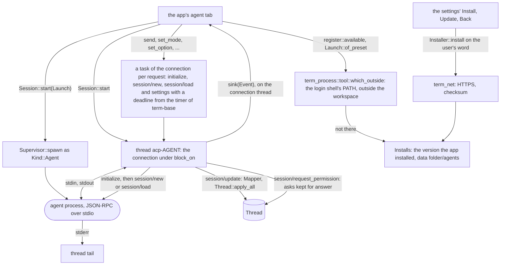

# term-acp

Copied from Dango at commit `041f7ca1995c632beed490f033756e12642b65a3` (E2); `install.rs`, `tool.rs`, the registry of `register.rs` and the pinned versions of the presets came over later from the same commit, after the owner's decision of 2026-11-24 that Tapa installs agents itself as Dango does (E21). An agent runs from its own command on the login shell's PATH, found outside the workspace (`term_process::tool::which_outside`, E16), else from the version the app installed into `<data folder>/agents/<id>/<version>/` (`term_base::data_dir()`, named after the bundle id, E19), never from a program inside the workspace. Installing happens only on the user's word: a preset's pinned version (an npm package checked against its `integrity`, or an archive per Mac checked against its SHA-256), or the exact version a registry entry names (its archive's SHA-256 where the entry gives one, else only after the user confirmed; npm and uv packages are checked by their tools; an unversioned package is refused). npm installs with `--ignore-scripts` first and runs the package's scripts only once the lock file names the expected version and integrity. Each agent keeps its previous version for going back. The ACP registry (`Register::fetch`) is fetched only when the user asks and kept in `term_base::cache_dir()`; the network is `term_net` behind the `Net` trait, so the tests stand in for it. The capabilities are the thread model's (`term_thread::Capabilities`), filled from the protocol here. In a workspace that is not trusted no MCP server is handed over, OpenCode starts with the variables that skip the project's configuration, and every other agent, including one from the registry, is refused with `SessionError::Untrusted`, since none of them has a switch for it (E16). P7 brings later changes of either side over; until then this copy is the one that changes here.

Agents over the Agent Client Protocol, such as Antigravity (`agy acp`) or Gemini CLI: a session that fills the shared thread model (`term-thread`) and the agents the app knows. The protocol runs through the `agent-client-protocol` crate, whose types stay inside this one; `docs/acp.md` lays down how each update changes a thread.

The API is documented in [`src/lib.rs`](src/lib.rs) and its modules.
