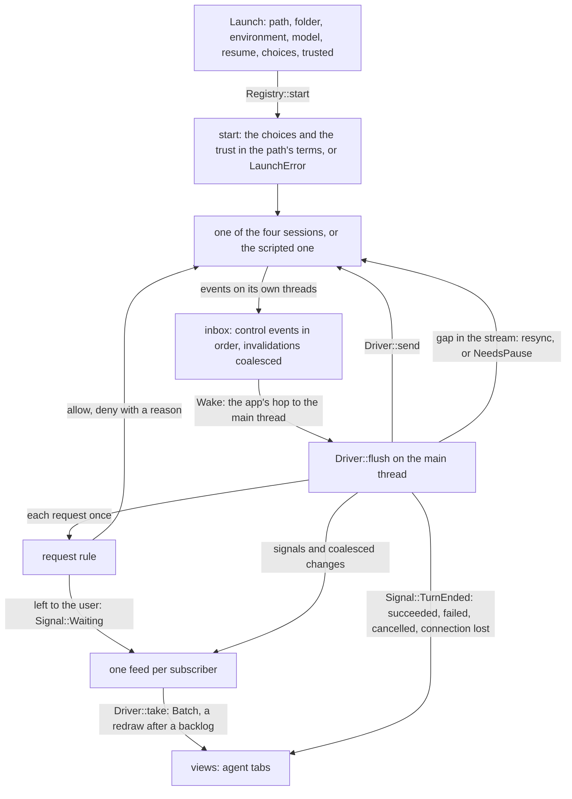

# term-agents

Copied from Dango at commit `041f7ca1995c632beed490f033756e12642b65a3`: ide-session without the own agent, the work orders (`Order`, `Role`, `Contract`, `OrderRule`), the checkpoints (`Checkpoint` and `CommitId` are types without a value) and Codex's shared server; `script.rs` and the program `session-stand-in` are behind the feature `selftest` (E2, E21). `Launch::trusted` carries the workspace's trust to every path (E16). P7 brings later changes of either side over; until then this copy is the one that changes here.

One driver over every agent session: Claude, Codex, OpenCode and ACP agents. `Registry::start` starts a `Launch` under a `SessionId` the app keeps in its context; the `Driver` sends prompts, answers requests by the `RequestRule` it is handed, fans the events out to any number of subscribers and ends every turn with a typed `TurnEnd`.

The API is documented in [`src/lib.rs`](src/lib.rs).
