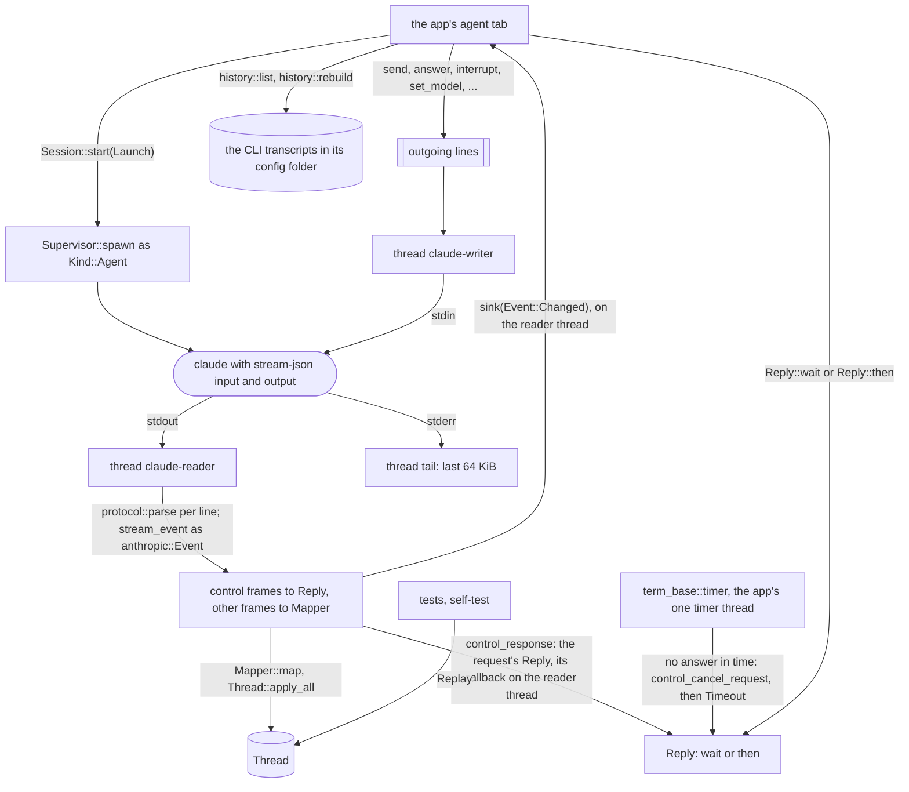

# term-claude

Copied from Dango at commit `041f7ca1995c632beed490f033756e12642b65a3`: ide-claude without `order.rs` and the work-order bounds of the launch, which serve Dango's work orders, and with the Messages API's stream events of ide-net (`src/api/anthropic.rs`) as the module `anthropic` (E2, E21). A session in a workspace that is not trusted loads only the user's settings and no MCP server (`--setting-sources=user --strict-mcp-config`, E16). P7 brings later changes of either side over; until then this copy is the one that changes here.

The Claude connection (E21): the installed `claude` CLI in stream-json mode, one JSON frame per line each way. Frames are read leniently and mapped into the shared thread model (`term-thread`); control requests in both directions carry permissions, plan approvals, questions, model and mode changes. `docs/claude-mapping.md` lays down how each frame changes the thread; the partial messages carry the Messages API's stream events, typed in `anthropic`. Past sessions are read from the CLI's own transcripts, and a recording can be replayed without a process.

The API is documented in [`src/lib.rs`](src/lib.rs) and its modules.
