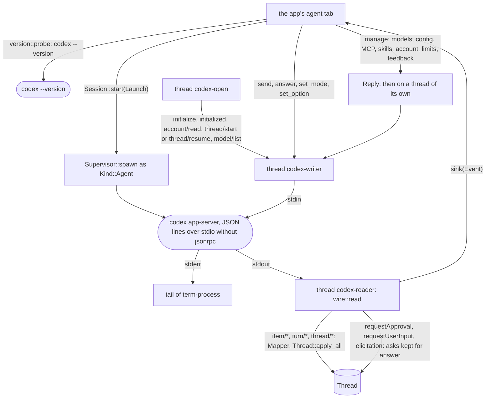

# term-codex

Copied from Dango at commit `041f7ca1995c632beed490f033756e12642b65a3`: ide-codex without the work-order bounds of the launch (`Confinement`); the stand-in server and its program `codex-test-server` are behind the feature `testing` (E2, E21). Every private app-server start names the workspace's folder in `projects.<folder>.trust_level`: `untrusted` unless the workspace is trusted, so no `.codex/` configuration, hooks or MCP servers of the project load in an untrusted one (E16). P7 brings later changes of either side over; until then this copy is the one that changes here.

Remote Control joins Codex’s local shared daemon through `codex app-server proxy`. Only trusted local workspaces use it because the daemon keeps its own configuration. Enabling and disabling Remote Control affects the shared daemon across clients.

OpenAI Codex over its own app-server protocol (E147, "SDK first, ACP as fallback"): `codex app-server` on stdio, a session that fills the shared thread model (`term-thread`) as an ACP session does, and the management calls Codex offers beyond ACP. An older Codex is refused, so the app takes `codex-acp` through `term-acp` instead; `docs/codex.md` lays down the framing, the handshake and how each notification changes a thread.

The API is documented in [`src/lib.rs`](src/lib.rs) and its modules.
