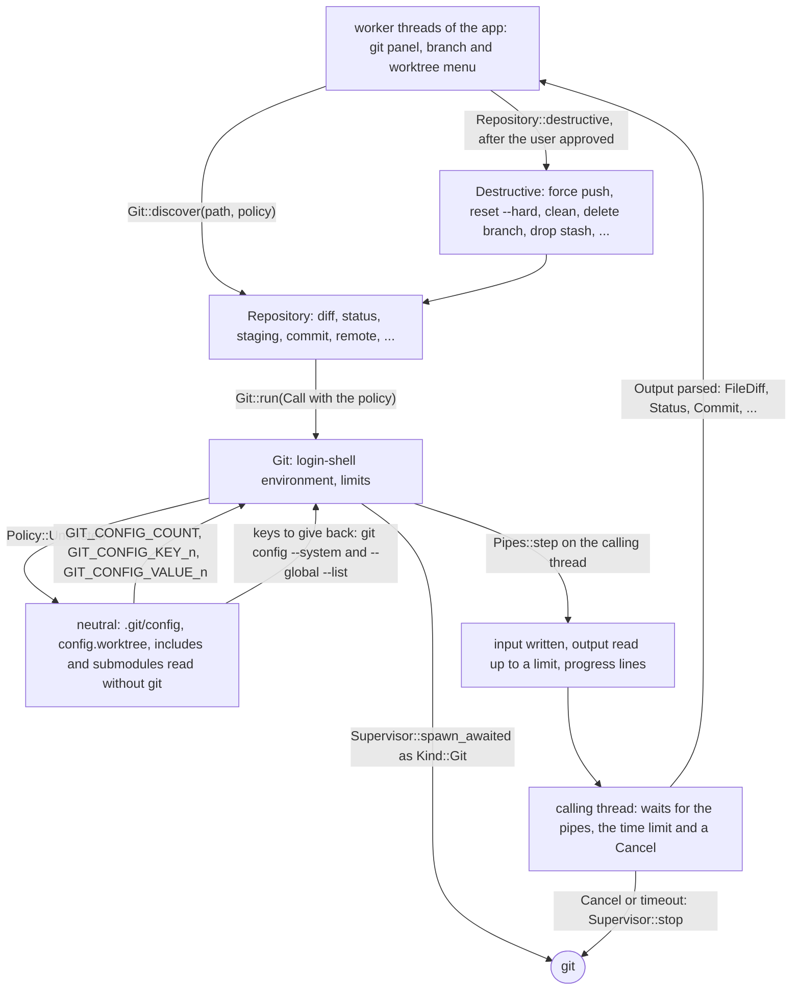

# term-git

Copied from Dango at commit `041f7ca1995c632beed490f033756e12642b65a3`: ide-git without `checkpoint`, `thread_trees` and `thread_tree.rs`, `gate_dir`, `integrate` (except `ChangedFile` and `name_status`, now in `changed.rs`), `refs`, `message`, `secrets`, `fuzzing`, the orchestrator's unattended git (`Git::unattended`, `bound_to`, the anchor, `Repository::branch_head`, `remove_recorded_worktree`) and the panel's section of thread worktrees (E2, E22). `hooks.rs` makes its trace folder itself instead of through ide-process's `private_dir`. New here is `neutral.rs` with `Policy`; its configuration reader `neutral/config.rs` follows splat-git's `config.rs` at Splat commit `e552246`, which splat-git keeps private and which only checks a repository's format. P7 brings later changes of either side over; until then this copy is the one that changes here.

git for the app through the `git` program: repositories, status, diffs, staging down to single hunks, commits, remotes, branches, history, the stash and worktrees, plus what the Git panel decides without AppKit (`panel`). Every call blocks until its process ends, so callers run it on a worker thread.

Every way into a repository, `Git::discover` and `Git::init`, takes a `Policy` the app chooses per workspace (E21): `Trusted` runs git as the user's own git would, hooks included; `Untrusted` runs every command neutralised (E16, E22). It then gets fixed settings (no hooks, no fsmonitor, no `ext::` or local-path remotes, editors that accept at once, no signing, no automatic maintenance, `safe.bareRepository=explicit`, `GIT_ATTR_NOSYSTEM=1`), and for every key that names a program in the repository's `config`, `config.worktree`, its submodules' configuration and the files these include, the user's own system or global value or one that runs nothing; credential helpers are reset and the user's own added back. The configuration is read without running git, so nothing the repository names runs before the settings are in place; a file that cannot be checked stops the command (`Error::UncheckedConfig`).

The API is documented in [`src/lib.rs`](src/lib.rs) and its modules; the neutral settings in [`src/neutral.rs`](src/neutral.rs).
