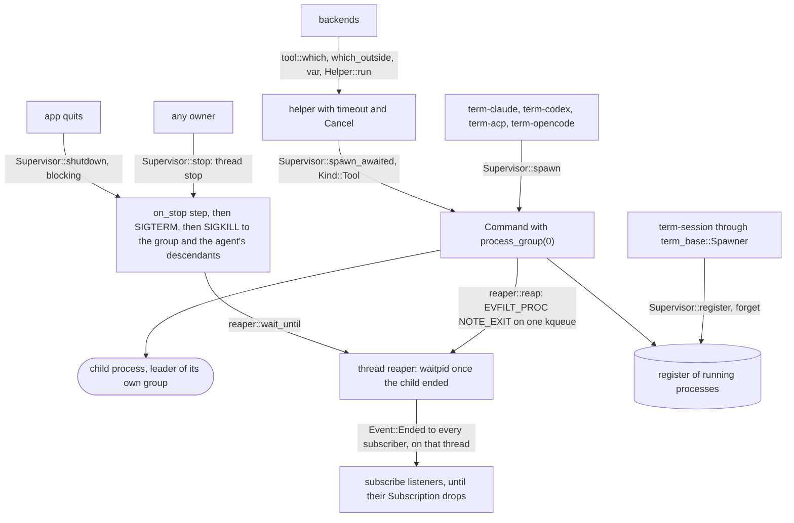

# term-process

Copied from Dango at commit `041f7ca1995c632beed490f033756e12642b65a3`: ide-process without `gate`, `sandbox` (except `CREDENTIAL_FILES`), `order_env` and `private_dir`, which serve Dango's work orders; `signpost`, `system`, `shell_env` and the threads' part of `priority` came earlier into `term-base` and are used from there (E2, E21). P7 brings later changes of either side over; until then this copy is the one that changes here.

The one register of every process the app starts or adopts: each runs in a process group of its own, is listed, and is ended in order — graceful step, SIGTERM, SIGKILL — when it is stopped or the app quits. One reaper thread hears through kqueue when any of them ends, so no child costs a thread of its own. It serves a process's pipes from the thread that waits for it, keeps the tail of a process's output, frames the messages exchanged on standard streams, and runs the short-lived helper programs others need (`tool`): found on the login shell's PATH, only in absolute folders and, with `which_outside`, never inside the workspace's base path (E16), started with that environment only, with a time limit, a way to cancel and the last mebibyte of each stream kept. Ending a process ends its whole group, also what is left of it once the leader is gone. Agents get nice 10 and everything they start nice 20. The `Supervisor` is also a `term_base::Spawner`, so terminal sessions and agents share one register.

The API is documented in [`src/lib.rs`](src/lib.rs) and its modules.
