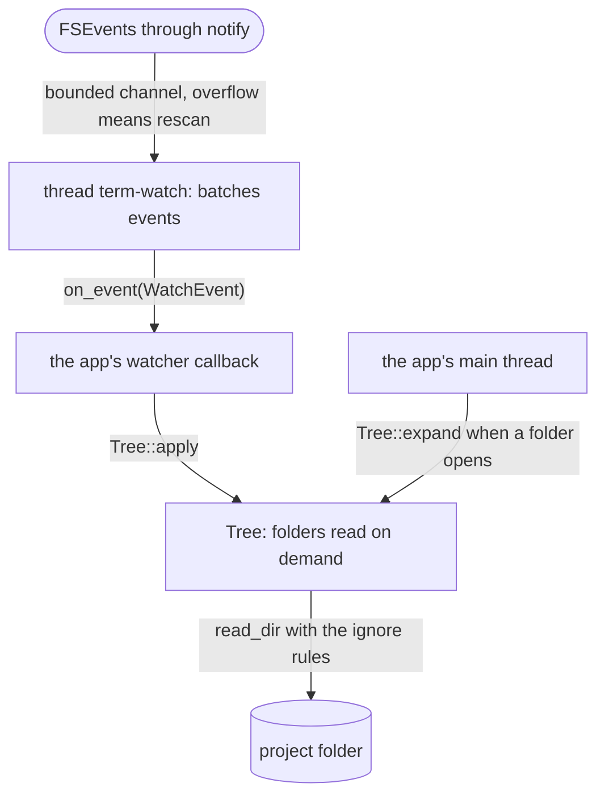

# term-project

Copied from Dango at commit `041f7ca1995c632beed490f033756e12642b65a3`: ide-project with the files only, its `tree`, `watch`, `files_panel`, `order`, `rules` and `editorconfig` (E2, E22). Cut are quick open (`index`, `fuzzy`), project search and replace (`search`, `search_panel`, `replace`, and `text`, which only they used), `prettier` (E16), `site` and `trust`, whose part the app's trust per workspace takes (E21). New here: the watcher refuses `/` and the home folder itself. P7 brings later changes of either side over; until then this copy is the one that changes here.

A project folder without a window: its tree read one folder at a time, changes on disk and the `.editorconfig` settings of its files. The watcher runs a thread of its own and answers through a callback; the rest blocks on the calling thread. No process is started.

`files_panel` holds what the app's files panel decides without AppKit: what a click, the context menu and a new name mean in the tree.

The API is documented in [`src/lib.rs`](src/lib.rs) and its modules.
