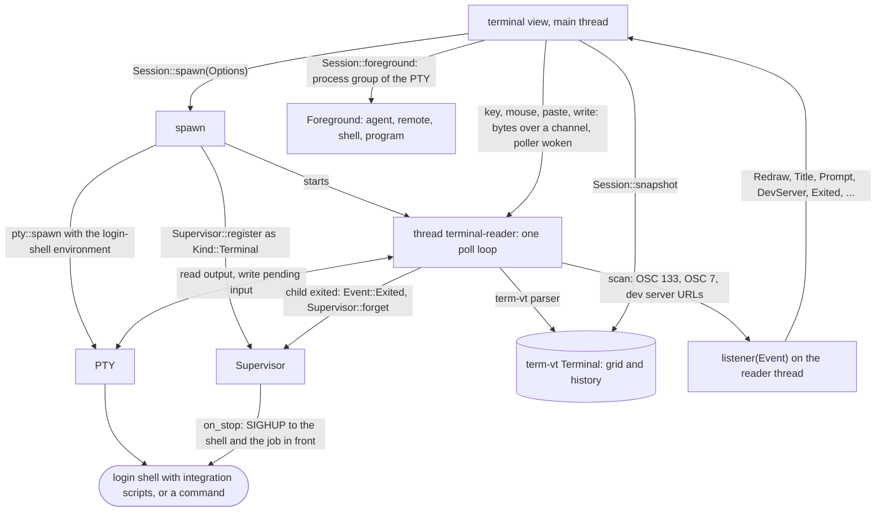

# term-session

Copied from Dango at commit `01bba21a061a1ee15e24336c2bc9b3bd644b6d6c`: ide-terminal (scan.rs moved to term-vt) (E2). P7 brings later changes of either side over; until then this copy is the one that changes here.

Terminal sessions without a window: the user's shell in a PTY with its screen kept by `term-vt`, keys, mouse and paste turned into bytes, shell integration for prompts and the working directory, the program in front with coding agents recognised, and what pasting an image does. The view draws snapshots and sends input; events arrive on the session's reader thread.

The API is documented in [`src/lib.rs`](src/lib.rs) and its modules.
