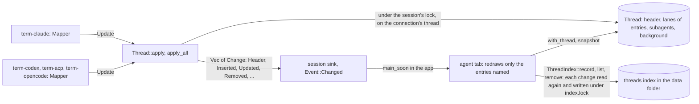

# term-thread

Copied from Dango at commit `041f7ca1995c632beed490f033756e12642b65a3`: ide-thread, whole, with the `fuzzing` feature off unless a fuzz target asks for it, and the plain types of ide-acp's `capabilities.rs` without their conversions from `agent_client_protocol` (E2, E21). P7 brings later changes of either side over; until then this copy is the one that changes here.

The one thread model every agent connection fills, shaped like ACP v2: a thread with its timeline, the subagents it started with timelines of their own, and the work it keeps running in the background, plus the index of threads the session manager lists and what an agent offers (`Capabilities`). It holds data only: no threads, no processes, no I/O except the index file in `threads` of the data folder. A connection changes a thread only through `Thread::apply`, which reports each change with a stable entry id.

The API is documented in [`src/lib.rs`](src/lib.rs) and its modules.
