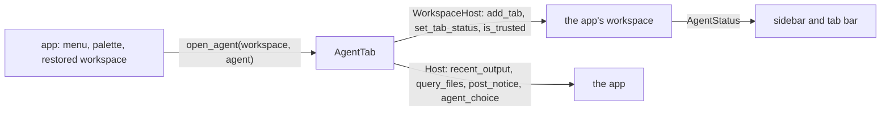

# term-ui-agent

Copied from Dango at commit `041f7ca1995c632beed490f033756e12642b65a3`: ide-ui-agent without Dango's own agent, plans and Plan+, checkpoints, rewind, Codex remote, CI logs, the browser context, the Agents panel (but for its store of past sessions and bookmarks), the tabs on work orders' sessions and the user's own MCP list, and the parts of ide-ui-common it needs; dictation came back later with term-ui-dictation behind the feature `dictation`, and the ACP installer (`acp_install.rs`: installing an agent from its tab, the registry as last fetched, where installed agents live) with the owner's decision of 2026-11-24 that Tapa installs agents as Dango does; the window seam, alerts, styles, serial numbers and the interface size went to term-ui for every UI crate (E2, E21). Dango's commit `7b82ee42f3331e939104b89093e734ab8e0a9134` came over later: the `/resume` overlay, and the "finished" notification only once the session stayed idle for three seconds; unlike Dango, a tab out of sight in the active app still gets its notification and its attention mark. Dango's activity view (`src/activity` at commit `c59fb253d9b5b49571e469055200c806d45b77ef`) came over as `src/activity/` for the lists of one session, without the toolbar item for the whole window. P7 brings later changes of either side over; until then this copy is the one that changes here.

The agent tab: one Claude, Codex, OpenCode or ACP session per tab, started in the base path of its workspace, with its timeline, composer, approvals and status. The crate knows a workspace only by its id and reaches it through the `WorkspaceHost` the app installs (`term_ui::workspace_host`): its base path and trust, its tab bar, the status a tab shows in the sidebar, notices and the login shell's environment. Everything else of the app, such as the terminal's recent output, the files of the base path and what the user picked last for each agent, comes through `Host` (E3). Every tab runs its session in one `term_agents::Registry` the crate keeps, under `term_process::Supervisor::global()`. Formulas and diagrams in answers are drawn by Splat's hidden WebKit renderer, which the app starts through term-ui-preview, and show as code until they are; pictures decode in Splat's sandboxed decoding service.

The API is documented in [`src/lib.rs`](src/lib.rs).
