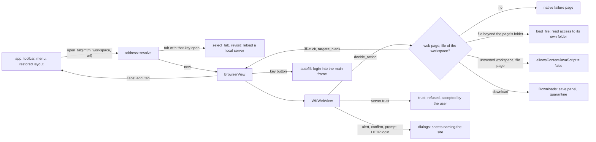

# term-ui-browser

Copied from Dango at commit `041f7ca1995c632beed490f033756e12642b65a3`: ide-ui-browser, whole (E2, E22). A tab belongs to a workspace (`WorkspaceId`) instead of a window and joins the workspace's tab bar through `term_ui::workspace_host::Tabs`; the search engine comes from `[browser] search_engine` in `term-config` through `Host`, the tab's shortcuts (⌘L, ⌘R, ⌘[, ⌘]) are fixed as in Safari instead of Dango's keymap. New here: a file page may read only the folder it sits in, a link to another file of the workspace loads that file anew with its own folder, file pages of a workspace the user does not trust run no JavaScript (`WKWebpagePreferences.allowsContentJavaScript`), and only web pages and HTML files open in another app. P7 brings later changes of either side over; until then this copy is the one that changes here.

The browser tab: a `WKWebView` below a navigation row, which also previews a project's dev server. Every tab shares WebKit's default website data store; pages get no way into the app, open local files only inside the workspace and other apps' schemes never. Pop-ups open as tabs, downloads ask where to save and are marked as coming from the web, HTTP logins and certificates accepted for a development server live in memory until the app quits. A tab restored behind others builds its web view only once it first shows.

The API is documented in [`src/lib.rs`](src/lib.rs).
