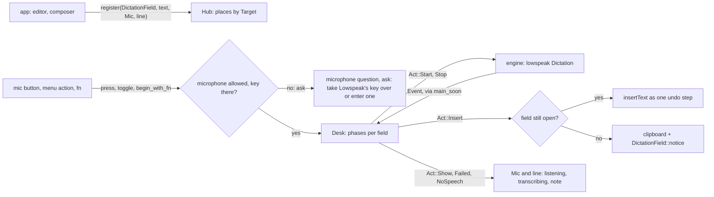

# term-ui-dictation

Copied from Dango at commit `06289f16fbbebc12c83c9bcd4a9bb69cb395c78f`: ide-ui-dictation with its choices in the `[dictation]` section of the settings file instead of Dango's settings store, its keys through `term_seal::secrets`, and the menu item as the key-binding action `toggle_dictation` of the app (E2). Until a later port brings Dango's changes over, this copy is the one that changes here.

Dictation into the app's text fields, the agent composer and the editor, through lowspeak: the microphone button and line beside a field, the menu action, fn as in Lowspeak, the app's own API keys and the questions about them. One recording runs at a time, bound to the field that had the focus when it started; its text goes in at that field's cursor as one undo step. The app registers each field as a `DictationField`, holds the dictations through `Host` and hands over the settings' `[dictation]` section with `set_config`; the crate knows no editor and no agent tab. Without the feature `engine` only that trait and the shortcut's spelling remain, so builds without dictation never compile whisper.cpp. Dango's `docs/dictation.md` describes the design.

The API is documented in [`src/lib.rs`](src/lib.rs).
