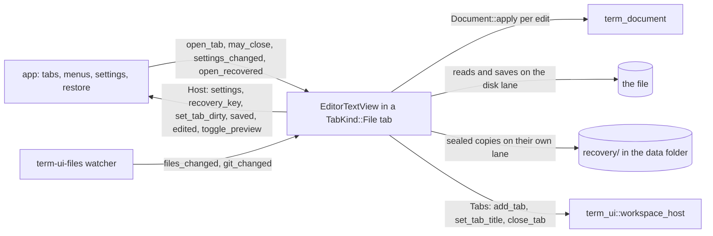

# term-ui-editor

Copied from Dango at commit `041f7ca1995c632beed490f033756e12642b65a3`: `src/editor` with `src/markdown/{bar,format,insert,paste,splat_app}` and the non-LSP helpers of ide-ui-lsp (`EditorSerial`, `text_range`, `rect_of`, the range shift of an edit and edits made back to front, now in `text_view.rs`) (E2, E22). Cut are edit prediction (`predict/`), the language server (`lsp_editor`, the status bar's server part, code actions, hovers, go to definition, formatting), diagnostics at the line's end, the insets and their layout fragments (`insets/`, `inset_fragment`; `insets.rs` keeps only `line_fragments`), the minimap, Sticky Scroll, blame and its column, the debugger's and the test panel's gutter marks, navigation history, the Markdown exports and the preview beside a document, which the app shows through the host (package P6). An editor belongs to a workspace (`WorkspaceId`) instead of a window: `Host` replaces Dango's `WindowController`, `context` and `util`, and a tab opens through `term_ui::workspace_host::Tabs` as `TabKind::File`, keyed by the file's canonical path, with one preview tab per workspace that the next preview replaces until the user edits or keeps it. The copies of unsaved text are sealed with the key the host hands over (E17). The format bar sits in each Markdown editor's own tab instead of over a window's panes. Dictation into the editor came back later through term-ui-dictation behind the feature `dictation`. P7 brings later changes of either side over; until then this copy is the one that changes here.

A file of a workspace in a tab: a TextKit 2 text view over one `term_document::Document`, with syntax colours lexed in slices, folds by indentation, further carets, Vim's keys through `term-vim`, the `.editorconfig` indentation, change marks against the last commit read with splat-git (no process runs, E16), the bar about a file that changed on disk or holds conflict markers, the comparison of disk and editor, and in Markdown the Format menu, the format bar, pasting rich text as Markdown and "In Splat öffnen". Reads and writes go to the disk lane; the main thread waits a frame at most.

The API is documented in [`src/lib.rs`](src/lib.rs) and [`src/host.rs`](src/host.rs).
