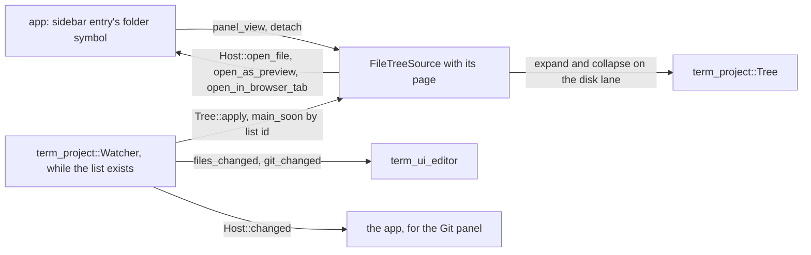

# term-ui-files

Copied from Dango at commit `041f7ca1995c632beed490f033756e12642b65a3`: `src/window/files/{mod,view,controller,hover}.rs`, `src/window/files_header.rs`, `src/project.rs` without quick open and trust, and `ide-core/src/prewarm.rs` (E2, E22). Cut is opening a file in a pane beside or below (`pane_choice.rs`, ⌥-click): an editor is a tab of its own in Tapa, so the context menu leaves out "Daneben öffnen" and "Darunter öffnen". The list belongs to a workspace (`WorkspaceId`) instead of a window and lays out for the workspace's sidebar entry instead of Dango's activity bar; its watcher runs only while the list is built. P7 brings later changes of either side over; until then this copy is the one that changes here.

The file list of a workspace: the folder tree of its base path, read one folder at a time on the disk lane as the user opens it, with a title row for a new file, a new folder and folding every folder, and a context menu for renaming, the Trash, the Finder and copying paths. A click opens a file in the workspace's preview tab, a double click in a tab of its own; the pointer over a file reads it ahead. What the menu means is decided in `term_project::files_panel`. The FSEvents watcher (`term_project::Watcher`) refuses `/` and the home folder itself.

The API is documented in [`src/lib.rs`](src/lib.rs) and [`src/host.rs`](src/host.rs).
