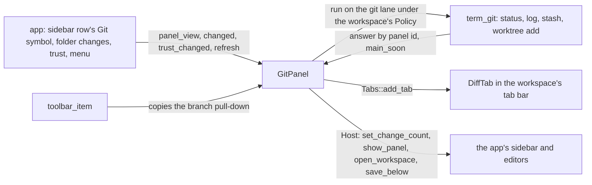

# term-ui-git

Copied from Dango at commit `041f7ca1995c632beed490f033756e12642b65a3`: ide-ui-git without `message/` (commit messages written by a model), `trees.rs` and `worktrees/` (Dango's worktree threads and work orders) and the secrets check before a commit or push in `ops.rs` and `sheets.rs` (E2, E22). The host lost what only those needed (`claude_program`, `endpoint`, `key`, `provider_error`, `open_thread`, `show_order`, `select_thread_in`, `thread_works_in`); a panel belongs to a workspace (`WorkspaceId`) instead of a window, and the app shows it in the workspace's sidebar entry instead of an activity bar. New here: git runs under the workspace's `Policy` and the panel says when that is the neutralised one, "Neuer Worktree …" in the branch pull-down opens a worktree as a workspace of its own, and single clicks share one preview diff tab per workspace. P7 brings later changes of either side over; until then this copy is the one that changes here.

The Git panel of a workspace, the diff tab and the branch item of the toolbar. The panel is a view the app puts directly below the workspace's row in the sidebar (`panel_view`), so it lays out at the sidebar's width: the branch pull-down with ahead and behind and the remote buttons in one row, the commit message, then the list of conflicts, staged and unstaged files, the stash and the history as a graph. A diff never opens inside it; it opens as a tab of the workspace, as wide as the content. git runs off the main thread; in a workspace the user does not trust it runs neutralised (`term_git::Policy::Untrusted`, E16, E21), and a change of trust finds the repository again under the other policy. Destructive operations ask first.

The API is documented in [`src/lib.rs`](src/lib.rs) and [`src/host.rs`](src/host.rs).
